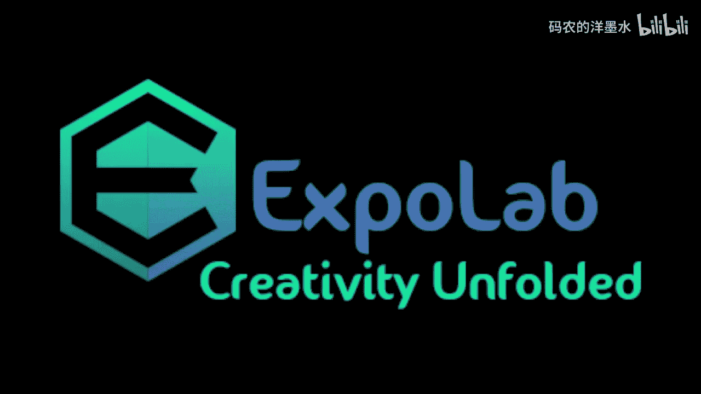
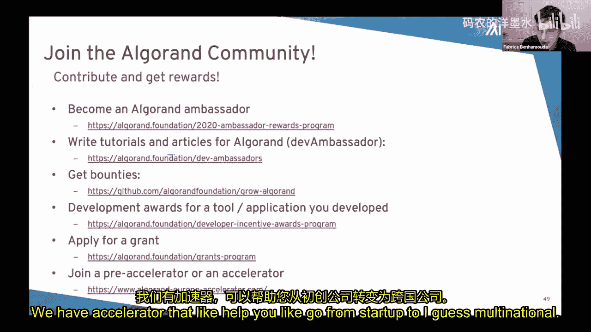
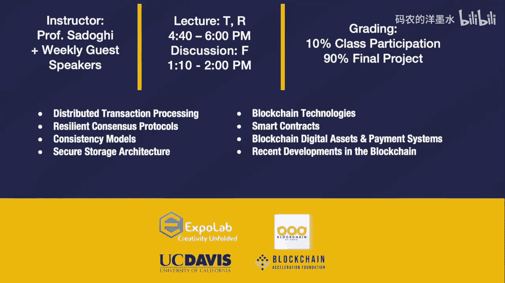

# 【全集】加州大学戴维斯分校 分布式交易与区块链架构 中英字幕 完整课程 p12 Lecture 8 - 解决区块链三元悖论 -BV18YFVzME2f_p12-

Hello everyone welcome to another session of Expo Lab Bin speaker series and today it also is going to be a computer science distinguishued lecture series as well too so it is my great pleasure to have Talrabean and forbri joining us today and Tal is a professor at UK and also was the head of research and Alg Foundation she's right now I believe only serving in the capacity of consulting while Febrise is the computer science focusing in theoreticalical Comp science and cryptography at Algand Foundation so a little bit about T interestingly she was at IBM research for 23 years I was at IBM research myself and our offices were kind of close by but we never really had a chance or the opportunity to meet while I was at IBM so several years later after we bought left IBM。

Have the opportunity to kind of chat with her and same as。

 actually you got Bruce as soon as I left IBM， I think he joined IBM and then shortly after he went to Algron so it's kind of an interesting history that happened in IBM research。

And the other thing that I wanted to kind of add is that T has been instrumental in cryptography and her work has really changed the field in fact。

 by For she's top 50 woman and computer science and business insider rankker number four as top woman engineer so it is a great pleasure to have you today。

 so please take it away。Thank you very much。😊，And for having me。

 it's exciting this whole class that you're doing and the focus on I see it in turn of my Whatsapp one second。

 that's not good。The whole class is exciting and devoting it to this topic is。

Very interesting and maybe i'll do something like this eventually if you can i get some tips from you and what to do anyway today we want to talk about the Aland blockchain the talk will be comprised of two parts i'm going to first talk about more。

theoretical aspects and the design of the blockchain and so on and then for B will really talk about more technical issues。

 how things are done， how they're built， what we can do and so on so。

It'll cover this whole spectrum of things I cannot read the chats while i'm talking so if there's questions somebody please tell me or just unmute yourself and ask I love an interactive class that would be great。

So。First of all， I want to say， I know that this was supposed to be for a blockchain class。

 but then I was told that it was going to be also a distinguished lecture so there are things that are not just for people who know blockchain as most of you do。

 but a little bit more broad on some aspects。So first of all， blockchains， in fact are。

When people say blockchain or crypto， it's not clear exactly what they mean and there are two major aspects that people talk about one。

I the underlying technology of the blockchain and the second aspect is the cryptocurrency most people in the world of course are extremely excited by the prospects of the cryptocurrency and making money and so on。

 but the truth is that the underlying blockchain technology is really what's exciting in these all these things starting from Nakamotos protocol with Bitcoin to the more advanced blockchains that we have now and the developing designs。

The blockchain in the cryptocurrency that resides on top of it， in fact。

Cannot exist one without the other the cryptocurrency of course needs the blockchain because that's sort of the memory that propagates where all the transactions have taken place。

 but in fact in many， many instances the cryptocurrency is what's driving the blockchain。

And what do I mean by that？We need the money to incentivize people。In some instances。

 in order to extend the blockchain， I'll just speak a little bit more about the blockchain in a second of what it is。

 or it really is is more meshed into the issue of holding tokens how you build your blockchain now first of all。

 what is a blockchain。A blockchain that technology is simply a distributed， secure。

Efficient creation of a ledger that's right only cannot be muted and can be visible to everyone。

This is what a blockchain is， it's no more than that。

 you can think about it as a bulletin board that people can come and write messages one after the other and once they're on the bulletin board they cannot be removed or delete。

So this is what the blockchain is。And some might say that it's the infrastructure of the future。

 I don't know， but definitely at this time it looks like it's offering a lot of exciting applications。

The most popular， of course， is the cryptocurrencies on top of it。And。In this talk。

 I'm going to focus on the blockchain technology。And when I said that the two need each other。

 I had said that， for example， for Bitcoin， the cryptocurrency is used in order to incentivize people to extend the blockchain。

 but in Algoand， as I said heres it's used in particular the extension of the blockchain is based on how much stake you have of how many algoes。

 algoes is the native currency of Algoand of how many algoes you hold。

 and that's going to be reflected in what we're going to discuss shortly。Which is proof of stick。

Okay， so first of all， I said that we have what is a blockchain。

 it's basically a database where you add records and you cannot delete them and it's viewed by everyone。

 but we have databases， why do we need a blockchain？But databases are not really。

 do not really offer all the functionalities that a blockchain offers。

Let's say a database held by a bank with all the records of its clients。

Who has access to the database？😡，What kind of data can each person see。

 what are the access to the datas， what can you remove， what can archive and so on。

So that's first of all， with respect to the usage of the database， but also。😡。

These database has other issues， for example， it's a central location where。

If something happens to it。It's a single point of failure and all the data can be lost。

It might be hard to access if I'm a bank in New York， my branch is in New York。

And somebody from India， I want to do some transaction in India。

It's hard to access the database to get my information from New York。So databases really。

Create a lot of issues and problems and the blockchain really comes to try and mitigate these issues。

Okay。So。It's called the blockchain because in fact。

 it's a good picture of actually what's happening with this data storage。

You add one block of data after another block of data after another block of data and so on。

 and there is something connecting the current block to its previous blocks in there it's different in different types of blockchains。

 but there's something going into history for these constructions。

And the blockchain has very nice properties that it's readriable by all， it's readable by all and。

It's Tper proof for all。 nobody can。Change it。And。These things。

 the fact that it has these properties that anybody can write to it and anybody can read it。

 really creates some trust in that data。And trust in data is very important。As we see locally here。

Okay。So。It offers a lot of things which I said were an issue with the databases。

It offers immediate global。Access so if all my banks data is on the blockchain。

 the bank can India can immediately access my account and do whatever needs to be done。And。

It's also very cheap to do transactions and to share information because of the nature of the blockchain and it has the properties that it's virtually impossible to break the system。

Okay。And we can do many， many things with blockchain。

The most common used example is supply chains because there is some factory。

 someplace that is preparing fabric and then it ships it to a place where it's cut and then it's shipped to a place where it's sold and then it's shipped to the US and then it's distributed to stores and all these things are very easy to execute on a blockchain because all the information is there everybody can access it and it's clear it's a propagation of。

The things on the supply chain。And you can do a lot of。So there is this myth。

 I don't know everywhere。A vitaltaik is being quoted of introducing the blockchain trilemma。

And what is the blockchain Trilema， it tries to say。

 what are things that we would want from a blockchain？😡，And whether we can achieve them altogether。

 what are the things we want？😡，We want security for the blockchain。

 the transactions cannot be tampered with or removed once they've been committed of course removing a transaction is detrimental to the proper functioning of the blockchain let's say if it relates to a wallet if I remove a transaction that I paid $100 and suddenly I have $100 more in my wallet that's not proper behavior so we want security。

嗯。We want scalability， meaning that we want to be able to post many transactions。

That would work for real world use。I forgot the numbers of how many transactions Visa does。

 but for example， Bitcoin cannot support the number of transactions that Via needs to do per second。

And decentralization is that it allows everybody to participate in the creation of the blockchain。

And what Vitaik was quoted as saying is that you can achieve at most two out of the three。

And what Algoand set out to do is really to solve the trilemma and to offer all three things。

At the same time， security decentralization and scalability。

 so we'll go slowly and see how these things were offered。

And what are the things that the algorithm blockchain is going to offer。

 there are many things here on the slide， but I'm going to mention a few of them。

A very important property is that there's going to be no foring。

There's going to be working with very， very small probability。😡。

Unlike in other blockchains where you have proof of work where there is forking。

 it could occur in the algorithm algorithm， this will not happen and we will touch later on the point where this happens。

I had said on the previous slide that we want scalability， that we want many transactions。

 but if in fact， there are two types of scalability that the algorithm。

Solution is going to deal with one is actually really having a high throughput of transactions and we have a block certified every five seconds with 5000 transactions so it's about a thousand00 transactions per second and this is a very high throughput。

Another thing that's important is when you're working in proof of stake， unlike in proof of work。

 there's also a question of how many parties are in the network。

And you have to show that you can execute your design， even if many。

 many more parties join the system， even if you have billions of users。

 you still need to show that your algorithms will work fast enough to deliver the result and not harm anything in the performance of the network。

And also， I said decentralization and the idea here in Alkaand is that it's true decentralization that anybody can join the protocol and participate in consensus as long as you own some algoes if you have algos。

 you can participate consensus and contribute。😊，And we also want to be cost efficienticient we provide very low transaction fees that the computations that will be done in order to extend the blockchain will be minimal and why do we want this the issue currently with proof of work blockchains is that they're not green at all they're very。

 very costly in how long it takes to create each next block and this is something my personal opinion is that it's not sustainable that we will be moving away from this。

 maybe Bitcoin will stay forever as a historical remnants but blockchains that will actually be utilized will not be able to waste so much energy so we need the computations to be very small and there are more things on this slide I'm going to move forward。

Okay。So what was the general approach for generating new blocks？

And this was the approach that was introduced by Nakamoto for Bitcoin and in fact。

 is also deployed and utilized in Al。What is it？You have to win the right to add a new block。

I put when in quotations， what does it mean， I don't know， we'll discuss shortly。

Once you have won the right， you think you've won the right， what do you need to do。

 you need to provide a certificate that in fact you are a winner， okay？😡。

And you provide the certificate that you're a winner and the next block。

The block is added to the chain， what is added we'll discuss later also。

 but this is just a general approach of thinking of how blocks are added to the blockchain。😡。

And now we have to define what winning is， we need to define what our certificate is。

 the only thing you know what it means here is a block right that's something that has a lot of transactions on it and we also need to discuss a little bit once we get。

To algorithm around what it means to add it to the block。Okay。So。

The first generation of blockchains were proof of work。And。They are。

Have a high cost per transactions they're very slow because they're very labor intensive I had mentioned this before in respect to being green。

 but it's also an issue with respect if you do the calculation per transaction that's a huge issue。

And they lack speed and they don't have finality because I said that there might be a fork。

 so this was the first generation of blockchains and I don't want to knock it。

 I think that Nakamoto had done our field a huge service and it really created a revolution。

 this is something amazing Bitcoin and all the things that have followed from it。

And then there are proof of stake， a middle version before the pure proof of stake。

 and what do proof of stake algorithms do they say。Your're。

Your ability to add a block is going to be dependent on your stake。

 this is what it means you have to prove that you have some steak and according to that stake you'll be given the right to add a block。

However。When we say that they're delegated or branded， what we mean is that there is some subset。

Of parties that are going to be making the decisions and me。

 if I'm a user that has some tokens in that cryptocurrency。

 I will delegate the right to some other parties to a small number of parties。

 20 parties I don't know。And there's also a need to lock your tokens in order to participate in this process of extending the blockchain。

And then we come to Algand， which is a pure proof of stake。And。

When it gives us that it's scalable and secure， it has a low cost per transactions。

 everything I said before。It's fast because we want the computations to be fast， it's by design。

There's finality because you won't have a fork with almost probability of having a fork is negligible。

It's green。So it also gives us things that are very attractive in our current thinking about climate。

So if I may， we kind of just interject here。Is it possible to kind of maybe slightly extend this picture to include more traditional consensus BF and how would that sort of relate。

 especially I think to the previous slide I think that's a very very telling slide where would the traditional BF be in this picture and also kind of putting into the sort of with a remark of this ideal of decentralization is that the good example we've seen the proof of work at the end of the day when you look at a realistically we see four or five entity control the entire computational power so it's probably less decentralized on the banking system from that perspective because even the global banking system if every country puts forth the central bank there's a lot more entity involved in maintaining that ledger and similar thing could then later be argued in terms of the at least the the first generation of the proof of stake in terms of。

The idea the relationship of the stake and decentralization so again theres there is also if you have more stake then the system becomes less potentially less and less decentralized versus kind of kind of going back to the traditional BF consensus every person gets one vote so it is decentralized with that perspective that every person has one vote and it's democratic from that perspective of course somehow you need to generate the identity so there is another level of decentralization to be able to form this identity in order to do the voting so I would really be interested to kind of see a perspective how does that fits into the sort of extending this picture。

Okay so first of all I want to say that my memory is not that long I hung up on to some points of what you said but you can later ask me again the points that I don't talk about so first of all the interesting thing about the Algoand protocol is that in fact it is a regular Byzantine agreement protocol so we will see this later so basically it falls really into that bigger picture of course and this is what Algoand comes to deal with that you cannot run a consensus amongst all the parties participating in the system because that would be an effective any Byzantine agreement protocol is N square and cube whatever。

And when you're talking about billion of servers， you can't do it， so in fact。

 you have to do something much more sophisticated， which I will discuss。

That was one point that you made about the fact that。え。

The computation or the consensus is being done de facto by a small number of parties。

 I would say the following for proof of work。I would think that it would be hard to move away from it because the proof of work really calls for these farms of computing and really getting a lot of power together and being able to do it and a little fish can just can't swim in that pond。

And proof of stake， whether' pure or not， again， if you're really a big big holder of tokens。

 then of course you'll be participating much more in the consensus you'll be more powerful。

 but in some level that's okay because the interests are aligned in the right direction。

If you own a lot of stake you should be able to influence things more in the proof of work。

 you know it might be the case that those farms of people don't have any bitins right they're farming farming and then they sell it the minute that they get it but they're just doing it for profit and really they do not care at all about the blockchain and the token running on top of it so in proof of stake there is a little bit more of alignment。

 not a little bit more there is alignment between the interests of the provers and so on。😡。

And the hope really is that once if a token is really successful， then of course， therell be many。

 many people and you will not have heavy hitters that are controlled 10% of the blockchain。

 that this will not be the case。Currently， of course， I would say for even for Algoand。

 which is a pure proof of state。We're on a journey to get there， we're still not there。

 but we're definitely striving towards it and we're hoping that with time it really will be that there'll be many parties that participate in the consensus I don't know if I answered everything you asked。

No， I think your answer to everything is just so I like the sort of the alignment example that you also gave。

 the only thing I would say is that perhaps for for the Bitcoin also。

 there is a bit of incentive is because the success or the perception of the Bitcoin also。

Kind of determines the value of reward so there is a bit of a there is a bit of an alignment probably not as direct as in proof of stake。

 but there is also something there as well that may promote staying longer in the in the infrastructure I'm not arguing with that I agree okay so please do you want to add anything on this pointer you're good no I just wanted to add to this to continue on on the fact that this PBFT algorithmism like this traditional would not walk for medium of user even even if you add the ability for some reason give identity to people and that would not be a decentralization issue you would as I said you would not be able to run this traditional consensus algorithm between a huge committee like the committee would be small like your 21 notes。

And yes， and that's also the issue of this delegate proof of stake where even if you the stake itself is completely like spread out properly。

 then only thing you can do is vote for validator。 And we know that not necessarily。

 at least in years， we seem to have the example that not necessarily people will vote for。

For the for the things which are the best， I mean， best align with their goal。

 I would say and and the algorithm that solve， I mean。

 solve this issue because anybody can participate like that's really what algorithm proof of stake provided it's completely scalable in the number of participants。

 So even if you have millions of users that can all participate and and if the stake is some somehow like completely uniformly distributed。

 which is like the ideal， I would say， then you already have like completely security that you cannot achieve because a technical origin we see other technology。

😊，Okay， I'll continue okay。How did in Nakamoto's consensus proof of work work， work work。

 we have all these servers。wantant to reach consensus in order to extend the blockchain。

 we have the blockchain currently has three blocks。And what happens is that a puzzle appears。

 how it appears doesn't matter。And then after some time， some party pops up and they say。

 I have one second。I have this oops， my pen is not working oops that did not go as expected， okay。

 I'm not going to use the pen。Okay， it comes and says。I have。Okay， there I go。

 I have the solution to the puzzle。That's my proof that I won the right。

 the right the winning is to solve the puzzle， here's my proof of the puzzle， here's my block。

And everybody extends the blockchain by this additional block okay。

 this is what happens in in Bitcoin there is a puzzle and the proof of winning is solving the puzzle okay。

 it takes time and work to solve this problem and this is why it's called proof of work。

What happens in the algorithm proof work？Again， we have all our servers and we have our。

Blockchain of three blocks。And now a party pops up， there was no puzzle before。

 but it comes and it says， I have a certificate。Who gave them this certificate， who knows？

I have a certificate I'm going to show to you how we actually get this certificate。

 which is fascinating， but the thing is I come I say I have a certificate here's the block okay now。

In Algoand the consensus is a little different， it's not that you take this block and you immediately attach it to the blockchain。

😡，Because we want to create this。Non forking。For this， on top of it， we ask the question。

 do we like this block？Do we want to attach it？😡，And then if the answer is yes。

Then it's attached to the rest of the block。How do we answer this question， do we like it。

 how we reach this decision of yes， we will discuss。Okay， but now。

I want to change the story a little bit because it's not that we're working in this ideal environment where everything is great。

 we're somewhat working in an environment where there are adversarial parties like that little guy standing there in the corner and what he wants to do is he wants the impact。

Um。The blocks， the transactions that go into the block。Maybe to starve someone。

 you know never to allow any of Fea's transactions on the blockchain， it might have a strategy。

 we don't know what it is， but the guy is just not nice， okay。

 and he wants to harm the proper creation of the blockchain。😡。

So what happens in this Nakamoto protocol， which is very interesting。In fact。

You don't know who's working on the problem。The guy's just sitting me there and he has no idea。

Of who's working on this puzzle that appeared。So。He can work on the puzzle himself。

 but that really takes a lot of work， he can't have a lot of impact if he's just solving the problem himself。

 what he would want to do is to corrupt。The party that solved the puzzle。And impact that party。

On what block it puts on， but the way that it happens。

 he's sitting basically in the dark and he doesn't know who's doing what。

And then the minute that the server comes out and says， I solved the problem。

 here's my winning ticket for the win and here's my block， it's already too late。

 the block is out there。And the little guy can't do anything。

 so we can get control on more blocks and the blocks is attached to the blockchain。What happens？

In the algorithm， you might say。Same thing right they'll all sit in the dark and C their certificate。

 which is the case， so suddenly the guy pops up and says here's my certificate。But then I said。

But then I said that we have to solve the question， do we like this block？😡。

And the way that we resolve it Mo to your question is by running a Byzantine agreement。

Maybe now this Byzantine agreement can be controlled by this little guy， maybe if he likes the block。

 he can force the Byzantine agreement to say yes， we like the block and maybe if he doesn't like the block。

 he can force it away from the block。😡，So we have initial。But what will we do？Wevo。

Utilize this technique that I said that the guy is sitting quietly computing his certificate or computing his puzzle until he speaks out and willll say。

Each step of the Byzantine agreement which we're going to be running。

 a Byzantine agreement for those who don't know is a protocol that brings party to reach an agreement on some input。

 each step of this Byzantine agreement will be carried out by a secret committee and then it will announce its step and die out。

😡，Okay。So。First of all， I want to touch and we'll get to this in a second how we do this。

 so first of all， I want to touch on the question of how is the certificate created？

And this is really the beauty of cryptography that sometimes people design all kinds of primitives and people。

 what the hell are we going to be using it for， this thing has no use whatsoever。

 it might be very nice mathematically。😡，But。Who knows what it's for？

And this was the case with verifiable random functions when they came up。

 people really didn't know what they were going to be used for。But in fact。

What they do is exactly create this type of certificate。I can create the certificate。

 I can compute it very efficiently， and everyone can verify that it's a valid certificate。

I do my computation locally and the verification can be done by everyone that this is in fact a true certificate。

 which is amazing， the computation of this certificate is extremely fast。

Contrast that to computing the puzzle。😡，In Bitcoin。Okay。

So now we have to do this Byzantine agreement。And we have the huge。

 huge set of people here on the left that you can see this big， big set here。

If we run the Lizentine agreement on this set， this is going to be terrible。😡。

It's going to be too expensive it's not going to work so really we need to choose a small small committee that will do the calculation of the Byzantine agreement。

😡，ok。😊，So we take a small committee， they're going to run this Byzantine agreement and in fact it's going to happen in a very interesting way。

 they're going to agree on this fifth block B5。And they're going to connect it to the blockchain。

 it's going to be connected to the blockchain。But the question is。

 how do we create the small committee when I said that the committee has to be secret， right。

 because otherwise the little adversary， my little guy in the corner。

 is going to attack this committee and is going to influence its decisions？

But we already have a technique for people to select themselves as winners。

 so how do we choose the committee the same way as we did？

You choose yourself to say if you win the right now not to extend the blockchain。

 but to be in the committee， you present a certificate。😡。

You're allowed to do the calculation of this step of the Byzantine agreement。

Of the Byzantine agreement， in fact。It's going to be much more than that。

 it's not just that you can participate in the Byzantine agreement that's going to be too much you really we do this thing we repeated it for each step of the Byzantine agreement。

😡，And what we did in what the Algoand protocolto does is it has a super fast Byzantine agreement for a small set of people。

 it uses these verifiable random functions and it uses this player replaceability。

 what's the players replaceability that for each step you choose a new committee to do the computation。

And， in fact。We now have follow up work。That enables us to compute any function here I only talked about Byzantine agreement。

 which in fact is also a simple case because parties don't have state。

But we can compute any function。Even if parties have stayed in this model of player replaceability and this choice of small committees。

 and we call this model， you only speak once， you also。

 because that's exactly what I said every time someone speaks， they speak and they die。😡。

So we have a full new work doing it in general。So as I said。

 I have six more minutes and then I want to pass it on to Philip please。嗯。😊。

The fact that we add the Byzantine agreement on the。tack it on to the block suggestion。

 we disable this issue of the fork， which gives a huge advantage to the algorithmand protocol。

 there's never a fork virtually。So。Oh my god， that was terrible。 Okay。

 so we wanted this protocol to have。Trivial computations that would be really。

 really fast so that we can have this five second creation of a block。

We want true decentralization because that anybody can join and you see why anybody can join because you join the big pool of people and then you're chosen into that little committee based on your stake。

 but anybody can be chosen and nobody can starve someone out。We have finality， we have scalability。

 as I said， even if there are more parties， we can do it and also there's scalability in the sense that we can handle many。

 many transaction and the protocols， of course， offer security based on their design。

So here we have that。The algorithm solution。Resolve the blockchain trilemma we have securities because the committee members and every party whoever takes an action is unknown until after the fact。

😡，Everything is cryptographically signed， these things cannot be forged。We can get scalability。

From the two things， first of all。The we can have a lot of transactions and we can work really。

 really fast because the lottery execution， which is the verifiable random function that I spoke about is extremely fast and the committees are very small。

 so the computations happen over a small number of parties。And we have decentralization。

 there's a very low barrier to entry， you basically need to have tokens and then you can join and anybody can participate in consent。

And so basically this solves the。The trilemma and now I will pass it on to Faliis。

Perhaps also maybe at this point， if any questions from the audience as well might be good。

I think a good one is well too。I have a question， actually。Yeah。So a couple of questions， actually。

So I believe visiting agreement is like a BFT protocol same as PBFT and something like that which which is run between a set of committee members so and when we run a visiting agreement protocol I mean it will have some sort of guarantees like they can only be F malicious replicas of N and F is less than n by three so how do we ensure that when you generate these certificate I mean the certificates are generated and the people who are part of the committees that number is still less than n by three because too much then yeah okay so first of all I want to say I forgot to say it because I think I forget on the slide something wasn't working there for me in Algoand you need due to the proof that was provided you need 80% of the money to be honest okay that's one thing。

Now， how do we guarantee that in the small committee， which is an excellent point that you make。

 how do we guarantee that the small committee does not have too many faulty parties， of course。

 let's say if the adversary can corrupt the million parties and the committee is a thousand parties it can corrupt the whole committee。

 you have an issue。This is exactly where this point comes in。

 that the adverary doesn't know who to corrupt。He can only corrupt people。In some random fashion。

And then a subset of  a thousand is going to get chosen into the committee through that certificate。

You cannot forge a certificate and claim to be in the committee that's not going to happen so now the committee is going to have the same percent of good money in it。

So the committee is going to have the property that it's going to be 80% good money。

Excellent point and if you want in that yo paper which is still not online。

 but in another related paper which we have。Whi is on Eprint。

 which is called can a blockchain Keep a secret or some variation of that name。

 we discussed these issues of why the committees follow the same probability of being malicious。

Some perhaps a follow up question。What are the timing and the synchronization assumption here we for both safety and liveness？

For thatSo the protocol basically has a gossip mechanism and there is some assumption that all messages are delivered now I don't remember within how many seconds but that amongst honest parties you cannot cause this starvation and through the gossip protocol you will hear them within a certain amount of so there is a pulse so everybody needs to be sent in that pulse。

 whatever that everybody has a local watch everybody has a local watch。

 they're not synchronized Yeah it's not and I mean security likes no fucking property or whatever happen like if the adar has full controllable network you have security like I can delay message it as much as you for liveness for the block to be created you there is some assumption about synchronicity but as T said it's not。

Synchronous model。 It's not a。 It's really local clock。 And in addition， it's a very fast recovery。

 Like if you have a network partition， which means that some messages like between India and the US do not go。

 like it's completely separated in2。 obviously， it will automatically stop because it would focus otherwise。

 But as soon as the network partitions is a resolved。 Like as soon as the messages are below。

 I don't know either the exact number， but the messages can circulate at a speed。

 which is below blah， blah between at least 95% of the parties。 I mean， I don't have a number。

 but something like this， then immediately， the production of clock starts again。不 see。All right。

 I guess we can start the second part。 Thank you so much。Oh， hi， thanks， more。

 So thanks more for inviting us。 So， So that talk to you about a lot about the consensus protocol。

 which is like really like the foundation of in blockchain。 and in particular。

 of the Algo and blockchain。 But nowadays， like most blockchain。😊。

A lot of features on top of this consensus protocol。

 and that's what I want to talk to you about in these slides。

And I want to start by saying that what I like a lot about where Agon is built is that it's really tried to be built layer by layer in a mindful way and in a way that each new layer adds features but do not remove any advantages like do not spoil the lower layer so let me go a bit more into it so the first layer above the consensus protocol that tiles presented you is what we call layer one features which include like layer one smart contract Agon standard data sets and atomic transfer。

And essentially， all these features are somehow backed in the consensus protocol and benefits of all the advantages of the consensus protocol。

 So you have the same safety， exactly the same safety， same security。 You have the same speed。

 like same throughput， same latency and the same cost， like the same transaction fee。

 It's extremely cheap。😊，So that that's what this layer one feature property are and。

Obviously as a flip side， like to achieve such great properties， we need to put some restrictction。

 so the restrictction and expressiveness of this smart contract。😊，On at layer one by the way。

 sorry what I forgot to say two things， one thing is that don't hesitate to ask any question if you have any question。

😊，At any point on the second question， the second thing is I I don't read the slide so just talk or maybe raise your end。

 maybe I will see that。 And the second thing is I will explain in more detail what smart contract are if you don't know what these are。

 but here you can just think about like program executive by blockchain。So as I said。

 layer one feature， very cheap。 I mean， low transaction fee， high speed。

 high security about linear restriction and then。If then。In soon， it's not yet available。

 but soon we provide like a new set of feature， a new layer called layer to smart contracts。

 which essentially trade the transaction transaction fee and the speed for more expressiveness。😊。

Like， so now。You can write more easily smart contract， more complex smart contract， and so on。

But obviously， you will pay a little bit more and the speed of the smart complexity head might be slightly slower。

 but very importantly。😊，This new layer will not slow down the other layer。

 So by adding this new layer， we I mean， this new layer3 has been designed in such a way that。

It will not degrade the performances of normal transaction and layer one， a smart contract and so on。

😡，And this is not straightforward， like if you think about E essentially。

 you can do any smart contracts。😊，But a smart contract which is slow we slow down everybody else。

 like think about cryptoites that essentially congeed the full network few years ago。😊。

This is something we really want to avoid in a and and I think we manage to do it using this novel idea so just a quick question I mean this is a very nice figure and I mean also a little bit I guess the context is that our focus in my lab is all we're looking at the BFT consensus protocol so we're looking at traditional consensus protocol and one thing is like I was mentioned earlier as well too this certificate that we produce。

Recently I've been sort of thinking about this is this certificate as resilient as the Bitcoin certificate or the proof of work certificate because for example。

 in PVFD， we could also generate these certificates and the certificate could be， for example。

 the digital signature of everyone who voted it， but at some point if all the sort of replica I and the single replica standing and says this is the proof this the change。

 this is what the change should look like，Reconstruction of that certificate is cheap versus if I had developed that chain using Bitcoin。

Faking now a different chain， especially at the large length is going to be much more difficult so I just want to see with these verifiable function a verifi random of function what would be the cost of generating can you go I mean I assume they kind of would be similar as to traditional BF consensus in terms of the cost of generation so somebody could just say no this was the chain and you can really refuted in those extreme condition that more than let's say in this case more than 20% have failed or more than 30% have failed。

So when you mean certificate， you mean certificates for cifyinging。

 and I guess you don't mean C the V certificate that was talking about。

Oneder that certificate itself， I mean， because essentially you're kind of proving I have the right to vote right now in that selected sample that was randomly generated I have the right to vote and well and then that quo that sample quo that gets generated on every round。

 they're under consensus and I guess they produced this form of a certificate to show that this block is valid and once they show that certificate everybody else go ahead and add that block in traditional PBFD consensus again everybody vote and once everybody gets agreed upon that vote somehow a certificate gets created for example just collecting everybody else's vote。

unilaterally， you can decide whether this is a valid transaction or this is a valid block。

 you can go ahead add it to my chain， so there is a form of a certificate that gets generated that gives the validity of that block。

Yeah， that's the same here。 Thats that's exactly the same here。 So， so the reconstructioncon so。

Is it fair to say in general， then a block that is generated in a proof of work will be more resilient。

Because the generation of a certificate there is much more harm。

Here after the fact I can go ahead and sort of reconstruct the chain。

 I can go ahead and just rebuild all the certificate I can recompute all those verifiable function and if nobody was aware who were the participant at the time of those。

The initial chain nobody can really say anything but in the proof of work just because of the construction of every block is costly and it's a waste of research I totally agree with that there is more resilience in the chain itself Oh no no no you cannot do that Oh oh oh I see there is。

Like， actually， you can prove that。If 80% at any point in time。

 80% of people are honest and do not leak their secret key。

 we see if you lick your secret key in the why you might have issue。

 but do not leak their secret key。Then there is no way。 It's it's even stronger on proof of work。

 like proof of work， it says。I cannot create a bit chain if I don't have enough power and if I or if I have like。

 I cannot create a Bitcoin chain if I don't have enough power or like if we don't have enough time to do it here it's even stronger like it's impossible it just impossible like okay。

 you always need to say possible words like cryp by impossible I mean crypto impossible like Mari。

 do you want to to to give some details。😊，So I didn't understand exactly what the question was。

So the question in terms of the resiliency of the chain。

The resiliency of the chain in a traditional PBA consensus， people vote they add block to the chain。

And。If every replica dies except one， you have， let's say you have a single replica left。

And somebody from outside says what is the state of the database。

 this single replica can show this is the chain and the best it can do。

 it can show the digital signature of every vote that was ever cast and says okay。

 this is all I have and these are all the vote that was done。

But the point is in such environment with PBF is that while digital signature is cheap to imitate and you could have reconstruct that whole thing could have been preplayed by a faulty by generation many more public and private key on somehow you know the the public keys of everybody who was involved somehow that information we preserved okay I got it so the issue is the following in the earlier stages that we have now。

The situation is that in fact。Most of the keys are held by parties that we know that are 100% honest。

 which is by the Inc， which is the company and by the foundation in order to be able to go back and to start and fork the blockchain。

 you really need to go back to a time where you have all the keys。In order to do this。

 this is going to be impossible given if the blockchain is not worth anything。

 I mean if the als gone down to nothing， then you can go and do it。😡，But then who cares。

 but if the blockchain is still worth a lot， then to go back。

 you can't go back to the times where most of the keys were held by the I in the foundation because we are doing what's appropriate and erasing the keys and so on that signed for the specific consensus so I think I sorry so you can't go back back in time if this was your question。

 was this your question sort of this？So you cannot go back in time because you cannot own all those keys because those keys were。

 in fact， erased， however。At later times when the blockchain is much more decentralized。

 maybe everybody is bad， but by definition， if you're bad， you left the key， but if you were good。

 you erased it so you can't go back and really get those keys。OkayYeah。

 what's happening here is that we are not using long like the thing like， okay， that is too bad。

 There is the election， but you can forget about the election。

 but but there isn't the signing like signing that I propose these vote the signing that I I like these votes intervention in agreement。

 And this signing key actually is what's called a forward secure signature。 This means that。Actually。

 we use a fresh key， a fresh public key for each round。

And essentially it's to simplify that it's as if you have a fresh public keeper itron and you when you read it at the beginning say I will be using this 1 million keys it's following 1 million round。

 and each time you use a key， you erasse it。😊，Erase it completely， if you are honest。

 like all the parties who are honest and we want to good of the blockchain， then we erase this key。

 So later， even if the party is completely corrupted， the key does not even exist。

 The secret key does not exist。 and it's a signature。 So it's impossible to recover as a secret key。

😊，So it's impossible now to come back in， I mean， the only solution is to at some point you the only solution to for it is really at some point to get the security of 80% of the parties。

AndBut you need to do at some point， everybody at the same time， like a specific crime。

 So it's extremely difficult like you cannot even like start saying， okay。

 we've tried to corrupt 10% now and 10% next month， a 10% in two months。

 This does not work because the key， the 10% of last month are useless I mean。

 you will not be able to for if you do this kind of thing。😊，soundsund good。 Thank you。Okay， yeah。 So。

 so here。 sorry。 So So back to back to the algorithm feature。 So， So。

 so you have like this pyraid of of layers。 And I want to talk first about the layer one。

 So the one which is really bake in the consensus at some level。

And the first thing in this layer is what we call Algo and stand up assets。 So as I told you about。

 I mean， for consensus is always linked， I mean， at least a decentralized blockchain is always linked to a cryptocurrency。

 So in our case， it's the algo。But sometimes you don't want to transact using the algorithm。

 Sometimes you want to use your own token。 And that's what the algorithm and stand up asset provide。

 to provide the ability for anyone to create a token。Like the algo on the algo and。

 And you benefit from all the advantages of the al。 The same transaction fee as the Algo。

 So it's completely neible。 like it's less than a tenth of a cent。😊，Sense for put Sam latency。

The only difference is obviously， a this token， I'm not used for consensus。

 I'm not using the Byzantine agreements， obviously and。

There also difference is that you can have an optional administrator who can mint and burn unit for country of asset。

 but it's optional。 And all this picture I can be activated and disactivated forever。

If you know Ethereum， essentially， it's similar to ES20 and ES 721。The main difference is that。

Contriry to Eium， we don't need any smart contract for this purpose to create this token。

 this algorithmgon stand up asset token。 It's really backed into the consensus。 in particular。

 this means that okay， no good to write that good and even better you pay the same transaction fee as transaction with the album。

 which is not the case for the E C 20 with E where you would pay a higher fee to transaction with E C 20 on E than with a normal E。

And for them all， it like we have this website and you can even do it very easily after the class if you want。

 you can create your own token it's really just one click and it's very easy， really。

 really simple to create your own token So let's see a bit why would you want to create this token and let's look at real world examples No I mean real world example here I mean。

😊，Things that are deployed using production on the main。 And they are like really representing money。

 It's not like some test。 It's not like proof of concept。 It's really they making money right now。

The first class of assets of tokens that are interesting to use are what's called stable coins。

So you know that also blockchain of them not native cryptocurrency it a bit called als and like this。

 but in theory you could use them to buy。Anything to contract with a merchant like this guy who buy who bought a pizza for several bit coins a long time ago。

 But the issue with this token is that they are really highly volatile。

 So many people might not like paying with them。 Like if in 5 minutes， you lose 10%。

 it's not great to pay your to buy your pizza， so。Instead。

What stable coin offer is a way to represent like a normal currency on the blockchain。Like US dollar。

 It allows you to pay in US dollar equivalent over a blockchain。

 So you have all the advantages of a blockchain， including smartphone faculty， something like this。

And all without the drawback of the associated critical pro cur of volatilityolatities。😊。

So concretely， unlike sure， I'm really simplifying a lot。

 And like I'm only talking about a very specific stable coin。 So it's not it's not a stable coin。

 but let's talk about this specific stable coin we have like USDC and USDT essentially。

 you have a company who says if you give me this token on Al。

 I will give you in your bank account the same amount of USD US dollar。

 So this means that really this token is equivalent to US dollar。😊。

so that the first use case second use case is for rewards like if you want to reward your user for good behavior and you want to give them some tokens like you know this point cards in retail stuff all so here it's the same overall blockchain on the internet So we have two two project accounts you running I mean。

 more than two but two main project like one is called props one is planet Watch So props is very rewards for social contents on planet watch is reward for you provide like good environment like the environmental data。

😊，呃，在你边推广。Another use of Afghanistan of assets is stocks and stocks and even if finance created。

 like shares of real estate and so on。That you can transact as token on the blockchain。 So always。

 as you rule， same advantage as before， like 1000 transaction per second less than per second to finalize and so on。

 You can also use it to notarize documents on many， many morph。 And as I told you， like it's really。

Real world thing， like crops， for example， as more than 2。5 million transaction per week。

 And that's really something you could only do with alggogan。

 Like if you if they try to to do that on Es， they would first like do be one fourth of the total number of transaction on alg on。

 that would be a ridiculous。 And second， they would just go bankrupt because the fees would be too high because of Em is still and a proof of work and you need to pay all this mine who are spending a lot of electricity。

 a lot of money of electricity to mine each。 so。This is really something that I will on provide compared to other blockchain like E。

O。That was the first feature。 The second feature I want to talk about is。

Atomic transfer of group transaction。 So let's suppose that Alice want to buy one USDC。From Bob。

Let's put that team， she needs to pay two I go for that。So now， you have two transaction。

 like I least need to send to ourgo to Bob and Bob need to send back the one USD。

 And whatever other you do is two transaction。 you have an issue， like the second one。

The person who received like the second transaction essentially at the risk of not being paid。

So if I start， maybe Bob will not send back to one USDC and vice versa。

And what atomic transfer do is that they allow to fix this situation like to sort this issue。

 it allows essentially to say， I' create a group of transactions， okay up to 16 transaction。

And is there also the transaction on this group？Succeed， and they will be written in the blockchain。

All they all fail， and we forget about them， but it's never the case and one succeed and it return and the other is not。

O。AThird feature I would like to talk to you about which complement is to first feature is stateless smart contract。

 layer1， stateless smart contract。So。What is a stateless market product in， It's really something。

That allow to only to approve a reject transaction， like normally。If an account correspond to a user。

 I can have an Algo account and every time I do a transaction from my account。

 every time I send money D it like USDC or the Al from my account。

 I need to sign myself this transaction。Sometimes it's not convenient。

And this specialistless smart contract allows essentially to approve a related transaction without signature。

 but according to some logic or to some program。And the problem is written some simple stack based language that we call till。

😊，So it has a lot of restrict， it has no loop， very strong restrict on size on the number of complex operation like crypt operation you can do。

But the flip side of this is that you have many advantages with this due to this search section One it is just formal analyzed and it's much less open and solidity。

 And the second is that the price。😊，I mean， it allows us to make the transaction key with stateless smartphone contract as cheap as a normal transaction and as with the same at through。

And further， we anyway have like a slightly higher level like proper around it in Python to avoid having to always deal with start based language if you don't like this。

And finally， all of this stateless smart contract feature can be combined with all the thing I talked to you about before。

 like atomic transfer and I on some that essay。😊，And let's actually。

An example which combine all literature。So remember， Bob want to sell USDC。😡。

And many people may want to buy USDC from bulk。If you do it completely naly with atomic transfer as before。

 each time somebody wants to buy a USDC from Bob， Bob will need to sign the transaction because let's not forget that each arrow row here in this diagram is really a transaction that is signed by the parts which is the left side of the I mean。

 the opposite of the arrow side， there's the source side of the arrow。

 So you need to be signed to be authorized。And what state smart contract allows Bob to do is to。

Not adding to signage and instead just put on the blockchain into smart contract and say。

 now anytime there is a group of two and anytime there is such an atomic transfer。

I sign it and no need for my actual signature。So that's one application of all we have seen before like stateless smart contracts。

 atomic transfer， and Igon some。会，不清。Oh， okay， so， okay。

 I don't have time to explain you to show you in detail this sta as well， but。嗯那个白个呃。😊。

What's very interesting is that if you look at all of this picture I talked you about。

 you might think it's very simple actually if you know about Bitcoin。

 stateless smartphone fact are very similar to Bitcoin。😊。

But the other property of the Alrgon blockchain， namely the atomic transfer。

 thegon as Algon standard I said， makes stateless smart contract extremely powerful。😊。

Because you can actually。Even if you cannot store state in a stateless smart contractor directly。

 You cannot stop say directly， you can use the standardun data set to represent some state。 Like。

 for example， the number of USDC you have。Can be used in some way。

 And this is actually extremely expressive。 We can even do a Dutch。

 So for people who like the coding person， this is a very interesting thing you may want to think about。

 I to do a Dutch just with the free feature you about。😊，呃。But anyway， later， I mean。

 it's all now deployed， but later we introduced a state smart contract which simplifyimpl a lot the use of states。

😊，And what stateful smart contracts are like you can see them as application on the blockchain。

 It's kind of similar to E smart contract， but's not completely because。Okay， I will explain later。

 but essentially what a state smart contract is， it's really just a program on the Algo and blockchain。

😊，Which store states on the Algo option， and then you can call some function of this program and it will modify the state。

It's written in the same language as a stateless smart contract， same restriction。

 and in addition we have a restriction on the storage of the state like the state needs to be constant size essentially constant site you have a constant size global state for all。

I mean， globally accessible。 And then you have constantized state the accounts that subscribe or opt into the smart contract。

All of these restrictions are again， for the same reason。

 we want to keep the same performance and we want to keep the same fee for this layer one feature as for a normal al basic al transaction。

And importantly， like， obviously， this stateful smart contract can be combined with everything we have seen before。

 and combining this stateful smart contract with satellite smart contract allows you essentially to。

😊，Create smart contract， which also keeps phones because like state with contact a free application。

 they don't really keep fun。 But if you combine them with stateless smart contracts。

 then you can keep fun。 And actually， you can get。You can offer quite a lot of application。

 Like a lot of application are possible dress and layer one。 for example， the simplest one is voting。

Lets you suppose that you want to vote on the blockchain。

 you can just create a simple application where in the global state you store the tall。

 like number how many you vote you have for each person， let's say。

 and in each account you vote for you store or which person this account voting in。

So you see that Con is sufficient for this voting application， Similarlyly， you can do crowd funding。

 you know， like kids data， you want people to be able to fund to give money to a project and only if there is enough money to reach some threshold。

 the project is funded， this means that if there's enough interest for the project。

 the project is funded， Otherwise everything is reimbursed for the user who provided the money So that's possible。

 again， this layer one。More advanced， you have this algo swab， which is a equivalent of Uniiswab。

 so I don't know if you've ever heard of Uniiswab， but it's one of the biggest like large dress。😊，呃。

诶。Smart contract on EO， like it's used like a lot， a lot of people and it isn't really allows to it exchange the I mean。

 decent the exchange in decentralized way。Any pair of yeah C20 token in a work case of algorithms stand up as a token。

AndThe price is determined by the liquidity price devices。 Okay， forget it。

 if you don't know what all this4 means， but essentially like there is a。

 there is a way to dynamically compute the price。And we can do all of this。

In layer one state spot contract， so with all the advantage of the blockchain。

 all the scalability we talked about people。So， yeah， so to conclude like all this layer one feature。

 like that sufficient for mini application， they have like central very low transaction fee。

 very low la C central put as Al transaction。There are much more expressive that they may appear the first time like the first time I saw the status smartphone on I thought we cannot do much with that and then I thought about it and I thought oh。

 actually you can even do a Dutch this is extremely powerful。

 but how expressive they are is still an open question if you' are interested but。😊，Eith。

 sometimes it's not very convenient to write this smart contract because it's very low label。

And that's where。This layer of too smart contact coming into play。

So they will trade like performance and costs for expressiveness。But importantly。

 they do it without slowing down any of the other feature I talk to you about without slowing down any layer one or any algorithm transaction。

😡，And so they can be used for contracts that are like too complex rightly layer one。

 like even maybe is are possible to write， but it would be painful or to computational demanding。

 like checking the knowledge proof like Zika snap。😊，And what I told is。

 the good is ready to allow such contract。Why not flowing down the blockchain and why keeping the blockchain secure？

And。😊，If you， you remember， like the layer layer one likes the base consensus algorithm。

 like really work per block of 5000 transaction and every 5000 transactions every five second。

 you have one block which is to the blockchain。And actually， like among this five seconds maybe。😊。

200 millisecond， something like this， which is allowed for the evaluation of all year one contract track of checking。

 whether people have inner font like updating the balance of allD accounts。😊。

Because all the other time is actually used in to go sip the blocks and things like this。

 So you have very， very little time in this five seconds to do all the computation you want。😊。

So obviously， if you are trying to do like very complex math contract。If you are doing like naively。

 like Italian does it。You will increase significantly the time to produce a block and you will know more as this fine editing in 4。

5 seconds there is no way。呃。And you may you may think， okay， there is no solution。

 There is no solution to your problem because I want to be able to to make contract call。

And I want speed or normal transaction。But at the end of the day。

 a contract call needs to be a to be transcribed into a normal transaction like it needs to be registered on the blockchain so that is how do we do both of these things at the same time and I think it's a very nice idea is that。

Let's。😊，Do the contract call， like evaluate the contracts outside of the main。

 outside of the consensus。It might take some time， maybe it takes 15 seconds to evaluate the contract。

 that's fine。But when the evaluation is done。😊，Let's just like say， okay。

 my evaluation is done on like add to the blockchain。

And now like the contract color are no more like blocking like I bottleneck and the very nice idea is that。

😊，obviously you need to evaluate these contract code correctly。

 like you don't want random people to evaluate it and claim random thing。

 you want really that the the contract like the code is executed exactly as it should be executed。😊。

And another idea is that instead of having all the nodes， evaluate this contract call。

 which is crazy。 will what we do is we。😊，Create a committee。

 like select random new committee the same way that we selected a committee for the consensus algorithm。

 Like， remember what T showed to you the picture with all these people and like a small committee is chosen to。

 to vote on the blog or like to agree on the blog。 Yeah， we do the same thing。

 We select a small number of people。 exactly the same way。😊，To execute， to run the smart contract。

 And when they run it， after running them， then we signed the result。

 and then the result will be incorporated into the next available block。And you may say， okay。

 that is an issue here because the contract can take a long time and maybe the blockchain states changed between the time I started running the contract and the time I'm ready to register the results。

And the idea is that actually the contract Education Committee is much smarter than that。

 it will not only sign the result， it will also sign the que requisite， it will say， okay。😊。

Attect this value， if the。Blockchain was in this state and even blockchain was not in this state failure。

And then there is a lot of thing to figure out， like to ensure that one failure does not cause or everybody else to fail。

 you need to be able to formally find aquiquisite and thing like this So lots a lot of work。

 but that's really like this new idea of like running it outside and making each work make really like ensure to keep the same performance for normal transaction by adding this more expresss layer So in a sense。

 is it also So what it's doing is that。😊，Somehow is taking the snapshot。

Of the time that the contract was initiated and if the snapshot hasn't changed。

Then it allows the contract to go through， Yes， exactly， exactly。And and你 it it's it。Yeah。

 and then then yes， there is a blog post for more detail。 And okay， what okay。

 I want to quickly talk about actually so about this this point that will up as soon is that blockchain are very interesting。

 but it's alone like it's unlikely that we have a single blockchain like dominating all of them。

 we need interop between the blockchain。😊，And as the mall was mentioning it， actually what， I mean。

 you have said。You like essentially what the blockchain provides certificates for blocks or for transaction。

The issue that the certificate of Iland。I mean， in theory way。

 you could have other blockchain with the certificate of other blockchain so that they can interact with with each other。

 But the issue that the certificate of algorithm is complex。 like it's uses expensive VR。

 complex cryptographic tools。 I mean， complex in the sense that。😊，Not for cryptograph。

 but for like for it are less known than signature artists。

So the idea of this compact certificate is to allow to create a certificate which does not use all of this complex cat tool it's much simpler。

😊，Using other ideas to construct this and then now when you have this compile ticket make you can make other blockchain like ETium understand Algo on blockchain。

 and now you can transfer assets between Algoan and ETO。😊，For example。

 So that's that's that's working progress。 Like like the layer two that's also working progress。

Okay okay well really go very quickly here because it's late what I wanted to say that now it's really targeted a developer that we have lots of development tools I mean。

 all the people I talked to you really like out to develop and logo on。

 especially compared to ETO even if you are younger like we manage to like really get development tools that add on a really good documentation and so here I'm giving you like some of some of the tools which just wanted to I like。

 for example you can do we have like a complete online tool to start like create your token fast contract。

 we have SDK or Java Python， go Java C sharp first and so on we have like plugging for different I and standard ID we have the equivalent of all the infrastructure you need like if you are familiar with eachO you know that you need an API service like in。

 we have the equivalent for free we need a meta maskask wallet like metaask create equivalent for free and so on and so on。

If you want to start building where the best solution is to go and develop product aregon。

 maybe go to the Getting started page， you have lots of tutorial。

 you can find whatever best way you like to learn like learning by tutorial by looking at a complex application learning by step by step like a concept and or something like you have many ways of learning people like really like our documentation I mean Im not really got to many people liking it so it's not like just me things that I like it and I did not write most of it so it's not it's not my own phrase So anyway。

 everything is open so if you have any question we have a Discd server if you like synchronous communication if you you have like a Q Q like stack overflow we know even have office hour very simple you just pop in。

😊，If you have any specific question， you can also just contact me directly at Paways of Alroundal Foundation。

And if you join the Argon community， you can get mini award， you can as students。

 it's very easy to be an ambassador or like write an article about it more or less technical write tutorial like coding tutorial or form tutorial if you don't know even what to do。

 we have some boties like you can get a word by just check it as something you like and you can do it we gave a word if you develop a tool and application。

 can and if you are like ready to do a video project。

 we also offer grants and even accelerator like if you already have a startup ID。

 you are ready to go get apply for funding， we have accelerators that like help you like go from startup to I guess multinational。

Okay， thank you very much。

Thank you so much for this wonderful lecture it was。Td appreciate it。

So perhaps I think if there's other questions。放第二啲。

So I guess I was kind of my prediction was slightly correct。

 I guess past six o'clock to just be some past experience。So。

So let me just i'm going to ask my last question because I think perhaps I wasn't really 00% clear on it so if it's too late for you I don't want to hold you either so just be honest on that so traditional consensus you do a voting ground and after the vote is done if enough。

If there is an honest reptlica remains， you can。Remember the result of that vote and you can show the result of that vote。

And。More specifically if F+1 people are still stick around， you can say okay。

 this is the result and you can if there's F+1 matching result， then you say okay。

 then that was the result of the vote in the last round。And the other thing one can also do is。

If I show a certificate saying that this is the result that I have and the certificate of that result is all the votes that have collected it and all those votes have been signed。

 there was a digital signature but the messages that was sent。

And so if I can show the digital signature of how I reach this decision。

 and essentially it can form a certificate so a single individual can response the result of this mode。

Based on。Some form of a certificate。Now if。Let's a very catastropphhe case。

Nothing remains except one replica and that replica wants to show what was the proof what was the result of that last round I can still go ahead and show this proof of certificate but you can't really trust that because unless I know exactly who were involved。

In the decision making those digital signature can be just reconstructed。

 I could just generate a new identity， create some signature and say this was the result of the vote under somehow these the membership information was ingrained somewhere and the traditional consensus just basically doesn't provide that。

But the one thing about the bitco and the proof of work is and I'll show you something there was a work involved in creation of that。

So faking it is prohibitively much more expensive than just creation of the certificate。

And I was just kind of asking where does the the algorithm sit。

 I feel it's going to be similar to the proof of similar to the traditional BF because it's essentially wording and。

Signatures， but so that was the question that I sort of I had because it seems to me because I've been we've been kind of looking at it seems these proof of work are fundamentally more resilient in this situation。

 of course if you have enough replica remains then you can get that resiliency but in those extreme cases maybe in practical setting they tend to be more resilient I think。

sure please comment yeah yeah， think I think I think the question is whether what remains like if what remains is the list of public keys like the list of actual identities and one replica then then you are good because I mean exactly if all these public the secret key are completely leak for some reason。

 but let's suppose that the secret keys have been kept secret by the party the party just died。

 but they did not reveal are secret if you know exactly the list of public keys。😊。

You're good because you can check the signature and buy the secret of the signature and sure that it's impossible for somebody else to create a signature for the center。

 But if you have that。Yes， so on algorithm on， what we suppose is that the genes block。Is here。

 Its is known。 Like， so， so for other， we we， we suppose that the genesis book is is known。

 And in the genesis book， you have the list of the initial。People were allowed to generate blocks。

 which is interesting in terms of foundation， but to the entity like running algorithm robot essentially。

 but so so you you are if you have this block， then the full blockchain is uniquely defined as long as 80% of the people are honest like anyone。

That that's what we can prove， but yes that we suppose we suppose that the Genesis block is never lost like everybody knows what the Genesis block of Algoone is。

 but then if every other repa disappear appear except one and we have the genesesis blocks then there is no way to create a new blockchain。

😊，I是。Because I mean we're kind of looking at this space。

 I think this is a very interesting space of the unification of the permission list and permission in more particular。

BFD proof of work and proof of state I think kind of a generalization of those ideas to create a protocol that is more resilient for the reason I kind of mentioned right now on more performance on the PBF side I think that's a very interesting line of work。

 for example just kind of give you also a number in terms of some of the work that we're doing right now but resilient Db are on fabric is that we're hearing about scaling to 500 machines globally so 15 countries and are sort of peak throughput is about 1。

2 million transaction per second。So I mean three years of work getting there but so of course we can get into a thousand machine or a million machine。

 but I 500 machines and still 1。2 million transaction I think it's。P second。

 so I think that's still you can do a lot in a traditional BF consensus。All， of course。

 with a lot of improvement。So that's kind of where we kind of we're setting in terms of the research side。

Yeah， the algorithm on the I mean at some level like it's a byer government so it's not PBF but another one and it's done be in committees of 1000 people like the committee we said 1000 people but it's fixed like even if you have a 1 million1 billion user we would only select 1000 people so then the performance is just what the performance for 1000 people in the blockchain and essentially has been tested it's very close to it's less than five second。

So question。But obviously we are just talking about 1000 fraction per second。

 we can optimize to get more， but I don't think we can optimize to get1 million transaction per second with this kind of protocol。

😊，Yeah。All right， again， thank you so much for this wonderful lecture。

 it was very insightful and so on behalf of Expo Lab and UC Davis。

 I really want to take this opportunity and thank you。😊，Thank you for having us， thank you。

 thank you for inviting us。😊，拜 thank by。

