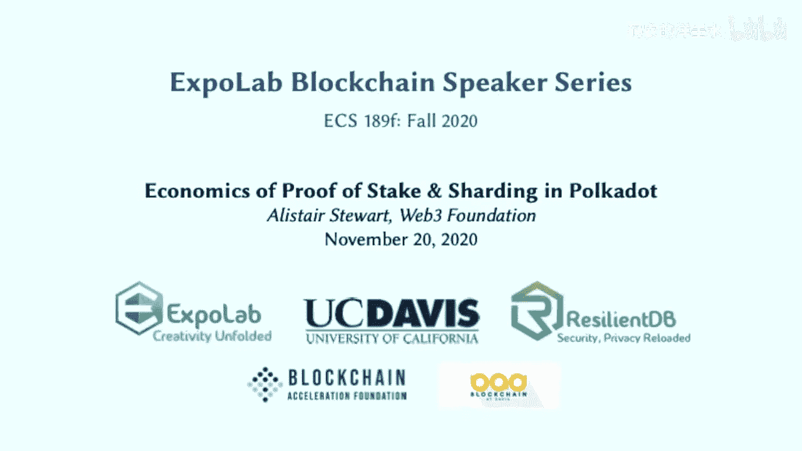
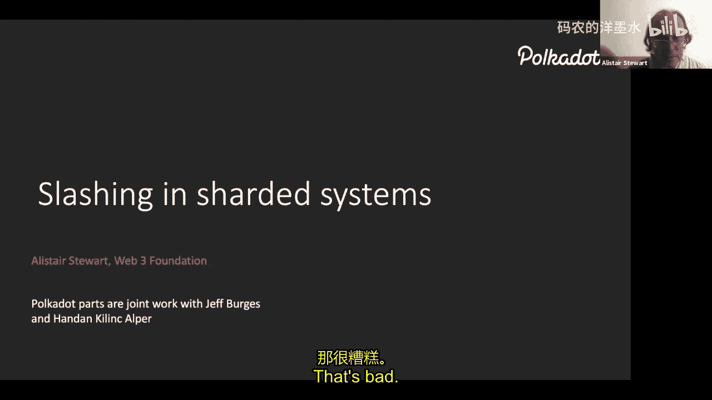
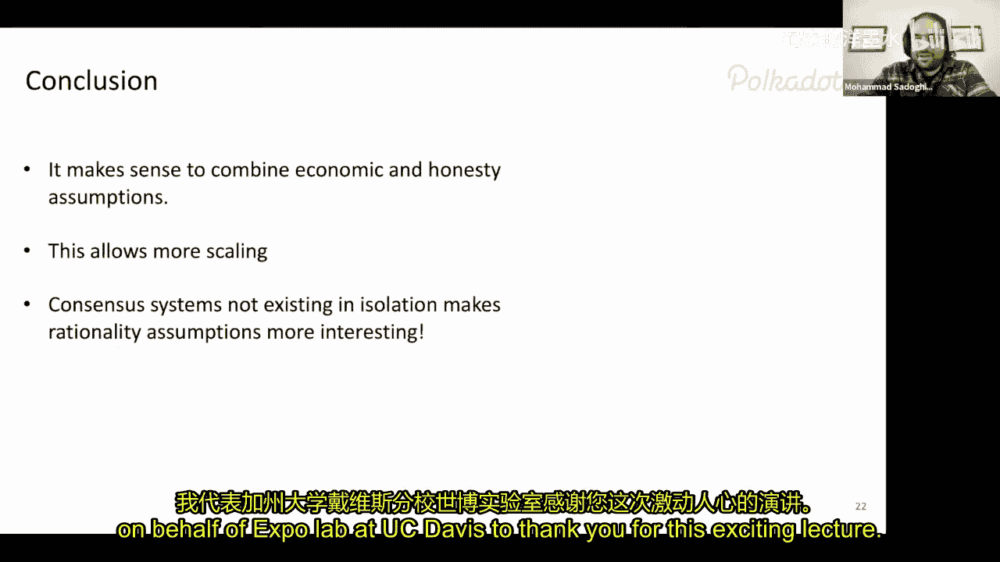
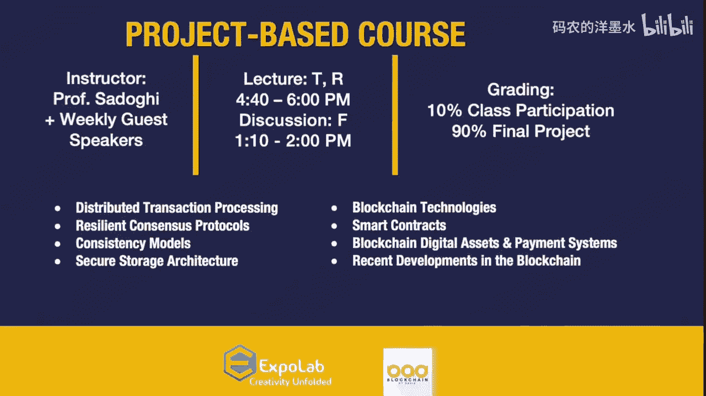

# 【全集】加州大学戴维斯分校 分布式交易与区块链架构 中英字幕 完整课程 p13 Lecture 9 - 波卡的权益证明经济学与分片技术 -BV18YFVzME2f_p13-

Hello everyone， welcome to another session of Expo La at Blockchain Speaker series today is my great pleasure to have Alistair Storwart from Weby Foundation so a little。

But our speaker today here kind of have a very slightly different background from one of our recent speakers so he has a theoretical background he studied at Oxford and then Edinburgh and Edinburgh is known to have a theoretical strong theoretical computer science as well too and he was also a postdoc at USC and in the last few years kind of a shift of this focus into blockchain and in particular the exciting problem of sharding and he's kind of been one of the main person behind the sort of the core protocol of Pocodot sharding protocol so without furtherdo please take it away thank you。

Hい。So。So this talk is going to mention a bit about how sharding works in Polka dot。

But the overall idea is to。Discuss。It's slashing in proof of stake systems and in particular how that applies to sharding。

So I want to describe a particular protocol， which is。😊。

Join work with Jeff and Hanan and other people in Web3 research and other people in priorityity technologies who are building this。

Um。But yeah， so that sort of start that kind generally。So。Can I switch to the next slide？That's bad。

嗯。Okay， now there we are so firstly and kind of。I want to talk about permissionless things。

 we all know why we don't want to trust the central authority， we don't to read Google or Facebook。U。

And there's different sort of assumptions you can make with when you're dealing with it with a sort of decentralized system so we have。

诶。Many actors。And we consider we can make honesty assumptions。

Normally we'd aim to sort of reducing half of people learn or two thirds of people learn or something。

Um。And for a proof stake system， this is going to be within the system。And so we'd have to assume。

That some people are honest。And frequently， these would be the assumption we have to make the other sort of type of assumption is a kind of rationality assumption。

So rather than assuming that actors are good， we'd want to assume that they're rational。

And then I argue that we're going to set up our incentive system。In a way that this is going to work。

And this is sort of this is the goal with the permission of this blockchain， right？2。

We want to have some argument that says that it's a cure if enough participants are rational。

So we can do this by certainly by rewarding participants for correctly participating。

And I'm going to particular be talking about proof of stake blockchain。

 so it's an proof of stake basically the people who take part in consensus will be people who already have stake。

The sort of end goal of designing the system is to argue that if most stake is sort of in the hands of rational and indeed。

They also need to actually do something and be active。And this is often a problem。In practice。

 then we argue that the system is going to be secure。😊。

Now one of the in and things that make proof of stake protocols is that while instead say proof of work。

 we could only reward participants in proof of stake。

 our participants are going to put stake on the line。

That means we can take it away and so essentially we have the ability to punish participants as well as rewarding them。

And this talk is good to try and like examining what the。

What the tradeouts are and whether we should do that。So。

We'd really like to understand our protocols under rationality， you know。

 like can we do some game theoreticaloretic analysis？But this is actually quite hard。😊。

So often what we assume。It is only an honesty assumption。You know， two thirds of hash power。

 two thirds of stake。Is in the hands of honest people。

And I honest the assumptions are alone here enough to prove these one are correct。For rationality。

 we can't really do this， but we can find analyze attacks。

 so we analyze like selfish mining in Bitcoin or whatever by coming up with games。

With the aim of sort of showing that the honesty is rational。And。You know。

 it's actually a bit of an different question about whether we can get more in the way of security by so we have to make honesty assumptions。

 so can we get more if we make economic assumptions as well？😊，RightThat's part of what we。

Need to ask。So。And certainly there are people that argue that you。Shouldn't be doing slashing。

 we shouldn't be doing punishments。And I'm going to try and explain why。

 at least from my understanding of the argument is。So。And now more exactly。

 So so so basically you suppose right。 So we normally we。

 we try and design that a Byzantine fault tolerant protocol。And basically。

 what that means is if up to say， a third or even nearly a half of participants can just do anything whatsoever and it still works。

As long as。One half or two third of people are honest and these particular numbers depend on what your assumptions about the network are if you can assume everyone has a synchronous connection then we then we be we can get a you know just over a half of honest people is enough to make it work。

If you want it to be work。You know when're when the network might be bad when people might not have best some time。

 I' not necessarily like fully asynchronous， but。Like these partial synchrony models。

 then you need to argue you need to say there's more two3 of be lowerist。And so the thing is。

 if we have such a protocol。Then maybe we can design it such that if the other guys are dishonest。

As long as we have dishonest guys， then we shouldn't be suffering a big penalty to performance。

 and then we should be still safe when we have some dishonest people。Right， but on the other hand。

 if we don't have a third or two thirds on。In particularment。

 imagine that more than half or more than23 of participants are dishonest。

And if these guys are colluding， then basically they can make any valid chain。

 they can agree on anything valid， and if we follow the canonical consensus rules。😊。

We will agree that this is what the blockchain has decided。

Now one of the annoying things about this is that they can sensoror the chain， right？😊。

So even if we know they're being dishonest。And。AndBut they're following otherwise following the rules。

And we know somehow off train they're dishonest， there's no point us sending a report to say your these guys are dishonest that they can be slashed because they' would just cor it and so they won't be slashed。

So we have a situation particularly in like synchronous case。

 so if more than a third people are dishonest， they can misbehave。

 they can do what they want and we can't slash them。😊，If on the other hand， a half of， you know。

 bit more than a half of people are honest， then the bank guys aren't really calling us any problem。

 so why bother we slashing them？Now in this sort of asynchronous case， right。

 asynchronously safe case， if bigger than the third and less than two thirds are dishonest co。

 then typically what happens is they can actually just stop us from advancing。😊。

If we need a two third threshold to sign up on something to say it's good and one third of people just don't show up。

 then they can stop us from deciding anything， which means they gets sed either。So， then。

Like so so if we actually， if they successfully attack the system and they can keep on attacking it。

 then no one gets slashed。😊，And if they don't have enough people to do that。

 why would they attack at all in which case it didn't get slashed？😊。

So it is true that slashing incorrect behavior discentivize it with them when there's not a successful attack。

Um， but if most of the time we're just slashing incomp people and not actually dishonest people。

Then what are we getting by this？And on the other hand。

 just having a risk that your tech state might be taking away。

Is going to disincentivize your participation， right， because now you need a secure setup。

 maybe someone can hack hack your machine cause you to do something which loses you money。嗯。And。

It has to be the case that， you know。It tends to be coins that blockchain protocol that come to from academia like Algarand。

 you mentioned we're going to talk next week， Alvallanche Caranno。

 these are so called professorfe coins in which people don't slash and and the reason for that is because mostly because they publish papers。

 they say this protocol is corrective two thirds of people on， they don't analyze nationality。

 just honesty。And。And this is what they can prove that it's correct and honesty。😊。

And then you can make the argument that why slash if it just disscentivizes people？

And I think this argument。😊，I actually hold some water for a single contented system。

So here we're sort of talking about a single chain。Now。

 what's different in if when we have many chains？You know。

 eitherith because we're in a charted system or we're talking about inroperating between one chain and another。

Is that we can report behavior on one chain onto another chain。

Which means it doesn't even matter if they can center this one chain。So this is what you know。

 layer two protocols do if you look at plasma and the like。

If we have transactions off the main chain。We can use the main chain for dispute。 We。

 we can escalate to the the main chain only when。Something goes wrong offchaing。

And sort of try and prove what's going on and if we sort of forced people to。

Lookock up tokens before doing this then。You can get an argument that this is going to work so this is。

Often what we're going to do in chartarding when we have this main chain。So basically。

 you use the main chain。To。嗯。You know， organize who are the consensus participants。

I accept that we will' often want to do that centrally and the other thing we can do is。

This thing reading the I particles。😊，And。呃。So it's sharding we can have one chain we can report to。

 and also if we have。Multiple chains， we can have like bridges between chains。

We want one change to follow the consensus is on the other。

We can also report this behavior on the other chain。So。So now。

But we can definitely make shing work with with only honesty assumptions。I chip。

 you said do you have a system for this？Um。So basically what you do in the permission in the setting。

 we agree on who our participants are we。Divide them up into sets and we randomly assign people to sets。

OfE size for each chart。And then we maybe like do a Byzantine fault tolerant protocol on each shot。

Now this works because assuming we have， you know， a decent percentage honest in the whole system。

Because， you know， if we have enough people it works， because if we take a random subset of people。

 then right with high probability enough people and the first thing we're not this thing is honest。

So。Let's get specific。😊，So each child is going to need like more than a third and more than two third on validate just to work。

And we assume like a bigger bound on the honest validate to the entire system。

 and we just knew turn off bounces。So here we are， so postings inequal。

 which is simple enough to fit on a slide。And we can post in numbers， right so there's one sixth。

Extra guys in the in the main that we actually need on anything these shards。

And you can push this out to get an equation。😊，And come up with some assumptions。

 so that's about to say we have 100 yards。Now in Polkko dot。

 we change validators like four times a day， or we change keys four times a day。

Or sorry assignments fourth time today。And if we want to be safe for like 10 years。

 then that that goes is 365 times 40 and like one percent head chance that any of these that chains are going to be attacked and that gives us a number of validators we need。

Of here of 338。4 it's a big number because。We need a lot of validators on each each sh so that we're sure that basically they're all。

Majoity honest。Does that make sense？That makes sense， but just maybe a little bit more insight as to。

How much this penalty would be and what what is the how do you find the right value of the penalty and how do you no penalties in this particular version Yeah this no not in particular version talking about in general。

How do you， I mean also is it proportional to the extent of malicious behavior， I mean that's right。

 yeah， so interesting。Indeed， so what Ethereum and Por art both do is。This kind of quadratic thing。

 so basically we need a third of people to do something bad for to actually cause any damage to the system。

So therefore what you do is when a third of people do something bad。

 you slash them a very large amount。when close to a third of people do something value slash in a very hard amount。

 but isolated cases you slash a small amount， you just want to ensure that you just want to slash enough to incentivize people to change their behavior to increase the security of their validators。

You know， follow better procedures。😊，But not like kick them out of the system completely。U。

There is a danger， it depends kind of how centralized you are。

 so we ourselves in the Web3 Foundation managed to take sort of 12% of nodes offline and we got slashed a bit。

呃。Which was worth all of two weeks taking rewards， but probably quite a bit。But that's because。

 but if you're a small actor and you know， as long as not everyone puts their validators on Amazon。

And no one guy controls too much of the system， people end up don't get a slash too much。呃。

There are reasons why we want to slash 100% and I'm going to get to that。

The chief reason why we why we do that in Po dot later in this talk。So。

So this is sort of the number we get with only honesty assumptions。 So so as I say with in a。

In a shaarded system with one of these central chains。

 now Ethereum2 have a central chain called the beating chain and Polkko dot。

 we have a central chain called the relay chain。We can use this the central train to deal with disputes on charts。

So if sort of。We have one on this validated pushard now。

And they can report something to the main chain。Then we can splashlash the guides on the other chain。

No。Maybe they could include a short proof that something bad happened， but even if they can't。We can。

a single complaint can maybe cause everyone to check。And。This would break our scaling。

 but it wouldn't break our scaling too badly。Because it's like either everyone will agree that this block is valid。

 whatever it is or this block is invalid or something like that。嗯。

And as long as we can all agree that this is true or false。

 we can slash someone when a validate data complaints。

And basically that pays for the breaking of scanning。So now if we want just one honest person。

The number is a lot better， right， because。Now instead of this thing we got from Hfing's inalitylity for two thirds of people being honest。

We can assume two thirds honesty for the whole system and we get like two thirds to the number of guys per shot being smaller than this this probability that we need。

For this never to go wrong in 10 years across all the island00 shards。

And that gives us this number of 46。3， which is a lot smaller than the 338。

And this is something we get。You know， straight away if we can reduce down to one on this person。But。

There is kind of like。So one thing here is that we know exactly well one disadvantage of this this sort of system。

U。So that we actually there's two big disadvantages。One of them。

It is this so called availability problem， right if we have our one honest validator and everyone else is dishonest。

They don't need to give this guy the data， right？They can just hold it back and claim it's correct。😊。

Now， if you're a Bitcoin and your mind and you withhold the actual block。

 no one else is going to build on it。So there's no danger of an invalid block a block that's gone missing is unavailable。

 ever being in the longest chain unless 51% of the mine is are dishonest。But。

The situation is a bit different in a shadower system because we only need the guys on this one chart to claim it's correct。

 then it's sort of then the whole system believes that this thing is correct and they don't actually get hold of the data so maybe it just doesn't exist。

There is actually a way to。Get around this， that Ethereum is looking at Pokotyotic is using。😊，嗯。

In which you kind of want to robustify this and instead of having like you want to rely on everyone and not a few people to make these the child blocks available and we can do that by era coding them。

😊，If we so basically we distribute the pieces of the chart to everyone。

 if we all agree it's available， if we all agree we have our piece。😊，Well， okay。

 two third of his agree we have our place one at least one third of those are honest。

 so if we sort of add three times redundancy， we can we can reconstruct from any a third of people it and we can get it。

So this sort of solves the availability problem and reduces it down to an honesty problem for the whole system。

The other problem。Is that the。The attacker knows。诶。Went him out of attack。 So basically， you just。

 they just wait long enough。You know， they control a you enough bad guys。

 they wait long enough until everyone on the shard is bad and then they attack。😊，And of course。

 because there are lots of shards， we only have a few guys on each shard and the cost if we're going to slash these guys。

It's only one in the amount of you know the amount of shards so we have we have 100 charts and every validator is only on one sh。

 then we slash only one in 100th the stake of all the validators when we slash every one on one chart。

Whereas if we sort of had the two thirds honest for the whole system。

 it costs us sort of a third of all state things to attack the system。And this is much smaller。😊，And。

So so is it。Actually possible to get more than this to get an attack cock bigger than this well。

Not really。So basically if。Everyone， if checking validity is atomic。

 safe we either check a shower block or we don't and order to check it。

 we have to have the entire block。嗯。Then you know then we can only check sort of a constant number of blocks。

Now。And if this is true。😊，Then we're going to be validating。

 then the cost is going to be sort of one and S of the state of the entire system at most。Now。

 neither of these are necessarily true。So what you could have is you could divide the block into pieces and you could check each individual piece separately that might change the numbers a bit or change the analysis anyway the other thing you could do is you could use ci proof you know zero knowledge to proofs。

And if you could magically do that， you can have everyone check a proof for every block。

And that will get around this point too。So I don't think there that're buying into pieces。

 you still have to ask， you're not going to give these little pieces to everybody so you're in the same situation。

And for the succinct proof thing， it would be really nice if we could do this。I think you'd have to。

And the basic problem is that we're really not。We can't really do an Ethereum we can't really do su proofs for Ethereum or something like that。

 but something you know general purpose to and complete that you didn't design specifically to be easy to do in a srk。

 this isn't practical yet。So。And if we can't， does this work at all？So there's a rather nice。

Blog post。That became a paper by Brian Ford and Maynabone。

Arguing that rationality is self defeating in British systems。And they make some very good arguments。

About basically that we cannot do better than honesty assumptions。

And I'm going to concentrate specifically on the one that I don't buy。

So you should read the rest if you want to know what they're really on about。😊。

And one of the arguments they make basically is this。U。

Is that there's more money in the world than there is stake in the system。Token the system。

And this means that there can be bigger incentives than we have tokens。And further。

 the number of tokens in the system or stake or whatever is bigger than that。

 you know the total of reward punishment we can give to an actor。😊，Who can attack system？And。So。

At some point there may be enough external cost here for it to be worth it just paying and acted to a tax system。

And there's certainly enough money in the world to do this。😊，嗯。You know。

 so all they need to do is to pay to take down the system。

 you know they could maybe make make up to the amount of stuff in the system up to S by taking down the system。

 maybe or at any rate just just steal more money than this maximum rule of punishment for the for the guy capable of attacking the system and then they'll just do it。

So。At first sight， this seems kind of a foolproof， but。Really， it's not。

 especially not if we make honestnesty assumptions。So here's the sort of reason why it's not。

 so if you think like an expect a constant attack。There are more things。

 so even if the cost of an individual attack cannot be made too high。

We can still make the expected cost very high。All we need to do。

Is to make sure that most attack attempts are not successful。But our court。

So basically if most of the time you attempt to attack， we can catch you， slash you。

 but the attack doesn't succeed。Then the expected cost will be much higher than the cost of attack attempt。

 so in particular the cost of the attack attempt to of1 over S。

And we can make the detection probability close to one。

Then the success probably the needs to be bigger than sort of one and one in the number of shelter one and S here。

In order to make this this thing the number of states in the system and we can make it higher。

 you know you can even make it higher the total money in the world it's not。

 you know it's just the question of how to make this small。And one of the nice things is。

About this about compared to the formula I had before is that we don't need to consider how many times the system can be attacked。

 right？So if you're trying to make the probability of。U。You know。

 the system never attacked in 10 years， if we were trying to argue about each time we change the valid set the probability is really small。

 now we can make it one in S throughout the entire system like we have one% chance of any attack succeeding。

But we catch you all the time and so it costs you 100 times more than the cost of a single attack。

And then basically， you bag guys just don't have enough tokens to attack the system。

But one issue here is that we need to make sure that for every an attack attack attempt。

 the detection probability is actually close to one， it's not enough to detect successful attacks。

All it won't work。So。So one of the things we definitely need to do here is to use unknown participants。

 so the problem with the original one on person design is that we can just wait until there isn't one。

嗯。So we want to have participants sort of checking what this is correct so with the availability solved we sort of want to check validity of these lots good。

Um。And so。We need a way of choosing people。Now we could use sort of system randomness。

 normally we think of people self selecting by say， using a verifiable random function。

 which I'm sure Algom will talk about。Um。So if we should of have people self selecting with with private randomness。

 and then they can sort of prove to us that。They were supposed to have been chosen if they actually ever need to report。

So we have random people checking who aren't known by the first set of random people who be inside the shards。

😊，Then。Then we can get what we wanted， which is a protocol that works under honesty assumptions。

 even when a few participants decide。U。But even if we do something like this there're still attacks that we're vulnerable to。

In particular， this is the difficulty with honesty and nationality assumptions to assume to thirds of people honest it definitely works。

😊，Um， if we give too much power to the bad guys， we allow them to corrupt people instantly before they know who they are or something like that。

😊，Which is more or less。Down to the assumption that every viator is running hack software。

Where they try and maximize their own thing and then we can just bribe them from another chain that then nothing is secure。

If're in touch of model sharding just can't work， it's always cheap。But with two third honesty。

 it does work。And so this is how we do it in Polkkod do。

So we have a number of guys who we selected to back。To say initially that this child box is correct。

And we said we record this on our central chain， we record some kind of edit for the sharp block。

Along with these claims of correctness。Once that happened。

 we distribute these array coded pieces and everyone sort of votes did we get them and at this point it's like the back validators are committed。

 they can't you know anyone can now get hold of this block who wanted。Whatever the original guys do。

And then we choose going to random or they use themselves， but random in order to check the shard。

They can get it from the major code of pieces from the original guide from however。

 but they can certainly get it， they'll check its validity broadcast it and if any of those guys complain。

 we escalate it to everyone。😊，But if all the guys who said that they're going to check it say it's good。

Then we believe it's correct。😊，And after some time sort of we'll finalize and all agree that this has happened forever。

Actuallyc this sort of protocol is a bit optimistic as soon as we think we know something's available。

 we're going to other shards are going to act on messages sent by this sh。😊。

But we can delay deciding that this thing is final that we're never going to be able to go back on it until we show it's correct。

And。So I wanted to argue like the main theme of this talk。

 what does this do to the numbers just a quick question on the previous slide so。When do you know。

 I guess something becomes available or I guess as subtle， you said？

Like know the protocol you highlight that few steps that you have a pocket So at what point you then become certain that something was replicated enough to other and do they need to send messages back or you need Yes so in particular。

 everyone needs to send a signed message saying we got pieces from these from the blocks from these shots。

Okay。So this is everyone sends to everyone and then everyone sends a message to the main chain。

And then it figures out what we have enough people to agree on。

We can probably use some cryography to get rid of the n squared here okay oh so it's actually it's an all to all communication because everybody needs to determine that decision kind of well。

 it's not quite all to all， buts it's so the image code of pieces distribution is someone on this sh。

So everyone needs to get a message associated with a shot。

The number of shards is of course less than the number of people， but it is like a lot of messages。

you know I think if we're talking of you know hundreds of hundred yardsard and thousands of validators。

 there are 10，000 eraated pieces that all really s right no one gets more than like a constant number of blocks data ever。

But yeah， it's notable。Sure， so kind of so another question that's very interesting so in terms of。

Kind of a bigger picture is that within' a shard， all the validators need to validate every transaction。

 but sort of at the global level。Still， all other shards， in a sense， are validating。

An aggregated or。An amorts or a batch of transaction for every show。

Right so it's not yeah so the viators is not just the guide on this sh。

 but also other shards so actually in Polka dot viatorators is right。

So one thing I might have had to mention to make sense of this is that we need stateless validation。

So we actually separate collation， which is getting by getting these transactions together and creating blocks from validation。

 which is checking that the state transition was updated correctly and we make the latter stateless so we include。

Like lots of Merkel proofs， like like you have to do to a like client to say what the state wants beforehand and afterwards so that the viinators don't have to know the state。

 they don't have to know this many gigabytes of data may be associated with each chart。

 which means you can check things on any chart。Without sinking it， this is very important。Okay。

 so they don't have the states but they get enough proof to be able to determine yeah。

 they have now a bigger a bigger block and they also have this centrally registered what the actual validation function was what actually is this thing we're supposed to be checking about this sh。

And the intuition there is and the intuition there is。

Transferring and computing and validating that proof is。Simple or done maintaining its state。

A得 short。Yes well it's just a lot less data right so there's more data with the block but we don't have to so so so the goal is that everyone users has the same amount of data as if you know cop within the concept of just do one chain even though we have 100 or more chains。

So everyone wants to be scalable in terms of their bandwidth in terms of their computation power。

 how many blocks they check and in terms of how much data they have to store so so kind of again taking one step higher in terms of the overall optimization is that one way of looking at sharding is to。

Distribute the workload One way of looking at the sharding is to distribute the computation。

 distribute the validation， but in in the pocketlka dot。

 the focus is not so much necessarily distribute or divide the computation is to just ensure the state is really divided that really optimizing the amount of state that each chartard needs to maintain And so what would many what we're really trying to get shared security。

What what we like to do is for one sh to be able to trust every other and for us for each of these shards so。

In our SAshaards are actually different we call them power chainins and they're different from each other each chain is sort of different and really we have lots of chains and the key idea is that they have shared security and message passing is easy right if we're're in one single sshaardder system and the key thing is that we all trust the consensus we all trust the two thirds validity the two thirdhirs honesty of the viators of the whole system then we can trust other chains。

😊，That's the main goal。And so is it also the main goal is in addition to kind of reducing the amount of state that each shard needs to have is it also each shard each shard might have a lot of state。

 but it doesn't have to store anything about other other shard so basically an operator might you know on one shard might follow the shard and the main chain and they' they shouldn't have to have any data associated with anything else but the validators do。

 but they only have it temporarily。And it's only a constant time more than if they were following one check。

But the validator is the same valid maybe validating more than one chart as an actual validator。

I mean holding the state more than one chart？So actually we have the separation and validators are basically main things。

 they only have main state。They have main state， but they have， you know， the stateless。

 the proof of validity blocks from the Shas。And those proof of validity blocks could still be trusted if everyone that participated in construction of the proof are also faulty。

Yes， so the aim is to。So the whole the purpose of validators is to sign off is to show that these things are correct is to the purpose of this protocol is to make sure that these things are correct。

 we do that by basically having people sign off on this thing and then detecting it with high probability and slashing them。

 taking away 100% of their stake if they lie。See and what is the path to recovery so you can identify it。

 you can slash it， but can you always correct it， can you always recover。Right。

 so what what actually we do so so。Our consensus so this is where it gets slightly fun。

 so our consensus is。We follow a fork for a sort of proof of weight stake version of Laymoto contents。

 actually it's similar to the O Bras pros that the Carano guys came up with。2。

When it comes to creating reallay chain blocks。But then we have a second thing called a finality gadget。

 I don't know if you looked at Ethereum too。Call Grandpa。

 which then later agrees that these things are final。And Grandpar is flexible。😊。

It's not tied into the rock production and its fork choice rule too much and in particular we can hold off and finalize it。

So what happens here is that we act on blocks so as soon as we have these age coded pieces。

 we enact a block， it sends messages to the sharp block。

 it sends messages to other sharp blocks and they act on those and so forth。嗯。

But this is sort of in the stage where we can still we have forks。

 we can still switch to another check。And then it's only when we have a certain form of people having done these next set of checks。

 these approval checks that we will once we've drop all of those done for some relay chain block for all the sharp blocks in a relay chain block。

 only then can we finalize it， can we do our Byzantine agreement on it。😊。

And this means in this period between， we can roll back， we can switch to a different fork。

And that's what we do。 So if we， if we catch something in this period， then。

We just declare fork this block invented retroactively and we build a fork of its parent。I see。

 so this is just to kind of the pres staging to penalize and so forth。

 but down downstream as where kind of things come finalized and our argument is when we finalize the block。

 the expected cost of finalizing a bad power chain block is expensive。

Because most of the time before you finalize it's one of these approval guys will say if it was really invalid。

 one of these approval guys will most of the time say it's invalid。

 they'll escalate and we'll never finalize it and we'll roll it back and we'll switch to a different for without ever finalizing。

I see。And this is where I was going with all these numbers。So now like what's the probability？

So we have these sort of these M prime I called it。Guys， checking me checkers。

And so as of the two N over three honest validators。😊，We assign sort of。

E primeme with them on average， so we do the binomial thing here to do it。

And the probability that this is zero， there's no one guys。

 it's about press on the probability of class of0， get we get each of the minus2 m prime over three。

As a probability that none of these guys are honest。

And this gives a formula for the expected Go attack。嗯。

And we compare this with our sort of one over S fraction of stake and this gives us a number and the number here was of both of total of both the approval checkers and the back of things is like is about 14 if we have 14 checkers total。

Then it will cost you more than all the stake in existence and an expectation to attack a single shard。

And this is a lot smaller number than we had even with the one honest。

 that was 38 with the other one， it was like 300 and something。U。

And so we deal with this crazy protocol in Poa lot in order to reduce the number of viators per shard down to something sensible。

Something much more than say Ethereum2 or most of these other systems are attempting。

And that just means that we can。Have more shards， we can have more project。Any more questions？

Right it almost out of time。 I did have one more slide that I tried to explain before。

 but it might not be a good idea to try and explain it。嗯。Which is。

Whether we could get this approach of。Committing to something with a certain amount of stake on the line and having a small probabilitybil of detection。

To to light clients or bridges。And the answer kind of is yes。

So one of the problems we have is that we'd like to convince Ethereum one of what's going on and poke it up。

The problem is， is that for Ethereum 1。诶。We have to basically convince a smart contract what's going on。

 storage and computation costs are very expensive。So checking signatures is expensive。

 it does depend a bit about cryptography， but even including signatures and public keys is fantastically expensive to which costs are fantastic expensive on Ethereum。

So we want to absolutely reduce the number you check。

And we can do some crazy stuff with the sink boostost， but actually there's a simpler approach。

Basically， we claim that a bunch of validators signed something。U to this， to do this。

 we only need to give one bit per validationator to say who signed it and we give one signature。

And what we do is we so instead of storing the entire biodata set。

 we just store a Merel loop of all the public keys instead of storing all the public keys。

So we can have a miracle proof of this one public key we need for this one second chair。And then。

We wait a bit， in particular we wait enough to be sure that we can't go back on this first transaction。

嗯。And then， we'd want to have。Then basically we just give random validators。

We check random signatures of these guys。And we changed it and we accept it if all of them signed it。

Now the way you'd make this work。Is that you'd want people to sign something that was already final so that they all agreed it was correct。

And then we only need to prove that one on this person signed it。

 So we have two thirds of people signing it。 We need what we to show that one one third them dead。

So we only need to show that half of the claim signatures actually exist。

And if we ask for M random ones and the probability two to minus m is。

Is the probability that these are all bad if in fact a third of people。You know。

 230 people signing it didn't sign it， then it's only to then the probability is only two the minus M after checking M things that。

That they could possibly get all these signatures。Now。

 one problem is we can't get randomness on chain very easily。So in Ethereum war how do we do it。

 well the easy thing is to use block ashes block ashes actually works。

They're biasable because the miner is sort of of some particular block a。

knowThey could throw their block away and do something else， but this has a cost。

An economic cost which we can also model and at some point we we make this number small enough。

 you know that we can argue about honesty of miners and get and prove something that works so we have a proposal to do this。

😊，And to， to。There's bridges too， so as I say like I think that。Instead of a conclusion。

Is here that because our consensus system tend do this in isolation。

 like there is a good argument that for a single chain， slashing is a bad idea。Um。

In a if you have sharding or interruptability， it makes a lot more sense to slash。And in particular。

 we think it can allow us to scale quite a lot further than you would than other systems。😊。

And still argue that it's expensive。I still then argue with the sort of combined economic honest assumptions。

That's what this talks about。So let me take this opportunity to on behalf of Expo Lab at UC Davis to thank you for this exciting lecture。

And thank you so much。

