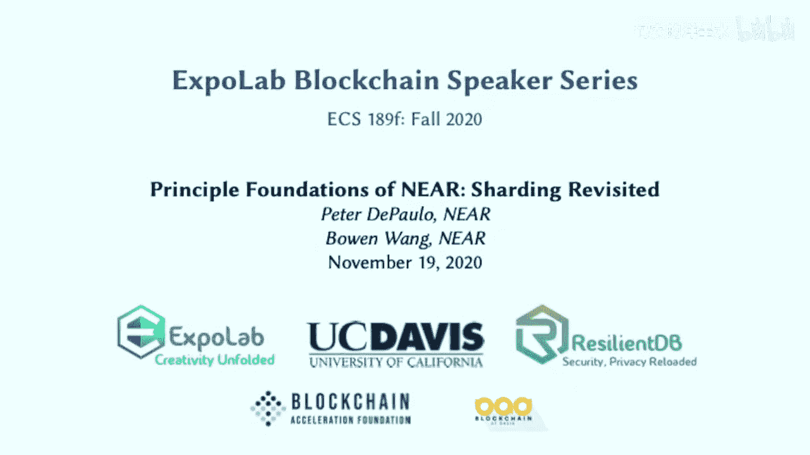
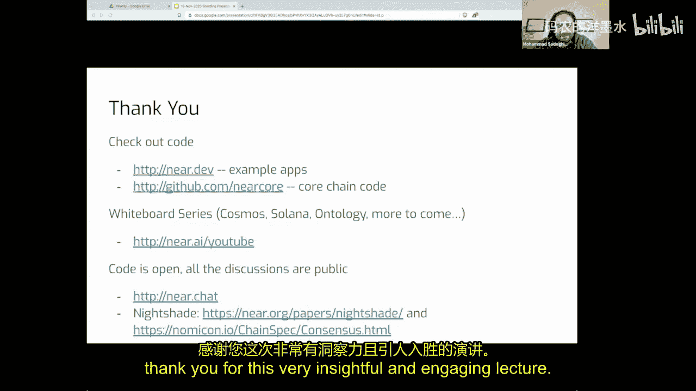
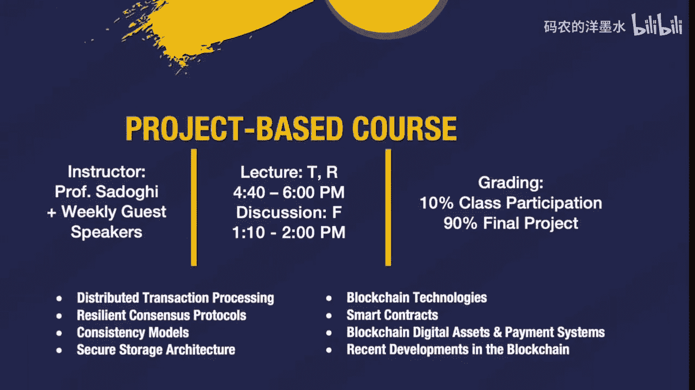

# 【全集】加州大学戴维斯分校 分布式交易与区块链架构 中英字幕 完整课程 p14 Lecture 10 - NEAR的核心原理-分片技术再探 -BV18YFVzME2f_p14-

Hello everyone welcome to another session of Expo La blockchain speaker series today is my great pleasure to have Peter depolo from near and he's going to talk about the sharding of near platform and so what's exciting about Peter's background is kind of been。

Everywhere from blockchain to pharmaceutical he's written code that has been shipped to millions of people and right now he is the head of the development community of Ne so it's going to be an exciting one and so without further ado Peter there please take it away。

Great， cool yeah， so yeah I'll just introduce us actually so like I said before we started recording recording I brought a friend along which is Boown Wang and he has worked directly and more recently on the actual implementation of sharding that we're going to talk about today so I'm going to pass the mic to him on the sharding part and then you can ask him deeply technical questions and he can go even deeper than me it's been a while since I've written code just since most of my duties around community stuff but just introducing both both of us Bowen he's been a core engineer engineer engineer for the last two years about two and a half years and yeah he's done a lot of stuff he's very smart。

And then am not as smart but I've worked in the developer experience and developer tooling since I started I was the first DevX hire and on this site I work on sustainable behavior and then I was an early E person to see if you have questions about war stories in early Ethereum I can share some of that stuff which is pretty fun。

 things were pretty crazy back in 2017。So let me talk a little bit about Ne。

 I think you guys are aware we're a public sharded blockchain and if you're not just just so this talk doesn't go straight over your head。

 we're specifically delegated proof of stake， we're going to get into what that means specifically the sharded part we're composed of essentially three kinds of people it's people who are like X you know Facebook。

 MemSQL， Google MemSQL is a sharded database company that's where Alex one of the founders came from。

A couple of the folks， the other like collegiate programming champions and then there's like previous founders this is like the broad categories。

 but in in general we have a very strong engineering organization and that's been the emphasis and all of this has been pointed towards this concept of developer usability so。

Let me sorry， my my keyboard just clicked off and I want to introduce what we're talking about。

 So this is kind of like two talks smashed into one the first part。

 which is like what Bo is going to talk about is specifically sharding in blockchains。

But I thought it would be interesting looking at what this course is about to kind of zoom out and talk a little bit about crypto as a business and then also this kind of addendum which is really just five minutes around this concept of behavior in blockchain and outside of blockchain but we'll get there you'll see hopefully the transitions are not too clunky and with that being said we can jump into the sharding presentation so here we have a blockchain and I will pass it to Bowen and he can talk about what happens next。

Thanks， Peter， for the intro。 And hopefully gave a a brief introduction about sharding。

 as well as our approach to sharding at near。 So as you can see， you know， there is blockchain。

 I hope everyone knows what the blockchain is and you know， which with the， the this kind of。

Current generation or rather things like a serum。 and or even cosmos。 nowadays。

 it's what they do is that every single node with the validate all the blocks in the system。 and。

 you know， if you think about that is。Now the the most scalable way of doing things。

 And there is necessary limited to that。So because of that。

 if we want to get even more throughput than what the current systems can handle。

 we need to do something else。A kind of natural approach is to have multiple blockchains to and each and each chain could can process its own transactions have its own blocks and effectively in an ideal world。

 we should be able to scale up the throughput very linearly。呃。Pter next。Yeah， however。

 you know those we cannot just put smash like 10，15，20 or even 1 thousand0 chains together and say。

 you know this is a sharded blockchain because you there the juxtaposition of many different chains doesn't really help because they're not working in a single system and there has to be some way some process in which we coordinate some kind of metadata regarding all the chains and an important part of important aspect of that is how we select validd and how we assign valid to each shard and for that purpose there usually is a chain which different。

Different protocols call them differently， we call them the main chain。

 I think serum called them the big chain， Polk dot called the reallylay chain。

 the cosmos called the hub， whatever we call it， the idea is that the main chain is responsible for dealing with this orchestration of the overall process。

 which includes like valid selection and then another metadata processing。And yeah。

 this is pretty much the overview of what most of the sharding architecture today in blockchain looks like。

And now that we talk about the kind of nice and rosy picture of sharding， there are， unfortunately。

 a set of big challenges that comes with sharding So you know as people know that there are is this 51 percent attack improve work systems and you know for bitco and ayem。

 they are not sharded。 So if you want to do this kind of attack。

 you actually need to control 50%51% of the hash power which is consider to be very difficult however。

 if you actually have let's say10 shards10 chain and then if you want to describe one of them。

 it actually the amount of corruption you need to do is 10 x less which you know becomes much more realistic then let's say corrupting。

50% of the validators。And so。One of the ways that you know we can kind of mitigate this problem is that we pretty much sample the validators randomly。

 let's say we have like tens of thousands of validators and you if you want to just and assuming that let's say like a small percentage of them are malicious if you sample。

 let's say 100，200 of them then the probability that a majority of them is malicious is actually fairly low or even negligibly low so we can assume that in that case。

 this kind of selected set of validators is mostly honest。And。And， and because of this。

 you know what what。What happens is that when you sample these valids and then they produce blocks on the chain and each block is produced from Genis by a set of honest valids and they each build keep building new blocks on top of it and because each block is built signed by values who are mostly honest。

 we can assume that by induction that this chain is valid and and also this chain is is unique。

 this is pretty much the overview of what BFT consensus does which assumes that every block is signed by a honest majority to guarantee both that the block are valid and also that they're unique。

So。There are a couple of。So I think we talk about bio getting corrupted and， you know。

 so on so forth， right， So， but people may ask， you know， what kind of stuff we can， they can。

 they can do And they're kind of too big。A tax that can perform one is like creating forks， another。

 which is which is what we willll focus more on today and which is also much， much worse or。

Much more the tack that would would cause much more damage， which is inva state transitions。

 And yeah， we will talk more about that very soon。kind of just a quick question kind of things this is getting very exciting interesting so two things at least I guess I have on my mind one is that how do we deal with cost sharp transactions so I don't know if you perhaps you're going to cover that in the following slide and the other one I think was very interesting is that say if I were to do a random sampling when i'm constructing the set of validate for every shard then I can sort of get the same guaranteed as of a nonchararding system so。

So now the question is， I guess how do you do that random sampling and those sampling are is it fixed。

 do we create a new sample for every shard for every block or is it just on onces？

And so maybe kind of a bit of an insight on that as well， I think be that would be very good as well。

Yeah， so so for the first question on the crosst communication yeah， we will get to that very。

 I think in a few slides， I agree that the order is maybe not optimal one but yeah and for sampling yeah this is a much bigger question kind of related to how we do distributed randomness and there is know you can just spend an hour talking about this and especially if we want to do un biasased and if we want to do like un biasasedable distributed randomness it is extremely difficult and there a lot of challenges associated with that and we actually have done a lot of work in this front so our cofounder Alexs has wrote a few blog post on distributed randomness and how we。

Planning to approach that， I mean， unfortunately， the completely un biasable randomness approach was quite difficult and its the boost in terms of the approach and also in terms of implementation so we didn't actually take that part our distributed randomness value just has one bit of influence over that。

So basically， the idea is that you have a randomness seed that is generated every epoch。

 and then like you use that randomness seed， which is supposed highly secure to you know。

 do this kind of shuffling or like rearrangement of validators and assignments。

 assigning them to shards and things like that。So kind of putting the question of the P randomnessia。

 that's a hard problem。I think that's a well known hard problem。

 but assume there is a random function， the random function for now。

 so to kind of get the general flow if I here correctly you said you have the motion of epoch so add every epoC then you reshuffle and create a set of validator assign them to the shards。

And then， I guess they will。After the resignment， they're kind of responsible for the next epoC and every repoC you reshuffling all the validate there is that yeah that's yeah I think yeah。

 I think that's that's also the approach that IM too is planning to take yeah。All right， sounds good。

Yeah， yeah， okay。 So yeah， because let's， let's continue on with the the current slide。 Oh。

 I think I think I haven't finished that one。 Yeah， So so so yeah， what is the transition yet， right。

 so。State transition is pretty much the process where we update。

 you can think of the accounts in the system and in this case。

 let's say we have a transaction that sends 10 tokens from Alice to Bob right so what the valid transaction looks like it would just deduct 10 tokens from Alice account and then add 10 tokens to Bob's account right but invalid state transition on the other hand。

 can pretty much do our three things here， for example。

 it can it can proceed with deducting 10 tokens from Alice account。

 but then just out of nowhere means 990 tokens on Bob's account in addition to 10 tokens that Bob receives so in state transition is almost the worst nightmare that you can possibly have in a sense that this is even worse than having the entire network store right but because even if。

Have been trying to store like， if you find some way to restart it， you can still proceed。

 But if you somehow invest transition gets into the blockchain and it didn't get immediately addressed。

 then you normally what happens that you have to do a hard work And there needs to be some like some sort of social consensus that take place and things can get very nasty。

 So that's why this is something that we want to absolutely avoid。So， yeah， so without sharding。

 it's actually， things are easier because if you think about it in day transition now doesn't make sense。

 The reason being that every node in the network needs to avoid it all blocks。

 And if someone tries to do transition， that will just get rejected and there and usually this would not be a concern anymore。

 However， they can still， people can still create fork maliciously or by accident。

 And maliciously creating for can still be attack in without without sharding。Yeah。

 so what this means is that。Yeah， as Peter through the the slide here。The the attackers。

 they can create， create， try to create forks。 They can try to， you know。

 build on top of fork and install the network， and so on。

And I think we talk about this cross our transaction and with startinging it actually becomes worse。

Both in terms of creating for and also now in state transition becomes an actual possibility that we cannot just ignore。

So how does the cross sh communication looks like so here we will mostly focus on this Asnc communication model and I believe this is actually the model that that most of the wellknow protocols take or will take basically what it means is that if you have a cross sh transaction。

 it first will execute on the sh where it originates from。And then after the execution。

 it was sent a receipt to the destination chart to keep executing。 Now。

 a receipt can even go on because you can generally further receipt if necessary and then getting sent to another chart to get processed。

 Yeah， But basically， the idea is that this process isn't really synchronous。

 because you first execute the source chart。 And then you send the receipt to the destination chart。

 and then you executed there。 So as's an example here。Right。

 Alice from Sha 1 send some tokens to Bob on Sha 2。

 The first step on Sha 1 is that a transaction would first de Alice account。

 and this is executed on Sha 1。 And then a receipt would get sent would be created and get sent to Sha 2。

 And now on Sha 2 in the next block that receipts get executed。 And then Bob's account is credited。

So if I may ask， can you go back two slides？So can you just explain sort of the flow here because that seems to be an interesting。

 how do you follow this envelope？Right that is the starting point yeah so so as I said right maybe maybe that was a bit fast so what happens is that let's say you have some transaction right it originates in some sh and then what happens is that it first is executed in that chart and then this transaction if it's cross start transaction it will created a receipt with all the necessary information needs to send to the destination chart and so kind of if I were to read this graph I just want to kind of also follow the graph am I reading is the time going from left to right right to left。

What is the first so the arrows is pointing like to older blockss， it？

So time is time is proceeding from left to righting and basically you can think of the arrow as essentially the。

Reference to the previous blocks has I see Okay， so sorry that's a little confusing， I realized。

 Yeah， okay， so there are different arrows as well， Yeah yeah。Okay。

 so the first envelope is on the left side is coming from that top right corner。

 so that's the first sh and it gets created on the first sh first block。

 then the envelope gets created goes to the second sh。And then。

And then I guess these are different transaction How many these a illustration of different exactly this is just an illustration that things can get extremely complicated because if you look at for instance state on let's just call the top one shard one what would be happening is some transaction is going to change state then across shard transaction is going to shard two but then in block three and shard one across shard transaction is also going to shard3 so it's just a demonstration that in an asynchronous with multiple shards you have to deal with a lot of complication and not only that you have to sync state like you have to be very diligent how you think about how state syncs and also and also this illustration only shows like one hop but in reality it can be more it can you have a transaction origin is from shard one and then it sends a receipt or shard2 and then。

Q theres generally some further receipt gets sent to like3 or short4。

 for example and can go back had two more questions on that。

 So how often do you also go to these pink shards after every block you created you so this actually this this isn't a sha this is beacon the main chain that's actually an interesting question because because every it depends on what what the protocol does So what often happens is that those sha blocks what gets crosslink to to the beacon chain every once for a while and that is usually a away to avoid the damage caused by for on the sha chain because basically the for choice through would respect the blocks that that are linked。

To the becon chain。I think one helpful mental model for the pink chain。

 the main chain or the beacon chain is to think of it as like a metal layer of computation because we're doing all of this stuff like validated rotation and then validating cross shard transactions and validating blocks and validating headers all of this stuff requires a really secure place to run right you don't want it to run in some centralized place otherwise it defeats the entire purpose of the blockchain that's what the pink chain does pink chain is not actually processing transactions just like a shard pink chain is like this sententinel that's saying like okay making sure shard one and shard2 are good making sure these headers make sense right so and yeah like Boone said it really depends on the chain on how frequently it's updated。

Yeah， I think that that is a really a powerful idea。

 I think this is probably one of the most powerful usage of permissionless setting in my mind。

 I think it's really powerful。 One last question。 So now if you have this cross start transaction that is happening and let's say it's。

Two shards or three shards， what happened？It successfully executes on a first sh。

 but then it comes to the second sh then it kind of fails how does it rollback and a board procedure work？

Right， yeah， this， this， again， I think in the， in the general case， it's， it's quite。

 it's quite complicated。 I mean， like it， this is， I mean， in in the， I would say like broadly。

 this is kind of the， the issue with。It was asynchronous。This communication model， right， You can。

 let's say you you execute some contract on one chart， and then it generates a call to another sh。

 And， and the call there， you know， failed or unexpectedly or or yeah。

 it did pretty much you need to you need to handle the the call back。 like you like。

 let's say you you on the you on the short one。 And then you。

 you basically will need to take a look at the results coming back and then。

Process it and do something like do some further processing like based on the result。

 and I think this is an issue with asynchronous communication model and there has been you know a lot of discussions research on that。

 I think because this can potentially leads to some some like problems like likeing things just get like thatlocks gets much more complicated for yeah Yeah。

 and then then you know that is is something that you know we can just talk for a day。

 I think a lot of research has also been done people discuss different ideas like saves like Yanking and this kind of ideas basically try to come up with prims that allows you to lock certain results。

 however in specific cases， what I've seen。People， at least in people who are designing applications for this right now and they're they're figuring out how to architect their state。

 they're actually just thinking of this。Just like you would a node application with asynchronous calls that are going to change a record in a database so in in the best case scenario like Bon is talking about the theoretical and general case to solve this for everybody is actually extremely complicated but in specific cases where you're like well I know。

You know， I have some linear， I have some procedure， I have like three steps， right。

 and I know that deterministically three things are going to happen right in three steps。

Then people can initiate transactions at any given step。

In both directions right so so the thing that makes it hard is they'll have to interrogate state。

 but at least it'll be treated like an asynchronous system right where're like okay。

 I check out the state。Good or bad and then i'm going to go and tell tell like for example the previous contract or whatever what happened good or bad right and that would be facilitated through receipts just like normal cross transactions and like I said as for specific cases this is like application architecture it's not really。

Helpful for like someone thinking about it theoretically designing the system。Thanks for。 Thank you。

He。Yeah I I think we were talking about the kind of potential attacks with invalidvi state transition right so let's assume for a second that Sha1 somehow get corrupted and theres a majority of malicious attackers there and what they can do is that they can create an invalidvi state transition in one of the blocks and then they actually go on produce valid blocks and in one of the valid blocks。

 they create across Sha transaction that bills on top of the invalid state transition and now from the Sha2 perspective。

 they just received a regular transaction and then they will just apply it and since it's from they cannot distinguish on the side of the Sha1 and they would just happily apply the results and this potentially means let's say。

You actually mean a bit in tokening in broad B now you can just spend them by sending some cross short transaction to use them on another chart。

 I'm going to make a quick point here because people have asked me this before which is like how is this even slightly possible in case it's not explicit？

The transaction itself is inside of block B， but the transaction is gone by the time the block C comes around。

 so this concept of an invalid state transition， that specific word transition is what's important because it's a transaction that you're validating。

 not the state itself。So in C， the state looks good to validators if someone came along and tried to validate that block。

 they' were like great， everything looks good and they don't know because they don't see the transition itself。

 so I just wanted to clarify that little point。So sorry for an interrupt， you can go ahead， bud。Now。

 I think I'm down with this one。Yeah， so you know for there are like a number of ideas on how to address this。

 right， One of the interesting ideas， I think this is what Kaina uses in their kind chain web。

Basically， the idea is that you actually organize shs in in kind of the sound directed graph。

 and each chart is connected to a few or I mean by a few， I mean。

 really a small number of of other shs。 and you can only do cross transaction to the that you're connected to And the idea is that in in every chart also validates the sh that are adjacent to to their chart in this graph。

 and you know， in this example， right， if you understand transaction from sh one to sh 2 and there is in state transition from 2 also would validate know the the blocks one。

 they would have called this in day transition。But yeah， now the problem is that， yeah。

 if single sh is corrupted， right， it's， it's kind of fine。

 But now if there are multiple shards that gets corrupted， you， we kind of gets back to the you know。

 original situation， Let's say here both shard  one， sh 2 are corrupted。

 then if there's something in transition in sh  one happening it somehow just get a group through from chain of transactional receipts。

 And then eventually gets a charge 3。 But Sha 3 doesn't actually valid anything in chargeard one。

 So from its perspective， cannot know that some transition happen there。 So there still。

 theres a type factor still exist。 although its kind of mitigated。So this。

 this is actually what most of the protocols today use you know。

 in one way on in one form or another。 So basically。

 fishermen is this idea that there is a separate group of people who whose like responsibility is to try to figure out whether such。

Such in day transition happened in some sh。 usually what they do is that there are some fishermen associated with each chart and they would just be looking out for they would be applying every blocks as well and they would look out for this in day transition when they see such things happening。

 they they would submit a challenge。 And if the challenge is successful。

 all the in in the sh would get slashed and this is this is a pretty powerful way to prevent in day transition from happening even even if a sh is corrupted。

Yeah， so that kind of if I understand， just let me just ask one more question on this。

 So this is really the cases that。The invalidation said the invalidator said the child in Charard one was probillysically end up to be bad。

 so the block that was generated in B。It has yeah， it's invalid。

 So we're trying to periodically somehow be able to crossche the other sh， making sure。

 even if they hit they get unlucky and they had done that invalid。

 there somehow gets identified as time goes on。 Well。

 notice rather that there would be some fishermen that's associated with Sha one。

 they would just to there would just spot that there is station happening that sh。

 even if every single valid in that sh is corrupted and you know， mean normally。

 if not every single one of them is corrupted， some valid themselves submit the change。

 but let's say you know some for some reason theyre entirely corrupted then yeah the fisherman kind of exist as a separate entity that that can submit change and yeah。

And slash deal I want to add just that this is triggered any time headers are being sent from one charge to another。

 which is the representation of a crossstr transaction right so any time there's a crossstr transaction a fisherman who's oh sorry also a form of validator right some validate puts on their fisherman hat and then they're going to go during this challenge period and actually validated the state。

So then kind of so every time there is a cross start transaction then。

It invokes checking the other sh to make sure everything has been fine recently。 Is that well。

 it's more like it's waiting。 There is a kind of confirmation period for which people can submit change。

 And if no challenge is submitted during that period， then yeah， it's considered fine。

But so this fisherman now， this invocation coming from the Shaard one。 Yes。

 so there is a good entity。 Shaard one is trying to do。It's constructing， I guess。

 the Y is being constructed。No no， the challenge is basically proof that there is there or there was a invalid state transition like basically it shows that in brought B。

 invalidval state transition has happened， this usually comes in the form of some state proof basically proof that this this state transition there is invalid。

All so so chart two， they will try to invalidate block A and B。

 and then the figure of block B is problematic。Yeah， so well， this。

 this doesn't show the entire picture。 It basically， the challenge will get processed on the。

 on the main chain as well。 So the there， they would basically mark that chain mark that block is involved。

 And then it would roll back entirely to， to what happened to the block that comes before that。

And how many of these challenges need to be solved before I can be certain that all the data in shortard one up to D are valid is it I there is so basically you' you're not like it's not that you're processing all the challenges is mostly you're waiting for confirmation right if there's no challenge for a period of time。

 then this block is considered fine， but otherwise if something happens if some challenge pops up。

 then it needs to be processed， it's not that challenges are sent for every block。

So for example thisance kind of resembles it like a bit is that you kind of have to wait up to six block before something gets settled so the settlement period here is that if you wait for long enough and then there's no challenge being raised then you can kind of be rest assured that well what you have is settled is that yes okay and。

And is there sort of a time limit is it this Yeah， so I think yeah。

 usually based on number of blocks and you know I think different protocols use different。

Numbers for those things， yeah。We use three， it's three bucks to finality hit well。

 no actually Oh not for the challenge period， yeah。All right， sounds cool。Cool， al right。Yeah， so。

So with with all that， there still is kind of a a problem， Basically that in order to to even to do。

 to do change and also perform a lot of other things。 you actually need to。

 to know to actually know the block right？ So sort an interesting attack is that。

Since not every validator validd， every short， if some malicious validator in some chart。

 what they can do is that they actually produce a valid chunk a valid short block and they send the header let's say to the bi chain。

 and people on be chain they cannot they can validate the header is valid。

 which it is because the block is valid to begin with， but the problems that those validators。

 they withhold the block from other validators， so basically they will try to。

Not send this this data to other cloud and。And what happens is that let's say you are actually performing some some service in exchange for tokens。

 And from other charts perspective， if the let's say if the header of B gets included。

 then thats that that block is is valid and you know some， for example， then you can。

Maybe you provide the service。 But then the problem is that now you cannot actually build on B because B is not actually available。

 and it depends on the kind of implementation here。

 But you either that either that chart would just get stored or more realistically。

 what happens is that you just abandon that block and keep building on a and effectively。

 this this would become a problem because you effectively。

 you kind of attack the network or someone gets scammed and this， this can get。Cant get very nasty。

And yeah， this is just basically to iterate what I just said， right。

 maybe because Ming Ch cannot actually validate all the all the charts。

 and they can only validate headers。 And but problem that sometimes if header is valid。

 doesn't actually imply that the block is actually available。

 So that can cause this problem with data availability。So just one more question is。

 so what if something that has been written into the beacon chain and gets invalidated so do we need to go back check？

Do we write through compensation， how do we fix that？Yeah， so it depends on why it's invalid， right。

 So usually the beacon chain， you can think of as having like a very good security。 Like like。

 of course， if there's some fundamental assumptions broken。

 let's say you actually have more than one surge of malicious valid。 then there is pretty much。

Like undefined behavior， like anything can happen。 And we usually do not do not consider those。

 those scenarios because， because if the fundamental assumption of of you know。

 BFT consensus is broken， then。I mean， like anything can happen pretty screen so I mentioned not the main the main chain itself is that one of your shard。

 like let's say your example that you had the shard B was invalid。

 but it managed to write its states to the main chain and then after some point it realize as well shard B the block B was invalid。

 it rolls back but does it now have to do any rollback on the main chain or how does it kind of retracted from the main chain or how does it reflect that on the main chain right。

 Yeah， I mean I think here it depends on the implementation and in one of the scenarios。

 you could just simplyly stall the network and I mean other implementations for example， yeah。

 you could say like know that you could you could figure out ways to say like you know that block somehow invalid and everyone just like build a new block on top of block A and then。

Basically， just discard。This discard the block B， and it can get into problems。

 It depends on like how you cross link things， right， If， if， if B， for example。

 somehow it's already cross linked， then yeah， it can get into。Pretty big problems。 And then like。

 maybe you have some rules on the， on the pick chain on how to roll that back。 But yeah。

 this hosting has very。Yeah can as I said， this hosting can get very very nasty and is really complicated because essentially I mean if you the moment you say I can roll back the main chain you kind of use the imability of the main chain and now it becomes a potential attack what if one shard is trying to roll back valid transaction。

 how does the main chain can how do you prove how do you provide proof to the main chain that things needs to be rolled back and。

There seemed to be a lot of cascading， interesting cascading effect that could happen。So yeah。

 this is pretty interesting。Yeah it's a good point and and yeah this this stuff is like why on the outset sharding seems pretty straightforward when you draw a bunch of squares and like lines between them。

 but then when you get into actually all of the different problems that you can run into， yeah。

 it's lots of cascading stuff that you have to keep track of， right？

So it's a fair point now it's a very interesting challenging problem。Yeah， so嗯。

Kind of the solution that to data variability， I think。

 I think both us and also Po dot uses is that we have this。

We we use erassure code to basically divide a sharp block into a lot of different pieces。

 and we send， you know， piece to each of the each of the bio。 The idea is that let's say small。

 basically a small amount。 let' say 1，6 of them is sufficient to reconstruct the original data。 And。

And the idea is that when， when the block on the on the mention is created。

 the block producer will not include。The chunk if， if it does not if it does not have the。

 the the the chunk piece or the the short piece from the from the short chart block producer。

 and this， this basically kind of is a way to make sure that we can。

Like even if the shard somehow is invalid， not somehow tries to withdraw their data。

 like know then there pretty much their block which is not getting included and also if somehow valid is there are offline or like some for some reason lost their data。

 you can also reconstruct its data from other valid in the system。

And here it basically shows that each for each of those pieces， we actually。

 we actually construct a mery for the for all the pieces。 And for each piece。

 basically you can prove that oh， this， this is actually an authentic piece from the the original block because you can because the Mer route is actually included in the header and you can actually verify against it。

Yeah， and， and I think here is。We I'll just go through a list of the famous protocols I guess。

 and then see what they well， I think most of them are sharded in one way or another and we look at。

Their approach。Yeah， so cosmos is basically this。We have this hub and dome approach。

 so obviously hubbbies you're going think of the big chain and the main chain that does this orchestration of ourdiits and each zone。

 so Cosmos zones are highly heterogeneous zonemes can pretty much be anything and it's up to the zones to guarantee know to figure out the biodis inside the zones as well and the thing called IBC that allows communication between zones。

 this is kind of similar to the cross chart communication that we talk about。

 but I think this time IBC still not life yet because it's actually quite challenging like even to make sure that crossstar communication works in a homogeneous system is already quite difficult as we see various challenging rights with that。

Making sure that， you know， you can do this across two like very different chains。 It's。

 it's just even harder。And Polk dot is has a kind of similar model in a way。

 they have this really chain。 and they have power chain。3 chains。

 basically the similar to cosmos hub and power chains is similar to cosmos zones， but not exactly。

 So the Polk dot has share security where cosmos don't can should bring their own value users but in Polk dot。

 the value shared between across the system。 and and actually， I'm not super familiar with with。

Actually， I'm yeah。 I would say I'm not very familiar with either of those。 So I。

 I will not try to say things that I that to comment on things and not not familiar with in case that I I just say something that's completely wrong。

 So， So yeah， that's pretty much what I what I know about them。And yeah。

 Deica is kind of a different example in that they don't actually charge state。

 They only startard processing。 and this is in a way very limited because when you have cross sh transactions。

 it can it can get very slow and it's not actually utilizing the full power of sh。嗯。

And the serum is also quite complicated due to this upgrade that they need to do from proof of work to proof of stake。

 and the architecture is mostly similar to what we talked about before。 they have be chain。

 They have sharp chain and the virtual machines basically the kind of state transition is happening in as this environment where you execute transactions and then you perform the state transition。

Yeah， and in our， our design is。呃。Well， this， well， yeah。

 our design is kind of similar to is ser in a way， but not executives。 I think this。

 this picture actually doesn't do us。A lot of justice but so basically we don't have explicitive sh chains。

 we have this thing called chunk that is sort of a sharp block that's similar to know is shaard blocks。

 but basically the idea that we don't actually expressively maintain sh chains and we only have kind of this main chain that's responsible for the orchestration the ideas that you just like get rid of a lot of this overhead complexity with sha chains because if you were to maintain like a sha chains。

 the problems like you can have forks， you can you know you need to handle how those sh blocks get linked back to the main chain and and as we have talked about there's a lot of complexity associated with that and so that's kind of design decision that we took kind of early on to reduce some of the。

Complexity and make it just easier to build。So kind of just a little bit more context I think these are I mean you're highlight one of the key sort of sharding protocol in industry but just kind of from from our lab expo labs so we also been doing sharding for the past two three years and so we have three main line of work one is combined by shards so in there we look at all isolation levels。

And isolation level and weaker to the stronger serializability all the way to snapshot isolation。

 So we look at like your traditional database but different isolation semantic So there is sort of a plug and play。

Platform that allows you to experiment with 18 different sharding protocol。

 So that's one thing we we've been doing。 The other one is we've been working with Ras on a server protocol and so there is a whole different flavor of sharding that we are been exploring in partnership with Ras and the third one is again。

 something just kind of in house is。The shorten protocol that we've been working on in terms of evaluation of it without going to into its sort of technical details of it it's been sort of also very exciting so are we able to scale it to globally to over 500 validators 500 replicas and sort of peak performance about 1。

2 million transaction per second in Brazililient D so resient D is our blockchain fabric so that's another very I think very related piece of work we don't have this hybrid model that you're focusing on with this main and the short chain so I think that's a really interesting。

Design that they haven't explored yet， but there seems to be a lot of interesting similarity as sort of as as far as is sharding concerned and some of the problem we talked about the cascading of the rollbacks and how do you ensure that。

Something is executed is executed atomically even if it spans tens of shards and well if it needs to be rolled back it will be rolled back atomically sort of analytically sort of proven that so I think that's probably some follow up conversation we could have which seems to be very interesting since you were covering the restite that maybe mentioned that as well too。

Yeah， things actually hadn't heard a whole lot before I saw the stuff on the lab about Rads。

 so I actually read a bit about it， which is cool。Yeah， so thanks for sharing。Yeah。

 resilient D is quite cool as well。Yeah。Thank you。Yeah。

 just the last couple of slides on sharding are just a couple of details。

That are just differences between Ethereum serenity and near primarily like the finality gadget yeah。

 Bo did you want to add any other other stuff on this or I mean， not Ra H Okay thats cool yeah yeah。

 then I can I can take it from here thanks very much Bo that was like really good fantastic。

Exploration of sort of some of the things so and I just want to take a few minutes i'm glad we interpersed questions before yeah let me just say a couple of things that I mean it's written on the slides but yeah fundamentally the core difference between theorum serenity and near is that we have a different and novel model of consensus called Nightsh which I didn't write here but and then our our BFT like finality gadget is called doom slug and so。

We don't really have time to dig into the really nitty gritty details of each of these things but I linked to the end of these slides and I think you guys have a copy of them if you want to go and read more about them you can read the White papers and then we have some more friendly explainers on our blog as well if you if you're interested in this stuff exploring actually the differences between dooms slug and then BFT and then PBFT so that's something worth noting and then yeah this is just fast finality is shorthand for dooms slug which is。

I think pretty cool and yeah， so I want to talk briefly， well actually sorry before I move on。

 do any students have any questions about sharding at all or in general？Okay。So that is now。

But we might have some time at the end for a discussion as well so so I do want to talk a little bit about pulling way back on this right all of this stuff exists for a reason right like and and if you think about the progression of blockchain overall we have these proof of work blockchains that emerged and then proof of works not fast enough so we created proof of stake and then it's like well proof of stake aggregates wealth so what about delegated proof of stake okay well delegated proof of stake is like not quite fast enough so we have sharded proof of stake or sharded delegated proof of stake。

And。It's interesting to look at just like push the pause button on all of like the feverish technical details of these progressions and think about like a how this stuff is actually secured。

 fundamentally at a very fundamental first principles level and B what is it trying to accomplish so right now what it's trying to accomplish I think is actually even though blockchain feels like it's progressed quite a lot in the time I've been involved with it it's only a couple of years old。

 it's only a few years old fundamentally and programmable blockchains were really invented in 2017 and it's only three years I it's three years from that time we're in 2020 I approaching four years。

So I want to make this point to the people specifically in this class you guys are in an actual really interesting position in time。

 which is that you are early to a new technology in which the business models and the the way that these organizations are going to come together have not actually been fully fleshed out right so I just wanted to。

Plant this in your head that if you have an idea that doesn't look like an organization or if you have a project in mind。

 I know you guys are working on projects right now。

 it's really easy to sort of write those off as just strictly academic or just saying like oh I'm just a student I'm not necessarily capable of working on something big。

 but I promise you that the big ideas that are going to be like taking over the world in a few years look like small ideas now they look they look like things that are unrecognizable as big ideas and one piece of this which is a new idea because of staking。

 I wanted to sort of introduce to you， which is the concept of I call it an infinity machine。

So because of staking。If you were to create an application that is paid in some protocol that uses Stakings native token。

 you could write a program to restake the tokens that you're paid in right so you make an application for people。

 a DAP distributed application， I saw you guys were exposed to some concepts there and you're charging people automatically and then you rest stake that money。

You probably haven't thought through the economics of how you can actually create a successful business or a successful side project out of this。

 and I wanted to show you that basically I didn't unfortunately didn't write all of this stuff down。

 but I wrote an essay on this and I'll be publishing it in the next couple of weeks。

It works such that in a conventional proof of stake network。

 if 70% of the network's tokens are staked， you can expect basically 6% inflation。

 meaning 6% of tokens will be returned to the people staking into the form of block rewards。

What that means is if you create something。That ends up garnering a million tokens。

 so let's just say arbitrarily， which would be roughly 8，435 people paying 10 tokens per month。

 so bear with me on the math， but you get there in a year， you get a million tokens。

You could then have a return from that at around 60，000 tokens per year for 6% really easy math。

 the reason I bring this up these because if any of you are inclined to start businesses。

 the way that it works is you go to some investor they give you。

 let's say a million dollars for some stake in your company and the way that their economics work out is that they have invested in let's say100 companies with the expectation of that 90% of them are going to fail and then a fee are going to succeed and become something like Airbnb。

 I just want to make the point that proof of stake changes that model in a dramatic way that somebody in a country outside of the United States。

 someone outside of Silicon Valley could come and build a product and they could publish it and people can use it and then by resttakingly rewards they can live indefinitely off of just staking rewards even if their product is no longer successful after a few years。

So it's just something to think about。And then the last piece of this。

 and I'll stop for questions after this slide is that the first generation of blockchains were secured by proof of work。

 which was actually cryptography。The second generation of blockchain sorry。

 the second generation two right proof of work， the third generation of blockchains is proof of stake。

 they're actually not secured by cryptography that facilitates the security。

 but it's not what actually secures the chains themselves。

They are secured by economic models that try to predict people's behaviors and planting incentives。

 so if you think about why we need fishermen in a proof of stake sharded blockchain。

 it's because what we're trying to do is give someone a competing incentive that is comparable to the malicious behavior that might make them rich or they might take down the chain or whatever their malicious incentive is so fundamentally predicting behavior is very hard and the fact that we're able to do it in a way that actually secures these new protocols that actually are locking millions of dollars of value is very。

 very interesting and an even interesting meta point is essentially。

What these economic incentives are doing， what we're trying to predict is market behavior。

 it's actually behavioral economics。And blockchains are inherently markets。

 any blockchain with a native token is itself a network and a network with the economy is what a market is I mean I don't want to argue about markets right now。

😡，So that's just something that I wanted to expose you guys to that like I said。

 didn't really fit into the sharding presentation， but I would imagine not many people would have covered that you all of this stuff seems really complex technically and yes it is。

 but at the root of it is actually human behavior predicting the psychology of actors in a network in order to secure the network itself and I think that is fascinating。

So that's it and then behavior doesn't relate to crypto just like I know you guys are in college and I imagine when I was in college if I had to like go to a zoom class and is how I was exposed to class and be kind of sad maybe you guys like it maybe you guys are our home bodies but you knows it's a challenging time you guys stay healthy take care of yourselves find know talk to your friends。

 I know like probably lots of people have already said this to you but don't forget the human element of all of this in this COVd time hopefully this will we'll have a vaccine we'll move on past it but yeah that's just I just want to put this in there as like a little cherry like please take care of yourself guys and then lastly just yeah thanks everyone for listening thanks again to Bon for giving the presentation on charting and thank you I don't know if I don't want to mispronounce your name is it Professor saiddeie。

 is that。okay close enough So Doug all right well yeah。

 thanks for inviting near here to give our talk on sharding if you guys are curious or you want to get involved。

 anyone watching in the recording or anyone currently listening there's lots of ways to do it near dev all of our code is open source and almost all of our work is public publicly discussed we work through Github near chat takes you into our discord you can meet our community we have lots of people now who are pretty I mean。

 extremely impressive actually working on really cool stuff if you're actually interested in the implementation So all of this was really theoretical you can actually look at the specification that's more up to date the very specific the rest code that implements these things like fishermen and validateator rotation。

 things like that you can look at naomicconda Io to start seeing the chain spec and then Github right if you go to。

😊，GitHub。com/newcor you can then actually like dig into the rest code near。

 devev for anyone who wants to build applications is a great place。

 we didn't even talk about the runtime， we didn't talk about application development specifically。

 but if you want to write some apps near。 devev is a great place to start has example code and that's where you can get started you can actually start writing in your browser we set it up so you can click on the examples and then there's an IDE that launches so。

😊，Yeah， that's it。So that's all we've got all right。

 thank you so much that was wonderful and I wish to take this opportunity on behalf of Expo La and UC Davis。

 thank you for this very insightful and engaging lecture。😊。

