# 【全集】加州大学戴维斯分校 分布式交易与区块链架构 中英字幕 完整课程 p15 Lecture 11 - Hedera Hashgraph的核心原理 -BV18YFVzME2f_p15-

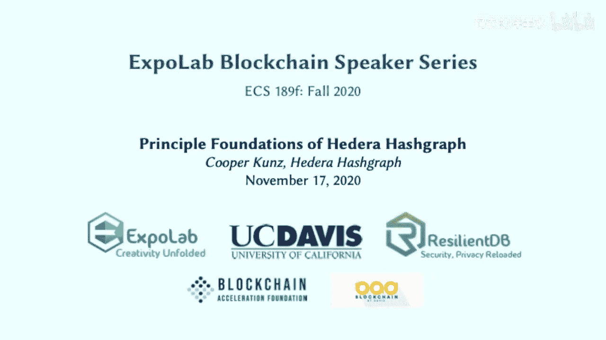

Hello everyone welcome to another session of Expo Lab Block speaker series and today is my great pleasure to have Cooper from Hederro Hashgra being with us and talking about their platform and so what's interesting about Cooper he has kind of a background both in computer science and philosophy and especially talking about blockchain and decentralization itself is an interesting philosophical question so he has a kind of a unique background being an evangellist developer Hederro hasshcraft so without further ado please take it away。

Yeah， thank you so much very excited and happy to be here。

 talk more about my background my experience， you know why I'm so excited about blockchain and distributed ledgers and specifically Haddera。

 Haddera is you know in my opinion， even if I didn't work there I think we're bringing really unique things to the market and helping kind of mature the industry so very happy that I get to specifically talk about what we're doing。

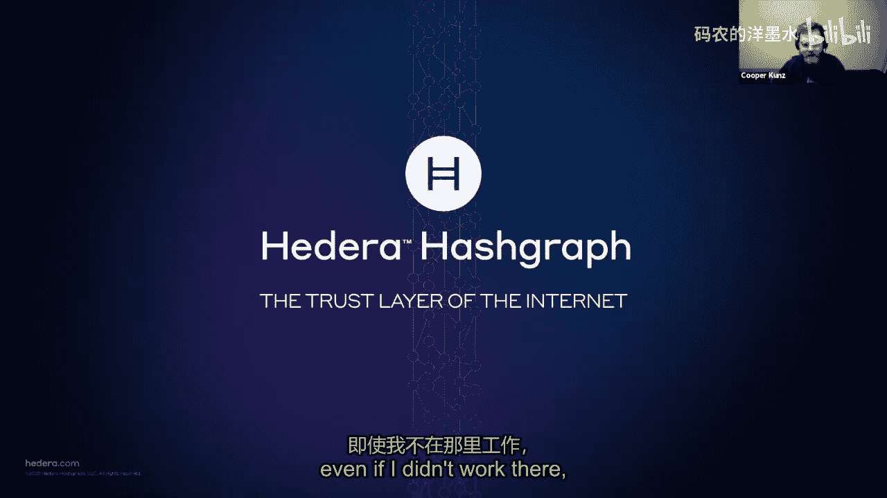

And so just to kick us off here， Hadder's tagline or kind of brand as we consider ourselves the trust layer of the internet or you know that's kind of what our aspirations are a lot of people talk about blockchains as being systems fundamentally about trust。

 you know he mentioned that my background is in philosophy and computer science so happy to talk about you know what trust actually means in decentralized systems and things like that。

But as he mentioned my names Cooper Coons， my job title is I'm a developer evangelist at Haddera so I get to talk to a lot of people speak at conferences。

 help companies and projects that want to use our technology I work with probably about 20 or 30 different startups and you know medium to small enterprises that are building on Haddera。

Going over their architecture， seeing where it makes sense for their use case or where it doesn't make sense。

And if you want you can follow me on Twitter almost everything I post is about Haddera。

 so it's a really easy way to kind of stay up to date on our press releases。

 news that we have coming out or if you ever have questions you can just reach out to me via email or on Twitter I'm pretty easy to find online and get a hold of。

嗯。So our agenda today， we have kind of five parts here， well be doing the intro。

 which is just an overview， a high level understanding of the Haddera Hashcraft public network。

 what our kind of goals are， what our approach in the market is。

 how we're different from some other platforms。The most unique thing about Haddera Hashcraft is that we are the only public network that uses the hascraft consensusens algorithm。

 so I will talk specifically about how that works and you know for anyone who's super super technical or really curious。

 I love the hashcraft White paper it was one of the things that got me excited about the blockchain industry and would highly recommend you to read it as well。

We'll talk about some of my favorite or some of the most exciting or high profile projects that are built on this public network we've only been around for about a year or two now so our ecosystem is moving pretty quickly actually and we have some kind of high profile use cases that i'm excited to talk about。

We'll also be showing you how to start building your own application so getting onboarded to our public test network。

 how you can get started with JavaScript and some demo applications that we have。And then at the end。

 you know we can take questions as we go， but if if you have you know longer discussions or you know you want to talk about something that I didn't necessarily cover。

 we can always circle back to it at the end and I'm happy to just hang out and。

Talk to you about what you guys are what you're all interested in I know that you had like I don't know if they've spoken yet。

 but Alex the guy who launched his own personal token and a bunch of other you know speakers so it's really nice to be able to talk to a class or a program that already has a lot of context about some of the newer things going on in the industry so it's really cool。

嗯。All right。

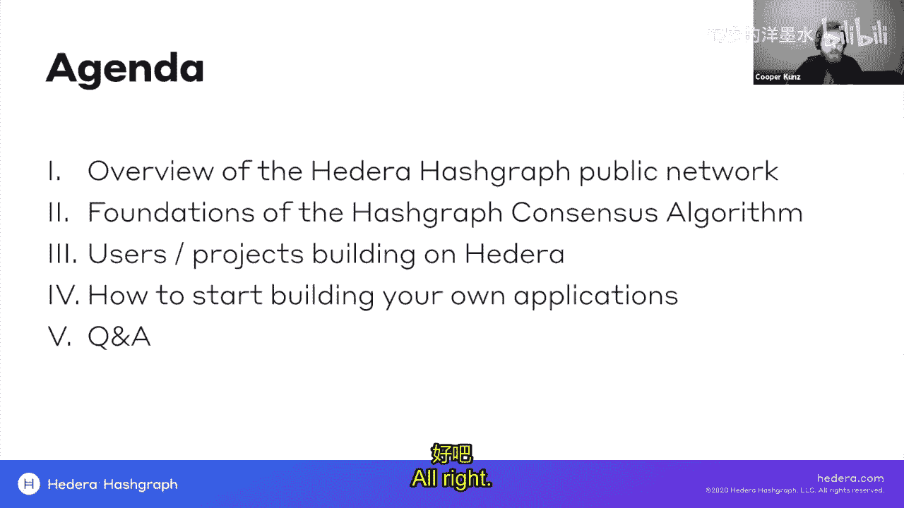

So I assume that I haven't lost anyone yet with the agenda。I'll just dive into part one here。

 it is an overview of the Haddera hasashcraft Public network you can find us on Twitter and around the web at hashcraft。

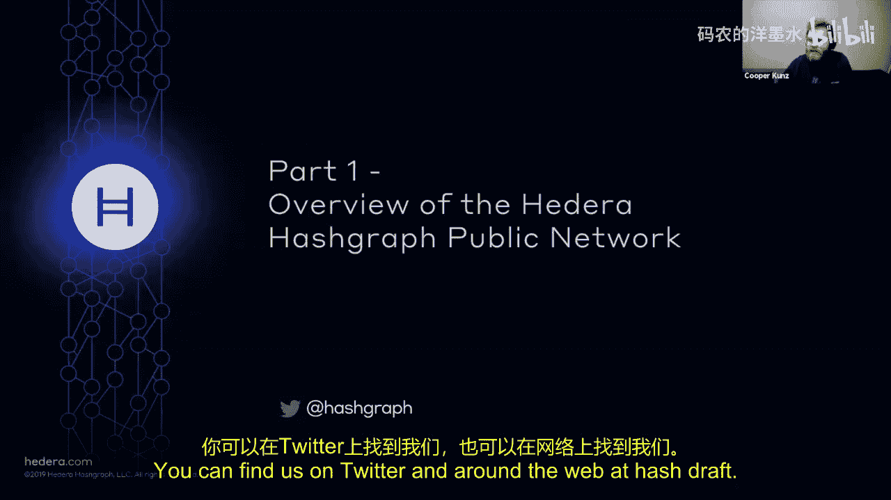

And so from the start， our goal was really to address what we see as being the hurdles for the barriers to enterprise adoption of public distributed ledgers。

 so there's been a lot of interest in the public distributed ledger market from enthusiasts from kind of the crypto anarchist community people who like sovereign money。

 but Haddera from day one has always been considering how can we get wide usage for enterprise applications in this new market with these new technologies。

And so we set out and hope to systematically address these kind of four problems that we saw with other platforms。

So performance， security， stability and governance and throughout this hopefully we can talk about how Haddera has taken a very methodical。

 very careful approach to creating an environment around these things that enterprises genuinely feel comfortable deploying or using public networks within。

So that's kind of our mindset is how can we build public networks or public distributed ledgers that enterprises want to use and how can we do that in a unique way that brings value to their businesses。

And so this is an overview of the Haddera network you know part two is diving specifically into the hashcraft consensusens algorithm。

 so I'm just going to talk at a high level what the architecture looks like and those types of things。

So obviously blockchain， you're all familiar with it， you're in this class。

 but the important thing is that hash graph fundamentally is not a blockchain。

 I'm sure you're familiar with DAGs or directed acyclic graphs。

So hashgraph is a particular type of dag， and we use that dag to build a distributed ledger with。

It combines a gossip protocol with what we call virtual voting。

 so somewhat like a historical voting distributed consensus algorithm。

 which we'll talk you know in depth about in part two。

 but I think it's helpful to kind of understand you know， 10。

000 foot view how hashcraft fundamentally is in a blockchain。

 and is its own type of data structure and it's also its own type of distributed consensus algorithm。

It's very high throughput， we can do tens of thousands or hundreds of thousands of transaction per second。

 it doesn't require heavy electrical usage， there's no mining， there's no proof of work。Um， and so。

 you know， just to kind of set the context before we talk about the architecture。Hashcraft is。

A mechanism to build a distributed ledger with， it's its own data structure。

 it's its own consensus algorithm。And we'll talk about how it works in a little bit。

But this is kind of a high level of what our ecosystem looks like。

 so at the very bottom of our stack everything Haddera does is built on this hashcraft consensus。

 it's built on this type of dag， it's built on this distributed ledger。

On top of the hascraft consensus we build different types of network services that use that consensus so our primary services our own cryptocurrency and an upcoming tokenization service and then the other kind of primary network service that we have is what we call the Haddera consensusens service so the cryptocurrency is called HbarR and we're coming out within the next couple months with ways to issue your own tokens somewhat like a modified ERRC 20 standard our upcoming token service will map to the Interwork alliances tokenization framework so they have a token taxonomy framework which is pretty cool it's a nonprofit organization with the likes of like Accenture and Microsoft and some big industry players。

And the consensus service is very unique， it's probably the most efficient way to log data to a public distributed ledger and we're seeing interest in it for being like the ordering service in hyper ledger fabric deployments or being the notary service in our three quarter deployments。

It's a really easy to use kind of lightweight messaging service。

 which I'll actually show you how to get started with at the end of this demo。

And so those are the two kind of primary services， we also have supporting services。

 which is the fact that we support EVM solidity smart contracts out of the box。

And we also have a file service as well， but we really see kind of our bread and butter or where we're finding product market fit with the cryptocurrency and consensus services。

On the left you can see that we have the Haddera Gning Council， which is our governance mechanism。

 which oversees the hashcraft consensus algorithm and the network services we'll talk about our governance structure in a little bit。

But they really control everything that's going on there in blue and purple and that gradient color。

On top of the Haddera network services， you know we have applications from just about every industry。

 we have real estate security tokenization， music streaming micropayments。

 people connecting hyper ledger fabric and cord deployments together。

 almost anything that you can think about for the industry is kind of build on top of the network。Um。

 so this shows you， you know， you have the consensus algorithm at the bottom。

 we build services and expose them via APIs on top and then applications consume them and use them。

One of the other unique things about the Hada network is that we have what we call the Mainnet or consensusens network that actually runs the hashgra consensusens algorithm and the services。

 so those are nodes that actually take in transactions and API calls they come to consensus on those transactions with hashG and all the interactions with those mainnet nodes require H cryptocurrency payments。

One of the efforts that we have done to ensure scalability is we have this thing called the Minet and the Minet is a specific type of node that can store all or some of the historical transactions that have happened we'll talk about it in a bit but because hashcraft comes to appvable finality on those transactions the main net nodes don't need to maintain entire history of everything that has happened like a blockchain it can actually just store the most recent events and prove that the state is cryptographically secure and then mirror nodes can store as much or as little information as they want。

And so we have this kind of two node architecture， this is becoming a very common thing to have different types of nodes or different types of servers that have very specifically defined roles。

 for example， you if you're familiar with the flow blockchain they probably have four or five different node types everything from consensus to execution to verification。

And this is super important because Haddera's main netnot can handle tens of thousands。

 if not hundreds of thousands of transactions a second。

 so if all those nodes needed to store every single one that has ever happened。

 it would be kind of a ridiculous storage requirement there。And so just in terms of categorization。

 we really see ourselves as kind of a third generation public distributed ledger。

 there's a lot of different projects that fall into this category that are trying to overcome some of the pitfalls of earlier generations of ledgers and just to more formally define this like the first generation。

 you could keep track of how many coins people had。

 the second generation v and Ethereum came out with programmable scripts in ways that you can actually put business logic on shame。

 third generation were're really looking to overcome the fundamental scalability challenges and potentially like the marketplace in the costbased challenges that would affect enterprise usage of these types of systems。

so right now we've been live for two years， can handle over 10，000 transactions a second。

That's within a single shard， Hadder is not currently a sharded solution。

 but if you look into our white paper sharding is very much on our roadmap and all of those shards would be able to handle 10。

000 transactions a second as well minimum。Fees were very unique in the sense that all of our fees are actually pegged to US dollars。

 so a business will know from day one based on how many accounts or how many transactions they need。

 what they predicted costs our years or months out in advance。

 if you're asking a very large company for example。

 take Google to build an application on a public distributed ledger。

 the fee mechanism or the fee marketplace on Ethereum where it could skyrocketets to tens of dollars overnight for a single transaction doesn't really satisfy a lot of their needs。

and then we're also dealing with near real time finality， there's no block reorgs。

 there's no changing history after transactions are final。

So we're seeing somewhere between actually it's closer to like two to four seconds of transaction finality on Haddera at the moment。

 which is pretty cool and faster than a lot of credit card processing that's going on。And then。

 you know， we're thinking back to the context of how can we be scalable。

 how can we actually address enterprise needs， just kind of a super high level market breakdown of how many transactions these networks can handle a day。

诶。Someone asked how is such fast finality achieved， we will talk about that in the second part。

 but the secret sauce is the Hacraft consensus algorithm。

 that is just how fast the Hacraft consensus algorithm comes to consensus finality。

But you know just looking at this like there's clear things that you can do that you know if if you're only using Bitcoin as a sort of value 400。

000 transactions a day is perfectly fine if Ethereum you're only giving out loans or doing automated market making you know a million transactions is totally fine if you're Hodera and you want to address some of these more specific enterprise use cases。

 for example， combating advertising fraud or issuing global digital coupons。

 you need hundreds of millions of transactions per day。

 so this is one of the most compelling reasons that we see people looking at Hodera。

And so just to talk about kind of use cases for Haddera that we're finding product market fit within you know it's the very early days of this entire industry and so anyone who's claiming to have found like perfect product market fit is probably lying to you but these are kind of the early categories of applications that are lending themselves well and we're seeing some traction in the market so far so data integrity we have a company called adtax which i'll talk about more later who's using Haddera to log all different types of advertising events and they can take that historical log of advertising events and give it to thirdparty auditors regulators and companies specifically dedicated to looking at fraudulent advertising and kind of。

Combat whats actually a billion plus dollar problem right now with fake advertisements。

 so being able to log those events in real time and hand them off to a third party with you know an agnostic DLT likeera is super valuable to you what they're trying to do with data integrity。

We're also seeing a lot of interest in micropayments because you can do such high transaction volume with such low finality times power transitions a cool peer to peer lending profile。

Pearer to peer lending platform for actually renting out energy consumption via microgrids so you can have。

Solar panels rent that out to your neighbor if you actually don't need as much solar energy as you generated that day。

 but we're seeing a lot of interest in micropayments。

And then the third kind of vertical that we're seeing a lot of interest in is decentralized identity with the Haddera Cons service。

 we actually implemented an SDK and services that map to the W3C's standards for decentralized identity and verifiable credentials so for a lot of these companies that want to implement decentralized identity。

 you can do so on Haddera with our quick transactions and low fees and they're still plug and playable with anyone out there who's still also implementing the W3C standards for decentralized identity。

So those are just you know super high level of how the network works and you know what kind of use cases that we we're seeing ourselves geared towards I think that this will you know clearly change over time and like I said。

 anyone who's claiming to have product market fit in such a new industry is probably not being very honest with themselves。

U， one of the most important things about Haddera is our approach to governance。

 where from day one been a platform for enterprise usage and we think everyones seen the fork wars with Bitcoin and Ethere the Ethereum even had like an accidental fork this past week。

 which was pretty interesting in a novel case of potentially a governance failure。

So Haderre's approach to governance is incredibly unique in the market。

how this works is we have a governing Council of up to 39 leading global organizations。

 what that means is that they have to be in the Fortune 500 of their individual j Lake region。

 we're searching for members from 11 different industries。

 at least one university and one nonprofit across you know all the major global markets。

In order to bootstrap the network， all these members are required to run a consensus node。

 they aren't paid anything to be part of the governing Council besides the fees that they get from running that node so it's just like any other node they don't have to pay to join I actually think it's just $100 to legally join the LLC so there's actually a company established in the United States that our governing Council legally joins to be part of the ownership body of the Haddera network。

and once you member， we're broken up into different committees， whether it's， you know。

 searching for replacements， whether it's determining the product roadmap and what features we need to add or where we need to fix different types of our Treasury or economics。

We have one of the largest law firms in the world on it。

 so if it's understanding our regulatory environment and how we fit into， you know， for example。

 securities laws and marketing and all those things。

 so they're very much in charge of like all of those things。Um。

 and you know we we try to have 11 different industries。

 universities nonprofits to make sure that there's a diversity of interest。

 you know we don't want all telecoms， we don't want all tech companies。

 we want it to be decentralized in terms of how they think about their approach to the DLT market。

And another way that we ensure kind of a decentralized governance model is that we can have a three year term with up to two maximum terms。

So unlike the Ethereum Foundation where the people that work at the Ethereum Foundation will still probably be the core contributors in a decade from now。

We can guarantee and actually prove that the same people in charge of it now won't be the same people in charge of it in six years。

 which is pretty interesting。And so these members determine everything from what we add to the platform。

 the consensus service that I briefly talked about was actually co-written by IBM and IBM's goal to bridge public blockchains with private blockchains such as fabric。

 they also determine when we build that how much our fees costs， how much of that goes to nodes。

 and Podera has a pretty hefty sized cryptocurrancy Treasury。

 so determining when we sell some of that to the market， when we allocate that to grant programs。

 all comes down to these 39 companies。And we also have what we consider to be strong governance。

 so we have both technical controls that prevent forks。

 so things like being able to sign state all the way back to Genesis and if someone wanted to fork it。

 they wouldn't be able to actually continue on with those same initial nodes and also being able to ensure that every node upgrades their software at the same time。

And this is probably one of the most controversial things about hashcraft is that the hashcraft consensusens algorithm is actually patented by our CTO Dr。

 Lehman Baird， and so we have patents and IP protections on the hashcraft consensusens algorithm。

 but there is no license required to use the network and all the codeb that has been patented is available for open review so you can go download it。

 you can verify you can run it yourself， you just can't use it for a public network。

and so that is one of the many ways that we think that we are providing an enterprise friendly and enterprise stable offering if you want someone like。

 you know just running with the example of Google to be able to build on your network you need to。

Have assurances that that platform isn't going to fork into potentially 10 different copies of their user data or 10 different copies of their token and all of these potential problematic issues that we've seen with the historical forks in the industry。

And these are the current members of the Haddera Governing Council。

 so we have Avery Denizen who makes most of the RFID chips in the world。

 Boeing everyone knows DA Pir is one of the largest law firms in the world。

 Deutsche Telecom owns Stemobile FIS one of the biggest money processors in the world。

 I don't really need to explain who Google IBM or LGR。

 magazine Louisa is the largest online retailer in South America。

Norra Holdings is a financial institution out of Japan。

Sorls is the company that Lehman our CTO actually started that builds and created the hashcraft consensusensus algorithm。

 so they're probably the only non public company that's on the council。

Tt Communications is one of the largest consultancy firms in the world。

 the University College of London does amazing research in the blockchain industry， great papers。

 great research。WipPro is another gigantic consulting firm out of India and Zane is a very large established telecom provider in the Middle East and Africa。

 so these are the companies that legally co-own an LLC that operates the Hada network all of them run nodes on our public network and when you submit transactions for example like Tata's node is ran in their private data center warehouse that's not available for the public Google Cloud is the only member who can run a node of the council on Google Cloud so we have pretty interesting model here where we want enterprises to use us we're giving control and ownership of the platform to those enterprises directly which is pretty unique。

And so just to talk a little bit about our team and how this kind of came about and where it came from Mans Harmons our CEO and cofounder。

 he was previously the head of Architecture and identitydent Company but most of his career was as a course director for cybersecur at the Air Force Academy he also worked at the Missile defenseense Agency and for the Department of Defense if anyone seen the movie War games。

 he actually spent time at the Department of Defense working on artificial intelligencetellig systems for nuclear threat detection so very much like what was in the movie War gamess was what Mans was doing。

Decades ago， and then Lehman Bairdt is the guy who actually invented the Hahcraft consensus algorithm that we'll talk about a professor of computer science for a long。

 long time at the Air Force Academy。Founded multiple companies before has some of the earliest publications in artificial intelligence like radio frequency jamming。

 all different types of stuff and got his PhD at Carnegie Mellon， brilliant guy。

 go read his papers on his website it's a lot of fun and if you ever hear him talk online like check out his YouTube videos super charismatic and one of the nicest people I've ever met。

And then just to talk about kind of like our executive team， I'm just the developer evangelist。

 i'm not not super important at the company， these are most of the people running the show。

 they have backgrounds of experience from Cisco， IM， FiIto All that is identity standards。

 a bunch of like some of the best companies in the world。

We have I want to say like closer to 65 or 75 employees now which is pretty cool we're actually headquartered in the Dallas area。

 so we're one of the largest and highest valued startups in Texas。In 2018。

 we raised over $120 million as part of a SAC agreement。

 if anyone's familiar with token fundraising structures。

 and we have a total supply of 50 billion of our native cryptocurrency。Um， so yeah。

 you can check out our about page， but mostly just saying there's a lot more important and impressive people at Haddera than myself particularly。

And so we have this very clearly defined path to decentralization so decentralization is always kind of the main topic for public blockchains right now we're in phase one of our path to decentralization where only the governing counselor running nodes there's currently 16 nodes on the Haddera network which a lot of people are like okay that's your tradeoff between having this high groupput and being decentralized we have this very clearly defined path where。

Phase two within probably two years will allow KYC or any one of our partners or customers who wants to to run a node。

 you will have to go it through an identity verification process。

 and then phase three of our rollout is probably anywhere from six to eight years down the road what we'll talk about it but we're proof of stake so that the amount of stake in our network would have to be high enough and high enough value that people cant can buy it all up on the market and attack us。

 but we have this very clearly defined path to operating permissionlessly with anyone running nodes in this public environment。

And what is unique about us too is like even though we do only have 16 nodes at the moment。

 we have access to physical infrastructure that unless you are working directly with Google Cloud or directly with IBM or Deutsche Telecom。

 you wouldn't be able to so like Google Clouds the only node in our network that's running on Google Cloud。

 if Amazon ever joined， they would be the only node from the council that's allowed to be ran in Amazon。

 and so comparing that to Ethereum， the Ethereum ecosystem where like they're completely reliant on inFra which runs on AWS is a very different kind of trust model or decentralization in the type of infrastructure that can be run。

Um， and then just to talk a tiny bit about our roadmap and what we're currently doing like right right now and what we're focusing on。

In 2020 we've done a lot of cool things so the entire services layer。

 the actual cryptocurrency and consensus service， we just open sourced all of that software about two three months ago。

 you can run that yourselves we also made the hashcraft consensus algorithm so the specific implementation is now available for open review。

Um， we just launched a stablecoin demo that was audited and formally verified from Quaant Stamp。

 which is one of the leading blockchain security companies， if anyone's familiar。

So we just did that and have released a lot of different types of token specifications。

There's kind of a lot going on here， but I guess the highlights of things that are coming next is we're currently working on the Rosetta API integration。

 which is an exchange standard from Coinbase， which allows you to get added to exchanges more easily。

We're working on ways that you can do kind of cool scheduled transactions。

 so if you want to send a payment， but you don't want it to be now。

 you want it to be sent in the future， make it incredibly incredibly easy to do that。

We have plugins right now for hyper ledger fabric if you want to anchor your hyperledger fabric blockchain onto Haddera and R3 Corda。

 if you want to anchor that onto Haddera， what we're doing next is working on a quorum plugin so that could be anchored to Haddera as well。

 and then interoperability solutions between all those different types of kind of private networks。嗯。

Yeah so those are some of the things that we're currently working on and excited about there's a lot of other things like we currently support Java JavaScript and go officially in terms of SDKs there's also community built ones and rust and do net we're working on official support likely coming out early next year for Python Swt and。

There's one other that I'm kind of forgetting about right now。

 but always a lot of things to do when you're working in this industry。

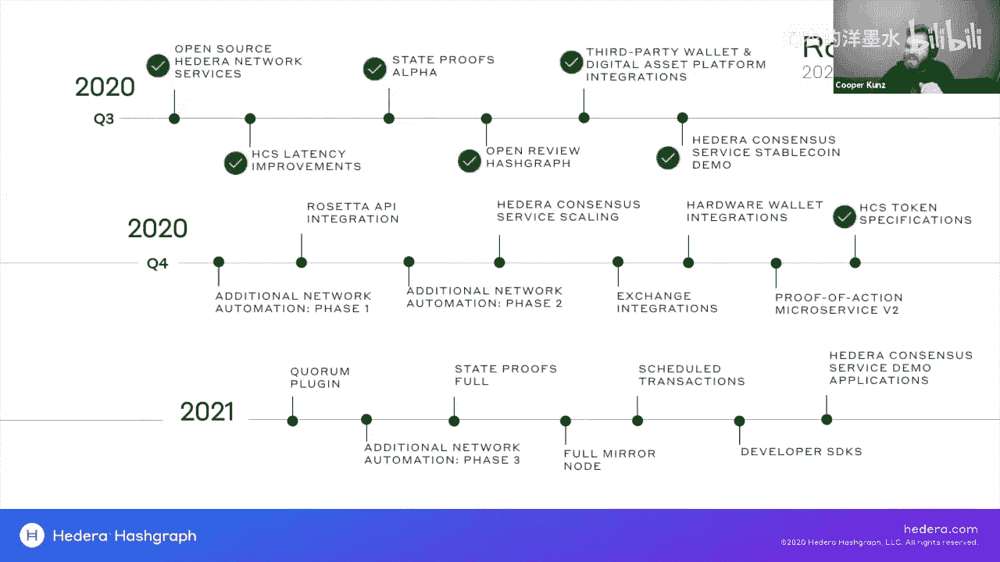

And so I'll pause for a second there because that's kind of the end of part one。

 which is the overview of hashcraft or Hedera hasshcraft as a public network。

 kind of our approach to governance and kind of our performance characteristics I'll pause for a second here if anyone has questions about our approach to the market。

So I have a question right now Hedera's whole network is basically a permission system。

 it's not permission list， it's not public yet because you have 16 people who have 16 organizations or 19 organizations。

 but they are the organizations who are basically controlling everything。

How is this model different from Libra's model or any JP Morgan Chase or any visas model because here still there are some sort of organizations who are going to basically authorize if even if you're giving a cryptocurrency out of something is still backed by some organization。

 those organizations will decide in other words， Bitcoinin if youum allow any note at this so why would somebody consider this as a public network right now？

That's an absolutely good question i'll talk about it kind of in two parts so one is that when we're actually coming up with this governance model of these council members in these companies it was 2017 we actually our CEO sat down with the head of Facebook leverra at the time and said hey you know this is what we're doing this is our approach to the market we would love for you to be a part of it。

They said no that's not something that we'd be interested in we don't really see the value in doing that two years later they come out what we would say with a model that's very much inspired by what Haddera initially pitched to them and actually the day after they announced the Libra network we took out a fullp ad in the Wall Street Journal saying thank you Facebook Libra imitations the sincerest form of flattery and just kind of thanking them for acknowledging and validating our approach to the market so we very much see Haddera having kind of pioneered that model of Enterse Le governanceover。

And then so to answer， you know， more specifically。

 enterprise applications or enterprise users of distributed ledgers kind of break down public versus private and permission versus permissionless into kind of like a four quadrant chart。

So public， you know， anyone can access the data， you know。

 you can have it on third party mirror nodes， anyone can， you know。

 anyone can run a mirror node which has the full chain of history and transactions that have gone on。

V private， where only authorized parties can actually physically have the data that's going on。

And then you know， the other quandrant is permission versus permissionless。

 so who has the rights to actually run those nodes？

And so over time with our path to decentralization。

 we will move from what in our perspective is a public permission network。

Where everyone can have the data， everyone can use the data。

 you don't need to authenticate to use the system。But you know。

 you're permissioned where only certain members have nodes。Over time。

 we will move to a public permissionless network just like Bitcoin and Ethereum。

And so the main genesis or the requirements for that transition is that if you're deploying a proof of stake network on day one。

 your network isn't going to have a lot of value。It would cost one third of however much your cryptocurrency is out there to attack the network。

And if you're trying to attract enterprise users， companies like DLA Pipers。

 one of the largest law firms in the world， just launched a tokenization product on us。

The cost of accumulating one third of our stake versus how much would cost the potentially value from attacking us just doesn't work out in the early days。

And so our goal is to align that pathity decent decentralization with our coins price and how hard it would be to accumulate one third of it over time。

 creating a stable network for any of these enterprises。You know。

 frankly a lot of enterprises are totally fine with having 16 diverse members that are segmented by geography and industry over time you know we're not getting a lot of complaints from our enterprise customers saying oh why can't any of the random public on a node and that's very much kind of just our enterprise focus so my question was never saying that enterprise will not be happy enterprise are already happy they already have they already have chase they already have control with something something more enterprise will never be the sad people the people we are talking sad will be the terms if the switch are the ones who have working anonymously towards in the environment of Bitcoin theory even if we say that down the line after six to 80 years you transfer to an。

Public network， which will be great。 The point is it's about the stake。

 and these companies will still still hold a very large stake。

 So a normal user like I can never come and actually make propose a block， even if I propose a block。

 my probability of getting having a stake which actually gets a chance。

 would be very low compared to a company like Google， for example。😊。

So yeah that makes sense does that happen I just want have an Yeah so I think it's just the question well for one the hashcraft consensus algorithm waits everyone's votes based on their stake so even if you have a very low stake you'll still be contributing to consensus even if you just have the minimum amount of H bar you're still contributing to the actual consensus on the network。

But at the end of the day it's just a question of who are you building for Hedera at the end of the day is building for these large enterprises we are not building in the kind of crypto anarchy spirit of fully anonymous transactions and things like that。

And。So totally can agree why you know an individual why those might be more interesting applications of these things。

 but Hedera has always been from day one， how do we get large companies to use these types of systems？

And。You know， some people， as you could imagine don't like it or don't agree with our approach to the market。

 which is totally fine， there's a lot of options out there for them。Thank you great questions。

Anything else before we move on to。Talking specifically about how the hashgraph algorithm works。

All right， I will take that silence as they know。Cool。

 so this is the foundations of the hasht consensus census algorithm。

For the sake of time i'm not going to be able to cover the entirety of the protocol。

 it's only a I think 12 or 18 page white paper for those that are technically inclined to read it。

You can go to Lehman。com or Hadderra。com back/papers to read the full paper really well written stuff it's super interesting。

 but hopefully I can just kind of explain it at a high level here and if people want to dive into the newty gritty of it。

 we can talk about it after in the Q&A section I just want to make sure that we save enough time to get into like the handson stuff。

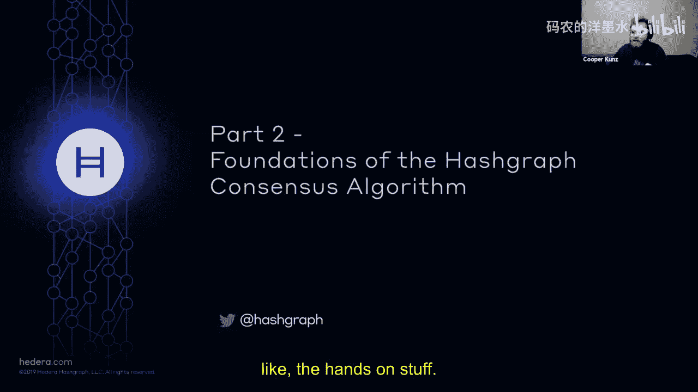

So the first concept of how hashcraft works is called virtual voting。

 so virtual voting is an algorithm that calculates you know in a Byzantine resistant manner。

 the times stampamp of transactions from a super majorityity of the network。Um， so 10。

000 foot view virtual voting is a way that we can determine timestamps on transactions in a potentially distributed network。

Historically there's been a lot of different types of votingbased consensus and so voting-based consensus were some of the first types of ways that you can come to agreements and distributed environments。

 I'm sure all of you are familiar with this， they're usually Byzantine。

 they usually are Ddos resilient， they're pretty resilient to firewall and virus and network to attacks。

 but they're traditionally you know going back to the 90s terribly terribly slow people probably want to deploy a pure voting protocol into production let alone for like an actual high throughput use case。

And comparing that to hashcraftft's virtual voting， it's still Byzantine， it's still Ddos resilient。

 it's still firewall or resilient， but it does have high throughput so you can do hundreds of thousands of transactions per second you have fairness of transactions ordering。

 which means that no individual computer or small subset of the group is going to actually be able to alter the consensus order。

 it's not like a minor where a minor gets to determine which transactions get included in a block。

 you have actual fairness in terms of transactions being ordered based off when they reach a supermajor of the network and so that leads to fair timestamps so if you're building stuff like auctions。

 fairness is a super interesting property。Chain Li actually just came out with a cool paper on fairness and distributed ledgers。

 which is worth reading and Hahcraft is the only example of this kind of virtual voting model that Lehman came up with。

And the other kind of 10，000 foot view of what makes hashgraphs so unique is gossip about gossip。

 so it's a gossip protocol or an atomic broadcast protocol。

 but instead of just talking about events you're also talking about the history of how nodes have talked to each other in this Dg。

UAnd so I'm going to break down these two concepts and show you how hashcraft uses gossip about gossip。

And virtual voting to come to these types of consensus agreements。

And just remember that this is the core kind of consensus layer on the stack。

 once we come to an agreement on those consensus timestamps and the ordering of those transactions。

 the services that are built on top of the hashgraph are how we actually apply those changes to state and process cryptocurrency payments and do all the kind of fancy things that you want with the network。

 this is purely just a way to come to a consensus order on all of the events and transactions。嗯。

So I'm going to try to try to do my best at explaining this here。

 highly recommend again the White Pa is great Lehman's way way smarter than I'll ever be。

 but on the left you can see that we have a group of I think about eight nodes and on the right we have a DAG representing the same group so as I walk through this it'll just be talking about gossip communication through both of these networks or you know graphs。

And so you can see that we're starting with a transaction in Alice。

 how gossip protocols work is Alice will choose a computer at random and tell it all of the events or transactions that Alice is aware of that other nodes in the network aren't aware of。

And so Alice gossips this event to Dave。Now Dave and Alice both have it and so they will continue gossiping this exponentially at random so Dave will send it to Bob。

 Alice will send it to Gina and we you know have exponential communication within this dag and so you can trace these events chronologically on the right and on the left we're basically just keeping track of who knows which events。

And so they keep doing this exponentially， you can see in this case within three rounds of gossip。

 everyone basically knows about this red transaction and you can actually graph this or build this out into the Dg。

And then in this case， you know， we're going to take an example of two more transactions coming in。

 Green's going to Bob， blue's going to Carol， they're going to do the same thing。

 they're going to gossip about these transactions exponentially at random。

And you're only telling computers about the transactions that you have that the other parties don't already have。

So if you know， Bob is sending this to Frank and Frank already has the red transaction。

 doesn't need to tell them anything about it， it just knows and Bob is going to you know keep sending it information that it doesn't already know yet。

And basically， this is how gossip about gossip works。

 it's just randomly selecting different computers in the network。

 sharing it all the information that they don't already know。

and eventually everyone will become aware of all of these transactions as long as there's a majority of honest nodes randomly gossiping these transactions。

 people will become aware of them。嗯。You can see in this case that like Frank received them in the order。

 red， green blue， and Gina received them in red blue green。

and that's totally okay different computers and the networks can receive them separately。

 it just depends on the random gossip。But because of the metadata and the information that's being shared here。

 you're able to run the virtual voting protocol on this DAG after everyone's become aware of it。

 and the virtual voting protocol will use that metadata to ensure that everyone comes to the same consensus agreements and orders on these transactions。

And so it's okay if people gossip out of order， that's how it's supposed to work。

 it's supposed to be random and you can't just shut down you know。

 a leader node or a minor node or one of these computers and affect the network from reachinging consensus。

The interesting thing here is that these nodes when they're gossiping。

 they're not just gossiping transactions they're also gossiping cryptographic signatures so you know who's sending it from who and you can actually prove that they're sending a timestamp which is when they received it so youd know on your local copy who sent transactions to who and when they received it as well so you're adding metadata to each of these events。

And then you're also adding hashes to previous records in the hash graph。

 which is how you know what the last transaction you received is or the last transaction that you sent is。

and so this is kind of what makes it gossip about gossip， you're not just sharing information。

 you're gossiping about who told who what and other nodes in the system at the same time。

And so this is how you're building that physical data structure in all of these nodes memories。

So Cooper， I think this is an excellent slide， perhaps you can go back。

 I think there are also a couple of questions， maybe let's go over this exactly step by step。

To talk about how does the gossiping itself for， how does the consensus is reached and how you can have multiple gossip at the same time。

 what are the different color means the green， the red。

 so I seem might'd be good to kind of go a little bit in more depth， especially your previous slide。

Yeah， on the previous slide， is that what you're talking about？

So I think that's where you're setting this stage。Yeah。

So I mean the colors are just different types of transactions that have been submitted， so you know。

 in the case of Hedera， you could take the example of a cryptocurrency transaction being sent。

And you would send it to Alice and then you can follow through the graph。Who gossiped with who。

 when and they're making everyone aware that。诶。This is actually a cryptocurrency transaction。

 this is when I received it and they're just doing this at random and。So each of these colors is。

 you know， for example， you could take the example of a cryptocurrency transaction。嗯。

And then later in history， so you know， as you go up in the graph。

 that means you're progressing with time。and so later， maybe 10 seconds later， whatever it is。

 two different transactions were submitted so someone sends another crypto transfer to Bob and someone sends that that's in green。

And someone sends another crypto transfer to Carol that's in blue。Um。

 and then all of these computers are just sharing the transactions that they're aware of with anyone else who they know to be part of this hashG。

 anyone else who's participating in it。So kind of to so go back so kind of so now we have three individual Alice is the one who initiates the red transaction Bob initiates the green and Carol initiates the blue and Alice starts initiating the gossip protocol to kind of eventually at some time everybody will see。

The red transaction and you're kind of looking at the stack here we have on the left hand side。

 everybody sees the green transaction first。你诶。The green and blue is a little more interesting。

 they're kind of happening at the same time， so now we have some notes we've received。

Green first some other notes have received the blue at first as part of that gossip so now so then so how does the so what is consensus means here now what if there is dependency between blue and green how do you pick the order so I guess those are now becomes a sort of the interesting absolutelyute you're hitting the nail on the head there very very much and so the gossip about gossip protocol only cares about how information is spread throughout the network。

The virtual voting protocol which is coming up in the next part after this is how they use the gossip and this daA that we're building to put these transactions in a consensus order。

 you know the high level is once it reaches a supermarity of the network。

 every node will have the timestamp that that supermajority received it and then you'll order it based on the median timestamp that everyone had received it but that's why it's kind of like a twopart protocol is the gossip is how the information is spread and the virtual voting is how that information is interpreted and put into a correct order。

Um， you have we have a good question in the chat here if only one person starts gossiping events。

 how do the others know that that initial gossip is legit or not？UAnd so in the case of Hedera。

 all these transactions are signed by the private key of whoever submits that transaction to Alice。

And you can and Alice will verify that， you know， say it's account 10 sending a cryptocurrency transfer。

 Alice has basically a record of the public key that's associated with account 10 and it'll match the signature on that transaction with what it knows to be their cryptocurrency account。

and so in the same way that Alice is validating that whoever submits the transaction to Alice is valid in terms of having the right private key。

 Bob and everyone else in this network has the public key of Alice and they can validate that the gossip event is also coming from who it claims to be。

So Alice validates and make sure that the right person is actually signing the cryptocurrency transfer。

And then in the gossip events， Bob and Carol and Dave， et cea。

 are validating Alice's signature and making sure that Alice is actually signing the transactions or gossip events as they claim to be。

Hope that makes sense， but we can also always circle back。

I have a question so how does gossip is not Byzantine resilient so how does it ensure that everyone actually gets every transaction what if someone is bad and they do not transfer or is if I gossip to three people and those three people ended up being the malicious so my transaction ever even goes to further other people in the network there are only three people are bad but just everyone is good or I up ended up sending to those three people so how does it ensure that my transaction is reaching to everyone。

So I might be misunderstanding your。Question or you know the specific scenario。

 but my understanding is as long as Alice is aware of this transaction。

 they will keep trying to gossip it out to the rest of the community。

And it'll send it to Bob and Carol， et ce， if some of those are malicious and choose to not gossip it or not continue sharing it。

 Alice will keep sending it to other members of the hashcraft。

And as long as a super majority of them are honest。

 it'll eventually make its way to the rest of the network。

So my question is how many people does Alice send initially like let's assume network has 10 people so does Alice send to all 10 or does it send to five people or two people how many how does it decide that's what my question is Alice will try to send it to everyone in the network。

Okay， so basically it's an all to all communication so Alice will p Bob。

 if Bob isn't aware of that transaction， then it'll share it。

 but if Bob is aware of that transaction hash， then it won't。Um。

And so if Alice is the only one gossiping， if everyone else is being attacked， then yeah。

 Alice will communicate to every single member of the network。

I don't know if that makes sense or not。So I suggest that's。

Kind of have an abstract is let's say somehow gossiping everybody gets it I guess they're a different way of doing gossiping now let's get to that consensus then I think we can come back to the gossiping question also important Yeah no no worries Yeah I don't want to I feel like we're already going be running out of time here so I apologize so so I'm just going to ask if you could also quickly go over the second slide the second graph I think that was also a very interesting graph。

Which one， this one or？This one， yes， I kind of understanding the notation here as well， too。

Yeah so this is just keeping track you can see we have three different types of lines here you can see that Alice was made is was the node that the red transaction was submitted to first so Alice is aware of。

This transaction， whatever it may be。And then you can just basically trace the gossip events and you can see that。

 you know， if if it's a full line， Alice already knows that this transaction is there。

 if it's a small dotted line， that means Alice doesn't know that these members are aware of this transaction yet。

And then if it's a full line that means Alice is aware because of the communication that has happened so the difference is that。

Basically， Alice sent this transaction to E and to D directly。

So Alice knows that nodedes D and E have received it。

In the case of the D to B or D to C transactions。Alice will become aware that these members of the network have received it。

And then the dotted line from b to F because it's kind of a second tier transaction that Alice didn't communicate with at all Alice isn't aware at that point in time that。

B and F actually have the transaction。So that's interesting so so you said correctly。

 not only Alice is gossiping its message， but it's also waiting for a gossip to hear back that everybody learned the message。

We have almost like a two gossiping happening。That's yeah。

 that's kind of how it works is that Alice would become eventually aware through a subsequent transaction and specifically the hashes that are being shared that like say eventually D gets back to Alice。

 they would sync events and they would share all the information of who else they communicated with。

So like I said， it's a pretty complicated protocol， so I was yeah。

Try not to get too hung up on the details here because I see that we only have like 20 minutes left or something like that in the class and I still have a good amount of stuff to cover but happy to keep going here。

Sure， no no， let's continue。嗯。Yeah， so what gossip at the high level is that each node will share the entire history of who it just talk to and when they all will eventually end up with the same picture of this Hahgraph except for obviously the latest events which will eventually sink。

highlyighly recommend the white paper though like you're curious or we can talk about it more at the end。

 I just want to kind of make sure that I get through。Everything that we have here。

And so once you have this history of who has talked to who when。

 you can run a virtual voting protocol on the hashcraft that you have on your local machine。Um。

 I'm sure people are going to have a lot of questions about this。

 but how it basically works is we can divide this hash graph up into rounds。

And our round is created when the super majority of witnesses in the previous round can be what we call strongly scene。

And a witness would be the first event in a round for a given node so this gets pretty specific pretty quickly。

 but hopefully the diagrams are somewhat hopeful you can see in round one say we're starting fresh from a brand new hash draft that each node would be witness to a specific event every round your node will become aware of one event first and that is what they're technically a witness to。

These are very specific kind。Terms that have been defined for the hascraft consensus census algorithm。

And so famous witnesses basically mean that a superma or a lot of people see this transaction in the next round。

So in the case of。BB2 here you'll see in the graph that eventually that B was a famous witness because this transaction was seen by a supermajority in the previous round。

诶。And。Yeah， this gets pretty， pretty specific pretty quickly。诶。

Wwhichch is again wire for people to the White Paper and also Lehman has some great YouTube videos like he gave a lecture at Harvard last year which was like two hours straight just on the consensus algorithm。

 which was really interesting。So another sorry so another interesting question。

Right now the hashcraft is not really about the data model。

 hashcraft is the communication pattern or the Dg that you were referring to。

It's the communication pattern of the gossip。It's not the data model of how the chains are stored。

The chain or the ledger is still a single。Still a linkus， not a da， is that correct？

So the hashcraft is a physical data structure that exists as a dag。

 all this gossip is going on on everyone's。Dag and basically everyone's keeping track of。

Everyone else's like events and so the distributed ledger that's spill on top of that dag or that consensus algorithm。

Isn't actually storing this entire thing forever there's just too much。

Communication and too many things going on that it offsets that a mirror node sometimes。

But this dag does exist in。Physical memory stored like this。

 it's keeping track of who has already seen this like this diagram is running on every single person's nodes。

In terms of。Running hasht does that but in terms of in terms of a ledger again putting the communication aside in terms of a ledger。

 each node one to kind of still is attempting to have a serial order of a transaction kind of written down so first transaction one the transaction2 the transaction3 in then transaction4 so that chain of transaction to be executed to be agreed upon of this of the node participating that's that's a single。

Serial order it's just a chain。 its not a it's not a da it's not a graph it's not that all of a sudden you split some those do like the third transaction。

 some do transaction5 and then kind of multiple chains or almost forking there's no forking involved in the data model。

 the data model is it a single chain。Again putting this on the communication and how they learn about the transaction with that aside the data models is that a chain or no So the virtual voting will end up resulting in a single sequence of consensus timest based transaction so it's basically like you can think of it as a linked list and then it'll read that linked list into what we build is like basically a replicated state machine on top of it which keeps track of feeding those transactions in a consensus order to affect the state of it so the services will keep track of like accounts of like who has what what amount of cryptocurrency who has what file like it's basically just like a globally shared database and those services read in those consensus ordered events in so the Dg model then it's really the communication is the communication pattern in which。

Results into that serial order of execution。Yes， yeah。

 that's a pretty good way to summarize it and the way you're doing this to step by step at every step。

Just because of the nature of the gossip， few more notes become aware of that transaction and few and。

More and more notes become a aware of the transaction at every phase。

But at the every step additional notess and eventually you become super maturityity or eventually while everyone become aware of that particular transaction is that yeah that's that's pretty much how it works and then because you know。

A super majority of the network has those transactions and you have the timestamps that the supermar has received it。

 you can place them in a median consensus order based on those timestamps。

So what different and what is the definition what's the difference between supermaity and majority here so if I have like 10 nodes when do you consider when do you consider that to be majority。

 when do you consider to be superma you have 10 node。It'd be two thirds plus one。

 so I guess plus one is the supermaity yeah。Oh，Okay， so once it。Okay， good。

 I was just going to say in the case of Adra， it's a stake。

 so it's whoever has two3s plus one of the H barss weighted to。Those nodes。

 but in the case of if you were putting out a private deployment of hashcraft。

 it's always two/3s plus one。So then now the other interesting question is that at some。

2 third of the network we'll learn about the red transaction and at some point23 we' also learn about the blue transaction。

 but what if they receive it in a different order？I mean。

 that's not really guaranteed that to the super majority will see observe this transaction in the same order。

It's probably guaranteed that they will observe it eventually and become super majority。

 but what happened to the discrepancy in the order， which order is。

So it would be based off the median time that the supermarity has seen it。

 so if it happens that the blue one is just getting gossips slower rather than the green one than the green one is likely to end up with an earlier median consensus timestamp and that would be included in history before based off the time that a majority of the network had seen it。

嗯。And in the case of。诶。We have a pretty interesting blog post that shows how we talk about fairness and so fairness is the case that is unless you have more than a third of the network it's very hard to actually manipulate that median consensus timestamp so you might be able to change it by like a few milliseconds or a few seconds or you know the actual network speed that the first computer you send it to might matter a tiny bit but at the end of the day it's it's way more fair or。

Good at getting that consensus order， then something like a mine who can arbitrarily choose which transactions get included in which block。

Or so if I'm Alice so like I said， I'm Alice and want to propagate the direct transaction， I can。

 could I sort of act cleverly and don't do gossip， basically just send it to everybody？

Alice will try to send it to everyone as quickly as possible。But directly。

 dont even don't wait even for the cause to just。I you just start sending the message point to point to every single other node。

 for example， you have 16 nodes or even 100 nodes。呃 just。

And of'm essentially doing a broadcast to everybody instead of following the gossipA and most likely everyone will be hearing a director from Alice。

Before the gossip kind of I mean so the gossip definitelyly is trying to share it as quickly as possible like Alice isn't waiting for anything to happen。

 she'll start gossiping it to everyone as quickly as she can。

Every other node will also do that as soon as they receive it from Alice so it will'll grow exponentially quickly and as fast as it possibly can like there's no delay in the gossip protocol or anything like that like they're always just trying to send out any transactions that they're aware of as quickly as possible to as many people as possible。

And so when you do that， so then it is possible that you kind of always end up in this split situation is that you have majority majority。

Maybe super majorityity have seen both A and B， but majority。

 one majority says ICA first followed by B， the other one says ICB followed by a and you kind of get into this deadlock situation if you have these concurrent A and B are being sent out。

So what would happen in those cases？U so the super majority or the nodes that first see a super majority of the network would all。

Have the timetamps of when the rest of those you won't get to the supermaity so you would be the case that so you said2 f plus so you said2 f plus one you get to the majority and let's say seven out of 10 you need seven out of 10 just for the sake of the example seven out of 10 is a supermarity。

 but then you have six on each side。Or another six on each side。

 you have maybe split five Cs a first followed by B， the other file Cs， B first followed by a。

 so you have a split decision。And so what would happen in those cases， everybody's seen A and B。

 but network is split， have seen A first， have seen B first。

 what is the resolution mechanism in that case？So my understanding is that there are some very very irregular chances in which that happens if there's two that have a you know very close consensus timestamp or there is a split majority there's a random coin flip basically that happens in the case that is built into how it works so it's like in the event that we've already sync all of the events in the event that we still can't reach to consensus we will do what is an arbitrary coin flip to pick one over the other。

Okay， that makes sense， Thank you。Yeah， no， no worries。嗯。And so all this kind of。Jump to this one。

 which is how you can。Implement what is strongly seeing， so not just being seen。

 but actually see it through the supermajority， just because you have everyone's copies of all the transactions and when you received them and who they received them from。

 you can practically run a graph search through your DAg and draw lines to the supermajority and you would know the median timestamp that they had actually voted or determined that they saw this transaction。

And I am kind of， I see we only have like 10 minutes left， so trying to get through this。

But so after a few rounds of voting you would know which events are famous and which aren't if a decision can't be made in this round。

 you know you would just keep doing it and keep doing it until a decision could be made like we talked about in the event that it was stalling and the network wasn't able to come to a decision like we just talked about they would do at coin Flip to determine which one it is every node has a distinct copy of this hashgraph on their machine。

 so they're actually all going to run this voting protocol separately which is why we call it virtual voting because youre only voting on things that you have on your physical computer but they will all which we have a formal methods verification and proof of it that they all come to the same result based on the hashgraph which is pretty interesting and if you follow formal methods Lehman is very。

 very serious about this， they did it with Carl Carerry who heads a formal verification at Carnegie Mellon。

And so you can actually go download it's a COQ proof of the hashcraft and census algorithm and it's way above my head。

 but very interesting stuff。嗯。In transaction ordering， like we talked about。

 it's based on a consensus timestamp of the median of all the events and they're basically put into that median consensus timestamp for transaction processing so after a transaction has a median consensus timestamp it'll be fed up the stack into the services and then we'll actually execute the cryptocurrency transfer and the noal updated database to say that now account 10 has eight tokens and this other account just received two of them。

Um so the hashcraft will come to a consensus agreement and timestamps and feed those into the services to be processed。

And that's kind of like the separation of the two architectures。

The hashgraph codebase that runs this protocol that we just talked about is available for open review we actually just released it a month or two ago so you can go download it。

 clone it， run it locally， we have a cool diagram that'll actually build this good example demo that'll build this hashgraph in real time and you can like run it at full speed or run it very slowly and you'll see all the gossiping and all the events going through it and then the services that are built on top of it are fully open source so you can go clone those and run it and it will come with a hash like I think a three nodeode deployment baked into it and you can just run that and see how everything's kind of put together。

And then kind of one of the other things to notice is that hashc was already originally intended to be a permissioned blockchain or distributed ledger deployment so you know all the nodes what we did with Haddera is we've generalized this into a proof of stake implementation where we have what is called proxytaking an actual staking stake is just how many tokens you have dedicated to your node if other people want to give you their Hbar it's kind of like a delegated proof of stake mechanism where they can proxy their H bar to you and they can give you their weight and consensus。

And so it's important to note like what defines the network or what defines how much influence someone has over a hashgraph in Hadera's case。

 it's not the nodes， it's the amount of H bar that they're holding。

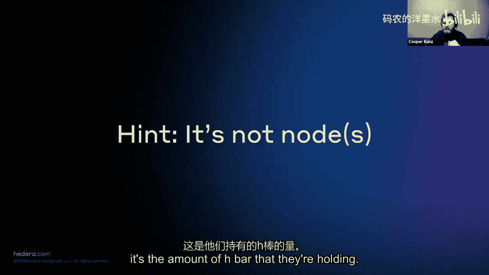

系。There's again， no leader or delegate election type event。

 it's just how much stake an individual node has， whether that's holding directly or if that's holding it via proxy。

We make it so accounts will automatically proxy their tokens to one of like so if you don't define a node to proxy your tokens2。

 it will pick one of the council nodes at random and basically guarantee that your HR is actively contributing to consensus。

Um， obviously every node participates in consensus， it's not just the minor。

 it's not just the leader， everyone is always kind of running this protocol。嗯。And again。

 just a high levell hashcrafts a consensus algorithm and actually a physical data structure that is built to be fast we're currently running it in this public permissioned environment and doing 10。

000 plus transactions a second if you want to run the services locally you can probably get it up to 100。

000 we're just you know we're not seeing needs to run it at 100，000 T at the moment。

 so once demand is there to actually implement those types of throttles we would。

Worry about it then it's also not sharded， we could build sharded versions of this。

 but there's just not enough need to at the moment。

U it has formal methods for proving its Byzantine fault tolerance。

 specifically in an asynchronous environment， those are like I said probably over my head。

 but if you're into those things I can send you the links and you can verify them yourselves。

It's very efficient in bandwidth and computation people every event or every time that they're actually participating in it is actively used for consensus you're not solving random math problems like improve work。

And it's leaderless。Which is kind of cool people like that about hashcraft。And just to reiterate。

 this is how you know， architecturally sits the hashgraph consensus algorithm just comes to that order of transactions and timestamps on those transactions。

 it doesn't keep track of balances or files or contracts。

 those are all services implemented on top of that consensus algorithm。

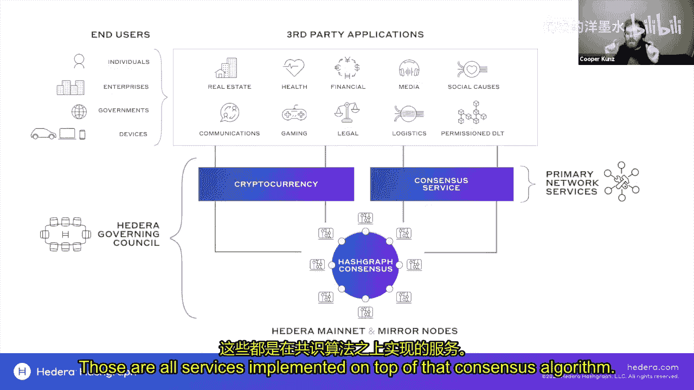

And that was it for part two of the actual consensus algorithm， I highly recommend the white paper。

 if you look up Lehman Baird hashcraft on YouTube he has really really good videos。

 brilliant brilliant guy way smarter than I'll ever be talking about how it all works。

But I do see that we're almost out of time already。

 I don't know if I should keep going or if we should just jump to Q&A here。

 what do you think makes the most sense？I think it's kind of up to you maybe you want to just perhaps wrap it up in a few minutes maybe there are a few slides that you think it's important sort of a concluding slides maybe we can jump to those and then we go to QA I mean so I think was an excellent I mean I think detail on their consensus the core consensus I think this is what the students and everyone kind of really excited about hashG and so I think so that was really nice in depth overview of I appreciate that yeah i'll just kind of breeze through some of these things we've had over 8000 devs on our test networks and we have 3045 plus applications live we're currently doing over a million transactions of day which is more than the entire Ethereum network。

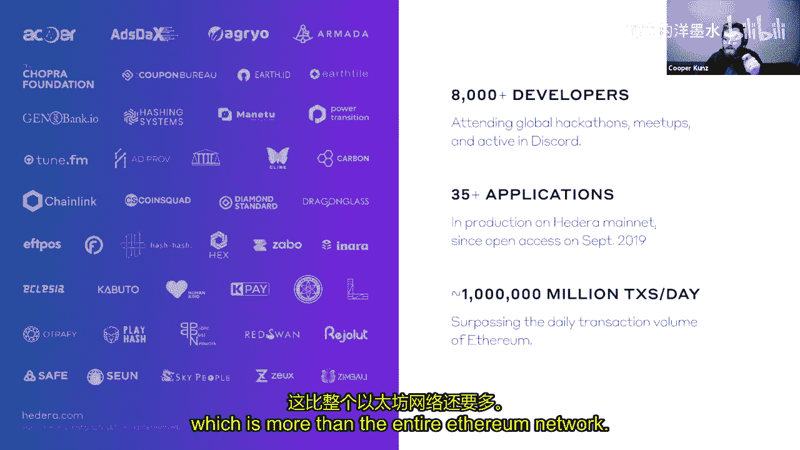

AdSs probably accounts for 80%， maybe 75% of all the transactions。

 they have some of the largest advertising companies in the world using them to mitigate ad fraud hugely valuable business the coupon Bureau actually went live last week so this is a digital coupon offering that's backed by Proctor and Gamble Targ Walmart consortium of physical retailers who is offering digital coupons that can be used across any of those stores on Hedera which is pretty cool coupon fraud is also a huge huge problem especially if anyone' seen coupon wars or extreme couponing great show but they're doing some cool stuff around that。

Acor doing really cool things in the healthcare industry。

 they're actually building an application with safe health which is being used at Arizona State University to keep track of COVID testing and approving people to go back on campus and stuff like that it's also being built with the Mayo Clinic and Delta for keeping track of medical reporting。

And those are users that we've had for a little while。

 all these users have just been announced in the past couple weeks so we don't have like actual slides on them yet。

 but Deeppoak Chora is building a mental health care platform on Hodera which is pretty cool he'll have his own token DLA Piper is one of the largest law firms in the world who's building a security token offering on Hodera。

Spencer Deninwoody is an NBA player who is kind of famous for tokenizing his NBA contract。

 building an influencer platform on Hodera where people can launch their own tokens。

 and just today actually we announced that we're working with hollow systems who is building a mechanism for preventing or alerting people in Syria of airstrikes or pending conflict zones。

 which is pretty cool。诶。😊，And those are all of kind of our our most exciting users part four was supposed to be hands on getting building with Haddera since we're out of time I'll probably just send links to tutorials or references and things like that it's incredibly easy like you just sign up at portal。

haderra。com you get a testnet account within like a minute it'll give you an account ID publicprivate key we have SDKs and Java Javascript go。

net and a lot of docs and tutorials and resources for that。嗯。

And then the last part here was just Q&A and this has links to you know those things that I just talked about so portal is how you can get a testnet account if you go to Hadderra。

com/getstar it'll talk you through some of our use cases some of our example applications， tutorials。

 it's really easy to build with it's really fun even just like compared to Bitcoin and Ethereum if you've programmed in those environments being able to submit a thousand cryptocurrency transfers within us like a minute just seeing them kind of fly through the network is pretty cool we have a really good discord chat where we have a couple thousand I think 3000 or so。

Engineers actively in there， so if at any point you have questions about how to build onjaRA or about how any of of these things work or run into issues or you know that's probably the best place to go to get real time help from our community。

Lots of stuff on our YouTube， so many good talks from Lehman who invented hashgra。

 other members of ourenium and people who have built on the network。

and if you have questions about anything that we talked about or anything Haderre is doing feel free to email me directly it's just Cooper@hadera。

com very easy to get in touch with i'm happy to set up like you know additional calls to onboard anyone who's interested。

And building on our technology， or if you just want to dive deeper into how the SDKs or APIs work。

 it's all super fun stuff。

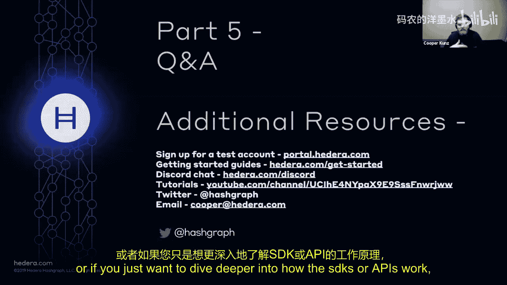

Everyoneone who attended， we really appreciate it like I said before。

 I saw the speaker list and I was incredibly impressed。

 this industry moved so fast and so the fact that you have people doing really cutting edge stuff like you have speakers from Libra and Hedera and people doing interesting stuff at the application level。

 I'm very jealous and wish I could have taken this class when I was in college。

Thank you so much and again on behalf of Expo Lab and UC Davis， we wish thank you again。

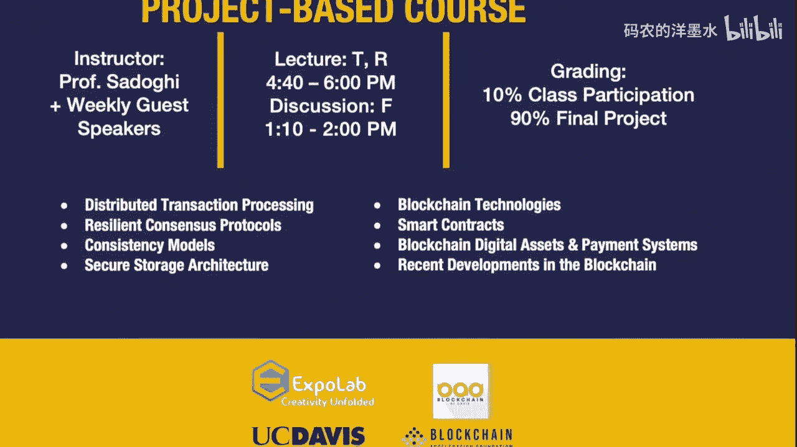