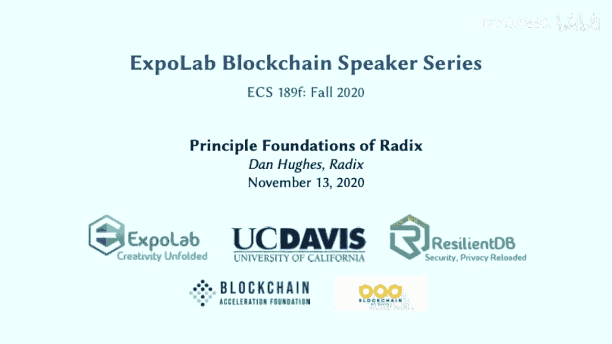
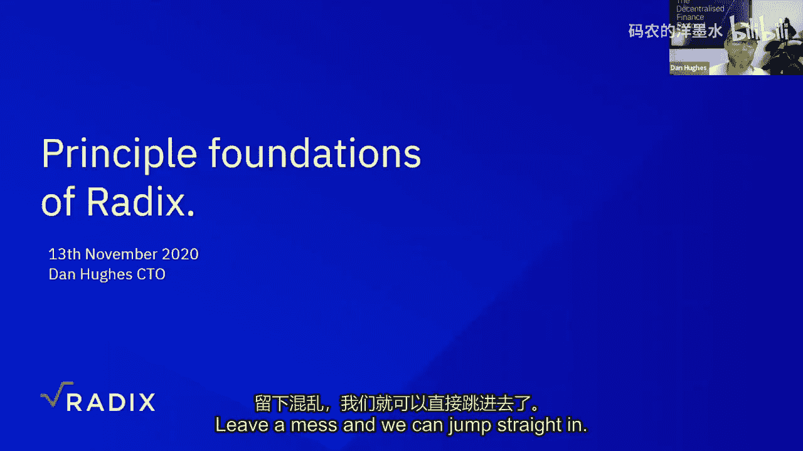
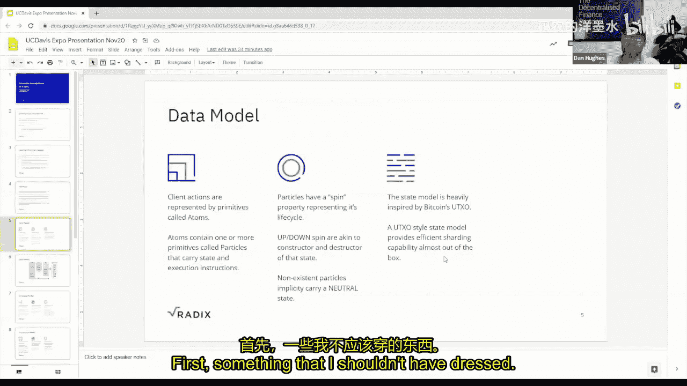
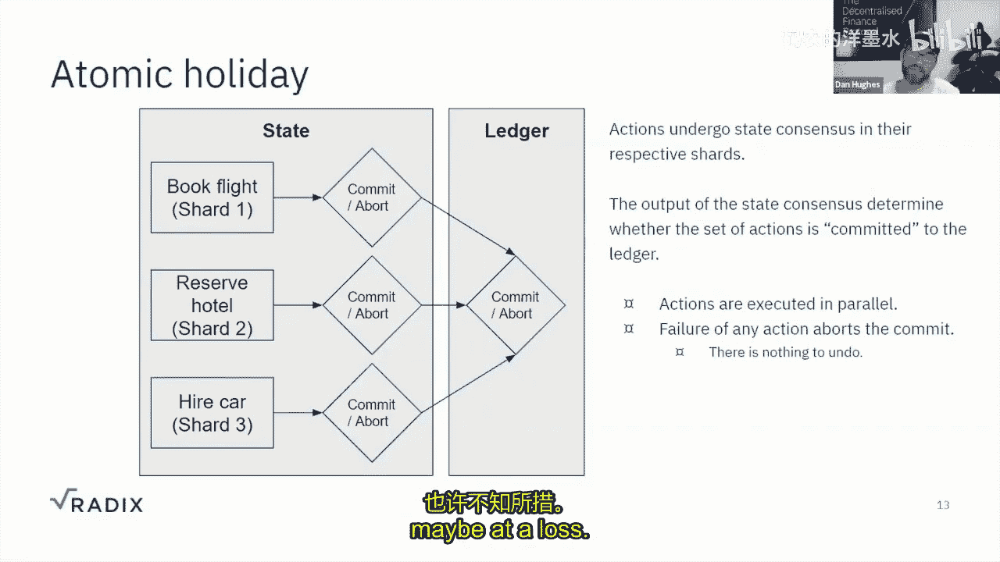
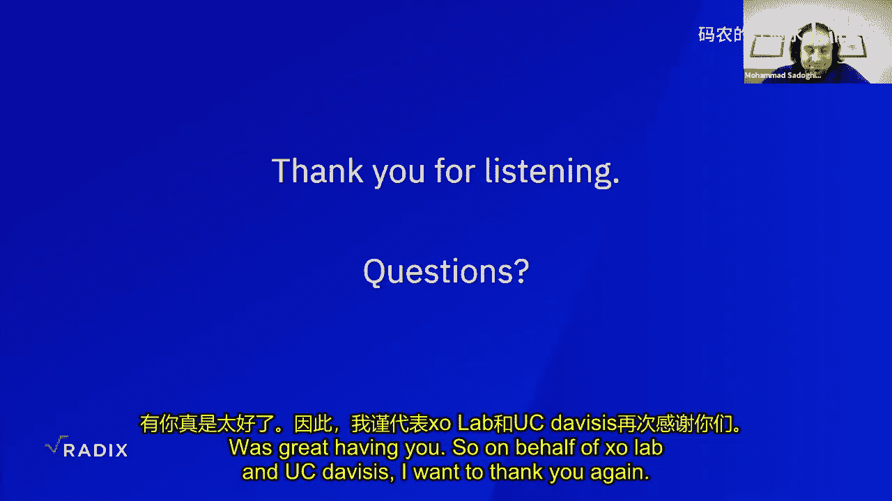
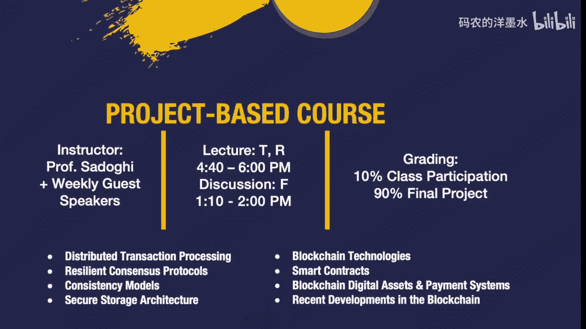

# 【全集】加州大学戴维斯分校 分布式交易与区块链架构 中英字幕 完整课程 p16 Lecture 12 - Radix的核心原理 -BV18YFVzME2f_p16-

Hello everyone welcome to another session of Expo La blockchain series and today it's my great pleasure to have Dan Hughes CT and founder of Ras to join us so quick about Dan so he's done really interesting work from foundational work in NFC mobile payment and in the last few years his focus has always been on。

blockchain and so as part of it he's developed and founded Ras and the Expo lab had the sort of the pleasure to be working with a Ra of team over the last year or so。

 so were very excited to have Dan today with us so without a furtherdo please take it away。

Thank you Profeor and thank you for inviting me to give this talk today so I did want this talk to be a lot more technical than it's going to be。

 but Ras touches on so many areas and topics that it didn't feel right to make it purely technical and pigeonhole into one particular topic。

😊，As you may like lose context on。Vatics as a whole and what it is we're trying to achieve so instead I'm going to take it in the direction of a fairly high level kind of overview and presentation of what we've done over the past number of years and the kind of things that we've had to think about and key things that you need to consider when you're building a permissionless blockchain or distributed ledger and how all those things fit together to enable a scalable。

 secure shrr consensus platform。Um so that's where it's going to go for today if anyone has any questions。

 any point， just shout or raise your hand or。Leave a message in and we can jump straight in。

So my journey， like most peoples started when Bitcoin was released upon the world and the main thing about Bitcoin that grabbed my attention was somebody had managed to actually solve。

The Byzantine general's problem in a permissionless environment。

 which up until that point was kind of a pipe dream for all of us computer scientists and hobbyists and。

'tNo one had really even got close before， there was always that kind of element of centralization and you had to trust somebody。

And it grabbed me in such a way where。I'm an engineer。 So I like to， I like to break things。

 and I like to understand how， how things work and take them to the limits and to try and improve them or find inefficiencies that maybe can be fixed。

 And so that's what I did way back when， a long time ago now。Um， looked at the Bitcoin White Paper。

 got the source code， took it part， played around with it， spun up networks， test networks。

Ran large amounts of throughput through them to see what would happen。

And a few things that I found or had a intuition that would happen over time would be that it would run into scalability issues across with compute。

Storage， communication， etc cetera， that mining would centralize over time and this was before there was GPU accelerator cards being used for the proof of work。

Solutions and Ass and。FGPs and all that kind of stuff。

 It really was back then very much one CPUU1 vote is to quote to Saoshi。

And over time that's happened， mining has centralized into pools and big mining farms and it's generally quite inefficient as well。

 a lot of power is in quote wasted to find the next to find the next block。And it will always have。

A long term market volatility due to the way that the economics and the emission and just the incentives in the network drive a very volatile market for long periods of time。

 still decades to come。So。After playing around with Bitcoin for a couple of years and and breaking it multiple times and making it cry。

 I thought， well。Everything that。Where Bitcoin is going if it wants to be a global。Currency。

 if it wants to be able to decentralize global finance and be a network of value。

 then really it needs to be able to scale above all else。

 everything else you can kind of live with if you have to。

 but to put 7 billion people onto Bitcoin as it was then and even as it is now。

And would really cause major issues。And this is kind of where， where verdicts， as it is now， was。

Began back in 2013。So the first thing I did was think about a blockchain and how maybe you would scale that。

And that led me down the obvious path of， well， let's have multiple chains and let's have block trees and directed acyclic graphs。

And just change the data layer。More than anything and that allowed multiple computing consensus instances to run so you could have different parts of the network working on different things at different times and it wasn't sharded in in the traditional sense at this point。

 everyone was still storing everything， but the data model allowed these multiple instances of consensus。

But there was some fairly large limitations with that where you couldn't transact outside of the branch that you found yourself on。

 et cetera， et cetera， lots of issues with it， but it was a stepping in stone into the next it。

 which was called cast。Which stands。For it's not a very good anagram。 really。

 it was kind of shoe honed into itself。 concurrent asynchronous state trees。

 So it was the first real sharddi model。 There was 1024 shards。

And the data in the state were explicitly separated from each other。

 and there was this kind of sparse state tree， which could be reconstructed by。

Thoseose in the network and they could fetch pieces of this state tree from different places that they needed and they could validate that either things were valid as state or invalid as state and the validators within that model were largely stateless。

 so you kind of had data silos and then you had your your validators。

And the data silolows would provide the state information that the valid is required。

It showed quite a lot of promise， but things like zeroology proofs and bullet proofs to be able to prove state from a sparse Merel tree and threshold signatures and all those things that are really now only just beginning to be solved properly in such a way where they become viable。

There was none of that kind of stuff really around in 2015。

So from there we went to the next iteration called tempo and it's important to note that each of these iterations while a failure as such。

 there was a lot of learning that happened here and a lot of the learning was carried from one to the other and each time we made significant progress in terms of the scale and inefficiency and when we arrived at tempo we had a much more defined and improved sharding model we understood a lot more how we needed to have the data model and the sharding model interact with each other and our consensus mechanism was as synchronous and it used logical clocks and state commitments to determine the order of events that had happened and which event had majority agreement in the network。

嗯。And with， with that iteration， we achieved just over 1 million transactions per second in 200。

19 just over a year ago， we replayed the entire Bitcoin history 460 million transactions in around 15 minutes。

U。😊，And we thought we were there with tempo。 But there was a few issues with it。

 There was some edge case but fairly serious safety and laness issues， which we spent some time on。

 And we could solve them。 But one thing that was really missing was。Cssyard atity。

Which as you'll see a little bit later on in the presentation is quite important。

 especially especially at the moment with all these various D5 products they're all touchy to and you're doing things like yield farming and you have all these different smart contracts that go and talk to different smart contracts somewhere。

And so we took our almost there with tempo， we went back to the drawing board。

 all the lessons learned and arrived at Serverus， which gives us scale。

 gives us the atimity that we need， but is quite fundamentally different to tempo in terms of its consensus mechanism。

Any questions so far， Any thoughts？没有。Everyone's good， cool。

So service is a culmination of all the previous iterations and research that's been done over the past seven years or so。

And。We had the goals of。We want to be able to develop a。Scalable network， whatever that looks like。

 whether that's sharded or some other mechanism， stateless， etc cea。

 and our stretch goal was for it to be more efficient than proof of work but offer similar levels of safety。

嗯。😊，Serverice goes a little bit further than those initial goals that we set。

 It allows us to have some additional， desirable and interesting features。

 such as composability of complex actions and as already mentioned， atity。

And these were important because if you look at。Bitcoin， for example， it's it's quite difficult to。

To get it to do something that it's not really designed to do。 It's very specific in its role。

 It transfers value， essentially。 And the there are various bit improvement proposals that have been submitted over the years。

 and things have changed。 and new features have been added to the， to the the。

 the bit scripting language。But it's still very difficult to do complex actions with it。

 Then we have the next step from now， of course， is Ethereum， where you have a virtual machine。

Ching complete。So you can easily。Put together complex actions。

 but there's there's quite a lot of complexity in actually doing that as a developer。

And so we'll also talk about those things a little bit later on。Really， there's， there's maybe four。

4 or five main topics that you need to think about and what we've had to spend a lot of time thinking about when developing this technology and serverus and。

One is the data model， the data model， how do you organize the data that's going onto the ledger。

 how is that how is that constructed is it is it generic。

 do you need it to be a generic data model so that it doesn't really care。

What information it is that the network is processing， it just does it achieve consensus with it。

 makes sure sure that it's safe and the actual content of that data is handled at the application layer or is it something that's very specific like Bitcoin where it really is just transactions and so you can have a much simpler data model。

Second thing is your sarddi model。How does that look how how do you how do you shard the data。

 how do you shard the state， how do you assign validators to deal with those shards is it a dynamic sharding model。

 is it a static sharding model all those kind of different questions and things that you need to think about。

A things that we've also kind of had to spend a lot of time on and gone through multiple iterations trying to figure out what is the best compromise。

 what is the best set of features we can get from those compromises。

 how does that relate to the data layer， how does it relate to your consensus。The third thing。

 obviously is consensus， you need a consensus mechanism of some kind so that you're。

St machine replicas and everybody can agree on what's happened and they can replay it and they can validate it and make sure that everything's all in order and then perhaps the most difficult thing that Satoshi solved with proof of work and blockchain is civil。

How do you prevent。Rogue actors from taking control of the network easily。

 how do you ensure that you can always meet that guarantee of2 f plus one， how do you。

 how do you make that expensive， either compute or economically or by any other means of reputation there's also some reputation systems as well that deal with civil。

And I think that really is the genius of Bitcoin that it was able to use proof of work as a civil protection mechanism。

 but also use proof of work as a means of a decision making element to the consensus。You know。

 which which is the strongest chain， if there are multiple chains to choose from。

 which is the one that's the longest and has the most proof of work associated with it。And also。

 it was used as a economic means of distributing the currency。

 so really killing three bes was one stone， so she definitely didn't do things by halves。

And it's very elegant as well。嗯。As this presentation isn't going to be。Completely technical。

 you can find some technical content on the server's consensus。

 the paper that we and the lovely guys at Exp Labs collaborated on。

 they helped us a lot with that to verify that we weren't crazy and that what we were trying to do actually did what we thought it did。

and the professor and his team did a lot of work with that so very grateful for your for your work there it makes for。

😊，I'm not gonna say Sunday reading because you need your brain turned on a little bit to digest it。

 but it's， it's， it's a good read。 And then after you go to raex DLT dot com。

We've got a bunch of content there and various of the white papers on some of the stuff that I'm going to be discussing in the rest of this presentation there's an economics paper there that talks about the economic model that Ras will utilize and how all the incentives work and how they align and price unlocking and all that interest in economic stuff。

And also documentation on the RadX engine， which is the application component of our Radix steelity stack。

Okay。So first thing is the data model makes sense to start here， seen as this is how。

Where everything really kind of spins off from。So quite simple， the data model。

 which is always a good thing， but it it。Ls itself very nicely to be sharded so if I'm a client and I want to present some action to the network for execution。

 such as a transaction， then I create a primitive call an atom。

Excuse the numbman clcher here we're physics buffs over in Ras as well。

 so there's a lot of atoms and particles and spin and things like that and an atom is a collection of primitives called particles。

And a particle will carry state information and also in execution instructions of what to do with that state。

So if you imagine that you have 10 Bitcoinin。And you want to spend that to somebody else。

 Then the state that's being carried is that you have 10 Bitcoin and that it hasn't been spent yet。

 and the execution is to create a new particle that has 10 bit to whoever it is that you're spending it to。

Um， you can also have particles that carry messages and do various sort of things and you have the states。

 the payload and then the execution instructionss。UmParts have a spin which represents the lifetime。

 the life cycle of that particle。So if you are spending your 10 Bitcoin in the previous example then。

The particle that represents the 10 bit that you hold will have a spin up and when you spend it and that atom is executed。

 that particle will go into a down spin state， So they're kind of a into up being a constructor and down being a destructor。

嗯。😊，They're the only explicit spin states for。How do you press something。

Press something that I should' have。

Up and down spins， yes。So there are only those two explicit spin states。

 there's a third implicit one which is basically a neutral state and that just means that a particle hasn't been constructed or hasn't been destructed。

 it just hasn't existed anywhere yet。It kind of deals with particles in the state。

 so typically if you were to look at the lifecycl of a particle。

 you would have the implicit state which is neutral in the example for the 10 bit。

 you would have a particle would be created with 10 bit and put into an upstate when you received it from whoever sent it to you and then when you spend it on to somebody else。

 it would go from the upstate to the downstate and somebody else would get a new particle in the upstate that represents that 10 bitin。

嗯。The state model sorry， the data models， I should say state model really as well。

 I guess it's heavily inspired by Bitcoin's UTXO unsp transaction output model。

It lends itself very nicely to be able to do state sharding because you have these kind of inputs and outputs or spin up and spin down and you don't have to kind of track a balance across shards。

 it's much easier for something to permanently live in a particular shard and then you just manage its life cyclee within that shard。

It also means that if you， if you are mapping。Your particles in a deterministic manner。

 then they will always live in the same sh， so given a particular piece of information about a particle or some state。

Anybody in the network will always know what sh the entire life cycle for that particular piece of state will live。

 so then it's quite easy to go and fetch that state if I need it for anything。So wait。

 just to clarify the up and downspins are just referring to the creation and destruction of the。

Objects in the UTXO transaction or no。Yeah， basically。 yeah。 So， so the。

 the uppin says this thing has been created。 And so if I try to create。

 if anybody tries to create the same thing and the network， then that will fail because it's already。

 there's already something in an upstate that was there before。

And when I spend or consume that particle， it goes to the down state。

 which is basically the destructor。 So if I try and use it again I a double spend。

 then that will also fail because everybody who needs to。

Query is this in in a down state already knows exactly where to go in Luke and who to ask to give them that information and obviously then you can you can audit that information as well if you want to be sure that is this really in a down state yes it is and you can follow you can follow the the history of that particle and any subsequent particles prior to it that created it and you can audit their up and down states all the way back to。

Genesis inception， basically。Okay， thank you。So this is a really rubbish diagram that I put together quite quickly to try and show this from a from a high level。

 so the particles that are green， they are in upstate and the particles that are in red are in a downstate。

 And if you kind of imagine these as maybe。😊，Currency， like a bit。

 each particle represents a bit and these bitins are being sent around the network。

You can kind of see quite easily from this diagram how the particles transition from an up to a downstate and new particles maybe are created because that's the person who is receiving those funds。

And at the end of a number of atoms， you have this kind of。The sum of all the states。

 which represents the total legger state for those particles。

 so the top one is up because nothing's happened to it。This one that started as up has gone down。

 so the legis is down and so on and so forth， quite simple and you can you can follow what's going on。

It's extremely high level， but it's quite a nice diagram to kind of be able to visualize what's happening with this up and down states。

There are obviously some actions where you don't want the particle to have a downstate。

 so if you had a message， for example， then you you can't really spend a message or put it in any kind of downstate it either exists or it doesn't。

So some particles you're able to specify this can only ever be in anop it can never go on a down same for if you were creating a token right so you were creating Bitcoin2 or Ethereum classic。

 then the particle that defines the properties of that token， how many in circulation。

 what the emission curve maybe looks like， etc cetera， et cetera。

 you don't ever want that token really to be going into a down state because if it was。

 then you potentially void all of those tokens that were ever created。So Dan just a quick question。

 so when you were sharing this last figure， so got me thinking how about smart contracts。

 so how would you。Willll kind of characterize arbitrary smart contract in that model。Yeah。

 this is this is why I was around with with his presentation all day。

 theres there's so many bits and pieces that all kind of play into。😊。

The kind of ra stack as a whole it was， It was quite difficult to pick four that I could fit into an hour so。

One of the things that we're also doing is we have this component called a vX engine。

And the RaX engine is kind of the application。Environment for particles， so。The。

 the current version that we have is， is， it's quite simple。

 These are these predefined components that particles can call to execute and do various things。

 And we have messages。 We have token value transfers。 We have token definition。

 So you can create new token。 We have a multis component， some of the bits and pieces。U。

 but we're working on the next iteration of the RaX engine to be a lot more flexible。

 a lot more generic and to actually you be able to code your own kind of。

State machines that you can call from a particle to execute do this thing right I want to I want to well we'll get to an example later on I guess。

I've got one down the bottom， which is quite interesting。So on that later duration。

 I'll be able to deploy a particular state machine that can execute some code and function on particles that have particular parameters or input arguments to that state machine。

 so I can do really interesting kind of composition of particles， composition of state machines。

 I can define the order that they're executed in and can do all this kind of composability stuff。

Which is。Really quite important for developers because at the moment it's easy to make a mistake in solidity。

 for example， it's quite low level。The tooling is a lot better than it used to be。

 but there's still a lot of room to make mistakes there。

 so we're approaching it more from the other direction there kind of Lego bricks so you've got these kind of predefined state machines that you can plug together。

That will do 90% of all the things that any developer really needs to do。

 but if you're a real hardcore or you're doing some real innovation in what you're trying to build in a decentralized application or a DI application。

 then you can go a bit lower and you can build actual code and define the state machine and then deploy that to the network as a particle in its own right。

The other side of that to attract developers is that we also have this model where。Um I can。

 I can receive royalties for any particle state machine definitions that I submit to the network that get used。

So it's kind of like monetizing your dependencies in a way so I can build this really cool thing that does this really cool stuff that people can then build different applications around using other available dependencies and particles and components that are built in and all these different state machine definitions and it becomes very kind of drag and drop and almost domain specific language to a large degree and if you want to go really low you can so。

That's kind of where we are now very simple just toe in the water with that kind of stuff。

 these basic components that you can put together in different ways。

 but then over the next 12 18 months or so really start to open that up so you can have programmable steam machines and stuff。

But they're still。Quite constrained， so things that are like。Simple bugs there， you know。

Typo at 4 AM in the morning because you're tired。 Those kind of things youd be able to do form of verification of the code and that kind of stuff as well。

 So still still constrained， but flexible enough to do。

Anything anything that you can think of banana D LT， really。诶。Hopefully that answers your question。

Yes， thank you。So the Shi model， this is probably。The piece that's been through the most iterations。

So trying to trying to。Create a model that could satisfy the criteria that we had allow us to do state chartarding。

 allow us to do it in an efficient way that would complement the data model that would complement consensus that would also allow us to deal with all kind of civil stuff as well。

Really took a lot of， a lot of time， a lot of， a lot of hair pull in。And a lot of thrown away。

Coode and ideas。And eventually， we settled on。This idea of we should have a very large。

Shard space that will be quite sparse So as can see there on the screen we've got a shard space of two to the power 25。

6 shards， which is a lot let's say bring it bluntly。

And the reason for going with a fixed shard space is you're able to do these interesting。

Deterministic functions aren in a fixed shard space so as I was saying before you have a particle。

 you know what shard it's always going to live in， you know how to index into that shard。

 you knew how to look up who you need to go and talk to to get the information in that shard if it was a dynamic a dynamic shard space where the number of shards maybe grew and contracted。

That information would always be changing particles and state information and consensus output would be。

transransitioning from different shards as the shard space was growing or shrinking。

 then you've got issues around how do you synchronize a new replica against a shard space that's always changing。

 how do you determine who's going to be serving which shards if the shard space is always changing。

Things that seem quite trivial at first Luke。When you have a dynamic sh space。

 they actually turn out to be quite complex problems。

 so just having a fixed known static shard space of2256 or whatever number。

We needed was best because。Sharards that are empty don't consume any space。

 they don't consume any communication bandwidth， they don't consume any CPUU and the nice property of having a very large but sparse shard space is that later on when the technology for stateless validation has moved down the road a bit further a fixed but sparse shard space maps very well onto things like sparse Mer trees。

All the various zero knowledge technologies that have being developed that use sparseness of data sets as a means to。

 to prove or disprove particular things。嗯。So that's the reason behind to fix shard space。

And shards contain。The consensus output， any state information， any parameters。

 any payloads for a particle over its life cycle and because the shard space is so large。

The chances of two particles occupying the same shard as minuscule。

A particle and it shard or a shard is responsible for a particle。

Hence you're able to always know which shard you need to go to。

 who you need to talk to to get information for that shard fill that particle and determine what its lifecycle is。

 what state it has etc and the mapping function is quite simple it's just a function of the atom and the particle hashees。

 they then determine which shard that particle and its subsequent information over its lifetime where that lives。

obviously in a Sardian model， you need validators and you need a mechanism that determines who's validating what and where they are and for how long they're doing that and are they being churned out and replaced by other validators。

 what happens if validators leave the network what happens when they join。Um， so。It's fairly obvious。

 really， we have a global set of validators that are registered to the network by some means and。

Depending on how many validators we have and how much throughput we're seen in the network。

 how many shards are occupied， all this kind of input information。

 we take those validators and we put them into sets and we determine as well which group of shards that validator set is responsible for。

so if we had say a thousand00 available validators in the network and we wanted to maintain 10 validators per set at an absolute minimum。

 then at most we could have 10 validator sets and those 10 validator sets would。

Be gently responsible for the entire。Shard space。 So in this case。

 the shard space will be chopped into 10 equal pieces and。

A validator set would be responsible for one10th of the shard space。 if it was 100 validator sets。

 then they'd be chopped in the shared space would be chopped into 100， et cetera， et cetera。

There's this notion of epochs， which at the moment is daily and what happens on an epoch。

As we churn the validator sets。For two reasons one。

 we don't want any validator set that has been compromised to remain that way。

 so when we return the validator set we we move a portion of the validators out to replace them with others so if the。

If the validity set has been compromised， then hopefully we will remove some of the adversarial validators and put them somewhere else。

Um， the second reason， of course， is validators may leave the network as well。

 and if you don't churn out your validator sets and remove move those validators that have left or are known to have left。

Then you obviously potentially run into liveness problems later down the line。

mThere in order to be able to。manage the validator sets and put them where they need to be and churn them on epos there's this concept of a root sh which is specifically for storing registered validator information as we'll see a bit later on as well some additional information goes into that sh to do with our civil model which has some additional properties that determines who goes and what validator set and where they go but essentially does this root sh that everybody has。

 everybody has a copy of and that gives them all the validator information。And from that root shard。

 for any given epoC， you're able to determinly calculate who is serving what。

 what the validator set looked like， which shard groups are they serving， etc。

So yeah the next note there particle and state information loopups are efficient。

 the validated sets of the current EPAC Act as a map into shared space。

I mentioned about moving to stateless validators at some point in the future。

The desire for that is there's a cost when you churn your validator sets。

Some of of the validators that are in the incumbent sets will be moved out to a different set and that different set will serve a different group of shards so those validators will not have the information for those shards they won't have a copy of those shards they won't have there won't be a replica for those shards so on each epoC validators that leave the set that they are currently in and move to a new one need to synchronize all of the state information。

 the particle information etc with the new validator set that they're in。

And so that obviously has a cost not just to the validators that have moved。

 but also the validators that are remaining in a particular set because they have to deliver the information to their new arrivals。

 hence the epoC can't be too short， otherwise you just stand up with this endless synchronization of validators across the network which just sucks available bandwidth and throughput and compute。

If you're if you have stateless validation where you have a secure means of providing state to a set of validators that they can efficiently validate and be sure that it is correct。

 then they don't have to synchronize state because they can trust and verify any state that they are given so you can move validators around you can compromise any。

Coned shard you can eject the adversarial component of that shard without there being any additional work you can and your epos can be a lot shorter as well so the window of opportunity for anybody to cause disruption or to cause liveness or safety failures etc within a compromise validateator set is also much shorter as well if you're able to do stateless validation。

I have have a couple questions more of of a general question so。

Is Reds essentially leveraging servers for？I guess to create a like finance based protocol。

 I asked that because we've had previous presentations where。Like for example。

 other companies are leveraging Ethereum or。Yeah， Ethereum to create like a framework to then construct on top of that applications you guys just。

Are you guys also working on that or is it just kind of for financial purposes like？

No it's designed to be a generic solution， so its it's data agnostic from from a kind of abstract theoretical point of view。

 the particles really are what define。What the data does right， so if I have if I want to build。

A finance a financial application that moves some value， some token value form place or another。

 there will be a particle with a state machine that it calls that does that specific validation you know is this balance valid is there enough balance to do this has it been spent already etc cea。

 etc ce from from a from a really low level point of view we really wanted the。

The entire stack to just not really care what data it's moving and so and then you have these kind of plugins which are the particles and the state machines that then do the validation and the actual work of making sure that this data is able to be processed by the network。

 it satisfies the constraints and it's able to be validated， it's not double spend。It's， it。You know。

 it can do what it's meant。Its supposed to be doing。But。The consensus mechanism。

 the Shaard model and all the civil stuff。I it doesn't really。

care what you're doing so we've we've built chess games on this we've had a bunch of hackathons where we've done various things we've we've built cards for humanity on it we've did we did a Netflix clone somebody in the community built a Redit clone called Rait which was quite funny and there's another project called podium that was used in。

We're RaX engine to prototype a Twitter clone， which they then got funding and stuff for。

You can it's just a generic protocol and it doesn't really care。

 it's like this is kind of TCPI and then you've got something on top， which is your HTML。

Kind of the stack is nicely segregated that way。And then my second question。second question。

 so my team and I as Professor Molo stated。We've been reading the servers paper and。

So when you say you're using servers， we know that there's like pessimistic servers。

 optimistic servers。Coourse servers are using the entire system or how or just a portion of it。

We're not really using core server for what we're doing。

 it really doesn't lend itself for permissionless networks。

We are more towards optimistic than pessimistic because we have some stuff。

Around the application layer and the data model that we can leverage to kind of short circuit any failures and stuff like that that you may get in their purely pessimistic model。

So it's it kind of sits in between optimistic and pessimistic， I guess。

 if you if you wanted to kind of stick a pin in its somewhere。And it we're also。

Another reason for using optimistic is。And the next slide we' kind of get into it a little bit of the consensus model。

For our local consensus， we're using three face hot stuff。

 which gives us some some nice benefits on its view change that we can use as well so it can。

It can allow us to be a bit more optimistic。On the same lines as what Hor1 has。

 have you faced it like any roadblocks or any problems with Cus or in its implementation so far？嗯。

Not really anything that's major in terms of the theory。

 there's quite a lot of moving parts and so we could always do with more hands and more hours on a keyboard to implement this。

The issues that we're facing are really the interactions between the different components。

 So the data model， the shardri model， the consensus and civil getting those。

 those four things to really behave and to talk to each other and to kind of catch any issues and deal with them appropriately is is。

Kind of where all of our implementation issues are coming from。In terms of serviceus itself。

 the implementation of serviceus is going really well。No real bumps in the road。

 its it's integrating it with all the other stuff。So we can actually deliver what we want to deliver。

 that's where we're getting all of the issues， I guess。

 in terms of how do we how do we ensure that the the validated selection set。诶。

I is correct and it's strong against civil actors and what happens if you have a really strong adversary that has a lot of influence pooled in one place。

 but not in another， how does that affect his overall influence in the network。

 what can he do and just all that kind of kind of stuff that isn't really talked about at all in the server paper but it's stuff that we're having to think about a lot and well probably write subsequent papers on it as well and share our findings all that kind of stuff。

Can you go back a page real quick？So the validators is more so a concept that shows up in these permission and less blockchains right it's not necessarily。

Okay， I'm just trying to clarify that okay thanks yeah so so in traditional blockchain if you're proof of work。

 proof of stake etc cetera， then it's not your kind of classical BFT where you've got multidree you know votes are being cast and collected and counted by a leader it's probabilistic and in its nature so you don't really have validator sets so there are some some projects such as cosmos which is using a variant on PBFT I think to drive its blockchain and you've got Zilica which is a sharded。

Blockchain has kind of multiple chains。that talk to each other and the civil protection mechanism is proof of work to actually register into the network and then this concept of epochs there as well where you churn across the different shards but within the shards I think they're also once you're in a shard and you've done your proof of work to get permission as it were to enter the network I think they're using a PBT variant there as well so this kind of concept and a validateator sets and the hybrid of the two between proof of work or proof of stake。

And your kind of classical BFT consensus mechanisms are starting to show up in different places so。

Yeah， I'm not sure does that does that kind of pretty much answers Yeah。

 I would definitely recommend looking at Ziliica and Cosmoss if you want to kind of see some innovative thinking around how can we moul the two the probabilistic and and and the safe and have them run side by side and use one as a civil protection and there's a one as a consensus mechanism。

😊，嗯。Yeah， and there's a tenderment as well， I think uses PBFT or raft， I'm not sure。 yeah。

 there's a bunch of。Okay， so the consensus is how are we doing for time， by the way， Are we。

 are we okay。So far I think you're okay and if you need an extra few minutes that's also fine。

 most of the students here are going of be in the next class。Anyway， so I think this should be fine。

 Okay， cool。So consensus model， I mean， if you've if you've read the Cbrius paper。

 then you probably already got most of this for those that haven't or those that haven't had time yet。

Essentially there's there's two consensus domains with servers。

 you've got the state consensus domain and you've got the ledger domain state consensus is。

The consensus that runs within a validator set， so。

These validators are dealing with a particular particle that's doing some action and they're looking at the information in that shard that represents and stores all information for that particle。

 and they want their consensus mechanism to agree or disagree on。This change happened to that state。

So if you've got an atom that has multiple particles in， then you'll have 2，3，5，10。 however many。

 however many validate data sets involved in the ledger consensus。

 and they will all be doing state consensus for each of the particular particles they're responsible for。

Um， and leisureger consensus is the bit that happens when the local consensus is finished and they've come to some quorum on yes or no。

To prepare the commit， the pre commitm， whatever phase it is that they're currently on。m。

And that is when all of the leaders。Of the validateator sets for those particular shards。

 cross communicate their quorum certificate to each other to deliver the yes or the no agreement on what should happen。

After that's happened， all the leaders in order in order the validateator sets。

Have all of the quo certificates for the current phase and if there is a majority yes。

 what the majority yes， then they move to the next phase and if there is not then they don't that's the kind of the alleged consensus so specifically。

All the validator sets。Must agree with two F plus one validators in all phases to commit。

 but any validator set can disagree with two F plus one validators in any phase to abort。

 So what that means is quite important。So if we have a three sh transaction taking place。

Then in order for that to commit to the ledger and for all that state change to happen。

 then you need to have2 F plus one in sh one，2 F plus one in sh 2，2 F plus one and sh  three。

 all say yes， we can commit this thing。But if you have Shad one and two that agree to commit。

 but Shad three says no， I can't do that for whatever reason， then。

The entire commit is aborted across all shards and it doesn't matter how many validated sets you have。

 You might have have some really complicated event happening where it's touching 100 shards。

 only one out of those 100 needs to produce a quorum certificate that says。No with 2 F plus one。And。

The entire thing across all 9 to9 other charge won't won't be committed either and that's very important for the for atity and for things like DI and decentralized applications and stuff as we'll see a couple of slides down。

Um， those rules as well around that also help us quite a lot with Sybil。

 which I'll talk a little bit about in the next slide in the next slide。

Another nice thing about about serverus is。The state domain consensus is is。

It really could be anything。As long as whatever is you're using there can produce a quorum certificate to the specification that Serris needs。

 then you could have some charge using hot stuff， you could have some charge using PBFT。

 you could have some charge using RA， you could have some charge using consensus by conference calls as long as you can produce a quorum certificate。

 it really doesn't matter so long as。Those validateator sets that are doing that state domain consensus can produce a Qma certificate that Serus can use。

 then you can have these different consensus mechanisms operating at that kind of state level which is really quite nice if you want to relax some of your safety and liveness if you want to relax some of your safety guarantees and go with probabilistic then with some work you could even have some of these validateator sets using a proof of work kind of blockchain hybrid as well。

 which is something I spent a little bit of time looking at a long time ago with the Servius which probably wouldn't recommend that anybody do that with Servius。

 but I was just curious if it was possible to use some nakamoto style stuff in there。

And you can really enough。Okay， this is a big fat one。😊，Wait。

 are the certificates mainly used specifically in the O serviceus implementation or is it for everything？

No， they're used in all of them。So your quantitative is is just a validable。

Representation of what all the nodes in the validator set have agreed to or disagreed to so typically it's a if you got 100 validators in a set then you need 67 to agree or disagree on a particular event and will they will pledge their decision and they will attach a signature with that。

嗯。Each of those votes goes back to the the leader for that particular phase or or round the leader colates those signatures creates the quoum certificate and then that quo certificate then gets sent back to all the validators within that shard and the leaders for the other shards as well so that then at the end of。

The end of each round， the leaders can look at the coin certificates they've received。

 and they can then make the decision of， well， do we continue or is this an a。Okay， that makes sense。

So this is， this is kind of a really。Heavy looking diagram that kind of shows， kind of shows that。

 So this is just like。An example of what you would have in terms a of a cus protocol。

 which is leaning towards。Optimistic。so there are a few things as well that are quite tricky which I don't touch on here。

 but things like the men pool， the pool of pending transactions and and how do you select from those men pools so that you get responsiveness and you can maintain a。

A kind of low latency network because if you've got different validator sets that are serving different shard groups。

 then if say the leader that is dealing with particle X here picks a particular thing from the mepo and then he starts his round you know does pre preparepare or whatever the first phases。

The validators that are due to process particle Y and particle Z in this atom， they might be busy。

They might have backlog。 They might be under high amounts of load and so。

They may not they may not get round to actually process the first phase for a period of time and so then you have issues around while。

 this is going to time out， how do you deal with to time out。

 how how do you try and synchronize the mes as much as possible across all of the different validator sets so that if there are these issues of load or latency then you can you can make sure they're at a minimum。

And there's all this kind of stuff， this is like a topic and field all by itself around me synchronization and making sure that all of the validators across all the shards kind of pick up the same thing at the same time and prioritize cues appropriately and all that kind of stuff。

嗯。We'll ignore that for this。This slide is to assume that's， that's fixed。嗯。

So essentially what's going on here is this is just。Does the leader for particle Xs in Sha X。

iss the guy that kicks this three phase commit process off for the particular atom and it's touching a particle in X y and Z。

 so he does a prepare phase， puts on some information。

 includes a previous quorum certificate which you need to have。Increments the view number。

Does all the kind of housekeeping stuff that it needs to do before broadcasting to the validators in the set。

He then waits for the responses for those validators for a period of time。If he doesn't get them。

 then there's a timeout if he receives。Enough responses to create a quorum then everything's great。

 you can move on if you doesn't have enough to create a quorum。

 then it just fails and the client is told this doesn't work and in this particular protocol。

The validators and Sha Y and Z aren't even aware that anything happened because it's just。

Short circuited here。If it does have a Sha core quorum of validators that agree。

 then that quorum is broadcast to the leaders and Sha Y and Sha Z。They do the same thing。

 those leaders do a prepare， they include the previous QC of whatever last round they were working on。

 include some information in the atom， the particle， etc cea， package up the prepare。

 send it to the validators in their validator set， wait for the responses。

Do they have a quorum if they do， then they communicate。

That quorum certificate to the leaders and the shards。mThey receive them。

 then you have the kind of this is where this is the serveruous bit over here。

This could be anything this could be your hot stove， your PBFT， whatever whatever you're using。

Serus validates to QCs。Checks to see if we have a quorum across all of the acuses that we can continue if we can't。

 then it fails。Some failure case happens， if it can。Then move on to the next stage。

All the leaders in those particular shards then do a pre commitmits， they include the previous QC。

 which will be to prepare from the previous round， they broadcast the validvaluators。

 they wait for responses， they see if they have a state quo them if they do。

 they' gossip it that across two leaders in do the Shaards。They wait in for QCs from other the shs。

 they receives them， they check if there's a ledger quorum from all the validator sets， yes。

 carry on， fail， yeah， you get the drill， right？嗯。It's kind of。Looks massivey。

 but it's quite simple when you really kind of。Dig into what it's doing。The fairly cases here。

 obviously there could be any number of things， it could be timeouts， it could be。

You have a shared compromised where there's an adversary that has a third of votes and he is telling one group of validators in his set。

 yes， in his time another group of validators in his set， no。

 he have communication issues here all this kind of stuff。嗯。

Another reason why we used hot stuff was that it's very easy and simple to do the view change if a leader has failed or if a leader is suspected of being malicious and subsequent leaders can pick up quite easily where that leader left off if they actually committed some valid phases and completed them and committed them to ledger so if this leader here had failed on the precommit and then doesn't come back。

 these guys do this round， they committed it。Eventually， the other validators and validator set。

For partial X。Would hear that， hey， you know we've done this thing we're waiting for you。

 you't you haven't given us your your decision on the committee yet your leader can be elected here fast few change。

 pick up where it left off some state level consensus happens here and then it can report the outcome to to the shs that we' awaiting。

So just to be clear， just like with servers。Within the shard itself。

You're still working on PBFT and servers is implemented for crossard exchange。Yeah， basically， yeah。

 so so service is your is your crossyard protocol。Um。

 and it has some requirements on the individual validator sets that are do in the actual shard level consensus。

 which may be PBFT or hot stuff or。Whatever。Um， so in order for the two to work together。

 there's a specification of what。The validators for a particular shard using a particular local consensus mechanism。

 what they have to produce and in what format and what specification that has to be produced to can then be delivered to the other leaders and the other shards via the service protocol and country decision on okay。

 do we do we have ledger level consensus on this or not？So yeah。

 serverus is the Cruyard protocol and then there's a specification that you need to implement on top of your your shard level consensus mechanism。

 which could be any number of things。Okay， shall I go to the next slide。嗯。Okay， civilbil。 so I I。

 I took your advice yesterday first and did a little bit on civilbil just for you。So。

'm I'm assuming everybody here is aware of S and what it is and what it means and what the various techniques are to mitigate。

Civil identities and civil attacks。But for those that don't。

Essentially S is a means of creating many identities that can't be correlated with each other in order to overwhelm or influence or take control of some。

Some resource or some protocol or some process so。You， we can。

We can have civilbil in real life where， you know。If I am able to dec createate myself many identities。

Um I can vote multiple times in elections and things or I could I could get myself multiple multiple bank accounts and and have multiple loans that I maybe shouldn't have that have some particular。

Treferable interest rate that is for new customers only， but I'm acting as 100 new customers。嗯。

So with with proof of work， the production of that hash that has a number of zeroes preended to it that you've managed to brute force your way to find。

That is。It'sThe most popular form of。Civil prevention。

 because I I've got to spend computer what to spend electricity to find a hash。

That has a particular difficulty associated with it and I can't easily create more compute I can't easily create more electricity and it costs me money to generate that proof of work cost me money in terms of electricity。

 cost me money in terms of equipment， cost me money in terms of the wear and tear of that equipment and obviously as well it's competitive with Bitcoin at least so everybody's always competing with each other so therefore the barrier to entry is forever getting higher and higher because of the rewards Bitcoin rewards。

As the price of Bitcoin。Against everything else goes up。You'll see。

The mining in hash rate of Bitcoin usually drops usually increases sorry as miners turn their hardware back on because they they want a piece of the Bitcoin bubble that's currently ongoing and the price drops value drops then you tend to find that the hash rate drops some because。

Miners that aren't getting cheap electricity or don't have economies of scale in their mining operation。

 they're just not able to。To afford to on that equipment。

Pop of stakeholders is a little bit different， proof of stakeholdersrs using the token itself。

 the native currency of the network as a means of providing civil prevention。

And the reason it can do that is because a token has some value， so for example。

 if Bitcoin was a proof of state network， then each Bitcoin has currently $16，000 worth of value。

And for me to acquire。Bitcoin that I might want to use as stake in a network。

 then it's going to cost me 16，000 for each one。嗯。Interestingly， with proof of stake。

 it's used for buying things as well。 It's used to speculate with the token。

 it's used in the economy as a whole purchasing power。It has a number of uses。

So it's not only being used for security also has some utility as well。

 and if you analyze proof of state networks， you tend to find that typically3 to5% of the circulating currency is what is used in terms of proof of stake。

So。If you wanted to overwhelm a proof of state network。

 so Ethereum is going to proof of stake eventually and finally well done to them。

 guys we're finally figuring that out。嗯。You would expect to see 3% to 5% of all Ethereum tokens being used as proof of stake。

So if you wanted to overwhelm Ethereum 2。0 by acquiring enough Ethereum。To 51% attack that network。

 Then you would need to purchase， or you would need to have。About 1。

5% of all the circulating supply of Ethereum。Now， where this starts to get interested in terms of。

Economies， as。On the open market。You also generally have around 3 to 5% of the currency circulating on the open market。

So if I need to purchase one and a half percent of all the currency in circulation。

 and there's only 3% of all the currency and circulation available on the open market。

 my purchase of that one and a half% to overwhelm Ethereum2 is going to send the value of that token one way up。

So as I'm trying to buy more steak to mount my attack on the network。

 it's going to cost me more and more for each Bathium that I want to buy because I am pushing。

The value of athere up by my act of buying it for my attack。So。

It starts to get quite expensive and complicated and there's a lot of moving parts because you're also working against not only the honest actors that are in the network and you're trying to buy enough to overwhelm them。

 you're working against the market as well， because the more I'm buying， the value is going up。

And so that's actually an incentive for people not to sell if the value is going up rapidly because I'm buying lots of people who have Ethere I' I'm not going to sell right now this is a gravy trade and going through the roof。

 look at these candles， they're huge someone's buying up Ethereum 2。

0 like it's going out going out of fashion so I'm going to hold onto these So the secondary consequence of my trying to buy more stake to overwm the network means they're actually ends up being less stake available in the markets for me to buy because the incentive for people at that point。

 the rational actors in that market will hold it and not sell it。

Other than the weekends that need to sell for， you know， whatever reason。

 they've been margin cold or something like that。Um。

 and so that's kind of the fundamental reason why proof of state works well。

As a civil prevention mechanism， the more I want to buy and the cr I want to buy it。

 then that has knock on effects in the market that work against me。I can do it more covertly。

 of course， I could accumulate slowly over time。But then that's a really long play and as a rational a that might be something that I want to do。

 but most 51% attacks or double spend attacks or attempts on networks are usually quite shortlived over the course of a couple of weeks because looking that far into the future on where the market is going to be is it worth double spending my token at that time。

 what does the topology of the network look like？In our case， who are the validator sets。

 how many validators are there， where where are the validator sets it has it grown。

 so I got less of a chance of being put into a particular set。Long range。

 long range attacks like that don't they're not generally the course of action for rational adversaries。

Of course， if I don't care about double spends and I just want to disrupt the network。

 then I can require slowly and I can unleash how at a later stage。

 but that's generally something that you can't really defend against too much if someone is slowly。

Acquiring stake。Much in the same way that you can't really defend against selfish mining and long range proof of work attacks。

 either one day someone just pops up with a with a stronger chain with more work behind it。

 they've been doing selfish mining， so they've reduced the requirements from 50% to about 33 and that could happen at any moment and we wouldn't even know。

U so there's a little bit of a background on proof of stake and why works and I'm going to say that in Croachs because there's a lot more edge cases to proof of stake。

 a lot more things to consider than you have a proof of work。People it works very simple。

 we've got some compute power here that generates a hash this hash satisfies some requirements。

 if it's the best hash on the network at that time then that hash wins new block is created everybody then starts mining on top of that block。

With proof of state， there's all these various kind of attacks you can do。

 especially with blockchains， like the nothing at stake problem。

And this is one thing that Ethereum has had to really work hard to solve because of the way that they are implementing sharding and because of the way that they're。

Data model works with where it's balanced focused instead of being more UTXO and all that kind of。

So's state representation and Patricia trees and stuff like that。嗯。

Nothing at state problem is where you have a fork of a chain。嗯。And。

I'm just going to hedge my bets and I'm going to I'm going to mine with my proof of stake I'm going to create blocks on both of those chains and there might be 10 chains or 20 chains and the problem with that with proof of stake is that because my stake is validd and because there is a fork after the point where I pledge my stake then I have multiple copies of my stake on all of these forks that are all equally valid as one another so I can mine I can produce blocks I can validate on all of those all of those different forks。

There's no cost， so that's where kind of slashing conditions and stuff come into play with proof of state networks。

proof of work I can't do that right if I want to mine on a different chain。

 then I've got to spread the amount of hash power that I have across all of the chains that I might be interested in。

So within a state problem is just one of many， then you've got issues around slashing conditions。

That could be subjective rather than objective and a bunch of all that stuff Id highly recommend anybody that's interested in proof of stake civil protection on blockchains to go and read everything that Ethereum has produced on on Caper and all that stuff just。

Get strong cup coffee and spend a weekend。嗯。Oops。With with serviceus in our model。嗯。Thankfully。

 we don't have to worry about some of those edge cases。

 but we still have some that we need to think about。but first。

 I'll dive a little bit into into how stake is used when you have sets of validators and then some of the things that that means in terms of the edge cases that we have to deal with。

So up until this point before we got to this this particular slide。A validate from the network。

 its vote represented the value of one。In a proof of stake based serverus network a validator's vote is weighted by the amount of stake that it controls。

 So if I have a validator that has 100。Rads， and then there's a validator here that has 10 ras then。

The amount of vote power that those validators have is different。 One is 100， and one is 10。

So if those two validators were in a sharedard group by themselves， then the validator with 100。

Essentially controls every single vote。 and the validator with 10 he's not really needed。

 He can only ever vote with。To validateate with 100， because if he workss on his own。

 he doesn't have2 f plus one of the amount of stake because in this model F。

Represents quantity of faulty stake。 And if he has 100 and is 1 hundred and 10 total in that shard and in that validator set。

 then he doesn't have。诶。67%， he only has。Just shy of 10%。I keep doing that。嗯。So。

F represents quantity of faulty stake。Validator and its vote is weighted by the amount of state that it controls。

 And if you have。Incorrectly generated validator sets。

 then you might naturally just end up with one particular validator with a lot of stake that can control that validator set。

 even if he isn't a malicious validator or adversarial， you still don't kind of want that。

So one of the more difficult things that we've had to figure out。

Is how do you generate validator sets on each epoch？There are load balanced， so to speak so。

You're trying to avoid the situation where you have validated with 100。

And then everybody else has just got one。嗯。And obviously you want to do this because you don't want that particular validator to either control the validator set or if he happens to go offline or crashes or was faulty for any reason。

 him disappearing from that validator set， then you have going to have liveness issues。

Within that holiday to set for anything that it wants to validate。So。

The way that we're looking at solving that particular problem。

 this is still something that we're looking at at the moment and it's something that。

You guys are looking up as well， some of you at least with the professor。

Is how do we load balance these validator sets And from our end。

 the solution that we're looking at the moment is。Combininatorial optimizations。

 So I'm sure many of you have heard of things like the Napsack problem and the traveling sales problem。

 traveling salesman problem。 This is one of the things that we're using to load balance our validator sets to make sure that we don't have。

です。Disproportionately balanced amount of vote power in invalid invalidator sets。We can't use simple。

 So if the， the rules here were。Kind of。Okay， all these all these validators that have 10 rads as stake put them all into the same set these to be a bit more intelligent than that because me as an adversary。

 I'll just go okay， I'll just create a bunch of validators with with 110 rads and then I'm pretty sure that most of them will end up in the same validator set and then I can control that validator set。

嗯。Obviously， we also don't want adversaries to be able to control。Where their validations go。So。

The generation of these validateator sets and who goes where is initially seeded by。

Any stake activity， any new validator registrations。

 any changes to the validator configuration in the in the the root chart that I spoke about a few slides ago so that if I try to spend some root force compute power to figure out。

 okay， what is the best validator set configuration that I would like the network to choose that puts my validators in this particular spot。

If I take the current input and I brute force can I compute some output that is preferable to me。

 if I then try to go and massage the input that will be used on the next epoC to produce the output that I expect to get。

My mass of that input， my changes to that input， my moving stake where it needs to be my moving validators that I control where they need to be will produce a different output because I've changed the input。

 So it's also。Tricky area that we've been working on how would you kind of get all those things to gel together and there's a bunch of other edge cases there too。

 such as。嗯。If I have a validator set that has a lot of state power across a small number of validators and I'm pulling in lots of other validators to try and load balance that。

 then I don't want that valid set to get too big because then have inter domestic complexity issues and I may actually end up having less of validators available to make up those validator sets that I require。

嗯。I think that's probably enough on on Sybil， whoses a bit of a。

That ended up being a bit of a brain dump for more than an actual constructive presentation。

 but hopefully it made a bit of sense to somebody somewhere。😊，Now， it was very nice。

It's also getting quite late here as well so if I start to mumble， it's because it's my bed tag。Okay。

 so， if anybody has any any thoughts about this stuff afterwards。

 then I'm happy to to answer any questions or thoughts after this session。😊，嗯。

So the final thing that I want to talk about today is。Defy user experience and atity， which is。

Aity being perhaps the main reason that we， we moved away from tempo because we just didn't have that there。

 And the reason that's important is because。Applications， distributed applications。

 products in Dfi are getting。Quite complicated these days and they started to have lots of dependencies on on other things。

 so if I am using a what's called a unisWp pool。Where I have some Ethereum and and I want to do a swap for some US dollars and maybe there's a price I will call somewhere that's also free information into that pool and then once I've done that I've got an arbitrage opportunity over here somewhere and another pool that then feeds into an exchange somewhere。

电话。Products and applications available today that do those kind of complex interactions with all these different bits and pieces that are moving around。

And so。Being able to do atomic crushyard commits。Isn't just nice I mean you really got to have it it's a must have for these kind of deffi and complicated distributed applications because it leads to a better user experience a better developer experience if you if you have to do things serially as a developer and commit this first and then commit that first and then do this over here and they do that over there that has a lot of complexity in terms of the developer the developer to do each of these each of these commits transitions check that that went through okay what block is it and did it happen。

 you know whatever platform you're building on has different different things。

What happens if that fails， Okay， how do I enroll that， How do I move to the next stage？

What do I do then， I'm doing this thing over here。 it gets very， very complicated。And obviously。

If it's complicated， then it's potentially less secure because bugs and humans。Coding these things。

 we're not infallible。And atomic crushyard commits over the long term。

 the macro kind of scale is more efficient for the network as well。

 because you don't have all this complexity of okay， what has to happen when things go wrong。

 How many steps is it to。To execute this set of features。

 How many times am I going to be invoking a write or a re operation on the network。

So just to kind of highlight some of the。Some of the issues here I've put together some I put together a simple example。

 put together。A non atomic holiday and then on the next slide we've got an atomic holiday。

So if I had an application where I could。Do all my holiday needs in in one place I could。

 I could boot my flight， I could reserve my hotel， I could hire a car， I could do some other stuff。

 I could maybe some book some excursions and all this other stuff and in the application I can list all these things and I can just hit go。

Behind the scenes， the application is going and it's picking my flight， it's within my hotel。

 it's doing the high carbon and all this kind of stuff， as per my requirements。😊，So。

Obviously you can see here doing these sequentially on something that doesn't have。

Non atomic crush yard commits。You book the flight on Shaard one that gets committed。

 you reserve the hotel on Shaard two， that gets committed。

 you hire a car and Shaard three that gets committed。

But if the hire car there't a car available and the time you would like it and that doesn't commit and that fails well I've got my hotel and I've got my flight well maybe that's okay maybe I don't really care about the car but I still got my hotel on my flight what happens if the hotel isn't available and the car isn't available but I've got my flight booked already maybe I don't want to go on that holiday anymore because well I can't go to that hotel I wanted to go to and I can't have that car and I can't do that jetky thing that I wanted to do so what happens then so。

Then the application has to somehow undo that， otherwise， I'm left with it。

Tickets for a flight that I don't want anymore。How does it do that while it probably has to issue another instruction to the network to say hey undo that last thing we don't want that anymore but then the undo might fail there might be an issue that causes that commit to fail or maybe I can't cancel the flights on ledger I have to call up the operator there。

The airline and say， hey， you know， my hotel wasn't available。 I need to cancel these flights。

 Can you do that for me， and then they'll say no because， you know， they。

 they don' they don't like cancelling flight tickets or anything。嗯。And then。

Which action do I perform first here， which is the most important is the hotel the most important is the flight the most important is the high car the most important。

 Which one， which one is the most important， right Which one am I happiest to be stuck with if it fails。

So from a developer point of view implementing that and the failure cases and handling the failures is very complex from a user point of view it's not very nice because this takes a while to go through and if any of it fails it's potentially hassle for me I can't go to that hotel because I've got my flights now I've got to call somebody up to try and cancel them it just doesn't really make for a good user experience。

Where is。If you can do an atomic holiday， then you can issue the instructions to boot the flight。

 reserve the hotel， hire the car in the same in the same state transition。

 the same atom in our case and all of those different。

Actions will undergo state level consensus in their respective shards。 And if any of them fail。

 then they all fail because of the serverous protocol on top。

 Either they all go through or none of them do。 There's nothing to clean up。 There's no roll back。

Logic the developer needs to handle。The the user doesn't need to get on the phone to the hotel to try and cancel it because everything else went wrong。

 there is nothing to undo it's either door or it's not。There's no leftover bits and pieces。

And so moving forward and where DI is going and where decentralized applications are going。

this is really quite a simple example。But some of them really get quite complex and there's there's quite a lot of cleanup。

Or roll back involved if something goes wrong and in some cases you can't you can't even roll it back。

 imagine if there was an arbitrage opportunity。And instead of booking a flight here and'm buying some Ethereum and I'm waiting for that to commit and then in the next action。

 I'm moving that Ethereum to an exchange somewhere because there's a nice arbitrage opportunity there。

And then I have to wait for that commit and then on the exchange， I then finally。

Take that arbitrage opportunity off the table， I sell my Ethereum and I get back some rads。

 let's say。And that goes through， great。But if this middle one here failed or this took too long or by the time it got here。

 the arbitrage opportunity has gone well now I'm stuck with some Ethereum that I didn't I don't really want or because the arbitrage opportunity has just disappeared whereas in this case buy the Ethereum I move to the exchange and then I take the arbitrised opportunity off the table all in one if that's gone by the time these two are done then the whole thing cancels I'm not left with a bag of Ethereum that I now need to go in south somewhere else maybe at a loss。

And that's it。😊，So thanks for listening I hope some of it made sense it's like I say it's been a very long day here for me I was off 18 hours ago so。

😊，Thank you so much Dan it was an amazing lecture， thank you so much thank you。😊。

It was great having you on behalf of Expo Lab and UC Daviss， I want to thank you again。

