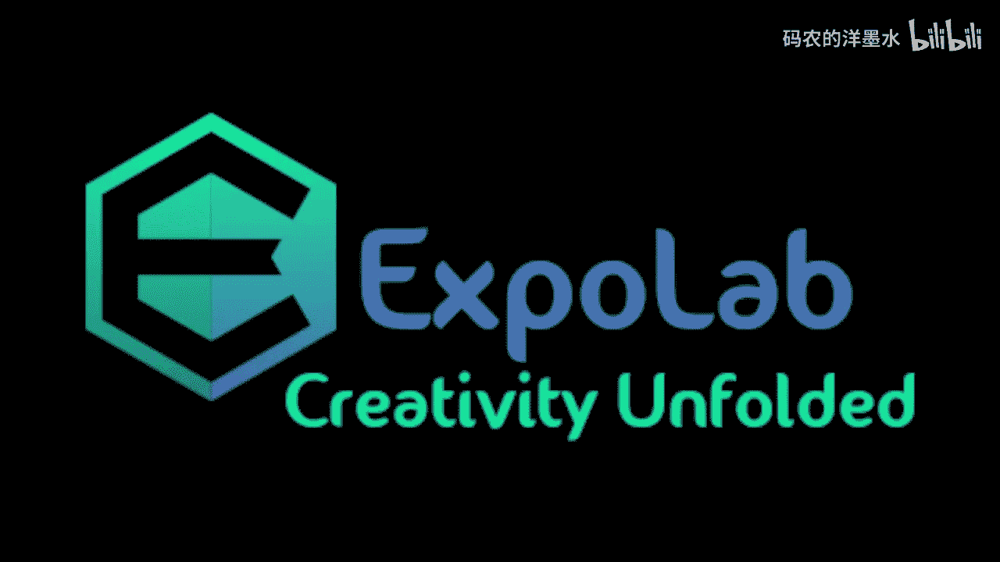
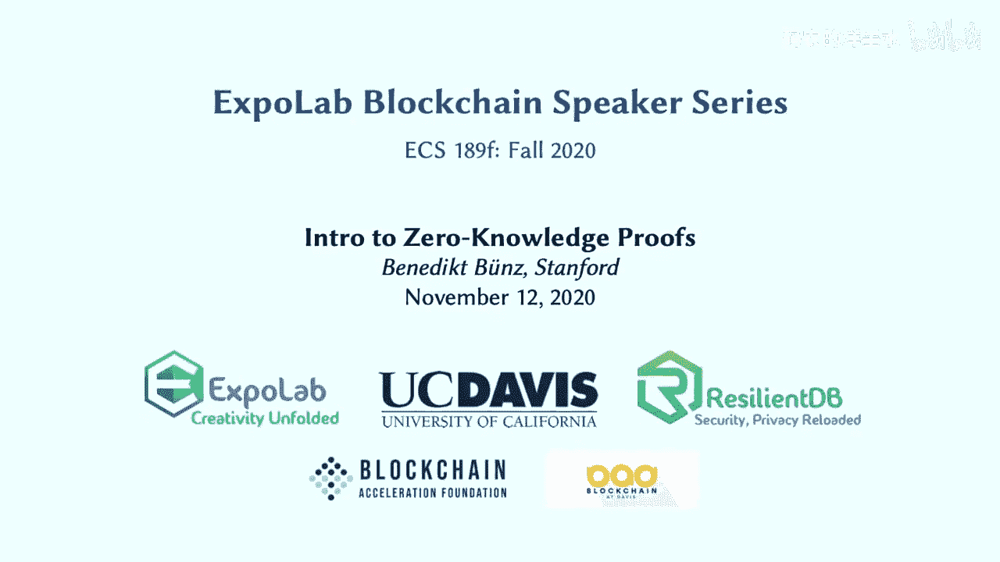
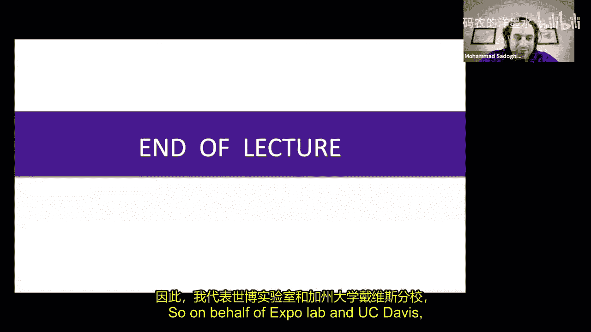
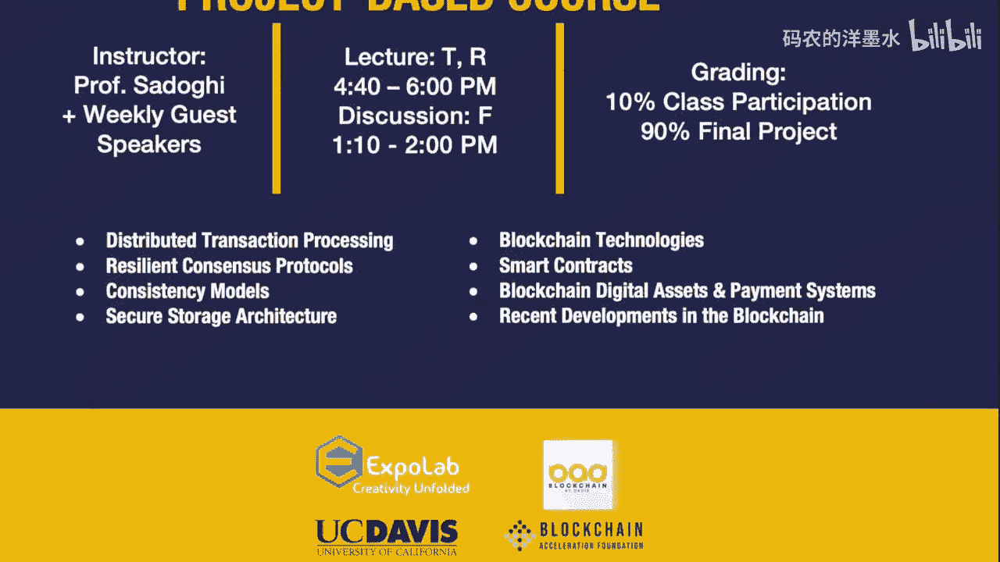

# 【全集】加州大学戴维斯分校 分布式交易与区块链架构 中英字幕 完整课程 p17 Lecture 13 - 零知识证明入门 -BV18YFVzME2f_p17-

Hello everybody， welcome to another Expo La blockchain speaker series today it's my pleasure to have Benedict join us and he's a senior PhD student in Stanford and has been doing a lot of exciting work around zero knowledge proofs。

And well sort of key technology for enabling blockchain so without furtherdo Benedict。

 thank you so much again for joining us today and please take it away。Okay， yeah。

 thank you very much for having me and I guess let's。😊。

You know I have a lot of different slides I'm sure I won't get through all of them。

 but you know I think the idea is that you guys can also ask questions and we can dive into different topics so you if we get stuck or something or if we have a discussion about some part of it that's perfectly fine you know don't yeah but you know I can also go on and try to teach you about zero knowledge groups or S snarks you know we'll see in a second what exactly you know what is the zero knowledge proof what is a snark and also how these things are used in distributed letters how these things are use the blockchains。

And one of the key。诶。Assets are one of the key principles Yeah， this works now of blockchains。

 They kind of two key principles。 One of them is this universal verifiability。 So this is true。

 no matter whether it's， it's a。Blockchain that is completely public。

 something like Bitcoin or something that is managed by consortium and kind of all of them you have this universalifiability of blockchain rules so all data that is written to the blockchain is public and everybody can verify so every transaction that gets put on the blockchain everyone can verify that this transaction is valid and you know this in addition you can use this even to interoperate between chains so you can use this public verifiability to have kind of for example atomic swaps so you know say that。

Transaction A on chain one only happens if also transaction B happens on chain two because I can。

 you know chain one can kind of you can see on chain one or you can mirror on chain one what is happening on chain two。

AndAdditionallyly， you have the property that assets are controlled by signatures and signature key so what does it mean to own a bit well really what it means is that you know the private key you and no one else ideally know the private key to you takes or something that basically that has the value of one Bitcoin on this Bitcoin letter so you know the private key and no one else to some address some Bitcoin address and this Bitcoin address has a value of one Bitcoin well then you own a bit so and if you want to spend or use that bit what you're going to do is you're going to issue a signature a digital signature cryptographic signature and transfer that that asset so。

AndYou know this is what it means to own a Bitcoin， of course you can you know。

 say that you trust your bank or your online exchange to manage this key for you。

 but that's kind of on a different level。But the problem is that you know we have this universe verifiability。

 but that seems to be completely at odds with privacy right the whole idea is that all of the blockchain data is public。

 well this means that all of the transaction data must be public because otherwise how could I possibly verify that a transaction is valid。

Well， it turns out right， like this is the naive reasoning， you know。

 all the blockchain data is public in order to verify that a transaction is valid。

 I need to see all of the details of the transaction。Well。

 it turns out that this kind of naive reasoning， this is very intuitive。

 but it's not quite right because it turns out using crypto Mag and using things that we'll discuss today。

 I can have private transaction on a public verifiable blockchain so I can keep the level of privacy that I want。

 even though I maintain the key principles of a blockchain。So。

Very abstractly what we're going to do so how could that possibly work Well basically the idea is that I will have the current state of the blockchain so this is at a very high level how can I have this public verifiability but still have privacy Well the idea is that I have the state public on the blockchain but it's encrypted it's encrypted said that only I can see how much money I have。

And then if I issue a transaction， I post the new state to the blockchain。

 so this is now saying you know say I am sending one bit to Mo and I used to have four Bitcoin you know then the new state。

 the old state used to say I have four Bitcoin and I don't know Mo had six Bitcoin and now after this transaction I have three Bitcoin and he has seven Bitcoin so I will post this new state still encrypted it so only he and I maybe can see what this new state is and I will post the transaction that issues the state。

And what I will do in addition is I will add this so called proof so。Here。This is a proof。

 this is what we'll learn about today， a zero knowledge proof。

 and the proof will show that the plain text data that the plain text transaction data。

 which is inside this transaction。Is consistent with the plain text current state So。

 and that the new state is correct。 So basically， instead of。Telling you or showing you that。

 you know showing you directly and you being able to directly verifying that all everything is that all the transactions are valid instead I'm going to give you a proof that the transaction is valid and it turns out that this is a so-called zero knowledge proof and the zero knowledge proof will reveal or it will say that the transaction is valid but it will not tell you why the transaction is valid and we'll see in a second you know or we'll see how that works you know。

 I can prove to you that something is true without revealing to you why it's true。

 That's the idea of a public of using these zero knowledge proof。So， yeah。

And the property of these proofs is that anyone can read the proof and verify them。

 and then they're satisfied and know that indeed this transaction was valid。

So to do that we need to introduce this tool of zero knowledge proof systems right so how can we do that right what are these what does this magic pie in the sky look like right it's a so-called zero knowledge proof and the zero knowledge by the way stands for the fact that I'm not revealing any additional information and proof well basically says that well I'm proving to you that something is correct right I'm proving to you that the transaction is correct。

So。The way we way that before we talk about these zero knowledge proofs。

 I quickly have to talk about something else namely arithmetic circuits。

 basically we're going to build a zero knowledge proof for an arithmetic circuit。What we have is。

At a very high level， Okay， what is a， what is an arithmetic circuit， Well。

 an arithmetic circuit takes as input。Some numbers。

 some of them are public right like and some of them are variable so x1 and x2 are variable and then it does a set of multiplication you know then it has these gates so the gate and does operation between the public inputs and the variables so I have a plus operation here I kind have a minus operation a multiplication operation and the wiring of the circuit based says which inputs feed into which of these gates okay and。

You can think of this as basically once you unroll the circuit， right， you can say， okay。

 so what is the output of the circuit， Well， it's x1 times x1 plus x2 plus 1。

Times zero rate x to minus1。 So in the end， this thing here。

 it basically the output of the circuit is it's a multivariate polynomial right it has multiple variables as input and the output is some polynomial in all of these variables So you know。

 if we have n inputs。It's an invaried polynomial。诶。

And you know the circuit is it's a directed basically graph right if you remember that from your graph computer science class。

 you know， it means that kind of all the errors flow into one direction。

So the and we say usually you know we do this computation， we do this over a finite field。

 all this says is that we do all of these operations kind of we do the modular prime p so you know multiplication so a times B really means a times b mod this prime and a plus B is so what this means all of the numbers in the circuit you know and all of the numbers that come out are between zero and p minus1 right willll never you know get over p minus1。

And the complexity of you know what is the size of the complexity of the circuit well you know you can say it it's the number of gates in here。

 but it turns out really what we care about for most of these proof systems is actually just the number of multiplication gates it's you know it's just a property of these proof systems that oftentimes we can get additions and subtractions for free。

But multiplications are the expensive things。And。😊，So these arithmetic circuits。

 they're very powerful。 you can basically the reason why we use them is because you can kind of you can express any computation as a circuit so for example。

 if you you know want to you can write it actually there's now compilers where you can write a C program。

😊，And then you hit compile。And then the the basically it will output a circuit the one criterion is that you know it can't really have it can't have four loops or at least not four loops where the input is variable so you know because we need the size of the circuit to be fixed。

One thing that circuits can also express is is express is boolean operations， so I can have。

So right if I want to do and or or not operations I can actually express them as kind of these arithmetic operations so an and for example。

 you know if your inputs are booleions so they're either zero one well then an end will be just x times y right if。

X times y is only one if both of the inputs are1， that's exactly the end condition and or condition is a little bit more complicated it's x plus y。

 well but x plus y is can be if x is1 and y is 1 then that's2。

 so we need to subtract x minus y and not is just inverting x to 1 minus x。

So this bill gives you a way to transform a Boolean circuit of boolean gates into arithmetic gates。

So it turns out that with these arithmetic circuits as I already already mentioned they're quite powerful。

 so for example one thing that I can do and that people do quite often is they can write a circuit you know they can write a circuit for a hash function they can say here this circuit output zero right we always say a circuit is accepting or it's valid if the end result is zero okay so we can for example design a circuit。

That takes input， a hash and a message， and output zero if and only if the Sha 256 hash。

 so there's a cryptographic hash function。Of the message is equal to this digest。Okay， so。

And otherwise， the circuit will output some number that is not equal to zero。And。

Basically the size of the circuit is roughly equal to you know this would take about 20。

000 multiplication in the addition or it would take about 20。

000 multiplication gates in order to implement this you can actually use you know with other hash functions this is actually you can get this number much you know now there's a lot of work in actually designing hash functions that you can write much more efficiently as a circuit so you know this might take only 1000 gates or something。

additional thing I can do is you know I can have a circuit that implements a signature scheme right this is the cryptographic signature so it says that the circuit will accept the input's public key message and signature。

Oh， if and only if。The signature is actually a valid signature of the message under the public key。

So it implements signature verification。So let's look a little bit more about you know what these proof system look like。

 So we have our errors in the arithmetic circuit see here， which takes as input。

Some public statement X。 So the green X is always public。 This is known to everyone。

 and then a secret witness W。And it will say that， and then it outputs a number and we say that the circuit outputs zero。

 when the circuit outputs zero， then the circuit accepts the input。

And the goals that we have for our proof system are twofold。 So are the two。

 there's two different one。Well I guess there's two different kinds of goalss that we might have so one thing that we might want from the proof system is saying that a soundless so a prover can convince a verifier that they exist to W such that Cx comm a w is equal to zero so for example it can convince a verifier that they exist to w such that the hash of w is equal to to X and that w is a small number so。

That W is between has less than 60 bits。This is what this means。AndIt's not。You know。The problem。

 though， is， sometimes it's meaningless to just prove that something exists。 So， for example。Well。

 what's a good example。I can。You know， say I didn't have this additional condition here said that W is a small number。

 they always exists a W， you know， if I don't put any condition on W。

 they always will exist a W such that the hash of this W is equal to x。

The problem is just proving that it exists is not you know this is not very meaningful what I really need to prove is that I know the w such that the hash of w is equal to x right and so this is what we call a proof of knowledge where the prover can convince the verifier that in fact knows the W such that the well the circuit accept so that C of x comm a w is equal to0 if our circuit implements a hash function this would say I know a W such that the hash of w is equal to x。

So。TheSo you know what's the most trivial proof system？

I guess yeah what's a let's sorry let's go back for a second Maybe I'll ask a question right what's a how can you know。

 how can I build such a proof system right I want a proof system that satisfies you know the sound as't the knowledge definition so say now I have my circuit C and I have my public input X。

How can I convince you， you know， what's the simplest proof system that you can come up with such that you believe me that I know a w such that C of x come a w is equal to 0。

What's the most， you know， the simplest proof system that I' kind of come up with？So。

I guess the rapids。The simplest proof system is I can just simply send UW， right you can just。

Check W yourself， right。So if I send you W myself， well then you know that I know W I just gave it to you right it's immediately trivial to verify that I know W right and you know the verifier can just check that C of x comm a w is equal to zero and the verifier will accept if I if it does so I'll stop for a second like you know this was a lot of information so。

Please let me know if something isn't clear if I should should repeat something here right is it clear why you know just sending W to the verifier is a valid proof system that satisfies these definitions。

Can you explain to soundness again？Right， so sound says that。Oh sorry， sound says that I。

Sous just says that there exists W right so we have our circuit C as a circuit and so let's let's see and you know。

 let's make it a very simple example， maybe let's go back。One more slide。Yeah。So say。You know。

 so for example here。What would be- so say this is our circuit here。What would be an input。

 What would be， you know， say this is our。Well， let me write something。So say this here is x。

And this is W。 And say， I said x1，2 or。Say I said x1 is equal to。1。What W makes the circuit be 0。

So what x2 makes the circuit be0？So that would be like negative two and also one right exactly right there's two solutions here so there's two w's right there's negative two and one exactly make the zero so this is you know this would be the the W the witness here this would be a valid witness for the statement x equals one。

And。😊，What the what we want to design is a proof system for kind of these circuits and I can have something similar with much more complex statement。

 So this is， you know， a statement for a hash function。

 So in when I design a non interactive proof system， basically as a prover， I say， okay。

 I want to convince you that there exists a solution。You know， this could be a polynomial。

That this could be a multivariate polynomial that doesn't have any zeros， right。

 there could be no W that makes this true。And what soundness says is I convince you that， in fact。

 there exists the W that is a solution and knowledge。

 it turns out knowledge is a stronger definition， right。

 knowledge is it's you know it's a stronger requirement for the proof system because。

If the prover convinces the or if the noninactive proof has what we call knowledge。

 it's a proof of knowledge， well then it will additionally say it will not just say they exist W。

 it will additionally say that you know the prover knows one of the Ws， it knows say minus2。

 such that C of x come at W。Is equal to zero。Does that help， yep， that makes sense。

I have question so so where in this where is this basically used in the blockchain terminal I think I missed the first few minutes of this presentation so is this use because at that point of time when the prover is trying to prove that he actually has access to the coin or something like that at that point of time and。

So yeah doesn't you can use these proofs to prove that you know you have access to the coins and you can also just use a signature for that。

 but a signature is a kind of zero it's a kind of zero knowledge proof。

But the general theme that we basically the general thing that zero knowledge proofs are able to provide and we'll get to that more in a second of how exactly that works is they can blockchains have this universal verifiability property so you can verify that every single transaction is valid。

However， the problem is this seems to be at odds with providing any sort of privacy right it seems to mean that you know all of these transactions are private and what we're now working towards is looking at these zero knowledge proofs which would say that I can actually encrypted state so I can have an encrypted transaction where only the sender and receiver know the details of the transaction。

But instead of giving the details of the instead of making the details of the transaction private。

 I issue a proof， a zero knowledge proof and this proof。Pros it shows that in fact。

 the transaction is valid and everybody can now know see that the transaction is valid。

 but they don't know why it's valid。So if I understand in terms of the blockchain then basically because there are all these replicas or miners who are basically trying to ensure that all the transactions are part of the ledger to ensure that there's a consistency happening so for that purpose instead of actually sending the transactions you're going to make users send these proofs and the ledger will be based on the proofs is that what you're suggesting well basically I'm still sending transaction but now I'm encrypting the transaction so an encrypted transaction and we'll talk about a little bit more later with it basically says that。

Only right now in a blockchain transaction， you know， say a Bitcoincon transaction， the sender。

 the receiver， the amount that are sent are all public， right everybody can see them。

RightAnd it's you know it's it seems to be it's not a bug。

 it's partially a feature right because you have this universal verifiability property where you know all of these replicas can verify all of the transactions and you need that right you know。

 this is what we need to make these blockchains work and what's your knowledge proofs or this crypto magic gives you is it basically says we can still have privacy。

 we can still you know， for example， say that only the send and receiver should know。

 you know how much money is being transacted between them。

And I do that by encrypting the transaction， but how when I encrypted the transaction。

 how do I maintain this public verifiability， how do I maintain this property that everybody can check it and this is what we're building。

 you know this is what we need these zero knowledge proofs for because then I can instead of you know you seeing。

 okay， for example， you know very thing that I always need to check is that the sender had enough money to。

 you know， if the sender makes a transaction for three Bitcoin I need to check that they had at least three Bitcoin right。

 otherwise we have a problem。The problem is if now everything is encrypted。

 I don't know how much the sender had， I don't know how much is being sent。

But somehow I still need to maintain this property that no one can overdraw their balances， right？

And with the zero knowledge proofs。I can prove to you a descend sender will prove to the world。

 it will prove to the world。It didn't achieved。But it will not tell the world， you know。

All of its bank details， that is what zero knowledge proofs give you。Okay， thank you。

 I think we'll come back to this at the later I think I have some question but let's come back at the later yeah okay。

 great。😊，Yeah， thanks for the questions。 Keep them going。Okay。

 so we have this trivia proof system right so the trivia proof system is just sending the witness。

 but the problem is that the witness might be， you know。

 it doesn't achieve the property that we just wanted right it doesn't achieve， you know。

 stay the witness are the transaction details that I encrypted well just sending them you know。

 then I were back to square one this doesn't help me at all This is I mean。

 this is kind of how blockchains work today， they just send you the the witness。

And the other property is， is that the witness might be long。 You know。

 this might be quite a long and complex witness。 And ideally。

 what I would want is that the short that the proof is much， much shorter than the witness， you know。

 so say the witness is。A million you know can be a million things long。

 I want that you know the the or it's gig the witness can be gigabytes long。

 I want that you know and I can actually design proofs that are only a few hundred bytes long。

And additionally， for example， also computing the circuit might be complex and I would like to minimize the verifier's work right the verifier doesn't actually shouldn't have to do work that is proportional in the size of the circuit and it turns out that we can actually achieve all of these three properties。

So嗯。呃。Yeah， so。You know what does this this so what does this interactive proof system look like？

 Well， it it consists of three different algorithms。

 So the first algorithm is this setup algorithm denotta by S and it outputs public so called public parameters and this is the。

This is the。If output put the proving key。Sorry for my handwriting and a verifier key。

Or a verification key。And。The prover will take as input， the proving key。The instance。

So the statement X and the witness W。And it will produce a proof。 So the prove outputs approve。

And it sends it to the verifier， the verifier then takes is input the verification key。😊。

And also the instance， so this is why x is green， it's public。And then it takes is input to proof。

 but very important， the verifier does not take is input W and the verifier runs some checks and then outputs accept or reject。

So right， it's this triple of algorithm。 So we have the setup。

 which takes input the circuit right notice also the verifier doesn't actually take as input the circuit。

 It only takes as input something that was derived from the circuit。

 namely the verification key right This goes into the verifier。

And the prover takes his inputs instance witness outputs a proof， and verifier says yes or no。

 it accepts or rejects。And the properties that we want from this proof system are threefold。

 So the first property is。This so called completeness property。 Well， so all that this says is that。

If we have a valid instance and witness。Well， os sorry。

 then the the prover can convince the verifier。 So whenever we have a valid x and W such that the circuit evaluated x comma w is equal to 0。

Well， then the verifier will accept right， there's you know。

 this is a it's basically the proof system should work， this is the you know。

 should work for valid things。And then this other property is this proof of knowledge property。

 which says that whenever the verify accepts。The prover。

Should know it knows a w such that the circuit of x comma w is equal to0。

 so you know it shouldn't be possible that the prover can convince the verifier if it doesn't know a W which is equal to such that the circuit is equal to0 and then we have this additional property。

 this zero knowledge property and sometimes you know this is an optional property and。You know。

 sometimes we have this property， sometimes we don't have it。

 but basically what it says is that x comm a pi， so the instance in the proof reveal no information whatsoever。

 or especially the proof itself， revealeds no information about W。

Right and this really means no information whatsoever。 And this is kind of a magical property， right。

 it says that， you know， I can。😊，Prove to you that something is true。 I can prove to you that。

 you know， a common example is like， I can prove to you that I know a solution to a silku。

Without convincing you without giving you any information about what the solution to the pseudo occurs。

And you'll be convinced that I know the solution about the Sudoku。

But you have no idea what the solution is itself， right， you just know that there exists a solution。

 but that's basically all you learn。I'll skip over the kind of the the formal definition。嗯。

And then the additional property is that。So we say， you know， I sometimes use the proof to improve。

 sometimes argument these things really mean the same thing， like don't。

 I hope you don't get confused by that。But sometimes we have this additional group of property。

 right， So we have this proof of knowledge property。The completeness property。

 the proof of knowledge property， the zero knowledge property and now there's this additional property called the succinctness property and we once we have a succinct proof we call that a snark so I'll say in a second one srk or a snark means a succinct noninactive argument of knowledge。

And what this says is that the size。 So when the prover creates a proof for some circuit。

It says that the size of the proof is only logarithmic。You know。

 it's only logarithmic in the size of the circuit。And additionally。

 the verifier also only runs in size， you know， it obviously runs in time linear in x。

 it needs to read all of x， but it's only logarithmic in the size of the circuit。So嗯。

What does this mean， Well， it means that I can prove to you that some complex computation。That took。

A million steps。I can prove to you that I did that computation correctly。And checking the proof。

 checking the snark， and then I produce， I'll produce a snark and checking the snark。

Instead of you know， doing a million steps， a million cycles， you only have to do 20 cycles。

Or I can do a computation that is a billion steps and you only have to check 30 you know you only have to do 30 steps or 30 different checks in order to verify this proof so this is you know also。

Completely amazing， right， You know， this is it's not at all intuitive that this should exist。But。

 you know， it is completely， it is actually possible， right it's I can。Give you proof that， you know。

 it's， you know， I could outsource， I could have Amazon， you know， on Amazon E2。

 I could run a computation that takes。A year and can verify it within I can verify that Amazon did their job correctly and the output of the computation is correctly and it would take me let's say。

 20 milliseconds。So how could this possibly work， how can the verifier run in time that is logarithmic in the size of the circuit。

 if you might ask well if it doesn't you know if it's logarithmic in the size of the circuit。

 it doesn't even you know can't even read the circuit or it doesn't even know what the circuit is well。

 as I said， the verifier relies on the fact it doesn't actually get the circuit as an input。

 it gets the SV， this verification key as an input so it relies on the fact that the setup will basically you know produce a very short summary of the circuit inside this verification key。

And if this proof the srk is zero knowledge， then we'll call it a ZK srk。

So one example is that the proveric can say。That， you know， it knows。

And different inputs such that the hash of all of these values。

 So say the hash of a gigabyte of data is equal to y。 and then the size of the proof will be。

 you know， could be like and we actually know how to do this。

 The size of the proof is like less than a kilobyte and the time to verify it is is still milliseconds。

So诶。Yeah， I guess。It turns out there's kind of two different types of setups actually else let's skip over this。

What is really interesting is that there's been a lot of recent work you know in recent years。

 actually kind of very parallel with the rise of blockchains。

 there's been a lot of work in the kind of the space of zero knowledge proofs so these things are actually you know quite old。

 we knew like in 92 or '94， we had our first naRCs。

 but the problem is that these were theoretically possible but unfortunately very。

 very impractical and now in you know like like last year and these years you know's there's kind of these proof systems that are getting better and better and improving on all of these properties all the time so you know there's kind of an overview of different proof systems so you know we have these Ro 16。

Very famous s that you know where the size of the proof， I think is。

I think this is like 188 bys you know the size of the proof is 188 bys no matter how long the the and it takes like 10 milliseconds to verify no matter how complex the statement is and you know。

 then we also have more modern snarks that they actually get。A little bit。

 you know they have a little bit larger proofs， but they don't suffer from this thing called a trusted setup basically a trusted setup says that the setup algorithm。

 you know if we have a trusted setup it means that the setup algorithm is run by a person that we need to trust right if they cheat then the proof system loses it sound as property and ideally we would have proof systems that don't have trusted setup and so now we also have very good candidates for this。

So， are there。Is it。That's a。You know， pause here for a second is it。Clear， you know。

 is it clear what a snag does？Right， or what is zero knowledge。

 what kind of the properties of these zero knowledge ss are。And。Yeah。

 are there any questions regarding them？Can you can you repeat how a snark is different from a zero knowledge in the sense like what is succinness here happening I mean I want to know in like what part of the proof is it getting like for example in terms of blockchain basically I would like to know like how is how。

How would a sender specify that this part what part is it trying to prove which we show that it's succint or sharp that's what I'm trying to understand so basically these are two different properties and ideally we'll have a ZK syn which has both properties but the zero knowledge property。

Is basically the property that gives us privacy It says that no information about the witness is revealed right So。

 for example， you know what is the witness in our example， you know。

 no information about the transaction details is revealed right all of that stays private。

So this is the zero knowledge property， the succinctness property says that verifying and checking the proof。

Is much， much faster than actually checking the the thing that I'm claiming。

 So what I can do is instead of。So when you when you download a blockchain。

 you you start up a blockchain client。So say a bit inclined。

 but this is true for all of the Ethereum， whatever you know。When you start them。

 you need to go through the entire history， like if you run the full kind if you。

 if you start a mining， you need to go through the entire history and verify every single historical transaction that has ever happened。

 okay。So this takes days and like like starting up a Bitcoin note takes like days or weeks， you know？

To just resthink it up。Instead， someone could give you a proof。 they could give you a snark。

That the entire blockchain is valid。So then what would happen is you just download the newest state of the blockchain。

 you just download you know the head of the blockchain。And additionally， you download this snrk。

 which is like 200 bytes。And you verify the snark， which takes 10 milliseconds。

And then you're convinced that all of the transactions in this blockchain are valid。

 You didn't even need to check them right basically you've outsourced that work to approver and now checking it is much。

 much faster than redoing the work yourself， This is what the succinctness property gives you。

 especially in a blockchain application it lets you outsource work and let' you say like， you know。

 additionally， I could do something similar instead of you know。

Like all of the transactions in a block instead of you seeing all of them。

And checking all of them individually instead I could give you a snark that says you know here all of the transactions in this book are valid and they've been you know applied to the state and here's the new state so this is you know we often call this application this is like a roll up application where you know all of the transactions get roll up to prover and that prover gives you proof that you know or the mine gives you proof that。

All of the transactions are valid。Okay， so。Before I ask this do you have other slides to cover because I don't know how much longer a discussion can gos let's have this discussion I think this is probably more useful than you know okay me talking and people are being lost。

So。So I'll try to debateiate a little and I'll try to move towards the traditional BF protocols。

 so like one direction is obviously bit Ethereum and bitco and they talk about this using the proof of work protocol and that is how they work。

And there's other style protocols like PBFT， PaXos style protocols。

 which also said this is possibility of doing consensus using those protocols。

So this is why I'm trying to that okay， but I just want to say this has nothing to do with consent I'm let me let me I agree it's why I'm trying to says that this un of college checkpointing。

😊，You can always checkpoint the state or in Ethereum term terms you can call finality you can say at this some point of time I have checkpointed a state and said that all the transaction beyond this have already been finalized and now whatever happens is that。

😊，And assuming let's assume we have a set of replicas a set of minorrs who is there's a number which we can count。

 well let's assume we know the identities of the replicas or all。And we have。

 we can always get these checkpoints。Signed by all these replicas or create a threshold signature。

 which is a threshold signature， so i'm just trying to understand。

In such scenarios is having a sn much more useful or because if I already have a checkpointed state and which is signed by using a threshold signature。

 do I even need snock in that scenario， that's what I'm just trying to understand so if you trust someone right if you trust someone that gives you the new state then absolutely you don't need you know you don't need to verify all of the old transactions。

But you know， I mean I think a lot of the idea about blockchains is removing trust right and even in you know even if you're you're running your consensus algorithm right now right like right now what is happening is that。

A minor or a consensus note that proposes a block。They propose a block with a bunch of transactions in them。

Or smart contracts in them right and they get some reward right really usually incentivize the person proposing the block with you know say transaction fees or new leadership coins or something like that。

The problem is that all the other consensus nodes。Need to also verify everything they need to do basically exactly the same work。

 you know other than in proof of work， but basically let's think of like PVT consensus or something like that。

 they need to do exactly the same work of verifying all of the transactions as the original node proposing this。

So， you know， here already srks can be a huge benefit what if we require the block proposalr to say。

Don't let us do the work， give us a proof， give us a short proof。

 give us a snark that all of the transactions are valid you know that is right we really put like you know in consensus or in blockchains we've kind of like bundled like transaction verification and consensus notes like together but that's really unfair right and it actually leads to problems right because it kind of there's there equiria and it really incentivizes to not actually notes to not actually do the work of verification it's called like the verifies dilemma and snarks like they remedy this completely。

So that is a very interesting point。My main concern at that point here is that。

The assumption here is okay let's assume we start with a scenario where the database is just clean or everyone just has zero transaction。

 they just have some initial data then there are this user a and user or Alice and Bob and Alice and Bob wanted a transaction to happen they use the zero knowledge proof scenario and basically the idea is the transaction is didduct $ from Alice account and maybe put put the $3 to Bob's account that is a transaction and if you're using that transaction and we basically want this and they are minus in Cr system every miner would have updated this transaction in their database they would have updated in the ledger now they get dis proof so they don't know anything how much is the amount in Alice account they don't know anything about how much amount is in Bob's account they don't know whether how much amount is getting changed they only have proof there's something value is happening so they all are not updating the ledger now the next transaction comes third transaction then similar they can be millions of such transaction。

So。HowHow is the credibility of every transaction getting verified what data is being updated in the leisure if the just the proofs are getting transferred then what are they verify that's for my concern that's a very good point so this is also you know this speaks to something so there's two scenarios one is that I can send you you know this is basically I don't know if you've learned about Merrk trees so you know I could send you for example a Merrkult tree commitment of the state you know basically I give you no I need to like I need to do that right I have I have a commitment to the database a small meel tree commitment to the database and then I just give you a Merrkultry commitment to of the new state of the database。

And I give you a proof that the state transition between the old state and the new state was valid。

Right that it only included， but additionally you know you're actually right that there is an issue here where you know this is sometimes called the data availability issue where notes you know。

 what if no one knows the state of the database anymore right like you know and usually what we do in these systems is that actually you are required to still like for this to work。

 you are required to still publish the kind of the deelta so you still have to say okay， you know。

 Alice now Bob has balance or Alice send to Bob3 Bitcoin？But you only basically， we can really。

 you know， minimize the amount of data that we have to send。 So， for example， you know。

 if there's some。Complex you know smart contract or some complex transaction verification logic that has to be run you know all of that can be compressed into the snrk and you know no one needs to the miners just kind of you know they need to update the database you know and you kind of just send them the minimal diff so that they can correctly update the database but all of the transaction verification logic that gets all outsourced to the sn by the s Okay so yeah that part agree and then going back to the Mercurel tree part even the Mercurel trees are created by the note itself and for that node have an identity of the transaction or at least they know what the database is because then only they can create the Merel otherwise they cannot do that actually and as you said that more people you know that everybody。

Like at least some nodes or some one manner you know have have access to the data in the database that's absolutely true yeah yes basically then in that case we would need some form of the database to be known maybe some some form of the state to be known so again it's an interesting question like how much privacy are we providing I mean we can see but ultimately if the database even if I don't know what the transaction is but if I know the read and write sit to the transaction I know how many how much data is being transferred like how much is the final value I don't know exactly the value but I know that this address has this amount this address has this amount final updates this is I'll get to this so this was just you know what I was talking about was just about you know kind of the6 it turns out we can still get for privacy。

You know， we we need。Yeah， basically， the way that I do it is that all of the rows of the database are going to be encrypted。

It're going to be crypto， yeah。So that's you know that's how I get privacy I encrypt all of the rows of the database and then I prove。

 you know， or the users prove， you know， only the users know what is in their database row。Okay。Yeah。

 are there more questions？I think that's good， thank you。Okay。Yeah， I'll skip over this kind of this。

So let's talk about applications， right， I already。What I just。

 what we're just discussing this is kind of the roll up application。 So this is， you know。

 kind of rolling up these these transactions。 And you know。

 this is actually like not just theoretically but this is now getting deployed in Ethereum and kind of boosting the transaction throughput of in Ethereum by like。

A factor of maybe 100 or so， I think。And yeah， what I you can also， yeah。

 but what I want to now focus on is at least in the remaining time。We have like 23 more minutes。

 right？So I want to focus on kind of the privacy applications of zero autocrs。

So the first thing that we need to talk about， though。

Are these are so called cryptographic commitments so what a cryptographic commitment is it emulates an envelope so the what Bob can do or what in this envelope it can write down some data。

This is committing to the data。 And then。The verifier， you know。

 send it to the verifier and the verifier can't see what is in the envelope。But later on。

 Bob can open the envelope， but it can only open it to what it previously committed to。

 It cannot open it to something that it never， you know， it cannot open it to some other data。

 So if it wrote down heads， then it can only open to head。 So you know， this has many applications。

 for example， one of them is， you know， say a seal bit auction， I can。

Commit to my bid in the seal build auction and then later open it。to say。

 you know what exactly I want a bit to， I need one minute to plug in my computer。

 otherwise I'll go offline。Okay。So。😊，呃。Right， so in the a bid auction。

 every participant would commit to its bid and then once all the bids are in。

 everybody opens their commitment。So a little bit more formally。

 the commitment function takes in a message and some secret randomness are and outputs a commitment string and then the verification function takes in the message。

 the commitment and the randomness and simply accepts or rejects so anyone can verify that the commitment is open correctly and the two properties that we want from commitments are that their a binding so this means that I cannot commit to a message one and a message two that are different with the same commitment。

 I cannot open it to two different things and that the hiding which means that kind of the commitment itself is statistically independent of the message so it doesn't reveal any information whatsoever about the message。

So now we can do use this to build a so called confidential transaction so in a confidential transaction。

 well let's first look in at a normal bit con transaction and we'll see that you know the quite a lot of is actually public here so。

The send address， the receiver address and you know， the amounts that are being sent are all public。

And。You know， you may have heard that actually Bitcoin provides a lot of privacy because these addresses。

 they don't reveal real world identities。Well， it turns out that this is actually not really true because for example。

 when I pay you， you need to give me your address， so suddenly I learn you know what your address is and even if you use new addresses all the time。

 you can do some more sophisticated blockchain analysis to kind of link these addresses together and figure out you know which address belong to whom and there's now actually companies doing this for you。

 you can hire a company that will tell you you know I want to figure out who this address belongs to。

 you know say law enforcement can go to them and say like hey。

 I want to figure out who this address belongs to and you they have a pretty good rate at figuring that out。

So for example， you know so all of the amounts are public。

 but this is actually a big problem you know for example。

 this would mean that if you receive your salary on a blockchain。

 it means that your salary is public and people might not want that or additionally if I want to use the blockchain as for supply payments。

 this is also gigantic problem right makes it almost unusable if Ford wants to buy tires from a supplier。

 it doesn't want to reveal on the blockchain， how much it is paying you per tire。

 this is very crucial business information but in the blockchain setting or if we use these kinds of transactions。

 well then everything is publicly reveal。And。The rate what we won't hide is the transaction fee that is sent to the miner this is private。

 but you know what will what we want to hide， you know the goal now of this confidential transaction is hiding exactly the amounts。

So you know， say in our example here， we have like if Google sends a salary to Alice and Alice gets one Bitcoin as our salary。

 then you know we can see exactly you know that Google is put in 30 to the transaction that's the input to the transaction and then the outputs are  one in 29 right and the condition that we always have for these Bitcoin transactions a Bitcoin transaction always has some input。

And some outputs。This is this output 29 this is what we call the change output because it's very similar to when I pay with a $20 bill then but I only want to buy something for $7。

 well then I get $13 back and change and Bitcoin works very similarly here that Google has a $30 Bitcoin bill and pays one of it to Alice and then it receives $29 back to its own account。

诶。So we want to hide these amounts and you know the first idea is that we just simply replace them with these cryptographic commitments so you know instead we have come one Com2 and come3 so come commit one is is committed to with 30 and some randomness。

Come2 is the commit to one with some randomness and so on and so forth。

 So this is a little bit larger。 These commitments are 32 B， versus， you know。

 representing a number I can do in， in maybe 8 by。But not that much。 So not that much larger。

 The problem is now that if these amounts are all hidden in these cryptographic commitments。

 they might look like this。 Well， then I cannot， you know， I don't know how much is transferred。

 and especially I also don't know I cannot check this condition that the sum of the inputs is equal to the sum of the outputs。

 and this condition is is is important for checking that you know， no new money was created。

 if I have a bit transaction where two Bitcoincos come in and 20 come out well that， you know。

 that would be extremely problematic because it would mean that somehow 18 bit were created of thiner。

 But if I have hidden everything under under you know， under these commitments。

 then it's very hard to tell what is valid here。You know whether this transaction is validated。

So how will mine verify this transaction and the solution is using a zero knowledge snark and we use actually for this for this kind of thing。

 we would use a special purpose one that is optimized for this problem。

 So the first thing that Alice is so Google created this transaction So it would privately send R2 to Alice So now Alice knows how much money she received。

 She knows that she received one bit from Google she doesn't actually even need to learn R3 and R1 so that she doesn't need to learn what is in CO3 it's none of her business。

And then Google creates a zero out snark where the statement are the commitments come one， come two。

 come three， and the witness are the messages and additionally。

 the randomness used for the commitments。And the circuit that we create。

 Google creates this proof for the following circuit， this confidential transaction circuit， well。

 the first thing that Google proves is that the commitments are valid commitments。

 you know given M1 and or MI and RI can produce commI。And then additionally。

 that the sum of the inputs is equal to the sum of the outputs。Well， plus the transaction fees。

 but we can ignore， let's assume the fees are zero and then。That's actually not quite enough。

I actually also need to prove that all of the outputs are equal to greater or equal to zero。

Why is that？ Well， say I had a transaction where Google put in 30 and then it outputs， you know。

Say 4 to Alices and minus10 to itself or I don't know or just the two outputs。

 one of 40 and one of minus10。Well， the problem is that the first， you know， I can verify the first。

 I can satisfy the first condition， I can satisfy the second condition。

But now I've actually created money out of thin air because I can， you know。

 say I ignore this minus10 commitment。Well， then I have one commitment of value 30 that comes in。

And one of value 40 that comes out。So right out of 30， I'm made 40， you know。

 and this is we don't want this to happen。 and in order to prevent this。

 we need to verify that all of the outputs that are created are greater or equal to zero。

So now what this， does this transaction look like， Well， it has the。The commitments in it。

 and then additional he has this proof pie and because we ideally want this proof to be short because you know this now gets appended to every transaction。

 we're going to use a ZK sng for it。And miners will accept this transaction if the proof is valid。

And they learn that the transaction is valid， but they have no idea now how much money Alice has。

 they have no idea how much money Google has all of that。

 all of the amounts are hidden So even though right you know。

 the miners can still store the entire database and everything Well。

 the database now consists of commitments or I said encryptions before。

 but really we're going to use commitments is a special kind of encryption and you know。

 and they reveal no no information about。Yeah， about about。What is， yeah， what is being transferred？

So呃。I guess， now。I have 10 more minutes。 I could talk about Zc。It could also， you know。

 give you a very。High level overview about how these your knowledge proofs work。

 So kind of a if you are flexible in terms of time。 So if you need to maybe an extra 5，10 minutes。

 that's already fine。 Yeah， no， I think I'm， I'm， I'm okay， you know。

 I'm just wondering what is more interesting for the students。

I think so far it's been very interesting so maybe the question is。

 would they rather see what how Zcsh works or how you know， these zero knowledge groups actually。

M be a good idea to look at Zcash， I think okay。So嗯。So if you can see， well。

The problem here in these confidential transactions， I've hidden the amounts。

But I've not actually hidden who's paying to whom， right？

 You can still see that Google sending money to Alice， right， None of that information gets hidden。

 So what Zcsh does is it additionally also。Hs who's spending money to whom。

 So it gives you fully private payments， kind of like cash。 But across the Internet。 And， you know。

 obviously， this is a question is， you know， that this can be used for good purposes。 you know。

 if you're， say， a political dissident， and you you live in suppressed。Under suppressing government。

 you know， for example and。I think in Venezuela， people were you know using Zc and using cryptocurrencies because they're strong monetary controls。

 but of course you can also use this for illegal things right you can use you know if you have these fully private payments across the internet。

 you might be able to use them to buy drugs or something like that。诶。

But we're not here to judge we're here to learn how it technically works so kind of the Zcash blockchain actually supports two different types of payments so it supports you know very like basically it has Bitcoin running on it like the normal version of these parent transactions they look exactly the same as in Bitcoin and then it has these shielded transactions and these are completely and anonymized。

So。The way that a shielded transaction works is that I have a shielded address。

And the public key here have a secret key， which is a random， you know。

 it's just a random number and the public key is the hash of that random number。And。

The secret key is needed。In order to spend the transaction you know， for this address。

 public address， PK。And。So if I have you know， then I might have a shielded note。

 so this is some money that I control， you know， at this address PK。

And the shielded node has a value V。 So this is how much money is it。

 And then there's this random value R assigned to it。So I get that， you know， whenever I I get paid。

 I receive the info， you know， how much money did I get paid and I also received this random value are。

And on the blockchain， every coin on the blockchain is the hash of the public key。And the value。

 So this is， you know， address Pk has value V and you know， additionally with this value R。

 So this is a commitment to PK and V。 So on the blockchain we put this commitment to Pk and V。

And yeah。So， the。Blockchain will contain this list of coins Okay， and so these are all hidden coins。

 you know， none of them reveal any information you know。

 I now have committed to not just the value like in the confidential transaction。

 I've also committed to who's the owner of this coin。

And this is all publicly stored on the blockchain or actually you know just the Merrkle route is is kind of stored on the blockchain and additionally there's this list of nullifiers So the list of nullifiers says that I it's one entry per spend coin and why do I need to keep this list of nullifiers so every time I spend a coin I publish a nullifier。

And then basically， this prevents me from spending the same coin again。

 So if I want to spend the same coin again， I would have to publish the same nullifier。

 But then everybody can see， oh， oh， this node has already been spent。 So you can never， you know。

 this is， this would never be accepted。 So this is how I prevent double spending。

So what does the transaction look like？So the owner of a coin wants to send。

The funds to some other address。So it wants to send it to you know， some shielded address。

 PK and B prime， and also to some public address。So V prime prime。

And what it will do is it will construct a new coin coin prime。By choosing a random value R prime。

 you know， and it puts in the value PK prime and E prime and sends it to the owner of PK prime。

And then it computes this so called nullifier， So the nullifier is the hash。

 basically it's the hash of the secret key。So whenever I try to spend the coin。

I will you know I will become up with the same nullifier right this is always the same it's the hasher of the secret key and it's the index of the coin in the Mer tree so you know maybe this is the 10th coin so even if I try to spend it twice I will come up with the same nullifier。

So this is used to cancel the coin， right， because I don't want to reveal which coin am I spending。

 but instead I will produce this nullifier such that if I try to spendd it again。

 it will result in the same nullifier。And the miners will learn。

 and then well see in a second that I'll do as your knowledge proof。

 but the miners will learn that some coin was spent。

 but they will not see any information about which coin is spent。So how does that work？

I produce a zerool snark， which says as its statement， the current Mer root， the coin prime。

 so this is a commitment to the new coin， the nullifier。

 and then whatever public value I want to publicly output， so this is the non shielded output。

And as the witness， it has kind of the contents of the commitment， so the secret key。

 the value and the randomness and the contents of coin prime。

And then it also has a Mer proof that coin is part of， you know。

 it's in this list of already existing coins。And now the circuit that I produce this urology before just says that。

 well coin was a valid。It says that the Mer proof for coin is valid。 So I'll prove to you。

 I won't actually make this your Mer proof public instead of。

Prove to you in zero knowledge that this Merrk tree proof is valid so that coin was in the list of already existing coins。

That coin prime is validly constructed that you know I don't have any any， you know。

 this is the same condition as in the confidential transaction and that the nullifier was constructed correctly。

Well， and now all that the miners will see is they will see coin prime and they will see the nullifier。

 but they will have no information about which coin was spent so now I've completely hidden you know who this sender was and who the receiver was right all I see is this new magical commitment。

 It looks like a random string basically to a new coin and a zero knowledge proof that says that was one coin was spent。

But I'm not going to tell you which one。So yeah， here it's already written down。

So I sent to the miners the coin prime， this commitment， the nullifier， well。

 the transparent TO and approve。And I was send to the to the receiver where the receiver needs to know how much money it got paid。

 So it receives V prime。 and then the miners will verify the proof pi。

 They will verify the trans parent output。And they will verify that the nullifier only appeared once。

 so this prevents double spending and everything is valid。

 well they will add coin prime to the mercurry of already existing coins and nullifier to the nullifier and NF to the nullifier list。

So the transaction heights， which coin was spent。And it hides the address of the owner。

And how much Mo coin prime has。And the miners， in the end， you know。

 the miners can verify that the transaction is valid。

 but they learn no information about what the transaction details are。Okay， so。

 you know this this is。The high level takeaway， if this was you know too much detail。

 then the very high level takeaway is that I can basically use zero knowledge proofs。

To give you full privacy， even on a completely public blockchain。And yeah。

 that's why you should care about them。Yeah呃。You know we're just in time for the end of the lecture。

 but I'm happy to stick around for a few questions。Great， thank you so much。

 excellent in depth overview of Ze knowledge proof， so any questions？Beside that。

The student wants to kind of listen to more details on the on the actual proving part， but I guess。

こ to様です timeね。嗯。Okay， so I呃。We more than welcome。I， I'll give you an example of。

You know how like the， the， the very simplest example of of。You know。

 how can it be that can prove to you something zero knowledge so。The呃。

So you you may have heard or you know， thought of the the kind of the Pepsi Coke test right。

 So this is like the test of whether， you know someone you know。

Fun party trick that's your kind of party then you can test you know like whether someone can tell the difference between Pepsi and Coke or Coke and I don't know or Coke zero and what you do is you know how do you do this Well you just have two glasses in one of them you put Pepsi in another one you put Coke and then you write on the bottom you know maybe what which one was Pepsi and which one was Coke and then the tester which is going be the per in this example well it tastes both of them and tells you which one was say Pepsi。

😊，And if the prover is correct， well， you know， he may have gotten lucky。m， but you know。

 there's some indication that he might know， you know。

 that he knows the difference between Pepsi and Coke。

But we can repeat this experiment over and over again， right we can run this twice， you know。

 you know swap the glasses， just clean them， do it again and then the chance that he got lucky。

 you know， if you do it once the chance that he gets lucky is like one half。If we do it twice。

 the chance that he gets lucky is one fourth， but if we do this like 100 times。

 the chance that he gets lucky every single time is completely innegligigible right you know this doesn't happen。

So嗯。But it turns out， so this is clearly a proof， right， if I run this。Often enough。

 this is clearly proof。That， you know， someone knows or the the tester knows the difference between Pepsi Coke。

But by checking the proof， did you learn anything about the difference between perhaps and Coke。

 right， Are you now able， if you see this person， you know， do this over and over again。

 Are you now able to like。Have the same magical ability of testing the difference between Pepsi and Coke。

No， you have not， right， Like it's， this is actually a zero knowledge proof， right。

 It's a very simple and dumb zero knowledge proof， but it is a zero knowledge proof because you learn no information like the witness here is。

😊，What is the difference， you know， the magical formula between， you know。

 what is the difference between Pepsi and Coke， But if you verify this， right， if you run this。

 this test， you， you， you learn no information， you have no information about what the， you know。

 unless you know it yourself， right， But from this experiment。

 You learn nothing about what the difference between Pepsi and cocacus。So this is actually。

 you know a zero knowledge proof for showing that you know I know the difference between Pe single。

 it's a very， you know kind of simple example， but it shows you that I can prove to you that something is true or you know that I know something without giving you any additional information。

I can also actually use exactly the same protocol like there's this cute paper on saying。

You know I can use the same protocol for showing say I want to prove to you that I'm not the murderer of the crime scene so you know say there was a crime scene and we have DNA but I want to prove to the FBI that I didn't commit the murder but I'm very privacy you know I'm very concerned about my privacy and I don't want to give my precious DNA to the to the FBII so what we can do is that you know I put like。

I give a sealed envelope， you know that they can't open of my DNA to them。

 I seal it such that they they're not allowed to open it。And then they shuffle。

 they take the murder's DNA and my DNA and they shuffle it， you know， behind their back。

And then they give me the you know the two different DNA samples。

And if I'm able to tell the difference。Between them， well。

 then my DNA must be different from the murders。DNA， right？but if they're the same。

 if I was the one who committed the crime， well， then I will not be able to tell which one was。

 you know， the one that I handed them originally and which one was the crime scene one。So， you know。

 this is， but if they are different， I can， you know， answer this every time I can say oh here。

 this is my DNA like this is the one that I gave you， but if I committed the crime。

 then I cannot do this， so this is a zero knowledge proof that of not murdering。You know。

 and it turns out that like the funny thing is， you know， these are kind of these， these， these。😊。

Sample， you know， these， u like fun game examples， but it turns out that， you know。

 the real protocols are actually not， you know， that far away from it。Does that give you cementition。

Yeah。All right， so thank you so much Benedict and for taking the time and joining us today so on behalf of Expo Lab and UC Davis。

 really be thanking you。

