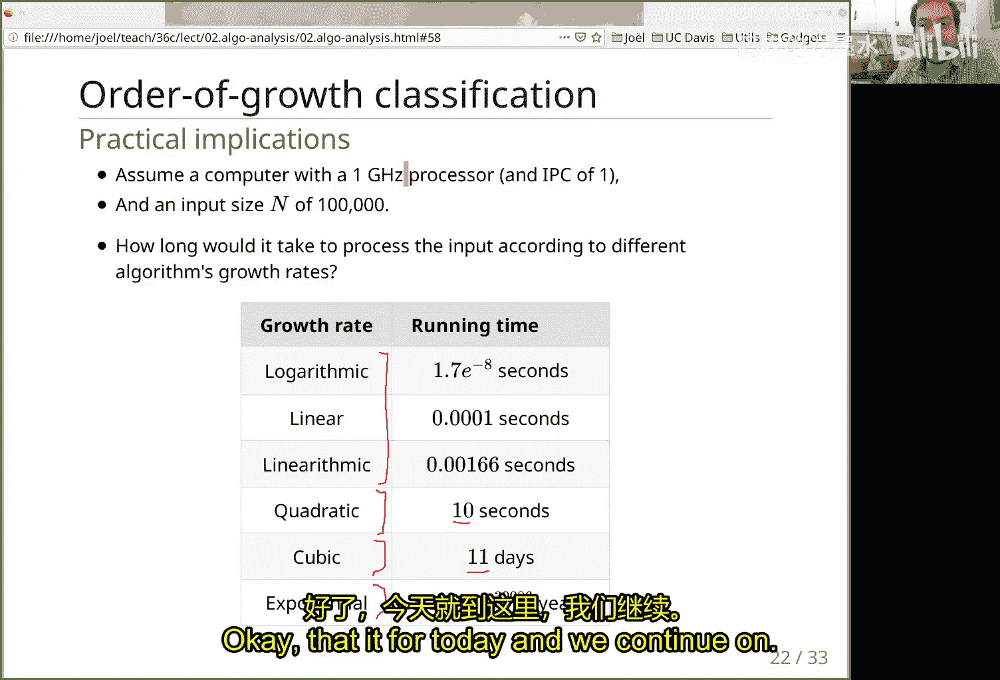

# 002：算法分析


在本节课中，我们将学习如何分析算法的性能。我们将从实验方法的局限性开始，然后深入探讨一种更数学化的方法，通过计算语句执行频率来估算运行时间。最后，我们将介绍一种简化的概念——增长阶，它帮助我们快速理解和比较不同算法的效率。

## 实验方法的回顾与局限

上一节我们介绍了分析算法的实验方法。其核心思想是：编写特定算法的代码，运行并收集大量数据点，绘制图表，提取方程，最终预测算法在其他输入上的行为。

然而，这种方法存在几个明显的缺点。首先，我们必须先实现想要分析的算法。其次，测量结果受许多因素干扰，例如编译器优化级别、计算机处理器性能等，这些都会影响结果的质量。因此，实验方法是一种相当复杂的技术。

## 数学化方法：语句计数

鉴于实验方法的复杂性，我们来看看另一种更数学化的方法。这种方法的核心思想是：查看程序执行的所有操作，并为每个操作关联一个成本（例如，执行该操作所需的纳秒数）。这里的“操作”包括整数加法、乘法、变量声明、赋值、比较、数组访问等。

通过统计程序中每种操作的使用次数，并乘以各自的成本，我们就可以累加得到程序的总成本，从而推导出运行时间。

但这种方法同样复杂。我们需要审视程序的所有操作，而成本本身很难精确确定，因为它高度依赖于编译器、优化级别和处理器性能。

因此，我们将进一步简化。我们不再区分具体操作，而是直接查看代码并**计数语句的执行次数**，同时考虑输入数据的大小 `n`。

### 示例分析：One Sum

让我们通过一个简单的例子来理解。这个例子称为 **One Sum**。假设我们有一个大小为 `n` 的数组 `a`，目标是扫描整个数组，统计其中等于零的元素个数。

以下是该算法的伪代码：
```java
count = 0
for (i = 0; i < n; i++) {
    if (a[i] == 0) {
        count++
    }
}
return count
```

现在，我们来统计每条语句的执行频率：

*   **`count = 0`**：这条初始化语句只执行 **1** 次。
*   **`return count`**：返回语句也只执行 **1** 次。
*   **`for` 循环的初始化 `i = 0`**：只执行 **1** 次。
*   **`for` 循环的条件 `i < n`**：这个条件在进入循环前会评估一次，然后在每次迭代开始前都会评估。对于从 `0` 到 `n-1` 的 `n` 次迭代，条件总共会被评估 **`n + 1`** 次。
*   **`for` 循环的增量 `i++`**：在每次成功的迭代后执行，共执行 **`n`** 次。
*   **`if (a[i] == 0)`**：作为循环体的一部分，执行 **`n`** 次。
*   **`count++`**：这条语句的执行次数取决于输入数据。如果数组中没有零，则执行 **0** 次；如果数组中全是零，则执行 **`n`** 次。

在最坏情况（数组全为零）下，将所有频率相加，我们得到估算的运行时间表达式为：**`4n + 4`**。

## 更复杂的例子：Two Sum

现在让我们看一个更复杂的例子：**Two Sum**。这是 One Sum 的扩展，目标是找出数组中所有和为 `0` 的元素对。

以下是 Two Sum 的伪代码：
```java
count = 0
for (i = 0; i < n; i++) {
    for (j = i+1; j < n; j++) {
        if (a[i] + a[j] == 0) {
            count++
        }
    }
}
return count
```

外层循环的语句计数与 One Sum 类似。关键在于分析内层 `j` 循环的执行频率。

当 `i = 0` 时，`j` 从 `1` 运行到 `n-1`，内层循环体执行 **`n-1`** 次。
当 `i = 1` 时，`j` 从 `2` 运行到 `n-1`，执行 **`n-2`** 次。
以此类推，直到 `i = n-2` 时，`j` 从 `n-1` 运行到 `n-1`，执行 **`1`** 次。
当 `i = n-1` 时，内层循环条件 `j < n` 初始就不满足，执行 **`0`** 次。

因此，内层循环体（`if` 语句）的总执行次数是序列 `(n-1) + (n-2) + ... + 1 + 0` 的和。这是一个等差数列求和。根据公式，从 `m` 递减到 `1` 的序列和为 `m(m+1)/2`。这里 `m = n-1`，所以总次数为 `(n-1)n/2`。

展开这个表达式，我们得到 `(1/2)n² - (1/2)n`。这是算法核心操作（检查数对和）的频率。

在最坏情况下（所有数对和都为零），将所有语句的执行频率相加，我们得到运行时间表达式：**`2n² + 2n + 4`**。

## 简化分析：主导项与增长阶

如此详细地计数每条语句非常复杂，而且得到的精确表达式对于理解算法效率的核心并不总是必要的。我们可以进行大幅简化。

首先，观察 Two Sum 的核心频率表达式 `(1/2)n² - (1/2)n`。它包含两项：`(1/2)n²`（二次项）和 `-(1/2)n`（一次项）。

当输入规模 `n` 变得很大时，**`n²` 项的增长速度远远超过 `n` 项**。因此，低阶项 `-(1/2)n` 的影响变得微乎其微，可以忽略不计。我们只需关注 **主导项** `(1/2)n²`。这种近似方法称为 **渐近分析**。

对于算法分析，我们甚至可以更进一步简化：**忽略主导项的常数系数**，只关心它的 **增长阶**。对于 Two Sum，我们只关心它是 **`n²`** 阶的。

增长阶为我们提供了一种高层次、直观的方式来描述和比较算法的效率，而不必纠结于精确的常数因子。

### 常见的增长阶及其代码模式

以下是常见的增长阶分类及其对应的典型代码模式：

*   **常数时间 `O(1)`**：算法的运行时间与输入规模 `n` 无关。通常是一系列简单的顺序语句。
*   **对数时间 `O(log n)`**：通常出现在每次迭代都将问题规模减半的算法中，例如二分查找。
*   **线性时间 `O(n)`**：算法对输入中的每个元素处理一次。通常是一个简单的 `for` 循环。
*   **线性对数时间 `O(n log n)`**：常见于高效的分治算法，如归并排序。算法递归地将问题分成两半（`log n`），然后在合并结果时进行线性处理（`n`）。
*   **平方时间 `O(n²)`**：通常由两个嵌套的 `for` 循环导致。
*   **立方时间 `O(n³)`**：通常由三个嵌套的 `for` 循环导致。
*   **指数时间 `O(2^n)` 或阶乘时间 `O(n!)`**：通常出现在需要尝试所有可能组合的算法中，例如解决旅行商问题的暴力方法。这类算法在输入规模稍大时就变得极不实用。

### 增长阶的直观感受

不同增长阶之间的性能差异是巨大的。假设我们有一台主频为 1 GHz（每秒执行约 10^9 条指令）的计算机，需要处理一个规模 `n = 100,000` 的问题：

*   **`O(log n)`**：几乎瞬间完成（微秒级）。
*   **`O(n)`**：约 0.1 毫秒。
*   **`O(n log n)`**：约 1.7 毫秒。
*   **`O(n²)`**：约 **10 秒**。
*   **`O(n³)`**：约 **11.6 天**。
*   **`O(2^n)`**：时间长得无法想象（远超宇宙年龄）。

这个对比清晰地表明，为问题设计一个低增长阶的算法是何等重要。它决定了在可接受的时间内，我们能够处理多大输入规模的问题。

## 总结



本节课中，我们一起学习了算法分析的核心方法。我们从实验方法的局限性出发，引入了数学化的语句计数法，并通过 One Sum 和 Two Sum 的例子进行了实践。接着，我们了解到过于精确的计数并不必要，进而学习了通过关注**主导项**和**增长阶**来简化分析。最后，我们认识了常见的增长阶类别及其对应的代码模式，并通过一个生动的对比，深刻理解了设计高效算法（即低增长阶算法）的极端重要性。掌握这些概念，是评估和比较不同算法性能的基础。