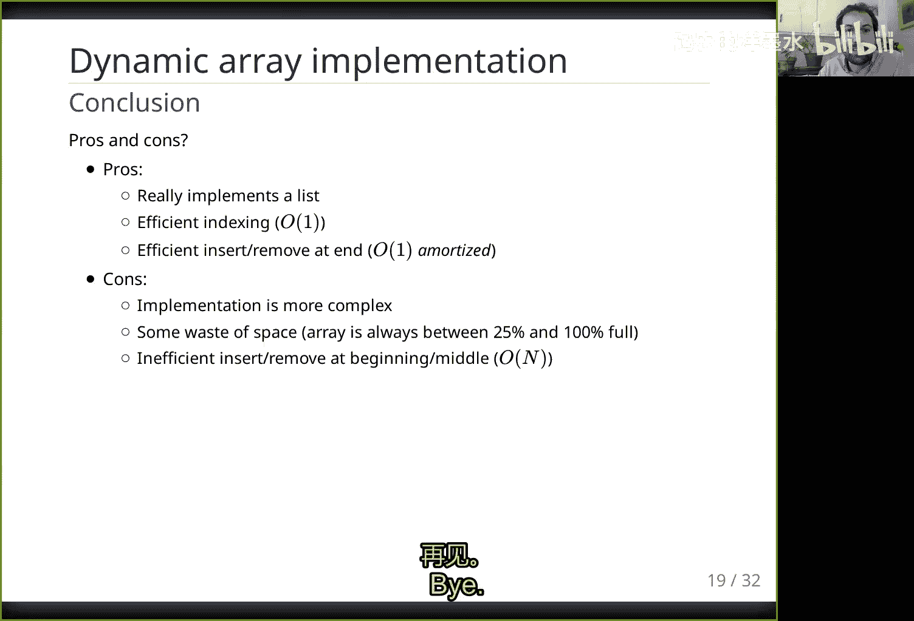

# 005：列表的动态数组实现 📚


在本节课中，我们将继续学习列表（List）数据结构，重点探讨如何通过动态数组（Dynamic Array）来实现列表抽象数据类型（ADT）。我们将了解动态数组如何克服固定数组的容量限制，并分析其操作的复杂度。

上一节我们介绍了列表ADT以及使用固定数组的简单实现。本节中，我们来看看如何通过动态调整数组大小来实现一个更灵活、更符合ADT定义的列表。

## 动态数组的概念

动态数组实现的核心思想是：数组的容量（`capacity`）不再是固定的。当需要插入的元素数量超过当前数组容量时，我们可以动态地扩展数组以容纳更多元素。反之，当从列表中移除大量元素时，我们也可以收缩数组，以避免内存浪费。

这就引出了一个问题：我们应该在何时扩展（`grow`）或收缩（`shrink`）动态数组？

以下是两种可能的策略：

*   **策略一：每次操作都调整大小**
    每次插入时，将数组大小增加1；每次删除时，将数组大小减少1。这种方法实现简单，但效率极低。因为每次操作都需要重新分配内存并复制所有现有元素，导致插入N个元素的总时间复杂度为 **O(N²)**，这是不可接受的。

*   **策略二：非频繁调整大小（我们将采用的策略）**
    我们只在必要时（例如数组已满或太空时）才调整数组大小，并且每次调整的幅度更大（例如翻倍或减半）。这样，虽然单次调整的代价较高（**O(N)**），但分摊到多次廉价操作上，平均每次操作的成本（**分摊复杂度**）可以很低。

## 动态数组的实现

动态数组实现的大部分代码与固定数组实现相似。我们将重点关注两者的不同之处。

### 数据结构定义

首先，类的私有成员变量发生了变化：
*   `capacity` 不再是常量，而是一个普通的变量，其值可以改变。
*   `items` 是一个指向数组的**智能指针**（`std::unique_ptr<T[]>`），它管理动态分配的内存。
*   `curr_size` 保持不变，用于记录列表中当前元素的数量。

使用C++11的`std::unique_ptr`智能指针的主要优势在于**自动内存管理**。当`List_DynamicArray`对象被销毁时，智能指针会自动释放其指向的数组内存，有效防止了内存泄漏。

```cpp
template <typename T>
class List_DynamicArray {
private:
    int capacity;                 // 当前数组容量（可变）
    std::unique_ptr<T[]> items;   // 指向动态数组的智能指针
    int curr_size;                // 列表中当前元素数量
    // ... 其他成员函数
};
```

### 调整大小的核心函数：`resize`

我们需要一个内部函数来调整底层数组的容量。

```cpp
void resize(int new_capacity) {
    // 1. 检查新容量是否合法
    assert(new_capacity > 0);
    assert(new_capacity >= curr_size);

    // 2. 分配一个具有新容量大小的新数组
    std::unique_ptr<T[]> new_items = std::make_unique<T[]>(new_capacity);

    // 3. 将旧数组中的所有元素“移动”到新数组中
    std::move(items.get(), items.get() + curr_size, new_items.get());

    // 4. 交换新旧数组指针，使`items`指向新数组
    items.swap(new_items);

    // 5. 更新容量变量
    capacity = new_capacity;
    // 函数结束，局部变量`new_items`被销毁，其指向的旧数组内存也随之自动释放
}
```

### 插入操作与数组扩展

在插入元素时，如果发现当前元素数量已经等于数组容量（即数组已满），我们需要先扩展数组。

```cpp
void insert(const T& item, int position) {
    // 检查插入位置是否有效...
    if (curr_size == capacity) {
        // 数组已满，需要扩展。一个常见的策略是将容量翻倍。
        resize(capacity * 2);
    }
    // 后续的移位和插入操作与固定数组实现相同...
    // ...
}
```

### 复杂度分析：分摊分析

考虑连续向列表末尾插入N个元素的情景：
*   大多数插入操作（当数组未满时）是廉价的，时间复杂度为 **O(1)**。
*   只有当数组被填满，需要调用`resize`时，才会发生一次昂贵的 **O(N)** 操作（分配新数组并复制元素）。

如果我们计算这N次操作的总成本，然后**分摊**到每一次操作上，那么**平均每次插入操作的分摊时间复杂度是 O(1)**。这种分析方法称为**分摊分析（Amortized Analysis）**。

### 删除操作与数组收缩

与插入类似，删除元素后，如果数组变得“太空”，我们可以考虑收缩它以节省空间。但收缩策略需要谨慎，以避免在容量边界附近反复插入和删除导致的“抖动”现象。

一个稳健的策略是：**当数组中的元素数量降至容量的 25% 时，才将容量减半**。这样可以为后续可能的插入操作预留一些空间，避免立即再次调整大小。

```cpp
void remove(int position) {
    // 执行删除操作...
    // ...

    // 检查是否需要收缩数组
    // 避免容量为0，并且当元素数量减少到容量的1/4时，将容量减半
    if (curr_size > 0 && curr_size == capacity / 4) {
        resize(capacity / 2);
    }
}
```

## 动态数组实现的优缺点总结

本节课中我们一起学习了列表的动态数组实现。以下是其优缺点总结：

**优点：**
*   **完整实现了列表ADT**：可以动态处理任意数量的插入和删除操作。
*   **高效的随机访问**：通过索引（`get`操作）访问任何元素的时间复杂度是严格的 **O(1)**。
*   **高效的尾部操作**：在列表末尾进行插入和删除操作的分摊时间复杂度是 **O(1)**。

**缺点：**
*   **实现更复杂**：需要处理内存分配、释放和大小调整逻辑。
*   **存在空间浪费**：数组容量通常大于实际元素数量，空间利用率在25%到100%之间。
*   **低效的中间操作**：在列表开头或中间进行插入或删除操作时，需要移动大量元素，时间复杂度为 **O(N)**。



动态数组实现（例如C++中的`std::vector`）在随机访问和尾部操作频繁的场景下表现优异。在下一讲中，我们将探讨另一种实现方式——链表（Linked List），它将在中间插入和删除操作上提供更好的性能。