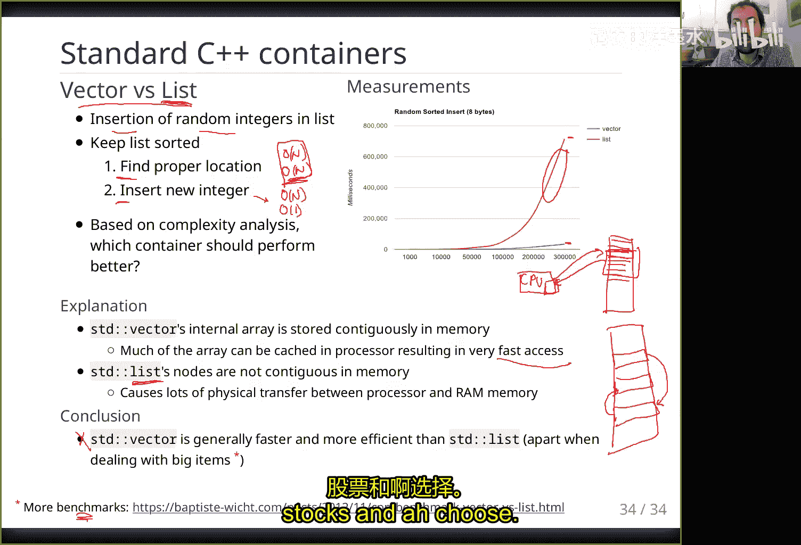

# 006：列表ADT的实现与比较


在本节课中，我们将学习列表抽象数据类型（ADT）的最后一种实现方式——基于链表的实现。我们将探讨单链表和双链表的工作原理，分析其优缺点，并了解C++标准库中列表容器的实现。最后，我们将通过一个实际场景比较不同实现的性能。

## 链表实现概述

上一节我们介绍了基于动态数组的列表实现。本节中，我们来看看基于链表的实现。链表通过节点之间的指针链接来存储数据，提供了动态插入和删除的能力。

### 单链表示例

以下是单链表实现的基本操作示例。

首先，声明一个空列表。内部有一个头指针`head`，初始指向空。

```cpp
List L; // 空列表
head -> nullptr
```

插入第一个元素（例如23）到位置0：
1.  创建一个新节点存储值23。
2.  将头指针`head`指向这个新节点。
3.  新节点的`next`指针指向空。

```cpp
head -> [23|next] -> nullptr
```

在列表末尾插入元素（例如42）：
1.  创建一个新节点存储值42。
2.  找到最后一个节点（当前是包含23的节点），将其`next`指针指向新节点。
3.  新节点的`next`指针指向空。

```cpp
head -> [23|next] -> [42|next] -> nullptr
```

在列表前端插入元素（例如99）到位置0：
1.  创建一个新节点存储值99。
2.  将新节点的`next`指针指向当前的头节点。
3.  将头指针`head`指向新节点。

```cpp
head -> [99|next] -> [23|next] -> [42|next] -> nullptr
```

从列表中移除位置1的元素（值为23）：
1.  找到位置0的节点（值为99）和位置1的节点（值为23）。
2.  将位置0节点的`next`指针指向位置1节点的下一个节点（值为42的节点）。
3.  释放位置1节点占用的内存。

```cpp
head -> [99|next] -> [42|next] -> nullptr
// 节点 [23|next] 被移除
```

### 单链表代码实现

现在，我们来看看单链表的具体代码实现。代码使用C++模板以支持任意数据类型，并利用智能指针管理内存。

```cpp
template <typename T>
class LinkedList {
private:
    struct Node {
        T item;
        std::unique_ptr<Node> next;
        Node(const T& value) : item(value), next(nullptr) {}
    };

    std::unique_ptr<Node> head;
    size_t size;

    Node* getNode(size_t pos) {
        assert(pos < size);
        Node* current = head.get();
        for (size_t i = 0; i < pos; ++i) {
            current = current->next.get();
        }
        return current;
    }

public:
    LinkedList() : head(nullptr), size(0) {}

    size_t getSize() const { return size; }

    T get(size_t pos) {
        if (pos >= size) throw std::out_of_range("Position out of range");
        Node* node = getNode(pos);
        return node->item;
    }

    int find(const T& target) {
        Node* current = head.get();
        for (int i = 0; current != nullptr; ++i) {
            if (current->item == target) return i;
            current = current->next.get();
        }
        return -1;
    }

    void remove(size_t pos) {
        if (pos >= size) throw std::out_of_range("Position out of range");
        if (pos == 0) {
            auto oldHead = std::move(head);
            head = std::move(oldHead->next);
        } else {
            Node* prev = getNode(pos - 1);
            auto nodeToRemove = std::move(prev->next);
            prev->next = std::move(nodeToRemove->next);
        }
        --size;
    }

    void insert(const T& value, size_t pos) {
        if (pos > size) throw std::out_of_range("Position out of range");
        auto newNode = std::make_unique<Node>(value);
        if (pos == 0) {
            newNode->next = std::move(head);
            head = std::move(newNode);
        } else {
            Node* prev = getNode(pos - 1);
            newNode->next = std::move(prev->next);
            prev->next = std::move(newNode);
        }
        ++size;
    }
};
```

### 智能指针与所有权

代码中使用`std::unique_ptr`管理节点内存。`head`指针拥有第一个节点，每个节点的`next`指针拥有下一个节点。当链表对象被销毁时，`head`指针被销毁，触发链式反应，所有节点被自动释放，避免了内存泄漏。

`getNode`函数返回一个原始指针`Node*`，用于遍历链表而不获取所有权。

### 双链表与优化

单链表只能单向遍历。为了提高效率，可以引入双链表和尾指针。

双链表的节点结构包含指向前一个和后一个节点的指针。

```cpp
struct Node {
    T item;
    std::unique_ptr<Node> next;
    Node* prev; // 指向前一个节点的原始指针，通常不拥有所有权
};
```

添加尾指针`tail`可以直接访问链表末端，使得在末尾插入和删除操作的时间复杂度为**O(1)**。

双链表支持反向遍历，但代码实现更复杂，因为需要维护额外的指针。

## 不同实现方式的比较

我们已经学习了固定数组、动态数组和链表三种列表ADT的实现方式。以下是它们的优缺点比较。

| 操作 | 固定数组 | 动态数组 | 单链表 | 双链表（带尾指针） |
| :--- | :--- | :--- | :--- | :--- |
| 随机访问 | **O(1)** | **O(1)** | **O(n)** | **O(n)** |
| 前端插入/删除 | 不支持 | **O(n)** | **O(1)** | **O(1)** |
| 末端插入/删除 | 不支持 | **O(1)** 摊销 | **O(n)** | **O(1)** |
| 中间插入/删除 | 不支持 | **O(n)** | **O(n)** | **O(n)** |
| 空间浪费 | 无 | **O(n)** | **O(n)** | **O(n)** |
| 反向遍历 | 支持 | 支持 | 不支持 | 支持 |

*   **动态数组**：随机访问极快，末端操作高效，但中间或前端操作需要移动元素，且存在一定空间开销。
*   **链表**：前端操作极快，中间操作在找到位置后也很快，但随机访问需要遍历，且指针本身带来空间开销。

## C++标准库中的序列容器

C++标准库提供了几种序列容器，它们都是列表ADT的实现。

*   **`std::vector`**：基于动态数组，是默认推荐的序列容器。支持快速随机访问。
*   **`std::list`**：基于双链表。当需要频繁在任意位置插入删除，或需要反向遍历时使用。
*   **`std::forward_list`**：基于单链表。更节省内存，适用于许多短列表或空列表的场景（例如按字母分类学生）。
*   **`std::deque`**（双端队列）：支持在两端高效增长，实现巧妙。

### 使用示例

以下是`std::vector`和`std::list`的使用示例。

```cpp
// 使用 std::vector
#include <vector>
#include <iostream>

std::vector<int> vec = {1, 2, 3};
vec.push_back(4); // 末端插入
vec.insert(vec.begin(), 0); // 前端插入
std::cout << vec[2]; // 随机访问，输出 2

for (auto& num : vec) { // 遍历
    std::cout << num << " ";
}

// 使用 std::list
#include <list>

std::list<int> lst = {1, 2, 3};
lst.push_front(0); // 前端插入
lst.push_back(4);  // 末端插入
// lst[2] // 错误！list不支持随机访问

auto it = std::find(lst.begin(), lst.end(), 2); // 查找
if (it != lst.end()) {
    lst.insert(it, 99); // 在找到的位置前插入
}

for (auto& num : lst) { // 遍历
    std::cout << num << " ";
}
```

## 理论分析与实际性能

考虑一个场景：需要持续向列表中插入随机整数，并始终保持列表有序。

*   **理论分析**：
    *   查找插入位置：数组和链表都是**O(n)**。
    *   执行插入：数组需要移动元素，为**O(n)**；链表只需修改指针，为**O(1)**。
    *   理论上链表应更优。

*   **实际测试**：
    *   使用`std::vector`（动态数组）的性能远优于`std::list`（链表）。
    *   **原因**：现代计算机硬件具有缓存系统。数组在内存中是**连续存储**的，CPU访问一个元素时，会预加载附近元素到高速缓存，使得顺序访问速度极快。链表的节点在内存中是**分散存储**的，每次访问都可能引发缓存未命中，导致实际速度很慢。

**结论**：算法复杂度分析是重要的理论工具，但实际性能还受硬件（如缓存）影响。对于大多数需要顺序访问的场景，`std::vector`通常是更好的选择，除非有特定原因（如频繁在任意位置插入删除）需要使用链表。

## 总结



本节课中我们一起学习了列表ADT的链表实现。我们探讨了单链表和双链表的工作原理、代码实现及其复杂度分析。通过比较动态数组和链表，我们了解到它们各有优劣：数组胜在随机访问和缓存友好性，链表胜在任意位置的高效插入删除。最后，我们介绍了C++标准库中的相关容器（`vector`, `list`, `forward_list`, `deque`），并通过一个实例认识到理论复杂度与实际性能的差异，强调了在实践中根据具体场景选择合适数据结构的重要性。下一讲，我们将开始学习新的主题：栈和队列。