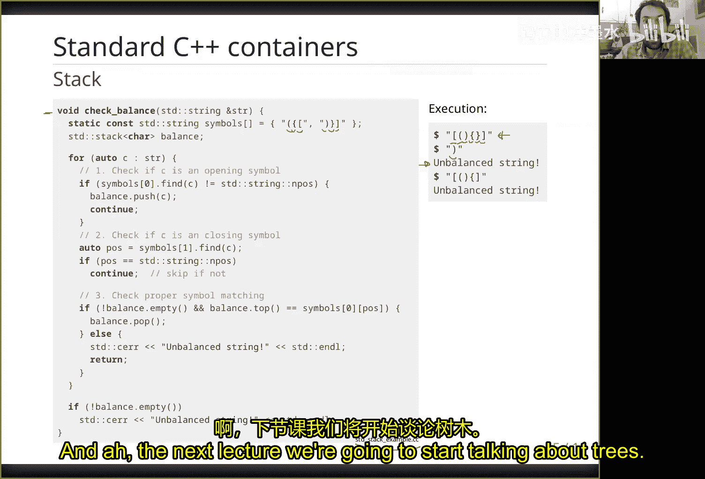

# 007：栈和队列


在本节课中，我们将要学习两种重要的数据结构：栈和队列。它们是列表抽象数据类型（ADT）的两种特定变体，操作上有所限制，但应用非常广泛。我们将从概念、操作、实现以及实际应用几个方面来详细探讨它们。

## 栈（Stack）的概念 🥞

上一节我们介绍了列表ADT的灵活性。本节中，我们来看看栈，它是一种操作受限的列表。

栈是一种数据项的序列，只允许在序列的一端进行添加和删除操作。这个操作端通常被称为“栈顶”。栈的核心思想是“后进先出”（LIFO, Last In First Out），就像一叠盘子，你总是把新盘子放在最上面，也总是从最上面取走盘子。

栈支持两个基本操作：
*   **入栈（Push）**：将一个数据项添加到栈顶。
*   **出栈（Pop）**：移除并返回栈顶的数据项。

此外，通常还会提供一些辅助操作，例如查看栈顶元素（Top）和获取栈的大小（Size）。

## 栈的API与实现 🔧

理解了栈的概念后，我们来看看如何用代码来描述和实现它。

一个典型的栈API（应用程序编程接口）可能包含以下方法：
*   `Size()`: 返回栈中元素的数量。
*   `Top()`: 返回栈顶元素的引用（但不移除它）。
*   `Pop()`: 移除栈顶元素。
*   `Push(const T& item)`: 将一个新元素压入栈顶。

以下是两种常见的栈实现方式：

**1. 基于数组/向量的实现**
使用动态数组（如C++的`std::vector`）实现栈时，为了获得O(1)的均摊时间复杂度，我们通常在数组的末尾进行`Push`和`Pop`操作。以下是核心思路的伪代码表示：

```cpp
class Stack {
private:
    std::vector<T> items;
public:
    void Push(const T& item) { items.push_back(item); }
    void Pop() {
        if (items.empty()) throw error;
        items.pop_back();
    }
    T& Top() {
        if (items.empty()) throw error;
        return items.back();
    }
    size_t Size() const { return items.size(); }
};
```

**2. 基于链表的实现**
使用单向链表（如C++的`std::forward_list`）实现栈时，为了操作高效，我们通常在链表的头部进行`Push`和`Pop`操作。因为链表在头部插入和删除都是O(1)操作。实现时需要注意手动维护栈的大小信息。

```cpp
class Stack {
private:
    std::forward_list<T> items;
    size_t cur_size;
public:
    void Push(const T& item) {
        items.push_front(item);
        ++cur_size;
    }
    void Pop() {
        if (items.empty()) throw error;
        items.pop_front();
        --cur_size;
    }
    T& Top() {
        if (items.empty()) throw error;
        return items.front();
    }
    size_t Size() const { return cur_size; }
};
```

## 栈的应用实例 💡

我们已经了解了栈的运作原理和实现，现在来看看它在实际编程中的强大用途。

**1. 符号平衡检查**
编译器在解析代码时需要检查括号（圆括号、方括号、花括号）是否匹配。栈是完成此任务的理想工具。
算法简述：
1.  创建一个空栈。
2.  遍历代码中的每个符号（token）。
3.  如果遇到开符号（如`(`, `[`, `{`），将其压入栈。
4.  如果遇到闭符号（如`)`, `]`, `}`）：
    *   若栈为空，则报错（缺少开符号）。
    *   否则，弹出栈顶元素，检查其是否与当前闭符号匹配。若不匹配，则报错。
5.  遍历结束后，若栈不为空，则报错（缺少闭符号）。

**2. 表达式求值（后缀表达式）**
我们日常使用的数学表达式是“中缀表达式”（如 `4 + 5`），它有时存在歧义（如运算优先级问题）。后缀表达式（或逆波兰表达式，如 `4 5 +`）则没有歧义，且可以方便地用栈来求值。
算法简述（用于计算后缀表达式）：
1.  创建一个空栈。
2.  从左到右遍历表达式中的每个元素。
3.  如果元素是操作数，将其压入栈。
4.  如果元素是运算符，则：
    *   从栈中弹出两个操作数（注意顺序）。
    *   用该运算符对这两个操作数进行计算。
    *   将计算结果压回栈中。
5.  遍历结束后，栈中剩下的唯一元素就是表达式的最终结果。

**3. 其他常见应用**
*   **函数调用栈**：程序执行时，函数调用、局部变量和返回地址的管理都依赖于栈。
*   **撤销（Undo）操作**：文本编辑器或图形软件中的撤销功能通常用栈来保存历史状态。
*   **浏览器历史记录**：浏览器的“后退”按钮可以看作一个栈，将访问的页面依次压栈，后退时出栈。

## 队列（Queue）的概念 🚶‍♂️🚶‍♀️🚶

看完了栈，我们再来看看它的“近亲”——队列。它与栈相似，但遵循不同的存取规则。

队列也是一种数据项的序列，但它允许在一端（称为队尾）添加元素，在另一端（称为队首）移除元素。队列的核心思想是“先进先出”（FIFO, First In First Out），这就像现实生活中的排队，先来的人先接受服务。

队列的两个基本操作是：
*   **入队（Enqueue）**：在队尾添加一个元素。
*   **出队（Dequeue）**：从队首移除一个元素。

同样，队列API通常也包含`Size()`、`Front()`（查看队首元素）等方法。

## 队列的实现 🛠️

与栈类似，队列也可以用不同的底层数据结构来实现。

**1. 基于链表的实现**
使用双向链表（如C++的`std::list`）可以轻松地在O(1)时间内完成队尾入队和队首出队操作。

```cpp
class Queue {
private:
    std::list<T> items;
public:
    void Push(const T& item) { items.push_back(item); } // 入队
    void Pop() { // 出队
        if (items.empty()) throw error;
        items.pop_front();
    }
    T& Front() {
        if (items.empty()) throw error;
        return items.front();
    }
    size_t Size() const { return items.size(); }
};
```

**2. 基于循环数组的实现**
使用一个固定大小的数组，并维护两个索引：`front`（队首）和`tail`（队尾，指向下一个可插入位置）。当`tail`到达数组末尾时，可以绕回到数组开头，形成一个逻辑上的“循环”数组，从而高效利用空间。

## C++标准库中的栈与队列 📚

C++标准模板库（STL）直接提供了`std::stack`和`std::queue`。它们被称为**容器适配器**，因为它们不是独立的底层容器，而是在现有容器（如`std::deque`, `std::list`）之上，通过限制操作接口来实现栈或队列的行为。

例如，声明一个栈：
```cpp
std::stack<int> myStack; // 默认使用std::deque作为底层容器
```
你也可以指定底层容器：
```cpp
std::stack<int, std::list<int>> myStack; // 使用std::list作为底层容器
```
`std::queue`的用法类似。

## 总结 🎯

本节课中我们一起学习了栈和队列这两种基础且重要的数据结构。
*   **栈（LIFO）**：仅允许在栈顶进行插入（Push）和删除（Pop）操作。我们探讨了其基于数组和链表的实现，并介绍了它在符号匹配、表达式求值、函数调用等场景的应用。
*   **队列（FIFO）**：允许在队尾插入（Enqueue），在队首删除（Dequeue）。我们了解了其基于链表和循环数组的实现思路，以及它在任务调度、消息传递等领域的用途。
*   **容器适配器**：C++ STL中的`std::stack`和`std::queue`是容器适配器的典型例子，它们基于已有的序列容器，通过封装提供特定的数据访问语义。

栈和队列是构建更复杂算法和系统的基石，理解它们对于学习数据结构与算法至关重要。



