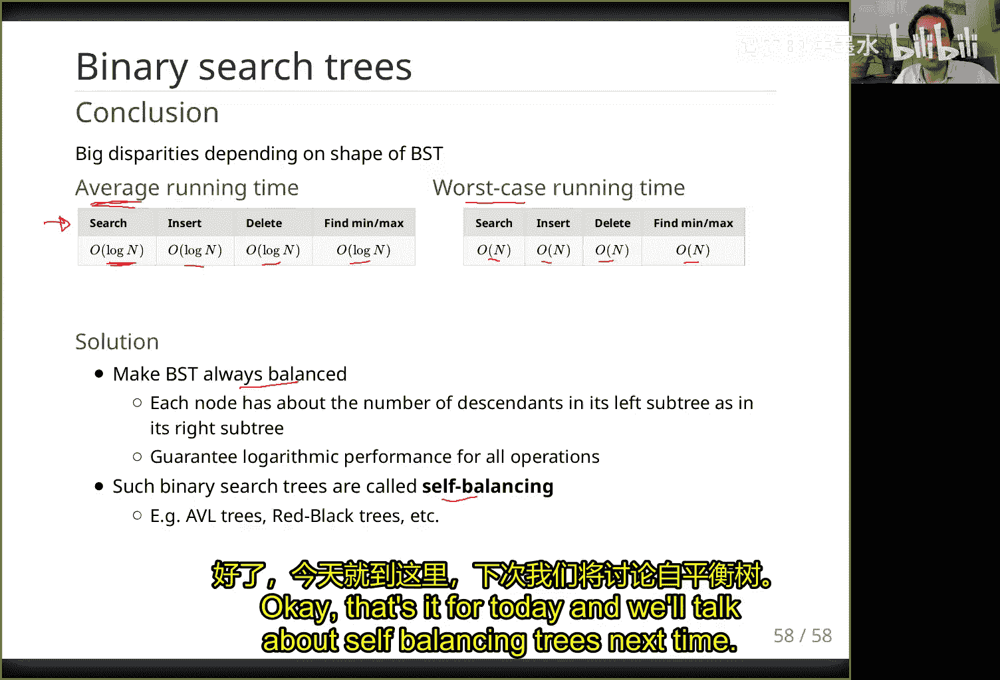

# 011：二叉搜索树（删除操作与复杂度分析）


在本节课中，我们将学习二叉搜索树的最后一个核心操作——删除节点。我们将详细探讨删除节点的三种不同情况，并分析二叉搜索树各种操作的时间复杂度，最后引出对自平衡树的需求。

## 二叉搜索树回顾

上一节我们定义了二叉搜索树。它是一个二叉树，其中每个节点最多有两个子节点：一个左子节点和一个右子节点。二叉搜索树的关键特性是：对于树中的任意节点，其左子树中的所有键值都小于该节点的键值，而其右子树中的所有键值都大于该节点的键值。这个性质适用于树中的每一个节点。

## 删除节点策略

删除节点是二叉搜索树操作中较为复杂的一个。我们首先来看一种简单的策略：标记删除法。

### 标记删除法

一种删除策略并非真正移除节点，而是将其标记为“已停用”。例如，要删除键值93的节点，我们可以在节点内部设置一个布尔标志，表示该节点已失效。节点本身仍保留在树的结构中，用于维持搜索路径。如果后续再次插入键值93，只需重新激活该节点即可。

这种方法实现简单，适用于删除操作极少发生的情况。然而，如果插入和删除操作频繁，树中将积累大量无效节点，浪费内存并使树结构膨胀。因此，我们通常需要真正的删除策略。

### 真正的删除操作

真正的节点删除分为三种情况。以下是每种情况的说明：

1.  **删除叶节点**：要删除的节点没有子节点。这是最简单的情况。
2.  **删除仅有一个子节点的内部节点**：要删除的节点有一个子节点。这种情况稍复杂，但处理逻辑清晰。
3.  **删除有两个子节点的内部节点**：要删除的节点有两个子节点。这是最复杂的情况，需要特殊的算法。

接下来，我们将逐一详细分析这三种情况。

## 删除叶节点

假设我们有一个二叉搜索树，想要删除键值为2的节点，并且该节点是一个叶节点。

**操作步骤如下**：
1.  找到该节点的父节点（例如节点18）。
2.  将父节点指向该叶节点的指针（左指针或右指针）设置为 `nullptr`。
3.  释放该叶节点的内存。

这个过程类似于从链表中删除一个节点，非常简单。

## 删除仅有一个子节点的内部节点

现在，考虑删除键值为18的节点，它只有一个右子节点42。

**操作步骤如下**：
1.  找到该节点的父节点（例如节点43）。
2.  将父节点指向该节点的指针（例如左指针），重新指向该节点的唯一子节点（节点42）。
3.  释放该节点的内存。

这样，节点18就从树中被移除，其子节点42直接连接到了原来的祖父节点43上。

## 删除有两个子节点的内部节点

这是最具挑战性的情况。例如，要删除根节点51，它同时拥有左子节点43和右子节点93。

**核心问题**：删除该节点后，需要用哪个节点来替代它的位置，才能保持二叉搜索树的性质？

**解决方案**：有两种合法的候选值可以替代被删除的节点。
*   **左子树中的最大值**：即节点43。
*   **右子树中的最小值**：即节点54（它是右子树93中的最小节点）。

通常，我们采用后者，即寻找**右子树中的最小节点**（也称为后继节点）。

**算法步骤如下**：
1.  找到要删除节点 `D`（51）的右子树中的最小节点 `M`（54）。这个节点 `M` 是 `D` 的后继。
2.  将节点 `M` 的键值复制到节点 `D` 中。现在，节点 `D` 的键值变成了54。
3.  此时，原来的节点 `M`（键值54）成为了冗余。我们需要在右子树中递归地删除这个键值为54的节点。
4.  删除节点 `M` 时，它本身只可能有两种情况：它是叶节点，或它只有一个子节点（因为它已经是右子树中的最小节点，不可能有左子节点）。在我们的例子中，节点54只有一个右子节点74。
5.  按照“删除仅有一个子节点的内部节点”的规则，将节点93指向节点54的指针，改为指向节点74，然后删除节点54。

通过这个“复制后继键值并递归删除后继节点”的策略，我们成功删除了拥有两个子节点的根节点。

## 删除操作代码实现

理解了上述逻辑后，我们来看代码实现。公共的 `remove` 方法很简单，它调用一个私有的递归函数。

```cpp
public void remove(Key key) {
    root = remove(root, key);
}

private Node remove(Node x, Key key) {
    if (x == null) return null; // 未找到键值
    int cmp = key.compareTo(x.key);
    if (cmp < 0) {
        x.left = remove(x.left, key); // 在左子树中递归查找并删除
    } else if (cmp > 0) {
        x.right = remove(x.right, key); // 在右子树中递归查找并删除
    } else { // 找到要删除的节点 x
        // 情况1 & 2: 节点有0个或1个子节点
        if (x.right == null) return x.left;
        if (x.left == null) return x.right;

        // 情况3: 节点有2个子节点
        Node t = x; // 临时保存要删除的节点
        x = min(t.right); // 找到右子树中的最小节点作为后继
        x.right = deleteMin(t.right); // 删除右子树中的最小节点，并更新x的右链接
        x.left = t.left; // 保持x的左链接为原节点的左子树
    }
    // 更新子树大小等属性（如果存在）
    // x.size = size(x.left) + size(x.right) + 1;
    return x;
}

private Node deleteMin(Node x) {
    if (x.left == null) return x.right; // 找到最小节点（无左子节点），返回其右子树
    x.left = deleteMin(x.left); // 递归地在左子树中查找并删除最小节点
    // 更新大小
    // x.size = size(x.left) + size(x.right) + 1;
    return x;
}
```
代码的核心是一个递归函数。它首先定位要删除的节点。如果该节点有两个子节点，则执行上述“寻找后继、复制键值、递归删除后继”的算法。如果该节点只有一个子节点或没有子节点，则直接返回其非空子节点（或 `nullptr`），从而在递归回溯时完成链接的更新和节点的删除。

## 复杂度分析

对于二叉搜索树，大多数操作（查找、插入、删除、查找最大/最小值）的性能关键取决于树的**深度（高度）**，而不是节点总数。

*   **理想情况（平衡树）**：如果树是平衡的（左右子树节点数大致相等），深度 `D` 与节点数 `N` 成对数关系，即 `D ≈ log₂(N)`。此时，上述操作的时间复杂度为 **O(log N)**，效率很高。
*   **最坏情况（退化为链表）**：如果插入的键值恰好是已排序的（升序或降序），二叉搜索树会退化成一条链表。此时深度 `D` 等于节点数 `N`，所有操作的时间复杂度退化为 **O(N)**，与普通链表无异。

以下是对比：
*   **二叉搜索树**：操作复杂度为 `O(D)`，`D` 为深度。在平衡状态下为 `O(log N)`。
*   **链表**：查找、插入、删除等操作复杂度为 `O(N)`。

遍历操作（如前序、中序、后序遍历）需要访问所有节点，其时间复杂度始终为 **O(N)**，这是无法优化的。

## 删除操作对平衡性的影响

我们之前讨论的删除策略（总是用右子树的最小节点替代）存在一个问题：它可能导致树逐渐**左倾**。因为每次都从右子树取节点放到父节点位置，长期来看右子树节点会减少。

**缓解策略**：
1.  **随机选择后继或前驱**：删除时，随机选择用右子树的最小节点（后继）**或**左子树的最大节点（前驱）来替代被删除的节点。这有助于避免树向一侧过度倾斜，但无法提供严格的平衡保证。
2.  **使用自平衡二叉搜索树**：这是根本的解决方案。这类数据结构（如AVL树、红黑树）在插入和删除节点时会通过旋转等操作自动调整树的结构，确保树始终保持大致平衡，从而将深度维持在 `O(log N)` 的水平。

## 总结



本节课我们一起学习了二叉搜索树最后的难点——删除操作。我们详细分析了删除叶节点、删除单子节点和删除双子节点这三种情况及其处理逻辑，并查看了大致的代码实现框架。接着，我们探讨了二叉搜索树操作的时间复杂度，认识到其性能高度依赖于树的深度，进而引出树平衡的重要性。最后，我们指出了标准删除操作可能破坏平衡性的问题，并为下一课要学习的**自平衡二叉搜索树**做好了铺垫。自平衡树能够保证在最坏情况下也能提供 `O(log N)` 的操作效率，是实践中广泛应用的数据结构。