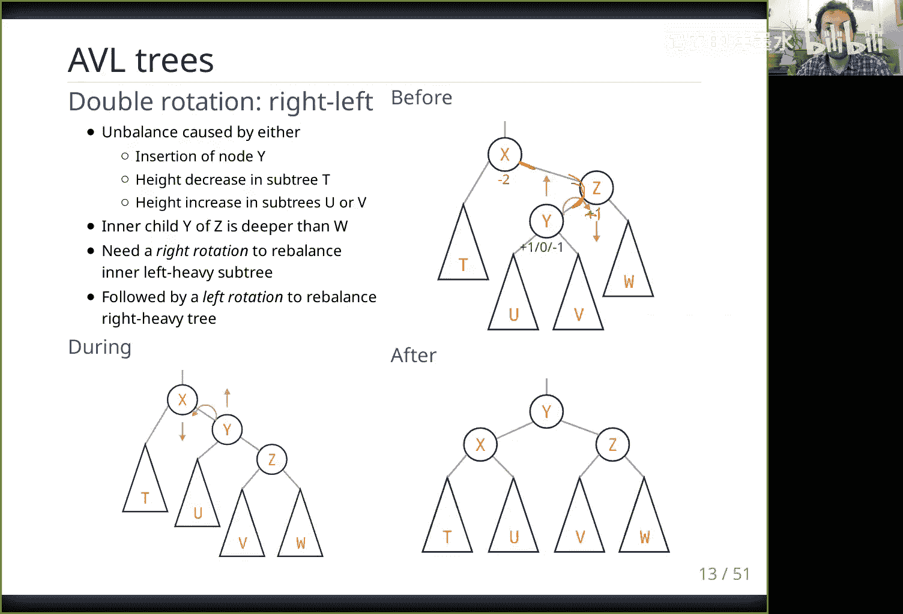

# 012：平衡树 🌲

在本节课中，我们将要学习平衡树的概念，特别是AVL树。我们将探讨为什么需要平衡树，如何定义平衡，以及如何通过旋转操作来维护树的平衡性，从而保证搜索、插入和删除等操作的高效性。

## 回顾：树的高度与性能

上一节我们介绍了树、二叉树和二叉搜索树的基本概念。本节中，我们来看看树的一个关键特性——高度，以及它与操作性能的关系。

对于一棵有 `n` 个节点的二叉树，其高度 `h` 与节点数量 `n` 的关系至关重要。在一个完美或接近完美的二叉树中，每一层的节点数大约是上一层的两倍。

以下是各层节点数与深度的关系：
*   深度为 0 的层（根节点）有 `2^0 = 1` 个节点。
*   深度为 1 的层有 `2^1 = 2` 个节点。
*   深度为 2 的层有 `2^2 = 4` 个节点。
*   以此类推，深度为 `h` 的层有 `2^h` 个节点。

因此，一棵完美二叉树的总节点数 `n` 近似等于 `2^(h+1) - 1`。由此可以推导出，树的高度 `h` 与节点数 `n` 的对数成正比：

**公式：`h ≈ log₂(n)`**

在二叉搜索树中，查找、插入、删除等操作通常从根节点开始，沿着一条路径向下进行。如果树的高度是 `log(n)`，那么这些操作的时间复杂度就是 **O(log n)**。然而，这有一个重要前提：**树必须是平衡的**。如果树退化成链表，高度就变成了 `n`，时间复杂度也随之恶化成 **O(n)**。

## 什么是平衡？⚖️

核心问题在于：如何确保二叉搜索树始终保持平衡，从而保证操作的高效性？让我们先看几种不完善的平衡思路。

以下是几种可能但效果不佳的平衡方案：
*   **方案一：根节点左右子树节点数相等**。这比单边链表好，但无法保证子树内部的平衡，深度可能依然很大。
*   **方案二：根节点左右子树高度相等**。这避免了单边深度过大，但两边仍可能各自是链表，整体性能不理想。
*   **方案三：每个节点的左右子树高度都相等**。这确实能保证完美平衡，但过于严格。插入一个新节点就可能破坏这种“完美性”，缺乏灵活性。

因此，我们需要一个**平衡条件**。这个条件应该：
1.  接近完美平衡，但不那么严格。
2.  易于维护和实现。
3.  能保证树的高度始终与 `log(n)` 成正比。

## AVL树：一种自平衡二叉搜索树 🌳

接下来，我们介绍第一种，也是最著名的平衡二叉搜索树之一：**AVL树**。它由 Adelson-Velsky 和 Landis 在 1962 年提出，其核心思想是为每个节点引入一个**平衡因子**。

### 平衡因子的定义

对于树中的任意节点，我们定义：
*   **高度**：从该节点到其最远叶子节点的路径上的边数。叶子节点的高度为 0，空节点（`null`）的高度定义为 -1。
*   **平衡因子**：该节点**左子树高度**减去其**右子树高度**所得的差值。

**公式：`balance_factor(node) = height(node.left) - height(node.right)`**

在AVL树中，要求**每个节点**的平衡因子只能是 **-1、0 或 1**。只要有一个节点的平衡因子超出这个范围，这棵树就不是AVL树。

### AVL树示例与验证

让我们通过一个例子来理解。考虑一棵二叉搜索树，我们计算每个节点的高度和平衡因子。

以下是计算过程：
1.  所有叶子节点（如 51, 74, 99）高度为 0，平衡因子为 0（因为左右子树都是空节点，高度均为 -1， `(-1) - (-1) = 0`）。
2.  节点 18：左子树高 0，右子树高 0，平衡因子为 `0 - 0 = 0`。
3.  节点 54：左子树高 0，右子树高 0，平衡因子为 `0 - 0 = 0`。
4.  节点 93：左子树（节点54）高 1，右子树（节点99）高 0，平衡因子为 `1 - 0 = 1`。
5.  根节点 43：左子树（节点18）高 1，右子树（节点93）高 2，平衡因子为 `1 - 2 = -1`。

这棵树所有节点的平衡因子都在 [-1, 0, 1] 范围内，因此它是一棵AVL树。

## 失衡与重平衡：旋转操作 🔄

查询操作（如查找、求最大最小值）在AVL树中与普通BST完全相同，且由于平衡性保证，其时间复杂度稳定为 **O(log n)**。

可能破坏平衡的操作是**插入**和**删除**。这些操作可能改变树的结构，导致某些节点的平衡因子变为 +2 或 -2。此时，我们需要通过**旋转**操作来重新平衡这棵树。

### 单旋转（左旋与右旋）

存在两种基本的单旋转场景。

**场景一：左子树过高（平衡因子为 +2），且左孩子的平衡因子为 +1 或 0（同侧失衡）**
*   **操作**：对失衡节点 `z` 及其左孩子 `x` 进行一次**右旋转**。
*   **效果**：`x` 成为新的局部根节点，`z` 成为 `x` 的右孩子。`x` 原来的右子树 `U/V` 变为 `z` 的左子树。旋转后，`x` 和 `z` 的平衡因子均变为合法值（0 或 ±1）。

**场景二：右子树过高（平衡因子为 -2），且右孩子的平衡因子为 -1 或 0（同侧失衡）**
*   **操作**：对失衡节点 `x` 及其右孩子 `z` 进行一次**左旋转**。
*   **效果**：`z` 成为新的局部根节点，`x` 成为 `z` 的左孩子。`z` 原来的左子树 `U/V` 变为 `x` 的右子树。旋转后，`x` 和 `z` 的平衡因子均变为合法值。

### 双旋转（左右旋与右左旋）

当失衡节点与其较重子节点的平衡因子符号相反时，需要进行双旋转。

**场景三：左子树过高（平衡因子为 +2），但左孩子的平衡因子为 -1（异侧失衡）**
*   **操作**：
    1.  先对失衡节点 `z` 的左孩子 `x` 及其右孩子 `y` 进行一次**左旋转**。这使 `x`, `y`, `z` 三点排成一条直线（`y` 在中间）。
    2.  再对 `z` 和新上来的 `y` 进行一次**右旋转**。
*   **效果**：`y` 成为新的局部根节点，`x` 和 `z` 分别成为其左右孩子。树恢复平衡。

**场景四：右子树过高（平衡因子为 -2），但右孩子的平衡因子为 +1（异侧失衡）**
*   **操作**：
    1.  先对失衡节点 `x` 的右孩子 `z` 及其左孩子 `y` 进行一次**右旋转**。
    2.  再对 `x` 和新上来的 `y` 进行一次**左旋转**。
*   **效果**：`y` 成为新的局部根节点，`x` 和 `z` 分别成为其左右孩子。树恢复平衡。

### 插入操作的重平衡流程

AVL树的插入操作在递归回溯阶段进行重平衡检查：
1.  像普通BST一样，递归地找到插入位置并创建新节点。
2.  递归调用开始返回（回溯）。
3.  在回溯到每个父节点时：
    *   更新该节点的高度。
    *   计算其平衡因子。
    *   如果平衡因子为 +2 或 -2，根据其子节点的平衡因子判断属于上述四种场景中的哪一种，并执行相应的（单或双）旋转操作。
4.  回溯到根节点，整棵树恢复AVL平衡性质。

## 总结

本节课中我们一起学习了平衡树的核心动机和AVL树的具体实现机制。

我们了解到，为了保证二叉搜索树操作的高效性（O(log n)），必须控制树的高度。AVL树通过一个巧妙的平衡条件——**每个节点的左右子树高度差不超过1**——来实现这一目标。我们深入探讨了**平衡因子**的概念，以及当插入或删除操作破坏平衡时，如何通过**单旋转**或**双旋转**来修复树的结构。这些旋转操作在保持二叉搜索树性质的前提下，重新调整节点位置，使树恢复平衡。

AVL树是众多平衡树方案中的经典之作，它奠定了自平衡数据结构的基础。在接下来的课程中，我们将探讨其他类型的平衡树及其实现。