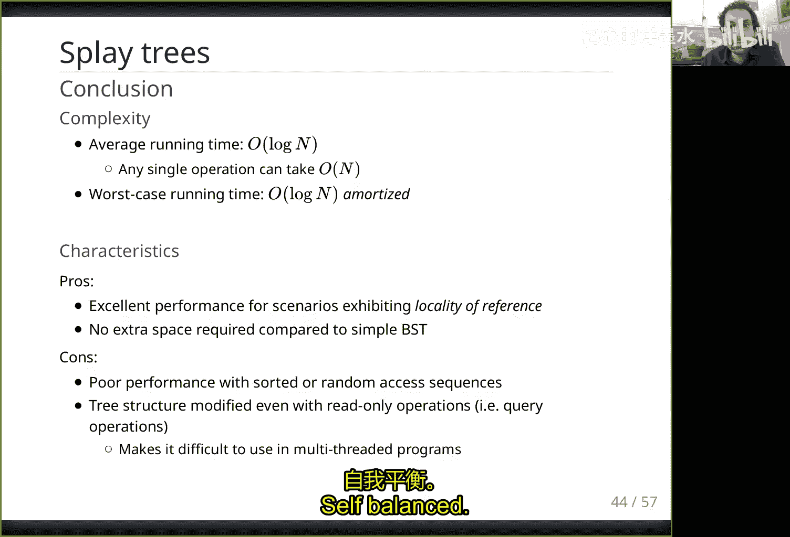

# 015：平衡树


在本节课中，我们将要学习红黑树的实现，并快速了解另一种自平衡树——伸展树。红黑树是一种自平衡二叉搜索树，通过一系列颜色规则确保树的高度大致平衡，从而保证操作的效率。我们将重点介绍一种更易实现的变体——左倾红黑树。

## 红黑树回顾

上一节我们介绍了红黑树的基本概念，本节中我们来看看它的具体实现。红黑树本质上仍然是一棵二叉搜索树，因此它保留了二叉搜索树的所有性质：每个节点都有一个可比较的键，较小键的节点在左子树，较大键的节点在右子树。

红黑树通过四个附加属性来确保平衡，从而获得优秀的对数级时间复杂度。以下是这四个属性：

*   **颜色规则**：每个节点非红即黑。
*   **根规则**：根节点总是黑色。
*   **红规则**：红色节点的子节点必须是黑色。
*   **路径规则**：从根节点到任意一个叶子节点（或只有一个子节点的节点）的路径上，黑色节点的数量必须相同。

所有查询操作（如查找最小值、最大值或判断值是否存在）与普通二叉搜索树完全相同。只有可能改变树结构的操作（插入和删除）需要为红黑树进行修改和适配。

我们之前讨论了插入过程，它分为四个步骤：

1.  像普通二叉搜索树一样插入新节点。
2.  将新节点着为红色。
3.  如果插入破坏了红黑树属性，则通过**重新着色**和**结构调整**（旋转）来修复，从插入点回溯到根节点。
4.  最后，确保根节点为黑色。

## 左倾红黑树

今天我们将学习红黑树的实现，但并非典型的红黑树，而是一种更简单的变体——左倾红黑树。它由红黑树的发明者在约30年后提出，其实现要容易得多。

左倾红黑树增加了一个额外的属性：**红色节点必须始终是其父节点的左子节点**。这个简单的规则使得实现大大简化。顾名思义，这种树在设计上会略微向左倾斜。

## 数据结构与辅助方法

与AVL树类似，左倾红黑树的节点结构在二叉搜索树的基础上增加了信息。不同的是，AVL树存储高度，而红黑树存储颜色。

以下是节点数据结构的定义：

```c
enum Color { RED, BLACK };

struct Node {
    int key;
    Node* left;
    Node* right;
    Color color;
};
```

与AVL树类似，我们需要一些辅助方法来实现插入过程中的重新着色和结构调整。以下是四个核心辅助方法：

### 1. 颜色判断 (`isRed`)

这个方法类似于AVL树中获取高度的方法。它判断一个节点是否为红色。空节点（`nullptr`）被视为黑色。

```c
bool isRed(Node* node) {
    if (node == nullptr) {
        return false; // 空节点是黑色
    }
    return node->color == RED;
}
```

### 2. 颜色翻转 (`flipColors`)

这个方法在常数时间内完成三个简单操作：将给定节点变为红色，并将其两个子节点变为黑色。这通常用于处理一个黑色节点带有两个红色子节点的情况。

```c
void flipColors(Node* node) {
    node->color = RED;
    node->left->color = BLACK;
    node->right->color = BLACK;
}
```

### 3. 右旋转 (`rotateRight`) 与 4. 左旋转 (`rotateLeft`)

旋转操作的代码与我们在AVL树中学到的几乎完全相同。唯一的区别在于，我们不再需要更新节点的高度，而是需要处理节点的颜色。在旋转过程中，子节点会继承父节点的颜色，而父节点会变为红色。

以下是右旋转的示例代码：

```c
Node* rotateRight(Node* parent) {
    Node* child = parent->left;
    parent->left = child->right;
    child->right = parent;
    // 处理颜色
    child->color = parent->color;
    parent->color = RED;
    return child; // 返回新的局部根节点
}
```

左旋转 (`rotateLeft`) 是其对称操作。

## 插入操作实现

有了这些辅助方法，我们就可以实现红黑树的插入操作了。你会发现，它与AVL树的插入非常相似。

插入函数的主体与普通二叉搜索树的递归插入相同。关键区别在于递归调用返回时（即从插入点回溯到根节点的路径上），我们需要执行一系列条件检查和修复操作，以维持红黑树（特别是左倾）的性质。

以下是插入函数的核心逻辑框架：

```c
Node* insert(Node* node, int key) {
    // 1. 标准BST递归插入
    if (node == nullptr) {
        return new Node(key, RED); // 新节点总是红色
    }

    if (key < node->key) {
        node->left = insert(node->left, key);
    } else if (key > node->key) {
        node->right = insert(node->right, key);
    } // 如果key相等，根据需求处理（例如忽略或更新）

    // 2. 回溯修复（维持左倾红黑树性质）
    if (isRed(node->right) && !isRed(node->left)) {
        node = rotateLeft(node);
    }
    if (isRed(node->left) && isRed(node->left->left)) {
        node = rotateRight(node);
    }
    if (isRed(node->left) && isRed(node->right)) {
        flipColors(node);
    }

    return node;
}

// 公开的插入接口
void insert(int key) {
    root = insert(root, key);
    root->color = BLACK; // 确保根节点为黑色
}
```

回溯修复的三个条件检查对应了维持左倾和红黑树性质的关键情况：
*   如果右子节点是红色而左子节点不是，进行左旋。
*   如果左子节点是红色，且左子节点的左子节点也是红色，进行右旋。
*   如果左右子节点都是红色，进行颜色翻转。

## 另一种自平衡树：伸展树

在结束红黑树之前，我们快速了解另一种有趣的自平衡二叉搜索树——伸展树。我们将在下一次讨论中详细研究并实现它。

伸展树的核心思想不是始终保持严格的平衡，而是利用**局部性原理**：最近被访问的元素很可能再次被访问。每次访问一个节点（无论是查找、插入还是删除），都会通过一系列称为“展开”的旋转操作，将该节点移动到树的根节点。

这样，频繁访问的节点会始终位于根节点附近，访问速度非常快。虽然最坏情况下单次操作可能是 `O(n)`，但平均时间复杂度仍然是 `O(log n)`。伸展树的优点是无需在节点中存储额外信息（如高度或颜色），缺点是它会改变树的结构，即使在只读操作中也是如此，这使其在多线程环境中使用复杂。

## 总结

本节课中我们一起学习了红黑树的一种实用实现——左倾红黑树。我们了解了其节点结构、核心的辅助方法（颜色判断、翻转、旋转）以及插入操作的回溯修复过程。左倾红黑树通过强制红色节点左倾的规则，简化了实现。



同时，我们引出了另一种自平衡树——伸展树的概念，它通过将访问节点移至根部的策略来优化频繁访问项目的性能。红黑树因其在灵活性和性能间取得的良好平衡而被广泛应用。