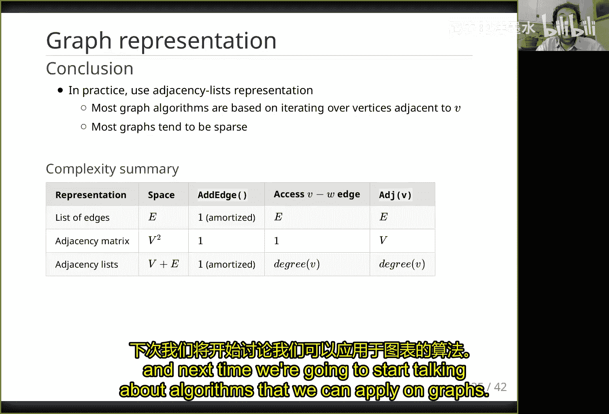

# 020：图论基础与表示方法 📊


在本节课中，我们将学习图的基本定义、术语以及如何在程序中表示图。我们将从数学符号开始，逐步介绍不同类型的图，并深入探讨三种主要的图表示方法。

## 图的基本定义与类型

上一节我们介绍了课程概述，本节中我们来看看图的基本数学定义。

图通常表示为 **G = (V, E)**，其中 **V** 是顶点（Vertices）的集合，**E** 是边（Edges）的集合。

图主要分为两种类型：

*   **无向图**：边没有方向，连接是双向的。例如，顶点 A 和 B 相连，意味着 A 可以到达 B，B 也可以到达 A。
    *   表示方法：`V = {A, B, C}`， `E = {{A, B}, {A, C}}`
*   **有向图**：边有方向，连接是单向的。例如，边从 C 指向 A，意味着可以从 C 到 A，但不能从 A 到 C。
    *   表示方法：`V = {A, B, C}`， `E = {(C, A), (A, B)}`
    *   有向图通常简称为 **Digraph**。

默认情况下，当人们只说“图”时，通常指的是无向图。

## 图的术语与词汇

了解了图的基本类型后，我们需要掌握描述图结构和属性的关键术语。

以下是关于图的一些核心术语：

*   **顶点的度**：连接到一个顶点的边的数量。在无向图中，顶点的度就是与其相连的边数。
*   **入度和出度**：仅适用于有向图。
    *   **入度**：指向该顶点的边的数量。
    *   **出度**：从该顶点指出的边的数量。
*   **孤立顶点**：度为 0 的顶点，即没有任何边与之相连。
*   **图的连通性**：图不要求所有顶点都必须相互连接。可能存在多个完全独立的子图。

接下来，我们看看图的几种特殊类型。

以下是三种常见的图类型：

1.  **多重图**：允许存在**自环**（连接顶点自身的边）或**平行边**（两个顶点间有多条边）的图。
2.  **简单图**：最常见的图类型。它是**无向的**，并且**没有自环和平行边**。通常所说的“图”即指简单图。
3.  **带权图**：图中的每条边都关联一个**权重**值。权重可以代表距离、成本、速度等，具体取决于应用场景。

现在，让我们探讨图中路径和环的概念。

*   **路径**：由一系列顶点和边组成的序列，表示从起点到终点的连通路线。
    *   **路径长度**：路径中边的数量。
    *   **路径权重**：在带权图中，路径上所有边权重的总和。
*   **环**：起点和终点是同一个顶点的路径。
*   **无环图**：不包含任何环的图。

## 图的分类与特性

在掌握了基本术语后，我们可以根据图的整体结构对其进行分类。

图可以根据其连通性分为两大类：

*   **连通图**：图中任意两个顶点之间都存在路径（直接或间接）相连。
*   **非连通图**：图中存在至少两个顶点子集，它们之间没有任何路径相连。

对于有向图，连通性有更细致的划分：

*   **弱连通图**：如果将所有的有向边替换为无向边后，图是连通的，则原图是弱连通的。
*   **强连通图**：对于图中任意两个顶点 **u** 和 **v**，既存在从 **u** 到 **v** 的路径，也存在从 **v** 到 **u** 的路径。

此外，还有两种描述图边密度的概念：

*   **稠密图**：边的数量 **E** 远大于顶点的数量 **V**，通常接近 **V²** 的数量级。在**完全图**（每对顶点之间都有边相连）中，边的数量达到最大。
    *   无向完全图边数公式：`E = V * (V - 1) / 2`
    *   有向完全图边数公式：`E = V * (V - 1)`
*   **稀疏图**：边的数量 **E** 与顶点的数量 **V** 大致成正比，即 **E ≈ V**。

最后，一个重要的特例是树。

*   **树** 是一种特殊的图，它满足以下条件：
    1.  无环
    2.  连通
    3.  具有根节点
*   **森林**：由多棵互不相连的树组成的图。

## 图的程序表示：API 设计

在深入具体的实现细节之前，我们先定义一下图类应该提供哪些基本操作。

我们希望一个 `Graph` 类至少包含以下功能（API）：

```cpp
class Graph {
public:
    // 构造函数1：创建一个包含 V 个顶点但没有边的图
    Graph(int V);

    // 构造函数2：从输入流（如文件）读取图数据并构建图
    Graph(std::istream& in);

    // 添加一条连接顶点 v 和 w 的边
    void addEdge(int v, int w);

    // 获取与顶点 v 相邻的所有顶点
    std::vector<int> adj(int v);

    // 返回图的顶点总数
    int V() const;

    // 返回图的边总数
    int E() const;

private:
    // 内部表示方法
};
```

## 图的三种表示方法

有了清晰的 API 设计，现在我们可以探讨如何在程序中实现图的存储。主要有三种表示方法。

### 方法一：边列表

边列表是最直观的表示方法。它直接存储图中所有的边。

**核心思想**：使用一个列表（如向量）来存储所有的边，每条边用一个顶点对 `(v, w)` 表示。

**C++ 实现示例**：
```cpp
class Graph {
private:
    int numVertices;
    std::vector<std::pair<int, int>> edgeList;
public:
    Graph(int V) : numVertices(V) {}
    void addEdge(int v, int w) {
        edgeList.emplace_back(v, w); // 添加边 (v, w)
    }
    std::vector<int> adj(int v) {
        std::vector<int> neighbors;
        for (auto& edge : edgeList) {
            if (edge.first == v) neighbors.push_back(edge.second);
            else if (edge.second == v) neighbors.push_back(edge.first);
        }
        return neighbors;
    }
    int V() const { return numVertices; }
    int E() const { return edgeList.size(); }
};
```

**复杂度分析**：
*   **空间**：O(E)，与边数成正比。
*   `adj(v)` **操作**：O(E)，需要遍历所有边来查找与 `v` 相连的顶点。
*   `edgeExists(v, w)` **操作**：O(E)，需要遍历所有边来检查是否存在边 `(v, w)`。

边列表简单，但在查找相邻顶点或检查边是否存在时效率较低，适合边数极少的场景。

### 方法二：邻接矩阵

邻接矩阵使用一个二维布尔数组来表示顶点间的连接关系。

**核心思想**：创建一个大小为 `V x V` 的矩阵 `matrix`。如果顶点 `i` 和 `j` 之间有边，则 `matrix[i][j]` 和 `matrix[j][i]`（对于无向图）设为 `true`，否则为 `false`。

**C++ 实现示例**：
```cpp
class Graph {
private:
    int numVertices;
    std::vector<std::vector<bool>> adjMatrix;
public:
    Graph(int V) : numVertices(V), adjMatrix(V, std::vector<bool>(V, false)) {}
    void addEdge(int v, int w) {
        adjMatrix[v][w] = true;
        adjMatrix[w][v] = true; // 对于无向图
    }
    std::vector<int> adj(int v) {
        std::vector<int> neighbors;
        for (int i = 0; i < numVertices; ++i) {
            if (adjMatrix[v][i]) neighbors.push_back(i);
        }
        return neighbors;
    }
    int V() const { return numVertices; }
    // E() 需要额外维护一个边计数器
};
```

**复杂度分析**：
*   **空间**：O(V²)，即使对于稀疏图也会浪费大量空间存储 `false`。
*   `adj(v)` **操作**：O(V)，需要扫描一整行。
*   `edgeExists(v, w)` **操作**：O(1)，直接访问 `matrix[v][w]` 即可。

邻接矩阵在检查边是否存在时速度极快，但空间消耗大，仅适用于稠密图。

### 方法三：邻接表

邻接表结合了边列表和邻接矩阵的优点，是最常用且高效的表示方法，尤其适合稀疏图。

**核心思想**：使用一个大小为 `V` 的数组（或向量），其中每个元素 `adjList[v]` 是一个列表（如向量），存储所有与顶点 `v` 直接相邻的顶点。

**C++ 实现示例**：
```cpp
class Graph {
private:
    int numVertices;
    std::vector<std::vector<int>> adjList;
public:
    Graph(int V) : numVertices(V), adjList(V) {}
    void addEdge(int v, int w) {
        adjList[v].push_back(w);
        adjList[w].push_back(v); // 对于无向图
    }
    std::vector<int> adj(int v) {
        return adjList[v]; // 注意：这里返回的是副本
    }
    int V() const { return numVertices; }
    int E() const {
        int count = 0;
        for (auto& list : adjList) count += list.size();
        return count / 2; // 无向图中每条边被记录了两次
    }
};
```

**复杂度分析**：
*   **空间**：O(V + E)，非常高效。
*   `adj(v)` **操作**：O(deg(v))，其中 `deg(v)` 是顶点 `v` 的度。通常这比 O(V) 或 O(E) 快得多。
*   `edgeExists(v, w)` **操作**：O(deg(v))，需要在 `v` 的邻接列表中查找 `w`。

## 总结与比较

本节课中我们一起学习了图的基础知识、术语以及三种主要的程序表示方法。

以下是三种表示方法的总结与比较：

| 操作/复杂度 | 边列表 | 邻接矩阵 | 邻接表 |
| :--- | :--- | :--- | :--- |
| **空间占用** | O(E) | O(V²) | O(V + E) |
| **添加边 `addEdge(v, w)`** | O(1) | O(1) | O(1) |
| **检查边 `edgeExists(v, w)`** | O(E) | O(1) | O(deg(v)) |
| **获取邻接顶点 `adj(v)`** | O(E) | O(V) | O(deg(v)) |

**选择建议**：
*   **邻接表** 是大多数情况下的首选，特别是对于稀疏图，它在空间和时间效率上取得了很好的平衡。
*   **邻接矩阵** 仅当图非常稠密，且需要频繁、快速地检查任意两点间是否存在边时才考虑使用。
*   **边列表** 通常用于特定算法或作为初始简单的表示，但在通用图操作中效率不高。



下一节课，我们将开始学习应用于图的各种算法。