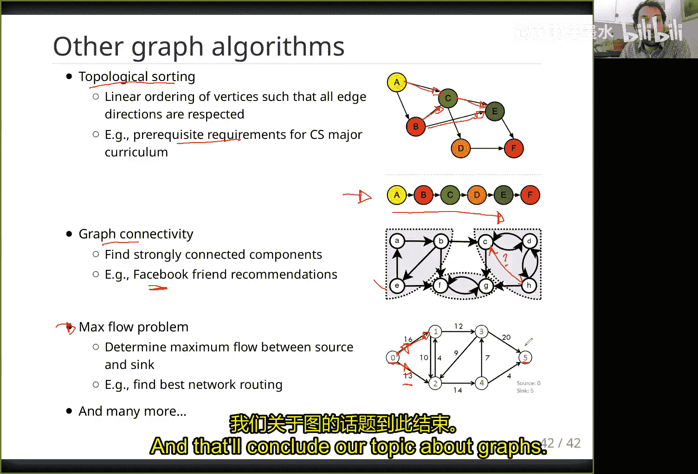

# 021：图算法


在本节课中，我们将要学习图数据结构上的核心算法。上一节我们介绍了图的三种表示方法（边列表、邻接矩阵、邻接表），本节中我们来看看如何遍历图，并探索几种最常用的图算法，包括最短路径和最小生成树。

## 图的遍历

既然我们已经可以用程序表示图，下一步就是如何系统地访问图中的所有节点。对于列表或序列这样的数据结构，遍历很简单，只需从第一个元素开始，按顺序访问即可。对于树，我们有两种主要策略：深度优先和广度优先。图本质上也是一种数据结构，其遍历策略与树非常相似，区别在于图没有明确的根节点，我们可以从任意节点开始探索。

以下是两种主要的图遍历策略：

*   **深度优先遍历**：从一个起始节点开始，沿着一条路径尽可能深入地探索，直到无法继续，然后回溯并尝试另一条路径。这类似于在迷宫中“一条路走到黑”。
*   **广度优先遍历**：从一个起始节点开始，先访问所有直接相邻的节点，然后再访问这些相邻节点的相邻节点，以此类推，逐层向外扩展。这类似于水波从中心点向外扩散。

### 深度优先搜索

深度优先搜索的核心思想是递归地探索图的深处。以下是其递归实现的伪代码：

```cpp
DFS(vertex v) {
    mark v as visited;
    for (each vertex w connected to v) {
        if (w is not visited) {
            DFS(w);
        }
    }
}
```

从起始节点 `v` 开始，我们将其标记为已访问，然后对于 `v` 的每一个未访问的邻居 `w`，递归地调用 `DFS(w)`。这个过程会沿着一条路径不断深入，直到遇到死胡同再回溯。

### 广度优先搜索

广度优先搜索使用队列来实现迭代式的逐层探索。以下是其算法步骤：

1.  将起始节点 `s` 放入队列并标记为已访问。
2.  当队列不为空时：
    *   从队列中取出一个节点 `v`。
    *   对于 `v` 的每一个未访问的邻居 `w`：
        *   将 `w` 标记为已访问。
        *   将 `w` 放入队列。

这个过程确保了节点是按照它们距离起始节点的“跳数”顺序被访问的。

## 图算法的实现模式

在编写图算法时，一个良好的设计模式是将图的数据表示（如邻接表）与图上的算法处理分离开。我们可以创建一个独立的“处理器”类，它接收一个图对象作为输入，运行特定算法（如DFS或BFS），并存储计算结果（如路径信息），然后提供查询接口。

例如，一个深度优先路径查找器的API可能如下：

```cpp
class DepthFirstPaths {
public:
    DepthFirstPaths(Graph G, int s); // 构造函数，从节点s开始对图G进行DFS
    bool hasPathTo(int v);           // 是否存在从s到v的路径？
    vector<int> pathTo(int v);       // 返回从s到v的路径（如果存在）
private:
    vector<bool> marked; // 标记节点是否已访问
    vector<int> prev;    // 记录到达每个节点的前驱节点
    void dfs(Graph G, int v); // 递归DFS函数
};
```

这种设计使得图数据结构保持纯净和只读，而算法逻辑和状态管理由独立的处理器类负责，提高了代码的模块化和可重用性。

## 最短路径算法

寻找图中两点间的最短路径是一个极其常见的问题，应用广泛，如GPS导航、网络路由等。根据图是否带权，我们需要不同的算法。

### 无权图的最短路径

在**无权图**中，每条边的“代价”相同（通常视为1）。此时，**广度优先搜索本身就是一种最短路径算法**。因为BFS按距离起始点的边数逐层访问节点，当它第一次访问到目标节点时，所经过的路径必然是最短路径（边数最少）。

### 带权图的最短路径（Dijkstra算法）

在**带权图**中，每条边都有一个权重（或成本）。此时，BFS不再适用，因为经过边数最少的路径不一定是总权重最小的路径。解决此问题最著名的算法是**Dijkstra算法**。

Dijkstra算法也使用类似BFS的扩展思想，但每次从“待处理集合”中选出的是**当前已知距离起始点最近的节点**。它需要用到优先队列（通常是最小堆）来高效地获取这个节点。

算法核心步骤如下：
1.  初始化：起始点距离为0，其他所有点距离为无穷大。所有节点加入优先队列。
2.  当优先队列非空时：
    *   从队列中取出距离最小的节点 `u`。
    *   对 `u` 的每条出边 `(u, v)`，检查能否通过 `u` 缩短到 `v` 的距离。即，如果 `dist[u] + weight(u, v) < dist[v]`，则更新 `dist[v]` 并记录前驱节点。
3.  算法结束时，`dist` 数组存储了从起点到所有节点的最短距离，通过前驱节点数组可以回溯出完整路径。

**注意**：经典的Dijkstra算法要求图中所有边的权重**非负**。对于包含负权边的图，需要使用Bellman-Ford等算法。

## 最小生成树

另一个重要的图算法问题是寻找**最小生成树**。生成树是连接图中所有顶点的一个无环子图。最小生成树是所有生成树中**边的总权重最小**的那一个。这个问题在网络设计（如用最低成本铺设连接所有城市的电缆）等领域有直接应用。

最常用的算法是**Prim算法**，其思想与Dijkstra算法有些相似：
1.  从任意一个顶点开始，将其加入生成树集合。
2.  在所有连接“生成树集合内顶点”和“集合外顶点”的边中，选择权重最小的一条。
3.  将这条边以及它连接的那个集合外顶点加入生成树集合。
4.  重复步骤2和3，直到所有顶点都加入生成树集合。

通过每次都选择当前可用的最小边，Prim算法能够逐步构建出总权重最小的生成树。

## 其他图算法简介

图论领域算法丰富，除了上述几种，还有：
*   **拓扑排序**：针对有向无环图，给出一个顶点序列，使得对于每条有向边 `(u, v)`，`u` 在序列中都出现在 `v` 之前。常用于任务调度、课程安排。
*   **强连通分量**：找出有向图中最大的子图，使得其中任意两点都互相可达。用于分析社交网络、网页链接等结构的内部紧密程度。
*   **最大流**：在带容量的网络中，计算从源点到汇点能通过的最大数据流。是网络流理论的基础，可用于交通规划、资源分配。

## 总结



本节课中我们一起学习了图的核心算法。我们从图的两种基本遍历方法（深度优先搜索和广度优先搜索）开始，理解了它们的工作原理和实现方式。接着，我们探讨了最短路径问题，区分了无权图（使用BFS）和带权图（使用Dijkstra算法）的不同解决方案。然后，我们介绍了最小生成树的概念以及Prim算法的基本思想。最后，我们简要列举了拓扑排序、强连通分量和最大流等其他重要的图算法。图作为一种强大的抽象工具，其相关算法是解决许多实际复杂问题的关键。