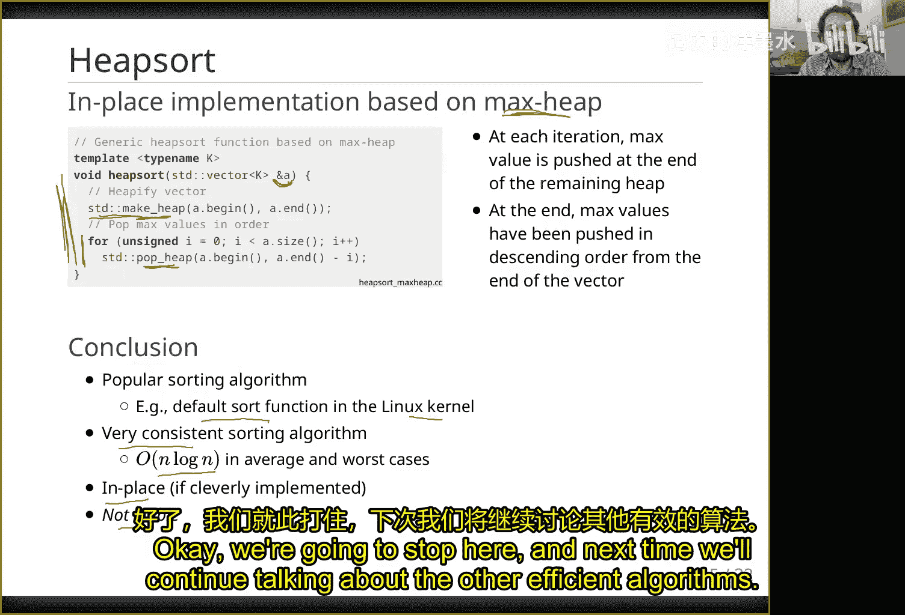

# 022：排序入门 🎯


在本节课中，我们将要学习计算机科学中的一个核心主题：排序。排序是组织数据的关键操作，它能让数据变得有序，从而极大地简化搜索、去重、统计频率和选择特定元素等其他操作。我们将从排序的基本概念讲起，然后介绍几种经典的排序算法，并分析它们的性能、内存使用和稳定性。

## 什么是排序？📚

排序是将一个集合中的元素按照某种特定顺序进行排列的过程。这个顺序并非一成不变，它取决于我们选择的排序标准。例如，我们可以根据学生的年龄、姓氏或名字进行排序，顺序可以是升序或降序。因此，排序总是**依据某种顺序**进行的。

为了实现排序，我们需要能够比较两个元素，即根据特定标准判断哪个元素更小或更大。这是排序算法的基本要求。

排序算法种类繁多，其中许多算法早在几十年前就已经被发明出来。虽然排序问题在今天看来基本已经解决，但了解不同算法的特性对于选择适合特定场景的算法至关重要。

## 排序算法的分类 📊

我们可以从三个主要方面对排序算法进行分类。

### 1. 按时间复杂度分类

这是最常见的分类方式，主要根据算法处理 `n` 个元素所需的步骤来划分。

*   **朴素算法**：这类算法通常实现简单，但效率不高，平均时间复杂度为 **O(n²)**。它们并非一无是处，对于小型数据集，使用简单的算法往往更合适。
*   **高效算法**：这类算法是我们学习的重点，如堆排序、归并排序和快速排序。它们的平均时间复杂度约为 **O(n log n)**，是处理大规模数据的默认选择。
*   **特殊算法**：这类算法不基于元素间的直接比较，其复杂度有时取决于键值的大小而非元素数量，在某些情况下可以达到极佳的性能。

### 2. 按空间复杂度（内存占用）分类

这指的是算法执行时是否需要额外的存储空间。

*   **原地算法**：这类算法可以直接在接收到的数组或集合内部进行排序，**不需要额外的存储空间**。
*   **非原地算法**：这类算法无法直接在原数组上完成排序，需要**创建额外的空间**（通常是 O(n) 或 O(log n)）来辅助完成排序过程。

### 3. 按稳定性分类

稳定性是指当排序算法遇到两个或多个被视为“相等”的元素时，能否保持它们在原始集合中的相对顺序。

*   **稳定算法**：保证相等元素的原始顺序在排序后**保持不变**。
*   **不稳定算法**：**不保证**相等元素的原始顺序在排序后保持不变。

为了更直观地理解稳定性，请看以下示例。假设我们有一副扑克牌，需要按点数排序，并且有两张点数相同的7。

*   初始顺序：7♥, 7♠, ...
*   稳定排序结果：7♥, 7♠, ... （红心7仍在黑桃7之前）
*   不稳定排序结果：7♠, 7♥, ... （顺序可能被交换）

上一节我们介绍了排序的基本概念和分类方式，本节中我们来看看第一种具体的排序算法：选择排序。

## 选择排序算法 🔍

选择排序是一种直观的朴素排序算法。假设我们有一个包含 `n` 个元素的数组 `A`，算法需要进行 `n` 轮操作。

在第 `i` 轮操作中（`i` 从 0 开始），算法会在**尚未排序的部分**（即从索引 `i` 到 `n-1`）中寻找**最小元素**。找到之后，将这个最小元素与当前索引 `i` 位置的元素进行交换。

这样，经过 `i` 轮后，数组前 `i` 个位置（`A[0]` 到 `A[i-1]`）就已经是有序的了。

### 算法示例

假设我们要对数组 `["U", "C", "D", "A", "V", "I", "S"]` 进行排序。

以下是选择排序的伪代码实现：

```cpp
template <typename T>
void selectionSort(std::vector<T>& arr) {
    int n = arr.size();
    for (int i = 0; i < n - 1; i++) {
        // 寻找 [i, n) 区间里的最小值的索引
        int minIndex = i;
        for (int j = i + 1; j < n; j++) {
            if (arr[j] < arr[minIndex]) {
                minIndex = j;
            }
        }
        // 将找到的最小元素与第 i 个元素交换
        std::swap(arr[i], arr[minIndex]);
    }
}
```

### 算法分析

*   **时间复杂度**：算法包含一个嵌套循环。外层循环运行 `n` 次，内层循环平均运行 `n/2` 次。因此，总的时间复杂度是 **Θ(n²)**。这意味着无论输入数组是否已经有序，算法都需要进行大约 `n²` 次比较。
*   **空间复杂度**：选择排序是**原地排序**算法。除了几个临时变量，它不需要额外的存储空间。
*   **稳定性**：选择排序是**不稳定**的排序算法。考虑数组 `[B1, B2, A]`，其中 `B1` 和 `B2` 相等。第一轮会将 `A` 与 `B1` 交换，导致 `B2` 跑到了 `B1` 前面，破坏了原始顺序。

选择排序虽然效率不高，但实现极其简单，对于小规模数据或作为教学示例非常合适。接下来，我们看看另一种朴素但很有特点的算法：插入排序。

## 插入排序算法 📥

插入排序是另一种经典的朴素排序算法。它同样对包含 `n` 个元素的数组进行 `n` 轮操作，但策略不同。

在第 `i` 轮操作中，算法关注的是位于索引 `i` 的元素。它会尝试将这个元素向数组的**左侧**“插入”到正确的位置。具体做法是：将 `A[i]` 与其左边的元素 `A[i-1]` 比较，如果 `A[i]` 更小，则交换它们。然后继续将 `A[i-1]`（即原来的 `A[i]`）与 `A[i-2]` 比较，重复此过程，直到该元素不小于其左侧的元素，或者已经到达数组开头。

你可以想象整理手中的扑克牌：左手持有一部分已排序的牌，右手从牌堆拿起一张新牌，然后从右向左扫描左手中的牌，找到合适的位置插入。

### 算法示例

同样对数组 `["U", "C", "D", "A", "V", "I", "S"]` 进行排序。

以下是插入排序的伪代码实现：

```cpp
template <typename T>
void insertionSort(std::vector<T>& arr) {
    int n = arr.size();
    for (int i = 1; i < n; i++) {
        // 将 arr[i] 插入到 arr[0...i-1] 中的正确位置
        T key = arr[i];
        int j = i - 1;
        // 向左移动所有大于 key 的元素
        while (j >= 0 && arr[j] > key) {
            arr[j + 1] = arr[j];
            j--;
        }
        arr[j + 1] = key; // 插入 key
    }
}
```

### 算法分析

*   **时间复杂度**：
    *   **最佳情况**：如果数组已经有序，内层 `while` 循环每次立即终止，时间复杂度为 **O(n)**。
    *   **最坏情况**：如果数组完全逆序，每个元素都需要移动到最左边，时间复杂度为 **O(n²)**。
    *   平均情况也是 **O(n²)**，但通常比选择排序快，因为它可以提前终止内层循环。
*   **空间复杂度**：插入排序是**原地排序**算法。
*   **稳定性**：插入排序是**稳定**的排序算法。因为它是依次交换相邻元素，相等的元素不会跨越彼此。
*   **在线排序**：插入排序有一个独特的优点——**在线排序**。这意味着它不需要一开始就拥有全部数据。数据可以逐个到达，每到达一个，就将其插入到已排序部分的正确位置。这对于处理数据流非常有用。

我们已经学习了两种朴素的排序算法，接下来我们将探讨更高效的算法。首先介绍的是基于我们之前学过的数据结构——堆——的堆排序。

## 堆排序算法 ⛰️

堆排序是一种高效且有趣的排序算法，它利用了二叉堆（特别是最大堆）的性质。其核心思想分为两步：
1.  **建堆**：将待排序的数组原地构建成一个**最大堆**。最大堆的根节点是数组中的最大元素。
2.  **排序**：重复将堆的根节点（当前最大值）与堆的最后一个元素交换，然后减小堆的大小，并对新的根节点进行“下沉”操作以恢复堆的性质。这样，最大值就被依次放置到了数组的末尾。

### 算法步骤与巧妙之处

1.  将无序数组 `A[0...n-1]` 构建成最大堆。
2.  此时 `A[0]` 是最大元素。将其与 `A[n-1]` 交换。现在，最大元素位于数组末尾的正确位置。
3.  堆的大小减 1（忽略最后一个元素），对新的 `A[0]` 进行下沉操作，使其重新成为最大堆。
4.  重复步骤 2 和 3，直到堆的大小为 1。此时数组已经完全有序。

这个算法的巧妙之处在于它是**原地排序**的。整个排序过程都在原数组上进行，通过交换和堆调整，最终得到一个有序数组，而不需要像朴素的堆排序实现那样额外复制一个数组。

### 算法复杂度分析

*   **建堆**：使用 Floyd 算法，时间复杂度为 **O(n)**。
*   **排序**：需要进行 `n-1` 次“移除堆顶”操作，每次操作（交换后下沉）的时间复杂度为 **O(log n)**。
*   **总时间复杂度**：**O(n log n)**。并且，堆排序的复杂度非常稳定，最好、最坏和平均情况都是 O(n log n)。
*   **空间复杂度**：原地实现，空间复杂度为 **O(1)**。
*   **稳定性**：堆排序是**不稳定**的排序算法。在构建堆和下沉的过程中，相等的元素可能会改变相对顺序。

由于其稳定的 O(n log n) 性能，堆排序被用于一些对性能一致性要求高的场景，例如 Linux 内核中的排序函数。

## 总结 📝

本节课中我们一起学习了排序的基础知识和几种重要的排序算法。

*   我们首先明确了**排序**的定义和重要性，它依据特定标准排列元素，是许多其他算法的基础。
*   我们从**时间复杂度**、**空间复杂度**和**稳定性**三个维度对排序算法进行了分类。
*   我们详细研究了两种**朴素算法**：
    *   **选择排序**：简单直观，每次选择未排序部分的最小值，时间复杂度恒为 Θ(n²)，原地但不稳定。
    *   **插入排序**：通过将元素插入已排序序列来工作，最佳情况可达 O(n)，具有稳定性和在线排序的优点。
*   最后，我们介绍了一种**高效算法**——**堆排序**。它利用最大堆在 O(n log n) 时间内完成原地排序，性能稳定但非稳定。



在接下来的课程中，我们将继续学习其他高效的排序算法，如归并排序和快速排序，并深入比较它们的优劣。理解这些算法的原理和特性，将帮助你在实际编程中做出最合适的选择。