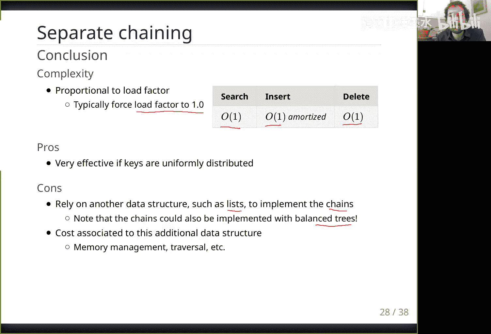

# 025：哈希表（第二部分）🎯


在本节课中，我们将继续学习哈希表。上一节我们介绍了哈希表的基本概念和哈希函数，本节我们将深入探讨如何为字符串等复杂类型设计哈希函数，并学习处理哈希冲突的第一种方法——分离链接法。

---

## 哈希函数进阶

上一节我们介绍了如何为简单的正整数设计哈希函数。本节中我们来看看如何为字符串等更复杂的键设计哈希函数。

### 字符串的哈希函数

一个简单但效果不佳的方法是：将字符串中每个字符的ASCII码值相加，然后对哈希表大小取模。

**代码示例：**
```cpp
size_t hashStringNaive(const std::string& key, size_t M) {
    size_t hash = 0;
    for (char c : key) {
        hash += static_cast<size_t>(c); // 累加ASCII码
    }
    return hash % M; // 取模得到索引
}
```

这种方法存在一个问题：英语单词的平均长度约为4.5个字符，每个ASCII码值在0-127之间。因此，大多数单词的哈希码会集中在较小的数值范围内（例如，低于500），导致哈希表前半部分非常拥挤，而后半部分几乎空置，造成严重的空间浪费和碰撞。

### 改进方法：霍纳方法

为了获得更好的分布，我们可以使用霍纳方法。该方法在累加过程中，将当前的哈希值乘以一个常数（通常是一个小质数，如31），然后再加上下一个字符的值。

**公式：**
`hash = (hash * 31 + c) % M` （在实际计算哈希码时通常先不取模，最后一步再取模）

**代码示例：**
```cpp
size_t hashStringImproved(const std::string& key, size_t M) {
    size_t hash = 0;
    for (char c : key) {
        hash = hash * 31 + static_cast<size_t>(c);
    }
    return hash % M;
}
```

选择31作为乘数有几个原因：
1.  它是一个质数，有助于产生良好的分布。
2.  在早期或资源受限的处理器上，`乘以31` 可以通过 `乘以32（即左移5位）再减去自身` 来高效实现。
3.  实践证明，31能为许多数据集提供良好的分布特性。

使用改进的方法后，不同字符串的哈希值分布更加均匀，能更好地利用整个哈希表空间。

### 通用数据结构的哈希

对于包含多个字段的结构（如电话号码、地址），可以采用类似的思路：将每个字段视为一个“部分”，并应用霍纳方法的原则进行组合。

**核心思想：**
`hash = (((field1 * 31) + field2) * 31 + field3) ... ) % M`

设计哈希函数时需注意：
*   **高效性**：哈希函数应尽可能快。
*   **关键信息**：对于复杂对象，应选取最能区分不同对象的部分进行哈希，忽略共性部分（例如，在地址中，“街道”这个词很常见，但街道名本身是关键）。

---

## 哈希冲突与生日悖论

即使使用最好的哈希函数，只要键的数量可能超过哈希表的大小，冲突就不可避免。我们可以用“生日悖论”来理解冲突发生的概率。

生日悖论指出：在一个23人的群体中，至少有两人同一天生日的概率超过50%。当群体达到70人时，概率接近100%。

类比到哈希表：
*   **哈希表大小 (M)** 相当于一年的天数（例如365）。
*   **插入的键数量 (N)** 相当于群体人数。

根据生日悖论推导出的公式，**第一次冲突发生的平均插入次数**约为：
`sqrt(π/2 * M)`

这意味着，如果我们希望平均不发生冲突，哈希表的大小需要远大于预计存储的键数量（通常是平方关系），这在实践中往往不现实。因此，我们必须设计机制来处理冲突。

---

## 处理冲突：分离链接法

分离链接法是处理哈希冲突最直接的方法之一。其核心思想是：哈希表的每个位置（桶）不再存储单个元素，而是存储一个链表（或其他容器）。所有哈希到同一位置的键值对都放在这个链表中。

### 工作原理

1.  当插入一个键时，先通过哈希函数计算其索引。
2.  找到该索引对应的链表。
3.  将新键插入到这个链表的末尾（或合适位置，取决于是否允许重复）。
4.  当查找或删除一个键时，同样先找到对应的链表，然后在链表中进行线性查找。

### 代码实现

以下是使用C++标准库组件实现分离链接法哈希表的核心框架：

**数据结构定义：**
```cpp
template <typename K>
class HashTableSC {
private:
    std::vector<std::list<K>> table; // 哈希表，每个桶是一个链表
    size_t currentSize; // 当前元素数量
    size_t capacity; // 哈希表桶的数量（初始为质数，如11）

    // 内部哈希函数
    size_t hash(const K& key) const {
        static std::hash<K> hasher; // 使用标准库哈希函数对象
        return hasher(key) % capacity;
    }
public:
    HashTableSC() : currentSize(0), capacity(11) {
        table.resize(capacity);
    }
    // ... 成员函数
};
```

**基本操作实现：**

以下是核心操作的实现思路：

*   **查找 (Contains)**：
    1.  计算键的哈希值，得到桶索引。
    2.  在该索引对应的链表中，使用 `std::find` 查找键。
    3.  返回查找结果（布尔值）。

*   **插入 (Insert)**：
    1.  先检查键是否已存在（调用Contains）。
    2.  若不存在，计算哈希值得到桶索引。
    3.  将键添加到对应链表的末尾。
    4.  更新元素数量 `currentSize`。

*   **删除 (Remove)**：
    1.  先检查键是否存在。
    2.  若存在，计算哈希值得到桶索引。
    3.  在对应链表中找到该键的迭代器，并使用链表的 `erase` 方法删除。
    4.  更新元素数量 `currentSize`。

### 性能分析与动态扩容

在分离链接法中，操作的性能取决于链表的长度。我们引入 **负载因子 α** 来衡量哈希表的拥挤程度。

**公式：**
`α = N / M`
其中，`N` 是元素总数，`M` 是桶的数量。

*   **最坏情况**：所有元素都哈希到同一个桶，链表长度为N，操作复杂度为O(N)。
*   **平均情况（使用良好哈希函数）**：元素均匀分布，每个链表的平均长度为 α。
    *   查找、插入、删除的平均时间复杂度为 **O(α)**。

为了保持哈希表的高效（即O(1)的平均复杂度），我们需要将负载因子 α 控制在一个较小的常数范围内（例如 α < 1）。由于元素数量 `N` 由用户决定，我们通过调整桶的数量 `M` 来控制 α。

**动态扩容策略：**
1.  当插入新元素后，负载因子 α 超过预设阈值（例如1.0）时，触发扩容。
2.  创建一个新的、更大的桶数组（通常将容量翻倍，并选择一个接近的质数作为新容量）。
3.  **重哈希**：遍历旧哈希表中的每个桶和每个元素，用新的容量 `M'` 重新计算其哈希值，并插入到新桶数组的相应位置。
4.  用新数组替换旧数组。

**复杂度分析：**
*   单次扩容操作是O(N)的，因为它需要重哈希所有元素。
*   然而，扩容操作发生的频率很低（容量呈指数增长）。类似于动态数组的扩容，这种成本被 **分摊** 到了多次插入操作中。
*   因此，在采用动态扩容的分离链接哈希表中，**插入、查找、删除操作的平摊时间复杂度为 O(1)**。

---

## 总结

本节课中我们一起学习了哈希表的核心进阶内容：
1.  **复杂键的哈希**：学习了如何为字符串设计有效的哈希函数，重点介绍了**霍纳方法**，它通过引入乘法使哈希值分布更均匀。
2.  **哈希冲突的必然性**：通过**生日悖论**理解了冲突无法避免的本质，并知道了第一次冲突发生的平均时间。
3.  **分离链接法**：深入探讨了处理冲突的第一种方法。其核心是将哈希表的每个桶实现为一个链表，所有冲突元素都放入同一链表。
4.  **实现与性能**：我们查看了分离链接法的代码框架，并分析了其性能。关键在于通过**动态扩容**控制**负载因子**，从而将各项操作的平摊时间复杂度维持在 **O(1)**。



分离链接法实现简单，是处理冲突的可靠方法。下一节，我们将学习另一种处理冲突的策略——开放寻址法。