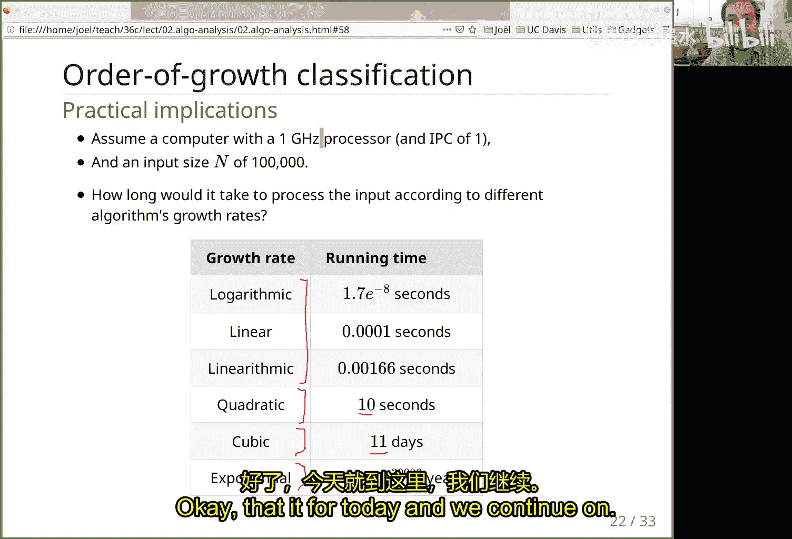

# 【全集】加州大学戴维斯分校 数据结构与算法编程 中英字幕 完整课件 p02 1-2 算法分析 -BV1rJ2WBSE7P_p2-

Hi everybody， happy Friday， so let's resume where we left off last time on this algorithm analysis topic。

So very quickly。😊，Last time we。So we started talking about the experimental approach in terms of analyzing algorithm。

 So the idea is that like we would implement a certain algorithm by writing the code。

Then we would run this code， its actual code after combiningiling it and everything and take measurements and gather data points。

 many of them。That would allow us to draw essentially like a plot to plot those data points。

And extract a certain equation and thanks to this equation we'd finally be able to make predictions and be able to characterize this certain algorithm and kind of know how it would behave on other inputs for which we don't have a certain measures that was the idea of the experimental approach and we saw that it had quite a few shortcomings first because we have to implement the algorithm that we want to characterize then the measurements that depend on a lot of factors that may like interfere with the quality of the results and so on it's a pretty complex complex technique。

So let's say another approach， which we can describe as a more mathematical approach。

So let's see what the idea is。The idea behind the mathematical approach is that we would look at all of the operations that a certain program performs and we would try to associate a certain cost。

 so for example that could be a cost in terms of the number of nanosecond that one operation takes。

 so by operation we mean for example， like adding two integers to one another or multiplying them or dividing them or adding floating point numbers。

 dividing floating point numbers， declaring variables。

 assigning values to variables comparing variables to one another。

 accessing an array and so on so every single operation that the program can make。

 we would associate a certain cost to it。And so then we could look at an entire program。

And see how many times we use those different operations and because we know the cost。

 we could just add everything to one another and have an overall kind of cost to that program and derive from it the learning time。

The thing is like it might be very complicated to do that because first of all we need to look at all of the operations of a certain program。

 the cost is very difficult to determine because it depends a lot on the compiler that you're using the level of optimizations of the compiler it depends on the computer itself the processor that's executing those operations and some processors are very fast at doing certain things and others are not so fast and so on so it's actually like such。

A detailed。Accounting might be very， very difficult to do。So instead， we're going to simplify that。

We're just going to look at a certain program， we're going to look at the code and we're simply going to count the statements。

 we're not really going to look at which operation each statement is。

 whether it's like dividing floating point numbers or just like simply assigning a value to a variable we're just going to look at the statements themselves。

And then we're going to try to count those statements and to take into account the size of the input data。

 so let's take an example here that'll be easier to understand。

So it's kind of the same example as the three sum except that the three sum is actually pretty complicated we might study it in discussion next week here I decided to go to another example that I called one sum which is really simple it's imagine you have an array of a certain size so array a of size n and essentially you scan this array from beginning to end and you count the number of items in this array that are equal to zero so you see like three sums we're trying to find all of the triplets that would add to zero here one sum we just try to find the number of items that are zero。

And so。The goal here with this super simple program is to try to count how many times。

Each statement in this program will be executed and actually。

 like you could post the video very quickly and try to do it yourself。And then come back。Okay。

 let's do it together now。呃So let's see。So let's look at this statement， for example， this statement。

 when we initialize count equals zero， that statement will be executed only one time right and actually we could even already say this one。

 the return statement will be executed only one time。Now what about this followup？😡，This follow up。

 we see that we have three sort of substatement， we have the initialization。

 we have the condition which will be evaluated at each iteration。

We have the increment and then we have the body of the loop。

 so let's look at all of those members separately， so let's look at this one。

How many times will this step statement be executed？Only one time。

Like the initialization of the loop will be executed one time。What about。This one。

This one will be executed as many times as we iterate through the loop。

This loop will go from 0 to n minus-1。So this statement will be executed。En times。

Now let's look at the body of the loop， so this statement。

 the if statement will also be executed n times。Because it will be executed from I equals0 to i equals n minus1。

The count plus plus now， this one depends actually on the input data。

If the array does not contain any item that is equal to zero， so the if condition always fails。

Then count plus plus would never be executed， it would be executed zero times Now on the other hand。

 if the array a contains only items that are zero， then every time the if condition will like kick in。

And this count plus plus will be executed。N times。 so it really depends on the input data。

 And finally， I left it for the end。This condition， there's a little trick here。

 you have to remember that in a fall loop。The condition， the stop condition is evaluated。

Even before running the loop for the first time。So， this。Stop condition will be evaluated， and plus。

One time， like once before we get into the loop and then n times throughout N iterations。

 So that's pretty much the idea。 And I summarized it。On this slide as well。

So now that we have the frequency of every single statement。

What does it give us well it gives us the entire running time and here I made the calculation for the worst case scenario。

 which is when the array is full of zeros and so we go through this statement count plus press all the time。

If we add up all of those frequencies， which are all dependent on the input size n。

That's the estimated runtime that we have at the end。4 n plus 4。So， let's take。AMore complex example。

 Now。 Let's look at another example called Tson。So two sum again。

 it's just it's an extension of one sum and it looks exactly like three sum。

 the idea is that we would try to find pairs of values or of items in an array which sum is zero。

And it's really like the same kind of algorithm as threesome but less complex。So let's do it again。

 like we could count all of the statements。So this one we said will be executed one time。

 this one will be executed one time that will be executed also one time that will be executed。

N plus one time。That will be executed and time。So here it's pretty easy。However。The inner loop。

Is a little bit more complicated here， so how can we think about it easily？Well。

 let's study it a little bit more。When I will be equal to0。Then J here will start from I plus 1。So。

 J。We'll go from one。Up to。And -1。 And that's when the inner loop stops。 So 1，2。N minus9 n-1。

Then we'll go back to the first loop。I will be incremented by one and will do it again。

So the next time I will be one and J。We go from this time， too。Two and minus one。Next。Ittereration。

 I will be2， and J will go from 3。Two n minus1。And so on。And so eventually， I will be equal to。

And -1 at the very last iteration。And， J。Well will not even enter its own loop because J will be equal to n and that will fail the stop condition and we're not even going to execute anything。

So that's what we have。And so here if we count， it means that the J loop will be executed here n minus one time。

A-2 times。N minus three times。And here， down to zero times。Okay。

So how many times total does that make Well here it's typically what we call a sum of series for which thematic mathematication called goes solved and so goes said that like if you have a series that goes from m down to one。

 then overall the sum of all of those terms is equal to that So we could essentially run the same like if we want to try to add n minus1 plus n minus2 plus n minus3 and so on down to zero。

Tortal， it means that it's。Half。Of n minus-1。Yeah。And-1 plus。1，'m。

 I'm really just like applying this formula， right， with M being n -1。 And so overall。

That equals to n minus1。Times n。And that's essentially the frequency of operation for this term。😊。

So actually not， for this term， this one， this term will be executed。

N time exactly like this one because we only execute the assignment of J once per iteration of the loop I。

However， the J+ plus and this if condition， those will be executed that many times。And once again。

 the stop condition for the J loop。Is the same as here， but。

Plus one time because it's also executed before we even get into the loop。

 so this one would be executed also like from n n minus1 n minus2 n minus2 and so on。

 so the formula would be a little different。And so overall， if we count everything。

 that's what we get and so you see here that like that's exactly。This formula corresponds to。

What I've been showing you here。And for the stop condition of the J loop here。

The formula is slightly different。Okay。Once again， if we sum all of this。

And we take the worst case scenario where。🎼In fact， like all of the。Pears all sun to zero。

 so we enter like we execute every single line all the time。

That's the kind of running time that we have。Two times n to the power of 2 plus 2 n plus4。

Now you have to agree with me that it was a little complicated to compute right like we have to apply this like sum of series。

 we really have to make some huge mental effort to be able to count all of the statements and derive the equation that gives us the overall running time。

Maybe we don't need to count everything like that and we can simplify even more。

Because when you look at it， like that really doesn't help like telling us the running time。

 that doesn't really help getting us the running time。That。

Would probably be able to be simplified a lot more， so let's see how we can do that。So first of all。

 we can try to identify。Which operation in the entire like block of code in the entire algorithm really represents the best the overall running time and here it turns out that like what represents the best the running time is this if statement because that's really like the core of this algorithm is to try to evaluate pairs of items and see if they add to zero。

And we saw that the frequency for this。For this statement was this like half of n times n minus1。

 and so if we like expend this expression， we have half of n squared minus half of n。

Now let's simplify。 let's simplify a lot more。Because we see that like we essentially have two terms。

 we have the term in n square。And then the term， interest N。It turns out that late。

 maybe we could completely ignore。The lower term。And only like focus on the N square。

The n square term here， half of an n square is called the leading term and the reason for us to like kind of allow ourselves to only focus on that term and discard。

The lower terms is very simple， is that like。Once you get set to an end to an end， sorry。

 like the input size that starts growing towards large numbers or like even towards infinity。

Then this lower order term completely disappears like it's not relevant anymore and that you can plot very easily。

 Let me show you here。So here I plotted the two curves。

One that's only essentially like half an n squared and this one is half an n squared minus the lower term half of n。

 and you see that like as soon as we get to large numbers which are not even that large like 2000 the two curves are completely in in indistinguishable like you cannot tell which one is which and that's mainly because like this。

Termed the X square， tall over powers。This small term。

 like this one is super small compared to this one completely like takes over。

That kind of notation is called the tilt notation。So it's a way of like approximating a certain curve by only keeping the leading term。

Because it turns out that like when the input size starts growing。The lower terms。

 they don't really matter anymore。嗯。😊，That T notation is definitely a good approximation for people doing algorithm analysis。

For us， it's still a little too precise most of the time for us。

 we're going to talk about something else。We're going to talk about something called order of growth so for example。

 like if you have a function that's pretty complicated that contains multiple terms。

If you simplify it in terms of tilted approximation。

 it means that you discard all of the lower terms and you only keep。The leading term。

But you also keep。The coefficient。Now， when you talk about the order of growth， you only focus。

On the growth of the function and you don't care。About the the coefficient。So for example。

Here with the tilt approximation， you had 16 n squared。

 the order of growth is just n squared you're just trying to capture like how the curve actually evolves like here。

Half of n squared oh sorry like n cubed n cubed and so here half of n squared you just keep n squared here a log of n that's just log of n and in case of like constant time three。

 you just keep the idea that it's constant or just one。嗯。So overall。

 like in terms of mathematical approach to。Characterize algorithms。

We do have mathematical tools that allow for very， very accurate modeling and some people who are very invested in studying that that's what they use。

呃。People who work in people who study the theory of algorithm。

 usually they are fine using approximate models using a tilt notation， often that's enough。

And for everybody else， including us， we often only just talk about order of growth。

 which is a perfectly fine way of like determining what kind of algorithm we have and how it compares to other algorithms and so on。

So actually I' like to。Give you kind of a notion of what does it mean the order of growth when we apply it to code。

 let me show you a few examples here。So。😊，If we have an algorithm。

 that's essentially just a sequence of simple statements。

And it does not depend at all on the size of the input。

 so if we have an input that we're considering that is， I don't know if size 10。

000 versus an input size of like 100，000。But the algorithm doesn't really take that size into account and it's just a succession of M successive statements。

 then it's just constant。Now we have。Look arithmic。

That would mean that you have a collection of n items。

And you go through those n items with like a few iterations。And at every iteration。

 the number of items that you are considering is divided by two。

Up until you reach the conclusion like you read the end so it's essentially like you divide your collection in half at every single step so if you had an input size of eight elements for example。

 then you would need three steps to process those eight elements if you had an input size of 16 elements then you would need four steps to go through all of those elements that means that your algorithm is logarithmic。

The binary research that we talked about last time。

 that's a logarithmic algorithm because if you have a set of n numbers that are sorted。

And in order to find one， you jump to the middle and you discard half of what remains and you keep doing that。

 then you will find the number that you're looking for in logarithmic time， like running time。嗯。

Next we have linear， so this one is the easiest， it means if you have a collection of n items。

Then you go through all of them。And it typically like it means that somewhere you have a fall loop that goes from zero to n that's linear so if your collection n has eight elements you're going to have eight iterations。

 if you have 16 elements you're going to have 16 iterations and so on。

Next we have an interesting one that we're going to talk about later this quarter。

 it's called linearar rhythmthmic， it's essentially n log n。It's used for example。

 in the sorting algorithm called merch salt and is' also very popular in all of the techniques that are called divide and conquer so often what's going to happen is that you have a certain collection of n elements。

You're going to divide them into repetitively。And that's where the login part comes in。

And once you've divided everything into two recursively。

 you kind of like re mergege everything back together and this remerrgging like regrouping part is often linear。

And so that's why overall you have n times login。And。Next we have quadratic and squared。

 so that's typically when you have a certain collection and you apply two for loops in a row so here typically like if you had a collection of eight elements and so you have an hour loop that goes from zero to seven and an inner loop that goes from zero to seven。

Total you're going to make 64 iterations， so eight times eight。And then we go on， we have cubic。

 so n to the power of three， so essentially three nested fall loops。And last but not least。

 we have exponential or factorial algorithms。 Those are pretty bad algorithms。

 essentially algorithms where you have。A certain number of items and you try the combinations of all of them so for example。

 like there's a typical problem called the traveling salesman's problem where you have a salesman。

And this person has a list of cities to visit， to sell their stuff。

And they have they tried to find the shortest route to visit all of the cities and go back to their origin city。

That's a very， very difficult problem to resolve and essentially in order to find the answer。

 you would need to try the combination of visiting all of the cities in all of the possible orders。

And once you've done that， then you know which order is the best order。

 but in order to find it you have to try all of the possible orders and that's typically a case where you could have an exponential algorithm because you need to try all of the combinations。

So to give you even more perspective in terms of what those different growth means like let me show you a graph where you can see how those algorithms kind of like behave graphically。

And that's what you see。 Oh let me。Remove those marks， okay。

So here you see that we have obviously like constant is great because it doesn't depend on the input size。

 then logarrithmic is one of the best type of algorithm because it's super fast。

 it doesn't increase very much even if the input size increases。

Then linear is not too bad as well as linear rhythmthmic。

 like often when we find linear rhythmmic algorithms for certain kinds of problems like people are fairly happy because it's still like kind of it gives us decent running times。

And then we have the category of quadratic， cubic， exponential and factorial。

 and those are usually like considered pretty bad or not very well optimized algorithms because。

As soon as the input size grows， they start getting really， really bad performances。And finally。

 to even give you a better example of what it truly means， let's run a quick example。

Let's assume that we have a computer with a processor that runs at 1 gigahertz， so fairly fast。

And let's assume that this processor can execute one instruction per cycle。

And let's assume that we are running an algorithm on an input size n of 100，000 and 100。

000 as an input size， it's not that big。100，000 is the equivalent of the population of Richmond。

 California， for example， so imagine like the。You are working for the city of Richmond。

 California and the city， the mayor asks you like hey。

 we need to run a certain algorithm to like I don't know。

 figure something out about the inhabitants and so you know that you're going to have to run some sort of like processing loop on 100000 items。

嗯。Or if you do some machine learning， you want to model the brain of a lobster。

 which also has about 100，000 neurons， and we can agree probably that the brain of a lobster is not that big。

So。😊，So that's your input size。And then it's funny to see it， like。

According to the kind of algorithm that you're able to come up with。

Like are you able to design an algorithm that will run in logarithmic complexity or in exponential complexity。

 how long is it going to take to process an input size of 100，000 on this 1 gigahertz processor？

And here it's staggering to see the difference。So for example， you see that like。

Everything that's from logarithmic to。Everything that's from logarithmic to linear aiththmic。

 it's pretty good right you're like still way less than a second so you you will be able to process all of the items in just a fraction of a second。

If your algorithm。Is quadratic。So meaning like you have two follow loops nested into one another to process all of those items。

That's now already going to take 10 seconds If you have three follows that are nested into one another。

 it's going to take 11 days and now if the algorithm that you're running somehow is trying to。

Determine all of the possible combinations for this input size then we're talking about I don't even know how much that is。

 but I'm not even sure well still be alive in that many years。

 so you see here how important it is to find algorithms that have a good running time complexity。

Because otherwise， on the same input size， you can have a rent from a fraction of a second to。

Atternity， essentially。Okay， that's it for today and we'll continue on。

For the next lecture。没。