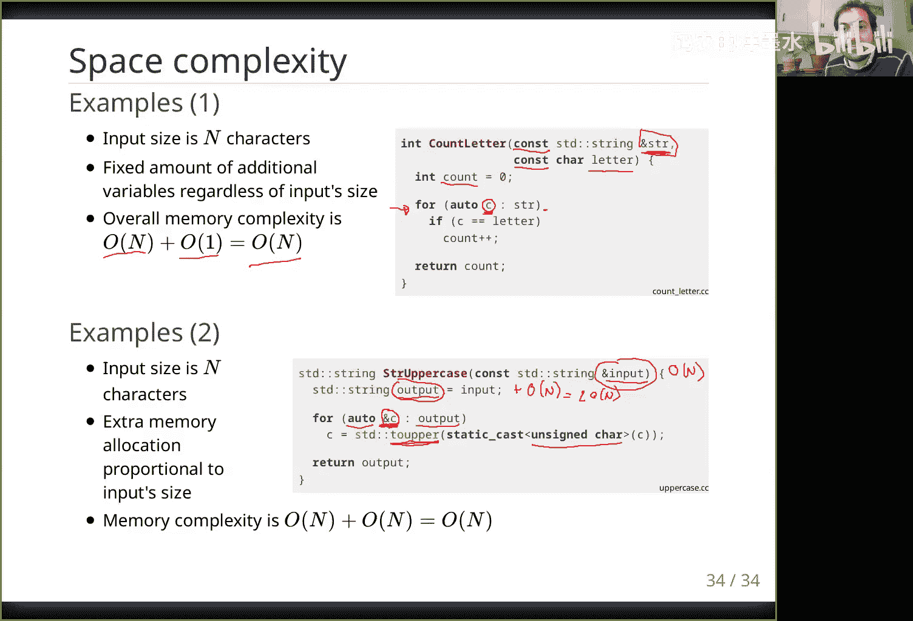

# 【全集】加州大学戴维斯分校 数据结构与算法编程 中英字幕 完整课件 p03 1-3 算法分析 -BV1rJ2WBSE7P_p3-

Hi， everybody。So today is the last episode of our ongoing series about algorithm analysis。

Qu recap from our previous lecture。So in our previous lecture。

 we talked about the idea that we could， we didn't have necessary to implement a certain algorithm and then run to have measurement and then derive a certain curve and then understand this curve。

We could simply look at the code and try to count the statements in function of the input size so for example we talked about two examples。

 the one sum and the two sum here is the code for the two sum and so for the two sum we could even go further and only look at one single statement which is the statement that really represents this algorithm the most。

The if statement that does try to detect if we have pairs of items that sum to zero。

And so by counting this statement and the number of time that it would be repeated that it would be executed。

 we were able to essentially determine that this algorithm has an estimate running time of half of n squared minus half of n and being the size of the input。

 which is like the collection that we're analyzing in that code。And。

We saw that we could even simplify more with the tilt notation。

 so the idea here is to only keep the leading term and drop any other lower terms because the lower terms as n increases they don't really matter anymore。

 so the t notation would keep only the leading term half of n squared and we could even simplify more by only looking at the other of growth of this function which is essentially n squared。

 we drop the leading coefficient here。Then we saw that there were different order of growth and I tried to show you graphically their behavior。

 so we saw that obviously constant never changes in function of the input size。

Loariththmic is really good because it barely moves as the input size grows linear。

 the running time grows proportionally to the input size and then linear arithmic quadratic and exponential the running time。

Grows faster， a lot faster than the input size。And we saw that those different orders of growth。

 they had real life implications in terms of whether an algorithm will be fast or not and so for example。

 like given a。A typical scenario where we have to process an input size of 100。

000 on the regular processor， we saw that according to the algorithm that we were using like the kind of order of growth。

 we could have an algorithm that could process all of that data in less than a second。

 and if the algorithm is really bad or what we are trying to do like won't be possible。

 it could take us essentially an et。So let let's resume that on that and today we're going to talk about this famous big O that you might have heard of before。

 so what is big O？Biggo is a mathematical tool。 It's a way to describe a certain function。

 So let me show you an example here。Essentially， imagine that。You have。A function here， I don't know。

 like something like that。Biggo would be a way to express the way that this function is moving in function of the input size。

And。And even more， it would be a way to describe an upper bound。So bigger would be aware of like。

Let me try to find another color here。Biggo would be a way to like define another function。

That will always be a above。The function that we're trying to describe and that function the blue line would be an upper bound it would be always greater than the function we're trying to describe here's the formal definition to help you understand a little bit more。

So we say that T of N T of n being。So， the red line here would be。T your in that's。

The function we're trying to describe a little bit better。

 that's the running time of a certain algorithm。And here， the blue line。Is essentially。Event。

And we say that Tn is O of F of n。If there is。A coefficientient C。

 which is greater than 0 for a certain constant n0， which is also greater than 0。

 such as t of n is always smaller or equal than c times f of n。

When N is superior or greater than this constant。What it means is that T of N here is。O。

 of ever then。If we can find a constant C， which in fact like describes is a multiplier to evern。

Such as。At some point here for a certain coefficient or for a certain， sorry value n0。

The blue line will essentially always be above the red line。

If we can find a coefficient C to ever then。For which at a certain end0。

The blue line is always above the red line， then we can consider then the blue line F of n is an upper bound to T of n that's pretty much what it means so let's take an example to make it even clear。

Let's look at that。😊，In that example here。That would be a certain equation。Yeah。

That we would consider to be this T of n， so let's say like we've done like last time we've looked at a certain algorithm。

 we've counted all of the statements in function of n and now we know that this algorithm that we're looking at has an estimate estimated running time which is like three n squared plus2 n plus4。

And we are trying to see if this TN， this estimated running time， is o of n squared。Right。

That means that we need to find if。N squared plus。2 n plus 4。Is less than。See a certain coefficient。

N squared， so I'm pretty much like just applying this formal definition here。

So let's try to solve this equation。What I can do here is divide everything by n squared if I divide here by n squared。

And all of that by n squared， so actually let's divide this by n squared。嗯。Let me。嗯。嗯。Yeah。

We divide this by n squared and we divide it by n squared。 and now we simplify。That goes away。

That goes away。诶。That goes away and here and this this thing stays like that。 So overall。

 we're trying to find a C which is greater or equal than3。Plus 2 over n。Plus， fall over。N squared。

Here it would be very easy to just set。Or constant n0 value to be equal to one。And。

Calculate now this expression。If we replace n here and n squared by this n0 equal 1。

Then we have two divided by one， which is2 and four divided by n squared， which is one。

 So that makes us a4。 So essentially it means that C must be greater than3 plus 2 plus 4。

Which is nine。And it means that then this proposition。😡，Is correct。

Our Tn is u of n squared because we can find。For a certain constant n0 equal1。

 a coefficientency equals to9 for which this holds like for which c times n squared9 n squared will always be greater or equal than our TN for all n value greater than1。

And actually， like。I traced it in the remainder of this slide here and we can observe that。

So the green line here。Is our TN。That's this line what we had seen here。The blue line。

9 x squared is pretty much the one that we came up to。

 which corresponds to the equation like n squared times 9，9 the value that we just found。

And we see that like。For everything， a above。N0 equal one。

 the blue line and9 n squared will always be above the green line。

 which means that it's an upper bound。And overall， it means that this Tn is O of n squared。

 even though。N squared technically would be lower， it would not be an upper bound if we just traced n squared。

 but it's not what biggo is like biggo implies that like。A certain function is O of another function。

If we can find a certain coefficient that multiplies F of n。

 such as c times f of n is always greater than t of n。Okay。So that's for Biggo。

 Biggo is not the only tool， there are two other notations that are very similar to Biggo but that express different things。

So Biggo is the upper bound that what describes a function that will always be over another function Now we have the exact opposite something called big omega it's the same idea of biggo。

 but here we try to indicate a lower bound。So for example。

 like if I had a certain function such as so Tn equals， I don't know。3 n squared。 Well， so plus4 n。

Plus two， I can't remember why it was。T of then would be。Omega of。呃And。

Oomega of n here is a lower bound to this function if I were to plot them。On a， on a， on a graph。

T of N would go like that because it it's a quadratic。Curve like equation。If I have n。

 which is just like linear necessarily。It would be always。Smaller。

So that would be a lower bound because this lower bound would never be greater than the other equation。

And the idea is the same like it also means if t of n is omega of f of n。

 it's the same reasoning with like finding a constant C for a certain value of n。

 such as t of n is always greater than this f of n。And so finally， we have。A last tool。

 which is called big Thera， which here is a tide bound。

It essentially means that like we would have a certain T of N which describes a curve。

And we can find。A function ever then。Such as we can find。2 constants。C1 and C2。

That will always be like C2 times。Our bound will always be above the function that we're trying to describe and C1 times。

The呃呃呃呃。The big Theta will always be lower if that's the case， then we have a tight bound。

So very quickly， a little bit more if you're interested in the math behind that。

You have to remember that Biggo is only an upper bound。Yeah。So。Technically。

 as we just saw a couple slides ago， that is correct。

 like we can find a coefficientency and a constant value n0 to demonstrate that3 n squared plus to n plus4 is in fact big of n squared because we can find a coefficientency and a value n0。

That makes this function be an upper bound， but it's not the only upper bound。Of this function。

We could also say that this function has other big os。Because bigger of and cube。

 bigger of n to the power of code for or even like bigger of factor n are also upper bound to that function。

 because there are also other functions that are always above。

The function that were trying to describe so you have to be careful that like bigger can be a little confusing sometimes。

 especially if it's misused。Because it expresses more。Um， so that that's why when we talk about bigO。

 usually like we always try to talk about the tightest bigO and not like any function that's above the one that we're trying to describe。

Another thing that we have to be careful as well is the notion of equality。So we can say that。

Bigger of n is bigger of n squared， like it goes in that direction because n squared is an upper bound to n。

Now the opposite is not true Big of n squared is not bigger of n because it only goes in that direction and so here n is never an upper bound to n squared。

So that doesn't work。So when you say equal， it's always in one direction。

A good way to remove any possible confusion is to not use necessarily the sign equal。

 but to use the sign include this way the relationship is clear and it's always。You need directional。

And finally， there's a good question here。Why can't we not always use big The？So actually， like。

 let me go back。To this slide。If you remember， so go back to the slides on your own and try to remember what we had found。

For the problem onesome。Yeah。When we counted all of the statements and their frequency。

 we ended up finding that the estimated running time T of n for this onesome problem was for n。Plus。

4。If you don't remember， like post this video， go back to the slide， go back to the other video。Yeah。

So here， if we try to find the closest n or that characterize this function。We could find that。

 it's bigger of。And。Because we can find a coefficient for a certain value n0。

 such that max this equation。An upper bound to foreign plus4。

 Now we could also find the tightest big omega， the lower bound， and in fact。

 we could also prove that this t of n， which is a foreign plus plus4， is big omega。Okay。

 we can also find a coefficient for a certain like starting from a certain n0。

Input such as we have an equation that's just n that is a lower bound。Altogether。

 it means that this one sum is big theta。Of it。Now。

Back to the question and we could do the same for the two sum。

 for the three sum for like all like for many， many algorithms that are like fairly simple。

 we can find a and aome that are similar， which means that we can define the running time with a big theta and really like describe a tide bound to a certain algorithm。

So back to the question here， why can't we not describe all functions all algorithm them always with a big the because actually like most of the time it's going to be possible。

But not always， there are also functions that depend on the certain input and according to the input。

 according to the value of the input， they're going to behave differently。

 so let me show you a mathematical function that would do that。Imagine you have function F of n。

 which is n times1 plus sine of n。This one， when you plot。

You're going to keep ociating between values that are essentially。lin尼亚。Versus values。That are zero。

And so here it means that your' big of n。Your the bigger the upper bound would be U then。

And the big omega would be。0。And that's the best you can do like that's the that's the tightest big O。

 that's the tightest big omega。 And so for that function in particular。

 you cannot find the big theta。To just express。The curve with only one symbol。

So that's why a big The， although you can， I mean you can try to use it as much as possible when it's applicable。

 but it's not always applicable。Okay， so let's drop the map a little bit and go back to some code。嗯。

😊，So it's good to understand all of those mathematical notions。

 big omega and big theta in terms of what they describe and how they are mathematical tools to describe functions and curves and express bounds。

In practice in computer science， we're pretty much always going to use biggo unless you start doing like actual theory and you start specializing like that。

 but if you stay at a very standard like software developer level，Biggo is fine。

 we not going to expect you to know anything else。However。

 even if you use BeO you should always try to use the beO function that is like that the tightest upper bound。

 so if you have an algorithm that's big of n squared。

 don't say that it's big of n cube because otherwise it doesn't really describe it very well。

What it means in practice is that like if you have a certain running time that you can express like that and you see the leading term is in n squared。

 then the bigger would be o of n squared it's really usually as simple as that。

So if we look at previous examples that we've。Studed in previous lectures， we see that the one sum。

 which has only followed from zero to n。I can be expressed as big of。

The two sum which had like two fall loops， so going through the collection kind of twice at least like with the combination of two nested fall loops。

 that would be a complexity of bigger of n squared and finally three sum which has three nested fall loops to go through the entire collection of numbers would have a bigger of n to the power of three。

Now you have to be careful， there are some cases where it doesn't at least like you have to be careful。

 so let's see why look at this first example here。嗯。As you can see。

 you have two fall loops that are nested into one another， the first fall loop。

Has an index i between0 and n， so that's going to run n times。

And inside we have a nested follow loop that has a J index from zero to5。

 so here we're going to make five iterations。So the question is like how would you describe this algorithm。

 like what kind of be would you apply？And you would be tempted maybe to say， oh， well。

 I see two follows are'm not going to think anymore， that's o of n squared。

Except that you have to be careful， you have to always look at where is the N。

 where is the input size。How does this code evolve？

In function of the input size as a function of the input size。

 that's really the question that matters the most。If n is1 thousand0。

 then this fall loop will run a thousand times and this one will run five times for every iteration of I now if n is。

1 million。Then yes， you're going to run this first fall loop a million time。

 which is bigger than before， but you see that the inner loop will still only run five times per iteration of I。

So overall。😊，You do any generation of this guy times。Five iteration of the inner loop。

That is not n squared。That is oh of。Essentially five times n， which is O。Oft。

That's the complexity and that is because the inner loop。

 it's not really an inner loop it's or at least like it's an inner loop that is completely constant。

 it doesn't change as a function of the input size and so it can be discarded。

Let's look at another example here。So again， you see two nested fall loops。

The first one same as before， we have an index i from0 to n。

 so this one is going to the number of iterations will grow proportionally to the input size。

And you see that we have another follow loop inside J， which also goes from zero to n。

So here you could be tempted like oh， I see a for loop that goes to n and inside another for loop that goes to n。

 so this one。Would be n squared， I recognize a certain pattern。Except that once again。

 you have to be careful because this if statement here。Makes all the difference。These if statements。

Will， only。呃呃呃。Pass will only succeed one time。At the very last iteration。

When the value of I is equal to a very specific value。So in fact， this far loop will not be executed。

For every iteration of eye， it's only going to be executed once。So technically。

 what you're doing is that you're executing。The first follow up n times。And once。

You're going to execute the second follow。So it's not a multiplication。It's an addition。 It's a same。

And so here at total， your algorithm is bigger of 2 n， which can be simplified too。Biggo of again。

Because the inner loop。iss only executed once， so you have to be careful about those pitfalls when you actually look at a certain code and you try to determine what is the legal complexity of that code。

Okay， let's continue。So what about when you have a certain function for which you're trying to determine the complexities or like the bigO that would characterize this function？

And this function calls another function internally。

 so look at here we have this function which receives a certain count and essentially we're trying to sum the different square values of that count at least like from。

All of the values between zero up to that count， so we receive a certain count which is a maximum value and we run all of the values from zero to that maximum value。

 we square them and we add them to a certain sum and we return that sum so we return the sum of all of the square values between zero and count。

嗯。Here we can pretty quickly determine we have one follow loop。

 which goes from zero to a certain input which we get here， so that's typically。On。Now。

 inside of this this， we call the square root function。

And here it's actually pretty important that we know how this square function behaves。

Because if this square function is also。O n， then it would multiply and we get like o of n squared if the square function is a constant function。

 like if it computes the square value regardless of the input size。Then it would be constant。

And overall， this entire function would stay o of it。

So that requires you when you write code to know what kind of function you're calling and to know their internal complexity in terms of running time。

So in practice， the square root function can be either directly a processor instruction that processor in hardware knows how to execute。

 and it can be done as fast as one processor cycle or a few processor cycles。

If the processor doesn't know how to do square root directly in hardware。

 most likely it would be emulated in software by running code that emulates the square root operation。

 and usually it would also take a few iterations。What's important is that the square root process。

 like no matter whether it's the processor who that runs it or a certain software function。

It always converges within a certain amount of iterations that does not depend。On the input。

 like computing the square root of。I being like two of I being like 1 million500。

 like whatever number would take pretty much the same amount of time for the processor。So overall。

 the square root function would be considered a constant in terms of complexity。

 and so this entire function would be U because this fall loop。Would be the primary。

Would be primarily responsible for the entire complexity this of this function let's look at another function。

Another function that operates on strings。So this one is a function that receives a certain string。

Receives another string that is a pattern and essentially tries to see if that pattern is included in the string。

If it is included then the function will return boolean value true otherwise it will return false there are probably better algorithm than this one this one is extremely naive but in this one so imagine that STR。

Es a certain string， I'm not going to write it， but like let's imagine it's plenty of characters。

And let's imagine that pattern。Is also a string like that's just a small word。

 And so we are trying to see if that word appears anywhere in the string。With this algorithm。

 what we're going to do is that we're going to start from the very first character of the string。

And were so imagining that like the let's say that the pattern is blue。

 we're going to try to see if the pattern appears over here。If it doesn't。

Then we move to the next character。And we try to see if now the pattern appears starting from the second character。

 if it doesn't， then we move to the third character。

And we try to see if the pattern appears on the third character。 and so， and so we try。

 we essentially try to match。The string like character by character by having the the we're trying to match the pattern like successively。

And that's pretty much what this fall loop does。We start from the very first character in the string。

And we compare from this character in the string with the pattern and we compare。

The length of the the the pattern and if we find that it's a perfect match then we return true if we've tried to match the pattern everywhere and we haven't find anywhere where it match perfectly then we would this if would never succeeds and eventually we'd be out of the photo because we've like。

Scan the entire string and with written false。So once again here。We have one follow loop。

Which essentially iterates from I equals 0 up until the length of the string。

 So that's a typical scenario where we have。Over then like because we have this iteration that goes through the entire length of the string once。

Except that now， here。We call this function STR and compare。

And so we need to know what this SDRN compare does and what it does is that like it will also try to go through the entire pattern because that's what we're giving as a parameter and it will try to see if every character of the pattern matches whatever is given here as an argument and we see that like the function will try to match the entire length of the pattern。

So technically， that's also。Something that's in U。You have to see that。

This n here relates to the size of the string STR， whereas this n here would relate to the size。

Or here the size of the pattern。which can be obviously a very different size。

 but we have to think in terms of like worst case scenario。

 it's very possible that the pattern is as long as the string or something like that。

So that's why as a matter of like simplicity， we would just say， oh， it's all then because it。

Scan through an entire string。And here it's also oven because it scans through an entire string。

And so。嗯。Here because we're running this thing n times and inside iteration。

 we're also running another function that is o of n that ends up being a multiplication。

 which overall means that this function as a whole is o of n squared。And okay。嗯。

Another interesting case is the binary research。So let me show you the algorithm。So here。

 the binary research。Imagine we have an array which is a vector containing integer and we're trying to find a certain value inside of this array。

So the idea is that like we have an array here that contains a bunch of integer。

We obviously assume because otherwise binary research would not work， the array is in like is sorted。

 is in sorted order， otherwise binary research cannot work at all。

And so the idea of this algorithm is that like we define that the first。Item is at index low。

 and the last item is at index。はい。And so the first thing that we do is that we compute the middle item。

 so we essentially add low to high， we divide by two， and that gives us。A middle item here。

And we look at this。アイテム？If that's the item that we were looking for。

 then that's great and we can essentially just return it。If it's not。

 then it means that the item we are looking for is either smaller than this middle one or higher than this middle one or like greater than this middle one。

So let's assume that the key that we would or the item that we're looking for is smaller than the middle one。

 then it means that we can simply。Disabs all of that part of DNA because we know it's in solid order。

 so if this one is greater than the one we're trying to look for。

 then everything else is also greater and we don't need to look at it anymore。

And so this guy here would become the new high。And we do it again。

 we do the binary research again on the remaining half。So once again， we go for the middle。

For the middle item， with look。Is that the one or not and maybe no this one is smaller than what we're trying to look for。

 so that would discard。All of that half。And now Me would become the new low and we would go find the middle item in between here。

And so every iteration we're reducing the amount of item that we're looking into by two and so overall。

It means that this complexity is a log of of。And the reason is that like。

We start from n being the number of items we have in the array。

X is the number of iterations that worst case scenario we have to do in order to find the key that we're looking for。

And so it means that n will be divided by two repetitively， like x times。i本7录。Worst case scenario。

 we've like really reduced the array sos that we only have one singular option at the very end。

And so if we solve this， we find that x， the number of iterations that we need in order to solve this problem is equal to log2 of。

Which makes this binary search algorithm overall be O of log n。

As an EarthI information for the first program assignment。

 you have to write a binary research function， you are very。

 very welcome to use this one from the slide and adapt it to your needs。As previously mentioned。

 you see that there is a file name here， which means that you can even find a related code directly on Canva。

嗯。😊，And FYI for this first assignment， I'm obviously asking you to write this function from scratch。

 but later in life if you are in a situation where you want to write a C+ program and you want to use binary research。

 just know that it does already exist。As a standard function。

 so if you have an array that's already sorted and you try to find a certain key in it。

 you can call directly binary research which is part directly of the standard library。Okay。

 and so last。Topic of this episode， let's talk a little bit about space complexity。

 like so far we've only talked about running time complexity。

 like how much time will set an algorithm take to process an input size of n elements。

Let's talk about space complexity， how much memory do we need？

Or does an algorithm need in order to process an input size of an item？

There are two different type of memory space that we have to take into account。

We have the input space that's essentially like the space that is taken。

Buy the input data to the algorithm。And then we have something called the auxiliary space。

 which is the amount of new data or additional data that the algorithm has to create or may have to create in order to process this input data。

Overall， what we want to do is a little bit like before like but instead of counting statements。

 we want to count the amount of memory that is created。

 so all of the variables and their size and all of that and then try to come up with the number。

That is a function of the input size N。Just as a reminder， because we work here in C++。

You have to remember that variables in C++ like they are declared with types， not like Python。

 for example。And each of those types have different sizes， so for example。

 like a simple character that's always one by short int or int short in is two bytes usually ins are often four bytes and so on so that also means that when you run you。

code an algorithm you have to be careful of the data type that you choose for your variable if for example。

 like you write all of your programs only using doubles even when you don't have to well you're going to use a lot of data because doubles are pretty big and so your program is going to take a lot of space so it's always something that you have to take a little bit into account like don't declare variables of an absurd amount of space if you don't really need that space so yeah。

Okay， so let's take two examples to like kind of illustrate this space complexity。

Two very simple example。In the first example， we have a function called a count letter。

That receives a string。Receives。A certain letter and essentially goes through the string entirely and counts the number of time we find the letter that is given as a parameter。

Very quickly here you see some like cool stuff about like that were brought by C11 C plus plus 11 sorry。

 so when you have a string for example here and you want to go through every character of the string。

 you can very simply use this form of iteration here with auto C so that declares an it C that goes through all of the characters of a certain string and so you see here that the syntax is super easy to write much easier than like the regular C syntax。

And also you'll notice that because this function doesn't modify any of the parameters。

 like we get a certain string as a parameter， we get a certain letter， but inside of the function。

 we are not touching those parameters at all because we're just reading them as input like in the read only。

We can declare them as cont。And that essentially， like。Ask the compiler to say， hey。

 we we're expecting to use those arguments。Only reading from them and not modifying them。

 so if ever by mistake， we modify them in a way that we're not intending to。

 you should raise some sort of error。So it's kind of a contract for us not to mess with STR or letter and keep them like this。

Anyway。So let's look at two things， let's look at the input space。

 what do we receive as a function of the input size and so here it's pretty much like the string so if the string has five characters then the space that will be taken will be five bytes。

If the string has 10，000 characters， then the space will be 10，000 bytes and so on。

So here the input space complexity would be O of n。And inside， we're only declaring two variables。

 were declaring accounts。That's a single variable and we're here dec a C to go through the string。

 that's also a single variable。So that's completely constant。

 so overall we would say that the memory complexity for this entire function is just O of n because we have the input size being over n。

The auxiliary space that is created by the algorithm is always constant。

 it doesn't depend on the input size， so overall that's what we have。

Let's look at another function now。嗯。😊，So this one is called a string upper case。

 the idea is very simple we receive a certain string。We copy it into a kind of temporary string。

 then we go through all of the characters of this output string and we modify all of the characters to switch them to uppercase。

So very quick mentions here of cool C++ stuff， so here once again you see like the syntax the C++ 11 syntax using auto。

You see a little difference here between what I had done in the previous function and what I'm doing in that function。

 you see that here I'm using the empersent side sign， which means that I'm getting a reference。

On each character and it's actually very important that I do that in that function because I really want to change all of the characters。

Of this input string。And if I want to be able to change those characters。

 when I iterate through the characters， I need to get references from them。对。In that case here。

 if I were to have my iterator C， go through the string， if I wanted to change the value of C。

 because C is only a copy of the character that we're iterating through。

 it wouldn't have any effect on the input string。Here， because we are。Have a reference。

 we have a reference we're actually going to change this output。So that's one thing。

The other thing that I want to mention is that this function to upper necessarily。

Expects an unsigned chart as an input， otherwise the documentation tells us that the behavior of the function might be undefined。

 which is a bad thing。Because this C character here， we declare as auto。

 we are delegating the responsibility to choose what type should be chosen。

 we tell the compiler like we ask the compiler to do that for us， just like yeah， O。

 like pick whatever is fine。We actually have no guarantee of what the compiler will decide to choose all that we know is that it will be the appropriate data type in order to go through each character of the output。

 which is great， but we don't know。If this auto will necessarily be uns cha， which is what2 upper。

 the2 upper function expects。So that forces just to make sure that like we're square。We need to cast。

Whatever C is into unsed child just to make sure that like this two upper function will receive a character of the proper type that it knows how to deal with so that's it。

Anyway， back to memory complexity， so we see that this input。

We'll obviously have a complexity of O of n has a number n of characters。

And we see that because we make a copy of this input into an output。We also create。

Some extra space of end characters。So total， it means that we have。

O of n here plus another U of n there， so total that we create and then we have this reference C。

 which is like just a space of one， so it's constant we don't really care。But so that would be two。

Or of it， which。Ends up being U and thorough。So that concludes our topic about algorithm analysis。

 the next homework， the written homework that will published at the end of the week。

 and that you will have to work on next week will be about this topic of algorithm analysis。

And starting next。😊，Lecture， we're going to start talking about actual data structures and we're going to start with lists。

So stay tuned。

