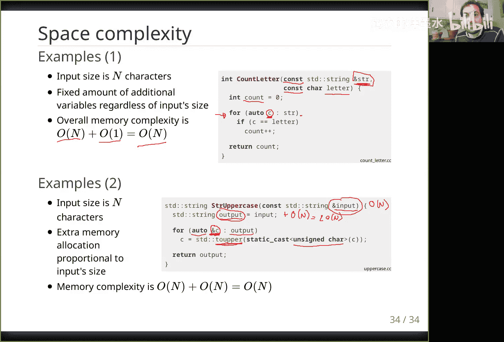

# 数据结构与算法编程：1-3：算法分析


在本节课中，我们将学习算法分析的核心概念，特别是如何使用大O符号来描述算法的运行时间和空间复杂度。我们将从数学定义出发，通过具体代码示例，理解如何分析算法的效率。

## 回顾：算法分析基础

上一节我们介绍了如何通过分析代码来估算算法的运行时间，而不必实际运行程序。我们通过计算关键语句的执行次数，得到了算法运行时间关于输入规模 `n` 的函数 `T(n)`。

例如，对于“两数之和”问题，我们分析其核心的 `if` 语句，得出其执行次数为 `(1/2)n^2 - (1/2)n`。我们进一步学习了使用“波浪号”表示法（~）和“阶”的概念来简化这个表达式，最终得到其增长阶为 **n²**。

我们还了解了不同的增长阶（如常数、对数、线性、线性对数、平方、指数）及其对算法性能的巨大影响。对于一个规模为100,000的输入，不同阶的算法处理时间可能从不到一秒到数个世纪不等。

## 深入理解大O符号

本节中，我们来看看如何用更精确的数学工具——大O符号来描述算法的运行时间。

大O符号是一种描述函数增长上界的数学工具。它为我们提供了一个函数，该函数在输入规模足够大时，总是大于或等于我们实际关心的运行时间函数 `T(n)`。

**公式化定义如下：**
我们说 `T(n)` 是 `O(f(n))`，如果存在正常数 `c` 和 `n₀`，使得对于所有 `n ≥ n₀`，都有 `T(n) ≤ c * f(n)` 成立。

这意味着函数 `f(n)`（乘以一个常数因子后）是 `T(n)` 的一个**上界**。

### 大O符号计算示例

假设我们分析一个算法，得到其运行时间函数为 `T(n) = 3n² + 2n + 4`。我们想证明它是 `O(n²)`。

根据定义，我们需要找到常数 `c` 和 `n₀`，使得 `3n² + 2n + 4 ≤ c * n²` 对所有足够大的 `n` 成立。

我们可以尝试设 `n₀ = 1`。那么不等式变为：
`3*1² + 2*1 + 4 ≤ c * 1²` => `9 ≤ c`
因此，我们可以取 `c = 9`。可以验证，对于所有 `n ≥ 1`，`9n²` 总是大于等于 `3n² + 2n + 4`。所以，`T(n)` 是 `O(n²)`。

## 其他相关符号：Ω 和 Θ

除了大O，还有两个密切相关的符号用于描述算法的渐近行为。

*   **大Ω符号**：描述函数的**下界**。如果 `T(n)` 是 `Ω(g(n))`，意味着 `g(n)`（乘以一个常数后）在 `n` 足够大时总是小于等于 `T(n)`。它表示算法运行时间的**最佳情况**或至少需要的资源。
*   **大Θ符号**：描述函数的**紧确界**。如果 `T(n)` 是 `Θ(h(n))`，意味着 `T(n)` 同时是 `O(h(n))` 和 `Ω(h(n))`。也就是说，`T(n)` 的增长速度与 `h(n)` 完全相同（忽略常数因子）。这是我们描述算法效率时最精确的表示。

**一个重要提示**：大O表示的是上界，因此一个函数可能有多个大O表示。例如，`3n² + 2n + 4` 不仅是 `O(n²)`，也是 `O(n³)` 或 `O(2ⁿ)`。但在实践中，我们总是使用**最紧确**的上界（即增长最慢的那个）来描述算法，通常是 `T(n)` 中增长最快的项。

## 代码复杂度分析实践

现在，让我们将理论应用于实践，分析一些具体代码片段的复杂度。

### 简单循环分析

以下是几个需要注意的循环结构示例：

**示例1：内层循环为常数**
```cpp
for (int i = 0; i < n; i++) {
    for (int j = 0; j < 5; j++) {
        // 执行某些操作
    }
}
```
外层循环运行 `n` 次。尽管有嵌套循环，但内层循环固定运行5次，与 `n` 无关。因此总操作次数约为 `5n`，复杂度为 **O(n)**，而非 O(n²)。

**示例2：受条件限制的内层循环**
```cpp
for (int i = 0; i < n; i++) {
    if (i == SOME_SPECIAL_VALUE) {
        for (int j = 0; j < n; j++) {
            // 执行某些操作
        }
    }
}
```
外层循环运行 `n` 次。内层的 `for` 循环**只会在一个特定的 `i` 值时执行一次**。因此，总操作次数是 `n`（外层循环） + `n`（单次执行内层循环），复杂度为 **O(n)**，而非 O(n²)。

### 包含函数调用的复杂度分析

当算法调用其他函数时，必须考虑被调用函数本身的复杂度。

**示例3：调用常数时间函数**
```cpp
int sumOfSquares(int count) {
    int sum = 0;
    for (int i = 0; i < count; i++) {
        sum += square(i); // 假设 square() 是常数时间操作
    }
    return sum;
}
```
外层循环运行 `count`（即 `n`）次。如果 `square(i)` 函数的执行时间是常数（例如，是硬件指令或固定次数的操作），那么整个函数的复杂度就是 **O(n)**。

**示例4：调用线性时间函数**
```cpp
bool containsPattern(const string& str, const string& pattern) {
    for (size_t i = 0; i < str.length(); i++) {
        if (str.compare(i, pattern.length(), pattern) == 0) {
            return true;
        }
    }
    return false;
}
```
`str.compare(...)` 函数在最坏情况下需要比较整个 `pattern` 的长度，假设 `pattern` 长度为 `m`，则其复杂度为 O(m)。外层循环遍历 `str`，长度为 `n`。因此，在最坏情况下（`m` 与 `n` 同阶），总复杂度为 **O(n * m)**，可近似为 **O(n²)**。这是一个低效的字符串匹配算法。

### 高效算法示例：二分查找

二分查找是一个高效搜索有序数组的算法。
```cpp
int binarySearch(const vector<int>& arr, int key) {
    int low = 0;
    int high = arr.size() - 1;
    while (low <= high) {
        int mid = low + (high - low) / 2;
        if (key < arr[mid]) {
            high = mid - 1;
        } else if (key > arr[mid]) {
            low = mid + 1;
        } else {
            return mid; // 找到
        }
    }
    return -1; // 未找到
}
```
其核心思想是每次比较都将搜索范围减半。假设数组长度为 `n`，最坏情况下需要比较的次数 `x` 满足 `n / 2^x ≈ 1`，解得 `x ≈ log₂n`。因此，二分查找的时间复杂度为 **O(log n)**。

## 空间复杂度分析

除了运行时间，算法所需的**内存空间**同样重要。空间复杂度也使用大O符号表示。

我们主要关注两部分：
1.  **输入空间**：存储输入数据本身所需的空间。
2.  **辅助空间**：算法运行过程中，额外创建的变量、数据结构等所占用的空间。

总空间复杂度通常是两者之和。

### 空间复杂度示例

以下是两个分析空间复杂度的例子：

**示例5：常数辅助空间**
```cpp
int countLetter(const string& str, char letter) {
    int count = 0;
    for (auto c : str) {
        if (c == letter) {
            count++;
        }
    }
    return count;
}
```
*   **输入空间**：字符串 `str` 占用 O(n) 空间。
*   **辅助空间**：只使用了固定大小的变量 `count` 和 `c`，占用 O(1) 空间。
*   **总空间复杂度**：**O(n)**（由输入主导）。

**示例6：线性辅助空间**
```cpp
string toUpperCase(string str) { // 按值传递，创建副本
    string output = str; // 创建输入字符串的完整副本
    for (auto& c : output) { // 使用引用以修改字符
        c = toupper(static_cast<unsigned char>(c));
    }
    return output;
}
```
*   **输入空间**：参数 `str` 通过值传递，在函数内已占用 O(n) 空间（副本）。
*   **辅助空间**：创建了 `output` 字符串，是 `str` 的完整副本，又占用 O(n) 空间。循环变量 `c` 是引用，不占额外空间。
*   **总空间复杂度**：O(n) + O(n) = **O(n)**。

## 总结

本节课中我们一起学习了算法分析的核心工具。我们深入理解了大O、大Ω和大Θ符号的数学定义及其意义，知道大O用于描述最坏情况的上界，是实践中最常用的符号。

我们通过多个代码示例，练习了如何分析循环、条件语句和函数调用对时间复杂度的影响，并特别指出了分析时常见的陷阱。我们还学习了高效算法如二分查找的复杂度分析。

最后，我们引入了空间复杂度的概念，学会了如何分析算法对内存的消耗，区分了输入空间和辅助空间。



掌握这些分析技巧，能够帮助我们在设计或选择算法时，对其性能做出准确的预测和评估，是编写高效程序的基础。下一讲，我们将开始学习具体的数据结构——链表。