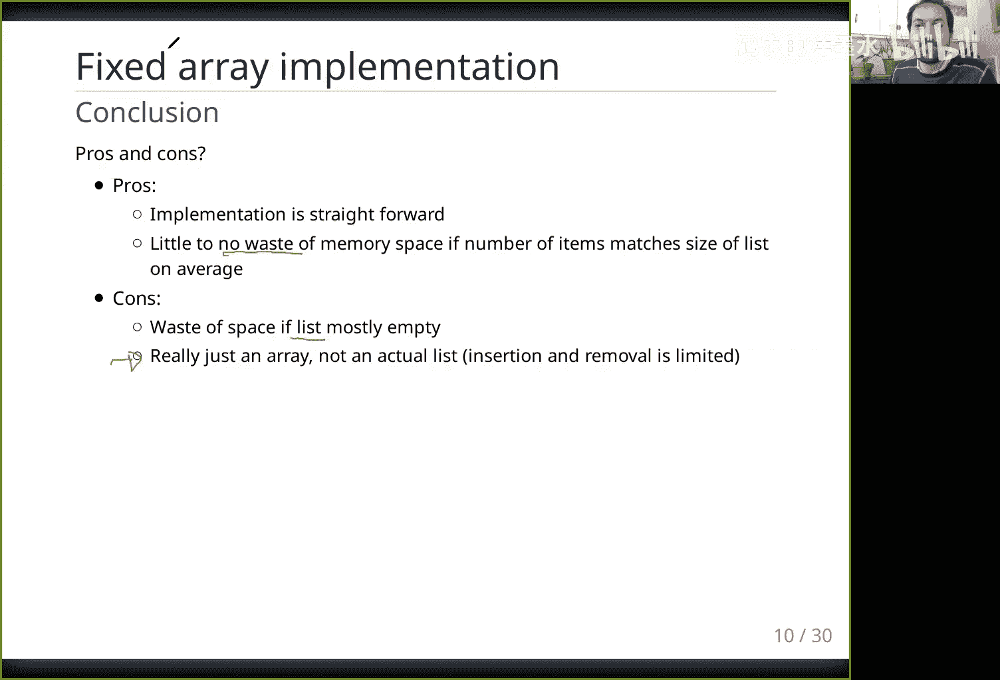

# 【全集】加州大学戴维斯分校 数据结构与算法编程 中英字幕 完整课件 p04 2-1 列表 -BV1rJ2WBSE7P_p4-

Hi， everybody。So today we're going to start talking about a new topic。

 we're going to start talking about lists。List are one of the most common。

 if not the most common kind of abstract data types。

 and there are many abstract data types that we're going to talk about in this class。

 but we're going to start with this one list。Before we dive into all of the super interesting technical details around L and their implementation。

 let's review some very important words and concepts that you need to know beforehand。

So let's start with the first word that I wanted to make sure we're on the same page about。Types。

Types are a collection of values， as you must have seen in previous classes， so for example。

 if you are talking about Boolean type， then you mean the two values that constitute Booleions true and false。

If you talk about an integer type such as just like ins。

 then we mean the collection of integer values， zero， one， two， three， and so on。Those types。

 they're called simple types because they are known by the processor directly at hardware do a level。

 like the processor knows what a integer is like has the knowledge of the representation。

Those simple types， we also often call them trivial types。

 basic types or primitive types that's all equivalent words to describe those types。

Those types can also be put together to construct like more。Complex objects by。

Creating aggregate or composite types so that's what we do when we create a structure， for example。

 that contains a boolean and an integer at the end of the day。

 this structure still contains very simple types， but they're combined together to express something that's more complex。

Now when we talk about data types， we mean the type itself。

 the type of data and the operations that we can perform in order to manipulate this type。

 so now when we talk about for example， like the integer data type。

 we talk about the integer type itself，And all of the operations such as adding， subtracting。

 multiplying， dividing， and so on that we can do on the type itself。Yeah。

And so now we have something called an abstract data type here is the idea that we can specify a certain data type that can be a novel data type that the processor doesn't know by itself like at hardware level like the processor wouldn't know naturally how to do that and so for example like least are a kind of abstract data type stacks are another kind cus dictionaries set most of which we're going to study in this class。

So abstract data types are ADTs among as I'm going to call them this quarter。They only define。

A certain data type， meaning like they document how this data type should behave。

 so think of it as kind of an API it like describes a certain behavior。

But it doesn't say anything about the implementation， the implementation。😡。

Is the realm of the data structure so when we talk about a data structure now we talk about a certain a very specific implementation of a ADity。

So for example， in this lecture and in the next two lectures， when we're going to talk about lists。

 we're going to see that lists are kind of ADT。But they can be implemented by different data structures。

 for example， at least they can be implemented using arrays that can be implemented using a singlely linked list。

 Do linked list and so on。So。😊，Let's start talking about listen。So what's the list？At least。

Is a collection of items of a certain type？And what's important here is that it is an ordered。

Collection。Of item。If the collection of items was non ordered。

 if we just wanted to have the notion of what is in the collection。

 like what items are in the collection and what items are not in the collection。

 we will talk about sets。But for lists the order is actually important like it's it's part of the definition so here we know that this red item is at position zero this。

Orange item is at position one， yellow is at position two and so on。Now what kind of operations？

Do we want to be able to perform on this list ADT？So there are plenty of different operations。

 but let's look at the most typical operations。Usually we don't have many of them it's about like five of them we have the size。

 the notion of like how many items do we have in the list。Then we have get。😡。

For a certain position in the list， give me back the item that is at this position。Then find。

I want to look for a certain item， but I don't know where it is。

 so please return its location in the list。And then two operations remove and insert to well。

 remove items out of the list and add items。To the list。So with those four， sorry， five。

Very basic operations， that's usually like enough to be able to build a pretty elaborated list。

And actually like so often and it depends on the implementation。

 but we can come up with many other operations that are very useful when we deal with lists such as like is the list empty let's push in front of the list or let's remove the last item of the list like pop back and so on。

 but in fact you realize that like most of those other operations that can be very very useful。

They can be very easily implemented。Based on those basic five here that we already have so for example。

If you take is empty。That could be implemented by just using the method size。

 which we already have and checking whether or not size is equal to zero。If you look at push front。

Insert a new item at the front of the list， it could be very easily implemented by calling insert which we already have with whatever item we want to push in the front and then saying position。

0。And same for pop back。Remove the last item in the list that could be easily implemented by calling remove。

which we already have and for the position that we have to give to remove in order to remove the last item。

 we could say remove the item。At position size。嗯。min你酸。So you see here like every not every。

 but a lot of extra methods that would be very useful for a list could be implemented by using those basic ones。

As we'll also see later。嗯。Lt are so common that they are at the base of many other ADTs that we're going to talk about。

 such as like stocks and queuees， we're going to talk about that at the end of the week and both of those。

Rely on the list， like list are so generic that they can be used for many different things。

So now that we have a pretty good definition of the ADT。

 the least ADT in terms of behavior and how it what it should look like。

 let's talk a little bit about implementation， the data structure。

So there are many different ways of implementing list。😊。

The most common implementation is by using a race， and that's actually what we're going to start talking about now。

So we can use fixed arrays like I define an array of I don't know size five and I stick to it and so I can have a list that can contain up to five items。

Or we can be a little bit more flexible and use dynamic arrays we're going to talk about that in the next lecture another kind of implementation that's very common is using linked lists so either a singly or doubly linked list。

And we're going to talk about that in two lectures from now。And finally。

 we're not going to talk about that， but that's a possibility。

 it is possible to implement list using trees， like so this kind of data structure where a node can point onto two children nodes。

是。So let's start with the first one， let's start talking about。An implementation of least。

 using fixed arrays。So let me give you an example here just to like kind of make you see how things would work inside。

So let's imagine I have。Data structure list fixed array。

 I made it templated so I can made a list that can contain a certain type of data so here like just out of simplicity let's imagine that it's a list of integer that I call L so L is my object of that type。

And so just that's a choice here in the slides， I decided that my list L。

 which is implemented as a fixed array， has a capacity maximum of five items。

At the very beginning the list is completely empty right so my array is empty and the current size。

 the current like the current number of items that I have in my list is zero so now let's start adding items to the list by calling insert。

The first operation that makes sense is to insert something in my list。

 at the very first position position zero， and so what would happen is that now at position zero。

 I have the number that I inserted。And。You see that the current size now has been updated to one because I added one item into this list。

Let's continue。Now let's add another item and you see here how it's I can use。

Size to essentially do the pushback so here I want to insert 42 at the end of the list。

 so I said at the end by giving the size。And that would have far effect too。

Insert the item at the end of the current list and now the list would be updated and say I contain two items。

Now a little bit more difficult， let's try to insert something in between those two items in between 23 and 42。

Oh no actually sorry， we're going to try to insert tonight and be forth 23 by saying insert now 99 in position zero。

Here it's a little tricky because I don't want to lose the two items I already had。Right。

 but I want to be able to insert as the user asked the this number 99 at position zero what it means is that before I can insert 99。

Things will need to be shifted like we're going to need to shift 23 to the next position。

 42 to the next position and to make space for 99 and 99 will be able to be inserted there。

And as you wrote， because added a new item， the current size。

 the number of items in the list needs to be updated accordingly。Last example。

After now like having added three items to the list in different ways。

 like either in front or in back or in front again to see how things need to get shifted。

Let's look at removal。So here in this operation， we want to remove the item that is at position one。

And so at position one， we had 23 here， so we want to remove 23。

What it means is that we need to move 42 now from its previous location back to this position so that items always stay together like a list doesn't contain any holes。

 it has to contain items successively。So here we'll have to take care of that in the implementation that like if we remove an item that is in the middle of the list。

 we need to shift everything that's behind it like back one spot。

And obviously because we removed an item， well also have to update the current size to the number of items that are now contained the list。

So that's kind of the idea here， that's what we need to be able to implement in terms of code。

So now let's actually look at the code， let's look at the possible implementation of a list。

Made with a fixed array。So let's look at the data structure。As usual。

Here you see that we have the name of a file of a header file that means that you can find this file on canvas and look at it and have access to the entire code here in the slides I only show like little snippets of code that I want to discuss with you。

So here is our class。😡，So that's the name of the class， that's the list made of a fixed array。

 and as I was saying before we templated this class so that it can be insated to contain any kind of item like whatever we fill is appropriate。

Here。As you can see， I decided to embrace。novellty and go for a construct a C+ press 11 constructstri and so I'm going to use STD array。

 which is a good way that like that it's a data type that provides me with a fixed array。

So this array will contain items of type T， which is a template here。

And will have a predefined capacity。Because it's a fixed array。And to make things generic still。

 we're going to determine that this capacity is three， so maximum I'm going to have three items。

So here there's some like C++ wildness， I guess。If capacity。Is a viable。

 but I needs or the compiler needs to know the value of this variable at the moment that it will like instantiate this class whenever it needs it to make an object out of it then it means that capacity it be an actual variable。

 it needs to be a constant it needs to be known by the compiler。

At the moment when the compiler actually compilerises the code。It cannot be dynamically known。

So to make that， we're going to use two very important keywords， we're going to use static。

And cont X。And the combination of those two keywords means that now this capacity variable is actually predetermined it's hard codeed and the compiler can even replace whenever capacity is being used in the code。

 the compiler can replace this name with value。3。So we have a maximum capacity。

 we have items which is going to be the actual array， and we need to maintain the size。

 which is the number of items that we have in this array。And so at the beginning。

 it's zero because we don't have， I mean， at the beginning when the list is instantiateated。

 it's empty， so it doesn't contain anything。So here's a little text that kind of。

Summarize what I just explained。Now that we have。The data structure here in terms of。

Members that we need for this class let's talk about the methods the functions that we need for this class so let's start with the first two usual like when we declare a class in C+ usually we need a construct and a de in that case because everything is pretty much like already initialized directly by associating values here it means that the construct can be completely empty we don't need anything and because we're not allocating。

Any dynamic memory， the de can also be pretty much empty。

And so here we have another C+ plus 11 construct， instead of just saying empty， you know。

 by having curly braces that would be empty， we use the keyword default instead and thats essentially like。

Gives the responsibility to the compiler to come up with like whatever the compiler sees fit。嗯。

And that's a good construct to use here， so essentially we say like we don't have anything of a own to add to the construct because like everything is already taken care of here。

 so we tell the compiler come up with whatever you like。嗯。嗯。😊，O。

So now that we have the data structure， we have the construction and this structure。

 we can start implementing the actual API， the five functions that we talked about before， you know。

 like size， get， find， insert and remove。So let's start with the first one size。

Size should return the number of items we have in the list。

That actually we know already because we maintain a certain variable like every time we're going to call insert and remove we're going to see those functions in a minute。

 but like we're going to maintain this variable to always contain the number of items we have in the list so whenever the user wants to know the size of the list。

 we can just return whatever value this variable is。Next。Get。

So here the idea is that the user would give us the location or certain position in the list and say。

 hey， I want to retrieve which item is at this position。

Every time in computer science and in programming we have to be very careful when we receive a certain input from the user to make sure that this input is valid typically here if the user gave us a position that doesn't correspond to any item in the list because for example。

 like the list is empty and the user would say like hey， I want to get I don't know。

 item number five， well item number five doesn't exist if the list is empty and it's something we need to catch because otherwise bad things could happen。

So here right away， we want to validate the input， we want to make sure that if the position that's being given is more than what the list currently contains。

 then we should like do something about it， we should like catch it and return that it's an error。

And the right way in C press to do that is to throw an exception。And in that case。

 already we have access to a bunch of different exceptions directly from the standardout library。

 and what makes sense here is to use the exception that is called out of rangech to say that the position that was given is not within the range of what the list currently contains。

Once we've made sure that the position， the input， that the argument， the function。

 the method argument is valid， we can simply return whatever item is at that position in our fixed array of items。

And next we have find， so find here is we， the user would give us an item that may or may not be part of the list already。

And the goal of fine would be to return if this item is in the list。

 then we should return where in the list exactly like at which position so here we would essentially go through the entire list from the first element down to the last element and compare every item with the one that was given as an argument here and if we find it then we return its position if we。

Don't find it， then the function would return minus1 to signify that the item was not found in that list。

So quick question now， now that we have talked over the past few lectures about algorithm analysis and algorithm complexity。

What is the running time complexity of all of those functions， of all of those methods？

So let's see that together， let's look at the first one。The first one only has one statement。

The question that you want to kind of ask yourself is。

Does this function depend on the number of items I have in the list？Like。

 will this function execute faster if my list is empty or if my list is full？The answer is。

It doesn't matter， right？If my list contains a00 of items or if my list is empty。

 I will always have to only execute one statement which is return the value of this variable。That's。

Constant， so the complexity here would be bigger of。One， it does not depend on the size of anything。

Now let's look at function get。We get a certain position and given that the position is valid。

 we directly index the array at this position and retain the item。Again。

Is it going to execute faster or slower depending on the size。

Or dependingepending on the number of items I have in the list。The answer here is no。

It doesn't matter。If I have a certain array。That has a certain number of items。

 then it takes as much time to access any item in this array doesn't matter。So， here。

The complexity would again be constant。And that's actually something that we'll get back to that like that's something that's extremely good with arrays implementation is that the access to an array is always constant。

When we'll talk about the implementation involving linked lists。

 then you'll see that this function gets cannot be constant。But we'll talk about that later。

And so finally， we have find。😊，So look at this one。

How much time would it take to find an item in a list that only contains one item。Well。

 it would take one iteration because we would check right away if the one item is the item that we're looking for and then we're done。

 we don't have anything else to do。Now， what if the list contains a thousand different items and we're looking for one in particular？

Now we have to go through a thousand items。And worst case scenario。

 we're going to go through all of them and actually not find the item that we are looking for because it's not in the list。

So here find is typically a function which running time entirely depends on the size of the list。

And it can be easily seen here because we have a follow loop that goes from the first item in the list down to the last item in the list。

So here that's typically a function which complexity is o of n。It's linear complexity。

 the running time will grow proportionally to the number of items we have in the list。Okay。

 let's talk about the last two methods we had for the list， we have remove and insert。

 so let's start with remove。So here is the code。So quickly， for remove。

 we're also going to get the same as get， we're going to receive a certain position in the list。

 the position of an item that needs to be removed。The first thing that we need to do is validate this position。

 make sure that the position that's being given and an argument is valid。So once again。

 we're going to have a little check， making sure that the position is within the items we do have in the list。

 otherwise will through an exception。And now we can effectively remove。If the position is valid。

 then we have to remove the item that is at this position。There are two scenarios。Scenary number one。

 we are trying to remove the last item。In the list and actually I did not make a figure for that。

 but we can do it very quickly， so imagine I have a certain list。From item 0。And so on。

And so imagine they have like item y X and y and say like a。安y。So that's position one， position two。

 position three， position four， and so on doesn't matter。Here the current size before we call remove。

Would be equal to four， that' is the number of items we have already in the list， right？Now。

 imagine that we。The user。Using this list would call remove。On position。3。😡。

So essentially like the user wants to remove item B， which is already the last one in the list。

In that case， we actually don't have much to do like we don't even need to physically remove anything the only thing that we need to change is to update the current size and now say oh the current size is three and that's pretty much it like the fact that we change the the size that we that we decide。

The number of items that now the list contains is three can of automatically discards the fact that this item in the array contains B because the next time now that we will call insert。

As position three will overrite whatever was in there and it's as if B had never existed。

So that's kind of。Scenario number one， scenario number two is that remove is being called to remove an item that's in the middle of an existing list。

 like in the middle of the list。And so here we have to make sure that like when we remove the item。

 we shift all of the items that are behind this one back one spot。So here， for example。If we had。

Item X， Y， A and B， and the user wanted to remove item Y。

 so would call remove with the position of y。Then we would need to move a and overwrite Y and then move B and overwrite A and update the current size to make sure that like all of the items are now like packed together。

And that's pretty much what this code does here， like that's exactly what this follow loop does。

It starts from the item after the one we want to delete and it copies it in the previous cell。

 like in the previous cell of the array， and then it goes to the next one and copies it over。

So it's in that loop that we copy a back to the location that before4 contain y。

 and then we copy B back in the location that contained a and so on up until everything is shifted back one spot。

And so finally， let's talk about。Insertion。So let's see。😊，So far， insert。😮。

The function receives two parameter。The parameter of like the item that needs to be inserted and the position at which the item should be inserted。

Here we have so we have the usual。Check to do like checking that the position is valid that we are not trying to insert an item past the end of the list or like outside of the existing list。

 otherwise the position would be out of range。We also need to be careful that the list is not full。

 you have to remember that here we're talking about a fixed array implementation。

 which means that when the list is created the array， the underlying array has a fixed size。

If the list becomes full， then we cannot insert any item anymore。

 that's actually an inconvenient that's a disadvantage of the fixed array implementation and that's why we'll talk about a dynamic array implementation but that's the way it is here。

So if we are at full capacity， then that's an error and we'll need to throw an error like an exception to tell the user like。

 oh， the list is full， you can add anything more to it。Then we again have two kind of scenarios。

Cnar number one， we are trying to insert an item at the end， at the very end of the existing list。

In which case it's super simple like this if would。

Fail like the condition with fail and the only thing we have to do is to insert the item at the last position。

 update the current size， and we're good to go。Now。

 more difficulty is when we try to insert an item right in the middle of the list。

Because now if we if we want to do that， which is obviously possible。

 we have to first shift all of the existing items forward one spot to make some room。

And there we can insert the new item。So that's why I try to。Showing that example。

 imagine you have a list that already contains A， B and C。

 so it it's a list that contains three items and now the user says， oh。

 I want to insert item X at position one。Well， what needs to happen？Is that we need to shift B。

One spot forward， we need to shift C1 spot forward， and then we can insert X。

Where B was and so now we're going to have a list that contains A， X， B， C。

 and that will contain four elements and not three anymore。

The codes that shifts the existing items one spot forward is that code。

You have to notice something in that there is like a little like trick， I guess。The trick is that。

We cannot shift things in that direction。Because。If we start by shifting B one spot forward。

 then B would overrite C。And so。Later， when we try to shift C one spot forward， we just lost。

The value of C。Because it was overwritten by B。So in order to make this happen。嗯。

We need to be very careful。 We need to work in the reverses order。 We need to first move sea。

To the end of the list。And then we can move B over C。

And that's why we start from the end from position cur size minus1。

 and we work in the opposite order to make sure that we're not overriding a value that we need。

So that's pretty much the idea。If this code gives you issues。

 I would suggest like come up with a simple scenario here and run this code manually on your visual representation to really see how the elements or how the items are getting moved and you'll see it'll appear right away。

So a quick conclusion on this fixed array implementation in terms of pros and cons。

So there are definitely some pros， the fact that the implementation is relatively straightforward。

 honestly。In terms of lines of code， it's not a lot of lines of code。

 the IDs are not super super difficult， so it's very easy to implement within a few minutes。

If it happens that we pretty much know in the program that we need， for example， like I don't know。

 let's imagine I want to create a program that。Computs。The number of I don't know。

 the number of houses in Davis， for example， and I already have a pretty good idea of that number。

 like the number of houses in Davis， then I could potentially use a list that's based on a fixed array because I know the number of items already。

And so that would allow me to not waste a lot of memory if I already kind of know the number of items I'm going to have in the list。

 and so my list fits exactly that number of items。Yeah。

Now it's to that like if I make a list and I don't know。I give a capacity that's a lot bigger。

 for example， like if I make a list that can contain up to1 million items and at the end of the day in my program I only insert five items。

So my list is like very poorly。Like allocated， then I'm wasting a lot of memory because because I allocated space。

 memory space for a million of items， and I'm really only using five。

So it's like you have to be careful that the size of the list kind of matches the number of items you're going to have in the list。

 otherwise you're wasting memory for nothing and that's definitely something when we talk about more dynamic approaches we're not going to have this issues because the dynamicity will offer this flexibility of having the list grow or shrink shrink to kind of like always match the number of items we have in the list and not waste memory。

And finally， like we have to obviously understand that。

The fixed array implementation of a list is not really a list like the whole point of a list is to be extremely dynamic in terms of insertion in terms of removal and here the inherenterrant like fixed aspect of of the implementation with a fixed array like kind of like it's not actually a list so anyway let's up on that for today and next lecture we're going to talk about the dynamic array implementation。

