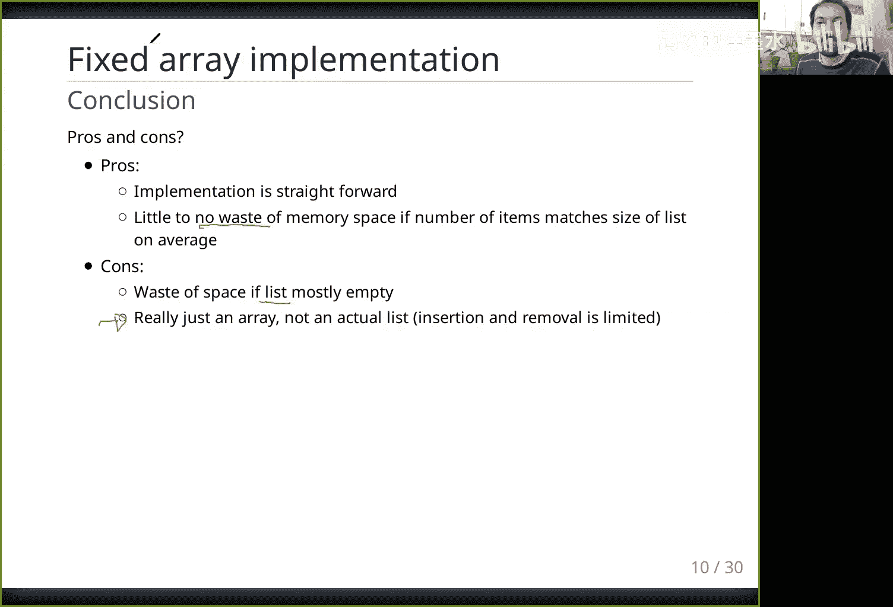

# 数据结构与算法编程：04：列表


在本节课中，我们将要学习一种最常见的数据结构——列表。我们将从理解列表作为抽象数据类型（ADT）的概念开始，然后深入探讨其具体实现方式之一：使用固定数组。通过本课，你将掌握列表的基本操作及其在固定数组实现下的工作原理。

## 概述：什么是列表？

列表是一种抽象数据类型，它代表一个**有序**的、由特定类型元素组成的集合。与集合不同，列表中元素的顺序是至关重要的。列表支持一系列基本操作，如获取大小、获取元素、查找元素、插入和删除元素。

## 核心概念回顾

在深入列表之前，我们需要明确几个关键术语。

### 类型与数据类型

**类型** 是值的集合。例如，布尔类型包含 `true` 和 `false` 两个值。整数类型包含 `0, 1, 2, 3...` 等值。这些类型被称为**简单类型**、**基本类型**或**原始类型**，因为处理器在硬件层面直接理解它们。

**数据类型** 不仅包括类型本身，还包括可以对该类型执行的操作。例如，整数数据类型包括整数类型以及加法、减法、乘法、除法等操作。

### 抽象数据类型与数据结构

**抽象数据类型** 定义了数据类型的**行为规范**（类似于一个API），但**不指定其具体实现**。列表、栈、队列、字典和集合都是ADT的例子。

**数据结构** 是ADT的**具体实现**。例如，列表ADT可以通过数组、单链表或双链表等不同的数据结构来实现。

## 列表ADT：定义与操作

列表是一个有序的元素集合。以下是列表ADT最典型的五种操作：

1.  **`size()`**: 返回列表中当前元素的数量。
2.  **`get(position)`**: 返回指定位置上的元素。
3.  **`find(item)`**: 在列表中查找给定元素，并返回其位置（如果存在）。
4.  **`insert(item, position)`**: 在指定位置插入一个新元素。
5.  **`remove(position)`**: 移除指定位置上的元素。

许多其他有用的操作（如检查列表是否为空、在头部插入、移除尾部元素等）都可以基于这五个基本操作来实现。

## 列表的实现方式

列表ADT有多种实现方式，主要包括：
*   使用**固定数组**
*   使用**动态数组**
*   使用**链表**（单链表或双链表）
*   使用**树**（本课程不涉及）

本节课我们将重点讨论第一种：使用固定数组实现列表。

## 固定数组实现列表

让我们通过一个例子来理解固定数组如何实现列表操作。假设我们有一个最大容量为5的列表。

### 初始状态

列表初始为空，底层数组为空，当前大小 `size` 为0。

### 插入操作

1.  **在位置0插入23**：数组在索引0处存入23，`size` 更新为1。
2.  **在末尾插入42**：通过 `insert(42, size)` 实现。在索引1（当前`size`值）处存入42，`size` 更新为2。
3.  **在位置0插入99**：这需要将现有元素（23和42）依次向后移动一位，为99腾出位置0。插入后，`size` 更新为3。

### 删除操作

**删除位置1的元素（23）**：需要将位置1之后的元素（42）向前移动一位，以填补空缺。删除后，`size` 更新为2。

核心思想是，列表必须保持元素的连续性，不能有“空洞”。

## 代码实现分析

以下是使用固定数组实现列表 `ListFixedArray` 类的关键部分。

### 数据结构定义

```cpp
template <typename T>
class ListFixedArray {
private:
    static constexpr int capacity = 3; // 固定容量
    std::array<T, capacity> items;     // 底层固定数组
    int size_;                         // 当前元素数量
public:
    // ... 成员函数
};
```
这里使用 `static constexpr` 确保容量在编译期是已知常量。`size_` 变量用于追踪列表中当前有多少个有效元素。

### 构造函数与析构函数

由于没有动态内存分配，构造函数和析构函数可以使用 `default` 关键字，让编译器生成默认版本。
```cpp
ListFixedArray() = default;
~ListFixedArray() = default;
```

### 基本操作实现与复杂度分析

以下是核心方法的实现思路和算法复杂度分析。

#### `size()` 方法
直接返回 `size_` 变量。无论列表中有多少元素，此操作都只执行一步。
*   **时间复杂度：O(1)**

#### `get(position)` 方法
首先检查 `position` 是否有效（`0 <= position < size_`），无效则抛出 `std::out_of_range` 异常。有效则直接通过数组索引 `items[position]` 返回元素。
*   **时间复杂度：O(1)**。数组支持随机访问，访问任何位置耗时相同。

#### `find(item)` 方法
遍历数组，将每个元素与目标 `item` 比较。找到则返回其索引，未找到则返回 -1。
*   **时间复杂度：O(n)**。最坏情况下需要遍历整个列表。

#### `remove(position)` 方法
1.  验证 `position` 有效性。
2.  如果删除的是最后一个元素（`position == size_ - 1`），只需将 `size_` 减1。
3.  如果删除中间元素，则需要一个循环，将 `position` 之后的所有元素向前移动一位，然后 `size_` 减1。
*   **时间复杂度：O(n)**。在平均和最坏情况下（删除开头或中间元素），可能需要移动大量元素。

#### `insert(item, position)` 方法
1.  验证 `position` 有效性（`0 <= position <= size_`）以及列表是否已满（`size_ == capacity`）。
2.  如果插入位置在末尾（`position == size_`），直接在 `items[size_]` 处放入新元素，然后 `size_` 加1。
3.  如果插入位置在中间，需要先**从后向前**循环，将 `position` 及之后的元素都向后移动一位，腾出空间，然后再放入新元素，最后 `size_` 加1。
    *   **注意**：必须从后向前移动，以避免覆盖尚未移动的元素。
*   **时间复杂度：O(n)**。在平均和最坏情况下（在开头或中间插入），可能需要移动大量元素。

## 固定数组实现的优缺点

### 优点
*   **实现简单**：代码逻辑直观，易于编写和理解。
*   **内存预知**：如果事先能准确知道元素数量上限，可以精确分配内存，避免浪费。

### 缺点
*   **容量固定**：列表最大尺寸在创建时即确定，无法动态增长。插入元素可能因数组已满而失败。
*   **可能浪费内存**：如果预设容量远大于实际所需，会造成内存浪费。
*   **插入/删除成本高**：在非末尾位置进行插入或删除操作，需要移动元素，平均时间复杂度为 O(n)。

## 总结



本节课我们一起学习了列表这一重要的抽象数据类型。我们明确了列表是有序集合，并定义了其核心操作：`size`, `get`, `find`, `insert`, `remove`。我们重点探讨了使用**固定数组**来实现列表的具体方法，分析了每种操作背后的逻辑、代码实现及其算法复杂度（`get` 和 `size` 为 O(1)，`find`, `insert`, `remove` 为 O(n)）。最后，我们讨论了这种实现方式的优缺点，其最大的局限性在于容量的固定性。在下一讲中，我们将学习如何用**动态数组**来克服这一限制，实现一个可以灵活扩容的列表。