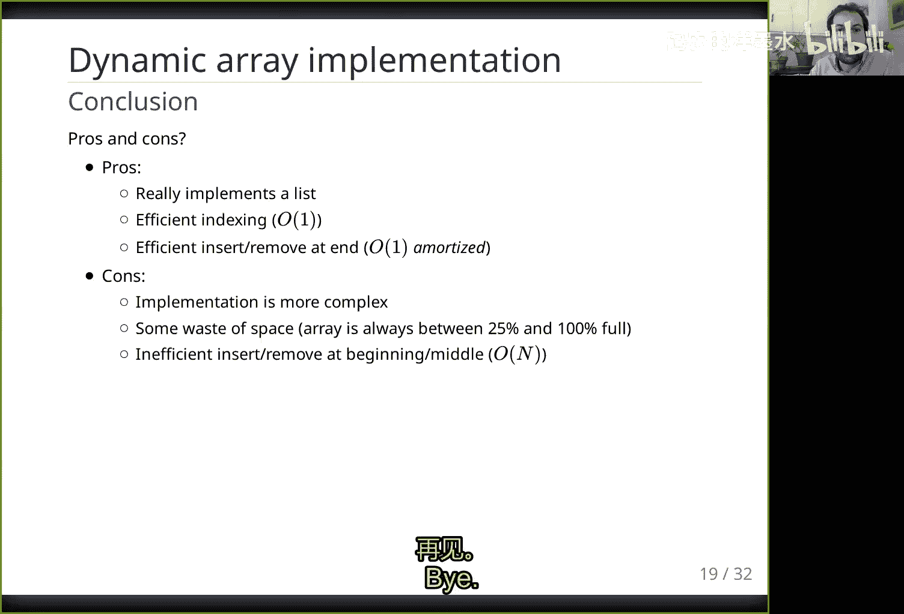

# 【全集】加州大学戴维斯分校 数据结构与算法编程 中英字幕 完整课件 p05 2-2 列表 -BV1rJ2WBSE7P_p5-

Hi everybody。So today we're going to continue talking about lists like we did last time for part number two。

So quick recap from last time。Last time we defined what a ADT was an abstract data typed and we looked more closely to the list ADT。

 so the list we said is an ordered collection of items of some type can be integers can be some like objects。

 whatever type， we have a collection of those and we maintain a certain order。

And so we saw that this list of ADT， we can think of it as kind of an API。

 it defineds a list of functions， a list of methods that can be applied to this ADT。

The implementation though can be very different， we can implement list using arrays。

 we can implement list using linked list using different types of data structures。

And so last time we talked about a very simple implementation， which is a fixed array implementation。

 so using an array of a certain fixed size。And so we went through the implementation route。

The pros of these are at least the main advantage of this fixedory implementation was the fact that it's a fairly simple implementation。

 it's quite straightforward if you go back to the slides if you look at the code it's pretty simple however because it's a fixed or implementation it offers no flexibility we cannot insert more than a certain number of items and so in that sense it doesn't really like fully implement the list API like the list ADT because the list ADT doesn't imply that the insert or remove operation should be somehow like blocked。

So let's talk about another implementation this time that would actually really implement the list ADT better by using a dynamic array implementation。

So。The question here is， if we're going to use a dynamic array fragmentmentation。

 it means that now the capacity is not going to be fixed。

If we want to insert more than what the array can contain。

 then dynamically we will be able to grow the array to accommodate for the number of items that are in the list right that's the whole point of having a dynamic array implementation。

And conversely， when we remove items from the list。

 we also want the memory space to sort of match the number of items we have。

 so we would want to be able to shrink the list so that we would have a list that kind of like adapts to the number of items that it contains。

So that brings the question， when should we grow the dynamic array and when should we shrink it？系。

Option number one， which is the most simple kind of。

 would be to increase the size of the array by one every time we insert a new item and decrease it by one every time we remove。

Technically， in terms of code。That would mean that like for example， if we have an array of size。

Of size4。 And so we have currently say like four items inside of the array， and we want to insert。

A new item， then we would allocate。A dig array of size。5。

We copy all of the items that we already had。Then we can drop this array。嗯。And。

Coff and insert the new item at the end。If we want to remove。We'd allocate a newer array。

Of a smallerer size。Into which we copy what the previous array contained。

Minus the element that we wanted to remove and so every time essentially we insert or we remove。

 we have to reallocate a certain a new rate that's exactly the size that we want and then like do some copying around。

I imagine you start saying what the problem would be here， the problem is that it would be very。

 very expensive。For every single insert or remove operation， we need to copy items around。

And that would potentially mean that we get a complexity， a quadratic complexity。

 a complexity of big of n squared。Because of those operations。Right。

Think about it if at the beginning say I have one item in IRA and I start in settinging like three new items。

Then I need to allocate two and copy the one into the new one。Then I insert one more。

 so I need to allocate an array of size three and copy。Those items press the new one。And so on。

And so for every insertion， I need to copy。N element。 So for N。Inserion here。

 I need to each time at every iteration， I need to reccopy。

And elements and so that's why overall my complexity would be n squared。

 which is not acceptable that would take way too much time。

So option one doest work option two and that's what we're going to talk about。What if we resize。

 what if we grow and shrink the dynamic array less frequently instead of doing it at every single operation。

 we do it more rarely？So that we don't have to pay the price of moving things around so much。😡。

The thing is like if we grow and shrink。😡，Less frequently。

Then we have to make sure to not allocate too much space so for example， like。

I could imagine I have an array with only two items。

If I say hey you know what I don't want to be I don't want to have to resize too often。

 so what I'm going to do is that I'm going to create an array that can contain 1 thousand00 items and so I can now inet 998 more without having to resite so that's great。

Except that like， well， now you're array。Has really big capacity that you're not using fully so you're wasting a lot of space and you don't even know if you're going to use that space so the idea is that like while you would。

Keep the resizing a pretty rare event so you have to kind of like over dimensionmen the array。

 you don't want to over dimensionmen it too much because then you would start losing space that's pretty much the idea。

O。So let's now that we kind of understand the concept of resizing and why it should happen。

 let's go back to the data structure to the implementation。

Of this list ADT using a dynamic array implementation and let's look at the actual code。

Most a big portion of the code between this list。This dynamic array implementation versus the fixed array implementation a lot of the code will be similar and actually I'm not going to show a lot of that code you can on canvasva look at the two different headers so this one is least dynamic array and the other one from the previous lecture with least fixed array you can open them both and look and you'll see that like more than 75% of the code is exactly the same so we're going to focus here on the differences between the fixed array implementation and the dynamic array implementation。

So。First difference here is that the capacity is now just a regular variable if you remember in the fixedory implementation the capacity was a variable declared as static con or cont X which meant that like the compiler would know that this variable will always have this value and it could not be changed ever here it's a very regular variable that has an initial value that will be the first dimension of this array at the very beginning but then it will be able to evolve and so we have to change this capacity over time and so that's why it's back to being just a regular variable。

Then we have the array itself items， so that's the array that will contain items of type。

T T being a template parameter， so this way with one class here。

 we can allocate lists that can contain integers that can contain doubles that can contain like whatever we need。

 right。Now there's one thing interesting here， my array items。

We use a specific C+ press 11 construct called unique pointers。And that's the syntax here。

 so we declare that items is a unique pointer that points onto an array of objects of type T it's pretty much equivalent to declaring without using those like C+ plus 11 constructs if we just look at how we would do it in C or in C+ plus 99 that would be equivalent to declaring a pointer。

Items。On type T， that that's pretty much equivalent。Then we have this variable curs size。

 so that hasn't moved that will be the variable that we maintain to contain the number of items we currently have in the list。

And so here you see that now we need to have a little bit of code in the construct to actually instantiate this unique pointer items to actually make the array itself and so here you probably recognize some of the syntax。

We essentially declare a new array of type T and of size capacity。

And because our items is a unique pointer， we have this specific syntax。

If we were to do things in C++ 99， so by having declared an item just as a single pointer。

We would probably inside of the construction， have some things such as like items。Equals。尿 t。

Capacity。That would be equivalent。The whole point。Of unique pointers and for now it might seem a little obscure so just go along with me you can also do some research online to look into what unique pointers are we're going to use them like throughout the entire class and hopefully like after a certain while you'll really see like all of the advantages of using them。

嗯。😊，Here， the main advantage of using unique pointers instead of just the regular C++ 99。

Look at the the。The destruction doesn't have any code， we still say oh， it's equal to default。

 which is pretty much which means like， oh it's empty， we don't have to destroy anything。

Which is bizarre， right because in the construction， we are allocating dynamic memory。

If we were to do things using C++ 99 by doing this。

 then the de structure should have a line that says delete。Items。Right。

Here because we're using unique pointers， we only need to instantiate it。

And we don't need to destroy it。 And that's the beauty of unique of smart pointers in C plus plus 11 is that。

There is an automatic destruction of the pointer when it disappears。So here， like whenever。

This class list dynamic array is instantiated as an object whenever the object disappears。

Then the delete of items。😡，Will be done automatically and that's really。

 really powerful because it means that you can no longer have memory leaks。

 you can no longer have memory that has been allocated dynamically and that people would forget to free here it's freed automatically behind your back in a very reliable way and you don't have to care about it so that's pretty great。

Okay。So here's how we reroute the data structure so that we now have a dynamic array。

The next thing we know we need is to resize this array。

 so technically what's going to happen is that as we use the list we're going to insert new items or remove items。

And so we'll need to， as we said before， grow the list or shrink the list right so we'll need a method that is able to resize this the size of item so here for example。

 like we start with the capacity of three。What if we start inserting more than three。

 then we'll need to reallocate items so that instead of being of size three。

 it's going to be of size like I don't know 10 or 15 like we're going to have to make it grow。

So and inly， like once， if we remove the number of items that the list contains and I don't know。

 we have a list of capacity 10， but we in fact only have two items in the list。

 then maybe it's not necessary to have all of that space allocated and we need to shrink it back to a smaller size。

 to a smaller capacity。So we need a method here that would resize。The size of the list。

 like the capacity of the list， so let's look at this function， if you will。

So that's the function resize， that's going to be an internal method to this class。Text one argument。

 which is the new capacity。This new capacity can be bigger than the current capacity if we want to grow the list or it can be smaller than the current capacity if we want to shrink the list。

No matter what， we need to be careful of two things。

We need to make sure that this new capacity is a positive number。

 it doesn't really make sense to shrink the list back to a size of zero that's going to be annoying we at least want to。

And sure。That even if the list is empty， it still has a capacity that's positive right it still has a like memory that exists and that can handle items。

We also want to make sure that obviously the new capacity is at least the size of the number of items the list currently contains。

 if the list currently contains four items， then it would be an error to call resize and say， hey。

 resize it to two items because then we wouldn't have enough space to manage the number of items we have。

The reason here that we're using assets。Instead of saying like throwing an exception。

Is that we are checking here potential bugs in our own code。😡。

There is this re method will be a method there is。Called only internally。To this class。

So the only code that can call resize will be our code。Not could that's coming from the outside。

 like from someone who would be using the list。When someone is using the list。

 then it's good to throw exceptions so that if they make a mistake in using this list。

 they get an exception back and that they can handle in the way that they want。Here。

If re is called with a capacity that is incorrect， it means that in our own code。

We're calling this reize function with a parameter that's incorrect and that's a bug that we should fix ASap。

That's the goal of using asset here， it's making sure that the code will fail or crush on purpose so that we can capture this event and fix a code right away。

Then we have essentially four different steps。In order to resize the dynamic array。

 we're going to actually allocate a new one of the new capacity， that's what we're doing here。

So imagine that the current capacity is three and that we want to resize to a capacity of say like six。

 we want to double the size， so what would happen here is that we would declare a new array called new items that is also a smart pointer。

Of capacity。6。Then so we have items points onto an array internally of capacity three。

And this new item internally points onto an array of capacity。6。The next step。

Is to transfer all of the existing arrays， all of the existing items。In the current。All right。

Inside of the new one。And for that， we're going to use move。

 so we're going to ask C+ plus to take every single items in this array and move them。

Into this newing。The syntax is a little bizarre， but essentially like move text three parameters。

It takes the beginning of what we want to try to copy and so here we can use items get which will。

Point us to the first element of this array。Then we use an iterator。

 STD next on get with the current size that will have essentially as an effect to say， oh。

 we want to copy up until here or move up until here。And the last。

Prameter to STD move is the destination where do we want to copy all of that and so here we give essentially a pointer onto this new item and so what's going to happen is that from this location。

Up to this location will be copied。Here moved here。So at this point after the move。

 we have a new array of a bigger size。Into which all of the existing items have been properly moved。

One of the last steps now is to exchange the two arrays。To make this item pointer。

 not point onto this old array of size3， but onto this new array。Of size6。And we do that with swap。

 we essentially like swap the content of items and the content of new items with one another。

So here items will point onto this new array and no longer onto the small one and inly。

 and that's where it's interesting。This new item pointer will point。

Onto the old array and no longer onto the new one。 that's what Swwab does。

Now what's interesting is that new item， this pointer， this smart pointer。Is local to this function。

Once the function returns。Then these viable new items will be destroyed because it's a local variable。

 we're returning from the function， the local variable is destroyed。

Because this local viable is a small pointer。Whatever it's pointing to will also be destroyed。And so。

When the function returns， new items will be destroyed and so will what new item is ining on and so this older array will be destroyed。

And you see， we don't even have to say it's all happening automatically。And so finally。

 last operation， we update。The capacity viable with the new capacity that was given as a parameter。

 so here if new cap was six。Then this capacity variable would be now changed to6。是对。Okay。

 let's move on。So。Now that we have this resize function that we are able to internally change the size of the array that contains the items。

 we can use it。And you will see here how easy it is to use it。So let's take the insert function。

The insert function is the same as the previous one for the fixed array implementationation。

 we receive an item and we receive a certain position。

But one of the first things that we're going to do is that if we see that the current size。

So the number of items we have in the list is already equal to the capacity of the list。

 which means that internally。The container is full like the internal array completely full and we cannot insert anything。

Then we can call resize and increase the capacity。And so here by default。

 and I think it's a good value， when the array is full， we're going to double the size。That brings。

The question now， in terms of complexity analysis。What is the big O。Okay。Of this function。

So let's look into it a little bit。Let's take an example where we would want to try to insert n plus one items。

At the end of a list。So imagine like we create a list and then we keep calling insert and we insert new items and every time we insert them at the end of the list。

U，And so the idea is that like at first we would have one item then another one。

 then another one and and so on。En times。And we want to be able to kind of express this sequence of operation。

As a biggo and we're trying to determine like what kind of egogo is that？

The thing is like there can be two cases。Basically， scenario。Internally。

 the array has enough capacity that when we call insert。

 we don't need to resize the array like the memory space already exists。

 and it's just a matter of putting the array in the right location。And that would be O of one。

 that would be a constant operation。Now， the problem is with the worst case scenario。

 The worst case scenario is if。We have an array of capacity three。We already have three items。

 and so now we need to resize the array to a capacity of six。And we need to。

Copy all three items we already had。Plus， inside the new one。And so here the complexity is over that。

The problem is that。How do I express the complexity of inserting n plus one items。

When I know that I can either have the best case。All the worst case。If I'm pessimistic。And I say。

 well， I prefer taking into account only the worst case scenario。

 and so I should account that every single insertion is over then。

And here I'm trying to insert n items， then total my complexity would be bigger of n squared。

 which is a bad。Complexity， like quadratic， it's usually not a good idea。So and we， I mean。

 and also it's very pessimistic because we know it's not going to happen like here we clearly know that。

If the arrays of size 3。And we want to insert the fourth item。

 and so the array is doubled in size to insert the fourth item。

 we know that when inserting the fifth item and the sixth item。We're going to be an o of one。

 so it doesn't make sense to be pessimistic all the time we need to be able to like。

Capture the complexity in a better way。So how do we do that？Well。

 there's another kind of complexity analysis for that kind of scenario。

 which is called amortized analysis。The idea here is to actually try to capture the fact that when we do。

A sequence of n+ one operations。Those operations will behave differently。And in that case。

Because we know that like the array is resized。Infrequently。We know that in fact。

 when we insert n plus one items， we're going to have an insertion that in fact take constant time。

And only for the last operation， once we've inserted those n items and we get to the array being at full capacity。

 now we need to resize and the price will be high because now we have a linear capacity because of you know。

 moving everything to the new item。And so overall， it means that the running time complexity for n plus one inserts。

Is， in fact。En times。Constant complexity and only one time linear complexity。

And that that's pretty much what we call like the amortized time complexity is that if we。

Look at this formula and try now to， to say， okay， so on average。What is the。complexity。

For one operation。Well， then it means that we take this thing here。And on average。

 we divided by n plus one， which is the number of operation， and on average， it tells us that。

 in fact， each operation is all of one。The rationale is that like those n operations all being in constant time versus one operation being in linear time。

 this one operation being in linear time is amortized。

By the number of operations that are in constant time and so overall， everything is in constant time。

And so you see that like by doing this analysis， now it's a lot better like the the the。

The characteristics of those insertion operations is a lot better than saying like， oh。

 the insertion is in n squared in terms of complexity。嗯。

So here we've talked about growing the array now let's quickly talk about shrinking the array so here that would be when we have the internal array for the list is of a certain capacity and we've removed many items out of the list and so now say we have only two items but the capacity of the list is like 10 and so it doesn't really make sense to have all of that memory allocated。

If we can actually like only have a capacity of five， for example。So。

The one possible option would be to say in the same way that for growing， we said， oh。

 every time we reach full capacity， then we double the size。Of the array。Here we say， well。

 every time we get to half capacity， like every time the list only contains half of the items for what the or can contain。

 then we would reduce it， right？The issue here is that there's kind of。

A bad scenario that can happen。We can kind of have a ping pong effect where we would have an array of say like so the capacity would be four and currently we have four items in the array and we insert a new one。

With the strategy that we just talked about inserting a new item here would make the array be doubled in size and that would we saw like that's an expensive operation。

 that's an U of an operation。And so the capacity now would be increased to eight。嗯。

If we do the shrinking strategy where we divide the size of the capacity of the array by two when the array is half full。

 then it means that removing this item would revert us back。To like shrinking the array。

The thing is like if we keep inserting and removing items that are right exactly at the boundary where we either like double the size or divide the size by two。

Then we will keep having a sequence of operation that are then over and again。

 and we can get to like a global complexity of n squared。So。That doesn't work very well。

How can we do better， it's actually fairly simple。We can only divide the size of the array by two when the array is a quarter。

So here what would happen is that like for example， imagine we have。Originally an array of size well。

 let's say like of size four and this array is completely full we have four items in the list。

Now we try to insert a fifth item。Then that means we have to pay the price or then to allocate。

A bigger array and to copy all of the existing items plus the new one here。

And we still have three spots that are available。Now imagine we start removing。

We will be able to essentially remove。Up until we have only two items left。 So here like 25%。

Of occupancy。Before。The array is halved。And so here we have two items and two spots available。

And so that would actually give us a little bit of room to expand if items needs to be inserted without having to resize again like right away。

So that's pretty much the idea behind this strategy。

So let's conclude on this dynamic array implementation。And let's do the same as last time。

 like pros and cons。Here the big pro is that like we are finally implementing the list ADT exactly as the API said。

In the sense that like now we can have as many insertion as we as the user needs or as many removal as the user needs。

And the implementation is able to gracefully handle that perfectly。

 which was not the case with the fixedory implementation。😊，Exactly like the fixed or implementation。

Accessing the list is in o of one from the moment that the user calls get with a certain position。

 given that the position is valid， then we're able to return the item at this position in O of one that's truly one big advantage of as。

And we'll see at the next section when we talk about the linked list implementation that indexing in linked list is a lot more complicated and it is not over of one。

And we saw that when we insert or remove at the end of the list。

 that's actually an important precision， like at the end of the list。

Then we have a complexity that we call u of one。Amorized it's not exactly o of one because o of one would really mean like every single operation is constant here it's o of one amorized。

Which means that。If we do n plus one successive operations。

 then we're going to have n of them being o of one constant and the last one being linear。

 that's what it means o of one amortized。In the cons。

 obviously the implementation is a lot more complex I hope I didn't lose too many people with this smart point I think。

 but like you say that we have to allocate memory， we need to like resize to accommodate for the change in capacity and so on and so it's a little bit more complex than the fixed story implementation。

We do have some waste of space。In the sense that like essentially。

Whenever we have the array of a certain capacity， then we know that the number of items inside of this array will go from 25% to 100% of occupancy somewhere in between we don't know exactly what。

 but it's possible that we are。Wasting 75% of the space that is allocated and that's just like the price to pay。

And， finally。For all of the operations that are either at the beginning or at the middle of the list。

Then the complexity is pretty bad， it's linear。We didn't talk too much about that。

 but imagining that I have。An array and here it's not even about resizing or anything。

 it's just like the fact that we're using an array if we have different items here。嗯。Or actually。

 let me call them。Differently， let's imagine that I have a at position zero， B， C， D。

 something like that ABC， and then the user。Wants to insert D at position one。

 then we have no other choice oh sorry about that。We have no other choice。But to move。B and C。

By one spot in order to insert a D。And that's necessary。

An operation that is in O of that is just like nowhere around it and that's an issue with with arrays。

 whether they are dynamic arrays or fixed arrays， if you want to insert something in the middle of an array。

 then you need to make space so you need to push on one side or the other。Um。

Here inserting on removing at the end you don't need to shift anything so that's why in many cases you can do the insertion in o of one because you don't have to shift anything Okay。

 so that concludes our lecture for today about the dynamic array implementation and in the next lecture we'll talk about the linked list implementation。

By。

