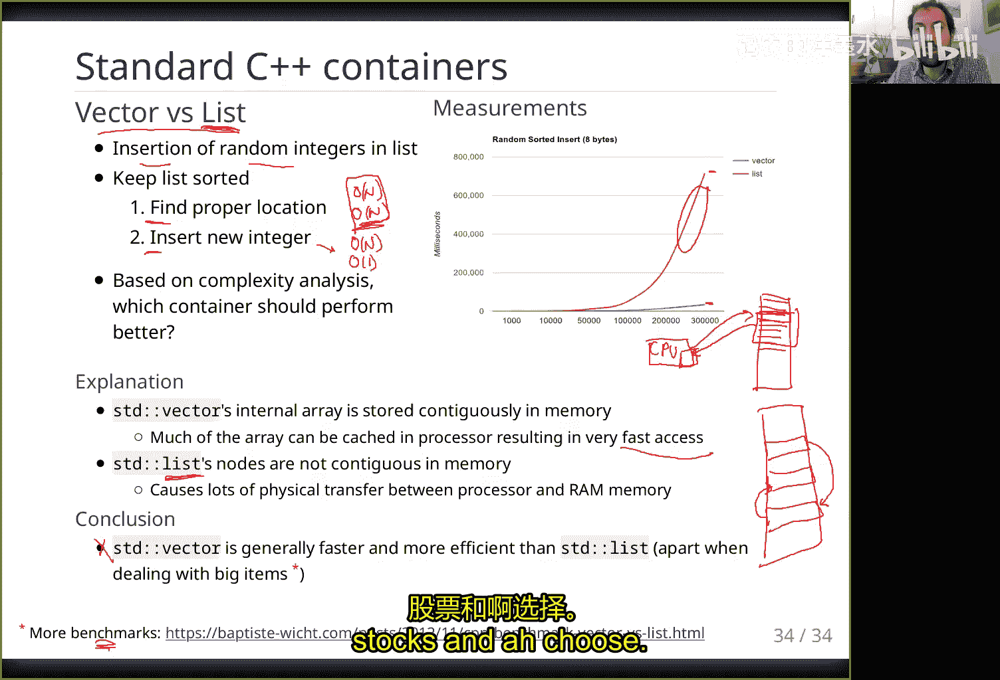

# 【全集】加州大学戴维斯分校 数据结构与算法编程 中英字幕 完整课件 p06 2-3 列表 -BV1rJ2WBSE7P_p6-

Hi everybody， so today will be the last part of our current topic， the L ADT。

We are going to talk about the last kind of implementations based on linked lists。

And then we're going to talk a little bit about the implementation of the list ADT in the C++ standard library。

So quick recap from last two lectures。so we talked about the fixed array implementation。

 which was well， not really like a proper implementation of the list API or the list ADT because of the lack of flexibility。

 the fact that we could not insert or remove items at will， because as the name indicates。

The list here would be a fixed size。And then the last lecture。

 we saw the implementation of this time， like a real list ADT based on the dynamic array。

And we saw that this dynamic implementation had different pros and cons。

 so has very good advantages that it has has a very， very efficient indexing。Here。

 if you want to access a certain item in the list by its position。

 then the running time complexity is o of one because it's an array。

 you can index it anywhere it's super fast。We also saw。

That when we want to do some operations at the end of the list， such as an insertion or removal。

 it's all of one amortized。The idea is that like when we do。

 we can do up to n of those operations in a row with a cost of o of one。

And only when we get to the operation n plus one， the array either needs to be like extended or needs to be shrunk。

 and that's a costB operation that is of complexity O of n， but because it's such a rare event。

 then on average， it's O of one， which is still a very good complexity。However。

 we saw that operations that are at the beginning or the middle will still need to move items around and so the complexity will still be over of and finally because we have to allocate。

An array that is usually bigger than the number of items that are being contained。

We are necessarily wasting some space when using array implementationation。

So now let's look at another kind of implementation based on linked list。

 I assume that you have heard of linkedlist potentially you have even implemented linked list already in 36B let's do a quick recap by showing an example in the same way that we did with the array implementation here we're going to show an example around a linked list implementation。

Given that I have a list ADT that is implemented as a single linked list。

Then it means that when we declare a list at first list L， an object L。

 which is at first empty because we don't have any items yet。Then internally。

 it means that we would have what we call the head pointer。

Point onto nothing because the list is empty at first。Then when we insert an item。

 the very first item and so here we say oh， I want to insert item 23 because that's the list here contains integer so I want to insert integer 23。

At position zero， that's the only possibility now。That means two things。First。

 we would need to create a node that in fact contains 23。

 that's the value we're trying to store in this list。

And we would need to change this head pointer to now point onto this node。

And because this node is the only node in the list， we only have one value。

 the next pointer for this node would point onto to no。Now let's continue。

 I'm going to show you two examples， an insertion at the back and an insertion at the front of the list。

 so let's start with the first one at the back of the list。

So what happens if I want to insert 42 at the end of my list？Again， it means two things。

 we need to create a new node that stores the value we want to insert。

We want to have this node 23 now point。😡，Onto this new node to form a chain。

 that's what we call the link list。And because now 42。

 the item the node containing item 42 is the last node of the list。

 we signify that by having its next pointer point onto node and so you see we have a chain now that goes from head so head points onto the first node first node contains the first value。

And contains a pointer onto the next node， The next node contains another value and a pointer to the next node。

If this node is the last node， then the pointer to the next node is in fact a pointer onto no。

 and that signifies， oh， in fact， I'm the last node。Now。

 let's look at another example an insertion at the front。

So here we try to insert item 99 at position zero。Again。

 it means that we need to create a new node that contains the value 99。

And here it's a little different because we insert it at the front。

 it means that the head now should point onto this new。

And the next pointer for this new node should point at the node that was previously the first one。

 and that's how we insert it at the front。And you'll notice that for the existing nodes 23 and 42。

 which already existed before that doesn't change anything， we not touching them at all。

And so finally here to finish this example， this graphical example， let's look at removal。

So here we call remove on the item that is at the position number one。

 which is the item that corresponds to 23。What it means here is essentially two things in order to make this item disappear。

 we need for the node to be bypassed in the chain so essentially we need to rewire the previous node to the next one so that 23 is not part of the chain anymore。

Once the node containing 23 is not part of the chain anymore because we've rewired the next pointer around it。

 then we can remove the memory that is associated to this node。And that's it， it's gone。

So that's pretty much the graphical example of a singlely linked list and how to do operations on it。

Now let's like the last time like we did with the fixed array implementation and dynamic array implementation。

 let's look at the data structure， like the actual implementation encode code of this singlely linked implementation。

30。What do we have？Well so again， you will see it's very similar to the previous implementation。

 we also declare a class with a certain name， we also make this class a bit templated so that it can handle any kind of items it will depend on the way that objects are being declared and once again we'll have two kinds of internal data。

 we'll have private to declare things that are private to the class and public which will essentially contain the API that users can call。

And that will be the same API as the API we've seen so far， so returning the size of the list。

 the number of items that it contains， finding a certain item。

 getting a certain item at a certain position and inserting an item removing an item so the same five functions that we've already that we have already been through for the other kind of implementations。

So here， let's start with the data structure， like how is this linked list represented in terms of code？

So you'll recognize we have thisstruct node that will allow us to like really make those nodes and you see that the nodes are composed of two members。

 we have an item of type T， which is the template， the kind of type that we want to be able to store in that list。

And then we have a next pointer。 So the idea is that like we will be able to create nodes。

That contain an item。And that have a next pointer so that it can point on to the next。Note， right？

And because the list has to stop somewhere， we're going to have a head pointer。

With the idea that the head pointer would be the one pointing onto the first node that contains the first item and that starts the beginning of this chain。

Um。Here not surprisingly， we're going to maintain the size。Of the linked list。

 so as we add items or values， the size will be increased accordingly will be incremented when we remove we just like decrement this size and that allow us to like just have a precise count of the number of items that are currently in the list very very easily。

Now， I want you to pay attention to something here。

The fact that this head pointer is declared as a unique pointer and the fact that the next pointer inside of a node is also defined as a unique pointer。

There's a very interesting reason for making that， and it has to do with ownership。

So let me explain what it actually means the fact that we're using unique pointers here。

If head is of type unique pointer， it means that when head。Points。Onto a certain item。

It will actually own this item， it will be the owner of this item of this note， sorry。

And same here here。Inside of a node， because next is also defined as a unique pointer。

 it means that let me make you change the color。It means that。

When the next corner of a node points onto another node。There is a sense of ownership as well。

 like it belongs to this pointer。So why is this ownership thing？Interesting。Well。

 it's very interesting， for example。Right。Here。In the destruction。

You'll notice in this structure we don't have any code， we just tell the compiler like no。

 there's nothing to do， just like whatever you want， just default。

 which usually is equivalent to just empty， no code。

So how come it's possible that at a certain moment， like the list might contain values。

 it might contain a chain of nodes。And if ever this list disappears like it。

 if ever this list is deleted。Then there's no code to actually free all of those nodes like technically we should have a far loop that starts from the head and goes over all of the node and callss delete on all of the nodes to remove the memory so that we don't have any memory leaks。

And here there's nothing。We don't have anything to do， so how come？Well。

 it all has to do with the fact that we're using the smart pointers。The thing is like。

If we declare an object of that class， if we instantiate this class into an object。

Then it means that we're creating this internalvi head， right which is a unique pointer。

And which might point onto something as we insert items。Now the thing is if this objects。😡。

Is destroyed。Then the structure would be called and the the structure doesn't have to do anything。

But it also means that the head would need to be destroyed because it's an internal variable to the object。

 so if the object is destroyed then every internal variable is also destroyed。

If head is destroyed because head is a unique pointer。

 then whatever it points onto is also destroyed。So that thing would be automatically destroyed except that that thing also has a unique pointer。

 so if this object is destroyed then whatever this unique pointer is pointing onto should also be destroyed because every time the owner of an object is destroyed then the object itself is destroyed as well。

And so you see here that we start to have kind of a recursion loop where because the head gets destroyed automatically。

 then whatever it's pointing onto gets destroyed， then the next。

Is also pointing onto a node that gets destroyed and essentially like the chain gets destroyed as every node gets destroyed。

So that's one interesting aspect of using smart pointers is that we have this sense of ownership that is very helpful whenever something gets destroyed and then in turns like we have this entire chain of ownership that kicks in and that indicates to to the system。

 like what object should be destroyed so that the memory should be completely freed。Okay。😊，嗯。嗯。

One thing that we're going to need for this linked list implementation is a way to retrieve a specific node inside of the list。

 like as you can imagine， when we try to insert a new item at a certain position。

 when we try to remove，An item at a certain position and so on。

 we're going to need to find the node in the first place。

So it would make sense to have a private method。That would help us like given a certain position。

 return a node that is at this position。And so that's why I created this private method called getnott。

So this method here。😊，That is declared here would be declared as part of the dot dot dot and so it would be private to the class。

 it would not be something that is exposed to the user like the user has no business calling getn。

 that's something that's totally internal because actually the user doesn't even really know that the list ADT is being implemented as an array or as a link list that's not none of their business。

so the objective of this get node is that given a certain position return a pointer onto the node that this position and this way and you'll see like this get node private method will be called in the other function。

U because it's a private function that is only called by our code。

 we should make sure that we call it with a good argument and if we don't that's not an error that's like an actual bug that needs to be fixed ASap。

So that's why here we use asset。Crush the program right away if the argument pause is incorrect and incorrect means that we will try to be accessing a node that doesn't exist。

And now you see that it's a pretty regular like iteration through the linked list。

 we start a pointer at the head。And then we go through the list by going from one next pointer to the next one as many times as the number of position that we're trying to reach。

Here is something that's interesting。 So we talked about the fact that。Internally。

 we're going to have the head。Be a pointer。Onto a node。

And then this node might be pointing onto the next node and so on。

 So that obviously like totally depends。On the length。

Of the list of the number of items we have on the list。The thing here is that like head。

 the pointer head is the actual owner of this node。

 The next corner here of this node is the actual owner。Of that node and so on。

 So we have this like strong sense of ownership， right。And the last one will just point on to no。

Now here with get node。There's no concept of ownership at all。

 like here we're just trying to it it through each node of the list to find a certain one。

And so that's why。Here what we return N。It's just a regular node。 There's no。

 It's not a smart pointer or any kind。 It's just like a regular node on on on like on node on the type node here。

What it means is that n here is just a regular pointer。That we want at first to point on this thing。

And then photo the pointer to the next。 and so。Next it's going to point on that and then it's going to point on that。

And so on。 And it's going to just like， follow。The next pointers up until we find like so that would be node at position zero。

 not at position one， not at position two， and so on until so we would like continue going through the list up until we reach the position that we're looking for。

But at no moment。And here is not the owner of any of those node。

 the whole goal is just to like iterate through those。So that's why n is a regular pointer。

 but you'll say that like every time it dereference one of the smart pointer。

 it uses the internal method get to actually access what we call the raw pointer like because it's not about ownership it's just about like getting the address value as as a raw value。

So that's why here like we have head。 get and then next dot get and so on， right？Okay。😊，So。

Now that we have the data structure and we have this internal private method get node which will be very useful now let's start talking about the implementation of the list ADT itself so like the five functions that we talked about size so the number of items we have in the list get find remove and insert so let's start with the first one size。

Same as usual， because we maintain a specific member that contains the number of items。

 we just need to return the value of this variable。And it's all of one。Now forget。

 so remember like get， we give a certain position and it returns the item at this position。And so。

 as usual， we would。Validate the position and so here you see the difference with before。

Here the position， the argument that we receive here is the argument that the user using this list would provide us with and it's very possible that the user could make a mistake。

And the position that they give is incorrect。But here we would not want to fail the program entirely because it's not up to us。

So here what we would want to do is only like make sure that the position is legit and if it's not。

 withdraw throw an actual exception。The the ideas that like by throwing in this section we just telling the user like。

 hey， you call this function with the wrong parameter。And here is why。

 but it's up to you to deal with it and so you can catch the exception。

 you can even try to recover from it and have some code that would like call the function get again with another kind of position I mean like essentially we're just telling you that you call this function with the wrong parameter and now it's up to you。

To deal with it。Whereas here when our own code calls the internal function get node with a certain position that now is supposed to have been validated。

对。If ever this position is wrong。Inside of get node。

 then it means that it's a bug in our code and there's no point in like returning an exception here because that's our code。

 if there's a bug， we should fix it right away。So that's why in get node。

 we have an SE because we're really trying here to catch that a certain invariant。Is checks out。

So anyway， so after validating pose， we in fact just。Called this get Note function。

 which we just talked about in the previous slide， and that give us back a pointer onto the corresponding note。

By using auto， we don't even need to like declare what kind of data this pointer is。

 we can just let that to the compiler to decide and the compiler will like take whatever get node returns and make and be available of the same type。

And because we know that n is a pointer onto a node， we return the item that it contains。

 that's the idea。嗯。😊，Now let's talk about the next one， find。So Fine here， if you remember。

 F receives a certain item and returns the position where this item is at and it returns minus1 is if in fact the item cannot even be found in the list。

And so here the idea is that we declare a pointer onto a node。

 we start from the head and we essentially iterate through the entire link list each time by saying that the pointer now points onto the next item and as long as the pointer that we're using to go from one node to the next is still different than no because otherwise it would mean that we've reached the end of the list。

And at the same time， we maintain。The location， so we start by a location at like a position zero and every time we go through one node of the list we do i plus plus。

Up until we find the item that we are looking for， in which case we can return the position at which it was found。

If after iterating through the entire。List the item has not been found then。

Written minus1 that tells the user like couldn't find the item that you were looking for。Okay。

So now we're going to talk about the last two method， the last two class functions。

 we're going to talk remove and insert。So those you'll see are a little bit more complicated because insertion and diletion in the linked list。

 we have to do some pointer rewiring and we have to deal with like different scenarios， but no。

 we're going to try to not go too too fast。Okay， so let's start with remove， shall we？

So remove just to remind you， we receive a certain position in the current list。

And the user wants to remove whatever item is at this position as simple as that。

First thing that we want to do as usually is check that the position that's being given as a parameter is correct。

 so we would check that it's within the number of items that we have。

 otherwise it's out of rangerench and we throw an exception。Then we have two scenarios。

And you'll see that for the insertion， it's very similar。First case scenario here if this if matches。

We are trying to remove。The first item。So that's scenario number one。Scenario number two。

 we're essentially not removing the first item。So the scenario number one would be activated。

If the position is equal to 0。 and that's pretty much what this syntax here means。 If not position。

 that is equivalent to writing if。Position。Is equal。退几。That syntax and that syntax。

 theyre exactly the same。It's just that this one is much faster to write so that's why I wrote it like that。

So essentially， if the position is zero， we're going to execute those two lines of code if it's not equal to zero。

 so if you are trying to remove an item that is not the first one of the list。

Then we would have to run those three lines of code。And just no matter what。

 because we're removing an item， the number of items that the list contains would be decremented by one。

 so we do that at the end。Okay， so let's see how that thing would work。

 so let's imagine that we have a list。So we have a head。And we have， like， say。

Let's just pretend we have three items currently， so the head is a smart pointer。

That point onto the first item。This first item has whatever black value A。

 and it has a next pointer which points onto to the next item that's B。Has a next pointer。

Onto the next node that C and the last one doesn't point out to anyone so that's no， right？So。

 let's see。嗯。😊，Here it's very important to remember this notion of ownership。

Head is a smart pointer that points onto a node， which means that head。Os。This note。

Then the next pointer is also a smart pointer， which points onto the next node。

 which means that it owns the node。And so on。Here， it's actually like very important and youll understand why。

Okay， so now let's stop to execute the code。So。The first line。The first line creates a smart pointer。

 and。嗯。The fact that it's auto here tells the compiler like， yeah。

 choose whatever size you think is the best， but it's influenced by this move from the edge to this n。

 which means that n will not be a regular pointer， it will be a smart pointer。

And what this line means， it very important， it means that whatever a is pointing onto like whatever add。

oons。Should now be transferred to N so actually like it means that both whatever head points ontoto in terms of memory address that will be transferred to N as well as the ownership there's a transfer of ownership。

So whereas head here owned。This node， it had the ownership of this node， it loses it。So。

 all of a sudden。Head。Oh， sorry about that。 Let me re redraw。嗯。O。So head loses the ownership。

Of the first node。 And now N has the ownership of the first node， right。And also head。

Does not point onto this first node。Any more。Right， so that's what the first line does。Okay。

 let's go to the second line。Now， we're going to say head。Is now equal to N error next。

And it's also a move， which means that there will also be a transfer of ownership。

So whatever N next points onto and owns will no longer be the case。In practice。

 it means that this so N next， its this pointer。 So this pointer will stop pointing on whatever it was pointing to and will lose the ownership。

Of what it was pointing on。That means that that's no longer the case and that's no longer the case。

And in fact， what it was pointing onto that node， the ownership of that node is now transferred to head。

So now it means that head。Points onto to B。And owns。The node that contains B， right？

So you see here how the rewiring worked。Now look at something very， very interesting。

Here technically， we still have N， which is a smart pointer point onto an object。

That eas memory takes space in memory。 The thing is that and。Is the local viable。

It's a local viable that belongs to this block of code。

So after executing those two lines and after getting out of this block of code。

And which is a local viable， will。Be automatically destroyed that's what happened when you declare a local variable and you come back out of the block of code that define this local variable。

So it means that n will be destroyed and remember， n is a small pointer。

 so whatever it owns should also be destroyed。And so that's how this object will automatically be destroyed when n disappears and we don't have to include any delete line in our code because it's all going to be taken care of automatically and completely transparent。

So that's kind of the beauty here of smart pointers， like they really help with memory management。

So that was part the first scenario here。Let's do the second scenario here very quickly。

 so let's imagine again we have the head pointer。That points onto to。A chain of nodes。And so again。

 we have a strict sense of ownership like head。Owns this guy。The next owner of this guy owns。

This node。And so on。嗯。So。This scenario here。Is when we are not removing the very first item of a list。

 but say we're removing either an item that's in the middle or at the end or like anywhere else。

So let's imagine that the one we're trying to delete is this one。

 the one that is at position number one， something like that。So again。

 let's quickly run the code for that。嗯。😊，So in the first line here。

Pv equals get node at position minus1。 So essentially here we're just trying to get hold of the node that directly precedes the node that we are trying to remove。

And get note here， pay attention to that。Returns a regular pointer， not a smart pointer。So here， Pv。

Would be a regular pointer。That points onto the node。

Preceding directly the one that we're trying to remove， so in that case that would be node zero。

Now the next line。We again， declare N。Which also is a pointer。But this time a smart pointer。

And we transfer the ownership of prev， next to N。What it means in practice， it means that now N。

Will take the ownership。Of prev next， which is。The node' trying to remove。And that means that。

The previous node loses the ownership to the next one and doesn't point on to the next one anymore。嗯。

Okay， next line。嗯。This line。We're going to rewire prev next， so prev next。

We're talking about this pointer。Will receive the ownership of N next。

What it means in practice is that。Pve next。 So this pointer。Will take the ownership。Of N next。

 And so N next will lose the ownership。So that means that will this ownership。Relation is broken。

And that's it。嗯。嗯。So now the head still points onto the first node。

The first node bypasses the second one， and now this one has become node number one。

And this one is no longer。This。Prive pointer is just a regular pointer。

 so here when we get to the end of this block， this pointer will just disappear。

 but nothing's else going to happen。However， n here is a smart pointer and the same interesting side effect will happen as before is that when n disappears because n owns。

Something else。This node that it's pointing onto the node will also be destroyed and the memory is going to be freed and so the memory corresponding to the node will be taken care of automatically。

So yeah， that's the idea behind removal。So let's switch to the next method， the insertion。

 and you'll see that it's very similar， but in a slightly different way because now we're inserting items instead of deleting items。

So just to remind you， insert text two parameters， text。

 the item we want to insert and the position we're trying to insert it at。Once again。

 we want to make sure that the position is legal， that it's within the existing list。

And now we can start to have the code。You'll see that again we have two scenarios。

 we have insertion in the front and insertion not in the front。

 so at any location that is in the middle of the list or at the end of the list。

So let's quickly show how that would work。嗯。And you'll notice here that this time I chose the syntax position equal equals0。

 but again， I could have written if not。Pause。That would have been completely equivalent。

So we have the head。Points onto a node。 This node points onto to the next and so on。And so here。

 don't forget that we have this ownership relationship here。😔，And so on。O。So。嗯。

So what happens if we call insert with a certain item at position zero。

 so we're trying to insert at the front。no matter what those two lines would be executed。

 so that means that we are creating n。Which is a smart pointer。

And the smart pointer is pointing onto a new node， so we're creating a new node here。

And this new node is already initialized so that the item。

Its set to whatever was given as a parameter。And because。And here is declared as a smart pointer。

We have an ownership relationship between。And the note that was created。So once we get here。

 that's the situation where we have a certain list。And we have N pointing onto this new node。

If we insert in front。We have two operations。First of all。

 we have a transfer of ownership between head。And and next。 So between heads and this pointer。

What it means is that this pointer。Well， now。Get the ownership to the first node。And heads will lose。

The ownership to this first node。So we are like wiring a new node to point。

Onto the previously first one。And next， so that was for the first line here。 Next where。

Transferring the ownership of N to head。What it means is that n will lose the ownership to this new node。

And head will take。Pos。Of this new node。 And so you see what happened we。Effectively。

 inserted this new item。Add the beginning。Of the existing link list。Yeah。嗯。😊。

So that was for the first scenario let me。And do because there'll be a lot of similarity between those two Okay。

 I think that's here。Okay， let's see， so。嗯。对。Now， what if we are trying to insert not at the beginning of the list。

 but somewhere in the middle。 So let's imagine that the item that we just created were trying to insert it here。

 So at a position。Number one， right？So let's again like just run those pieces of code one9 in time so first line we are defining a pointer prep a regular pointer this time no smart pointer。

 just a regular prep pointer。And this pointer will point onto the item preceding the one at the position that we're trying to insert into so if we're trying to insert that position number one。

 then prep should point。On the node that's at position number 0。 So like here the first node。

And it's a regular pointer there's no ownership like here add is still the owner of this first node。

Prive is just a regular point aren't it？Okay， next slide。Here we have some ownership transferring。So。

Pve next。The ownership of pregnant is transferred to N next。So that means that。Pve next。

 So that pointer loses the ownership。Oops。Loses the ownership。To the next one。

And this ownership is transferred to N next。 So N next here。Gains the ownership to this note。

 that's what this line was doing。And so now， the last line。The ownership of n。

 so N here is pointing and owning this new node is transferred to prev next。

So what it means is that N is losing the ownership to this new item。

And the ownership is transferred to prev next。And that's it。Once we reach。The end of this block。

 then。Prev here is removed。嗯。So， that is destroyed。Once we return from the function。

 local variable n is also destroyed。And that's what we're led with。

 and so we have indeed inserted a new item at position one。So that's the idea of insertion。

So let's get to some conclusion now。So in terms on pros and cons。You might disagree。

 especially with the smart pointer situation。Overall the implementation is in fact fairly simple。

 you see like the functions are pretty short， the logic is there。

 if you were to just like implement it in regular C++ 99 it probably be more easy to understand。

 although you would have to deal with the memory management manually。

 but it would still be like a very few lines of code。

What is nice here is that the insertion and removal at the beginning is in o of one because we just need to rewire the head。

To either like remove the item that the head is pointing onto and make the head point onto the next one or to make the head points onto a new pointer and this new node and a new node to point on the previously first node。

And regardless of the size of the list overall。The removal the removal and the insertion at the front is o of one。

 like we just need to do a fixed number of operation and that's it。Now。

 the big issue here is that the indexing， so just accessing。

A certain item at a certain position is O of。When you remember with array。

 it was o of one with an array if you say， hey， I want to access the fifth item。

Then you just go to position number five by saying number five within the square brackets and that's it。

 you get access to the item， it's super fast。Here if you say， oh。

 I want to have access to item number five， you need to start from the head and follow the chain five times to get to position number five and then you can have access to the item。

And so here it depends on the size of the list， so it is over。嗯。😊。

Insertion at the middle and at the end is also an oven because you also。

 if you want to insert in the middle， you also need to same like start from the head。

Can of scroll through your list。Get to the position at which you want to do the either like insertion or remove all operation before you can do this operation。

 but there's still a sense of like going through the list to the position that you're looking for。

And last。The singlely linked list only a lose for what we call forward transversal。

So what it means is that like。When you have， so it means that you have a head and you necessarily have this sequence of nodes that are containing items。

 right？You can go in only。One direction。So for example， when you call like oh， I want to find。

 I don't know， item 42， you would start from the heads and check， oh is this one 42。

 is this one 42 is this one 42 and so on and you go from the heads down to the tail of the chain to find this item。

What about implementing a function called R find， reverse find。😡，With reverses find。

 the function would say， oh， actually like I want to find also an item。

 so you would call it in the same way like our find。42。Except that with all fine。

 the assumption is that you would start looking from the last element of the list。And you would。

Ittererate back through the beginning， so essentially you want you would want to find the last item in the list。

That matches the item that you want to try to find。

What would be the complexity of our find if you have a singlely linked implementation？Think about it。

嗯。If you need to check that the last element。Or if the last element is equal to 42。

 how do you get to this last element？Well， you need to go through your entire list。That's O of then。

If the last element is not the one that you're looking for， then you need to do it again。

With the previous one， but how do you get to the previous one。

 well you need to start from the beginning of the list again in order to find the previous one that's another O of n。

Worst case scenario， you need to do that。And times。So overall， the complexity。Of air find。

With the single linked list would be n squared quadratic complexity that is terrible。

So you see there are like shortcomings to this singlely linked list implementation。Okay， let's go on。

There's another implementation that we call doubly linked list implementation here the idea is very simple。

In addition to having a next pointer， we also have a prep pointer， previous pointer。

 So every node is not only connected to the next node。 It's also kind of back connected。

To the previous one。So every node knows who is next in the chain and also who is before in the chain。

And as you can imagine now it allows for a good reverse trans vessel because if you get hold of the last node。

 then directly from the last node， you can actually go back up the chain。Up to the head。

So that can be very useful in some cases。Another kind of optimization that we can do is have a pointer tail that points directly to the last node。

 so in addition to having the head that points onto the first node and through the head you can access anything in the chain。

 but you have to all the time like start from the head and iterate through all of the node。

Here you keep an extra pointer tell directly on the last node。

The idea is that like it's very common to have insertion and removal at the end of the list。

If you have a pointer that points directly on the last node on the list of the list。

 then you can do insertion and removal at the end in O of1 instead of O of n because you would have to go from the head to the next node every time by like going through all of the nodes。

嗯。I'm not going to show you the implementation for this Do linked list because that's actually something we're going to do in the next discussion section。

 so set tuned。But very quickly in terms of conclusion。

 just to compare it with the singlely link list here with the double link list and tailPoer。

 we potentially have a very efficient like an o of one insertion and removal at the end。

 we gain the possibility of doing reverse traversal traversal。

 so if it's like if there is an operation in the API that definitely calls for some sort of a possibility of reverses transversal。

 that would be a very interesting。However， because you're adding a new pointer to that node。

It means more management， so the code has to be a little bit more complicated because for every node now you have to maintain who is next。

 who is before and so on， but we'll see that in discussion when we talk about the implementation。So。

嗯。Quick kind of overview of the different implementations that we just talked about。

 so the fixed array implementation， the dynamic array implementation and the linked implementation of the list ADT。

And that's pretty much what we get right， so we saw that what was great with a raiseis that you can access any item。

Of the list in O of one， because like when you are being given the position。

 you can use this position as an index in the array and just get access to the item right away。

We saw that for the fixed array because it's not really the least。

 there's no dynamic insertion and dynamic removal， it's kind of not really like applicable here。

What's nice though， is that technically the fixed array is insiateated just one time。

 probably with the exact number of items that the list should contain and so there's no wasted space。

On the other hand， for the dynamic array， so very good random access insertion and removal at the beginning and at the middle of the list are not that great because every time you need to move everything to shift all of the values by one in order to insert。

 well， either at the middle or at the beginning that's similar。The only。

Kind of solace for dynamic arrays insertion and removing at the end because we saw that here at the end。

 most of the time it's an operation that you can do in o of one by just adding the new item at the end and only sometime the array needs to be reized。

 which is an O of n operation。But it's rare enough that on average。

 we consider it to be u of one amortized。And finally， the dynamic array because it usually has to be。

Bigger than the number of items it contains， and we saw last time that it pretty much meant that the array itself would be from a quarter to 100% full。

 we consider that the amount of weighted space is proportional to the number of items that it contains。

 which is oven。And so finally the linked list implementation。

 random access is not very good or event， if you say I want to access item number five。

 then you need to start from the head and go through five nodes before you reach the one that you want here you can just index right in the middle and have access right to it right away。

You have to iterate。So that's why the random access is all of it。But on the other hand。

 insertion at the beginning is0 of one， just create a note， rewire the pointers。

 you're good to go regardless of the size of the list。

Insertion and removal at the end could also be of one if you have a tail pointer。

 like if you have a pointer directly on the tail。Then you can do operations directly on the tail in constant time。

 regardless of the size of the list。Now the operations at the middle。

 they're in fact the composition of two different times。

 you have what we can call like a search time， which means that like。

If you do an operation at the middle of the list， technically you need to iterate through the list in order to get to this item and so the search time is O of N however。

 once you get hold of this item that you're trying to remove， for example。

The actual removal is all of one because you need to rewire a few pointers and then you're good to there's no shifting that needs to happen or anything。

So that's why I separated the complexity into two different charts， but globally。

Operating on the middle of the list globally would be aware of it。And finally。

It could seem like a linked list doesn't have any wasted space because say if you have five items in your list。

 then you only have five nodes。Remember， however， that because for every node。

 you need to have a next pointer onto the next node， then you're wasting some space。Right。

And the amount of wasted space to maintain this linked list is proportional to the number of nodes you have。

 so in fact you are wasting space in of end complexity。

If you were to look at this table here and pretty much like compare dynamic array versus linked list。

It seems like the linked list is very good， you have many o of one here complexities versus like many o of n complexities for the array。

 like it seems like the linked list has an edge or at least is very comparable to a dynamic array implementation。

Keep that in mind because I have a slide in a few slides that will maybe show the opposite。

But let's go， so the last thing that I wanted to talk to you about in this lecture is how this list ADT is implemented in the standard C++ library。

In the C Research Library there are different kinds of implementations for the list ADT。

 they actually don't call it list ADT， they call it sequence containers， but it's the。

Similar concept。So。😊，The one that everybody probably knows is STD vector。

 this one is in fact implemented around a dynamic array， very much like the one we studied。

That is the most common sequence container。And according to the inventor of the C+ language。

 you should essentially always use STD vectors for like every time you want to use a sequence container unless you have a good reason not to。

Now， there also exists。A list STD list which is by default based on a do linked list and I think the reason that you would want to use a list instead of a vector is for example。

 if you want to have a very good。Reverse travel， for example。

There are two other kind of implementation， you have something called forward list and that's essentially the same as the STD list except that it's based on a single linked list so here you only have the possibility of going in one direction so not good for reverse Traviso。

What's very interesting here is that this forward list is actually very good for empty sequences。

 so you might wonder like why would I write a program that has empty sequences。

 it doesn't really make sense。But think about this use case， imagine you have a class of students。

 a pretty small class like 30 students， and in your program you want to sort the students by their last names。

Well， it's very possible that for many letters， especially with a number of students as small as dirty。

 for many letters， you won't have any students。Like I don't know， for example， like letter K， oh。

 no one has a last name that starts with letter K。So the sequence container that corresponds to later K would in that case。

 be empty， right？And also， because you only have 30 students。

Maybe letter like Z would have more than than one students and would have maybe like three of them。

 but still not a huge number。If you had such a scenario。

 make a scenario where you wanted to sort students by their last name and you knew that classes were always very small。

 then going for a forward list would be a good idea because here you would have certain sequence that are empty or other sequence that are very short。

And the reason why you would use forward list is that in that case the space occupation would be rather small and so you would save a lot of memory space。

 whereas if you were to use， for example， like a vector and most of your vectors were empty or most of your vectors were only had like just a few items。

 then you would actually be wasting a bunch of space， not to hold anything。

 so that that's kind of the idea。And finally， there's something called a deck。

Which stands for double ended Q and so this one is a very flexible list implementation as well that's very very good at growing in both directions so this one is very good at growing towards the end and also growing towards the beginning by having a very clever implementation made with two dimensions of arrays。

所以啊。So I just wanted to like show you a couple of examples of how those standard sequence containers are used in actual code。

 so here is an example of how to use a vector， a vector containing integers and so you see like all of the different operations that you can do you can like directly access certain values at certain like indices very easily。

 you can insert at the beginning or the middle， you can insert at the back。

 you can remove elements and you can iterate through the vector to， for example。

 like print the content of the vector。And here you'll see that like most of those are if not all of those。

Stand up containers， theyre compatible with the new C plus 11 syntax that is very， very powerful for。

Itating through， for example， like you're a vector， you see you just declare a viable n。

 you don't even have to define the tab， you can just say auto。

 and then you want to essentially n to iterate through vector V and that takes very little amount of code and that's what it does。

And I also wanted to show you the use of a list but well I mean it's very the same principle。

 so here you use the standard list also to contain an integer and you can also do a bunch of operations such as inserting an item at the front of the list。

 inserting an item at the back of the list， you can also search for a certain item in the list and saying you can like iterate through the list with the same very convenient C+ pen syntax to go through all of the items。

You'll notice in that code that there's， for example， no operator like， oh。

 I want to access L at index like I don't know。1。Because list they don't really work like that。Yeah。

嗯。😊，And so the last slide going kind of back to complexity analysis。

 there's a very interesting scenario。I think like illustrates well the。Complexity of， well。

 that's a rather probably a chosen word。The difficulty between like theoretical algorithm analysis。

And an actual real life performance， so let me explain a little bit。

I pointed out earlier the difference between the dynamic array implementation and the linkedist implementation and so that's pretty much like vector versus list in terms of a standard C+ container。

What would be interesting here is to try to run a certain scenario and see how it compares in terms of performance。

 so let's imagine a scenario where we would insert a bunch of integer like randomly chosen integer into the list。

And but we would insert it in such a way that like we try to keep the list sorted at all time。

 so imagine like a deck of cards you know like you try to sort it and so in your hand you have a sorted deck of CA and when you see you want to put a new card into the deck。

 you try to put it at the bright location so that the deck stays sorted。That's the idea。

In order to keep the list started， there are two steps you want to find where to insert the new item and then you want to insert it and so at the end if you insert it at the right location your list stays solid。

And so you want to compare those。The thing is like， so based on complexity analysis。

 which container should perform better well。Find the proper location。In in an array。

 that would be O of n， you need to go through all of the items in order to find the right location and in。

At least it would also be U of it because you also need to go from the heads and go through all of the items and find the right location。

Now the insert new integer。In an array， it would also be U because most likely you insert the new integer somewhere in the middle of the list。

 and so you have to shift everything else。That's an U of an operation。

Whereas with the linked list implementation， it would be o of one。

Once you found the location where to insert the new item。

 then it's just a question of making a new node and connecting it to the nodes that are around and that's super。

 super fast。I mean， technically。So here。The list。Theoretically should win over the vector。

Let's run a test。So let's insert a bunch。Of integers into either vector list。 And what do we see。

We see that， in fact。The running time for the vector stays fairly low。

The running time for the list starts to skyrocket。After a while。

So how is it possible when we saw it like technically in terms of algorithm analysis。

 the least should be better？The thing is， and it's very important。Algorithm analysis is great。

 it's a great mathematical tool， but it's not enough in computer science。

 you also need to understand that the code that you're writing。😊。

Also execute onto the computer and the computer has a processor， it accesses memory。

 I mean there's a lot of hardware that is involved。

And that also has a huge impact on how programs perform。The explanation behind that。Is that。

When you use a vector。Because the vector uses an internal array。That is completely contiguous。

Processors， the memory love things that are contiguous。Because say if you have the array memory。

And so it's organized in cells like that。The thing is like when the CPU。

Acceses a certain cell in the array。It will， in fact。Bring。

Back a ton of items all at once into its own processor cash。

Because it's kind of already expecting like， oh， if I'm accessing this one。

Like this item I'm probably going to ask access the rest。

 so I might as well like read all of them from memory and so if I need to access them later I'll already have them with me。

And so that's why it results in like。Accessing a array pretty fast if you access them sequentially and that's exactly what we're doing here。

 we always like access things very sequentially。On the other hand， when you use a list。😮。

Every item in the list is a completely independent item， which means that like in the memory。

 in the physical memory， you might have a node that's over here the next node is over here and so this guy is pointing onto this one and then another node that's other over here and is pointing。

And you have the node that are completely allocated at random location， which is fine because right。

I mean， in terms of like going through all of them， it doesn't。

 there's no issue because we have this next pointer that tells us exactly where the next one is located so it doesn't matter if it's not。

Located contiguously。However， in terms of performance， because now the CPU。

 when it reads a certain node。It doesn't make it faster to access any of the rest。Overall。

The it's going to be very， very expensive for the processor to essentially go through all of the nodes of a list。

Up until a point where like actually the cost of access complete is overwhelming compared to the fact that that that that the。

Agorithm complexity， like algorithm analysis told us， yeah， it's the same complexity overall。

 et cetera like in practice， no， like in practice， this thing is this operation in hardware is so slow that it took text over totally。

Conclusion， as was said before， vector is usually the right way to go for plenty of different reasons if you're interested in more explanation about this。

This scenario， I encourage you to click on this link， it's very informative。

And that concludes our topic around least ADT and in the next lecture we're going to talk about stocks and queuees。

