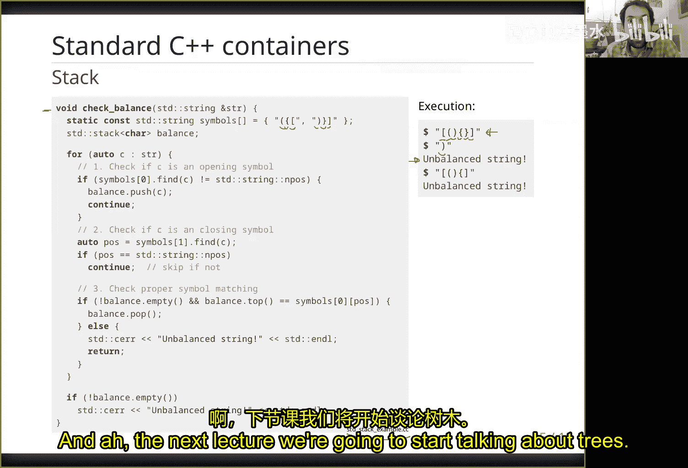

# 【全集】加州大学戴维斯分校 数据结构与算法编程 中英字幕 完整课件 p07 3-1 栈和队列 -BV1rJ2WBSE7P_p7-

Hi， everybody。So today we have a self-contain lecture about stacks and Qes。

 and the reason it's not actually a very big topic and we're just going to spend one lecture on them is that they are both just variations around least ADTs。

 which we've already studied in length in the past three lectures。Okay， so let's get started。😊。

So let's start with stacks。So the stock ADT is really just a subset of a list in the idea that it's a sequence of items that you can add or remove。

 except that it's restricted to only two operations。We have the push operation here。

 the ID is to add an item to the list。I mean to this stack and pop here has a very important significance。

It removes。The most recently， I did item。Right。And that's it like that's exactly where a stack is so you see like here it's not a list in the sense that we don't have a method for get。

 we don't have find we don't have insert or remove that would allow us to insert at any location or remove from any location here we're restricted it to。

Pushing an item。And we don't have to mention where should this item be pushed。

 it's just like pushing an item and then popping an item back。

Wwhich removed the most recently added item the concept of the stack is it's the same idea as like a pile of plates in your cupboard right like when you empty the dishwasher or after you're done doing the dishes and you put back the plates in your cupboard you stackg them right and when you're hungry and you want a plate you don't play at like trying to extract the plate that is at the bottom of the pile of always be complicated。

 you would just take the first one that's available that's a stack right like when you push a plate and you pop it。

 you take back the last one you pushed。So that's the80 so here like we would push some items when we pop them。

 we pop them from the last that was pushed back to the first that was pushed。

Another name for stack is also called LIFO last in first out。So let's look now so that's for the ADT。

 the abstract data type， the conceptual explanation of a stack， now let's talk in terms of code。

So here is a typical API， say like not many functions。

 typically we would want to know the number of items we have currently in the stack。

We'd want to have access to the top item， so the top would return typically like a reference onto whatever kind of item we are pushing in the stack。

Then we have P， so here we remove this last item and then we have push to push a new item。

A few things to notice， which I didn't mention in the list lectures。Notice the naming here。

 so for the methods， the first letter is capitalized like size。

 top pop and push to conform to the Google coding style。

You'll also notice and that's very specific for this stack that the method。

Top to have like get hold of the top item in the stack and the method pop to actually remove it are two separate methods。

And actually the reason that I did that is that in the C++ standard library there's also a stack data structure and that's how they do they do it so it seems like it's a good。

Approach。So that's the API that we would like to implement now in terms of actual implementation。

 we for the stack we have different options， we could use the rate to implement the stack or we could use a linked list。

 so let's see the typical implementations。So if you use。An array or a vector。

 then ideally you would want to push or pop items to and from the stack at the end。

Of the array right so if if you have an array here and you have certain items。

 the top would be towards the end of the array and when you want to push。Then you would push。

Towards the end and not touching the beginning and so when you want to pop you also pop from from the end。

What's the reason for that？ Well， the reason it's very simple is that when we operate towards the end of an array。

 then we get。All of one amortized complexity， as we discussed a couple of lectures ago。

If you wanted to do the opposite。😡，If you had an array implementation。

Like that' with some items and you were saying like okay。

 I want to do an implementation where new items are not pushed at the back but are pushed at the front of the array。

 then what would be the complexity here。Well， you can imagine that like if you do that。

 technically it means that you're inserting。At position。

Zero and I think we we discussed that a couple of lectures ago， if if we do that then。

Everything that's already in the array needs to be shifted by one to make some space so that the new item can be。

Inserted at the beginning， that would be a complexity of O of n for each single operation versus O of one amortized。

If we do it at the end。 So here， that's why it's a good idea to like extend this stack towards the end of the year。

 not the beginning。嗯。😊，For the link list here it doesn't really matter。

 but typically if we have a single linked list with only like a， you know a head pointer。

Pointing on to the first element in the linked list。

Then actually it makes kind of more sense to push and pop from the beginning of the list right because popping here means that you would just need to rewire the head to the secondonder element。

And dropping the first one。And pushing would mean that you makeg the head。

Point onto this new element。 and you make the new element point onto what was previously the first one。

 And so here both operations would be。In O of one。But typically， like you could also。

Push and pop from the end。Of the list。And still being all of1。

 but you need a tail pointer so that you have access to the end of the list。

 regardless of the size of the list， you have access to the end right away in constant time。

But that requires for you to have a tail pointer in addition to the head pointer。

 so you might as well just do things in reverse order and just have a head pointer and be done with it。

So yeah， that's the idea。Okay， so we're going to look at two implementations。

 actually like we're going I'm going to show you the implementation using an array and an implementation using a linked list。

😊，So let's start with the array with the vector and you'll see the implementation is extremely simple。

 the trick here is not to reinvent the will we're just going to like use a vector so if my goal is to implement a class stack that can be templated so that can handle like any kinds of data types。

I can very easily just use a vector with the same kind of template。And force essentially。

 like use only certain method of this vector。So you see that， for example。

 in order to implement my method size for my stack。

 it's just a matter of like calling the method size that already exists for my items vector。

And same here for pretty much like every function， top， pop and pushch。

There is already a method in the vector that that that already exists。 So like push。

 I have pushback that's offered by STD vector for top， I have back and for pop， I have pop back。嗯。

It's not just a question though of like calling existing methods for some reason that I can I don't know why but STD vector doesn't have error managements for some of the methods so for example like if the vector items here is empty that doesn't contain anything then calling method back on it would be an undefined behavior it wouldn't even throw an exception even if it's empty and you want to access the last item。

It would not crash， it would just be undeing behavior， which is not a good thing in computer science。

So in fact， it's up to us here to make sure that the stack is is resistant to errors to add our own layer of error management。

 so here it's up to us to make sure that like。If the user calls top on a stack。

 then it means that the stack should not be empty and if it is then we should throw an exception and that's up to us to see like write a couple of lines to like。

Handle this use case and do something relevant。嗯。Now let's look at the linked list implementation。

It's the same idea， so we're also again trying to define a class tag except that here we would use a forward list remember like so the forward list is the singlely linked list and the is very similar like the singlely linked list already also like offers existing methods that you we can just reuse so in order to have access to the top with return the item that is at the front of the list to remove this item we could use pop front。

And to push a new item， we could use push front。 So here again。

 like the idea is that like we would push and pop items from the beginning of the list。

 hence the use of front， pop front and push front。One thing again。

 that's interesting and that we have to work around is that by default。

 the forward list doesn't know， doesn't keep track of how many items it contained。

 doesn't have the information。So if we want to have this information。

We need to maintain it ourselves。And so that's why I introduced here our own local viable our own class member called Cur size。

 that is the one being returned for the size method。

and that we need to maintain here and push by incrementing it and in PP by decrementing it so that we keep track of its value and again。

 forward list doesn't provide any error management。

 so it's something we need to take care of ourselves so that the user cannot call top when there's like the stack is empty or cannot call P when the stack is empty。

嗯。So now that we understand what's a stack on a conceptual level， the idea of like pushing items。

 popping items， and when we pop we pop the most recently pushed items。

We've looked at a couple of different implementations。Question。

How do we use a stack like why is it interesting Well let me give you a few examples here。

First example that we use in compilers is called balanced symbol checking。

The idea is that like when a compiler reads the code。

 it makes much sure that like every open parenthesesis corresponds to a closing parenthesesis or every opening curly braces corresponds to a closing curly braces and if ever you have an opening symbol that's open and is not closed。

Then you have an issue that' you have a compilation error。So here we are opening a square bracket。

Around this array index that is not closed and you see like if I were to try to feed this code to G plus plus I would get an error because G plus plus says。

 hey， you just open a square bracket that you're not closing like that that's a mistake。Okay。

Typically。We can use a stack to actually detect this kind of compilation error。

 so let me show it to you as a pseudocode algorithm。So that's the algorithm that would do that right。

 and actually let's just like very quickly run it on on this example。

So create an empty stack that would be a step number one。

 So let's imagine I'm going represent my stack as kind of like an。An open bucket。Then。

Get next token in file。So when we say token， we talk about like it's either like here if or a space。

 for example， or here like the opening parentheses， then the name of a viable， the opening bracket。

 the zero， all of those would be tokens because they are kind of like keywords in the C++ language。

So if here that's not an opening symbol， we don't care space is not an opening symbol。

 we just like skip over it and we get to the opening parentheses and so that's an opening symbol and this if statement would match。

And so we would say， okay， push this opening symbol in the stack， so we would push it as a character。

 the opening parenthesesis and we push that in the stack。

And we continue then array is not an opening symbol we don't care and here oh okay we have the square bracket。

 which is an opening symbol， so this if matches and then we push it on the stack so we push。

The opening square bracket in the stack。We continue。

 we get to the zero that's not an opening symbol or any kind of symbol。

 and then we get to the closing parentheses， right？So here we would match thiselsie。

Els if token is a closing symbol。And here， that's where the magic happens。

We would pop the last symbol that was pushed in the stack。So， we would pop。This guy。

Because that's the last one that was pushed。So we pop it。And then we check。

If the pop symbol is not the corresponding opening symbol。So essentially。

 we're trying to match if this。Closing parenthees。Here。Is the same。As what we just。

Ppped out of the stack。And they should be the same that's the whole thing like。

If we have a balanced order of opening symbols and closing symbols。

 then the last one that we like the one that we pop from the stack should always be like correspond to the closing symbol that we encounter。

If it's different。Then that's an error。If it's not， we just continue。And so as we continue。

 we would make sure that like every symbol that's being open gets to a symbol that closes it。

So that's kind of the idea here。对。Another example that I can give you that's very classic。

 so has to do with the evaluation of mathematical expressions。😊，So。

Mathematical expressions like you have learned in school so far like everybody has are called infi that's pretty much when we have like say four plus five plus six times two like you have。

Two numbers and the operator is right in the middle and kind of says like， okay， we need to solve。

4 plus 5， that's an infi expression。The problem is that。In fixed expressions。

 sometimes they are ambiguous。Take this expression， for example， I have a choice here。

 I could read it as 4 plus 5 plus 6。Times 2。That would be one way to look at it。

 or I could look at it as4 plus 5。Plus。Six times two， right？That would give me two different results。

 so it's actually kind of important the way that I read this expression and I decide like oh those two go together and those two go together or those three go together and this one is by itself like。

By default。And I think like everybody would agree， it's pretty intuitive。

We all consider that the multipier is always a higher precedence than the addition。

 so most people would actually like look at the latter。

Approach as being the most correct and actually like。It's called the scientific answer。But still。

 it's still ambiguous because you still need to make a choice right。

 and in order to not make it ambiguous， ideally you would want to put some parentheses to really like highlight what needs to be evaluated before something else。

There are other ways to express those mathematical expressions in ways that are not ambiguous。

 so for example one is called the Po fixed notation， also known as the reverse police notation。

It was extremely popular in the 70s and in the 80s actually there were calculators。

 some of them made by Ewlett Packard that would only work with like by you entering post fixedxed expressions my mom had one of those calculators and for the life of me I could not figure out how to use that it was very frustrating。

 but you see here the ideas that like，The operator is after the opera。 So instead of saying like， oh。

4 plus 5， you say4，5 plus。And that makes kind of like a sub expression。And then the result of this。

You kind of carry on， then you have six to multiply and so those three symbols they are combined and you have like six times two and finally you have the plus which tells you that the result of this sub expressionpression plus the result of this subexpression you add together。

Here， you do not need ever。A single parent。Po fixed notations are absolutely explicit。

 none ambiguous， it's just a matter of like finding the right order。

And then there's only one possible answer， there's only one possible interpretation of an expression。

And here what's interesting is that it's possible to。

Program a calculator in software by using a stack。So let me show you again like the serial code for that。

And you can see， it's actually like fairly easy。So let's actually run this algorithm on this expression to see how things work so create an empty stack so again i'm going to represent that as an empty bucket。

Okay， if token is number， so we're going to go through this expression from left to right。

 token by token so 4，5 plus6 to multiply plus。So if token is number， then push to stack。

So the first number that we have， the first second is4。Okay。Next next token is five， so again。

 like token is number， push it to stack， so we push five to stack。And now we get to the plus。

 so now the eie is going to be triggered。Token is an operator because it's a press。

 So pop two numbers from stack。 So here we would pop5。And then we would pop again and get four。

And perform operation， so here what it says is essentially like oh。

4 plus five because that's the thing we have。So 4 plus 5 that's 9。

And then push the results to the stack， so we would push nine。Back to this stack。

So let me it's the same stack。Just want to make things clear。

So now we have back to only one item in the stack， which is nine。Which we just calculated。Okay。

 let's go。Now we get to six， six get pushed in the stack above nine。Next to can two。

 two gets pushed gets above six in the stack， so now we have three items in the stack。

And we get to multiply， multiply is an operator。 So it's time for us to pop the last two items that we pushed in the stack and do the operation。

So here we would pop。2。Then we would pop six。And we would do the operation that the expression told us。

Which is multiply， so two times six that's 12 that we push back in the stack so again same stack just redrawing it elsewhere so that it's clear。

Now we have still nine at the bottom and we just pushed 12 on top of nine。And we get to the last。

AToken in this expression， which is an operator。 and so again， we pop。12。We pop9。

And we do the requested operation， which is a plus。So here， 12 plus 921。

 which we push back in the stack。And so at the end， it means that our stack。Has one item。

21 at the very bottom。There are no more tokens to be read in this expression， so we are done。

 so we get out of the do Y loop。And the final result should actually be the only item on the stack that we can pop out。

And that is the final result of the evaluation。So you see here how like using post fix notation。

 we use this simple stack， we have this simple logic of pushing items popping them doing some。

Very easy operations on only two occurrence at a time and then pushing by the result and so on。

 super， super easily。Actually， as an exercise。😊，Think about what kind of program you would need to write to be able to handle in fixedxed expressions and you'll see that it's a lot more complicated。

Okay， let's go on。Another example that I wanted to quickly mention because it's probably not the first time you hear the word stack right if you've taken ECS50 or if you've even like learned C before you should know that like the way that programs work in C and in C++ and in actually like other languages。

Programs use stack to push arguments when a function calls another function and it's called the function stack。

So here， for example， like when function G calls function F with a certain argument and function F callss itself recursively。

 we have in the memory in the main memory， we have a stack of execution that grows in a certain direction as functions are being called。

And that like kind of shrinks back when functions return with the results。

 so you see here like the stack concept is something that is extremely used in computer settings。

And we could even like mention so many other examples。In the Java language。

 the program that runs Java code is called the Java Vitro machine， the JVM。

 and offering the JVM is implemented with kind of a stack principle or like the undo button in the Word processor or the back button in your web browser thats also has a concept of stack because as you say like for example。

 like visit a bunch of web pages one after the other。

 you can stack them and so when the user clicks on back you just like pop out of the stack。

 the last webage that was being visited and you can just go back to it and so on。So yeah。

 the stack concept is very， very popular。😊，So next， let's talk about queuees。

 so queuees are extremely similar to stacks with a small variation that makes the whole difference。

So they're also based on list。And they also have two main operations。

 except that instead of being push and pop， they're called NQ and DQ。

 or at least logically they're called NQ and DQ。AQ was kind of like the same。Meaning or yeah。

 like the same meaning as push。For stacks in the sense that like and you add an item to the list to the queue。

 that's it， that's it。It's mostly DQ that has a very specific meaning。

DQ removes the least recently added item from the queue。

So here you see that it's the exact opposite of the stack with the stack pop would remove the most recently added items。

Here， DQ removes the least recently added item。So Q here。

 you see like actually the first parts would be almost the same as as the figure for the stack。

 like we enque items on top of one another。Except that when you decu them。

 we start from the one that had been ened the longest time ago。嗯。To give you a real life example。

 that's essentially the line at the store when you go to the cashier to like pay for your groceries。

 you get in line。And once you finally get access to the counter after everybody who had arrived before you have passed。

 right， so that's really the idea。Another word that describes cues is pfo， first in， first out。

So we're going to do the same as we did for the stacks。

 I'm going to show you the typical API and then I'll show you one implementation in that case。手机被告 a。

Reseems very much the one of the stack。 so we also have the size。

Get to know the number of items we have in the queue。Instead of top， we have something called front。

 so that would return whichever item is currently at the front of the queue。We have pop。

 so here you see like the name is similar to stacks。

Removes the item that is at the front of the queue and then push。

Here it pushes the item at the back of the cube。呃。And again。

 we have different ways of implementing cues either around arrays or around linked list。

So typically for linked list， we would use a double link list this way we can very easily。

 like for example， push to the end and pop from the beginning of the list without any issues and all of the operations being in O of one。

Or we could use a circular array。In the sense that like so we have an array of fixed size。

 we can only push a certain number of items。And essentially we maintain two indices front and tail。

And so。Like for example， we could use the like push new items at the。

 so if here I have two available cells in my array can push two more items。

If we were to push a new item， it would go here and the tail would move to the next one。

And if we were to pop。Then we would pop this item and the front。Would move to one。And so on。

 And and then when we get to the end of the array， we like rub back。

To the beginning and that's why it's called circular so with only like one array。

 we can like move around like that。Okay， let me show you here one possible implementation using a list。

So again， not reinventing the will， if I want to make a class queue that's templated。

 I can just simply use the standard list also templated， and that's pretty much it。

And in the same way as before， I can essentially use the subset of methods that that is already provided by the standard list。

And because the standard list doesn't have a lot of error management。

 it's up to me to kind of keep track of that to make sure that the user is not going to call front on an empty list or pop on on an empty list and so we have like a little check here and there to throw a proper exception if ever those methods are not called properly。

You will notice here that like so items。Which contains all of the items implemented as a standard list。

In that implementation。呃。Items like when we deque items。

 we deque them from the front and when we push them， we push them to the back。The list here。

 the standard list is o of one for actually like all operations at the beginning and at the end。

 so we could do the exact opposite of this implementation。

We could also say that like the front here would be something like items。Back。

We could say that P is an item。Pop back。And we could say that push is push。Front。

All of those methods also exist in the standout list and so here it's really just a matter of like do you encu at the tail and DQ at the front or do you enU at the front and DQ at the tail it's absolutely equivalent。

 complexity exactly the same， it's just a matter of being consistent but it would work both ways so whatever makes is the most clear。

And。Again cues are very it's a very popular concept in computer science。

 it's used a lot in some algorithms for graphs， for example。

 which is something we're going to see later during this quarter。

And I mean it's just used a lot right like it's used for a queue of jobs in the printer it its used in。

In networking to like deal with network packets and so on。Yeah。Okay。

 now let's just talk very briefly about the C++ library。So the C response library does define。😮。

A standard implementation of a stack and a queue。What's funny is that their implementation is very much like ours in the sense that stacks and queuees are not implemented from scratch。

 they rely on existing list implementations。And so that's why they are called adapter containers because they are above。

Other containers and they adapt those other containers in very specific ways to only allow a subset of operations on those containers so so typically what it means is that the least ADT is extremely flexible because you can insert anywhere you can get anything you can remove anything so very very flexible。

A stack is essentially like adapts this list ADT and restricts the usage of this list ADT in such a way that you can only so for the stack you can only say push at the front and pop from the front and from the queue。

 you can only push at the front and pop from the back， for example。呃。So。

When you use the standard stack。But so you would just declare it like that， you know， like， oh。

 I want a stack and I want to handle like integers in my stack and that's it。

By default when you do that。😡，The stack， which is， again， just an adapter container。

 would internally use a deck， a standard deck。If you for some reason。

 don't want to use a deck as the internal implementation of the stack。

 you can actually specify what kind of other container you want to use as a template parameter。

So here in that case， you would say， hey， I want to stack， I want to be able to。Stack integers。

 but I don't want the default implementation that uses DX。

 I want an implementation that uses STD list。For the queue， it's the same idea。

 deck would be the default internal implementation of the queue and you would be able to use otherwise a linked list as an internal implementation。

嗯。😊，And so finally， just to conclude on this topic。

 I wanted to show you a little bit of code that uses the stack。

 the standard stack to write a bigger program。And it's actually a program that corresponds to the pseudo code that we saw earlier to check that opening symbols matched closing symbols and so here you have like a few lines of code that really show you the implementation of this algorithm。

And so we could feed the algorithm a certain string that contains a sequence of symbols and essentially like the program would make that。

Every single。😔，Oing symbol corresponds to a closing symbol。If it doesn't。

 then the program would be able to detect that， so that's typically like an algorithm that a compiler would use internally to detect if there's a syntax error。

I'll actually let you look at this code as usual。Available on Canva so please download it。

 compile it， use it， play with it， change it a little bit and have fun with it。Okay， so that's it。

 that concludes this topic about stocks and queuees。And the next lecture。

 we're going to start talking about trees。

