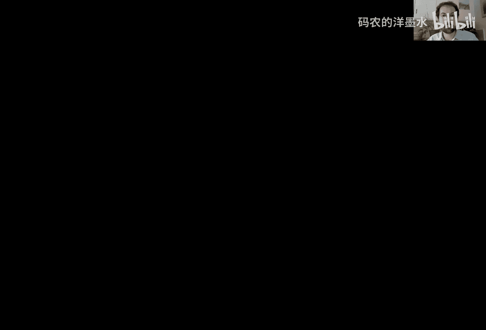
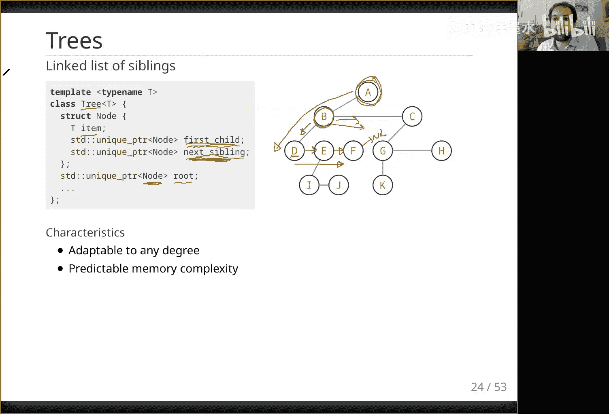

# 【全集】加州大学戴维斯分校 数据结构与算法编程 中英字幕 完整课件 p08 4-1 树 -BV1rJ2WBSE7P_p8-

Hi everybody， so today we're going to start a new topic。

About trees that's going to last us for about four lectures。

So so far we've talked about three different ADTs， lists， stacks and queuees。

And we have seen that those ADTs could be implemented by different data structures， such as arrays。

 single link list， doublely list。Today with trees， we're going to start talking about another kind of data structure。

Before we dive into the details about trees， first I would like for you to understand why they could be useful in the first place。

 so for that we're going to stop talking about searching data。

So here's a quick introduction to searching data， searching data as the name is suggests is very intuitive。

 the it is that you have a collection of items。That are usually described as a key and a value。

 and you want to search a specific item in that collection。

So an example of that is something called DNS lookup。Domain， name， search。

So just to make you understand here， when you browse the internet online using like Firefox or Chrome or whatever web browser。

 and you type in the address bar， say like ucdavievis。edu and you type enter。Thisucdavis。

edu has no meaning on the internet， it's not that that's really like sent out directly to UC Davisvis。

The name UC Davisvievis。edu is sent first to a very specific server， which is called the DNS server。

And that server has an entire listing of all of the domain names and the IP addresses that correspond to it。

And so what happens is that you would send UCda。edu to this dNS server， the DNS server would return。

 well， the computer that's behind this address is in fact IP address 23。 185。0。4。

 and that's what you would receive back。And so now Firefox or Chrome would actually go to this IP address now like send a network request to this IP address to us for the index。

html file。That is then displayed in your web browser。So anyway。Ponies。

We have this like searching data that's happening， the key here in that example with the DNS。

 the key being the domain name and the value that needs to be returned being the IP address。

That's just an example， overall in computer science and in programming searching data is just such a crucial operation。

 I don't think there' is like one piece of software that doesn't search data within a certain collection at any moment。

Um so it can be for like DNS reason， it can be for the file system。

 like finding a certain file on the disk based on the file name， it can be really like anything。

Related to searching， there are also some interesting operations such as determining the maximum value of a certain collection or the minimum value of a certain collection。

 so for example， like for the Deans on list， it can be very useful to get the maximum value to find the best student with the best GPA for example。

There are other operations such as， for example， floor。😊。

So here imagine you're looking for a certain key or you have a certain key。

 and you're trying to find the largest key that is smaller or equal to this search key。

Seal the ceiling function here is。The ceiling is kind of like the opposite of floor ceiling would mean that you have a certain key and you're trying to find the smallest key that is greater or equal to that key。

And for example， like a rank here， you have a certain key and you want to know what is its rank within the collection and so on。

 so you see like searching data is just not searching， it can be also other related operations。

The question though， is like， how do we make this searching and all of those operations as efficient as possible。

 now that you know the notion of algorithm analysis and you know that like。

As the collection tends to get bigger， we need to find algorithms that have a good complexity as a function of this collection size。

 otherwise we get performances that can be very， very bad。And。As kind of a sub question of that。

 what kind of data structures we can use to help。Improving the search。

So actually let's start with data structures and algorithm that we already know we've already talked about them。

 so let's start with the most obvious way of searching through a collection。

 the linear search so here you have a certain collection。That is not ordered in any particular order。

 you try to find a certain key within that collection。Linear search。

 which is also called sequential search， will check sequentially every item of the collection from the first one to the last one and look if this key exists。

In the collection， it is extremely simple to implement and it can actually be fairly okay in terms of performance。

If the collection is rather small。Which actually is something you have studied in the first programming homework。

In terms of data structure， so linear search can be implemented on different kinds of data structure。

 so for example， if we have like an unsted array then the search would be in O of if we have an unsortted linked list the search would be in O and actually even if we have a sorted linked list the search would still be in O of because we still。

Start from the very first node and we go one node by one node。

Now the other operations have different complexities so for example。

 like inserting a new item in a collection that is represented by an unsed array or an unsed linked list is o of one。

 we can just simply add to the end。Inserted insertting a new item in a solid linked list would be over because now you actually have to insert it at a very specific location and so that can be O。

The deletion。Is essentially like searching the item that you need to delete by its key and then removing it。

For linkedlist it's O of one， the removal operation we've talked about that。

 you might be a little surprised that it would be o of one for the array because we talked about like when we remove something from an array。

 there's this idea that we should shift everything that that's after this item like back one slot。

There's an interesting optimization here that can make us。Being all of one。 So imagine， well。

 imagine that's。Our collection and all of the items。Sorry for the drawing， it's really bad。

So all of those are the items and as you see， they are not sort。And imagine we call remove on key6。

So this one， we want to remove that guy。One solution。

 if we remove six here would be to move 52 over here。

 47 over there and so on and indeed if we do that。That would be a complexity of all and for the removal。

 Another solution， because the thing is not sorted anyway， so we don't care about the order。

If we were to remove six， what we could do is take 12 the very last one。And put 12。

Here and just free this。That's an o of one。Operation。That's this of one that I'm talking about。

 that's kind of neat optimization。And。And finally， just to like mention one of the related operations。

 not just the search operation， but finding the minimum and the maximum。

 so if the array or the link lists are un sorted， then it's an U of an operation you have to actually U not even worse case。

 like even best case， you have to go through the entire collection of items to find the maximum or the minimum。

 you have to go through all of them。UWith a solid link list。

 then finding the minimum and the maximum would be an o of one operation because you know that they are both at the extremity of the。

At the extreme ends of the list itself。So yeah， that's that's the idea idea。

So that's for linear search。Now。If we know that we have a collection and it's already sorted。

We can do minor research。So here we have a collection。

 we know it's in say like increasing order and we're looking for a certain key。

 we know we can jump directly from to the middle and kind of like discard half of the array or half of the remaining array at every iteration until we find the key that we are looking for。

So it's very good。Except that we need to have a sorted array and so either it requires that as items are being inserted in the array or removed from the array。

 the sorting needs to be maintained。Or everything is being like inserted in whatever order。

 but before we can search for keys， we need to solve it。

And we'll see about that later this quarter like all of the different sorting algorithm， but at best。

 the best kind of sorting algorithm is at least analog log n in terms of complexity。And。

And so in terms of data structures and complexity， we can do binary research on a solid array。

 that's really the only kind of data structure for which it works。

And the search would be log event because we can discard half of the remaining array every operation until we find what we're looking for。

However。Inserion is in O event because every time you insert a new item。

 you need to find the right location。Deletion is in O of n because you need to shift everything when you remove an item。

 however finding the the mean and the max is o of one because again they're going to be on both on either ends。

Of the correction。So quickly， let's make a summary of all of that， that's what we have。

We have four types of data structures。And for each operation search， insert， delete。

 and find mean Max， we have very different behaviors。So search。

Only the binary research using a solid array is super efficient in log then。

 all of the other ones are linear。So not that efficient。On the other hand。😊。

Only the unsed array and unsed linked list have really good insertion time over one， whereas。

When things are solid like solid linkedist and solid array， not a good linear time。Here the delete。

Is mostly like O of N really because like the search time would be in O of N anywhere here。

 even if the delete itself is constant time and here it's O of。And finally。

 finding the mean Max is not so good。When the collection is not solid and constant time when the collection is solid。

What we can identify here is that if I circle the best kind of complexity for each operation。

We see that like。Well， there's not one line。That is the best at everything。

They're all like very good at one operation or one type of operation。

 and then they kind of suck at other kinds of operation。So the thing is like ideally。

 we would want to find。Data structure that offers a complexity that is better or good for all of the operations。

 right？And ideally， we'd like to find a data structure for everything search， insert， delete。

Finding the minimum and the maximum and all of that is all in log event。And as a matter of fact。

 this data structure exists。It's called a binary Search treee。

 we're going to talk about that not today but in a future lecture。And that data structure。

 binary search tree offerss all of the operations。In log of it， which is really， really good。

But we'll get to that。Before we get to the binary search tree。

 we're going to talk a little bit more about just trees in general， like what are they。

 how do we describe them， what is the terminology so that we really understand them conceptually first。

 and then we'll talk about binary trees and binary search trees。So let's start with that。

So what are trees？Well， trees are nodes that are connected by  edges， right？

So we have a root node at the very top， and then we have edges。

That kind of like connect these root nodes to other nodes and so on。The big constraints that。

Deines what a tree is， is that one node。Can only be attached to another node。

So if B is attached to D here， D cannot be attached again to say like a。

And we'll see in future lectures that like that would make it a graph and not a tree。In a tree。

 it only goes in one direction。And as we'll see as well。

 trees are very efficient data structures that can be used to implement many ADTs such as lists such as maps。

 such as sets， such as priority queuees and so on。So let's do some terminology now。

Let's start with the root I just I already mentioned that so the root is the node that is at the top of the tree。

 you can see that as like Adam and Eve like those are like that's the first like the root has no nothing above it。

嗯。Next， we have the notion of edges， so edges， we said there are links between two nodes。

One interesting。嗯。Characteristic is that if a tree has n nodes。

 then it necessarily has n minus one edges that's just the way that things are connected。Next。

 we have the notion of parent。So parents。Is when it's the node that is the direct ancestor of another node。

So， here E。Is the parent of I。NJ。B is the parent of D， E， N， F， and so on。 however， B。

Is not the parent of J， right？Parent is only like one link away， like one edge away。

It's pretty much like the same in a family tree， right？Inversely。

 a child is a node that has a parent， so here D is the child of B。E is the child。Of the and so on。对。

Yeah。In a tree， overall， every node is the child of another node。Except for the root。

 which is only a parent， cannot be a child， otherwise， it wouldn't be the root。As you can see too。

 notes can be both parents and child here B is the child of A， but is also the parent of D， E and F。

However， I here is only a child and not the parent of anyone。Okay， let's go on。

Now we have the notion of descendant and ancestor， so here it's broader than the notion of parent and child。

呃。So earlier I told you that B was not the parent of J because B was could only be the parent of E。

 however B is the ancestor of J， the same as a is the ancestor of J。Inversely。

 J is a descendant of B and a descendant of a。 so here as long as you can find a link between two nodes there's necessarily。

A descendant ancestor relationship between them and their only parent and child if this connection is only one edge away so here think in terms of essentially think in terms of grandparents and grandchildren。

Okay。Next， because so as you can see here， it's a lot of symmetry or synonyms with family trees。

 right like parents。Children and ancestors and descendants so the whole vocabulary is very intuitive。

So here we have the notion of siblings， siblings are the nodes that are descending from the same parents。

 so here B and C， they are both directly descending from parent A， they are siblings。D E and F。

 their siblings， G N H， their siblings and so on。Okay。Next， we have the notion of leaf node。

So leaf node， they the node that are essentially kind of like at the outside frontier， right。

 they're all the node who have no children。in the so for this class。

 I'll probably like always refer them as leaf node。

 but in the literature online you might see them called as external node。

 outer node or terminal nodes， they are always like a ton of different words to designate the same thing。

嗯。One thing that's important to understand here。Is the notion of Neil。

 so let me explain a little bit here。It's especially popular in books or marginalarily like in the literature。

Sometimes the absence of a child or of children will actually be explicitly represented。

So here we know that D is a lymph node， doesn't have any children。

You might see that we would say that these is connected to Ne nodes。

 which means that that it's the absence of nodes I don't know if you've ever seen this description。

 but I've seen it in books for example， like link list。Link list would be described by。Having ahead。

Pointing onto a node onto a node。 And so this node would be composed of an item and a next pointer。

This next pointer would point onto to the next node and so on。And to signify the last node。

Not being connected to anyone in some books， you might see that the next pointer is pointing onto this knee。

Sort of value and that would signify like， oh， okay that's。

Like that's the end technically in terms of programming， it would mean that this。

Next pointer has the value null that that's pretty much what it means。

 but at least be familiar with this idea of a Ne。Not。The reason that I'm bringing this up。

Is that in some algorithms that we're going to study later around trees。

This notion of Ne nodes will become apparent and so it's kind of good to have this understanding。

Okay， let's move on。Since we talked about leaves， we're going to talk about the opposite notion which are internal nodes。

 so internal nodes are all of the nodes which are not leaves because they have。

At least one or two or more children。 So here like E BAC C。

 G are all internal nodes because they all have children then they are not leaves。Okay， next。

Next we have the notion of degree so the degree of a node is the number of children that it has。

 so here a is of degree2， B is of degree3， D doesn't have any children， degree zero and so on。

And actually， like as you can understand， since a lymph node doesn't have any children by definition。

Its degree would always be zero。Overall， when we look at an entire tree and we ask the question。

 what is the degree of this tree？It would be the highest degree of any of its nodes。

So here if we ask the question， what is the degree of these three。

 it would be degree of three because B here as a maximum of three nodes and so that would be the maximum。

Value。嗯。Just as kind of an FYI when the tree has。A high， high degree， like has many children。

 We often said that it has， has a high fan out。And as we'll see in a few lectures。

 we're going to talk about a data structure called B trees in BTes every node can have up to like a couple of hundreds of children。

 and so that would be a data structure that has a very very high fan out。Anyway。Okay， let's move on。

Next， we have the notion of level。And。Level as you can see it's it's kind of related in some ways to like siblings and cousins like the idea of generations so the roots is always at level one and then for every kind of level of edges further it adds a certain level so here like B and C are level two D E and F are level3 and you can see like they're all siblings and they're all kind of like。

Cousins like from different family in the family tree。Okay。Next we have the notion of path。

 so the path is the sequence of nodes and edges that are connecting two nodes， so for example。

 here the path between A and E is the path that is connecting a to B and then B to E。

Or the path between C and K is the path between C G。N Kate。A path has a certain length。

And this length is expressed in as the number of edges that composes that path。

So here the path between a and E is of length two because we have one edge， two edges。

If we're looking at the path between a and say， J here， that would be a path of length three。Okay。

Next， we have the notion of depth。So that is the。Lth of the path between any kind of any node。

 so the depth of a node is the length of the path between that node and the root node。

So here the depth。Of node D is the length of the path between D。N a， the root note。

 So here depth would be 2。The depths of I don't know。

 node J would be the length of the path between A and J， which is3。The depth of the root nodes。

Is zero because we don't even have to go across one edge to connect the root to itself。

When we ask about the depth of an entire tree， then it's essentially the higher depth of any node in that tree。

Inversely， we have the notion of height， so height is kind of the opposite notion of depth because here we're looking at from a certain leaves。

Like， how far away are we from the root。嗯。So's actually， like。A leaf itself has a height of zero。

E here would have a height of one because it's one step away from a leaf and then B would have a height of two。

Ansl。And。The height of a tree is equal to the depth of a tree because it's pretty much like the longest path between a root and a leaf。

Yes。And finally， that's the last word of the thisteinology that I wanted to push your away is the notion of sub。

So a subre is any tree that's within a tree， right？If we look at this tree here。

 it is rooted by node a。But we can also look at this subre。Which is now rootd by node B。

And this sub tree has all of the same properties as the other tree。

 like meaning that it also has well a root node B， it also has a certain height。

 a certain depth and so on， we can also kind of isolate another sub tree here。

That is rooted by node E， and that would this sub would also have a certain height。

 a certain depth and so on。And we can even consider a node alone。

As a sub tree with also the same property as a regular tree in the sense that here we have a tree that is rooted by only one node J。

 and we could even consider it that it has a height of zero and a depth of zero。

 but it is a tree nonetheless。Okay， let's move on。So now we've talked about all of the words that you need to know around trees。

 so make sure that you understand those words they are really that complicated like most of them are very similar to just。

Family trees， but you're expected to know all of them。

 especially because those words are going to be used later when we talk about algorithms around trees and so on。

So today I wanted to also mention how trees can be implemented。So the first。

 maybe most intuitive implementation。Is to represent children as an arrayray。

So here the idea is that like if you wanted to make a class tree， right。

 that contains like whatever item of type tea。Then you would start by having a root。

 which is a pointer on a node， so very much like the head would be the pointer on the first node in a linked list。

And that would help us have the representation of A essentially of the root node。

And then for each node。😮，We'd have an item， so again， like very similar to just a regular link list。

But we would have。An array of children。And those children would be nu as well。

And because here we can have between zero。And。😊，And children。

The easiest is just to represent the list of children as an array by you say， like using a vector。嗯。

So in that case， like A would have a vector of children that contains B and C。

B would be a node that has a vector of children that contains D， E and F and so on。

Now the issue is that like。By using vectors， we are potentially wasting a lot of space。

You have to remember that like vectors， they're implemented on top of dynamic arrays。

And even if you create a vector that is empty that doesn't contain anything。

 you're still using some space because you're still allocating at least a minimum size for the internal rate。

That can then be expended or shrink。But still you're still like allocating an initial size of the and so for example。

 like for all of the leaves like DIJF and so on， it means that all of them would have a vector for potential children which are not used at all and that uses a bunch of memory if or nothing。

There's another type of implementation that's interesting and that doesn't waste as much space。

And that uses a link list。Here it's quite interesting， it's called a linked list of siblings。

So the idea is， again， like you try to define a class tree that will have a root。

The root being a certain nu， right， so same same idea。In a node， you have an item and here。

 instead of having an array of children， it's kind of interesting。

You have a linked list towards the first child。And a link list for the next sibling。

And so essentially， it means that like you can have。From the root。

 essentially a link list that links。All of the different like kind of levels in one direction and for every level you have a linked list that links。

All of the siblings， right？So here typically， like。If we look at node B。

B would be connected to its sibling C via this。Poiner。And B would be connected to its first child， D。

 via this pointer。And inversely， like when you get to D。

 D would be connected to E via the next sibling pointer。

E would be connected to F via its own next sibling pointer and so on。

 and F would be connected say to Neil because its next sibling is not connected to anything。

What's interesting with this implementation is that like now your tree can have any degree because it's just a matter of like adding more items to those link lists。

And the memory complexity would。Be exactly what you need。

 you're not creating any space for something that doesn't exist。Okay。

 so that concludes our first lecture about trees and in the next lecture we're going to stop talking about binary trees。

Okay。