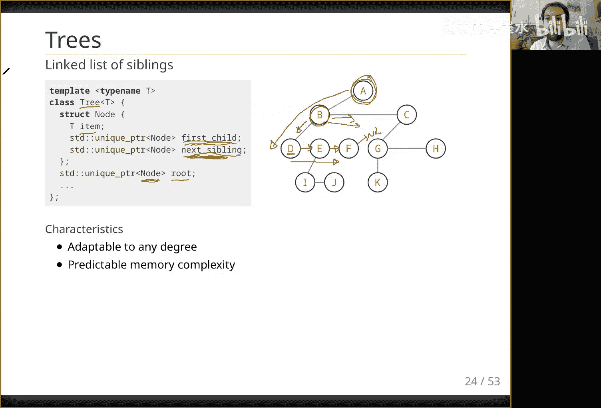

# 数据结构与算法编程：08：树

在本节课中，我们将要学习一种新的数据结构——树。我们将了解树的基本概念、术语、用途以及两种常见的实现方式。树是理解后续更复杂数据结构（如二叉搜索树）的基础。

## 概述：为什么需要树？

在深入探讨树的细节之前，我们首先需要理解为什么树这种数据结构是有用的。为此，我们需要讨论数据搜索。

数据搜索，顾名思义，非常直观。你有一个项目的集合，每个项目通常由一个键和一个值来描述，你希望在该集合中搜索特定的项目。

一个例子是DNS查询。当你在浏览器地址栏输入类似 `ucdavis.edu` 的域名并按下回车时，这个域名本身在互联网上没有直接意义。它首先被发送到一个特定的服务器，即DNS服务器。该服务器拥有所有域名及其对应IP地址的完整列表。DNS服务器会返回该域名对应的IP地址（例如 `23.185.0.4`），然后你的浏览器才会向这个IP地址发送网络请求以获取网页。

在这个例子中，键是域名，需要返回的值是IP地址。在计算机科学和编程中，数据搜索是一项至关重要的操作。此外，还有一些相关的操作，例如：
*   **确定最大值/最小值**：例如，在成绩列表中找出GPA最高的学生。
*   **Floor函数**：给定一个键，寻找集合中**小于或等于**该键的**最大**键。
*   **Ceiling函数**：给定一个键，寻找集合中**大于或等于**该键的**最小**键。
*   **排名**：给定一个键，确定它在集合中的排名。

问题在于，我们如何使搜索和这些相关操作尽可能高效？随着集合规模增大，我们需要找到复杂度良好的算法。一个子问题是：我们可以使用什么样的数据结构来帮助改进搜索效率？

## 回顾已知的数据结构与算法

上一节我们介绍了数据搜索的重要性，本节中我们来看看我们已经学过的数据结构和算法如何实现搜索。

我们从最明显的搜索方式开始：线性搜索。以下是线性搜索在不同数据结构上的表现：

*   **线性搜索（顺序搜索）**：在一个无序集合中，从第一个项目开始，依次检查每个项目，直到找到目标键。
    *   **数据结构**：无序数组、无序链表、有序链表。
    *   **搜索复杂度**：`O(n)`。
    *   **插入复杂度**：无序数组/链表为 `O(1)`；有序链表为 `O(n)`。
    *   **删除复杂度**：对于链表，找到节点后移除为 `O(1)`；对于无序数组，可以通过将最后一个元素移到被删除位置来实现 `O(1)` 的删除。
    *   **查找最大/最小值复杂度**：无序集合为 `O(n)`；有序链表为 `O(1)`。

如果我们知道集合已经排序，我们可以使用二分搜索。以下是二分搜索的特点：

*   **二分搜索**：在有序集合中，每次比较中间元素，根据结果丢弃一半的剩余数组，直到找到目标。
    *   **数据结构**：仅适用于有序数组。
    *   **搜索复杂度**：`O(log n)`。
    *   **插入复杂度**：`O(n)`（需要找到正确位置并可能移动元素）。
    *   **删除复杂度**：`O(n)`（需要移动元素）。
    *   **查找最大/最小值复杂度**：`O(1)`。

## 性能总结与理想目标

上一节我们回顾了线性和二分搜索，现在我们来总结一下它们的性能，并看看能否找到更优的方案。

以下是四种数据结构在不同操作下的复杂度总结：

| 操作 | 无序数组 | 无序链表 | 有序链表 | 有序数组 |
| :--- | :--- | :--- | :--- | :--- |
| **搜索** | `O(n)` | `O(n)` | `O(n)` | **`O(log n)`** |
| **插入** | **`O(1)`** | **`O(1)`** | `O(n)` | `O(n)` |
| **删除** | `O(n)` | `O(n)` | `O(n)` | `O(n)` |
| **查找最大/最小值** | `O(n)` | `O(n)` | **`O(1)`** | **`O(1)`** |

我们可以看到，没有一种数据结构在所有操作上都是最优的。它们各自在某些操作上表现良好，而在其他操作上则效率较低。

理想情况下，我们希望找到一种数据结构，使得搜索、插入、删除、查找最大/最小值等所有操作都能在 `O(log n)` 的复杂度内完成。事实上，这种数据结构是存在的，它被称为**二叉搜索树**。我们将在未来的课程中详细讨论它。但在学习二叉搜索树之前，我们需要先理解树的一般概念、术语和基本属性。

## 树的基本概念与术语

上一节我们指出了现有数据结构的局限性，并引出了树的概念。本节中，我们将正式学习树是什么以及描述它的专业术语。

树是由**节点**通过**边**连接而成的数据结构。它有一个位于顶部的**根节点**，边将根节点连接到其他节点，以此类推。定义树的一个关键约束是：一个节点只能被连接到另一个节点，并且连接是单向的（不能形成环）。树是一种高效的数据结构，可用于实现列表、映射、集合、优先队列等多种抽象数据类型。

以下是描述树结构所需的核心术语：

*   **根**：位于树顶部的节点，没有父节点。
*   **边**：连接两个节点的链接。一个有 `n` 个节点的树，必然有 `n-1` 条边。
*   **父节点**：一个节点的直接祖先（通过一条边相连）。例如，E 是 I 和 J 的父节点。
*   **子节点**：拥有父节点的节点。例如，D 是 B 的子节点。每个节点（除了根）都是另一个节点的子节点。
*   **祖先与后代**：比父/子关系更广泛。如果两个节点之间存在一条路径，那么上方的节点是祖先，下方的节点是后代。例如，B 是 J 的祖先，J 是 B 的后代。
*   **兄弟节点**：拥有相同父节点的节点。例如，B 和 C 是兄弟，D、E 和 F 是兄弟。
*   **叶节点（外部节点）**：没有子节点的节点，位于树的“外围”。
*   **空节点**：在一些文献中，为了明确表示没有子节点，可能会用特殊的“空”节点来表示。在编程中，这通常对应着 `null` 或 `None` 指针。
*   **内部节点**：至少有一个子节点的节点（即非叶节点）。
*   **节点的度**：一个节点拥有的子节点数量。例如，节点 A 的度为 2，节点 B 的度为 3。叶节点的度总是 0。
*   **树的度**：树中所有节点的度的最大值。
*   **层**：根节点位于第 1 层，其子节点位于第 2 层，以此类推。同一层的节点可以看作是“同辈”。
*   **路径**：连接两个节点的节点和边的序列。例如，A 到 E 的路径是 A -> B -> E。
*   **路径长度**：路径上边的数量。例如，A 到 E 的路径长度为 2。
*   **节点的深度**：从根节点到该节点的路径长度。根的深度为 0。
*   **树的高度/深度**：从根节点到最远叶节点的路径长度。一个单独节点的树高度为 0。
*   **子树**：树中的任意节点及其所有后代构成一棵子树，它本身也具有树的所有性质。

理解这些术语至关重要，因为它们将在后续讨论树的算法时被频繁使用。

## 树的实现方式

上一节我们学习了树的术语，本节中我们来看看如何在程序中实现树结构。

第一种可能最直观的实现方式是**使用数组表示子节点**。

在这种实现中，我们定义一个 `Tree` 类，它包含一个指向根节点的指针（类似于链表的头指针）。每个 `Node` 包含数据项和一个用于存储其所有子节点的数组（例如，C++中的 `vector<Node*>`）。这样，节点 A 的子节点数组包含 B 和 C，节点 B 的子节点数组包含 D、E 和 F。

然而，这种方法的缺点是可能浪费大量空间。即使一个叶节点没有子节点，它仍然分配了一个（可能初始为空但已分配内存的）数组来存储子节点，这对于有许多叶节点的大树来说是一种内存开销。

另一种更节省空间的实现方式是使用**链表**，具体称为**孩子兄弟表示法**。

在这种实现中，每个 `Node` 包含：
1.  数据项。
2.  一个指向其**第一个子节点**的指针。
3.  一个指向其**下一个兄弟节点**的指针。

通过这种方式，整个树结构被组织成两层链表：纵向是父子关系（通过“第一个子节点”指针），横向是兄弟关系（通过“下一个兄弟节点”指针）。例如，根节点 A 的“第一个子节点”指向 B，B 的“下一个兄弟”指向 C。B 的“第一个子节点”指向 D，D 的“下一个兄弟”指向 E，E 的“下一个兄弟”指向 F，以此类推。

这种表示的优点是内存使用非常高效，只为实际存在的节点关系分配指针，并且可以轻松处理任意度的树。

## 总结

本节课中，我们一起学习了树这种重要的数据结构。我们从数据搜索的需求出发，分析了现有线性结构的局限性，从而引出了对更高效数据结构——树的探索。我们详细介绍了树的基本组成部分和各种术语（如根、节点、边、父节点、子节点、深度、高度等），这些是理解更复杂树形结构的基础。最后，我们探讨了树的两种实现方式：使用子节点数组和孩子兄弟链表表示法，并分析了它们各自的优缺点。在接下来的课程中，我们将深入探讨一种特殊的树——二叉树。