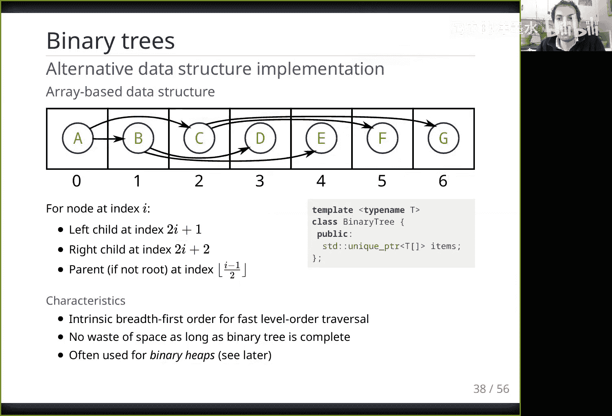

# 【全集】加州大学戴维斯分校 数据结构与算法编程 中英字幕 完整课件 p09 4-2 树 -BV1rJ2WBSE7P_p9-

Hi， everybody。 So today we're going to continue our journey on trees。So quick recap from last time。

 so last time we started talking about the issue around searching， you know like searching data。

 searching for an item in a collection。And we saw that through using the data structures that we had studied so far。

 so arrays and linked list， we could have very varying。Complexities depending on the data structure。

 all the way from constant time for certain operation to linear time for other operation。

 and the best searching operation we had was a log of end。And so the question was。

 can we find a data structure which would have better complexity for all operations。

 not only just one， and it turns out that there is one that we're going to get to。

Slowly but surely binary search tree， which offers log of n， which is really。

 really good running time complexity for all operations。

And so that's why we started talking about the tree structure and we studied the terminology around trees。

 the fact that it's made of nodes and edges connecting nodes。

 there is only one root node there's the concept of parent and child and so on so let's continue on that。

And today we're going to talk about very specific kind of tree called a binary tree。

So binary tree is just a tree like we studied in the last lecture， except that it has one constraint。

In the sense that one node can only now have only two children。

And we often call them like a left children， a left child and a right child。

 that's what makes it a binary true。If a tree has a node with more than two children per node。

 then it's not a binary tree it's as simple as that。So now there are different types of binary trees。

 we have what we call full binary trees， so in a full binary tree and the important word here is full。

Every node as either zero children， so for example。

 like this one doesn't have any children or two children， so either zero or two。

 but essentially like not one what that's what makes it a full binary tree。

Another one is called a complete binary。So in a complete binary。

 it means that every level is complete is full。Apart from the last level， right， or actually。

 I guess this one。So here we have the root， the root has two children。

 those two children also have two children each， and it's only at the very last level then this one has two children and this one only has one。

And one additional constraint is that for the last level， which is not complete。

All of the nodes are packed to the left。So quick question here， if I were to insert。A new node。

 where should I insert it in order for this tree to remain complete？So look at the picture。

 think about it。It should be right there。If I want to insert a new node industry and keep it complete。

 it should be right there and if I want to insert another one。

 then I'll become the left child of this node。And if I want to insert another one。

 then it'll be the right child。And then the left child。

 and you see like I try to keep new node like tied to the left as much as possible here。

TheThis last level would all be complete if I wanted to add another one again。

 I would start a new level and also completely back to the left and so on。In that direction。Okay。

 so that's complete。嗯。And last definition quickly。We have the notion of a perfect binary tree。

So here with a perfect binary， it means that every level is completely complete。

So all the internal nodes have exactly two children。And the very last level is full。

 like no nodes are missing。It happens a lot in computer science， but sometimes。

Terms are not well defined in some ways， so essentially here like the literature might。

Use words in different ways sometimes so here we call a perfect binary something something that is like that like all of the internal nodes of two children and the last level is completely full with leaf nodes。

And complete binary trees when the last level is not completely full and everything is packed to the left in the literature。

 you might hear that a perfect binary tree is actually called complete。And that kind。

 what we call complete in literature might be called like near complete。Or almost complete。

 it kind of depends。Once again， not a big deal for this class。

 that's the terminology that we're going to use， just don't be surprised that like you might hear a competing definition for the same terms in the literature or sometimes that computer science。

 we don't all agree on the same terms happens。Okay， let's move on。

So now let's talk about one of the most fundamental operations that we're going to do on a trip。

Which is the traversal， how do I， if I have a tree made of different nodes， how do I traverse them。

 right？And it's so important， I mean， think of like if you have a list。

If you have a list as we've studied so far， you'd have like essentially a bunch of nodes。

Whether it's a linked list or even an array， you have a bunch of cells。

And essentially there this sense of like the first cell is index zero up to n。

 and it's pretty intuitive that if you want to go through all of the items of a list of a sequence。

 then you start from zero and you move towards n and you explore the items one after the other in a sequence。

 it's fairly intuitive， right？And you do that when you want to print the collection of item。

 when you want to search for a certain value， when you want to update all of the items in a certain way on。

The thing is like when you have a tree now。How do you traverse it？There's no real like beginning。

 there's no real end like if you start from the root like do you go left first， right first。

 if you start from the leftmost leaf like how like what in which direction do you go I mean and so it code is a real issue like how do we traverse a tree because like there's no natural way that we would traverse a tree in the same way that there is a natural way we would traverse a least or a sequence container。

So they are actually like。Different ways that we can traverse a tree and there are two main types of traversal。

The first type we called depth first order。Here the ideas that like in depth first order。

 we're going to start from the root and we're going to kind of like explore the tree。

By going down toward the leaves。Right。And the other type is called breadth first order。

And here it's more like we're also going to start from the root。

 but we're going to go level after level， so essentially like we're going to start from the top and we are going to slowly explore everything down to the bottom that's going to be the breath first part。

嗯。😊，You'll see that those terms， they apply to trees and they also apply to graphs when we study graphs towards the like later this quarter。

嗯。So let's start with the first kind， the depth first order。

 they are in fact different like depth first order is a category of traversals and within that category there are different algorithms。

 so they are very all very similar but they are different。So let's see。So for the first step order。

 the concept is always going to be the same， we have three operations to do and depending on the order of the operation。

 that's going to yield different kinds of trarousil。

But essentially the three operations is that when we're exploring a certain node and we're going to actually like explore this node。

 that's one operation。We're going to have to recur on this nodes left sub to like continue the exploration。

And same on the right sub， so we're going to explore to the left， explore to the right。

And so that forms three operation that we can call n for processing the node itself。

 L for recursing on the left sub and R to recursed on the right sub。

And depending on those three operations。AndR， that's going to give us different ways of going through a tree。

And as you can see， it's all a recursive algorithm， so let's start。With the first one。

 there are three of them。Let's start with the first one in the first one we're actually going to apply those three operations in this exact same sequence。

 NLR。And it's actually called preor when we do that。

What it means is that we would start from the root。And then we process the route。

Imagine that by processing we would mean printing， we just like want to print all of the nodes in a tree so we get to a node and we print what this node contains and imagining like the node contains a letter or something like that so we print a letter。

So we start from the root and we print a。Then we follow the algorithm， we recur on the left sub。

 so from a， we go left。And that brings us to node B。At node B， we process the node。

 which means we print it。And again， we recur on the left。So that's going to bring us to D。

 which we process。And D we recur on the left that brings us to H， which we process。Age。

 now we are at age。Edge tries to recur on its left substrate except that doesn't have a left substrate。

So next， okay， we're going to recur on the right s doesn't have a right s。So now we go back to D。D。

 we had done。Processing the node， we had done recursing on the left。Now we do recursive on the right。

So from D， we recur on the right that gets us to I and so we process I。I is the same case as H。

 doesn't have a left sub， doesn't have a right sub， so we go back to D。D has been processed。

 has been recursed on both subries left and right， so we go back to B。

V has been processed with recur on the left sub， now we requestcur on the right sub and that gets us to eat。

E doesn't have a left， doesn't have a right sub going back to B， B is all done， going back to A。

 and now from A we can start exploring on the right。And so on。So here with the pre order。

 you see that like we start from the root and essentially like we go as deep as possible。

On the left side。And once we've reached the end on the left side。

 we start going back up different levels and then we start exploring like the left side。En on。

The next traveral algorithm is kind of the exact opposite。 It's called。Post order。

 So you see like the first， the first one is called pre order。 This one is called post order。

And the operations are kind of。Inverted。So in this one， we're going to start by Op L。

 we're going to recur on the left sub， then we're going to do operation R。

 we're going to recur on the right sub。And at the very， very last。

 we're going to actually process the node， right？So here when we start from A。

The root we actually don't process a first operation we do is directly oh ri on the left。

Which gets us to B， we get to B， we don't process B， we recur directly on the left as well。

We get to D， don't process it， we recurs to the left， and that gets us to H。We get this to H。

We recurs on the left， there's nothing， Okay， recurs on the right， there's nothing。Okay。

 now it's time to process H， so let's say we print it。And we go back to D。

Now D we had explored the left， now we explore the right that gets us to I。I doesn't have a left。

 doesn't have a right， so we can process it。Going back to D now D has been like recursed in both directions。

 so it's time to actually explore it。And we can do that and so on。The last one。

 the last kind of traversal is called in order。So this one goes like that。

 we're going to explore the left。Then we're going to process the node。

 and then we're going to explore the right So again， we start from the root。X pro the left。

Get to B x from the left， get to D。Ex product。Left， get to H。Explore the left， nothing。

Process the node H。 that's what we print。Process the right， nothing。Go back to the。D。

 we just explore the left。 Now we can process D。We print it now we explore the right， we get to I。

I we explore the left， nothing。Process the node， I。Explport the right， nothing， we get back to D。

 D is all good， go back to B。B now we've explored the left substrate entirely so we can process B。

After that， we can explore the right， gets us to E。Explore the right， the left， nothing。Process E。

Explore the right nothing， go back to B， go back to a。 now we can process a。

And start exploring the right sector and so on。The in order is interesting because if you pay attention to how the tree is being like processed。

 like how the nodes are being processed。And you see that essentially it goes exactly。

From left to right。Imagine you had some sort of like vertical line here。That was too like。

Go exactly like vertically， like exactly like that。

And you would see that like the line would reach H， then it would reach D， then it would reach I。

 then it would reach B， then it would reach。E， then it would reach A。And so on。

 it keeps moving vertically and that's exactly。How notess。Are being displayed， right？呃。

Good way to remember the difference between pre other， past order， in other， and so on。嗯。

Is to think of a sailboat。Navigating around the tree。

 so let me go back a few slides here to this picture this way like this one is we can draw on it。

So imagine that those nodes are actually like islands， right。

 there are a bunch of islands in the ocean。And you have a sailbo。

 so in the way that the sailboat will like go through those islands。

 we're always going to start at the root and we're always going to start from the left side of the route。

Okay。Then what you can do to remember is that you're going to make your sailbo travel around those islands。

 starting from the left of the root node。And you're going to follow the age。

 and you're going to go around。The node and the edges。And then you go around。😔，And essentially。

 you kind of like。foow。😔，The path here。That's your cellbo。Going。嚟。

Going all around all of the islands。And back to the root。On the right side。

 So always start from the left side and arrive on the right side。 And in the meantime， you go around。

All of the edges， all of the nodes and so on。And so now the trick is that。

When you do a pre order traversal。It means that the cellbo will kind of stop at the island and visit the island as soon as it reaches the island。

On the west side。So here it's going to stop on this island。

On the the left side here it's going to stop right away at this island， as soon as it reaches it。

 same here， as soon as it reaches D， as soon as it reaches H， then as soon as it reaches I，And so on。

 And so here you have like A， B。The。H， I，e。 and so on。 And that's the pre。Or traveral。Now。嗯。关系。

If the sailboats。Stops at the island when it reaches the south side of the island。

That's going to give us the in order。So here the Stboat starts from here and goes and you see like it sails。

 but only like it follows the west side of the island。

 so it wouldn't stop it just would like continue its way。And it's only when it touches。

The south side of an island that it stops at this island。So like on the bottom side， right？Here。

 here， here and here。Now if you follow， so the cellbo would start here like sell and not stop and the first node that it the first island that it would stop at is like this age。

Then it would continue and it would reach the south side of D。And then the south side of eye。

And then continue， touch the south side of B。Then of E， then of a and so on。 that's the in。Oder。And。

 finally。嗯。The post order。Is when the boat would explore an island when it reaches。で east？

Side of the island。 So that side。Right。The same like the sailbo we start here would sail around the island。

 not stop。And only stop when it touches the east side of the island， so here it would stop on H。

Then you'd gone on。It would stop on I here on the east side。Then continue。

 stop here on the east side of D。Then， continue。Then here， stop on the E side of E。Yes。Then continue。

 stop on the E side of B。Os。And so on。That gives us the post。Order。Ter so。

So that's a good trick to kind of remember if you I mean if I show you a tree for example。

 at the exam and I tell you like hey， give me the inner traversal of this tree you just do this you like draw this little sailboat that goes around all of the islands starting from the root and back to the root and then the only thing you have to remember is that like。

If I'm asking you for the in order， that's when the sailboat touches the south side of an island。

 if I ask you for the preorder， then it means that it's when the sailboat is touching the west side of the island and the post order is the east side of the island and so on。

Okay。Let's continue。So yeah， that's that's exactly what you say and you see here it corresponds exactly like pre order west side in other south side。

Post order east side， right。And so that's for the depth first order。

 like the idea that we start from the root and we try to explore as like deep as possible。

The other type of traversal is called breadth first order。And here it's also a type of traveral。

 it's also a category， except that in this category， there's actually only one algorithm。

 which is called level order。And so this one is pretty intuitive。

 it means that like we would start from level one， the root level。

 and then we would traverse all levels one after the other。

 so we would traverse dark level which contains a， then we traverse this level which contains B and C。

 then this one which contains D， E， F， G and so on。

The fact that it gives us here in this very example that it gives us something that is in alphabetical order is totally random。

 it's just a coincidence。I just want to insist on the fact that there is no correct traveral order of a tree。

 there are different traverss that we use for different kind of usages。

 there is not one that is deemed the most correct right and the fact that here it turns out that this traverso gets us a tree that is traverset in alphabetical order doesn't mean anything okay。

嗯m。O。Yeah。Now let's start talking about implementation a little bit and we'll finish on that。So。

If I want to implement a binary tree， how do I do it in C++ in terms of classes。

 it's actually pretty simple and it looks a lot like a linked list except that instead of having only one next pointer。

Every node will have a left pointer for the left subre and a right pointer for the right subre and so it looks pretty much like that。

So imagine I have a class here for a binary tree。I would have a root， which is a pointer onto a node。

And then a node would contain an item of a certain type， and in order to make it generic。

 I can make this type just a parameter like a template parameter。

 exactly like we did for the list ADT。And then I would have a right pointer。

 left pointer and a right pointer onto other nodes， and that would allow me to from the root。

Have a trade that has like as many levels as I want。

And so yeah that that's what this picture represents so here we have a root pointer。

Which points onto a node， and then this node has an item。

And this item has two pointers of its own to a left sub and a right sub。

And then we pretty much have like a recursion of that data type of nodes that gives us like as many nodes as we want exactly like a link that can get as big as necessary by just adding more nodes to the end。

What's interesting here？So you see that in terms of like C plus plus 11 and memory management。

 so the roots。iss declared as a unique pointer， which makes sense right like if this binary tree object disappears and the root pointer is destroyed。

 then the root node should be destroyed as well so there is kind of an ownership relationship between the root pointer and the first node。

And the same argument can be made。For the left sub and the right sub。If if I have a note here。

 then this note is the owner of。The left node and the owner of the right node。

 right in the sense that this left node cannot exist。Without the pen。

And this right note cannot exist without a parent， so there is an ownership。If this node。

Is being deleted， then that node should be deleted as well and as well as this one。And so on。

And so the idea of using unique corners here and unique corner there is that whenever my root disappears because the object would be removed or so on。

 it would trigger the removal of all of the nodes inside of a tree right exactly in the same way that like we talked about for the linked list and so on except that here it's a tree instead of being a list。

嗯。So ideally。So I have a class here binary tree class ideally I would want to have some method you know like construct or destructure method to insert new nodes or delete nodes and so on and traverse different nodes but before we get there and we'll get there in like a future slides but for now like let's just have this data structure without any nodes and see if we can already do something with it and it turns out that we can so only based on that description how can I build a tree like that。

 how can I build this tree composed of different nodes and link together in that specific way only using that definition。

嗯。So essentially we're going to statically build this tree by creating the different nodes like H，I。

J and so on， and by connecting them to one another in a static way without calling like any methods or whatever。

It's probably not something that you ever want to do。

 but I think I thought it was kind of an interesting exercise to really。

 I think it helps understanding this implementation。So let me show you the code here。

That would be the I。So very quickly， like let me talk about the first line here。This using line。

 that's a new construct that was introduced with C++ 11。

You probably heard of type depths in C or C+ plus， you know， like you would write， I don't know。

 type depth。My type。So here you're creating a new type that you call my type and you would say like oh my type is in fact the same as like I don't know int something like that right and so now my type would be an alias to int。

The thing is like TDe is a pretty old construct it comes all the way from C back in the 70s and TDe doesn't handle templates very well for C++。

So C+ Pro 11 introduced this new using keyword and a way of creating a smallerer type desk。

And so here we can say， okay， we're going to create a new type。

we're going to create a new alias of a type called say like node here and node will in fact be equal to binary tree specialized as a char so that here like you specify the template parameter。

Note， so essentially like that substructure。And now you can refer only as node。

In the rest of your code here and here without having to repeat like this entire like sequence of words so anyway。

So every time that we use nodes in the following lines， in fact。

 we should be writing like all of that long sentence。But because of these areas， we don't have to。

 we can only use node。So now the weather that it works， it's pretty easy。

 I'm actually going to I'm working like from the very last node of the tree J。

 and I'm working my way up here。And so on up until like。あ等ち。The root， So creating J。

J is just a note with the letter J。Then I just a node with the letter I and so on so H same G same。

 and now we get to F F is interesting because F is also a node with the letter F。

 but F has its left child being J， right？And so F， when we create the node F。

 we're going to initialize the item as being letter F and we're going to move。

 we're going to transfer the ownership of NJ。As the left child of node F。

That's that's what we do with this line then we create node E here doesn't have any children so we're good and then we get to node D so D same as F we create a node。

That has the item letter D， and then that has as a left child。

 we move the ownership of node H as the left child of D and we move the ownership of node I as the right child of D。

And essentially and so on， and we finished building the tree by like attaching like transferring the ownership of existing nodes as the children of those new nodes that are up the tree。

Up until we create the node NA， which is the root node。

And that root node allows us to finally build our like binary tree object。

And we give the ownership of this root node and a as the actual root node for this object bin tree。

 that that' the idea。Okay， so now that we have seen how a tree can be implemented via nodes。

 this black simple structure。Let's go back to our traveral。

And let me show you the implementation of the different triusal strategy on this data structure。

 like on this implementation。So let's start with the pre order and you'll recognize the exact sequence like processing of a node。

 then recursion on the left recursion on the right。

So you see how it's implemented like the function is super simple。

 it receives a node pointer as a parameter。If this point is no。

And here it means that we would have recursed on a Ne note。 You remember this notion of like。

Having a note。And if this node is a leaf。It has a new pointer。Are a Ne node。

On the left and a Ne node on the right。Here this ID is kind of expressed， right because。

When were at a note here and we recurs on the left。

 which is what we do here by calling the function recursively and giving。The left pointer。What we do。

 in fact， is that we really recur on this neo node， which is received here as a parameter。

 and we catch it because the neo node in practice in C++ would be a no pointer。

Which means that it's not a node itself and we can just like actually kind of cancel the recursive call right away and go back to where we'm from。

 okay？So， but。Overall we have this function， the stop condition is that there's no no nodes to explore at all and that's what make us richer otherwise node this processed re on the left ri on the right。

 so we have our NL or steps。And so the way that we would call this function on a binary tree。

 as defined in the previous slide， would be to call the function on the root。

 and that would trigger the traal the preor traversal。Now let's look at the in order。

 same idea except that the order of processing is slightly altered。

 we start by recursing on the left， then processing of the node and then recursing on the right so all LN R and that gives us an in order。

And same again， we would call this recursive function on the root node to start the trisal and finally as you can imagine the post order。

Res on the left first， then on the right and then process the node。

 So just three lines of code and same again with just like re from the root in in order to explore the tree。

Here what's important to notice is that because we're going to call recursive functions。

You remember that like in C or in C++ when we call recursive function。

 it means that we create stack frames in the execution stack， right？And so here。

 like imagine I have a binary tree。Like that。诶不啦。Because we start from the root and the root is eventually going to recur on the left side and this node will eventually recur on the right and this one will say eventually recurs on the left。

It means that we will have a chain of recursion like this function。

 the function on this node will have for called the function on that node on that node and on that node and so at a certain moment we have those like。

Four functions in a row that all exist， right？And so。It means that the length。

the depth of the recursion is proportional to the depth of the actual tree that were trying to explore。

 right？The problem here is that like。If you recurse too many times。You might in a certain program。

 you might overflow the stack of execution， the stack of execution is not unlimited because there's not like that much memory space on the computer and so it's possible to go beyond that that would make the program kind of crash and that's an issue with using recursive functions in general is that if there's no predetermined bound to when the recursion stops。

 then it can lead to the program crashing。So we have to be careful about that。

The sort of solution to prevent that from happening is to instead of using a recursive algorithm like with functions calling functions。

You will do it iteratively like you have one function and you have a Y loop or a four loop and you find a way to pretty much do the same thing but without functions calling function。

 which means that the stack of execution doesn't grow proportionally to the number of recursive goals。

And it turns out that it is possible。To do some of those orders。

 some of those traversals here using an iterative。Algorithm， if you use a stack。

 but so not stack of execution， but an actual stack like a stack。

 an ADT stack like we discussed in previous lectures。

And that's probably something we're going to do in discussion， not the next one。

 but maybe the one after the next one。Okay。So that's for the implementation of all of the depth first order traversals。

 now let's look at the level order， one of the breadth first order。

So here's the recursive implementation here it's a little weird because you would still so obviously like start the algorithm on the root node because you want to start from there。

But you'd know in advance the number of levels that need to be explored。

 so remember like that's the route is on level one， then level2，3， and4。

 and you would need to already tell the trivisor algorithm how many levels there are。

And then it turns out that you actually need two functions。

One will go through the different levels or like we'll try to like print all of the nodes on level one。

 all of the nodes on level two， all of the nodes on level，3 and so on。And for every level。

 it will call this other function， this recursive function。That will actually like。

And it's it's a little， this algorithm is a little bizarre， like every time to print a certain level。

 you start back from the root。And you explore the levels down and so at the very beginning you start from the root and actually you want to print level one。

 which is the root so you're not going to recur at all。

Then you want to print all of the nodes at level two， you start from the root again。

 the root you've already processed， so nothing to do here。

 so you start recursing down the tree and you get to level two， which you print。

Then you want to print level three and that's where it becomes bizarre。

 you come back again from the root。You start exploring down so you discard level one because that's been processed already。

 you start recursing you get to level two level two has been processed already in the previous iteration。

 you now recur。All of it like one step further get to level three and now like all of the nodes at level three get like processed and that's pretty much what this level riger does like it it's called。

On the route always at first， with the number of the level that needs to be processed。And then。

 it reers。On the right left sub and right sub。Up until we get to the level that needs to be actually processed。

Not not a great algorithm to be honest like when you want to do a level order the re of version is not is not great another reason I mean because because here like you can see that the algorithm is actually kind of complicated and more than that like the complexity is not that great here so。

Essentially， you have a follow loop。On the number of levels in a tree。Depending on the。

Depending on the。Shape of the tree。 So if the tree is pretty compact。呃呃。

The depth of the tree will usually be like a log of n will。Talk about that more later。

 but like on average， it would be like log event。But then it's very possible that the tree would be along lines of note。

 like worst case scenario， you can also say like have the root node that has a left child。

 this last child has a right child。Right， child has a left child。And so。

That is that is a tree technically that's a tree， you have you have a root node。

 you have like children and so on， like that has all of the properties of a tree。

Except that now the depth of this three is proportional to the number of nodes so and that's n。

 right？So technically like and so and then so that's that's the depth of your tree and then this function because it needs to recur on like worst case scenario。

 all of the nodes that are in the tree， which is also n。You can so best case scenario you would have。

N log n， log n being that part and N being this。 But actually， like worst case scenario。

 If you have a tree that's just a long line of nodes。 And so the tree has a depth of N。

 then the complexity would actually could be。N squared， which is pretty not great。Now。

 the good news is that。There is another way to do this traversal with a much better complexity and using an iterative algorithm and this time instead of using a stack we use a queue so like we find a way to enque nodes and traverse them with that technique and here the complexity would only be all of it that's also probably something we're going to talk about in future lecture or in future material。

Okay。And the last thing that I wanted to talk about today。

 so we've seen an implementation right here based on nodes right like based。

On nodes being substructured containing items and having a left pointer and a right pointer and so on and we have this like very recursive data structure there's another kind of a data structure which is based on an array so here the idea is that like you have an array。

And every cell of the array would represent a note。 So those arrows here。

 they're actually just conceptual that don't exist， there is no pointer。You only have。

An array of items of type T， that's it。The connection。

 the fact that like so here it's pretty obvious that the root node would be at index zero of the error because that's the very first item。

And then the reason for which would have B， which is the。

The left child of a and then C is the right child of a。

 So we have this kind of like conceptual linking。That's based on those equations。

So for a node at index I and we can do the experiment and say like let's take C， for example。

 node C at index2。Then the left child of C would be at index 2 i plus1， which corresponds here。

 if we take C index2， then two times2 plus1 equals5。If we go to5， we go to F and F is。

The left child conceptually of sea。If we want to try to find the right child of C。

 then it's2 i plus2， so two times 2。Plus 2， which is 6。And that works as well。 We get to node G。

 which is the right child。Of c。And you can do that with a big tree and many more elements in the same array。

 those formula would work for any single node。And universally。From a node。

 you can find its parent by using this formula and again it works like if you take C and you want to try to find the parent of C。

Then it would be i minus1 divided by 2， so2 minus1 divided by2 that gets us。To。0， which is。

Note a parent of C。right。嗯。And let's take like actually like let's take F。F is index 5。

5 minus1 divided by 2， that's 2， and that brings us back to C， which is the parent of F。

 so it does work。嗯。😊，Now， it's interesting with this。Aray implementation of a tree。Is that。

If you traverse this array in the actual like sequentially from index0 to index n minus1。

 then by default， you do a breath first order traversal of the tree。

For like ingesting over and like super， super fast。 So it， it's a great characteristic。Also。

 if the binary tree that is represented in an array is。Complete。So remember。

 the definition of complete it means that the tree is awful。

Except for the last level and everything is back to the left。If the tree is complete。

 then there's no waste of space， right， like all of the cells of the array are all taken by one node。

And as we'll see later this quarter， this。Implementation with an array actually what is being used for something called a binary heap。

 which is great for implementing something called a priority queue but we'll see that in a couple of weeks or in a few weeks just keep in mind that the node implementation of a tree with the pointers like the right pointer and the left pointers that's one possible implementation and there's also this implementation based on an array。

Okay， let's stop here for today and I'll see you next time。

