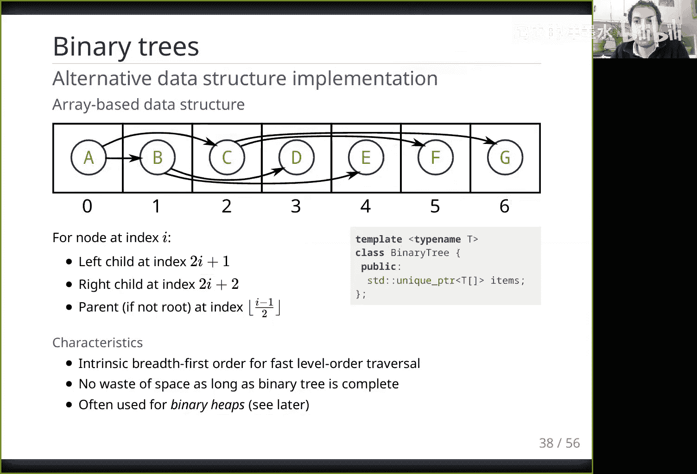

# 数据结构与算法编程：09：树（第二部分）


在本节课中，我们将继续学习树结构。我们将重点介绍一种特殊的树——二叉树，学习其定义、类型、遍历方法以及两种不同的实现方式。

## 二叉树定义与类型

上一节我们介绍了树的基本术语，如节点、边、根节点、父节点和子节点。本节中我们来看看一种有特定约束的树：二叉树。

二叉树是一种树结构，其核心约束是：**每个节点最多只能有两个子节点**。我们通常称它们为左子节点和右子节点。如果一个树的节点拥有超过两个子节点，那么它就不是二叉树。

以下是几种不同类型的二叉树：

*   **满二叉树**：在满二叉树中，每个节点要么有0个子节点（叶节点），要么有2个子节点。关键点在于，不能有只拥有1个子节点的节点。
*   **完全二叉树**：在完全二叉树中，除了最后一层，其他所有层都被完全填满。并且，最后一层的所有节点都尽可能地向左排列。这意味着，如果要插入新节点，必须优先填充最左侧的空缺位置。
*   **完美二叉树**：在完美二叉树中，所有内部节点都有两个子节点，并且所有叶节点都在同一层。这是一个非常规整的结构。

需要注意的是，计算机科学中术语有时定义并不完全统一。例如，有些资料可能将“完美二叉树”称为“完全二叉树”。在本课程中，我们采用上述定义。

## 树的遍历

对于列表或数组，我们可以很自然地按顺序遍历所有元素。但对于树结构，如何系统地访问所有节点呢？这被称为树的遍历。主要有两种遍历策略：

1.  **深度优先遍历**：从根节点开始，沿着一条路径尽可能深地探索，直到到达叶节点，然后再回溯探索其他分支。
2.  **广度优先遍历**：从根节点开始，逐层访问节点，先访问第一层（根节点），然后是第二层，依此类推。

深度优先遍历本身又包含几种不同的具体算法，它们都基于三个基本操作：访问当前节点（N）、递归遍历左子树（L）、递归遍历右子树（R）。根据这三个操作的执行顺序，产生了不同的遍历方式。

以下是三种主要的深度优先遍历算法：

*   **前序遍历**：执行顺序是 **NLR**。即先访问当前节点，然后递归遍历左子树，最后递归遍历右子树。
    *   对于示例树，遍历结果为：A, B, D, H, I, E, C, F, J, G。
*   **中序遍历**：执行顺序是 **LNR**。即先递归遍历左子树，然后访问当前节点，最后递归遍历右子树。
    *   对于示例树，遍历结果为：H, D, I, B, E, A, J, F, C, G。
*   **后序遍历**：执行顺序是 **LRN**。即先递归遍历左子树，然后递归遍历右子树，最后访问当前节点。
    *   对于示例树，遍历结果为：H, I, D, E, B, J, F, G, C, A。

一个记忆这些遍历顺序的巧妙方法是“帆船法”。想象每个节点是一个岛屿，你驾驶帆船从根节点的左侧出发，沿着海岸线（节点和边的外围）航行一圈，最终回到根节点的右侧。

*   **前序遍历**：帆船每次到达一个岛屿的**西侧**（左侧）时，就访问该岛屿。
*   **中序遍历**：帆船每次到达一个岛屿的**南侧**（下方）时，就访问该岛屿。
*   **后序遍历**：帆船每次到达一个岛屿的**东侧**（右侧）时，就访问该岛屿。

广度优先遍历通常只有一种主要算法：

*   **层序遍历**：从根节点开始，逐层访问所有节点。
    *   对于示例树，遍历结果为：A, B, C, D, E, F, G, H, I, J。

需要强调的是，没有一种遍历顺序是“唯一正确”的。不同的遍历顺序适用于不同的应用场景。

## 二叉树的实现（基于节点）

现在让我们看看如何在C++中实现一个二叉树。一种常见的方式是使用节点结构，这与链表类似，但每个节点有两个指针。

一个基本的二叉树节点类可能如下所示：

```cpp
template <typename T>
class BinaryTreeNode {
public:
    T item; // 节点存储的数据
    std::unique_ptr<BinaryTreeNode> left; // 指向左子节点的智能指针
    std::unique_ptr<BinaryTreeNode> right; // 指向右子节点的智能指针
    // ... 构造函数等
};
```

`std::unique_ptr` 用于自动管理内存，确保当父节点被销毁时，其子节点也会被正确释放，从而避免内存泄漏。整个树由一个指向根节点的 `root` 指针开始。

基于这种结构，我们可以用递归的方式简洁地实现遍历算法。以下是前序遍历的递归实现示例：

```cpp
void preOrderTraversal(BinaryTreeNode<T>* node) {
    if (node == nullptr) {
        return; // 基线条件：到达空节点
    }
    process(node); // 访问当前节点 (N)
    preOrderTraversal(node->left.get()); // 递归遍历左子树 (L)
    preOrderTraversal(node->right.get()); // 递归遍历右子树 (R)
}
// 调用方式：preOrderTraversal(root.get());
```

中序和后序遍历只需调整 `process(node)` 这行代码的位置即可。递归实现虽然简洁，但需要注意深度过大的树可能导致调用栈溢出。迭代实现（通常借助栈或队列数据结构）可以避免这个问题。

## 二叉树的实现（基于数组）

除了基于指针的节点实现，二叉树还可以用数组来表示。在这种表示法中，数组的每个索引位置对应树中的一个节点。

假设根节点存储在索引 `0` 处，那么对于数组中任意索引为 `i` 的节点，我们可以通过公式找到它的家庭成员：

*   **左子节点索引**：`leftChildIndex = 2 * i + 1`
*   **右子节点索引**：`rightChildIndex = 2 * i + 2`
*   **父节点索引**：`parentIndex = (i - 1) / 2` （整数除法）

这种表示法有一个很好的特性：**如果二叉树是一棵完全二叉树，那么按数组索引顺序遍历，就相当于进行了一次层序遍历**。并且，这种实现方式没有指针开销，内存利用率高，访问速度快。它常用于实现“二叉堆”这种数据结构，进而用于实现“优先队列”。

## 总结



本节课中我们一起学习了二叉树的进阶知识。我们明确了二叉树的定义及其不同类型（满、完全、完美）。我们深入探讨了树的遍历，包括深度优先（前序、中序、后序）和广度优先（层序）策略，并学习了用“帆船法”来形象记忆深度优先遍历的顺序。最后，我们了解了二叉树的两种实现方式：基于节点指针的链式结构和基于数组的顺序结构，并分析了它们各自的特点和适用场景。这些概念是理解和应用更复杂树形结构（如二叉搜索树、堆）的重要基础。