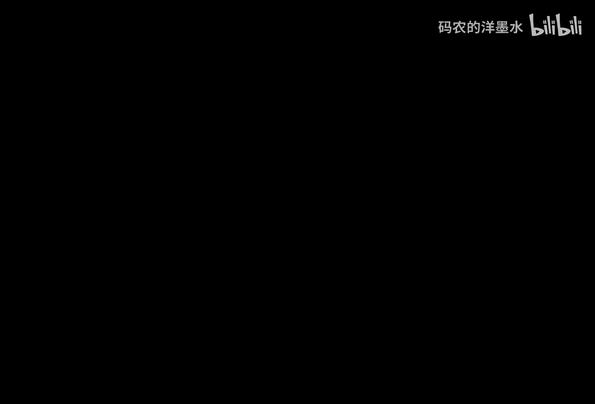
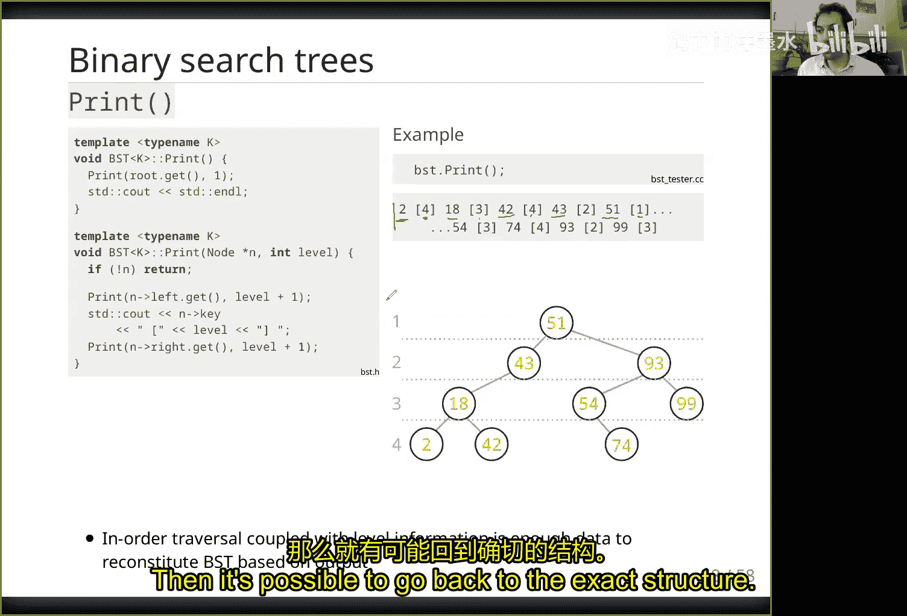

# 【全集】加州大学戴维斯分校 数据结构与算法编程 中英字幕 完整课件 p10 4-3 树 -BV1rJ2WBSE7P_p10-

系喂。So welcome to part three of our study about trees。A quick recap on what we did last time。

So last time we talked about specifically binary trees。

Trees which in which nodes only have up to two children， that's why they're binary。

We talked about the fact that there were different ways to traverse those trees。

 so to visit all of the nodes。We have a preorder traversal where we start from the root and we explore nodes directly as we recurs in them。

 and then we follow the left sub tree followed by the right sub。

 then we have the in node order where we start recursing on the left。

Then processing the node itself and then recursing on the right。

And the post order where we start now recursing on the left then on the right and finally the node is being processed and so you see that like。

three and so those three triussals here that are called depth first order because we visit the tree like kind of from top to bottom。

Recursively， they yield three completely different visiting order。And finally。

 a little like different than all of those， we have the level order。

 so this one is part of the category of bread order where we would visit all of the nodes really like from top to bottom every level after every level。

We also talked about different types of implementations for trees。

We talked about a node implementation where every node industry is really like implemented as a node and it has pointers like a C+ plus pointers a left sub and onto a right sub。

And。There's also another kind of operation based on an array where here there's no pointer involved all of the connections between nodes and their children is only a question of computation in terms of index in the array this one talk we' talk about it later more in depth when we talk about binary heaps and priority cues for the next couple of weeks we're going to mostly focus on node based implementations。

Okay。So today's topic， we're going to talk about what I've been like kind of。

Mentioning since the first lecture， this data structure that's very， very good for searching items。

 which is called a binary search tree。Binary search tree is very much like a binary tree like we just discussed。

 so the idea of a tree where node contain an item and can have up to two children。

A binary research tree adds a very， very important constraint onto this definition。In the sense that。

The item that every single node contains is called a key。And this key must be comparable。

 like if you have two keys， you must be able to say， oh， this one is bigger than this other one。

 that's what comparable means。And the idea here with the binary search tree is that。

Key that if a node contains a certain key， then all of the keys that are located in the left subre for that node are necessarily smallerer and universally all of the keys located in the right sub。

Must be greater than the noteski itself。Be careful， this definition is a recursive definition。

 so here if you take note 51 the root。Every key that is in the left sub3 must be smaller than 51。

 which is the case。Every key in the right sub of the root must be greater than 51， which is the case。

But it also applies to all of the nodes in that tree， take node 18。

Everything that's on the left must be smaller， Everything that's on the right must be bigger。

 same with like 93， Everything on the left is smaller，54，74。

 everything on the right is bigger and so this rule。

Has to be valid for every single node inside of the tree for the entire tree to be considered a binary search tree。

so let's jump directly to the implementation of a binary search tree and the kind of methods。

 the kind of API that we can apply on a binary search tree。So that's the typical API。

 you will recognize a lot of the same methods that we discussed for the list ADT。So for example。

 we have contains very similar to the method find which we had for the list ADT except that with find we would give a certain item and find would return the position of this item in the sequence which here is not really meaningless because there's no position in the tree that's not something we can describe so here contains we only return a boolean like does it exist in the tree or not。

Here just to show you， we'll do maxs and means so we'll be able to return the maximum key that a tree contains and a minimum key that a tree contains。

 which are also like possible to have in the list ADT if we want to。And insert to insert a new key。

 remove to remove a key and print the tree and so here because print can be done in many different ways like it's just a way of traversing the tree。

 we could do it with one of the depth first order approaches or with the level order approaches here I decided just randomly the print would be an in order print of the tree。

One thing that you can notice method that we had in the list ADT that we do not have here with the binary search tree。

Is the method get？😡，So if you remember for the least ADT。

 the get method would return the item that was located at a certain position in the secret。

Here again， same argument as with fine versus contain。

 no there's no position in a sequence here like there's no sequence。

 so that's why we don't have a get method method， but I mean it's not really a big deal。

In binary research stories， we often have other functions here we're not going to do them。

 but they often exist， we could have a function called floor， you give it a key and it returns。

In this binary tree， which key is smaller or equal to the given key。

 like the largest smallest key or a seal， which is the opposite of floor， or even like rank。

 you give a key that exists inside of a binary search tree rank tells you at which。

Kin of with rank it is like how many keys are smallerer and how many keys are greater than that key and so on and and binary researchers are very。

 very good。At providing those methods in a very good complexity。

 that's something we're going to talk about。Okay， so let's get to the now that we have the API。

 like the few functions that we would like to implement， let's talk about the data structure。

So that's the data structure that I chose here so we have a class binary research tree that's our collection of items like collection of keys right the keys are of type K K being something that we can compare so like integers or characters or like anything that we can compare like disk key is greater than that key or smaller than that key and so on。

Then in our binary， I told you we would follow a node based approach like a node based implementation。

 so the root is essentially a pointer on a node。And a node contains three things。

 has a key of this comparable data type K， and then we have a pointer on a left node and a pointer on a right node and this way we can describe a binary search tree。

Then you see that I have four private， they are not those functions。

 they are not part of the public API， they are not functions that the outside user can call。

 they are for us。And there are mostly like recursive methods that is going to help us。

Implement the functions from the API。So for example。

 we're going to have a recursive function for finding the minimum key inside of a tree。呃。

And I'll show you so for the minimum we're going to have a recursive version and then for finding the maximum key in a tree。

 we're going to use an iterative version， so this way you'll get to see the two different implementations。

Then for insert and remove we'll do that recursively as well and for print so for print we could also do that iterly without the need of a recursive function here the ID that like this way I can print the level of each node and it's easier if we can do that with a recursive function。

That binary search tree class。嗯。If it's in fact just what we would call a set。

 I think it's an actual data type， for example， in Python。

 you can define a set and then add a keys of like items to a set。

 that's pretty much what a set is except that here we are making it apparent that it's implemented as a binary search tree。

 but we could also just I don't know call it like class set and it would turn out that it is implemented as a tree inside and the user wouldn't even know because like everything is hidden behind the public API。

If we had a binary search tree where we have a key and we also have some sort of value that's associated to the key and so in fact we hold pairs of key values then then that would be what we call a map that's pretty much the difference between a set only contains comparable keys and a map contains comparable keys that are associated with values anyway。

Okay。So let's start implementing， so now that we have the list of functions that we want to implement and we have the internal data structure for this binary search tree。

 let's start implementing the actual functions， right？Let's start with the first one contain。

So this one we're going to do very simply using iterative methods。So， contains。

Receive it a certain key， and we have to go through the tree and see if the tree contains this key and return true or false。

 whether we find it or not。So obviously we're going to start looking for this key from the root node。

And we're going to use a pointer onto a node and we're going to move this pointer throughout the tree until we find the node that actually contains this key。

嗯。And。As long as the pointer end is not no， then it means that there's probably more to explore。

 so we continue exploring。嗯。😊，So if the nodes that we're currently pointing on。In fact。

 has the key that we're looking for， that's when we can return true like yes。

 the tree contains the key that we're looking for。Otherwise。

 and that's here it's kind of beautiful and it changes from the list ADT so remember like for the least ADT the function fine would just stock from the first item in the list and then just go in sequence from beginning to end and scan through all of the items here it's smarter than that。

Because a key。Can necessarily be compared with the key that the node contains。And we know that like。

From the perspective of a node， everything that's on the left side is necessarily smaller。

 everything on the right side is necessarily bigger。

So according to the key that we're looking for and the key that the current node contains。

 we know if we need to go left。All right， right？So if the key that we're looking for is smaller than the key of the current node。

 then it means that we need to go into the left sub and so that's why we move our pointer。

 we like reassign our pointer and to the root of the left sub and we do it again and we continue searching。

If the key is greater than the nodes key， then we follow the right sub。And so on。And so。

If we have a tree like that。Essentially， we stop looking at the first node。

And if the key that we're looking for is smaller， then we follow。

The right sub and then we're going to compare with this node if the key that we're looking forward is bigger than the node key。

 then we go to the right and we compare again。Here is an example。😊。

So that's a binary tree that contains a binary search tree that contains some numerical values。

Imagine that we' are trying to see if the tree contains key 54。So we're trying to see， oh。

 do we have 54 in that tree， so we would start， so we would call contain 54 and we get into that function。

In this function， we declare a pointer n。Regular pointer。 And we make n point。Onto the root。

And then we start executing the code while n。 So here n， yes， that's a valid point error onto a node。

If the key is equal to the node key， then we're good， but in that case， no 54 is not equal to 51。

 so it means we're going to have to go either to the left or to the right。

Here we check if the key is smaller than the notes key， then we go to the left。

Here it's not decades case， 54 is not smallerer than 51， so it doesn't work。

So we match the elses condition here and we go to the right。And that means that n is reassigned。2。

Yeah。Pointing onto。The right node。And then we go back to the beginning of the Y loop and we do it again。

So here again， like n is valid。But 93 is not the kid that we're looking for。It's smaller， so we go。

 we follow the left。So that means that the end pointer。Is real science。To the left。And here， bingo。

We have 54 equals to 54。Read and true。 yes， we found the key industry。And。Now， quickly。

 if we were to try to find 55。We' start again from 51。

 we'd follow the right tree because 55 is bigger then we'd follow the left tree because 55 is smaller。

Then we'd follow the right tree because 55 is bigger and then we'd get to 74。At 74。

 we would actually follow。The left sub。And that would be doing this operation。

Except that now point of n would be pointing onto。The neo node。

Assuming that conceptually this 74 has a neo node as its。Left child。And so technically。

 in terms of program action， it means that now n points onto no like the no pointer。

Which means that after we reassign n and we go back to the Y loop， in fact。

 n now is not valid anymore， so that stops the Y loop。And gets us to return false。

And the whole function now returns false because we followed the path。

 didn't find anything up until we got to a leaf node and still nothing。

So that means that 55 is not part of this binary search tree。

Okay let's move on so that's for contains now let's look at max the maximum method。

 so here we have the binary search tree and within this collection of keys we're trying to find the key that is the biggest of the collection。

How do we do that？😮，It is extremely simple， as you can see， four lines for this function。

Because of the nature of the binary search tree and the fact that from a node perspective。

 everything that is bigger is necessarily in the right sub。

 all we need to do is follow the right sub as much as we can。

Every time we get to an node we go to the right if possible。And we do that iteratively in that case。

 so we start from the root and then if the root has a right node。

 we go to that right node and we do it again。If that node has a right node， then as a right child。

 we just follow the right child， follow the right child。

Up until we get to a node that doesn't have a right child。And here by design。The first node。

 if we followed all of the right children， the first node that does not have。A right children。

 a right child。Is the biggest note。Or the node that has the biggest key。

Let me show you that graphically。So here we would start from the root 51。

 would the root has a right child， we just follow it 93， 93 has a right child we' follow it 99。

 99 doesn't have a right child because like here we could say that its there's just a Ne node。

Which means that overall is in this entire collection。99 is the biggest key， right？No。

Pay attention to something。What is the size of the collection。

 how many nodes do I have in this collection of keys？I have。9ine。Noes total。

How many nodes did I have to visit in order to find the maximum one？1，2，3。

So I had to visit three nodes out of nine。In order to find guaranteed the maximum node。

Now think of how many items。In a list， how many of them do I need to go through in order to find a maximum item？

Well， if I have a list that that has n items， I need to analyze all n items in order to find the maximum。

 I cannot not know which one is the maximum。Upen so I've looked at absolutely all of them。

So you see here the the the。Progress in terms of complexity for certain operations already。

Okay let's go on so we have the maximum implemented as a very simple iterative function now let's talk about the minimum and remember for the minimum we're going to do that recursively actually for two reasons the second one we're going to talk about in a few minutes the first one is just to show you like。

What it would look like if we do it reccursively versus if we do it iteratively。

So let's look at the minimum。The mean function that the user。Has access to is this one？😮。

And it's really only just a simple call。On the internal function。

That we have access to that the user does not see， right？And so this。Internal mean function。

Receives a pointer on a node as a parameter and returns a pointer on a node as a result。All right。

 so here essentially like we get the root of a certain subre。

And we overall like this function will return。The node that contains the minimum node。

And so at the beginning， this function， we're going to call on the root。

And when this function returns。And returns a pointer on a node。

 we're going to dereence this pointer and return the key for the minimum node。Interally。

When we receive the pointer on the node。We look whether this node has a left child。

 so it's the same principle as for max like for Max we we wanted to follow the right children as much as possible to find the mean the exact opposite。

 but we want to follow the left。Sheildre。So。If we get to a node n and this node n has a left child。

 then we call recursively the same function on the left child。

And as long as we get to a new node that has a left child。

 we keep recursively call the function on the left child。A you。

We get to a node that doesn't have a left child， in which case that node is being returned。

And now we come back from all of the recursive coal。Up until that function。

And that note that has been returned， we de reference to access the key and that's the key we return as a result from mean。

こ。So again， like graphically。😊，Not surprising， we would start from the roots。

We call the internal mean function on the root。Which means that this internal mean function will be called on this guy。

Then this guy has a left。呃， function。So from this。No， this node has a left child。

 it would call recursively mean on that left child。We would get to node 18 again。

 like 18 has a left child， so the function would be recursively called on the left child。And finally。

 this left child doesn't have a left。Child because here it's Neil so the if here condition would fail and n would be returned n being this last node and so this last node would be returned to that function returned to that function。

And back to here。And we would return the key， which is now two。Okay。😊，嗯。😊，So yeah， and once again。

 we can observe that overall we have nine nodes total。

And we have only gone through four of those nine in order to find the minimum one。

 which is a big improvement。Compared to a list ADT where we would need to scan everything in order to find a minimum node because we need to look at all of the values。

Okay。Let's move on。So we have done contains Max Min， now let's move on to insert。So in。

 you're going to see。A lot of the same as contained in the sense of how we go through the tree。

So insert is here， that's the function that the user see like that's the function that's part of the public API and that receives a certain key。

 that's the key we want to insert。And what we're going to do is that we're going to call our internal insert。

 the one that is in fact a recursive function， and we're going to call it on the roots。

With the key that we want to insert so that we we're going to do a recursive insertion starting from the root。

And so that gets us to our own private insert function， the one that is not part of the public API。

And you see here that。The node that we receive is a reference onto。A note。

With the key that we want to insert。And so here we're going to have different cases， like use cases。

If the node that we receive as a parameter is nu， which means that the node doesn't exist。

Then it means that that is where we're going to insert a new node。

 we're going to create a new node that contains the key that we want to insert。

That'll be like really the actual insertion process。Now if we get to a node。

Like in our insertion process。If we get to a node that already exists， then we need to。

 we cannot insert， add that node。We need to follow the path。

So if the key that we're trying to insert is smaller than the key of the node we're currently at。

 then it means that we need to insert in the left sub。

If the key that we're trying to insert is bigger。Then the node key。

 then we need to insert recursively in the right sub。

This whole thing here is about maintaining the properties of the binary research tree。

 like always making sure that from any notes point of view。

 everything that's on the left is smoother， everything that's on the right is bigger。

That means that when we insert a new node， we have to make sure that this property is still maintained。

And。We can also catch a last use case， which is that like if we find a node。

That already exists in the tree。And that in fact， already contains the key that we are trying to insert。

 then nothing happens and we just say， hey， the key is already there。

So let's take a quick example to illustrate this insertion process。

Imagine I have a sequence of keys that I would like to insert inside of my tree。

So I would create a binary search tree here that contains keys that are integers。At this point here。

 my BST variable is an empty tree， there's nothing。

Only contains a root pointer that points onto nothing like the root pointer would be equal to know。

And so we're going to go through this vector of keys。

And then insert every single key like one after the other， so we're going to insert like 51， 4 3。

 93 and so on。So at first， when we declare here like BST。

We only have a root pointer that is in fact equal to no。The first time that we call inet。On key 51。

We would get in that function。And inet， the internal helper。

 the internal recursive helper would be called。On route， which is currently no。With the key being 51。

When we get to this function， the internal helper。Then this reference pointer here n would actually be a reference onto the root。

And so that's when we would match this case。The root is no。

Which means that that is exactly where we should。Put this first note。

So we would create a node that contains the key 51 because that's the first one we're inserting。

And that node is now associated to root。When we get to the second value 43 and we call insert on 43。

 so we would get to that function and inet 43 at the root。Now we get to this function。The roots。

Is already associated to a node。 So this if fails。So now we get to those two elsess。

And we see is the key smaller than the node key， that's the case。At this point。

 N points onto the root， which is the node 51。The key that we're trying to insert is 43。

 so it's smaller。So we would recur in insert。On the left。Poinner of n。 So essentially。

 like we would recur and we would give the function a reference。On this left pointer。

 but the actual left pointer， that's why it's like really important that it is a reference here。

And so。With reers here into the same function and now we match the fact that this left pointer is no。

 so that is exactly where we're going to insert this new node and connect it to this left pointer that's exactly what this line is doing。

And if you continue the insertion process， that's pretty much。

How all of the new nodes and the new keys are being inserted into this tree。Okay， let's go on。

So before we talk about remove， because remove is by far the most complex。

Operation in a binary search tree， we're quickly going to mention the print method。Yeah。哦。

So for this brain function。We said we would implement in recursing so that we could display。

The level for every node as we're printing them。So here's how it works。

 so we have this print function that the user has access to as part of the public API and in fact this print function calls an internal helper again with the one which is recursive。

On the root note。And at first with level one， and that pretty much helps us。

Print this root node with level one， one being the level at the root， like the root node。

And we said this print function would be in order， which means that first we would recur on the left。

 then we would do the step where we process the node and finally we would recur on the right that's the in order traversal。

And so one will recur on the left。Then we add one more level than the one we at。When we print。

The node itself that we print the key and we print the corresponding level when we recur to the right。

 we add one level。Now what's interesting is that， so let me very quickly go back one slide here。U。

If we inserted a bunch of keys here in this binary search tree， we're going to have a certain。

Like structure of the tree。And so now if we call print。

Onto this tree where all of the keys have been inserted， that's the kind of output we have。

So we have an in order output， meaning that if you remember， the in order kind of means that。

It's almost like we had a vertical bar that would go from the very left side of the tree and kind of like scan vertically all of the nodes all the way through。

So wed start by actually like the minimum node because that's necessarily the one that's the most on the left。

And here it tells us that the minimum node is at level4， then we have node 18， level 3， then node 42。

 level 4， and so on， and you see here like we have the node root 51 at level1 and then we go onto the right side and so on。

What's interesting with this representation。Giving the key for each node and also giving the level and doing that in an in order traversal has actually a very interesting property is that based on these outputs。

It's actually possible to reconstitute the structure of the tree。So let me show you like graphically。

Only based on this output， we can actually like determine that the tree internally has this structure。

Yeah。And I'll probably show you other examples where it's very useful。

Just so that you realize why it's an interesting characteristic。If you output a tree， so for example。

 if you do a pre orderder of the tree， for example。

 and you only have access to the output of the preorder of a tree of a preauder traversal。

Only based on the preor traversal， you cannot reconstitute the tree。

Because there are different structure of the tree that would yield the same preodder traversal so usually when you have a tree and you want to reconstitutute its structure based on one one of the traversals strategies。

 you actually need the output of two different traversals like for example。

 you need the preodder and the in other or you need the preodder and the post other。

 you need the combination of two traversals。In order to kind of go back and determine what the tree exactly looked like when it was traversed here with this information of the in order coupled with the level。

Then it's possible to go back to the exact structure。

