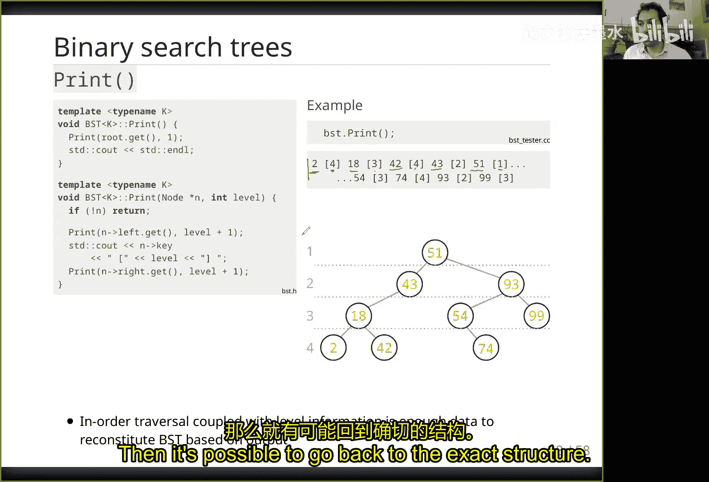

# 数据结构与算法：4-3：二叉搜索树 🌳

在本节课中，我们将要学习一种非常高效的数据结构——二叉搜索树。它是一种特殊的二叉树，专门用于存储可比较的键值，并支持快速的查找、插入和删除操作。我们将从回顾二叉树的基础知识开始，然后深入探讨二叉搜索树的定义、性质及其核心操作的实现。

## 回顾：二叉树

上一节我们介绍了二叉树，即每个节点最多有两个子节点的树结构。我们讨论了遍历二叉树的几种不同方式：前序遍历、中序遍历、后序遍历（这三种属于深度优先遍历）以及层序遍历（属于广度优先遍历）。我们还提到了两种主要的实现方式：基于节点的实现（使用指针连接子节点）和基于数组的实现（通过索引计算节点关系）。在接下来几周，我们将主要关注基于节点的实现。

## 二叉搜索树的定义

二叉搜索树是一种特殊的二叉树，它在普通二叉树的基础上增加了一个非常重要的约束条件：对于树中的任意一个节点，其左子树中所有节点的键值都必须小于该节点的键值，而其右子树中所有节点的键值都必须大于该节点的键值。

这个定义是递归的。例如，对于根节点，其左子树的所有键值必须小于根节点的键值，右子树的所有键值必须大于根节点的键值。这个规则同样适用于树中的每一个节点。

## 二叉搜索树的API

以下是二叉搜索树通常提供的公共方法接口（API），你会发现它与列表ADT的许多方法相似：

*   `contains(key)`: 检查树中是否包含给定的键。返回布尔值。
*   `max()`: 返回树中的最大键值。
*   `min()`: 返回树中的最小键值。
*   `insert(key)`: 向树中插入一个新的键值。
*   `remove(key)`: 从树中删除一个键值。
*   `print()`: 以某种顺序打印树的内容。这里我们选择中序遍历。

需要注意的是，列表ADT中的 `get(position)` 方法在这里没有意义，因为树结构没有明确的“位置”概念。

## 内部数据结构

我们采用基于节点的实现方式。`BinarySearchTree` 类包含一个指向根节点的指针。每个 `Node` 包含三个部分：一个可比较的键值 `key`，以及指向其左子节点和右子节点的指针。

此外，我们还会定义一些私有的递归辅助函数，用于实现上述的公共API，例如用于查找最小值的递归函数。

## 实现核心操作

现在我们已经定义了数据结构和需要实现的方法，让我们开始逐一实现这些核心操作。

### 查找操作 (contains)

`contains` 方法用于判断给定的键是否存在于树中。我们采用迭代的方式实现。

算法从根节点开始，使用一个指针 `n` 遍历树。在每一步，我们将目标键与当前节点 `n` 的键进行比较：
*   如果相等，则找到目标，返回 `true`。
*   如果目标键小于当前节点的键，根据二叉搜索树的性质，目标只可能存在于左子树中，因此我们将指针 `n` 移动到左子节点。
*   如果目标键大于当前节点的键，则目标只可能存在于右子树中，因此我们将指针 `n` 移动到右子节点。
*   如果指针 `n` 变为 `null`，说明已经到达了叶子节点仍未找到目标，则返回 `false`。

这个过程避免了像在列表中那样线性扫描所有元素，效率更高。

### 查找最大值 (max)

查找树中的最大值非常简单。根据二叉搜索树的性质，最大值一定位于最右侧的路径上。

我们使用迭代方法：从根节点开始，只要当前节点存在右子节点，就不断将指针移动到右子节点。当到达一个没有右子节点的节点时，该节点的键值就是树中的最大值。

在包含9个节点的树中，我们只需访问3个节点就能找到最大值，这比遍历整个列表（需要检查所有n个元素）要高效得多。

### 查找最小值 (min)

查找最小值的逻辑与查找最大值对称，即沿着最左侧的路径查找。这里我们使用递归方法来实现，一方面是为了展示递归实现，另一方面也为后续的删除操作做准备。

公共的 `min()` 方法调用一个私有的递归辅助函数 `_min(node)`。该函数接收一个节点指针：
*   如果该节点有左子节点，则递归地在左子节点上调用 `_min`。
*   如果该节点没有左子节点，那么它就是当前子树中的最小节点，将其返回。

最终，公共方法从返回的节点中提取键值并返回。

### 插入操作 (insert)

插入操作需要维护二叉搜索树的性质。我们采用递归方式实现。

公共的 `insert(key)` 方法调用私有的递归辅助函数 `_insert(node, key)`。递归函数处理以下几种情况：
1.  如果当前节点 `node` 为 `null`，说明找到了插入位置，在此处创建一个包含 `key` 的新节点。
2.  如果 `key` 小于当前节点的键，则递归地在左子树中插入。
3.  如果 `key` 大于当前节点的键，则递归地在右子树中插入。
4.  如果 `key` 等于当前节点的键，说明键已存在，不进行任何操作（或根据需求处理重复键）。

关键在于，递归调用时传递的是对子节点指针的**引用**，这样在找到插入位置（`null`）时，新创建的节点才能正确地被链接到其父节点上。

### 打印树 (print)

我们实现一个 `print` 方法，以中序遍历的顺序输出每个节点的键值及其所在的层级。这有助于可视化树的结构。

公共的 `print()` 方法调用一个私有的递归辅助函数 `_print(node, level)`，该函数执行中序遍历：
1.  递归遍历左子树，层级加1。
2.  打印当前节点的键值和当前层级。
3.  递归遍历右子树，层级加1。

一个有趣的特点是，**结合中序遍历的输出和节点的层级信息，可以唯一地重构出原始的树结构**。而仅凭前序或后序遍历的输出则无法做到这一点，通常需要两种遍历顺序的组合才能重构。

### 删除操作 (remove)

删除操作是二叉搜索树中最复杂的操作，因为它需要在删除节点后仍然保持树的性质。我们将在下一节中详细讨论其实现策略。

## 总结

本节课我们一起学习了二叉搜索树。我们了解了它的定义：一种左子树键值均小于节点、右子树键值均大于节点的特殊二叉树。我们探讨了其核心操作的实现原理：
*   `contains` 利用树的性质进行高效查找。
*   `max` 和 `min` 通过遍历最右或最左路径快速找到极值。
*   `insert` 通过递归找到合适位置并插入新节点，同时维护树的性质。
*   我们还看到了一个能输出节点层级的 `print` 方法。

这些操作的高效性（通常优于线性列表）使得二叉搜索树成为实现“集合”（Set）或“映射”（Map）等抽象数据类型的理想底层结构。在接下来的课程中，我们将完成删除操作的实现，并深入分析二叉搜索树的性能。