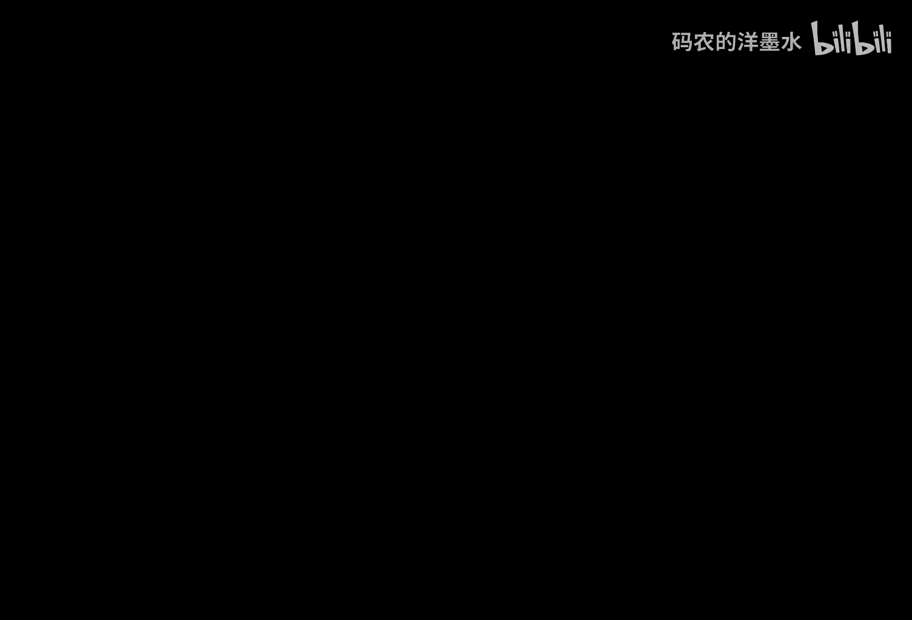
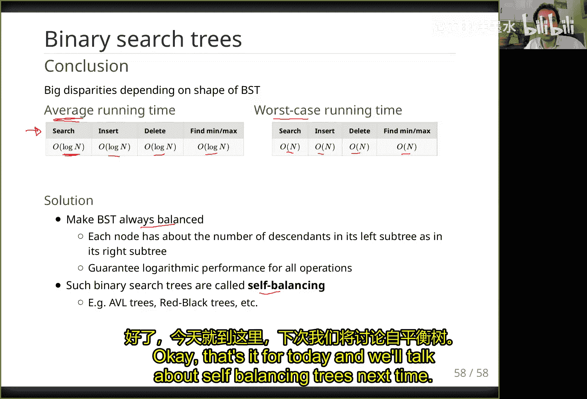

# 【全集】加州大学戴维斯分校 数据结构与算法编程 中英字幕 完整课件 p11 4-4 树 -BV1rJ2WBSE7P_p11-

Hi everybody， so welcome to the last part of our study about trees。So quick recap from last time。

Last time we defined what a binary search tree was。So quick redefinition here。

 binary search tree is a binary tree， it's a tree in which we have nodes that can only have up to two children。

 a left child and a right child。And the keys that a binary search tree contains。

organizedized in such a way that for every single node。

All of the keys that are in the left subre of that node are necessarily smaller and all of the keys that are located in the right subre of a node are necessarily bigger。

 and that obviously applies to every single node in the binary search tree。

Last time we went over the implementation of most。Of the functions of the API so contains。

 we looked at the maximum implemented as an interactiveative version。

 we looked at the minimum implemented as a recursive function。

 we looked at insert and we looked at print。And so the last operation that I wanted to talk to you about is remove。

Remove is a little bit tricky and we're only going to be talking about that today and we're going to go slowly what's funny is that the first strategy to remove a node out of the binary search tree is to actually not。

Remove it。Removing it。So imagine you want to remove node 93 out of this binaryse tree。

 one possible strategy is to not remove this node， you keep it right there。

 you don't remove the memory or anything。But you have some sort of boolean inside of the node that tells you oh this node is deactivated like it doesn't exist。

 however， it's still there and it' still participates to like to the binary search tree structure in the sense that like if you look for a certain key or if you insert if you want to find the mean of the max。

This node will still be relevant because it will still be a value that you examine at some point to determine if you need to go left or go right。

If you were to call， say method contains on this tree with key 93。

 even if it technically eing the three in the tree。

 the contained method would return false because it's not supposed to be there。

 it's just like hidden。嗯。And actually， if later on after removing key 93。

 it happens that this same key is being inserted again。

 then it would just be a matter of like kind of switching back this same node from disabled to enabled。

 and then it would be backup。It is kind of a funny approach I admit it's not completely relevant either in some strategies where you know that the site。

 I don't know， you're going to have a tree that's pretty big and the number of removal operations are going to be like super super small like very。

 very small， like it's going to happen super， super rarely。

Then maybe it's a value strategy because it's super simple to implement。

And if it's if at the end of the day， like there are not too many nodes that are in a kind of disabled state in the tree。

 it doesn't matter。However， if you have a tree that in which keys keep being inserted and keys keep being deleted like fairly often。

 then keeping those nodes around is going to cost a lot of memory for nothing and it's going to artificially make a big。

 big tree， even if technically the number of valid nodes nodes is not that high。

So it's actually better to have a real removal strategy。

There are three scenarios when we want to remove a node hour of a binary search tree。呃。

So first strategy that's the easiest by far， the node that you want to remove is actually turns out to be a leaf node。

 so for example here if we wanted to remove node number two node number two is a leaf node doesn't have any children that's actually going to be pretty easy to do。

Next operation。Our next scenario， the node that we are trying to remove is an internal node。

 so a little bit more complicated than a live node， but with only one child。

So here typically like imagine we have 18， we want to remove 18 and 18 only has one child 42。

That's getting a little bit more complex than the lymph node situation， but not too bad either。

The real struggle is the last scenario。How do you remove an internal node that has two children。

 so for example， how do you remove the root node？That's when things start getting complicated。

 but let's start easy， let's start with the first one， the leaf node。

Imagine I have a binary search tree。And I want to remove a key。

 so here I want to remove key number two。And it turns out that we said。

Notode number two is a leaf node doesn't have any children。Then it's super simple。

 we just remove the note。So that would mean that in node 18， the left pointer of 18。

 which pointed onto node number two， we're going to put no insight so that it doesn't point onto anything and they'll remove the node itself。

And that's it。As simple as that right， it's almost like removing an item out of a linked list。Okay。

 second scenario， we said we want to remove now an internal child， an internal node。

 so a node that has children， but only one child， so here we want to remove 18 but 18 has one child which is 42。

Here it's not too complicated， what we're going to do is that we're going to replace 18 with 42。

And that will have to do with the parent of 18， so here we had the left pointer of note 43。

 which was pointing on 18。And the right pointer of 18。Which was pointing on 42， right？

If we want to remove 18， we essentially want to have the left pointer of 43 point on 42 that's the idea and that's what we're doing here。

And that will have as an effect to remove this internal node， right？Okay。😊，And so last。

 the most complicated case。What if we want to remove now a node。

 an internal node that has two children？We're also going to have to replace somehow this node with。

Something either on the right or on the left， right？They are only。Two possibilities here of values。

Either in the left sub or in the right sub， that could be promoted。

As the new root node because you have to remember here。

 we have to guarantee that the property of the binary search tree is still maintained。

 meaning that like from every single node point of view， everything that's on the left is smaller。

 everything that's on the right is bigger。So technically， it means that like。

If we needed to replace this 51 that we want to remove by either something on the left or something on the right。

 in fact， it could be only two possible values。嗯。51 here could only be replaced by 43。

Because if 43 is the new route， then everything that's on the right is bigger。

And everything that's on the left is smarter。On the other hand， 51 could also be replaced by node 54。

 which is the smallest node。On the entire right side。If 54 is promoted as the new root。

 then everything that's on the left is smaller and everything that's on the right is bigger because 54 is already the minimum value of this right side。

And that's pretty much the algorithm。😊，The algorithm says that like。

If D is the node that we want to delete， so here 51。Then the algorithm goes this way。

 we want to find the minimum node。In this right tree。 So if we want to remove 51。

 we want to go in the right tree and find the minimum node in that right tree。Which is 54， right。

We also call it the successor key value， like the successor of 51 is 54 in this tree。

Once we've located this minimum value， we can essentially。

Switch the values or we can copy the new key so we can take 54 and copy it instead of 51。

 So here we' are not actually like really deleting anything。We're just moving over。

The new value into here like the root node， the one that we want to delete， so we copied。

And then what we do is actually pretty small now we've replaced this issue of deleting 51 with the issue of deleting 54 because now we've moved 54 somewhere else and we need to actually delete this node so what we do is that we recursively delete this node。

And now we're going to initially again be in one of three scenarios。

If this node that we're trying to delete it is a leaf node， then we can just delete it。

If this node is an internal node with only one child， then we can replace it by its own child。

 which is exactly our case here， 54 that we are trying to delete only has one child which is 74。

So that's perfect。 We can just relink。93 to 74 and just delete this node。Or worst case scenario。

This new node that we're trying to delete is also an internal node with two children。

 in which case going we're just going to do this algorithm again。

We're going to find the successor of that node and do it again and then we'll recursively delete the copy and so on。

Yeah。But in that case， we。Located the Suor 54， we copied it over to the root。

And then deleting 54 was easy because 54 only had one child 74。

 which we could re link directly to 93。So now that we understand the different scenarios。

 let's look at the actual code， don't be too scaled by the length of it， it's not that complicated。

 it really just implements what we've talked about。And。So the again。

 like the public method is super simple， like so that's what the user would call remove on a certain key。

And right away， we call our own remove function， the recursive one。

With root at the first argument and key as the second argument。

 and this one is actually just recursive and operates again the same way as insert on the reference of a pointer。

嗯。Here we have。Two cases。Where we first we need to locate this key that we're trying to remove。

 so we go down the tree like and we follow the path and we call remove recursivity to actually locate the node that contains the key we want to remove。

Up until we find。The node that has this key， like the node that needs to be removed。

And essentially here， the three scenarios can be kind of folded into just two use cases。

The first use case is the most complex。Is the one where the node that we have located that needs to be deleted has both a left child and a right child。

 so that's the most complex scenario。In that case， as we said， we're just following the algorithm。

 we're going to call the mean function， so you remember our recursive mean function that returned a node pointer on the minimum node。

We're going to call this mean function。On the right side of the node to be deleted。

This mean will return a node pointer。Will extract the key and will copy that key over。

To the node that was to be deleted so that's the step where we would find 54 and we copy 54 on top of 51。

 which was the node to be or the key to be deleted。After we do that。😮。

And now the key that we wanted to delete actually has been overwritten。Now， we need to remove。

This a note。Right。We need to remove。The node key， the one that we just copied over in the right sub。

 and we again do that recursively。嗯。So that's for the most complex scenario。Otherwise。

And here we can fold scenario number one， the fact that the node is a leaf node or scenario number two。

 the node is an internal node but only contains or only has one child。

 we can fold those two cases into just the same couple of lines of code。

 actually the same line of code it's really just one line。So the idea is that like。

If we have a note here。That only has say like one child。Then， N。

Would be the pointer that points onto this node。And we essentially said that like if this node has a left child。

 then N， which is the smart pointer that points onto this node， will now point on。The other one。

 like the left one。And by using STD move here and because n is a smart pointer。

That will like remove this connection here。And still its。From。From this link。

And that will have as an effect to， in fact， destroy。

The node that now no longer has an owner and that's actually like how all of the garbage collection here is done directly for us。

By like。Making sure that the node we want to delete doesn't have any owner anymore because like。

 well， now bypassing it， like the node that was the parent no longer points onto this child but points onto one of the grandchildren。

 then it has as a side effect or actually destroyed this child that we want to destroy。Okay。嗯。

Now that we have a good overview of all of the functions。

 let's finish this topic by talking a little bit about complexity analysis。So。If you think about it。

If a collection of items or keys is represented by a binary search tree。

Then it means that the running time of all of the operations， so finding the minimum。

 finding the maximum， removing a certain node or inserting a new node。All of those operations。There。

Proportal or their。They're in bigger of D， they are proportional to the depth of the tree right here if the tree has a depth of four。

 then the minimum will take four operations， the maximum will take up to four insertion will take up to four like removal will take up to four。

So it's no longer like proportional to the number of nodes that we have。

 it's proportional to the depth。Which is also like related to the number of nodes we have。

 but not directly， it's not directly proportional。Um， whereas for a list ADT。

 finding the mean removing， inserting and finding the map will all be in O of n。

 they would all be operations that are directly related to the number of items we have in the collection。

 right？And just quick one thing like the traversal is the only operation that is necessarily inu of。

 like necessarily proportional to the size of the collection， because traversal by nature。

Is about going through the all of the items so it's actually not something you can really like optimize that's just by by nature。

It's linear， but that's not a big deal。So here we see that when we use a binary search tree。

 all of the operations are proportional to the depth of the tree。

 so it actually really matters to have a binary search tree that is not too deep。

 that's pretty much what it means。The thing is like how can we guarantee that this depth is not too big right so the thing is like。

If we are lucky， and the tree is complete， which means that all of the levels are all。

 except for the very last level， remember， and the very last level is all packed to the left。

If the tree is complete。Then we are guaranteed that the depth of the tri or the height of the tree there are similar concepts。

Is all of login， that's how the depth is characterized。

So imagine you have a tree that contains nine nodes。Then by definition。

 the depth will be log two of nine， which is about three and that's something you can actually observe。

This tree has a depth of one， two。3。呃。The thing is like the shape of the tree。

So far of the binary search tree entirely depends on how the nodes， how the keys are being inserted。

 like it entirely depends on that。On average， though， if those keys are inserted in random order。

 so imagine like you have1 thousand0 keys。And theyre not in any particular order and you start from a binary search tree that's completely empty and then you insert those keys one after the other。

On average， the tree is definitely not going to be complete。诶。But on average。

The the height or the depth will still be somewhat proportional to log in。

The big problem is that like once you add to the mix， the fact that。Inside of a binary research tree。

 we're going to delete some nodes and we're going to insert some new nodes and so on。

 I mean that's going to be a removal and new insertions。

The problem is that in the diletion strategy that we just studied。嗯。There's kind of a side effect。

So remember， like in the worst case scenario， when we delete a node。

 we grab the minimum one in the right sub3e and we like copy it over and then we rigorously delete this other node。

That strategy tends to kind of like move nodes from the right sub into the left sub。

And it means that the tree， even if it was like fairly well balanced and proportional to a log of n。

 if we were just to like insert things randomly。Now it tends to become unbalanced。

And the depth changes from log n to square root of n。Let me show you a quick example here。

If I take a certain tree and then randomly I'm just going to like remove some nodes and insert some new ones and I'm going to do that like  a0 times kind of to simulate a way that like we would have a collection of items and we would add to that collection and remove to that collection in a completely like randomized way。

You see that here the resulting tree is heavier on the left side than it is on the right side。

 like on the right side we have very few items and on the left side we have like a pretty big number of items。

That's what tends to happen。Because of the dele strategy that like takess the successor node on the right and brings it over and so on。

呃。There are kind of， there are some solutions to。Help with this issue。

First solution back to the beginning， we can kind of like avoid doing deletions so this way we are not affecting too much the structure of the tree but。

It's kind of a non solution because then it means like we're not really deleting anything。

Another interesting solution is that like instead of always picking the successor。

 like the minimum node on the right side to copy over the node that we want to delete。

 we can kind of do the opposite or we can alternate。

Like one time we can pick the successor on the right side and the next time we can do the opposite。

 we can take the biggest node on the left side。As the value to replace the node that we want to remove。

And if we do that， we pick on each the other side。It's going to help not have a tree that becomes。

A lot more heavy on one side than the other the problem is that this alternative picking is not mathematically proven we know that it helps a little bit and it helps the tree not like kind of degenerate into having a depth that square root of n。

But yeah， it's not proven mathematically。嗯。And finally。😊。

Just to add to the amount of issues that we're having， that's also the worst， worst case scenario。

So a few minutes ago， I told you that the shape of a binary search tree depended entirely on the order of insertion of the items。

And it's actually very true in one particular case。The case where you built。

A binary search tree out of a list of items that is by chance or whatever。Already saw it。

If you insert values that are in ascending order， actually even like in in strictly descending order。

Then so here in ascending order， then the minimum value becomes the root。

Then the next value will necessarily be。A right node。

 the next value you insert will necessarily be a right node and so on。And here what do you get？

You don't get a binary research tree， you get a linked list。

Which means that all of your operations now become U of n because now finding the maximum inserting a new item。

 removing an item， it's all。As a function of the depth of the tree and your depth is actually the number of items。

 so here you I mean now your binary research tree is totally useless。So。

That brings us to this conclusion。Conclusion is that on average。

If your binary search tree is somewhat balanced， you have like about the same number of nodes on the left than you have on the right and that at every level。

Then you get great complexity because then all of your operations are as a function of the depth of the tree。

 which is login and so you get login everywhere， which is awesome， however， worst case scenario。

You have a tree that was built out of a solid list of numbers and so your tree is actually not a tree it just like a long linked list in which case your complexity is linear。

 which is。Awful。The solution to that。How do we get？This kind of complexity， always。

And never the worst case scenario。 Well， we need to make sure。By design。

That a binary search tree remains always balanced。And that's an entire topic that we're going to start talking at the next lecture。

 we're going to talk about self balancing trees。Their binary search trees that will。

 in addition to everything we've talked so far， will also self balance themselves。

To make sure that their maximum depth。Is always about。

Log of end so that all of the operations are always guaranteed to be about log of end。Okay。

 that's it for today and we'll talk about self balancing trees next time。

