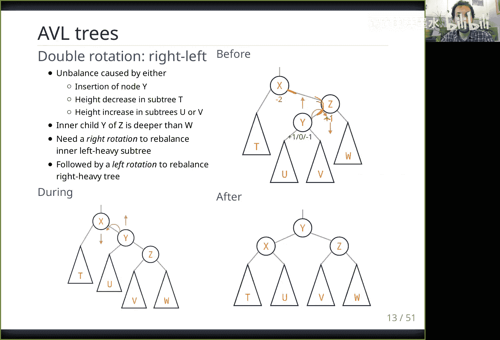

# 【全集】加州大学戴维斯分校 数据结构与算法编程 中英字幕 完整课件 p12 5-1 平衡树 -BV1rJ2WBSE7P_p12-

Hi everybody， so after introducing the concepts of trees， binary trees。

 binary search trees in the last few lectures， today we're going to start a new topic which is going to probably last a couple of weeks about balanced trees。

So let's see what they are and before that let's look back a little bit to trees and binary search trees。

To like really understand the concept and what we're trying to do here。So。One of the most important。

Characteristic of a tree is its height or its depth。

 like whatever in whichever sense you want to look at it。So just to as a reminder here。

 if we have a binary tree。Of size n and being the number of nodes。Then。The height of a tree。

 so the number of levels that a tree has it would be log。And， right？Why is that。

 let's look at it a little bit。So here， if we obviously consider a perfect binary tree because if it's a binary tree that says like degenerate into a link list。

 then the height would be over over n， but here if we consider that the binary tree is either perfect or at least like complete。

 so it's pretty packed toward the top， then you can see that each level has as many as twice as many nodes as the previous level。

We start by having。Here， one not， one node， that's the root。Two nodes at the next level， then four。

And if we were to continue， the next level would have eight nodes and 16。And so。

If we look at those numbers here，1，2，4， 8， 16， and so on， those are powers of two。One is， in fact。

2 to the power of0。Two is two to the power of one， four is2 to the power of two。

8ight is2 to the power of three。And so on。And so there's a direct correlation between like here。

 this node， the root node is at depth zero， the next level is at depth one， depth two。

 depth three and so on so you see here that there's a direct correlation between。

The kind of like level number or depth number and the number of nodes that we can have at that number。

And so overall， we can say that like at。At level， like。H。

The number of nodes would be two to the power of H at depth H。

 the number of nodes there would be two to the power of H and so total if we look at the tree。

 the number of nodes total that we have is one for the root two for the two children48 and so on up until two to the power of H which is the very last level and so total the number of nodes would be proportional to the height。

So， now。Given that a tree has n nodes。How do we find H， How do we find the height of that tree where？

That previous formula gives us this formula。Which is using log2。 And so essentially， it's。Log of it。

so that that's the rationale to explain that in a binary tree that's complete or perfect。

 if we have end nodes。Then the height of the tree is guaranteed to be log of n。Okay， let's go on。

And so that's where it becomes interesting is that if we have a binary search tree。

Given that all of the operations pretty much like always start from the root and then go down the tree and say like follow a certain branch。

Then if we consider that the height of the tree is log of n， then all of those operations。

Or of log event if obviously like if the binary search tree is balanced。Oh。Now， the big question is。

 how do we make sure？That a binary research tree stays balanced。

 like stays complete or perfect or like whatever makes all of the nodes be packed to the top so that overall we guarantee that all of those great operations like。

Finding the minimum， finding the maximum， inserting a new node， deleting a node and so on。

All of them have a complexity of O log of， how do we guarantee that？Let's look at。

A few possibilities。That don't work so well and then we'll get to something that works better。对。

So one first idea would be to say， well， maybe from the root。

We could make sure that like every side every sub like the left sub and the right sub from the root node point of view have the same number of items right so here we have the root。

And on one side， we have five items and on the other side we have five items。

And maybe that could help。If we can guarantee that that on each side we have the same amount of notes。

 then we would guarantee like a certain ballots。The thing is like。

It's better than nothing and it's sure helps not having like just a straight up link list on one side only。

But at the same time， only having this constraint。Doesn't really force the tree to be balanced。

Within each subre and so you see here like for example。

 on the right subre it's pretty much a linked list right like everything is linked and we have a depth that's actually pretty deep so doesn't work so well let's see。

Maybe another idea would be too force to avoid something like that where here like we have one， two。

 three， four， five， we have like a depth of five on one side and a depth of three on the other side。

Here we could constrain that from the root node， we're going to make sure that each side has the same height。

Like we're trying to enforce the heart。But again， it doesn't really force the tree to be balanced overall because we can get so here like each side would have the same height overall。

 which is better than this scenario， but at the same time， as you can see on the picture。

 it's pretty much a linked list on both sides， which is not great in terms of performance。

So not ideal。Another solution would be to really try to make sure that every single node has the same height。

嗯。So here it's not necessarily just from the root node， it's from every single node。

So this one has this node has two saries of the same height。

This node as two subies on the save of the same height。

 which makes this node have also two subies of the same height and so on。

 and so essentially like for every single node。We have the same height in the left sub and in the right s。

The problem here is that like if we actually want to enforce that。Guarante that。

Then we can only have。Perfect binary trees。Which is not possible because here if my tree is like that and I want to add a note。

I had to break the perfectness of the tree like that's like I need to be more flexible。在审这里。

It means that we need to find a way and that way is usually called a balance condition。

 we need to find a way。That。We're going to be close to that， like close to a perfect binary tree。

But not that rigid and that strict， we're going to try to be like somewhat flexible。And呃呃呃呃。

In a way that's easy to maintain and easy to implement。

 but at the same time for which the height or the debt of the binary surgery will stay overall proportional to log of it。

Over the next couple of weeks we're going to talk about different ways of doing that and different balance conditions。

We're probably going to talk about like two or three examples today we're going to start with the first type of balanced binary search trees。

 maybe one of the most famous examples。It's called AVL trees。

It was published a long time ago almost like 50 years ago in the 1960s and actually like just wanted to mention。

 many of the concepts that were studyinging in this class， many of the algorithms。

 many of the data structures that were all published within like kind of a short period of time are at least within the same period of time between the late 50s。

 I would say in the early 70s， so like there's probably like 20 years where a lot of the research around algorithms and data structures happened。

 and most of the concepts that was still using today that were still learning in school today came from that period。

And so。Back in '62， those two researchers， Adelson Weelski and Landis。

 came together and invented this of what they called self balancing binary search tree。

 and apparently it was one of the first， if not the first type of data structure like that。

And they gave it the name AVL， which stands for their last name initials。

Idea behind the AVL trees is that。We're going to try to keep the tree as balanced as possible。

 but we're going to allow for every single node， we're going to allow the right of tree。

And the left are to have their height die for by at most one。

And that value we're going to call the balance factor， so let me give you an example here。

So here is a binary search tree。That is balanced。So let me walk through this example with you。

In pink， we have the height of a node。So here we have a leaf node， height is zero。

Here we have a lymph node， height is zero as well，0， zero。

 so all of the lymph nodes have a height of zero， right？Then the node 18 has two saries。

 which are in fact， two leaves。So its height is one， right？Same for 54。

Now for 93 it's a tiny bit more complicated， 93 on one hand as a leaf of height zero and an internal node as a left child of height1 in that case this node 93 takes the maximum height that it can which is here like one。

Plus  one，2。And so finally we have the root node， same here on one side。

 it has a left child of height one and a right child of height2。

 we take the two because it's a bigger number and we add one to it and we say that this root node as a height of three。

After we have the height for all of those nodes， we can compute the balance factor。

So here it's a matter of data meaning。U。For every node we're going to look at the left sub and the right sub and the height of both of them and we're essentially going to make a subtraction between them and that will give us a number and that will be the difference between the height on the left and the height on the right。

What's important to understand here is that。For leaf nodes。

We can actually represent the fact that they don't have a child， they don't have any children。

That's why there are lymph node。But in fact， conceptually， they do have children which are neo nodes。

 this representation of the absence of a child。And leaf nodes。

Are considered to have a height of minus1。And so when we compute the balance factor of a lymph node of a lymph node here。

 like say 99， in fact， we could compute something that's real， we could say， oh。

 here the left child has a height of minus1。And we're going to compare that。

We're going to subtract to this value， so minus。The height of the right child， which is also。Minus1。

So we have minus1， minus minus1。That gets us minus one plus one， which is。

Z and so that's why a leaf node has a balance factor of zero it doesn't come out of nowhere like it actually comes from doing this operation。

So I made it obvious for 99 to show you that it doesn't come out of nowhere。

 but essentially I mean it mean that the balance factor for 51 would be zero， 74 would be zero。

 all of the leaf nodes have a balance factor of zero。And。Now let's go to the internal node。

 so let's say 18， for example， 18 on one hand as a child that has a height of zero on the other hand has a child with a height of zero。

 so that's zero minus zero。That makes a balance factor of zero。

Same for 54 has a left child of height zero， left child of height 0，0 minus0，0。Now more interesting。

 let's take 93， 93 on the left has。Like the left child has a height of one that's 54。

 so for 93 the balance factor， let me call it like Bf。

Is one which is the height of the left sub3 minus the height of the right sub3 and so here on the right we have 99 with the height of zero so here we have one minus zero。

 which is plus one。Plus one， in other words， tells us that for this particular node， 93。

It's one level heavier。😡，On the left， that's pretty much what it says。And so now we get to 43。

 so 43 has two children， so let's do it again like a balance factor for 43 is the height。

Of the left node， one。Mineus the height of the。Right node， which is two。And that gets us minus1。

Minus1 in other words， and you can see that visually tells us that add the root node。

The right sub is slightly heavier， like it's slightly deeper and we can see that because it's true that from 43。

The longest path。Would be like one， two edges， whereas on the right path， it would be like one， two。

 three。Edges， so it's slightly heavier on the right side and that's pretty much what this minus1 tells us like it's one level deeper on the right side。

For an AVL to be an AVL， we essentially have to guarantee that for every single node in the tree。

 the balance factor is always either essentially minus one。Zero completely balanced or plus one。

 slightly heavier on the left。If it's any other values。

 then it's not an AVL like the AVL property is broken and it's not properly balanced。So actually。

 let's see a couple of examples here。So。If you look at a tree like that。

 so here I haven't represented any of the heights or the balance factors， we can do it together。

And determine for those trees， if they're AVL trees or not。

 if they respect this property of the balance factor being either minus10 or press one for every single node。

So here the first thing that you want to do to answer this question is determine the height for every single node。

So we know that the leaves will have a height of zero here so we can。Fill that out already。Now。

 internal node number two as a height of one。Internal node number 18 as a height of two。

And here for 43。On one side， it has a child with a height of zero and the other side。

 it has a height of。A child of high2。So we take the bigger one and add one。

That would make 43 have a height of three。Now we can compute the balance factor。

So the balance factor for this node because it's a leaf， it's zero。Balance on both sides。Now。

 the balance factor of Inon 2。Would be the height of the left sub。Which is。Zero， that's this value。

Mine is the height of the right s。You see here that two doesn't have。

A right child so what value do we put here well here you have to remember that in fact the right child would be this neo value。

So in fact， we could say that it's minus1。So here it gives us0 minus minus1， which is。Plus one。

So the balance factor for the node two is plus one。Let's go on。

Balance factor for 18 is the height of its。Left child， which is one。Minus。

The height of the right child and here again。18 does not have a right child。But we can。

Consider that the right child is Ne， which has a height of minus1。So we can plug in here minus1。

And that gets us。Plus 2。And here， red flag。Plus2 is not a legal balance factor。

Like here at 18 we're already like way too heavy on the left and that's what the plus two is telling us like where it means that on the left。

We have two levels more of height than on the right。

 and' not that violates the AVL property because for an AVL tree for every single node。

The balance factor cannot differer at most more than one。呃。

So here that tells us that already this tree is not an AL tree。嗯。We could do the same here。

 so let me do it maybe a little bit quicker。Here we have a height of zero， height of zero。

 height of one height of0。Height of2， height of3 and height of0。Now if we do the subtraction。

So the balance factor of 54 will be 0 minus0， that's zero。The balance factor of 93 will be zero。

No sorry， the height 1 minus zero， so plus one。Tells us that it's slightly heavier on the left。

 which we can observe visually。And balance factor of 43 is zero minus height of 932。-2。Again。

 that's a red flag which makes this tree， not an AVR tree because it violates the rule that。

The difference of height between left sub and right sub is more than one。

 so it's not balanced like it should。So that's that's the idea。And。But with AVL。

 like if a tree is an AVL tree。Then there should be only a balance of one or less for every single note。

Now let's look at the kind of operations we can do on an AVR tree。

What's absolutely amazing with AVL trees is that all of what we call the query operations。

 so all of the operations that actually just look at the trees to find a certain key in the tree。

 so find if the tree contains a certain key are like find a minimum key of a tree or the maximum key of a tree。

All of those operations that we've already talked about。In previous lectures。

 when we talked about binary search trees。They are completely unmodified because at the end of the day。

 an AVL tree is a binary search tree， so whenever we want to find the minimum we're going to start from the root node and we're going to go on the left as much as possible and they'll bring us to the minimum if we want to find the maximum we're going to do the exact opposite we start from the root and we go as much right as possible。

And when we try to。Find a specific value in the AVR tree。

 we're also going to start from the root and we're going to compare the key that we're looking for to everything like to well to the root node that tell us to either like turn right or left。

And we're going to explore essentially only one branch before we can conclude whether this key exists or not。

What's important is that。😊，If the tree is guaranteed to be balanced。

 which it is because of this AVL property that like enforces this balance factor。

Then the worst case scenario now will be log oven all the time there's no possibility for the tree to degenerate into a linked list which would give us a worst case complexity of Uov。

And that's because like。AVR trees are guaranteed to be balanced in terms of height。Now， in order to。

Make sure that they are balanced。We still need to do a few things。

And those few things that're going to be relevant when an operation is called on the tree that actually modifies the tree and so potentially modify its structure。

So typically， inserts are removed。Are going to be the two operations that could potentially make a tree not balanced anymore。

Like take this example， if we have this tree which was balanced before。

And the node 99 is being removed。Here you see that now at node 93。

 we're going to have an inbalance because on one side， we're not going to have any node。

And on the other side， we have a height of two。So here we're going to have a balance factor of plus two。

 which tells us that like add node 93。The left sub is heavier by two levels。

 which is not okay that violates the AVR property， and that makes the worst case complexity for operations not being log of n anymore。

 potentially。So that's why on those operations， insert and remove。

 which could potentially change the structure of the tree and break those guarantees。

 we're going to have to rebalance the tree， we're going to have to move things around in the tree。

To make sure that the tree becomes balanced again and respect the AVL rule with the balance factor。

So let me show you a couple of examples about that。O。So let's look at this example。

Imagine we have an AVL tree。So far it was completely balanced。And we insert a new node。51。

At the beginning， we would do the same procedure as insertion into binary search tree with the recursive approach that we discussed last time。

So we would start from 43 and say， okay， is the key that we're inserting like smaller or greater than 43 here the key is 51 so okay we go to the right。

We get to 93。Is the key smaller or greater， it's smaller， so we go to the left。

We get to 54 is the key smaller greater smaller oh 54 doesn't have a left child。

 so that's where this new key 51 should be inserted at the left。

Of leaf 54 so so far we just follow exactly the same recursive algorithm for insertion that we've seen for a binary search tree。

Except that here I mean， you can already see we're going to have a balance of on 93 right because like now we are like a lot heavier on the left side than on the right side。

But we're not going to see that just yet。We're going to just so we started from 43 and then we like navigated the tree to find where to insert 51 and it was a recursive procedure。

 which means that，A function was called for every single node。

 and then that function called the same function on the child and so on and it like went down the tree on that。

When we insert 51。That will be the end of the recursive calls now we're going to go back up through the recursive calls。

And go back up to the root， right？When we do that this going back up。

 we're going to add something that wasn't there for binary search trees。

 we're going to add what is called a retracing step。On our way up。

 we're going to check that all of the ancestors of this new node that we just inserted。

 we're going to check that for all of those ancestors。Their balance factor is still okay。

 it's still in the range minus10 plus one。And if it's not， then we're going to have to take action。

So， here。After inserting 51， we're going to see， okay， 51 is a leaf。Height of0。

Then we go back up to the first parent， 54， how now has a height of one and before had a height of zero。

 so we need to update that。N has a balance factor of plus one。

Because on one side we have a node and on the side we have Ne， which has a height of minus1。

 so0 minus minus1， that's plus one。Why don't we go up to 93？We get to 93。

 93 has a left child 54 of height  one and a left child， which is Neil。Of height minus1。

And that gets us plus two。Which directly tells us like， okay。

 the left side is a lot heavier than the right side。

And here we're totally violating the AVL property， so something is wrong。What can we do here？

What kind of operation can we do to fix this unbalance。

 to fix this plus two and make sure that like we don't have a plus  two in the tree。

Well we're going to do an operation that will be at the root of。Everything we do with trees。

 which is called a rotation。We're going to move and we're going to rotate nodes to like rearrange the tree。

So let me show you here。If we rotate。54 and 93 with what is called a right rotation。

 which means that 54 will be brought up。And 93 will be brought。D。

So we're kind of like having them yeah like rotate like that。In such a way that now。

54 has taken the spot of 93。It's become the right child of the root。

And 93 has become the right child of。54。Here the binary search tree structure hasn't changed or like not structure。

 but like property hasn't changed in the sense that like。54 is here。

All of the nodes on its left side are smaller， all of the nodes on its right side are bigger。

So in that sense， like the BST property has not been altered。However。

 we change the structure of the tree by having this rotation in such a way that now 54 has。

The height of the left sub and the height of the right sub are equal。

 which makes a balance factor of zero。And same at the root。The height on both sides are the same。

 which makes a balance factor of zero and we have a tree that is perfectly well balanced。

And for which the operations will be guaranteed to be in a log of n。

So that's really the idea here is that。When we see an endbalance in the way that AVR trees define them。

 then we can apply rotations。To modify the structure of the tree。So here it was an example。

 let me now show you the actual concepts that are behind these rebalancing and those rotations。

So let me show you how it looks like。So what we just talked about this example can be。

Identified with this kind of scenario， imagine we have two notes X and z。

X potentially has two branches， like two subries。Has a left sub3 T and a right sub UVv。

UV can either be the same height as t in which case x would be would have a balance factor of zero。

 or UVV could be smaller than t by。A difference of one in which case x would have a balance factor of plus one。

 meaning that t is slightly heavier than UVv。But it actually doesn't matter。

 it's just like when we're trying to generalize this scenario， that's what could happen。

What really matters is that this z nodes has a balance factor of plus2。

 meaning that the left sub of z is heavier by two levels。Then the right sub of z， which we call W。

So essentially， like what matters is that the difference between the height of W and the height of。

T here。Is by two， which is not。Legal。And actually， just let me quickly go back one slide。

That's exactly what we have here， right？That's node X， that's node z。That's s T。

Here we have a sub UVv。Which is in fact， an empty subre， but still。And here we have a s。

W which is also a sub that's empty but doesn't matter what matters is that we have an imbalance of plus two because the height of this empty sub3 is different by two。

Compared to the height of sub3 T。Okay。Let me。Okay， let me go back to this slide， okay。

So how can that happen， how can we have the difference between the height of W and the height of T？

Differ by more than one。Well， it can be caused by a deletion。Into C3 W。

 like we remove something from the C3 W and it makes W like become less high。

Or it can come from making the subT bigger。By， for example。

 an insertion that adds a node that we didn't have there before。

And makes the subT deeper and that's exactly what the previous example was like we inserted this new node 51 and it made this subT bigger than it was before and that's what caused the difference of2 between T and W。

Now， what we saw is that if that case happens。We can do a right rotation。We can move X up。

And be attached to whoever was the parent of Z now this parent will have X as a child and Z will be lowered。

And will be attached。2 x。On its right side。And the tree， the s UVv will be reattached to Z。

As its left。Ched。And that's pretty much what we end up with。So x now is the parent of z。

Z is the left right child of x。X still has T as its left child that hasn't moved。

And Ui has been transferred from being the right child of X to being。The left child of the。

The reason behind that is that we don't want to break the binary search tree property。

If UV here was the right child of x， it means that every value of UVv。

 every single node belonging to UV is bigger than x。But smaller than Z。And here。

 even if Uv changed parent。The property is not broken。It's still in x's right sub。

 which means that it's bigger， but it's also in Z's left sub， which means that it's more than z。

And finally， W stays at these right sub。Except that now。

 so before we had this nbalance of plus two after doing this right rotation。

And depending on the height of T， UVV， and W， we're going to have balance factors that can be either zero or minus one for x and either plus1 or zero for Z。

all of those balance factors are possible according to the height of TUv N W。

But what matters is that they are all very legal balance factors， so we are good。

So that's for the right rotation and that happens when we have。Z here having an X as a left。

Child and a balance of plus2。The exact opposite， the exact opposite scenario can happen。

Where we have x now having a balance of minus2。And Z being the right child of X。

And so we also have an imbalance， but instead of being an imbalance on the left。

 we have an imbalance on the right。The scenario is very similar。

 it also comes from either the fact that the sub3 T here would be decreased by one。

Or that the separate W would be increased by one resulting here。

In a difference that becomes two in terms of height， like in terms of difference of height。

Here the solution is the exact opposite as the solution before， instead of doing a right rotation。

 we would do a left rotation。So here it's x that would go down one level， Z would go up one level。

 and we would rotate。Z with x in the left direction。And so at the end， we'd have。Z above x。

UV would changed its parent， it would have become the right child of X and so on。And once again。

 that gets us rid of this unbalance of minus2 by making sure that now x and z have balance factors that are legal。

嗯。So that's for the simple scenarios， yeah， sorry if you thought that it was complicated。

 like we're not done。嗯。😊，There are， actually， I mean I'm joking， it's not that complicated。

 but there's one more scenario that we need to take care of and it's just an extension of what we talked about。

Let's consider this example now。So remember like in the previous example we were trying to insert a new node 51 now let's redo the same thing except that instead of inserting 51。

 we insert 74。Again， it would start in the same way as inserting into a binary search tree。

We start from the roots。We compare the key that we want to insert and we follow the path up until we find the location where to insert this new node。

So here the nu node is 74 so we would go on the right of 43， then on the left of 93。

 then on the right of 54。And we would get there， that's where this new node would be created。

Because it's a recursive procedure。We have to go back up to the root now。And as we do that。

 we do the retracing and we compute the balance factor for all of the ancestors。

So now 54 here on the left side。There's no node， there's like a neo node。

So the balance here is minus one because now we're like heavier on the right side。We go one up。93。

Doesn't have a right child， so it's Neil。But has a left child of height one。And that gives us。

A balance factor of plus two， which makes sense because like 93 as now like。嗯。A s。Of two nodes。

On its left side and nothing on the right side and so that tells us like oh it's a lot heavier on that side。

Now notice one difference from before。Here we have 93 with the balance factor of plus2。

And right below， the balance factor is minus1。We have an opposition in the signs。呃。

Let me clear that and very quickly let me go back to the previous example here。

Here when we had the imbalance， we had the same plus two on 93 because it was also unbalanced in the same like sub in the left sub。

Except that in the left sub， the following node。Had a balance factor of plus one。

 And so here we had plus one and plus 2。 We had the same sign。

Now let's go back to the example we were at。Now we have plus two and minus one。

Which essentially tells us like， oh， there's a turn。Like。93。Is more heavy on its left side。And its。

 its child is more heavy on the right side。So question here。

Could we solve that with a simple left rotation， exactly like we did before？We would rotate。

54 and 93 with left rotation actually let's let's try let's try it so we have 50 43 as root that doesn't change。

And if we were to do a left rotation。That would bring。54 over here。嗯。嗯。哇， actually we we。

So if we do that。So 50 forward takes the spot of 93。93 would become the。Right child of。54。And 74。

 which was 54's right child， would become 93s left child。So that's where we would get at。

And we would not have sold。This issue。Because now 93 would have a balance of plus one。

And 54 would have a balance of。Mine is two because now it's a lot heavier on the right side。

So we would have just like transformed one issue into another issue， just a different one。

 but like still we still have a balance here。That we haven't sold。If we were to do。

A right right rotation on here again like sorry a left rotation。

 we would just go back to this original scenario。So here making like just one simple rotation is not enough。

 we need to do a little bit more。Let me show you what we could do。

What we could do before doing a rotation on 54 and 93。We could do a rotation on 54 and 74。

 and let me show you where it's going to get us。If we do a rotation on 54 and 74。

 and so here we would do a left rotation so that 54 goes。U。

And 54 goes down and we like exchange them。We would。Get to here。

We would get a line now with like 54 being leafaf， 74 being right above and 93 above。Here。

We have not changed the balance factor issue。93 still has a balance issue of plus two， however。

 and that's the big difference。74 here has a balance factor of plus one。

So we changed an issue where we had a balance factor of plus two followed by minus1 to a plus two and a plus one。

Which is exactly the scenario we talked about earlier in the simple rebalancing case。

Now that we are like back to this simple scenario， we can do this right rotation。Between 74 and 93。

And have everybody， everything be properly rebalanced。

Use case here is that leg if we have a balance factor of say like plus two or minus2。

And the heavier child has a balance factor of an opposite sign。

 then it means that we need to do a double rotation。We need to first rotate。

The child and the grandchild to kind of like makeg have them be all in a line。

And then we can apply a rotation on the node itself。

 the one that had the imbalance in the first place and the child。

And that brings us to something that's fully balanced。

And that's it like that' that's the most complicated case there's nothing else like。

If you understand the simple rebalancing and the complex rebalancing， you understand AVL trees。

 there's no more to that。嗯。But again， like that's an example of a complex rebalancing。

 let me quickly show you the concepts behind it are like the more like general case。So。

The general case is that we will have node Z， that's where we have the imbalance of plus two。

And the node X has a balance factor of the opposite side。 So here minus1 versus plus2。

And now part of the equation， we have to take into account that we have a grandchild why。

Which can have a balance factor of plus 1，0 or minus1， depending on the height of subaries U and V。

 but it doesn't really matter。嗯。What matters is that。At some point。

 because of modification in the tree。Difference in height between W and either U or V becomes。

A difference of plus two。Either because the separate W has shrunk because for example。

 like a node has just been deleted。Or because either U or or V has grown has been like increased in size。

And that resulted in the difference of plus2。嗯。And so what we need to do is two operations。

 we need to do a first operation of a left rotation between X and y， so the child and the grandchild。

Of this node Z that has the end balance， the problem in the balance factor。

So we have to do a left rotation between those two。

And after we are done and we have all three in a line， we can finally do a right rotation between。

Y and z Z being the one that has the balance factor of plus 2。

And that brings like everybody into a nice triangle and why。Does' not， I mean， there's no。インバレン戦にも。系。

As before。There's this there's the same scenario， but you know like reverse。

 essentially like EZ has a balance factor of minus-2 because instead of being heavier on the left side it's heavier on the right side。

 so let me show you here。So here it would be x that has an issue balance factor of minus2。

 it's heavier on the right side。But its child Z has a balance factor that has an opposite side。

 which means that there's kind of a turn here。And while X is heavier on the right side。

 its child Z is heavier on the left side。And so here again， we need two rotations。

 we need a first rotation between Y and z。Which brings us to having a line。

And then a second rotation between y and x。Which brings us to having now a well balanced tree。

And that's it for the concepts。Those are the underlying concepts of AVL trees and the way that like every time。

A node is inserted into an AVL tree or removed from an AVL tree。And during the retracing phase。

 we identified that now a node is inbalance， like has a balance factor that is not legal。

 but it's not minus1，0 or plus one。We have to identify which of those four scenarios。

 essentially like simple rebalancing on the left or on the right or complex rebalancing on the right or on the left。

We have to identify which of those four scenario we have in front of us， do the proper rotations。

 and then we're back to having an AVL tree that is entirely balanced。

So that's it for today and in the next lecture we're going to talk about the actual implementation in C+P。

