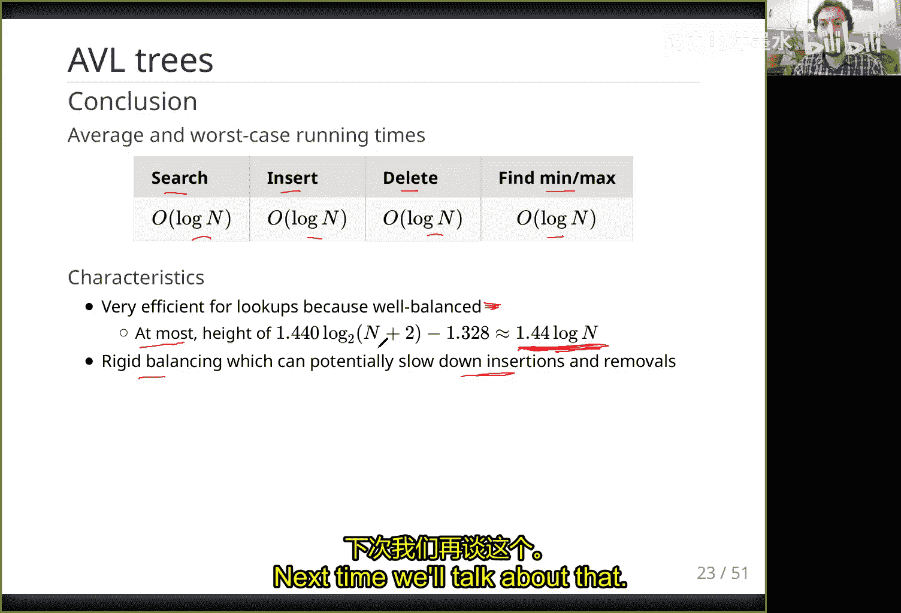

# 【全集】加州大学戴维斯分校 数据结构与算法编程 中英字幕 完整课件 p13 5-2 平衡树 -BV1rJ2WBSE7P_p13-

Hi， everybody。So welcome to our second part。Of our current topic about balance trees so a quick recap about last time so last time I introduced for the first time the concept of AVL trees right？

After the name of their inventors in 1962。So they had the idea of constraining the balance of a binary search tree via the use of a balance factor。

 so for every single node in the tree， we compute the difference of height between for every node between its left sub and its right subre。

If the values are minus1，0 or plus one， then all is good and it guarantees a certain shape like it guarantees that the tree has a height of about log of n。

If we have a balance factor that becomes more than one， so minus two or plus two。

Then it's time to restructure。So the idea behind that is that as long as the tree is AVL。

 like as long as the tree respect those constraints on the balance factors。

 then all of the query operations， they are guaranteed to have a certain complexity。

The trick can not thegene into a long link list that would get us a really poor performance。嗯。

And yeah。Whenever we insert or remove nodes from the AVL trees that could alter its structure and potentially like break the balance and so that's where we have potential rebalancing happening and so we studied that last time we studied two examples of one example needing a simple rotation。

 so here we would notice that the node 93 would have here a balance factor of plus two it's heavier on its left side。

And we kind of have like a line here after inserting a new item our new node in the tree and that scenario would be solved by a simple。

Right rotation， if we like rotate node 54 with node 93。

 then we get to a binary search tree that is balanced again。

Then there is another case that's more complicated where we have an imbalance on a node on a certain side。

 so here like we have an imbalance on the left side of 93。But internally， there's another like。

The呃呃呃。The child here is heavier on the other side， so we have kind of like a turn。

That type of scenario is a little bit more complicated to handle because we need to make a double rotation。

 we need to first rotate。The child and the grandchild to essentially like go to a case where we have a line。

And then， we can。Rotate again the node that is has the imbalance and the following one so that we can rebalance everybody。

So those were the concepts that we talked about last time around the AVL trees。

 today we're actually going to look at the implementation， the C++ implementation。

Let's start with the。The easy stuff， what doesn't change。

So what doesn't change as we mentioned before is that all of the query operations contains mean marks that are could be past it directly from the binary search stream implementation。

 we are not touching those， they work exactly the same。At the end of the day， an AVL tree。

Is a binary search tree in the sense that for every single node。

All of the nodes in the left sub three are necessarily smaller。

 all of the nodes in their right sub tree are necessarily bigger， so that property still holds。

And that means that all of the query operations， they're completely unmodified。

The thing that we're going to add。Is that we're going to have to change a little bit the node structure。

 so if you remember like in the node we had an item like the key that we're holding in the node。

And then we have two pointers， one onto the left child and one onto the right child。

 we're going to have to add one piece of information for every single node。

 which is the height of the node， which will help computing the balance factors。

And then we're going to need a few other internal methods to take care of the rebalancing and everything。

 so let me actually show you that so。It really resembles a lot of the binary researchery that we studied before here。

 I'm just calling it， I changed the name of the class AVL。We have the concept of nodes。

Every node holds a key， every node has a left pointer。And the right pointer。

And that's the additional。Field that we have for our node， its height in the tree。

Here the class ADL only knows the root， and then we have like all of the construction stemming from the root。

And those are the four helper functions that we have to add in order to implement the AVR tree。

So we need a method that gives us the height of a certain node， so it receives a pointer onto a node。

 returns its height。Most of the time。We're just going to look at the node and look at the height member and just return that。

Then we're going to have a method to rotate right at a certain node or rotate left at a certain node。

And a retrace function that will be called when we insert or remove a node from a tree to know if we need to like restructure the tree。

 so actually let's go through those functions kind of in order starting with the height。

This function is very small。And as I was saying， like so。

It receives a pointer onto a node and has to identify the height most of the time it's super easy it's just a matter of returning the field height of this specific node by dereferencing the pointer now there's a special case。

If the pointer is nu， which means that like it's actually a needle node。

Then we're returning the special value minus one。And that indicates clearly that neo nodes。

 the absence of a node。Has in fact a height of minus1 and it's very important because when we compute the balance factor。

Of all of the nodes in the trees。Certain nodes won't have children。

If there are lymph nodes that won't have children on either side， if theyre internal node。

 it's possible that they are missing a child on one side。

 but they have a child on the other side and yet we need to do a subtraction like we need to be able to compare the height on either side。

And so it's very important that even if on one side， a certain node doesn't have a child。

 we can still return a value that can participate into computing the balance factor and so that's why here we're actually kind of representing explicitly neo nodes by saying that if we have the absence of a node。

 then we have a height of minus one。Okay。Okay， so that's for height。

 let's talk about rotate right here now。So here's the implementation of rotate right。As you can see。

 it's not that many lines of code， how many we have like we have six lines of code， that's it。

 but they are slightly complicated， so we're going to go through them one by one。

What's important to understand is that and let me kind of。Redraw this same picture here。

 but in a maybe less conceptual way and more like in C++ way。So let's tag Z， for example。

 Z is a node。That contains a key。Has a left pointer and a right pointer， pretty much like。Here。

 it's a node has a key left corner， right corner， right？So that's for Z。Let me write it here。

The left cornerer of Z。Currently points on x。So that's x。X also has a key。A left partner。

 and a right partner。And。Then， x。Has a left pointer on something。

 we don't know it might be a no pointer if X actually doesn't have any child on the left or not。

And also has an R pointer on something。At this point we don't really care what it is。

 either it's an nu pointer or it's another node and there's like an entire subre。And same here。

The right pointer points onto no or onto another node and so on。

And what's important is that this node Z。Is necessarily pointed itself。By a pointer。So we could。

 for example， imagine that their Z has。A parent。That also has a key。

 a left pointer and a right pointer。 and either the left or the right。Is the pointer on z， right？嗯。

And what you need to keep in mind is that here we're using smart pointers in C++ like we're using those unique pointers。

 so there's actually like a sense of ownership right here the left pointer of Z owns。

Note X there's really like this sense of ownership。And same for these' parent。

 so let's imagine that these parent owns Z on its left side， it could be the right side。

 like it really doesn't matter。But one or the other。

 we have this sense also of ownership of a pointer onto node Z。And what's very important is that。

The pointer here， PR T， parent。That is received as a parameter is a reference on this guy。

And it's very important here because the fact that we receive it as a reference means that we can change the value of this pointer by manipulating PRRT。

Okay。I think that's all we need， so let's continue here。Okay。So let's go line by line。First line。

 we declare a unique pointer， a smart pointer called CHD。Stands for a child。

And CD gets the ownership of PRRTarrow left。So PRRT is thearrow left。

We steal the ownership of this pointer， we still the ownership of this pointer。

And we make this child point on x。 And that will have for an effect to remove。That。But。

 it's not great。Let me readr that quickly， okay。O。😊，So first line does that。

Now we have this partnerer child which owns X。And this left pointer doesn't pointer to anything anymore。

 it's like no。Second line。This pointer here that is now no。Will steal the ownership to child。Right。

So here child， which is x， right， so that pointer。Loses the ownership of whatever it was pointing onto。

 and now it's going to be this left pointer that takes the ownership。Of that。Whatever it is。And so。

Here， the ownership is lost。So that's how the second line。Next line。

So here you see that Z has still a right corner onto something。

And so here we knew the height hasn't changed。But now Z as a new left child。

And that forces to recompute the height of Z overall。

 because it has a new child that it didn't have before。 And so if this。

Left sub is maybe like higher than the right sub， then it's going to change the height of z。

So in that line， we take the maximum between the height of the left sub and the height of the right sub。

And we add one。So here the height of z will be the max of either this sub or that sub。Plus one。

Next line。Child， right。So this pointer， which lost the ownership of that subre and is now available。

Will still。Whatever PRRT points onto to。PRT is the pointer that points on z。So。Child。

The right pointer here will still。The ownership。Of Z。From。Whichever pointer was。Pointing on the。

Next line。Now again， we had X。X has a left substrate， which has a certain height。

Which was known before。But as taken a new right sub for which we don't know the height yet or like the height was not taken into account yet。

 so once again the height of x will be recomputed as the maximum between the height of the left sub and the height of the right sub。

Press one。And that will give the new height for x。And final instruction。The pointer PRRT。

 which is this guy。So whoever， like whichever pointer was pointing onto Z originally。

We now take the ownership of what pointer child is pointing on。

So here we're going to point onto to child。😔，And child， the CD will lose the ownership。

And that's pretty much what we're。Left with， right？So I know it doesn't look very beautiful。

 but essentially like。We have whichever。Notode was above Z now points on x。

Hecks as retained the same。Left sub3， so that represents sub3 T。But now X has as a right child， Z。

Z has taken。The former right sub of x as its own left sub。So that's s UV。And Z here as retains。

The right sub that it was pointing onto， which is W。And all of the heights。

So the height of z and the height of x have been updated to reflect their new height。嗯。

So let's look at it from like a。With a better drawing， if you will。

 that's the situation we're in after running those six lines of code。

The are tough lines of code that's actually what's interesting in computer science is when you get to a certain level where you see functions that seem very easy from a certain point of view because it's not that much code。

But it's difficult to understand right especially here in C plus plus 11 with all of the smart pointer management。

 so it's totally normal if it looks like tall gibberish， but take the time if it helps like。

Come up with the scenario on a piece of paper， really draw it draw the pointers。

 like really draw the representation of a certain memory and really。

Run every single line one by one changing visually on your piece of paper。

 like how the pointers like are affected and everything。And you make sense。😊，Code doesn't lie。

 there's no magic， it's really the execution of those lines of code that make what we want to do。嗯。

And。😊，So that's for the right rotation， as you can imagine the left rotation is extremely similar with just Im like when I wrote that code。

 I pretty much copied everything past it and replaced left with right and right with left that's pretty much all there is。

So let me show you here。So the left rotation here is the exact opposite scenario。

 but as you can see like the lines are pretty much identical like we also start with a child that temporarily like steals a certain sub。

 then we work on the right sub of the parent， then we update the height。

 we work on the left sub of the this child and work on the height and then we finally like do the actual move。

Having the parent。Still the child， and we end up with something that is now balanced。Okay。So。

So far we've seen that we took the same data structure as the binary search tree。

 we slightly modified the structure of a node by adding the height information。

And we came up with four additional internal methods。Height， which we already defined。

 returns the height of a node if the node exists or minus one if the node is in fact a neo node。

Then we just went through the right rotation， the left rotation in that slide。

Now we need to add the last step the retracing， so first before I show you the function for the retracing。

 let me show you where it's going to be used。It's going to be used。In the insertion and the removal。

So as I was telling you before。Insertion and the removal。They actually， like， they follow。

They're the exact same。Well that includes like the dot dot dot they're the exact same function as the binary search tree exactly the same that's a tall copy paste you see that like we we their recursive function we are trying to find the right spot to insert this new key and so we the function is called recursively to navigate through the different children up until we find where to insert this new child and so here we created a node and on the other hand the remove is the same idea。

The remove function is also called recursively。What we add。

 we only add one line to both functions at the end is this retrace step like we called retrace function。

On the current node。Right， so when we have a certain tree。鞋。嗯。Imagine that's what we have。

And imagine that like we would call insert。And insert would start from the root。

Call insert on the roots and then call another function on that node and call the same insert on that node and the new node would be inserted here。

Because theyre recursive calls， we have to return from them like we have to return to that function that pertains to this node。

And then return to that function that returns to that pertains to this node and so on until wherere。

Out of here。For every single node that we return to。

We're going to call retrace the rettra function on that node。So。When we insert a new node here。

 the retce function will be called on this node， then it was going to be called on that node。

 on this node and on that node。So the retice function will be called on all of the ancestors。

Up until the root note。And so on our way up， we're going to be able to compute the balance factor for all of the ancestors and if ever this insertion or removal operation has created an imbalance。

That's in retrace that we're going to be able to shift things around by doing rotations properly to rebalance the tree as a whole。

And more than that。If a rebalancing fixes like a certain issue。

But then it causes another imbalance higher in the tree。

 it's possible that the tree gets moved multiple times， like gets restructured multiple times。

Just because of the incession of one single note。I think in the next example。

 we're going to be able to see that happen in real life。So yeah， so at the end of insert。

 we call retrace at the end of remove， we call retrace and that's going to call retrace on every single ancestor of the node that is being inserted or removed。

So now let's actually look at this retrase function。As you can see this one is a little longer。

 but it's really not that complicated and let me show you why。

Let me redraw again the four different scenarios that we have that could cause an imbalance。

If you remember like we have the scenario where we have。Three nodes in a line like that。

 and we have an imbalance of plus two on this node Z。We have the exact opposite scenario。

And this time， the balance is minus2。We have the scenario where z has an imbalance of plus2。

 except that it makes a turn。And the scenario where it's same， but the opposite direction。

We have pressed to here。And minus one here， ohm sorry。We have。Minus。Or is it  minus-2 here。Plus。

 one there。And here minus one。😔，Minus1 and plus one。想听一。

So those are the four different scenarios at the end of the day that we are trying to fix， right？

Those first scenarios are right here。😡，So this first if statement。

Is trying to catch if the tree is left heavy。That would capture。That scenario。And that scenario。

 because both of them are left heavy， they both have a balance factor of plus two。On the other hand。

Thisels here is if the tree is right heavy， so that whole block will capture this scenario。

And that scenario。Right？Now。Let me go back to red。If we're in that scenario。

We can match the fact that we have only one line here because both balance factors are the same as a sign。

In which case， we can just。Solve it by doing a simple right rotation， whereas in that scenario。

 we first need to do a left rotation。And then。A right rotation。 And that's exactly what this sub。

That this like internal E does。This internal if tries to detect if we're in this particular scenario。

 in which case we would do a rotate left first。On the grandchild and the child。

Before we do the right rotation here。On the other hand， if we in that scenario。

 then this if wouldn't match and we just do the right rotation。

And so for this Elsie here is the exact same idea， we have an internal if that tries to capture this one。

 this scenario， because in this scenario we are first going to have to do a right rotation and then a left rotation。

Whereas here we do only a left rotation and that's what we're trying to capture here to do the right rotation only if necessary。

And finish by your left rotation， no matter what。And after rotating。

We need to adjust the actual nodes new height because we moved things around that's the idea。Okay。

Let me give you a few examples now。嗯。😊，That you might actually recognize from previous lectures。

I don't know if you remember when we talked about binary search trees。

 I think I showed you this example where we would insert keys。But that are already in a solid order。

 and if you remember， if we have just a binary search tree。

 that would that kind of scenario would degenerate into a linked list。

Because here two would become the root。18 would be inserted。On the right。

 then 42 would be inserted on the right and then 43 would be inserted on the right。

And so on and so if we happen to insert those keys in that order and we only have a regular binary search tree。

 we end up with the linked list and so worst case scenario we have all of the operations are in O of N which is pretty bad。

嗯。Here with AVL。We're not going to have that because every time that we are going to catch that there's an imbalance。

 we're going to rotate some nodes and that's going to make sure that the structure of the tree stays balanced。

So let's actually see how。For every insertion， I made the tree to be printed。

 so here we can actually like follow。How the different insertions are handleded by the tree。

When we insert value number two， well that's pretty easy， it becomes the root。

Then we insert value 18， which is the next。18 becomes the right child of two。Now when we insert。😡。

Value 42 here is the resulting。3 and so now we see here that 18 has become the root。

18 now is at level one。2 is on the left side at level 2。Sorry， two。

And 42 is on the right at level2 as well。So here we see that like when 42 was inserted on the right side。

 we were able to catch the unbalanced on the root node with a balance factor of minus2。

 that prompted a left rotation and we ended up with something that was balanced。

Now we continue note 43 was inserted， so that would get inserted on that side， no unbal。Next line。

 51 gets inserted。Here when it gets inserted there。We have an imbalance， right。

 because here now we have an imbalance。On note 42 of -2。So that would be so here we need to do。

A rotation between 42 and 43， and so that would get us。A tree that looks like this。

So now 43 would be up there， 42 would be。The left child and 51 would be the right child。

And we're balanced again。That's right here。嗯。Let's continue。Oh yeah。

 this one is going to be interesting and we're going to stop after that， I think。

So here we're inserting 54。So technically， 54， if we insert it just following the binary search tree。

Pinles it should get there。So that has a balance factor of minus1 oh and yeah， okay。

 so here 43 has a so that's a height of zero， that's a height of one， that's a height of two。

 that's a height of three。That's a height of one。So here we have a balance of minus2 for the root node 18。

So that tells us that we need to rotate here， right？So here 43 will become the root。

18 will become the left child。Two， we still be on the left。And then on the other side。

 we'd have like。诶。51。Oh yeah，42 would be also。Attached on the right side of 18。

And we'd have 54 over there。😔，嗯。Okay， we're going to stop here because we're not going to do all of it。

 but as you can see like。As nodes are being added and here like it's clearly。

 I mean it should not happen like that it's very much of a pathological case to insert a valueined order。

 but because of the AVR because of this restructuringtracing step and the restructuring with the rotations as nodes are being inserted。

 the trees being like restructured every so often to make sure that we keep a good balance so that whenever we want to do operations on it。

 like calling contains mean marks or whatever， we are going to be guaranteed log of n operations。

Quickly， another example that we had also studied for the binary search tree。呃。

TheLike random insertion and deletion， so if you remember when we had done that for a binary research tree。

Having a certain structure and then doing insertion and deletions。

 we saw that with the algorithm that I talked about。嗯。😊。

The algorithm tended to like remove nodes from the right side and put them on the left side and so eventually like the tree would become like more and more heavy on the left。

And that would actually like change the complexity like if we had the complexity of log n。

 after doing a lot of insertion and deletion， we'd have a height。

 so a complexity that would tend to become like square root of n and not log of n。

 which is a lot worse in terms of complexity。Here with the AVL。

 we do this experiment of inserting and deleting a bunch of nodes。And at the end of the day。

 when we represent。嗯。😊，This。This this tree here。We could we could do it very quickly。

 so we see that like 48 here is the root because it's at level zero。

Then what do we have like we have？78。Level 2。And 28， level2。Then we have。12。24。39。And  41。

And on the other side， we have。77。And finally 94。😔，We see that the tree is still very much balanced。

 like we still are able to like keep a very good structure that is proportional to log of it。

And okay。So to conclude on this lecture。We saw this data structure， AVL。

 both conceptually and the implementation， and we saw that now because of this restructuring。

 we can guarantee that we have a search operation， an insert， a delete。

 a finding min Max and all types of operation， all guaranteed to be in log of it。Which is really。

 really good。And actually it's so good。😊，Because of the fact that this balance factor that AVL trees enforce is pretty strict。

 it's a pretty strict balance factor， like for every single node in the tree guaranteeing that the difference of height between the right sub tree and the left of tree would be at most one。

That's a very， very tight balance factor。To the point that like。

And I think it's been proven mathematically， like if you have an AVL tree of end nodes。

At the very most， it's guaranteed that the height of the tree will not be higher than essentially like。

1。5 log of event。So the height of the tree as a function of n， the number of the nodes is very。

 very much kept under control and very close to the actual like log。嗯。On the other hand。

 the fact that this balance factor is like so strict comes also at a cost in the sense that it means every time the tree is modified by insertion and diletion and we have to restructure it in the retracing steps。

It's actually going to take a little bit of time to like rotate things around and make sure that the balance factor is properly respected。

In the。Next data structure that we're going to study in the next lecture， the red and black trees。

 well see that the balance factor or it's not really like a concept of balance factor here。

 but it's another set of properties。They're a little bit more relaxed。

 it's still going to enforce that the tree overall is fairly well balanced。But less so。

 so that means that for some of the operations like we're not going to be able to guarantee that at the maximum。

 the height of the tree or the complexity of all operations。Will be as small as that。

But because it's more flexible， we might accelerate the insertions and the removals。

 but there'll be for next time， we'll talk about that。

Yes。