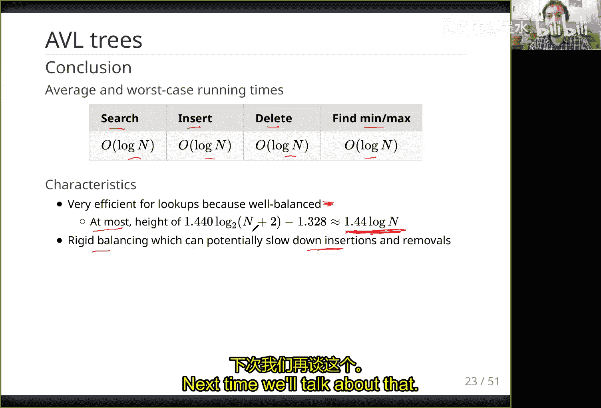

# 数据结构与算法编程：5-2：平衡树实现详解 🧑‍💻


在本节课中，我们将要学习AVL平衡树的C++实现。我们将从回顾AVL树的基本概念开始，然后深入探讨其核心数据结构的修改、旋转操作的实现，以及插入和删除节点后如何通过回溯（retrace）来维持树的平衡。

## 概述

上一节我们介绍了AVL树的概念，它是一种通过平衡因子来约束二叉树形状的自平衡二叉搜索树。本节中，我们来看看如何用C++代码来实现它。实现的关键在于修改节点结构、实现旋转操作，并在每次修改树结构后执行回溯以检查并修复平衡。

## 节点结构与辅助函数

与普通的二叉搜索树相比，AVL树的节点需要额外存储一个信息：节点的高度。这有助于我们计算平衡因子。

以下是节点类的基本结构：
```cpp
class Node {
public:
    int key;
    std::unique_ptr<Node> left;
    std::unique_ptr<Node> right;
    int height; // 新增字段：节点高度
};
```
AVL树类本身只维护一个根节点指针，并需要一些内部辅助函数。

我们需要四个核心的内部辅助方法：
1.  `height(Node*)`: 获取节点高度。
2.  `rotateRight(std::unique_ptr<Node>&)`: 在指定节点执行右旋转。
3.  `rotateLeft(std::unique_ptr<Node>&)`: 在指定节点执行左旋转。
4.  `retrace(std::unique_ptr<Node>&)`: 回溯并重新平衡树。

### 计算高度

`height`函数非常简单。它接收一个节点指针，如果指针不为空，则返回该节点的`height`字段值。这里有一个特殊情况：如果指针是`nullptr`（即一个空节点），我们返回`-1`。这很重要，因为在计算平衡因子`balance = height(left) - height(right)`时，即使某侧没有子节点，我们也能得到一个有效的数值参与计算。

```cpp
int height(const std::unique_ptr<Node>& node) {
    return node ? node->height : -1;
}
```

### 右旋转操作

右旋转用于修复“左-左”型不平衡。其逻辑是重新组织三个相关节点（Z, X, T）的指针关系。虽然代码只有几行，但涉及智能指针所有权的转移，需要仔细理解。

假设我们有节点Z，它的左孩子是X，而X的右子树是T。右旋转的目标是让X成为新的局部根节点，Z成为X的右孩子，同时T成为Z的左孩子。

以下是`rotateRight`函数的实现和分步解释：
```cpp
void rotateRight(std::unique_ptr<Node>& parent) {
    // 1. 临时取得父节点左孩子的所有权
    auto child = std::move(parent->left);
    // 2. 父节点的左指针接管原左孩子的右子树
    parent->left = std::move(child->right);
    // 3. 更新原父节点Z的高度
    parent->height = 1 + std::max(height(parent->left), height(parent->right));
    // 4. 原左孩子X的右指针接管原父节点Z
    child->right = std::move(parent);
    // 5. 更新新局部根节点X的高度
    child->height = 1 + std::max(height(child->left), height(child->right));
    // 6. 传入的引用参数`parent`现在指向新的根节点X
    parent = std::move(child);
}
```
理解这段代码的最佳方式是在纸上画出每一步指针和所有权的变化。左旋转`rotateLeft`的实现与此完全对称，只需交换“左”和“右”即可。

## 插入、删除与回溯

查询操作（如`contains`、`findMin`）在AVL树中与普通二叉搜索树完全一致，无需修改。需要修改的是插入和删除操作，它们在完成基础操作后，需要调用回溯函数来维持平衡。

插入和删除的递归算法框架与二叉搜索树相同。不同之处在于，在递归调用返回的路径上，**对每一个访问到的祖先节点**，我们都需要调用`retrace`函数。

```cpp
void insert(int key, std::unique_ptr<Node>& node) {
    if (!node) {
        node = std::make_unique<Node>(key);
    } else if (key < node->key) {
        insert(key, node->left);
    } else if (key > node->key) {
        insert(key, node->right);
    }
    // 插入完成后，回溯当前节点以检查平衡
    retrace(node);
}
```
删除操作`remove`在结构上与此完全相同，也会在最后调用`retrace(node)`。

### 回溯与再平衡

`retrace`函数是AVL树的核心。它检查当前节点的平衡因子，并根据四种可能的不平衡情况调用相应的旋转操作。

四种不平衡情况是：
1.  左-左型 (平衡因子 +2，且左孩子的平衡因子 >= 0): 单次右旋转。
2.  左-右型 (平衡因子 +2，且左孩子的平衡因子 < 0): 先对左孩子左旋，再对自己右旋。
3.  右-右型 (平衡因子 -2，且右孩子的平衡因子 <= 0): 单次左旋转。
4.  右-左型 (平衡因子 -2，且右孩子的平衡因子 > 0): 先对右孩子右旋，再对自己左旋。

以下是`retrace`函数的实现逻辑：
```cpp
void retrace(std::unique_ptr<Node>& node) {
    // 更新当前节点高度
    node->height = 1 + std::max(height(node->left), height(node->right));
    // 计算平衡因子
    int balance = height(node->left) - height(node->right);
    // 情况1 & 2: 左子树更高
    if (balance > 1) {
        if (height(node->left->left) >= height(node->left->right)) {
            // 情况1: 左-左型，单次右旋
            rotateRight(node);
        } else {
            // 情况2: 左-右型，先左旋再右旋
            rotateLeft(node->left);
            rotateRight(node);
        }
    }
    // 情况3 & 4: 右子树更高
    else if (balance < -1) {
        if (height(node->right->right) >= height(node->right->left)) {
            // 情况3: 右-右型，单次左旋
            rotateLeft(node);
        } else {
            // 情况4: 右-左型，先右旋再左旋
            rotateRight(node->right);
            rotateLeft(node);
        }
    }
    // 如果平衡，无需操作
}
```
这个函数确保了在插入或删除后，从被修改节点的父节点开始，一直到根节点，整条路径都能恢复平衡。一次修改可能引发多次旋转。

## 运行示例

让我们看一个将有序序列插入AVL树的例子，这恰好是普通二叉搜索树的最坏情况。

依次插入: 2, 18, 42, 43, 51, 54...
*   插入2和18后，树是平衡的。
*   插入42时，根节点2的平衡因子变为-2，触发一次左旋转，18成为新根。
*   插入43，无影响。
*   插入51时，节点42的平衡因子变为-2，触发一次左旋转，43成为局部新根。
*   插入54时，会导致根节点18的平衡因子变为-2，再次触发旋转调整。

通过动态调整，AVL树始终保持近似平衡的高度，避免了退化成链表的情况。即使在混合插入删除后，树的高度也能维持在**O(log n)**级别。理论证明，AVL树的高度最多不超过**1.44 * log₂(n+2)**，平衡性非常严格。

## 总结



本节课中我们一起学习了AVL平衡树的C++实现。我们首先在节点中添加了高度字段，然后实现了左右旋转的核心操作。接着，我们修改了插入和删除算法，使它们在操作完成后对祖先路径进行回溯和再平衡。通过严格的平衡因子约束，AVL树保证了所有查询和修改操作的时间复杂度都在**O(log n)**以内。这种严格平衡的代价是在插入和删除时需要更多的旋转操作。在下一讲中，我们将学习红黑树，它采用一种更宽松的平衡规则，可能在修改操作上更高效。