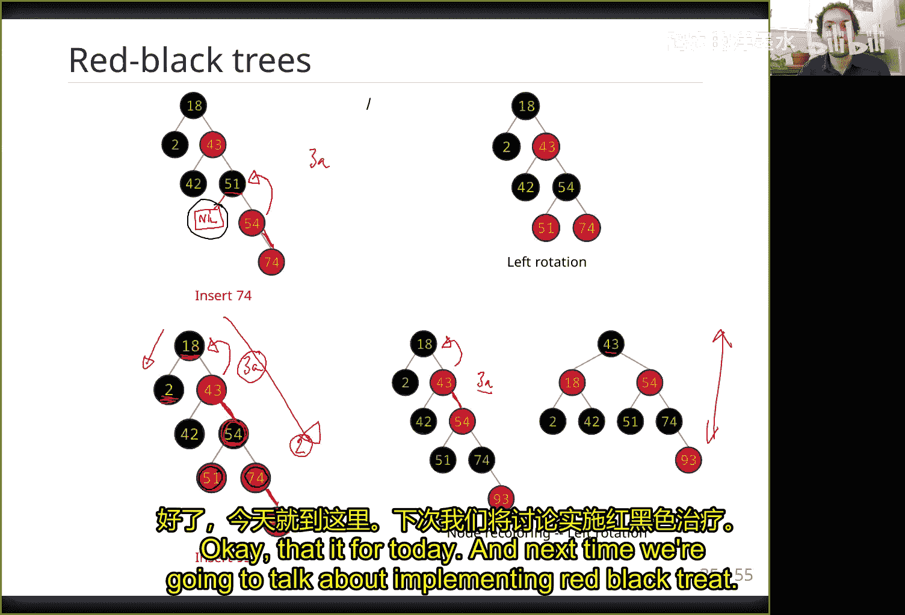

# 【全集】加州大学戴维斯分校 数据结构与算法编程 中英字幕 完整课件 p14 5-3 平衡树 -BV1rJ2WBSE7P_p14-

Hi everybody， so let's continue on our topic about balance trees。

So in the past two lectures we introduced AVL trees， the first selfbalan tree structure。

 it's extremely popular， it taught in every single textbook。

 not necessarily the most popular implementation， but the concept is very， very interesting。So here。

 just as a reminder， AVL trees they are based on this concept of balance factor。

 the it is that we compute the height of every single node in the binary search tree and we deuseuce from those heights the balance factor of every node and this balance factor essentially gives the information of whether a node is heavier on the left or heavier on the right。

And what we're trying to do is to make sure that if there's a slight imbalance between right sub and left sub of a node it cannot be moderned by a level of one so essentially like if a node is heavier by like two levels on one side then we need to do something we need to。

Rebalance the tree。And as an outcome， it means that AVL trees are extremely well balanced。At most。

 considering a tree that has n nodes， the height of the tree will be 1。5 about log of n。

 which is very， very well balanced， meaning that all of the nodes are extremely packed towards the top and we don't have any like long trails。

 which means that in terms of complexity for all of the operations that are interesting for BSDs。

 such as mean marks contains insertion removal， like the running type complexities is pretty good。嗯。

And just also as a reminder， when we say that we restructure the tree in order to keep the balance。

 it's being done by doing rotations so and if you remember like here in that we have four different scenarios essentially we have the scenario where we have node Z which is unbalanced on its left side so the left side is like two levels deep deeper than the right side in which case we can solve it by doing a right rotation。

 the left rotation here is the exact opposite， the node would be unbalanced on its right side and then we have two more complex cases where。

Here， like the left side of node Z is deeper by two more levels。But inside of these left sub。

 the sub itself is heavier on its right side that's kind of like a turn。

And so here we have to solve this complex scenario in two steps， we need to first do a left rotation。

Followed by a right rotation， we need to do a double rotation in order to fix this kind of scenario and so here last scenario is the exact opposite。

So now that we have studied this AVL tree structure。

 let's study another type of selfbound trees which is also extremely popular and actually like this one is used a lot in many。

 many different use cases， I think we'll talk about that towards the end of this topic。

So this other very popular。Type of self balancing trees is called red， black trees。

The concept was invented about 10 years before after AVL trees so remember like AVL trees were invented around like 1962 here the concept of red black trees was invented in '72。

 but the actual implementation of red black trees was invented in 78 so a few years later what's interesting here is that you might not recognize this name Segwick。

I don't know if I'm pronouncing it right， but。He's a professor at Princeton who actually teaches the equivalent of this course at Princeton and has been for like the past30 years。

He's the author of one of the most popular textbook about data structure and algorithms that is called actually algorithms。

 it's in the C it's a very very good textbook they also have a website that I keep referring to because it's very well done so check it out and it's a name that you will get to see again during this course because Segwick did his PhD on this algorithm called Quickalt which is also one of the best sorting algorithm and we're going to talk about that in a couple weeks。

So anyway。What are those red， black trees？So one thing that you need to remember here is that AVL trees。

 just like red， black trees。At the essence， there are binary search trees。

 remember binary search trees， meaning that every node contains some sort of key。

And binary surgery means that like for every node all of the keys that are in the left subies are smaller。

 all of the keys that are in the right sub are bigger that's what binary search tree is now the fact that we have an AVL tree or red black tree only means that we have to find some strategy to keep this binary search tree balanced so it's really just about the balance aspect of that that we have a distinction between AVL trees and red battery。

But the train itself has the property of binary surgeryery。

So how does it work for red black trees for red black trees？We have four very specific rules。

And by enforcing that those rules are always respected。We're gonna。As a consequence。

 make sure that the tree stays balanced， so what are those rules？Rule number one。

Says that every node in the tree will have a color。So here in terms of implementation。

 you can already think that like we're going to have a struck node like we've had before and for AVL3。

 we had added this new field height to keep the height of every node because that's what the balance factor uses。

Here as a parameter for every node， we're going to have a card， red or black。Now， rule number two。

 the root。Of the red black tree is always black， no matter what。😡，We'll get how it works later。

Third rule。If a node is red。Both of its children are black， so here we can verify it。Note 18 is red。

 both of its children are black。Notode 93 is red both of its children are black What about those leaf nodes。

115174 Well here it's interesting because in fact。Yeah。

If you remember conceptually leaf nodes that are nodes without children， in fact。

 they do have conceptually children。Ced Ne notes。Wwhich signifies the absence of a child and neo nodes are considered in this data structure that are considered as being black。

And so here， technically， it means that even if 11 is a leaf node n is red technically。

It's the parent of two neural nodes which are black， so this third rule is respected。Okay。

 and finally。Maybe one of the most important of those rules。

 and that's really the rule that we make sure that red back trees stay balanced。

Is the fact that the path from the root node to any single node of degree1 or zero。

Has the same number of black notes on the underpa。And that's something we can verify。

 let me clear this up， so let's take node。So just。Let's first identify the node of degree 001。

That would be all of those nodes， right？99 is degree 0， 74 degrees0， 51 degree0， 11 degree0。

 theyre all leaf nodes oh and sorry， but that 42 is also a leaf。And node two here is of degree one。

 right because it only has one child， so all of those nodes that I circled in purple are of degree one or zero。

And now what's interesting is that。The path from the root node 43 to any of those nodes of De 01 have the same number of black node。

So 43 to node2 has two black nodes。43 to11 also has two black notes， 43 and2。

43 to 42 has two black notess， 43 and 42。43 to 51 has two black notes， 43 and 54。And so。43 to 74。

 43 to 99， they all have two black nodes， exactly two black nodes。

On the path from the root to all of those nodes so here we see that the rule is respected and as you can imagine like enforcing the number of black nodes that we can have on all of the path between essentially the root node。

And kind of like the outer layer of nodes will enforce the fact that like the tree remains somewhat balanced。

Okay。嗯。Let me now show you two interesting examples。Yeah。

Let's take this example and actually let's make it a little interactive why don't you like pose the video right now look at this tree and try to determine if it's a red black tree or not and because i'm nice I'm going to give you a hint it is not a red black tree for at least three reasons so pose the video look at this tree。

And try to determine which are the three reasons why it's not a red battery。Okay， so。

This tree is not a red black tree already said that because of three reasons。

The first one you can see right here。That's the root node and it is not black。

 so that's violation of the root rule。Other issue here we have。

A red note and the red rule says that a red note should have both of its children be black。

 which is not the case with this left child， so that's another violation。

The last violation is a path rule violation。😊，So look at here like from the root。To say。

This node of degree0， we have。Two black nodes。Now if you take the path from the root。To this node。

Which is a node of degree one。We have only one black note。So that's the third violation。

Which I wrote here。Okay， now let's look at another very。

 very interesting example and let's try to play the same game， so let me show you the tree。

Pose the video and try to determine if it's a red black tree or not。

 and this time not giving you any hint。So let's look at it。Root is black。

 so the root rule is fulfilled。This node is red， both of its children are black。This note is red。

 both of its children are black， this note is red， it's a leaf。

 so technically like the neo nodes beneath it are also black。The red rule is fully respected。

So I guess that brings us to the last rule， the path rule。If we start from the root。

And we go to all of the node of。Deggree 01， so here the two pad that we have on that side。

 we have three black node。Now let's go from here to select。There， one， two， three black nodes。

Let's continue， let's try going over there。That's also three black nodes， one， two， three。

Let's go over there。1，2，3， black nodes。Let me change the color because we can't really see。

And let's go all the way。 say like to the last node， that's 1，2。Three black nodes。

What do we see here？This tree is a red black tree。It's actually a very specific red black tree that really pushes the like most kind of unbalanced than we can have in a red black tree let me explain a little bit more here。

We have the example of a red black tree where on one side， it's all black nodes。

And on the other side， as you can see， we have a succession or an inter livingaving between black nodes and red nodes。

And if every other node is black and the other nodes are red。Essentially。

 it means that like on one side， we're going to have a certain number of nodes like the。

Depth are going to be like， say here like three。 and on the other side， the depth will be like 1，2，3。

4，5，6。Okay。In that case， it means that like red， black trees are flexible enough that without breaking any rules of how they should be structured。

 we can end up in a situation where like on one side， we have a certain depth。And on the other side。

 we have up to twice this depth。So here you see that like compared to AVL trees。

 which would never allow such an imbalance。With red black trees。

 the overall balance of the tree is a lot more flexible， like a a lot less strict。

Which is very important because that was one of the cons of AVR trees。

 the fact that like the balance factor， like the balancing in general was like too strict and it took too much time because we had to do a lot of rotations all the time to make sure that the tree stayed balanced all the time。

Here the red， black trees， their rules are a little less constraining。

 and so we're going to restructure the tree a little less。

Which means that technically the implementation should be a little faster。

 which is great and at the same time the tree will stay like roughly well balanced so most of the operations will remain in like about log of it。

Okay。Let's talk about。Those operations， actually。So just like for AVL trees。

 all of the query operations， so finding the minimum， finding the maximum。

 finding a node in the tree。They are not modified at all。

 they stay exactly the same as regular binary search trees。

And it's only the operations that might change the structure of the tree。

 so a like insertions and removals。That we will need to slightly adapt to make sure that when a tree is modified。

All of the red， black rules， they stay enforced。嗯。😊，So here for red black trees。

 the removal operations are actually like pretty complicated so we're not going to go in details about them。

 we're actually not going to mention them at all， we're only going to focus on insertion and they'll be complicated enough。

So let me show you the overall procedure of an insertion。So。When we want to insert a new note。

We're going to start from the root。And we're going to do the regular。

Binary search tree insertion exactly like for binary search tree and for AVL trees。

 so remember like the most of the function is exactly the same。

We have a new key that we want to insert in the tree。

 we do the recursive insertion and we put the key where it should go initially。

So imagine that like this new key， we insert the new key to and it goes as the left child of。

Notode 80。The next step is that this new key that we're inserting this new node that we're creating。

 we will color it in red， no matter what， like that's just new node becomes red。

Then depending on certain conditions and that's mostly going to be depending on the parent's color。

 so whether the parent is black or whether the parent is red。

We're going to have to maybe restructure or record things to make sure that the。3。

Still respects the red and black properties。And I'm going to show you the different use cases。

 there are like three different use cases I'm going to show them。And at the end。

No matter what happens in terms of restructuring and recovering。The roots。

Will be recalled to black because it's possible that。😡，In the restructuring and in the reing phase。

 the root might temporarily be a change to reds。 So no matter what at the end。Rd is black。Always。

So those are the four steps。Now let's try to zoom on step number three。Three。

 when do we need to recol or restructure the tree to restore the red black properties if it's necessary？

So。Case number one is the easiest。Case number one is when we insert a new node。Newode is red。

 and it turns out that it pants。Is black。嗯。In that case。We don't need to do anything。

So what's the actual reason why we don't have anything to do， well it's pretty easy to understand。

If you look at the path between the roots。And this new node that we're inserting。

We aren't changing the number of black nodes that are on that path。

So the path rule here has no reason to bevarid。And also because the parent was already black。

If we insert the new node as a red node， we're also not violating。The red rule。So in fact。

 like doing that， we're not vi any of the red black properties。The issues。Arrrise when the parents。

Is red。And we would be inserting this new node， which would be read as well。

 and so here that's when we are going to have to do a little bit of work。So。

Let's see what could be the issue and how do we solve it？So let's look at the second use case。

In the second news case。It's actually when， so the new node。Is red and here。Problem。

 the parent is red as well。So here we have a clear violation of the red rule。

 the red rule says that if a note is red， then both of its children should be black and here we are violating that rule now。

When we look at that。When we look at this use case。

 we need to also look at the grandparent and the uncle that's going to be very， very important。So。

If the new node that we're inserting here is red， that's part of the insertion procedure。

And the parent is red， so we have a violation of the red rule。Now we look at the grandparent。

 the grandparent is black。And the uncle。Here， so the parent' sibling。Is also red。

So that's this very specific use case that we could encounter。In that case。

 we're not going to have to restructure， we're not going to have to move nodes around。

 that's going to be far later。Here in that very specific case。

 we're only going to have to recol the tree and let me show you how。嗯。

So the grandparent will be recovereded in red。And the parent and uncle will be recorded in black。

So you see what's happening between before and after。

 essentially before the grandparent was black itself and had two red children。

And now it's the grandparren that becomes red and kind of like pushes the black collar onto the parent and the uncle。

Now， notice that like the。Path rule。It's actually naturally really changed。

Because the path that came from up there。Down to the uncle。downown to the parent here， I mean。

 whatever was up there doesn't really matter。Here we were encountering one。Black note。

 which was the grandparent。Now， if we look after the reoration or after the reing。

 any path that came from up there。On this side or on that side。

We also still have one black node on that path， so technically like we're not changing the number of black nodes that are on the path。

It's just that it's been moved around kind of。And the red rule is now being respected again because we have。

A red note here that has two children that are red。嗯。Now might be the good time of also kind of。

Introducing a concept。So far， of。Kind of focused on the fact that。We would insert a new node。

And the insertion of this new node， which is always read， could cause some violation。Of the red。

 black properties。But it's also possible that while we are doing this reing process or restructuring process。

 we might also create some more violation， so let me give you an example here。

After doing this recovering。The grandparent has become red， right， What if。The node that's up there。

Is also red。Were creating another violation of the red rule。Okay。

That were actually going to solve in kind of the same way as here。

It's just that like we're like by solving issues。That stem from inserting a new node。We're going to。

 we might create issues。U the tree as we're going back to the root node and but that's fine。

 it's just like we're going to solve them and eventually we'll like climb up to the root node。

Wwhich we will recover in black no matter what， and eventually the tree is going to be all rebalanced I'll show you an example of that in a few slides。

嗯。Okay， so that was case number two when the parent is red， grandparent is black and uncle is red。

Let me show you now the third use case。So in the third use case， again。

 like the new node that we're inserting is red， that's a given， the parent is red， if it wasn't。

 then we would be in case number one， nothing to do。

Here the difference is that the grandparents is black， but the uncle is black。

So that's the big difference with the case number two here the uncle is black。

So we actually have two。The uncle is either black because it's a node that is black。

Or the grandparent actually doesn't have。A right subre or a right node。

And instead has no node at all so has like a neo node。

 but remember like neo nodes are actually considered technically as black nodes。

 so we would still fall under the same case that the uncle is considered as a black node。嗯。

Look at me。Remove that。OK。嗯。So yeah， so that's the typical use case。嗯。

We also have to take into account that the parent might have。A right node and a right sub。

 we actually don't really care what it is like we don't care about its corner or whatever。

 it's just like we have to conceptually， we have to know that it exists。

Because we are going to have to move it around as well。嗯。The way that we're going to solve。

This issue， well actually we're going to use the same kind of techniques as we used with the AL trees。

 we're going to use rotation and as you'll see like whenever we work with trees rotations will always be a very good tool。

So here to solve this issue， we're actually going to do。

A right rotation between the parent and the grandparent and we're going to do a little bit of reing as well。

 So let me show you。What's going to happen here is that we're going to do a right rotation between the parent and the grandparent。

So obviously， like here I'm showing you the use case where。Where in that direction。

 like this new node n is the left child of the parent and parent is the left child of the grandparent。

It could be the exact opposite， we could have the exact same scenario。

 but on the right side but the concept logically it would be exactly the same。

So here we do a right rotation。The parent now gets up there and the grandparent becomes the parent's right child。

 and you see here it was important to kind of make it a parent。That P right sub3 x could exist。

Because this sub x would now become the right child of G。哦。P was red and is now recorded in black。

And G was black and is now recorded in red。So that's the case number3 and3 a there's got to be a case 3B。

 so3 a is simple restructuring， so right rotation or simple rotation depending on which side。

We have that scenario and reing of the parent and the grandparent。After we do that。

 we're back to normal， right like the path rule is still respected and the right rule is still respected。

And， finally。Probably the most complicated case。Is case 3 B complex restructuring？

So here we're in a situation where。The node the new node n， which is read by default。

Is now the right child of P， the parent， which is also read， that's why we have an issue。

But P is the left child of G。You see where I'm going with that？Looks a lot like the AVR tree。

 like the complex case of the AVR tree as well。How are we going to solve that。

 well in the same way that when we had this like kind of turn in AVL trees。

 we're going to do a double rotation。We're going to do a first rotation between N and P。

 we're going to do here a left rotation。That's going to bring things into a line and once things are into a line。

 we're going to do a right rotation。So let me show you that。

So after the left rotation between N and P。P will actually become the child of this new node n and see how like those different subaries are also being redistributed and that's why we have to take them into account。

And once we have things into a line and you'll notice that like this first rotation has not changed the issue of the violation of the red rule here have we had the issue that like P is red and cannot have a child that is red by doing the simple rotation。

 we are still violating this rule because n is red and cannot have a child that is red。But。

Then we do a right rotation between N and G。And becomes。The parent。Of both P。And G。

N is recovered into a black node， G is recorded into a red node。

 and now we're back to having a tree that is valid。

That's it I know it's a little complicated but like we're going to do some examples and you see that like when you actually see the situation of a red rule violation and you just like identify it to which case it corresponds to then you just apply what needs to be done in of in terms of reing or restructuring and then the tree becomes balanced again so actually let's do。

An example of that。It's pretty much the same example as we did for the AVL trees。

 so the idea is that like we have a bunch of here like integer keys。And you see that again。

 like those keys， they are in fact in sorted orders。

 or remember like if we had a regular binary search tree that was not balanced。Inserting。

A sequence of already solid keys would make the binary search tree be completely unbalanced and it would degenerate into a long linked list and we saw that with AVL trees we didn't have that because the AVL will like keep rebalancing itself。

And so here we're going to see that the red black tree also rebalances itself instead of letting the tree become a long linked list。

Let's start with the beginning。What happens when we insert the first key key number two？

Well at first the tree was empty and so here now we have one node this node is by design the root node because it is the first one that we're inserting and right away we see that we are violating。

A rule， which is the root rule， the fact that the root node should always be black。

So when we insert this first key number two， as part of the insertion procedure at the end。

 we're going to have to make sure that the root is always black and so that's what we do rec it in black。

Okay， next one， we insert the next key key 18。Here， we're lucky。

So the new key is the new node is colored in red， that's part of the insertion procedure。

 but the parent is black， so here we are in the case number one， nothing needs to be done。

 we are not violrating any rule， we're good to go。Okay， next， we insert node 42。So here， okay。

 issues are coming away， we are violating the red rule。Notode 18， which is red。

 cannot have a child node， which is red as well。What case are we in now so actually like maybe pause the video。

 go back a few slides and try to identify which case corresponds to this scenario。

So here we're in the situation where so the newod is red， parent is red。

 grandparents is black and uncle。Is。A Ne node， which is， in fact。Considered black。

So we're in case 3 a， which calls for a simple restructuring， which means that they should be here。

A left rotation between the parent and the grandparent and a reing。

 so the grandparent here will become red and the parent will become black。After we do that。

 we're back to being balanced。Okay， next up。Notode insertion of 43， so actually same here。

Maybe post the video， go back to the different use cases and try to identify which one it corresponds to。

Okay， so here what do we have？We have new node is red， parent is red。

 that's why we have an issue because we have a violation of the red rule。Grandparents is black。

 and this time， uncle is red。That's case number two。Which doesn't call for any restructuring。

 but it calls for a recovering。Essentially， we're going to exchange the color of the grandparent with the color of the parent and the uncle。

 the uncle and the parent will become black and the grandparent will become red。If。

18 the grandparent becomes red， then we're going to be violating another rule。

 which is the root rule， the fact that the root should always be black that's not an issue we're just going to change its color。

So we're going to start by doing the node recovering based on case number two， and once we' are done。

 we're just going to simply recover the root。And here you see what something that happens that's interesting。

Up until now， the path between the roots。And the children know that the lymph node was that like we would have one black note。

For the path rule。Now。The roots。From any。Notode of degree1 or0 has。Two black nodes。

So you see how like the tree kind of grows little by little。

And we extend the number of black nodes that are crossed on the different path from the root to nodes of degrees 100。

Okay， let's go on。So next up， we insert node 51， so again， clear violation of the red rule。

And we are pretty much in the same scenario as before where the node is red。Parent is red。

Grandparents is black， and uncle is。Back。Ca the uncle here is a knee node。That's case number。3 a。

Calls for a simple restructuring between the parent。And the grandparents。

 we're going to do here a left rotation and a recovering。And so at the end。

 we have that 43 has become the apparent， 42， which was the grandparent。

 is now down there at the same level as the new node。And has been recalled。Okay， next up。

Inerion of node 54， so same as before， like violation of the red rule。So this time。

 the new node is red。Parent is red。Grandparents is black， and uncle is red。

Here when the same situation is up there。We can identify to use case number two。

 which will not call for restructuring at all， just a node reing。

So here the grandparent will become red。Parent and uncle will become black。嗯。そ呀。Okay。

We're getting towards the end here。So insertion of 74。So again， same as usual。

 like violation of the right rule。So 74 is red， parent is red。Grandparents is black and。嗯。Uncle is。

Black。So what do we do here， which case is that， well it's a simple restructuring case 3 a。

 we're going to do a。Left rotation on the parent and the grandparent add end a little bit of recovering and we'll get to something like that。

The last example is interesting。And we'll stop the lecture on that。So here insert session of 93。

So let's try to see， so again， typical red rule violation， parent wear red。

Grandparents is black and uncle is red。What kind of use case is that？It's a typical case number two。

Which calls for a simple reing。The problem here is that let me show you。

The case number two calls for recovering， which means that this node is going to become black。

 this node is going to become black。And this node is going to become red。If we do that now。

 what do we have？We just triggered another violation。Between those two。

If 54 becomes red because of the recovering， now it's violating the red rule with node 43 because now 43 is red。

 cannot have a child that is red。And so that's typically the case where by solving an issue。

 we're creating another one of the tree that we also have to deal with， but I mean that's fine。

It's just that in all of the scenarios that I showed you before。

 the node n which which up until now was the example of a new node that we could be inserting in the tree。

In fact， it's not the only。C that it can happen， it can also be that this node n。

 which conceptually is this new node， can also be a node that already exists in the tree。

 but beef course of other operations。Is recorded in red， and causes。

A violation of the red rule that needs to be fixed。If 54 becomes red and makes avi with 43。

 which is also red， we're going to have to solve that。

And so we're going to be in the situation where now 54 is this is N， it's red。

 43 is the parent is red。8 is， the grandparent is black and the uncle。😮，Is black。

And so here we're going to identify。With use case 3A， which calls for a restructuring。

And so here we're going to do a left rotation on 43 and 18。So let's see what's going to happen here。

So as I was showing you， like the first step when to solve the violation between 74 and 93 world cause。

A recovering of 54。But here we're going to have another violation that we will need to solve。

With that's case 3A。With a left rotation and after the left rotation。Between 43 and 18。

 43 will become the new route。And so here you see how like little by little。

 we were starting to be very unbalanced on the right side。

 whereas the left side was staying pretty small。Up to a point where it becomes like too unbalanced and that triggers like this sequence of operation。

 which eventually。Magda tree pretty well balanced again。And all of that。

 you see like we do not know the height at all， we don't have the information of the height at all。

We're only playing on those red， black rules and the fact that we should have like all of those properties。

 like a red node should not have children that I read。

 all of the path from the root two nodes of degree。

 zero and one should have the same number of black nodes and so on just by like enforcing that those properties are respected。

We are eventually making sure that the tree stays somewhat balanced all the time。Okay。

 that's it for today and next time we're going to talk about implementing red black trees。

