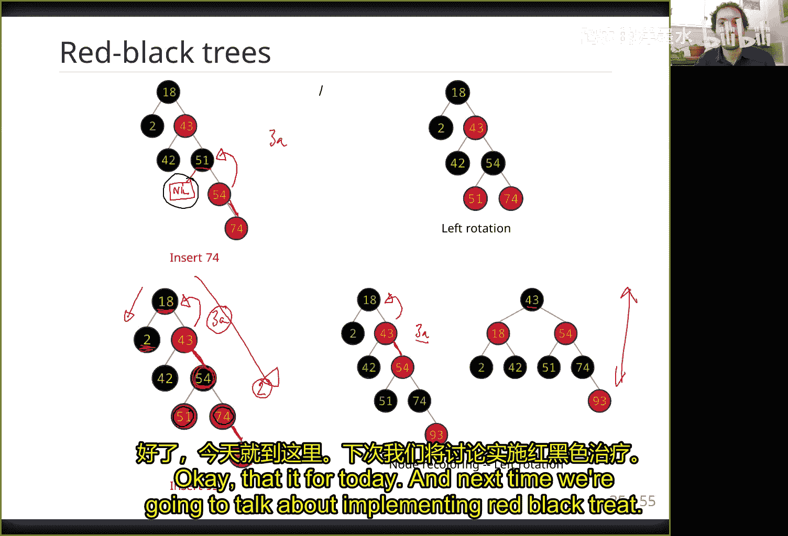

# 数据结构与算法：5-3：平衡树（下）🌳

在本节课中，我们将继续学习平衡树。上一节我们介绍了AVL树，它是一种基于高度和平衡因子进行严格平衡的树结构。本节中，我们将学习另一种极为流行且应用广泛的自平衡二叉搜索树——红黑树。

## 红黑树简介

红黑树也是一种自平衡二叉搜索树。与AVL树一样，它首先是一棵二叉搜索树，这意味着对于树中的任意节点，其左子树中的所有键值都小于该节点的键值，右子树中的所有键值都大于该节点的键值。红黑树与AVL树的区别在于它们维持平衡的策略不同。

红黑树的概念大约在AVL树发明十年后（1972年）被提出，其具体实现则由Robert Sedgewick在1978年完成。Sedgewick教授是普林斯顿大学的教授，也是经典教材《算法》的作者，他的工作在本课程后续关于排序算法的内容中还会被提及。

## 红黑树的规则 🎨

红黑树通过强制执行四条特定规则来确保树的大致平衡。以下是这些规则：

1.  **节点颜色**：树中的每个节点都被标记为红色或黑色。在实现中，我们可以在节点结构体中添加一个颜色字段。
2.  **根节点规则**：树的根节点必须是黑色的。
3.  **红色节点规则**：如果一个节点是红色的，那么它的两个子节点都必须是黑色的。这意味着红色节点不能连续出现。
4.  **路径规则**：从根节点到任意一个“叶子节点”（指没有子节点或只有一个子节点的节点）的路径上，必须包含相同数量的黑色节点。这个规则是保证树平衡的关键。

为了理解这些规则，让我们看一个有效的红黑树例子。假设我们有一棵树，根节点43是黑色的。节点18是红色的，它的两个子节点（2和42）都是黑色的，这遵守了规则三。从根节点到所有叶子节点（如2， 11， 42， 51， 74， 99）的路径上，都恰好经过两个黑色节点（例如路径43->18->2，黑色节点是43和2），这遵守了规则四。

## 识别无效的红黑树 ❌

理解规则后，我们可以练习识别无效的红黑树。请看下面这棵树，它违反了红黑树的多条规则：

*   **违反根节点规则**：根节点是红色的。
*   **违反红色节点规则**：一个红色节点（例如值为7的节点）有一个红色的子节点。
*   **违反路径规则**：从根节点到不同叶子节点的路径上，黑色节点的数量不同（例如到某个叶子节点路径上有2个黑节点，到另一个叶子节点路径上只有1个黑节点）。

通过这个练习，我们可以更清晰地理解红黑树的约束条件。

## 红黑树的灵活性 ⚖️

与AVL树严格的平衡要求（左右子树高度差不超过1）不同，红黑树的平衡条件更为宽松。这带来一个重要的特性：在最极端的情况下，红黑树中某条路径的长度最多可以是另一条路径长度的两倍。

例如，考虑一棵树，其左子树全是黑色节点，深度为3；而右子树是红黑节点交替的“之字形”结构，深度为6。这棵树仍然完全遵守红黑树的所有规则。这种灵活性意味着红黑树在插入或删除节点时需要进行的结构调整（如旋转）通常比AVL树更少，从而在实践中可能具有更好的性能，同时仍能保证树的大致平衡，使各项操作的时间复杂度维持在 **O(log n)** 级别。

## 红黑树的插入操作 🔧

与AVL树类似，红黑树的查询操作（查找、最小值、最大值）与普通二叉搜索树完全相同。需要特殊处理的是会改变树结构的插入和删除操作。本节我们重点讲解插入操作，删除操作更为复杂，在此不做详述。

红黑树插入新节点的标准流程包含以下四个步骤：

1.  **标准BST插入**：从根节点开始，按照二叉搜索树的规则递归地找到新节点的正确位置并插入。
2.  **新节点着色**：将新插入的节点初始颜色设置为红色。
3.  **调整以恢复性质**：检查插入后是否违反了红黑树规则。如果违反，则通过**重新着色**和**旋转**来进行调整，直到所有规则再次被满足。这是最核心的步骤。
4.  **根节点着黑色**：无论之前的调整如何，最后确保根节点的颜色为黑色。

接下来，我们详细看看第三步中可能遇到的几种情况及其解决方法。

### 情况一：父节点为黑色

如果新插入的红色节点（N）的父节点（P）是黑色的，那么不会违反任何规则（路径上的黑节点数未变，也没有出现连续的红节点）。此时，**不需要任何操作**。

### 情况二：父节点为红色，叔节点也为红色

当新节点N和其父节点P都是红色时，违反了规则三。此时，如果父节点P的兄弟节点（即叔节点U）也是红色的，并且祖父节点G是黑色的，我们采用**重新着色**来解决。

**解决方法**：
*   将父节点P和叔节点U的颜色改为黑色。
*   将祖父节点G的颜色改为红色。
*   此时，以G为根的子树恢复了红黑性质，但G变成了红色，可能会与其父节点产生新的冲突。因此，我们需要将G视为新的“问题节点”，继续向上递归处理。

### 情况三：父节点为红色，叔节点为黑色（或为空）

当父节点P为红色，但叔节点U为黑色（包括U是空节点NIL的情况，NIL节点视为黑色）时，仅靠重新着色无法解决问题，需要结合**旋转**操作。根据新节点N是父节点P的左孩子还是右孩子，又分为两种子情况。

**情况3A（直线型）**：N是P的左孩子，P是G的左孩子（或者对称情况：N是P的右孩子，P是G的右孩子）。这形成了一条“直线”。

**解决方法**：
*   对祖父节点G进行一次**右旋转**（如果是在右侧的对称情况则进行左旋转）。
*   旋转后，交换原父节点P和原祖父节点G的颜色（P变为黑色，G变为红色）。

**情况3B（之字型）**：N是P的右孩子，P是G的左孩子（或者对称情况：N是P的左孩子，P是G的右孩子）。这形成了一个“之字形”。

**解决方法**：
*   首先，对父节点P进行一次**左旋转**（对称情况则为右旋转），将结构转变为情况3A的直线型。
*   然后，按照情况3A的方法处理：对祖父节点G进行一次右旋转，并重新着色（新的中心节点N变为黑色，G变为红色）。

## 插入操作实例演示 📈

让我们通过一个具体的插入序列 `[2, 18, 42, 43, 51, 54, 74, 93]` 来演示红黑树的插入过程。这个序列是有序的，如果使用普通BST会退化成链表，但红黑树能保持平衡。

1.  **插入2**：作为第一个节点成为根。根据规则二，最后将其着为黑色。
2.  **插入18**：作为2的右孩子插入，着红色。父节点2是黑色，属于情况一，无需调整。
3.  **插入42**：作为18的右孩子插入，着红色。此时父节点18（红）与子节点42（红）冲突，且叔节点（NIL，黑）为黑，祖父节点2为黑。这属于情况3A（直线型）。对节点2和18进行左旋转，并将2着红，18着黑。
4.  **插入43**：作为42的右孩子插入，着红色。父节点42（红），祖父节点18（黑），叔节点2（红）。这属于情况二。将父节点42和叔节点2着黑，祖父节点18着红。此时根节点18变为红色，违反规则二，最后将根节点18重新着黑。
5.  **插入51**：作为43的右孩子插入，着红色。父节点43（红），祖父节点42（黑），叔节点（NIL，黑）。这属于情况3A。对节点42和43进行左旋转并重新着色。
6.  **插入54**：作为51的右孩子插入，着红色。父节点51（红），祖父节点43（黑），叔节点18（红）。这属于情况二，进行重新着色。
7.  **插入74**：作为54的右孩子插入，着红色。父节点54（红），祖父节点51（黑），叔节点（NIL，黑）。这属于情况3A，进行左旋转和重新着色。
8.  **插入93**：作为74的右孩子插入，着红色。父节点74（红），祖父节点54（黑），叔节点51（红）。这属于情况二，对54、74、51进行重新着色（54变红，74和51变黑）。但这导致54（红）与其父节点43（红）产生新的冲突。此时，将54视为新的问题节点N，其父节点43为红，祖父节点18为黑，叔节点（NIL，黑）。这又属于情况3A，需要对节点18和43进行左旋转来最终解决所有冲突。

通过这一系列操作，我们可以看到，即使插入有序序列，红黑树也能通过一系列重新着色和旋转，动态地将自己调整回一个相对平衡的状态，避免了退化为链表。

## 总结

本节课中，我们一起学习了红黑树这种重要的自平衡二叉搜索树。我们首先了解了它的四条核心规则，并通过示例理解了如何识别有效的红黑树。接着，我们探讨了红黑树相比AVL树具有更好的灵活性，平衡条件不那么严格。最后，我们详细剖析了红黑树插入操作的完整流程，包括三种主要的冲突情况及其通过重新着色和旋转的解决方法。

红黑树是许多编程语言（如Java的TreeMap、TreeSet）和系统（如Linux内核）中实现有序映射和集合的基础数据结构，理解其原理对深入学习算法和数据结构至关重要。下一节，我们将探讨红黑树的具体代码实现。