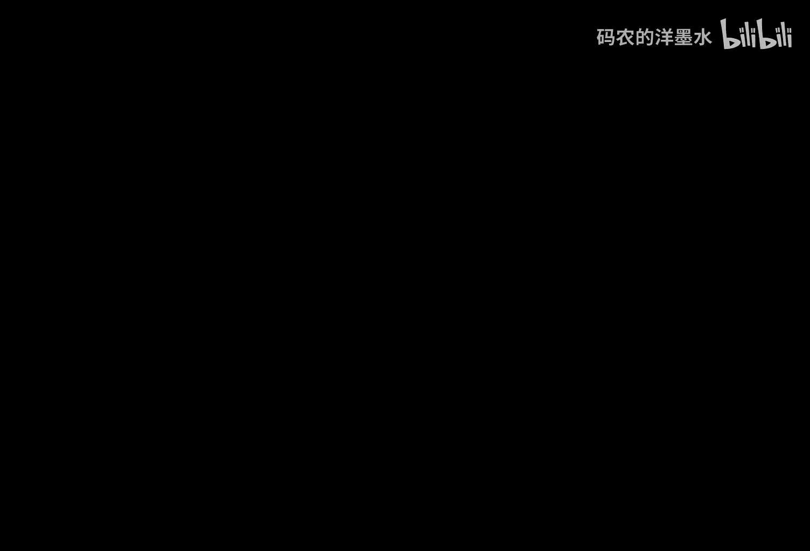
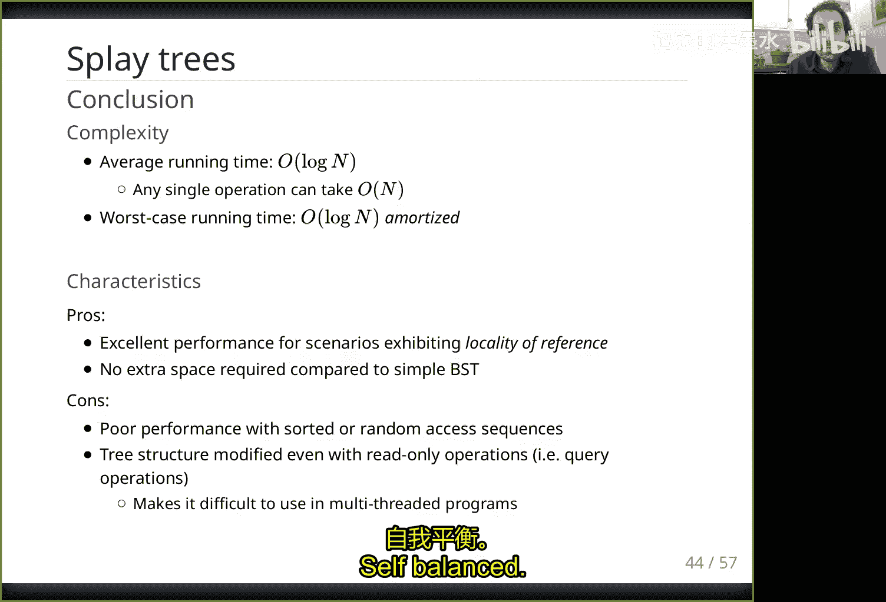

# 【全集】加州大学戴维斯分校 数据结构与算法编程 中英字幕 完整课件 p15 5-4 平衡树 -BV1rJ2WBSE7P_p15-

Hi， everyone。Today we're going to talk about the implementation of a red black tree。

And we're going to quickly mention another type of self balancing tree。

Which we will actually study in the next discussion。So let's get started。

 a quick recap about red black trees， which we started talking about during the previous lecture。

So a red black tree fundamentally still a binary search tree。

 so it's still the idea that like every node has a comparable key。

Every node that has a key that's smaller should be on the left。

 every node that has a key that is bigger should be on the right of that node。So same。

Properties as a binary search tree。Here， a red black tree has certain additional properties to make sure that the tree stays balanced because remember like that's the fact that the binary research tree is balanced that will offer really good running time complexities in a log of it。

There are four properties of a red black tree， we have the color rule。

 the fact that every single node has a color， red or black。The root rule。

 which means that the root of the tree should always be black， the red rule， which means that a。

Red note should always have children that are black。And finally， the path rule。

 which says that every path from the root to any of the nodes that are of degree zero。

 that is a leaf or degree one， which means a node with only one child。

 should have the same number of black nodes on the path。And。

And that's pretty much the combination of all of those four rules or all of those four properties that ensure that the red black tree stays somewhat balanced。

Now， as we talked about in the previous lecture， all of the query operations。

 so finding the minimum in the tree， finding the maximum or finding whether a value exists or not。

 they are completely unmodified， we can use the same functions as we have for binary search trees like just regular BSDs。

Only the functions that could change the structure of the tree。

 so insertions or removals need to be modified and adapted to red black trees。

So we studied here the insertion procedure， which goes in four different steps， step number one。

 we insert the new node with the value that needs to be inserted and we inserted exactly in the same way as we would do for a BSD with a potentially like recursive procedure。

So the new node is inserted over there， we color this new node in red no matter what。

And then we try to see that。If the insertion of this new node cos or triggers the violation of one of the rules。

 one of the properties of the red black tree， then we fix it。

And that usually means that either we need to recolor the nodes or we need to restructure the node。

 and by restructuring， essentially it means that we do some right rotations or left rotations combined with some recoloring and we do that from the node that was inserted back to the root to make sure that like all of the properties are respected at all different levels。

And finally， the last step is to always color the root back to black。

So today we're going to study the implementation of a red black tree。Except that， in fact。

 we are not going to study the implementation of a typical red black treeers。

It's somewhat a all complicated， we're going to study sort of simplification。

That is called a left leaning red black tree。As you can see， funnily enough。😊。

It was invented by the same person who invented red black trees back in 1978。So you see like。

30 years。Yeah，30 years later。The same person。Came up with another concept or another implementation called Left leaning red Ba trees。

And the idea is that this implementation that adds。

Another property to red black trees is in fact a lot easier to implement and so that's why we're going to focus on that。

The additional property that makes all the difference is to enforce that red node。

Should always be the left child of a node， that's it， say like very simple additional property。

So if you look at an example here， you see that all of the red nodes。Are always the left child。

Of node。What it will mean in practice is that like。

The and hence the name left leaning red black tree。

 the tree will always become slightly heavier on the left side than on the right side。

 like by design。Okay， so let's see how we could implement this left leaning red black tree。

So let's start with the data structure。And you'll see that compared to the AVL， it's very similar。

 remember how for the AVL it was very similar to the structure of the regular binary search tree except that we were keeping the information of the height in every node。

Here， instead of keeping track of the height， we keep track of the color。

So we can declare an enum color that is， in fact， like a boolean true false。

 except that here we define red or black。And then inside of a struck node， we define that every node。

 in addition to having the regular key and like a left pointer and the right pointer also keeps track of its own color。

So this way we'll be able to color either in red or in black every single node of this tree。

And in the same way that for the AVL trees， we had a handful of helper methods to help with the restructuring so if you remember we had a method to get the height。

 we had a method for the retracing phase and we had two methods for the left and right rotation here we also have four methods。

We have the left and right rotation。As I was saying like restructuring a tree is always about rotating nodes left and right。

 and we have two other methods here is red and re and the combination of all of four methods will help us implement all of the type of reing and restructuring that we might possibly need to do during the insertion phase。

So let's actually start by those two first methods is red and red color。

Is red is very similar to the height of the like the height method that we had in AVL trees。

 it's a very simple function。And it says that essentially。

If the node that we receive as a parameter is in fact a N node， if the node doesn't exist。

 it's the absence of node， then the Ne node is black so we capture this information right away like if we don't have a node。

 then it's black。If you remember like for AVL trees， it was。If we don't have a node。

 then the height is minus-1 and then it was helping us like。

Program the other functions based on that。And else。If the node that is given in parameter is in fact。

 a real node， then we can test its color and compare it to red and return true if the node is in fact。

 red or false if the node is in fact black。嗯，是呀。And then the next。Actually， very。

 very small method is the method recallcolor， so recallcolor gets a node as a parameter。

And does three very simple actions in constant time。

It recols the node that is being given as a parameter in red。

And it recalls both of its children in black， no matter what。

So the idea here is that when we call recallor， the node onto which recaller is called would normally be black and have。

Red children。 And we are essentially like changing that。 We are inverting that。

 We are making that note red and the children black。Okay。

So so we talked about is red red color and now we're going to talk about right rotation and left rotation。

I'm actually going to go fairly quickly on that because you will recognize that it's pretty much the exact same code as we studied two lectures ago with the AVR trees those。

Three， four lines here are exactly identical to the AVL tree the only change are those two lines because here so with AVL trees as we are rotating we would need to adjust the new height of certain nodes that are involved in the rotation here we don't care about the height because we're not red and black trees are not based on the balance factor they're only based on colors so the only thing that we need to take care of are colors。

And so here， the two lines that deal with colors is to say that the child tags the color of the parent。

And the parent turns into a red note， which is exactly what we discussed in the last lecture。

The case 3A with the simple restructuring using a single rotation and so rotate left。

Is the exact opposite of rotate right？嗯。Okay。So now that we have all of the helper methods。

Is red reoring rotate right and rotate left， we can implement insert to insert a new node into a red black tree。

And here again， you'll see that it's very similar to the insertion in an AVL tree。

So it startss by calling insert the recursive insertion method。

 exactly in the same way as we were doing with just regular binary search trees。

The whole body of the insertion function is the same。

 you see all of those lines they are similar to the binary search tree， they're similar to AVR trees。

 iss the regular recursive insertion in a binary search tree。And whereas in AVL trees。

 we had this retracing step here we have also kind of a retracing step like we。

Go from the node that was just inserted and we move our way back up the to the top so just here you see that when we create a new node。

Upon the insertion， the color here right from the creation of this new node is directly set to red。

 that's what we discussed in the previous lecture。And then after this new node is inserted at the location it should be。

On our way back from the different recursive coal， so there has been one recursive call from the root node down like every single or like down a certain path going through the descendants。

Down to where this new node is being inserted and so on our way back from those recursive callss。

We have to execute those six lines and those six lines is essentially like how the tree will be restructured as we go up back to the root。

So let me give you an example here。😊，Imagine we start with a tree that is completely empty。So。

We call insert with say like so let me write it like imagine the tree is completely empty and we call insert。

23。So that function gets called that's what we're doing here， 23 is the key。

 and we call insert on root， which is equal to null at that point because the tree is completely empty with key。

And so right away， right down like when we call this function。

 we match this first if statement because N here we represent the root。Is a no pointer。

 so it's not an and we get to create the node right away and we create the node in red color。

So at that point， we insert 23。And so we'd have the root pointer。Point onto this node， right。

 and the node would be colored in red。And as you can see。😊。

Then we would return from this function from this recursive function back to here。

 and the last thing we always do after inserting a new note is to no matter what we color the root into black。

So here， 23 had been created red and is recorded。Into black， no matter what。And that gives us。

A leg red and black tree， right， So let's， let's continue。 Let's now say that we call again。Inset。

On the same。3 with value 42。So what happened here？We call inserts on the root。

 which is now pointing on this 23 node and with key equals 42。

So we jump into this function and now we get into one of those two Alsive clues。

So here we would match。This one， right， if the key 42 is greater than n arrow key。

 which is 23 here then。We called the function insert again on n。E， right。So essentially。

 we call insert on。On the pointer， on this nodes right pointer， which right now is no。嗯。

So the function calls itself， we go back here and now we're going to match。This line right。

 and that's going to be when we create the new node。

So here it means that we create a new node containing 42， which is by default colored。Ignorant。

And then we go back。嗯。When we go back， we go back to being in the function insert。On node 23。

And now what's interesting is that one of these if statements will actually match and it's going to be this one。

 the first one。If is red。An error right？That's the case。Like， so n here is the root node。

And the node that's on the right is red。And is not red on the left。

You see here that 23 has nothing on the left， but nothing the nail will return black。

So when calling like is read on the left node， it will return false。So we're going to match。

This if statement， and that's going to trigger a left rotation。

So what's going to happen here right there is that we're going to do a left rotation between 42 and 23。

 right？And so we're going to end up with something like that。Remove that。嗯。Let's。And。哦。

So 42 will become the new route。And 23 will become the left child of 42。And。With the left rotation。

42 will take the color of its parent。And 23 will become， so 42 would become black。

N 23 will become red。So at this point， we're actually good。Now let's do one last insertion。Insert。2。

So here when we insert two， we're going to call insert on the root first。

And that we're going to have a recursive call on the left side。We're going to call。Insert again。

On the left side， and that's where the new node2 will be created。

And so this one will be painted in red by default。Now we're going to go up the recursive chain。And。嗯。

So。When we're in this situation， we're actually going to match now。This if statement。When N。

Is pointing on 23。Because here we have。Is red on the left， that's our case。Oh no。

 I'm sorry I'm being confused。So。呃。Let me， okay。So when we go back up the recursive chain。

 we're going to go back up to n pointing on 42 and that's where we're going to match。

This if statement。Is red。On the left child， that's the case，23 is red。And is red。Left， left。

So essentially like 42， left 23， left two， which is also red。

So we're going to match up this if statement。And we're going to do what it says。

 we're going to do a rotation right。And so that's going to be a rotation right between 42 and 23。

So 1023 will become the root。Two will still be on the left side and 42 will be on the right side。

As part of the right rotation， 23 will take the color of the parent。All right。

 so 23 will take the color black， will take 42 color。And 42 will become red。

 that's part of the right rotation。And what's funny is that it's not enough because after matching this if and doing the rotation。

 right， we're actually also going to match the following if that says。

If the left child is red and the right child is red， which is exactly our case here。

 the left side is red， the right child is red， then we need to recall N。

And the recovering of n here will mean that。The parent。Becomes red。And children become black。

And we are still not done because once we exit from this function。

And now because we were at the root。We go back。To the sort of top level insert function here it says the root needs to be colored in black。

 no matter what。So， in fact， this。Root。Note becomes black。

And so here we're typically clear in a situation where like right now at this very moment after inserting 23。

 42 and2。All of the nodes now are completely black so you see how like the tree gets restructured。

 the nodes are changing their color and little by little like the tree stays balanced even as we insert new nodes。

嗯。😊，Once again， we're not going to discuss the removal because the removal is a little bit tricky。

 but if you want to look it up on the internet， you definitely can。Okay， let's go on。😊，So conclusion。

 again， the fact that there red black tree and here this specific implementation of a left lean red black tree。

Also offers because it's self balanceance it makes sure that the tree is not going to degenerate into a long linked list it offers great complexity in log event for all type of operations What's interesting now is that with AVL AVLs are like pretty aggressive in terms of selfbalan like they try to maintain with this balance factor a balance that's pretty strict。

Here with red black trees and left leaning red black trees were a lot more flexible and we allow the tree to become like a lot more unbalanced than we would with ADVL trees。

 and so here if you remember with AVL trees， at most the height of the tree itself would be 1。

5 log of it，Here you see that like it's a lot less。

It's a lot more flexible because at most the high can go up to two times。Log of n+ one。So。And。

The reason for that， like the reason that red black trees are more flexible in terms of balance is that it improved the performance by a lot。

 and that's why red black trees are one of the most popular implementations of binary research trees or selfbalancing binary search trees。

There is another type， a very specific type of self balancing。

Binary search trees that I wanted to mention today very quickly。

 I only have a couple slides on it because we're going to study it in the next discussion and we're actually going to write the code we're going to implement it but here I just wanted to at least mention the concepts。

And。The next one is called Sp trees， it was invented in the mid80s。

Here the idea is kind of interesting Sp trees they don't really try to like keep the tree balanced so in a play tree it's definitely possible that from the root would have a pretty long path even like as long as a linked list like in O of N and that's possible that's not something that the play tree would prevent us from from doing kind of I mean there's no。

Enforcement against that。What's interesting is that every time。A node is being accessed in a s tree。

Then。And by access， I mean like every single operation。

 like even like finding the minimum of the tree， finding the maximum of the tree。

 finding if it node exists in the tree so like contains， for example。

 like and insert search and removal every single operation will be combined with an operation called s。

And what it means is that when we spray the tree， it means that we are bringing the node that is being accessed。

To the top。So here， for example， like when we call Con seven and we try to see if node7 is in the tree and you see like it's right there kind of like at the bottom。

At the same time that we're performing this contains operation。

 we're going to do a succession of rotations to bring7。To the root of that tree。

So here if seven is over there， then we're going to do a left rotation with five。

 right left rotation with three， right rotation with nine。

 left rotation with one and left rotation with 11 to like kind of pull the node7。

 to the top of the tree， and actually after doing that operation on node7 the tree now is going to look like that。

And。What is the reason for that like what's whats what's the the goal Well the goal is very simple is that。

By doing that。If it happens that the next operation that is being done on this tree。Is again about。

 say， node 7。Then we're going to be able to access node 7 in O of one in constant time because it's right up there。

So obviously， like。The chance is that we would want to reaccess Note 7 right after having accessed it like just seconds ago。

Maybe that's a slim chance。 however， what's very likely is that。

 say I have a collection of  a thousand0 items。It's very likely that only a few of them。

Are going to be accessed and reaccessed over and over again over time。That's called。Loality。

 but something that you might see in future CS classes and it's a very well known phenomenon in computer science。

The like items in general are re accessed very often and so here it means that if you have a big collection but you keep accessing the same few items。

Those items are going to be like pretty close to the root node pretty much all the time and so even if this kind of tree doesn't like enforce。

A certain balance， like like it could actually go like pretty far down。

 the fact that the items that are the most used are always towards the root node means that they can be accessed very。

 very fast， right？So。😊，On average。The play tree has actually like the same type of running time complexities as the other。

Self balancing binary search trees。Which means that it's on average in log of it。

Even if the worst case scenario might be that a certain operation is in O of N。If it happens。

 maybe that the tree is actually like a long linked list and that for some reason we're trying to access the one that is at the very end。

 but in fact it doesn't happen very often。BecauseBecause of the way that it works。嗯。

So sp trees are very， very good when the tree contains a collection of items and some of those items are used a lot over time and what's great is that here we don't have to contain any extreme information like we don't care about the height。

We don't have any like color that's associated to the node。

 it's exactly the same data structure as a regular binary search rate。

 the only difference is that every time we access a node we pull it so that it becomes the new route。

嗯。It has obviously some drawbacks， so for example， like if you have a collection of items and you want to access them in random order then that kind of data structure is not going to perform very well and even worse if you have a collection of items and you want to access them in a solid way。

 then play trees are going to be like absolutely awful and another drawback is that even with query operations。

 which we can also say they are readon because technically they are not supposed to like we're not changing anything。

 we're not changing the container， if we have n items were not like inserting a new one or removing another one we're just trying to find that like what is the minimum or what is the maximum。

 even those operations which should not technically like change，To change anything。

 they do change the structure of the tree， which makes s trees pretty complicated to use in multi threadreaded applications。

Okay。Yes。We are going to stop on this。 And next time we'll talk about the last type of。Self balanced。

Bny research trees。