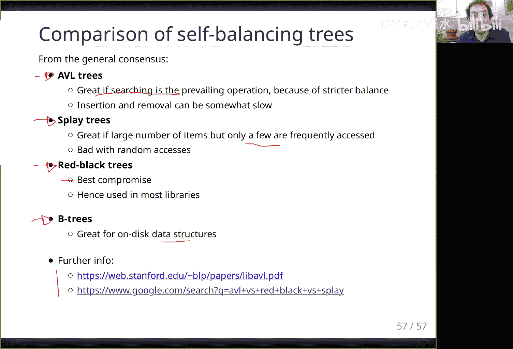

# 【全集】加州大学戴维斯分校 数据结构与算法编程 中英字幕 完整课件 p16 5-5 平衡树 -BV1rJ2WBSE7P_p16-

Hi， everybody。So this will be the last lecture about balance trees。 We're going to talk about。

The last type of selfvarienting tree。That is worth mentioning and we'll talk a little bit about。

How self balancing trees are used in typical like real life applications。

So quick reminder of the past few lectures。So we talked about AVL trees。

 the first invented self balancingan tree it very aggressive relies on this balance factor。

 every time that the balance factor goes above a certain value。

 it means that we're going to restructure the tree。Then we have red black trees。

Which are based on the compliance with four properties related to colors。

We have a very specific implementation of red black trees。

 which are called left cleaning red black trees， so they are pretty much equivalent except for an additional property that says that if you have a red node。

 it must necessarily be the child， the left child of a black node。And finally。

 we talked about another kind of self actually not really self balancing trick because it doesn't solve balance。

But something called Sp trees， where every time a node is accessed。

 we bring it back to being the root。And so the last type of tree that I wanted to mention in this class are called bee trees。

So before I introduce them， let's talk about a certain scenario。Let's imagine。

The DMV wants to build some sort of like database， wants to have a container that holds all of the drivers in California right in California you have 20 million drivers 26 million drivers。

 sorry。For each driver， you essentially have a key， which is the driving license number。

 that's like that number， that's a number that's on eight characters， one character and seven digit。

And that can be compared。Said that one number is greater o smaller than another number。

And you have a value per driver， the value is the driver's record， so like the name。

 the date of birth， the expiration date of the driver's license and so on。And so just roughly。

 we said that all of that record would be like hold in in。

Structure that's like about1 kilobyte inside size， so what like 1024 bytes。

Just based on that kind of information。26 million drivers。And then like for each driver。

 you have a number， a key and a value， the driver's record。

 that's 26 gigabyte of data that you need to hold。I don't know for you， but like。

There are not that many computers that can hold 26 GB of data in their Ram memory， right。

 typicallyy when you buy a computer a laptop， you have。

8ight gigabyte of memory and if you're lucky like me， you have a laptop that has 24 gigabyte of RA。

 which is huge， but still， it's still not big enough to contain all of that data。

What it means is that。That database。Has to necessarily be stored on the disk， right？

The issue is that a disc。It's super slow。Typically a hard drive like that。

 it's so slow that every time you do a disk access。

 so every time you go to the disk to breed some data out of the disk。It takes about 10 milliseconds。

If each axis is 10 milliseconds。It means that in one second。You can do 100。Accesssses。

Now you take a regular DMV office， like in Davie or in Sacramento。

And you say that like at any given time when the DMNV office is open。

 you have say like 20 clerks like 20 DMV employees that are all like accessing the same database at the same time。

 the database being on some sort of like。Local server that like holds the database。

Then it means that。Every user。Can make。5 disk accesses per second， right？

If you can do 100 access per second total and you have 20 users。

 that's five disk accesses per user per second。Now， the problem is that。

If you have 26 million drivers。And you want to hold them in say， a binary search tree。

So that all of the query operations would be pretty fast would be in log of it。

Then it would means that you would have this massive binary tree。Starting from a root。 And then like。

Having all of those items。To contain 26。Million items。Yeah。If you use。

An ADVL tree to represent those 26 million items， and even though。

AVL trees are the most aggressively balanced。Type of binary search trees。Your height。Would be about。

25。That's log of 26 million It means that between the root node。And。The fatherthest。Live。

You'd have like 25 levels。That would make a really， really， really big。Binary tree。

The problem is that。If you have。25 levels like if you're the depth of the tree is 25。

And every time that you access a level。Then this level tells you if you need to go right。

 left or right， and then you can access the next level and so on。

You have to do that 25 times on average。To find one of the 26 million drivers that like you're looking for。

Which means that you need to do 25 disc accesses because this entire binary tree would be stored on disk。

Since a user can only make five disk accesses per second。

And it takes 25 disk accesses to access a node in the tree。

It would take five seconds to access a driver。嗯。To summarize this example。

 it means that you go to the DMV， you stay in line， you get to the clerk。

You finally give your driver's license to the person at the counter， person at the counter。

Type in your driver's license number。And it takes five seconds of searching。

Before your record can finally be showed on the screen。That's too slow。Right。So。

How can we make it faster。We make it faster by lowering the number of these aes。

In order to make instead of making 25 disk accesses to access an item in the tree。

 we need to do less。Disk accesses， so how do we do that？Before we get to the solution here。

Let's make a couple of observations。好。The first observation is that if we use a binary search string。

Then the height of the tree cannot go below。Loock2 of n that's just that's by design that's like mathematical If you have a binary search tree。

 then the height of the binary search tree will always be log2 of n and being the number of items you have in the tree So here if you have n being 26 millions and you use a binary search tree of just a binary tree in general you you cannot go you cannot not have 25 levels like that's just impossible。

The second observation。Is that。While these accesses are very expensive in terms of time。

 so it takes like 10 millise secondscond。To make one single disk access。In comparison to that。

 processors are really fast。Tech a regular processor， typical processor running at like one gigahat。

 that's typically what you can find in a smartphone today。

If you have a processor running at one gig ahead， then within 10 milliseconds。

 like the time that it takes to make one single disk access。

 you can execute 10 millionsth of instructions at the same time。That means that like。It's worth it。

Making the management somehow more expensive。😮，By having a lot of very complex codes。

If you can save some disk accesses， right？You can make the program really complex。

If that's going to make you save disk accesses， because disk accesses are so much more expensive than like computational complexity。

So here's the idea based on those two observations。Instead of using binary trees。

 we could use trees that can have more than just two children per node。

That is called increasing the Rity of the tree， right the aity being the number of children that a node can have。

If we increase the R of a tree， then it means that we will decrease the number of levels we have in a tree in order to contain the same number of items。

 right？Technically in terms of code。Having a tree that is not a binary tree will be a lot more complicated to manage。

But as we already discussed， it's worth it， even if it takes more code and it takes more time to manage because it will save on a lot of disk accesses。

So that's pretty much the idea is that instead of doing binaryre trees。

 we're going to do M area search trees。M being the number of children that a tree might have。

So here is an example where M。Would be equal to 5。So it would be a five a search tree。

Every node can have up to five children and so on。And so here in that。Example。Total， I have。31。Nodes。

On 1，2，3。Levels。If we were to use a binary tree。We would need。F levels。To contain。31 nodes。

 So you see here by increasing the irity of the tree， we are decreasing。

The number of levels and that's going to help because then it means that we're going to do less less disc access。

So all of that introduction。Brings us to bee trees。

Baties are exactly that beeries were invented in the early 70s and they tried to have the same idea as binary search trees。

 but instead of being binary， they're not binary， they're allowing node to have more than just two children with the idea that like we're going to reduce the number of levels。

So a B tree of all their M。Is an MR tree， so if M is5， for example。

 then it would be a five R tree that needs to have some properties that here in that context we call invariance。

And there are three of them that we're going to discuss， not invari。

 other invari and structure invari。Just right here， look at this example of a B of order five。

 so every node can have up to。Five children。The idea is that pretty much the same concept as a binary search trip。

 so for example， like in this。T， if we were to call the method cell contains。On node， I don't know。

 say like 20 on key 20。Then we would start。By examining the root node。

And we see that the root node contains key 41。20 is smaller than 41。

 so we would follow the pointer that is on the left。Of 41。

 and that would bring us to this child node。Now in this Ch node。

 we would look for one of the keys here so that would be 18。Which is directly。Well actually。

 it would be like。18 and 26。There are two keys that are both smaller and bigger than 20。

 which means that we would need to follow the pointer that's right between them。And finally。

 in the leaf node of this tree， we would find。The information that contains to 20。

So it's still the same idea of like you have a value， a certain key that can be compared。

 you start from the root node and you follow pointers kind of like life left and right except that instead of being left and right。

 which would be binary here it's like，The most on the left are like second on the left or right in the middle。

 second on the right， or far most on the right。嗯。So yeah。

 but the idea is the pretty much the same as。Binary search three， otherwise。

So let's see those three invariants， the node invariant other invariant and structure invariant。

 those are again like properties that beies exhibit。

So the node in applies to internal nodes and leaf nodes。Internal nodes， they are made of keys。

And pointers， right？And so the。Note in tells us that。If we have an M area B tree。

 then an internal node can add to up to M pointers onto the level below。

and up to m minus one keys right and so depending on the value that we're looking for in the B3。

 we would compare and see which of the say like here in this example like which of the five pointers we need to follow and we would for that compare with the different keys that these internal node contains。

Next， we have leaf nodes。So leaves here， they contain the mapping of keys and values， right。

 and they are sorted by keys。So here if the leaf node contains， for example。

 like five pairs of key value and were looking for a certain key， then we would。Go in there。

 find it and be able to access the value that corresponds to the key so in the DMV example。

 for example， based on the driving's license number， we would find the driver's record。

Now it's interesting with B trees is that。The Rity of the3M。

And the number of mapping key value that a leaf node can contain， which is L can be different。

 they don't have to be the same value in that example I decided that M would be5 and L would be5。

But it doesn't have to be that way， right？And actually， we're going to pick。

A value for M and value for L in a smart way， we have to be smart about it。

The idea is that we would pick the value for M in such a way that the combination of all of the pointers。

 the m pointers plus the M minus one keys would all fit。In a data page。So data page is typically。

The amount of memory that the operating system allocates to applications that's kind of like at a pretty low level。

嗯。It's pretty much like the granularity of the memorial location between applications and operating system。

 so it's a good reference。And on the other hand。The same size of data page we could divide up in such a way that pairs of key value would fit。

Inside of a data page， so we would choose L and M to values that go well with the size of a data page。

Okay。And oh yeah， I have an example about that so for example。

 for the the example with the DMV database。L would typically be four because。

In a4 kilobyte data page， we could have four records。

 given that every record is one kilobyte in size。But the Rity of the tree could be up to 256。

Because within four kilobytes， the size of a page， we could have。256 pointers。

Each pointer being on eight bytes。And n minus1 keys also being on8 bytes， as we said previously。Yeah。

O。So that's for the node invariant next is the order invariant here it's very very similar to binary search keys the idea is that if you have a certain key here in an internal node and so you have two pointers on the left of that key and the right of that key。

 then all of the keys that are located if you follow the left pointer are necessarily smaller。

And all of the kids。That are in the。Right sub。Are necessarily greater or equal than the key。嗯。

And finally， we have the structure invariant， and that's where。

That's pretty much what makes the B tree be balanced into as little levels as possible。嗯。😊。

So let's start with the root node。The root node is the number of items。That we have in the Bea tree。

Is smaller than what we can fit in a leaf node then the root node would directly be a lymph node the root node only becomes an internal node once we start having more items than what a leaf can contain。

Which usually should happen pretty fast。If the root node becomes an internal node。

 then it would contain from two keys up to M keys or M minus one keys。

 and it would start having children。Now internal nodes， which contain keys。Ens。

Pointters to the next levels。We would try to keep them always at least half full。

 so an internal node would have at least。Half of its children be completed up until like all of its children。

And same for the lymph nodes， the idea is that the lymph nodes should always be at least half four。

Up to completely full the goal is that like every single internal node and every single leaf node must be as full as possible that's how we make sure that the B tree is as compact as possible and doesn't go down on too many levels The number of levels is really what we're trying to。

Kind of avoid or like optimize。😊，If it happens that a node becomes less than half full。

 so for example， that a leaf doesn't contain n of pairs of key values。

 or that an internal node doesn't have more than half of its children。

 then it means that we need to restructure the tree。

 which need to like redistribute all of the keys and all of the values in such a way that like the tree stays as compact as possible。

And here it's not a matter of rotations or whatever。

 it's a question of either merging nodes when they become not full enough。

 then we're going to gather what they hold together。Or if they start holding too many values。

 then we're going to split them here I think a good analogy is to think of a bookshelf when you want to restructure a bookshelf。

 you don't really like rotate books， you just like pack all of the books。

 put them back on the floor and then you repopulate the bookshelf to make sure that say like every level is like full of books while like all of the books remaining say like sort order or something like that。

Okay。So that's pretty much the idea。Now in terms of characteristics， because there are trees。

 bee trees are definitely classified as being in the log of N kind of complexity。Btri。

 like I just presented， I would say it's more like a general class of designs than an implementation。

Because then there are actually different implementations that are slightly different。

 you have B plus trees or B star trees and they are still like the same concept that I just presented。

 but they have like small variations more specifically in the way that keys and values are being held in the trees。

 but it doesn't really matter。Be trees are very popular in at least two types of applications。

The first step is databases like SQL databases， that kind of like big professional databases you often use B trees。

And in file systems。So that means like the hard drive on your computer。

 if it's formatted using like NFS or EXT4 or that kind of file system， then bities like。

Data structures are typically used to as a way to map files to the disk blocks， so for example。

 like if you have an MP3 that's like pretty big and you jump to the middle of the MP3 then you have to have a way to say like okay。

Where is located the data that corresponds to the middle of this MP3？And that's typically through a。

嗯。A be tree that you would find this information。呃。Before we finish。

 I wanted to quickly mention the type of containers。

That rely on self balancing binary search trees and that you can find in the C++ standout library。

There are pretty much two type of containers。Seets and maps。

 which which we call associative containers and which are often implemented as red black trees。

So sets。There are pretty much binary search trees that only contain a single key。

 that's the item that the binary search tree contained。

Whereas maps are pairs of key associated to a certain value。Just in passing。

 we also have two other types of containers called multiet and multi mapps。

 which allow duplicate keys to be in the tree at the same time。

 which is not the case of sets and maps here in sets and regular maps。

 you cannot have the key more than one time inside of the tree。

There are also two other variants of those containers。

 there's something called unaudered set and unaudered map。

Because you see that here like the regular set is a solided container and the map is a solided container and that's pretty much why we need to implement them as red black trees。

Now， if。The user doesn't need the sorted aspect。The user can directly use an unsorted set or an an unau set or unaudered map。

 and in which case the implementation would not be based on the red black tree。

 it would actually be based on the hash table， which is something we're going to talk about towards the end of the quarter。

 but anyway。Quick comparison with the regular sequence containers。

 so typically like lists of vectors， well the big thing is the complexity， right？

If you use a set or a map， then。All of the operations or most of the operations will be in a logarithmic complexity。

 whereas if you use a vector or least on something like that， the complexity will be linear。

And it means that the more the collection grows like the more items you have in your collection。

 the more that kind of running complexity will become apparent because every time you access the container。

 if the operation is in logarithmic time or in linear time， you're going to feel it。Obviously。

Seets and mapped because they are based on red black trees。

 they have they are more complex to manage right because like you have more code to execute there's this whole like rebalancing phase that needs to happen and everything。

One cool thing， though， that you don't have with the vector of a list is that every time an item is being inserted or removed。

The collection stays sorted by design right if you do an in traversal of the tree you will get a sorted sequence of all of the items。

 which is something that is not obviously possible with the least or a vector。

The conclusion of that is that。If you have a collection that's big enough。

Then it's worth using a set or map over using a vector or list because the running time complexity is going to be far。

More important。Then the complexity to implement the operations。

So let me finish by showing you some examples here of using， for example。

 so like a set from the stand on library so you could declare a set with some values。

Inserting a set is as simple as just calling the insert function with a certain key。

Here you see that if you try to insert a key that already exists in the set。

 it's not doing anything like the insertion is just ignored。And what's nice。

With the standout set is that you can。Do a follow loop on it。

And the follow loop here will do an in order traveral of the container and well essentially print or access all of the items in solid order by default。

And a quick example about maps as well， so map here you can associate a certain key， so for example。

 like an integer to a value， for example， a string。And then you can insert new item by for example。

 like using the brackets， the square brackets， just like if youre using an array。

 except that that's not really an index， it's just like a key。

 you can also insert by directly giving kind of a bundle of key plus value or you can even make it apparent here with the method Mac pair where you clearly associate a certain key with a certain value。

And same as the set。If you use a standard fall loop。

 then you will iterate over the entire collection in the solid order of the keys。For each item。

 the key is accessible via the member first and the value is accessible via the member second。

And that would display all of the items in the collection by a sending number of their keys。

To conclude this topic on self balancing trees。Here is kind of a general overview of the different types of trees that we have studied over the past few lectures。

So we have essentially like AVR trees。Which maintain a very strict balance。

 They are very aggressive in terms of balance， which makes them absolutely awesome。😊。

If searching like if the query operations are the main type of operations。

 essentially like if you don't have a lot of insertions and removal。

 you have a collection that remains like fairly static。

But this collection has to be like search or accessed a lot。

 then AVL trees are great because they maintain very great balance and they guarantee that all of the operations will be in a very like tight log of。

Next we have this kind of bizarre type of trees， play trees。

Here they're very good if you have a large collection of items。

 but only a few are being accessed very frequently。

And so you keep reaccessing the same items over and over over and over again， in that case。

 playre are going to be very good because theyre going to make all of those frequently accessed nodes。

Be towards the root node， and so they will be accessible very fast。And next， we have red。

 black trees。Those are， in fact like， I think that the most popular kind of implementation for selfbalancing trees because theyre good at everything。

They''re the best compromise essentially like they're not the best at everything。

 but they're good on average for all types of operations and that's why they're the most popular。

And finally， kind of like on the side， we have bee trees。Those are very。

 very specific reasons to exist。 They're great for。

Data structures that you would use on a disk in order to minimize the number of disk accesses that need to be done in order to access a collection。

If you want to access more information about the different characteristics of those self balancing trees。

 please refer to those links。And next time I'll see you for a new topic。

