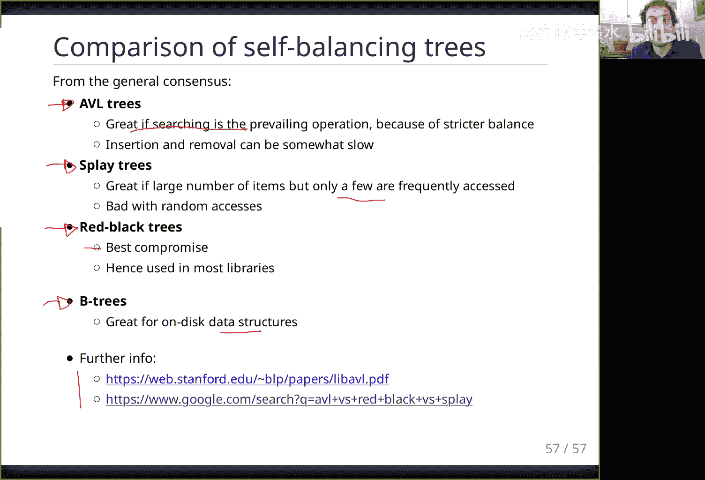

# 数据结构与算法编程：5-5：平衡树 🎄


在本节课中，我们将学习最后一种自平衡树——B树，并探讨自平衡树在实际应用中的使用场景。我们将从理解B树的设计动机开始，逐步介绍其核心概念、性质，并与其他自平衡树进行对比。

## 概述

在之前的课程中，我们介绍了AVL树、红黑树和伸展树。本节将介绍B树，这是一种专为磁盘存储等I/O密集型场景设计的多路搜索树，旨在通过减少树的高度来最小化昂贵的磁盘访问次数。

## 从实际问题出发：DMV数据库案例

假设加州车管所（DMV）需要构建一个数据库来管理约2600万名司机的记录。每个司机的记录（包含姓名、出生日期等）大约为1KB，而驾驶执照号码是用于查找的唯一键。

整个数据库的总大小约为26GB。如此庞大的数据量通常无法完全载入计算机的RAM内存，因此必须存储在磁盘上。

磁盘访问非常缓慢，一次典型的磁盘读取操作大约需要10毫秒。这意味着每秒最多只能进行约100次磁盘访问。如果一个DMV办公室有20名职员同时查询数据库，那么平均每位职员每秒只能进行5次磁盘访问。

如果使用AVL树（最平衡的二叉搜索树之一）来存储这2600万条记录，树的高度大约为 `log₂(26,000,000) ≈ 25`。这意味着查找一条记录平均需要进行25次磁盘访问。

**计算过程**：每位职员每秒5次访问，完成一次查找需要25次访问，因此单次查询将耗时 `25 / 5 = 5` 秒。这个速度对于实际应用来说太慢了。

问题的核心在于需要减少查找过程中的磁盘访问次数。

## 核心思路：增加树的“分支度”

基于两个关键观察，我们找到了解决方案：
1.  对于二叉搜索树，其高度下限是 `log₂(n)`，无法进一步降低。
2.  与缓慢的磁盘访问（10毫秒/次）相比，CPU计算速度极快（10毫秒可执行约1000万条指令）。因此，即使管理数据结构本身的代码变得更复杂、计算量更大，只要能减少磁盘访问次数，总体性能也会得到提升。

解决方案是：放弃二叉树，转而使用**多路搜索树**。通过允许每个节点拥有多于两个的子节点（即增加树的“分支度”），我们可以在存储相同数量元素的前提下，显著降低树的高度，从而减少查找所需的磁盘访问次数。

例如，一个五路搜索树（每个节点最多5个子节点）仅用3层就能存储31个节点，而二叉树则需要5层。

## B树详解

B树正是基于上述思路设计的多路搜索树。它于20世纪70年代被发明，旨在保持二叉搜索树有序特性的同时，通过多路分支来降低树高。

一棵**M阶B树**需要满足以下三个不变式（Invariants）：

### 节点不变式

此不变式规定了内部节点和叶节点的结构。

*   **内部节点**：由一组**键**和**指针**交替组成。一个M阶B树的内部节点最多可包含 **M个指针**（指向下一层子节点）和 **M-1个键**。查找时，通过将目标键与节点内的键进行比较，决定跟随哪个指针。
*   **叶节点**：包含最终的**键-值对**映射，并且这些键值对按键排序。在DMV的例子中，叶节点存储着驾驶执照号码（键）和司机记录（值）。

M（树的阶数）和L（叶节点能容纳的键值对数量）可以不同。在实际设计中，我们会根据**数据页**的大小来智能地选择M和L的值，以确保一个节点（无论是内部节点还是叶节点）能恰好填满一个数据页，从而最大化磁盘I/O效率。

**示例**：在DMV案例中，假设一个数据页大小为4KB，每个司机记录为1KB，那么 `L = 4`。同时，一个指针或键（如8字节长的整数）占8字节。在一个4KB的页中，我们可以存储多达 `(4096 / 8) / 2 ≈ 256` 个指针和键，因此 `M` 可以设为256。

### 顺序不变式

此不变式保证了B树的有序性，与二叉搜索树类似。

对于内部节点中的任意一个键 `K`，其左侧指针所指向的子树中的所有键都**小于** `K`；其右侧指针所指向的子树中的所有键都**大于或等于** `K`。这确保了在整个树中进行有序查找的可能性。

### 结构不变式

此不变式是B树保持平衡和低矮的关键。

1.  **根节点**：如果树中元素数量少于一个叶节点的容量，则根节点直接就是叶节点。只有当数据量超过叶节点容量时，根节点才会变为内部节点。
2.  **节点填充度**：除了根节点，每个**内部节点**至少要有 `ceil(M/2)` 个子节点（即至少半满），最多有 `M` 个子节点。每个**叶节点**至少包含 `ceil(L/2)` 个键值对，最多包含 `L` 个键值对。
3.  **平衡维护**：当插入或删除操作导致某个节点低于半满时，B树会通过**节点合并**来重组。反之，当节点过满时，则会进行**节点分裂**。这个过程类似于整理书架：把书重新整理打包，再均匀地放回书架各层，以保证每层都尽可能放满且有序。

## B树的应用与变体

B树及其变体（如B+树、B*树）在以下两类系统中极为流行：
*   **数据库系统**：如SQL数据库，用于高效索引大量数据。
*   **文件系统**：如NTFS、ext4等，用于映射文件名到磁盘物理块的位置，实现文件的快速随机访问。

## C++标准库中的关联容器

在C++标准库中，`std::set` 和 `std::map` 这类关联容器通常使用红黑树（一种自平衡二叉搜索树）实现。

以下是它们的主要特点：

*   **核心特性**：`std::set` 仅存储键，而 `std::map` 存储键值对。它们都保持元素有序（默认按键升序）。
*   **操作复杂度**：插入、删除、查找等主要操作的时间复杂度为 **O(log n)**，这与基于数组的 `std::vector`（查找为O(n)）或链表 `std::list` 相比，在数据量大时优势明显。
*   **有序迭代**：对它们进行遍历（如使用范围for循环）会得到按键排序的元素序列。
*   **变体**：
    *   `std::multiset` 和 `std::multimap`：允许重复键。
    *   `std::unordered_set` 和 `std::unordered_map`：不保持元素顺序，基于哈希表实现，提供平均O(1)的访问复杂度，我们将在后续课程中讨论。

**代码示例：使用 `std::map`**
```cpp
#include <iostream>
#include <map>
#include <string>

int main() {
    std::map<int, std::string> studentMap;

    // 插入元素
    studentMap[123] = "Alice";
    studentMap.insert(std::make_pair(456, "Bob"));
    studentMap.insert({789, "Charlie"});

    // 遍历（按键排序输出）
    for (const auto& entry : studentMap) {
        std::cout << "ID: " << entry.first
                  << ", Name: " << entry.second << std::endl;
    }
    // 输出：
    // ID: 123, Name: Alice
    // ID: 456, Name: Bob
    // ID: 789, Name: Charlie

    return 0;
}
```

## 自平衡树总结

下表总结了我们在本系列课程中探讨的几种主要自平衡树的特点：

| 树类型 | 核心思想 | 最佳适用场景 |
| :--- | :--- | :--- |
| **AVL 树** | 通过严格的平衡因子（左右子树高度差≤1）和旋转操作，维持**高度平衡**。 | 查询（搜索）操作非常频繁，而插入/删除相对较少的**静态**或半静态数据集。它提供了最稳定的O(log n)查询性能。 |
| **伸展树** | 每次访问一个节点后，都通过一系列旋转将其移动到**根节点**。 | 访问模式具有**高度局部性**的场景，即少数元素会被反复访问。它能将这些热点元素调整到靠近根的位置，加速后续访问。 |
| **红黑树** | 通过一组关于节点颜色的规则来维持**大致平衡**，确保没有路径会比其他路径长两倍以上。 | **通用场景**，需要在插入、删除和查找之间取得良好平衡。它是实践中应用最广泛的自平衡二叉搜索树，也是C++ STL中`set/map`的常见实现基础。 |
| **B 树** | **多路搜索树**，通过增加节点分支度来降低树高，专为**磁盘/外部存储**优化。 | 数据量极大，无法全部装入内存，必须存储在磁盘上的数据库或文件系统索引。其设计目标是**最小化磁盘I/O次数**。 |

## 总结

本节课我们一起学习了自平衡树家族的最后一个重要成员——B树。我们从一个实际的性能问题出发，理解了B树通过增加分支度来降低树高、减少磁盘I/O的设计动机。我们详细分析了B树的三个核心不变式：节点不变式、顺序不变式和结构不变式，它们共同保证了B树的有序性和平衡性。此外，我们还了解了B树在数据库和文件系统中的关键应用，并回顾了C++标准库中基于红黑树实现的关联容器。最后，我们对AVL树、伸展树、红黑树和B树进行了对比总结，明确了它们各自的设计思想和适用场景。



通过本系列课程，你应该已经对主要的数据结构与算法有了系统的理解。接下来的课程将探索新的主题，例如哈希表等。