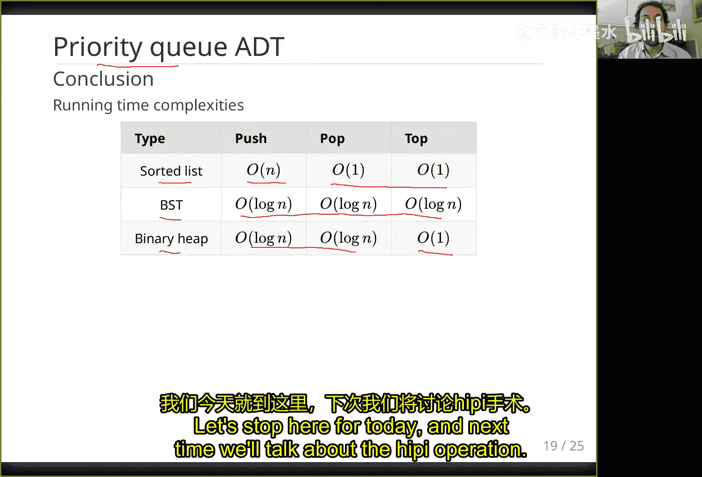

# 【全集】加州大学戴维斯分校 数据结构与算法编程 中英字幕 完整课件 p17 6-1 优先级队列 -BV1rJ2WBSE7P_p17-

Hi， everybody。So today we're going to start a new topic， priority cues。

it's a very interesting kind of data structure because it combines two concepts that we just talked about。

 cues and binary trees， and it kind of combines them in a very interesting way。

Before we dive into the definition of what a priorQ is and its typical implementation。

 let's just see a couple of examples to explain why it would be interesting to have such a data structure。

So let's start with the first example around process scheduling。

 so you know processes are applications on the computer， there are like processes that run。

 so they are like program and execution and they have to execute until they are completion。

The goal for a say like a system designer is to make sure that the computer will stay very responsive。

 otherwise the user will think that the computer is not being very usable。嗯。

So let's take a very simple example。😊，That we're going to try to improve。

So let's imagine that you're own your computer right。

 and at different times you are in your terminal and you run a pretty long compilation of a certain program。

And then so you like type G++ whatever and then you press enter and it's going to take a long time。

 so right away you I don't know you fire up your web browser and you refresh the page on Can for example。

 and while you do that you also decide you want to send message to your friend or you send an instant message through there。

And a little bit later， imagine like you are getting an email。

 so at some point you want the notification to pop on on the screen。Now。

 if the computer or if the system， the software system doesn't do things very smartly and says that like every time the execution of a process is started。

 it has to run，Up until completion， and then we run the second process entirely up until completion。

呃。Here the issue is that the system will feel very。

 very unresponsive right like it's doing things for short。

 it's doing this big compilation and then it's refreshing the webage and then it's sending the IM message to your friend and so on。

 but because the computer focuses on like only one task entirely at a time。For the user。

 it will feel that the computer is not moving， right you're going to move your mouse and things are going to feel like extremely slow。

So how can we do better than that， how can we schedule those different processes in such a way that the system feels like it's more responsive？

嗯。A first idea would be to say， hey， instead of executing an entire application an entire process all at once。

 we're going to execute it in checks and we're going to interleave the different chunks of different processes kind of at the same time。

So here， for example， like we would execute a little bit of the compilation and then a little bit of the refresh on the page on canvas and then a little bit of sending a message to your friend and then a little bit of the compilation again and a little bit of the refresh of the web page and so on。

And typically here we could use。A queue。Our 5O first in first out to implement this what is called a roundrobbing scheduling。

 meaning that like every application gets a little bit of the CPU to execute for a certain like amount of time and then goes back to the end of the line and has to wait until all of the other application in front of it in the line are also executed for a tiny bit and so on。

 so in a very fair manner， like every single application has like the opportunity to get executed。

You'll notice that， overall。In order to execute all of those processes。

It's taking exactly the same amount of time as before。

 it's just that this entire time has been distributed differently。

So that from a user's point of view， the user will have the impression that the compilation is happening。

Over time， but also that the refresh of the web page is happening。

At the same time and the user can see that things are moving。

 it's not like things are being stuck up until the entire process for the refresh of the page happens。

And so overall it improves the response time because between the event itself。

 like you pushing the refresh button and then you seeing that the refresh is currently happening。

We've kind of minimized the time and same here you see from like the time between receiving the email notification。

And the process like actually like displaying the pop up on the screen。

 we've shortened the time quite a bit compared to BO。Now， the question is， can we do？

Even better and yes， we could with something called priority scheduling。With priority scheduling。

 we could associate a priority with every process。And typically we could say that。

Shorter process processes that are going to get executed very， very fast on the CPU。

 they should have a high priority。In fact， to improve even model the responsiveness of the computer。

If the compilation takes like 10 seconds。Instead of， I don't know， eight。

It's not something you're going to notice。If receiving the email notification like two seconds later。

 instead of instantaneously， that's something you're going to feel a lot more。So that's the idea。

Every time you have a process that you know will be very short。

 you want to try to schedule it as fast as possible and so now you see that like process three the sending the instant message to your friend because it's a short process。

 we're going to try to execute it as fast as possible and you see that like before we would be done with this process over there and now we're done with it a lot earlier same with process number four the email notification as soon as we get it essentially like right away we try to execute and it gets executed a lot earlier than before whereas for the compilation process and the refresh of the page because their slower process they gets scheduled with a smaller priority。

The thing is that this priority scheduling we wouldn't be able to do with a queue because the queue is only able to understand like。

 oh， there's a line you go to the end of the line and once you get to the front of the line we're going to take care of you here we need a kind of queue because we need a sort of line but we need to be able to pick out of this line。

The entity that has the highest priority。And technically。

 that's what priority cues are about and that's the service that they're going to be able to offer。嗯。

Very quickly， here is another typical example。Of priority cues。

 something called discrete event simulation， So let me give you an example here。

Imagine that you're a hardware engineer and you are trying right now to design a new kind of CPU。

 like a new feature for a CPU。呃。In the first approach you would spend like a couple of years writing this CPU in terms of transistors right。

 and then because it would take a lot of time to like work at that level。

 then you would talk to a manufacturer to actually like。

Produce this CPU in silicon so that you can try it。

Then you're already like four years later after having had your your bright idea。嗯。😊。

And then you test your CPU， which is now like a piece of silicon and then you realize that you have a bug in it。

 except that it's now like five years later and you probably lost like $2 million going through all of that effort and paying for the manufacturer to produce your cheap and you pretty much have to do it all over again。

Or better solution second on approach instead of going directly to a transistor implementation。

 you program what the CPU would do like kind of its behavior using a programming language。

 so you program a simulation model of your CPU。And then you can actually try this feature without really like needing to manufacture the CPU itself and once you've。

Tested that behavior or you like I don't know you're sure that it's working fine。

 then you can really do the transistor part and the manufacturing part which are going to cost a lot of money。

Yeah。But so if you're going to program a model， a simulation model of your CPU and more generally like a simulation model of an entire computer。

 you need a way to simulate that like how do you simulate something that in real life has a lot of different events at the same time？

So one thing that you can do is called continuous simulation。

 you define period so you say like essentially I'm going to simulate the system every， I don't know。

 every microsecond， so you have your simulation models and every microsecond you evaluate all of the components and you see if they're doing something。

嗯。And you do that continuously at very fixed frequency。

And that's how you can see that the system is moving and you're able to simulate that system。

The problem is that like sometimes in between two periods of evaluation， nothing is going to happen。

And other times something is going to happen during the simulation like in between two periods。

 but maybe something is going to happen only between say like two components like between say the CPU and the RAM。

 but nothing's going happen for the GPU so it wouldn't like you would lose time trying to simulate the GPU for every single period of time if the GPU is actually not doing anything。

 so there's another kind of simulation called event driven simulation。Here。

 the idea is to really more like try to see。Okay CPU like what is your next action and when should it be simulated and so it's up to every component to say like oh。

 so for the next like that for the next period of time I'm not going to do anything the next time you need to simulate me because because I'm going need to do something is like in five milliseconds or something like that。

And so now it's more a question of like instead of simulating periods that are fixed。

 you simulate events， so you kind of keep up a calendar of events that you need to simulate in order。

And here， typically having a priority queue that is ordered by when the event is coming next is great。

There are many other examples around like using priority cues。

 I could mention like network management， for example。

 like say if you have a network that's very busy that's congested。

 we say and you want to send traffic like internet traffic with a very high priority first。

 then you need to you need a way to schedule that traffic，Following that those requirements。

 there's also another example in graphs， for example， so think in terms of like GPS。

 you want to go from Davie to Sacramento in as short a time as possible。

 the GPS will see all of the roads and all of the intersections as a graph of nodes。

And typically the algorithms that find the shortest path between two nodes on the map will use the priority queue to understand from one node where to go next and so on so that you can reach your destination as fast as possible that's actually something we're going to talk about very very soon。

Okay， so。Hopefully my examples have convinced you of the utility of a priority queue now let's talk about what is a priority queue itself and its definition。

It's actually pretty simple。It's a cube， which you already know the idea of like pushing。

 popping in a cube。Except that here， items are associated to a certain priority。And by priority。

 we mean there's some sort of like key， there's some sort of value that we can compare and we can determine like oh this item has a higher priority than another item。

 that's what it means。And so essentially pushche will be pretty much like the same kind of pushche as in a queue。

 you have an item， you push it in the collection。The pop will be very specific here because when you pop now。

 you don't want to like so in queues when we pop， we pop the item that was that had been pushed the longest time ago right that's the fee first in first out。

Here the P in a priority queue， you want to pop out the item that has the highest priority so you don't care when it was pushed maybe it was the last one that was pushed or maybe it was the one that was pushed the longest time ago but you don't care about that you just look at all of the items and you pick the one that has the highest priority that's what P P does in a priority queue。

So here in an example where items are being pushed successfully inside of the priority queue and so you see here that like。

They're kind of pushed in random orders， however， when we pop them we pop first the item that has the highest priority of like here by highest priority we。

the example is removing the item that has the smallest key。

And so we would pop one first and then two and then three and then four and then like five later。

The names of the operation， P and P， I'm reusing here what the C++ standard library uses for priority cues。

In the literature in books you might see those methods being called differently sometimes。

 so for example you might see a push being referred as insert and pop is often called getmin。

 get the minimum so if you read a book or if you read a webage about priority cues。

 don't be surprised to see that push and pop is not necessarily the vocabulary that is being used the most often。

Okay， let's move on。😊，so now that we have the definition， let's start looking at the implementation。

 here is the typical API that we would expect from a priority queue。

 so we would want to know the size like the number of items we have in the queue right now。

We want to be able to access the top item so the item with the highest priority。

We want to be able to pop this item like take it out of the queue。

And we want to be able to push a new item inside of the queue and so here to make things simple。

 we're not considering like items that are made of a key and of value we're just considering items that are directly keys themselves。

 just like we did for binary search trees and all of that。

So we're going to look at a couple of different possible implementations。

So here is the first implementation of a priority queue using a list and using more specifically a sorted list。

The idea is that。You have a list that is in solid order and that represents your priority queue。

If you if you call black top or pop。Then it means that the element that has the highest priority is the first one and you can remove it。

And then you have two left。If you call push。When you go push。

 you try to remain to keep the list sorry at all time。

 so the push will insert the new element in the right position in the list to make sure that the front of the list is always the one that has the highest priority。

We're going to discuss this implementation a little bit more in the next slide。

There's another kind of implementation that's a little bit better and we'll discuss that also in a couple of slides。

Based on using a binary search tree and to make sure that we get a good performance。

 a self balanced binary search tree， so pick anything from an AVL to red， black trees or whatever。

The idea here is that so that would be the binary search tree starting from the root。

Now we know that the top of the priority queue would be the minimum node。

 so the node that is the farther on the left side， right？So when we want to call a pop or top。

 essentially like we would remove。This minimum node and on the other hand， when we call push。

Then we would push。The new element， following the same。Like requirements as a binary search tree。

 we would like do a recursive insertion at the right location。Right。So that's the idea。

 those are two possible implementations。So let's quickly look at that。

 let's start with using a sorted list， how could we encode that？Well。

 we could think of an implementation that's based on a linked list， so typically using like STD list。

 so we have our items。In a standard list。The method size would just retain the number of items we have。

The method top so remember when we use a stand list here。

 the stand list has no error management whatsoever。If you call front on a list that's actually empty。

 you get to an undefined behavior， it doesn't crash its undefined behavior because you are not supposed to call front on an empty list。

So to make sure that our implementation managers has some error management。

 then we need to take care of that ourselves so every time we call like pop and top。

We make sure that there is something in the priority queue that we can return。

 otherwise we throw an exception。Other than that， is just a question here。😡。

Because we know that the list is already in solid order。

 we know that for top we can directly return front and that for P we can use the method pop prompt which will remove the first item now the fun part is in push so here push we get an item and we have to make sure that we insert this item in the right place in the currently solid list。

So for that。We use this function here， lower bound。And to lower bound。

 we give the entire list from beginning to end。We give the item that we want to insert and we essentially ask this lower bound function to return the position inside of the list。

Where we find the first bigger element than item。And that returns us the position。

And that's pretty much at this position。That we want to insert this item if we do that then we will insert in a list and keep it sorry so for example。

 like if we had the list where I don't know first item so we have the head over there。

First item was one next item was， I don't know， like three next item was like say five and say seven。

And we call pushush。four。😮，This lower bound function would return the position， so that's position0。

1，2，3。The function lower bound would return the first bigger element than four， which is five。

So the function would return position2。 and so eventually we would insert add position2 the item for。

 which we are receiving as a parameter and that would。Insert for here making 3。04 and 4。

025 and that's how we would insert for at the right location。U。Okay。

Let's talk in terms of complexity now， I wish we would be in the classroom so that I could ask you in real life。

 but let's do it here， so look at all of those methods and try to guess how much like what is the running time complexity of all of those methods。

So let's start with top here。😡，Top essentially we call items front。

 how much time is that going to take considering that the priority queue might contain n items。

Front returns the first item because the list is in solid order。

So the complexity here would be constant o of one， right？The list could have a thousand of elements。

 we know that the first one is the top we dont need like the size of the list doesn't matter。

Pop here because we also pop from the front， we pop the first item。Is also in constantine。不。

Now push is a little bit more complicated。What is the worst case scenario here when we insert an item？

Worst case scenario is that we have to insert it right at the end。

Of the list to keep the list chart sorry because the item that we are inserted is actually the biggest one of the collection now。

And so for that， wed need to scan the entire list from beginning to end。

So now this function is directly proportional to the size of the collection and is actually linearly proportional to the size of the collection。

So it's typically all of。And。So that's pretty much what we have。Now， just to mention。This O of N。

Is the worst case scenario。It's in case the item that we're inserting that we're pushing。Is， in fact。

 now the biggest item in the collection。On average。

 we could imagine that like if we have a collection of， I don't know， a thousand items， on average。

 when we push new elements to this collection。It's probably going to be like oh of。

And divided by two， like on average， the element that we're inserting。Is about like， I don't know。

 smallerer than half of the collection we already have and bigger of half of the collection we already have on average。

That's actually important to understand that because。

Here you see that we chose to do an insertion in order。

That we are going to push in such a way that the list will stay solid。

So that when we call top and pop。The item with the highest priority is already at the top of the list。

Now that could be another implementation using a list。😊。

That kind of like in versus the two running time complexity， we could say that push。

Is something like。Iem。Push front。So every time we have。

A new item that we want to push in the list in the priority queue， we just push it at the front。

And that means that the list is not sort， we just push them in random order。

That means that now the push would be。Inu of one。However。

 it would be up to top and top now that we have a list with like random elements。

 whenever top and top are being called， we have to go through the entire list。

To find the element that has the highest priority。And so here those two methods would be inu of it。

So we could argue， well， it seems like it's equivalent。In one case， we keep the list solid。

 which means that the push is in U。AWor case。And pop and top are in O of one。 or we do the opposite。

 We push in random order and we get a push that's in O of one， and we kind of like。

Die further the responsibility onto pop and top to scan the entire list to find the highest element in which case we make them inu of it。

They are not exactly equivalent though because here you have to notice that if we make top and pop in O of n。

 they really do have to go through the entire list to find the element that has the highest item。

 no matter what。Even if the first element。Of this unsed list is the one that has the highest priority。

 we don't know that we have to go through all of the items to make sure。

That there's not another one that has a highest priority。If we make push。

B the method that carries the longest running time in O ofN because this one has to make sure that we keep the lease sorted。

 in fact O ofN is the worst time the worst case running time when the new item that we're inserting is the biggest item of the collection。

 but in general the running time of push will be lower than that。

 so that implementation is better than the alternative。O。嗯。

So now that we have seen the implementation based on the list。

Let's see an implementation based on a binary search tree。And actually。

 we're not going to get into any code， I'm just going to talk about concepts。

So we could use a binary search tree to implement a priority queue。

The top function would be used or would be implemented by simply returning the mean of the binary search tree because as you know like the minimum item is the one located right on the left on the farther left。

 so that would be how we implement top pop would be removing that minimum node。

And push would be just the same as a regular binary search tree。

That means that all of the methods here would have a complexity of log of n。

 right like finding the minimum is log of n， removing the minimum is two logs of n。

 but log of n and push is the same as BST， so log of n。

Now what's interesting is that we can look at those two naive implementations， the list and the BD。

 and here's what we see。We see that a least implementation has top and pop in all of one， which is。

Awesome， like there's nothing better than all of it's constant time。However。To offer that。

 it means that the list needs to stay sorry at all time and it means that push is in U。

 which is not that great。Now the binary search stream implementation。😊，Gives us push in logovn。

 which is a lot better than Uovn。 However， it also gives us top and pop in logovn。So， that's。

Bless good than all of one。So the question is like， how can we get？

Or can we find a way of like organizing those values this and implementing the priority queue in such a way that。

Top and pop would be around like over of one。And push would be in log of it。

 that would be the best of both worlds。And there is such a data structure that we're going to talk about right now。

 and it's called。The binary heap。 So what's a binary heap。

Binary heap is essentially it's a binary tree， so recognize those like that kind of binary trees that we have studied for AVL trees。

 binary search trees， red and black trees and so on。

Except that this binary tree has different properties and it has two properties。

Has something called a hip other property。That means that the values here of H key have to be in a certain order。

And we're going to talk about that， but as right away， you can see that， for example。

 the minimum key。Is the highest in the tree that's the minimum key is the root node that's very。

 very important。And it has a structure property like the tree has to correspond to a very specific structure。

And in the same way that with selfbalan trees， we had two operations insertion and removal that could break the structure of the tree and the property of AVL trees and red and black trees。

 it's the same here， insertion and removals in a binary heap might。

Break one of those two of those properties， and so we'll have to find ways to restructure the binary tree so that it's still to restructure the binary heap so that it respects those properties again。

And we're going to talk about that。Now what's interesting is that binary heaps are one。

 if not the most common data structure to implement。Priority cues， and we're going to see that。

What's funny too is that binary heaps they were not invented at first for priority cues。

 they were invented by someone named Williams in the mid 1960s to help with a sorting algorithm。

 which will actually study。In a couple of weeks now。嗯。

One thing about the structure of property very quickly before we move on to the next slide。

Look at the tree here。Okay。We talk about different types of binary trees if you remember like perfect binary trees。

 full binary trees， and there was a third one， if you remember， called complete binary trees。

Complete means that every level is completely filled out。And if the last level is not filled out。

 then all of the nodes on the last level are packed to the left。

And you'll notice that that's exactly what we have here。Okay。Let's talk about the first property。

 the he order property， what does it mean？While it depends on the kind of he that we have。

 we have two kinds of hes， something called a mean he that's pretty much to what I've been talking about so far and that's mainly what we're going to consider in this lecture。

A mean he is when。The key of each node。Is less than the notes than the keys of the notes children。

So here take root node number two， like key number two， both of each children are smaller than two。

But it's a recursive definition， so if you take node 18。

 then both of its children have kids that are bigger than 1851 and 99 and same for 42。

 its own child has a kid that is bigger。嗯。So that that's how it works if we had a max he it would be the exact opposite like the biggest number would be the root node and then we'd have children with keys that are smaller it really depends how we like what do we consider being the item with the highest priority。

 sometimes the highest priority means the smallest number sometimes the highest priority means the biggest number it really depends on the on the scenario。

But once again， in that lecture。Implicitly， I'm going to talk about mean heaps most of the time。

 which means that the root node is the node with the smallest key。So here is an example。

 here is an example here where the hip order property would be broken and why is it broken because of that relationship？

Here we have a node with key 51， which is bigger than it child of key 18。

 that's a violation of the hip other property。If we were to invert。

 those we'd be in that situation and we would have a proper binary heap。Yeah。

Now what does this hip order property gives us that's absolutely awesome and like really meets exactly what we wanted out of that data structure。

How do I find here the item that has the highest priority， Well。

 this item is always the route which I can find in all of one。

So that's pretty much how this binary heap can implement top。

Like finding the highest priority element in a priority queue in o of one because it's the root node。

It's right away there， doesn't depend on the size of the tree itself。嗯。O。

So that's what about the he other property。 Now let's talk quickly about the structure property。

 which I already mentioned。Essentially， the he has to remained a complete binary tree at all time。

 so again， it means that every level is completely filled out。

Except for the last level may on the on the last level。

All of the nodes are absolutely packed to the left。

And that's what gives us a guarantee in terms of height， of overall height of the tree。

 which will guarantee us afterwards that some other very operations such as restructuring operations can be done in log of essentially。

So there's definitely an aspect of improving the running time of certain operations。Another aspect。

 and maybe you remember from when we started talking about binary trees in general and their representation in terms of code。

嗯。😊，So now is the time to bring that back。Having binary trees， complete binary trees。

Simplifiess the representation by a lot。And in fact。

 we can represent a complete binary using a simple array。Why。

 because we don't need to manage any of the complex management using pointers like bright and left pointers and everything。

 which we would need if the tree had like holes， for example。

 here because the trees complete then it means that there's a guarantee that all of the nodes will follow one another。

And it means that for any node， so for example， like node number five， which is E here。

We can with very， very simple mathematical formulas， we can derive。Is children。

Left and right and so to find potentially the left child of of node E。

 we would only need to multiply is index5 by two。And actually。

 that would give us the position of J if we were to represent J in that array。

 J would be at index 10。If now we're looking for the right child of a node。

 it's two times the index of the node plus one。So imagining that we had another node over there。

 this node would necessarily be at index 11。And finally， to find the parent of a node at index I。

 we just need to divide the index of this node by two， so here five divided by2 gives us 2。5。

 but we only keep two as an integer， and that gives us the position of B。Be being correctly the。

Parent of E。So you see here how we can like navigate this entire tree。Through an array。

 just by doing very simple operations on the indices。And。

So that's a very good reason to represent a heap as a complete binary tree。Okay。

 now that we master the different concepts， let's start talking about implementations。

So let's start with the data structure。So as usual， we declare a class。

 so here we are declaring a priority queue that is based on a binary he。

The priority Q is in fact a vector of items， so just an array has a current size of zero。

And we would。It's usually like the case that we know the capacity of the priority queue in advance。

 and so we can give it as a parameter。And we add plus one to this capacity to take into account that the root node starts at index one。

So here I realized that I forgot to mention that， so let me just go back very quickly one slide。

You notice here and that's totally a decision that's a conscious decision to make the root start at index1。

 so here a is the root node， we make it start at index one。

And which means that whatever is at index zero actually like doesn't exist。

 well just completely skipping this first element。It is possible。

 it is not at all impossible to make the root node start at index zero the only thing is that it forces us to slightly tweak those formulas to make sure that the relationship between parent and children and between children and parent will still work and it makes those mathematical equations slightly slightly more complicated but really barely more complicated。

And so to just make sure that they stay simple， it's kind of easier to sacrifice one cell of this array。

 that's a good price to pay。Okay。😊，So that's why we have plus one here。

Before we implement the rest of the API we're going to probably use some helper functions that will make the code look easier。

 so here's a bunch of helper functions it's mostly like all of this。

Calculation of indexes so for example like let's have a function called root that returns the index of the root node so here it's hot coded it's index number one。

The parent of node n is ndiv by two， the left child of node n is two times n right side of node n is two times n plus1 so tournament it like the formulas that I just showed you。

And two more helper functions that will be used in the different algorithms that we're going to need。

One help of function is。Detertamining if a certain node has a parent。

 which is in fact the case for every node except for the root。

 so it's just a matter of comparing if n is the root or not， in which case it has a parent or not。

And another function to tell us if a certain index in the array is a node right because the array will exist no matter what has a certain capacity that can contain a certain number of items。

 but it doesn't mean that this array will be full， we might have a tree that doesn't take all of the space and so for certain index in the indexes in the array。

 we need to know if they are part of the binary he or not。And so for that。

 we essentially compare that the index is smaller than the number of items we currently have in the binary he。

Okay so that's pretty much it for the helper functions now let's start implementing the public API of the priority queue so remember we had top pop and push we're going to try to implement those three functions。

Let's start with the easiest one。😡，Top。😡，So top is supposed to return the item that has the highest priority here turns out that this item is the item that is at index number one。

So the function is extremely simple， it essentially returns the item at index written by root。

 which is o of one。Function， right， and just to make sure that we are not accessing。嗯。

A location in the array that would be invalid， we check that the priority queue is not currently empty。

 otherwise we would return an air。And as it thought up super easy just a few lines now let's talk about the two others push and pop。

 we're going to start。Talking about push。So before we do that。

 just let me make you think a little bit。If I have a tree like that and I want to push a new item in this priority queue。

 where should this item be inserted？And don't think right now in terms of like hip property。

 hip other property， but more in terms of structure property。

Where should this item be inserted so that the structure is not broken？

There's only one possible location it would be right here。Like if I want to insert a new item。

 I necessarily need to make a new node over there， that's my only choice because it's the only way that it will go directly in the next cell following the last node of this already existing binary heap。

Okay。Except that obviously， if I insert。The new node over there。

 it's possible that this value has a higher priority than the parent in which case the hip order property would be broken and I need to fix that。

 but let me show you an example first。So let's imagine that we have a currently a binary hip and we want to insert a new value into it。

 so this one is a mean hip。You see that the root has the smallerest key too。

 and so we are inserting node 50。So by default， we go directly where that new node should be inserted to make that we are not breaking the structure property。

Except that here we can see we are violating the hip other property because 15 is smaller than 42。

 so 42 should not be the parent of 50。How do we fix that？Well。

 we fix that very simply by swapping the key with its parent。

So here we detected 42 cannot be the parent of 15 because 42 as a lower priority than 15。

 so let's just swap them。And we essentially continue doing that。

 swapping this new node key with the parent and grandparent and so on。

 up until it finds the right spot。Up until we find where 15 should be located at and so here 15 should be below a node that is smallerer。

And above a node， that is bigger。And once we find the right location that mag the heap other property be respected again。

 we can stop。That that。Procedure， this algorithm is called。Pcoulate up。

So peulate up a node means that like as long as this node as a parent and that would pretty much be the stop condition。

 like if we were to insert a value that ends up being the root then we cannot push it up there anymore so as long as the node as a parent and as long as the priority of this node is greater than the priority of the parent we essentially exchange the node with the parent。

And we make the node like kind of climb up the tree that's why we call it packcolate up to find its right location。

For some reason， the literature is not there's no consensus。On the name of this operation。

 so percoulate up， I took the name in one of the textbooks that I mentioned in the syllabus。

 the W textbook， but in other textbook， you'll find thousands of different names like up， bubble up。

 hepify up， swim up， they are like tens of them like people don't agree on one term。

 but they're all equivalent they're all the notion that the the note finds its way up the tree。

 to where it should be located to not to respect。The hip other property。嗯。Okay。

 and the implementation of this percolate up。Algorithm。

 I'm going to show you right here in terms of code based on the data structure that I showed you。

 and you recognize pretty much every link line as this Y loop as long as the node as a parent。

And that the parent so here it's a min hip， so as long as the parent is greater than the child。

 which means that the child could go up， then we swap parent and child and we update the index。

And so that gives us per up。Now in terms of。Pushing like the implement of the push。

We essentially have three steps， so first step is that we need to make sure that the priority queue is not becoming full。

 so we check the capacity。And then we have two steps。The first step is to insert。The item。

At the end of the current orraso， at the very like at the last node of the binary heap。

 exactly like we talked about。And then from that position。

 which very likely is violating the hippo property， we perulate up。From this index。Right？嗯。O。

And now pop， so pop is very interesting as well。Let's take an example。

So here before we had this number two was the root。When we do pop， we want to remove node number two。

If we were to remove node number two， we'd have a hole at the root node， which wouldn't be possible。

 where like we cannot add a hole。We need to keep the tree be complete。

So one good solution to make sure that we're not violating the tree structure property。Is to take。

The last note。The currently last node of the binary he and essentially to bring it。

As the new root note。And by doing that。We essentially remove the root node that contain the highest priority。

W while not violating the tree property the tree structure property。

Except that now by doing that potentially。We are not respecting the hip other property because now we have a root node 93。

 which is here bigger than both of each children， which is not possible in a mean hip so if we were lucky and the hip other was actually not broken。

 then there would be nothing to do， but it's very unlikely。

Most likely we're going to have to deal with it。And we're going to have to exchange this root node with one of its children。

And what we're going to do is that we're going to swap this root node with the smartest child。

 so here 93 has two children， 18 and 54， we're going to swap it with 18 and 18 will become the new root。

And actually， now 18 is in fact， the item with the highest priority in this mean he。

Here 93 is still bigger than both of its children， so we need to continue doing that and again we swap it with the smallest of its two children up until we find a location where 93 should go。

 where it becomes like smaller than any of its children and bigger than its pair。

This procedure is called。Pcolate down。So。The overall algorithm is that as long as a node has。

A child and if a node has one child it's necessarily a left a left child that's a property of complete binary trees。

 so as long as a node as at least a child a left child，Then we need to。

Determine which of the two children if there are two children is has the highest priority。

 so in a mean heap like which of the two children is the smartest， for example。

And then we need to compare the priority of this smallest child of this child that has the highest priority between the two children and the priority of the node itself。

And if one of the two children has a higher priority than the node itself。

 then we exchange the node and the child and we continue doing that as long as we need to push this node down the tree。

And。So here the implementation is slightly more complex。

 but you'll see that it implements this algorithm very strictly。So。歪了。

The node N has a left child That is a node。Then by default， we consider this left child。

Then we see if the left child。We see if there is a right child as well。

 and we see we try to determine which between the right child and the left side has the highest priority。

And if it turns out that it was the right child， then we change the index of the child。

Once we have in childil， the index of the smallest。Child of the node n。

 then we can compare the priority between that child and N itself。

 and if it turns out that the child should like or that the node should be perulated down。

 then we swap the child and the node， otherwise， it means that we found the location where this node should end up at and we can stop the algorithm。

And then we continue and we go to the next iteration。And so once again。

 now that we have the pecoade down， the implementation of P is pretty easy。Again， three steps。

Step number one， we make sure that we do some air management。

 we make sure that the binary hip the priority queue is not empty。Step number two。We exchange。😡。

The root， the root node which had the highest priority， and we move the last node over。

 that's what we do in that line。And now that we have a new root node with a new key that's probably not located at the right location and that's violating the hip other property。

We paracolate down as the third step， we percolate down this new root node so that it's pushed down the tree to find its proper location。

嗯。Conclusion on that。So the binary he。Offers us like three methods， push in log of N。

 pop in log of n and top inu of one， which is really great。

There are some other operations on binary hips that can be useful depending on the algorithm。

 so sometimes it's very useful even if you already have a binary he to be able to change the property of some items as they are already in the binary hip。

 but that might require if you change the priority of some items that they need to be relocated accordingly。

嗯。As I was saying， like binary hips can be used in sorting algorithms and more specifically in the hip salt sorting algorithms。

 which we will study later。By default when we say hip。

It's usually a typical binary he just like the one we discussed。

 but they are actually like other kind of hips such as two， three hips， binomial hips， fibonac hips。

 and so on， they are like different types of hips。And to conclude this lecture。

 just to kind of summarize everything that we've talked about。Priority cues。

 they can be implemented in different ways like using different data structures。

 they can be implemented using soted list， binary search trees or binary hips like we just talked about。

Except that using soed list， we have a great top end pop， but a pretty bad push。

With binary search trees， we have pretty good averages。

 but everything is in log of n and with this very specific data structure， binary he。

 now we have a top in U of one and we have a push and a pop in log of n。

Let's stop here for today and next time we'll talk about the Hie P operation。

