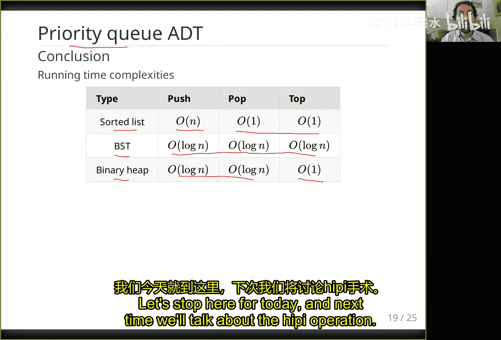

# 数据结构与算法编程：6-1：优先级队列 🎯

在本节课中，我们将要学习一种非常有趣的数据结构——优先级队列。它巧妙地将我们之前讨论过的队列和二叉树两个概念结合在一起。

## 概述：为什么需要优先级队列？

在深入探讨优先级队列的定义和典型实现之前，让我们先通过几个例子来理解为什么这种数据结构如此有用。

### 示例一：进程调度

想象一下，你在电脑上同时运行多个进程：一个耗时的程序编译、刷新网页、给朋友发送即时消息，以及接收邮件通知。如果操作系统采用“先到先服务”的方式，即必须完整执行完一个进程才能开始下一个，那么系统会显得非常卡顿，用户体验极差。

一种改进方法是采用**轮询调度**：将每个进程的执行时间分成小片段，然后交替执行这些片段。这可以通过一个标准的**队列**（FIFO）来实现。虽然所有进程的总执行时间不变，但用户会感觉所有任务都在同时推进，响应速度得到了提升。

然而，我们还可以做得更好。这就是**优先级调度**。我们可以为每个进程分配一个优先级。例如，那些执行时间非常短的进程（如显示邮件通知）应该被赋予更高的优先级，以便尽快执行，从而进一步提升系统的响应速度。这种调度方式需要一种特殊的“队列”，它不仅能管理一个序列，还能从中**取出优先级最高的元素**。这正是优先级队列的核心功能。

### 示例二：离散事件模拟

在硬件设计中，直接制造芯片来测试新功能成本高昂、周期漫长。更好的方法是先编写一个**模拟模型**。一种模拟方式是**连续模拟**，即每隔固定时间（如每微秒）检查所有组件状态。但这种方式效率低下，因为很多时间段内组件可能并无动作。

更高效的方法是**事件驱动模拟**。每个组件会告知模拟器它的下一个动作将在何时发生。模拟器则维护一个按事件发生时间排序的“日历”。这时，一个能按时间（优先级）顺序取出事件的**优先级队列**就至关重要了。

其他应用场景还包括网络流量管理（优先发送高优先级数据包）和图算法（如GPS寻找最短路径）。这些算法我们很快就会讲到。

## 定义与核心操作

现在，让我们正式定义优先级队列。它本质上是一种队列，支持 `push`（入队）和 `pop`（出队）操作。但与普通队列不同，优先级队列中的每个元素都关联着一个**优先级**（通常是一个可比较的键值）。

*   **`push(item)`**：将一个新元素插入集合中。
*   **`pop()`**：**移除并返回当前优先级最高**的元素（例如，键值最小的元素）。注意，这与普通队列的“先进先出”规则不同，它只关心优先级，不关心插入顺序。

在C++标准库中，使用 `push` 和 `pop` 作为操作名。但在其他资料中，你可能会看到它们被称为 `insert` 和 `getMin`。

## 可能的实现方式

我们将探讨几种可能的实现方式及其复杂度。

### 实现一：有序链表 📋

我们可以使用一个始终保持**有序**的链表来实现优先级队列。

*   **`top()`** 和 **`pop()`**：因为链表有序，最高优先级的元素始终在链表头部。因此这两个操作的时间复杂度都是 **O(1)**。
*   **`push(item)`**：为了保持链表有序，插入新元素时需要找到正确的位置。在最坏情况下（新元素是当前最大元素），需要遍历整个链表，时间复杂度为 **O(n)**。

另一种思路是让 `push` 总是将新元素插入链表头部（O(1)），但这样 `pop` 时就不得不遍历整个链表来寻找最高优先级的元素（O(n)）。相比之下，保持链表有序的实现更优，因为 `push` 的平均情况通常优于 O(n)。

### 实现二：二叉搜索树 🌳

我们也可以使用（自平衡的）二叉搜索树（BST）来实现。

*   **`top()`**：即寻找树中的最小节点（最左侧节点）。
*   **`pop()`**：删除最小节点。
*   **`push(item)`**：执行标准的BST插入。

在平衡BST中，所有这些操作的时间复杂度都是 **O(log n)**。这比有序链表的 O(n) `push` 要好，但 `top` 操作从 O(1) 变成了 O(log n)。

### 理想的数据结构

那么，是否存在一种数据结构，能同时实现 **O(1)** 的 `top` 操作和 **O(log n)** 的 `push`/`pop` 操作呢？答案是肯定的，那就是**二叉堆**。

## 二叉堆：优先级队列的最佳搭档

二叉堆是一种特殊的二叉树，它满足两个关键性质：

1.  **堆序性质**：对于最小堆，每个节点的键值都**小于或等于**其子节点的键值。这意味着**整个堆的最小元素始终位于根节点**。因此，`top()` 操作可以在 O(1) 时间内完成。
2.  **结构性质**：二叉堆是一棵**完全二叉树**。即除了最后一层，其他层都被完全填满，并且最后一层的节点都尽可能靠左排列。

完全二叉树的性质带来了一个巨大优势：它可以被高效地存储在一个**数组**中，而无需使用指针。如果我们将根节点放在数组索引 1 的位置（索引 0 闲置），那么对于数组中索引为 `i` 的节点：
*   其父节点索引为 `i / 2`（整数除法）。
*   其左孩子索引为 `2 * i`。
*   其右孩子索引为 `2 * i + 1`。

这种表示方法简单且节省空间。

### 堆的操作与维护

插入 (`push`) 和删除 (`pop`) 操作可能会破坏堆的性质，因此需要调整。

**`push` 操作与“上滤”**
新元素总是被添加到完全二叉树的最后一个位置（以保持结构性质）。这可能会违反堆序性质（新元素可能比父节点小）。修复方法是进行**上滤**：不断将新节点与其父节点比较，如果它的优先级更高（在最小堆中即键值更小），就交换它们，直到堆序性质恢复。

**`pop` 操作与“下滤”**
移除根节点（最高优先级元素）后，我们取**最后一个节点**放到根节点位置（以保持结构性质）。这几乎肯定会违反堆序性质。修复方法是进行**下滤**：将新的根节点与其子节点中优先级更高的那个比较，如果它的优先级更低，就交换它们，并继续这个过程，直到堆序性质恢复。

这两个调整过程都只沿着树的一条路径进行，而完全二叉树的高度是 O(log n)，因此 `push` 和 `pop` 操作的时间复杂度都是 **O(log n)**。

## 复杂度总结

让我们对比一下不同的实现方式：

| 实现方式 | `top` | `pop` | `push` |
| :--- | :--- | :--- | :--- |
| 有序链表 | **O(1)** | **O(1)** | O(n) |
| 二叉搜索树 | O(log n) | O(log n) | O(log n) |
| **二叉堆** | **O(1)** | O(log n) | O(log n) |

可以看出，二叉堆在 `top` 操作上达到了最优的常数时间复杂度，同时在 `push` 和 `pop` 操作上保持了高效的对数时间复杂度，是实现优先级队列的绝佳选择。

## 总结

本节课我们一起学习了优先级队列。我们首先通过进程调度和事件模拟等例子了解了它的应用场景和重要性。然后，我们明确了它的定义和核心操作：按优先级而非插入顺序来访问元素。

接着，我们探讨了两种基础的实现方式——有序链表和二叉搜索树，并分析了它们各自的优缺点。最后，我们深入介绍了**二叉堆**这一专门为实现优先级队列而设计的数据结构，详细讲解了它的堆序性质、结构性质、数组表示法，以及核心的 `push`（伴随上滤）和 `pop`（伴随下滤）操作是如何在 O(log n) 时间内完成的，同时保持了 O(1) 的 `top` 操作。

二叉堆是许多高效算法（如我们即将学习的堆排序）的基础，掌握它对于理解更复杂的数据结构和算法至关重要。