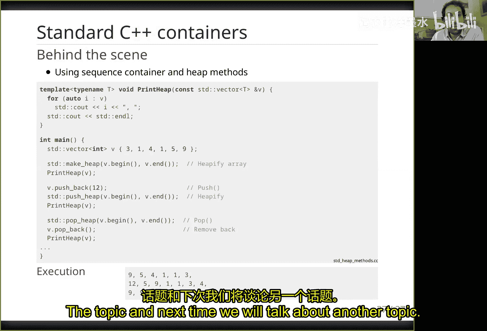

# 【全集】加州大学戴维斯分校 数据结构与算法编程 中英字幕 完整课件 p18 6-2 优先级队列 -BV1rJ2WBSE7P_p18-

Hi， everybody。So welcome to priority Q part two。So quick recap on last time。

So last time we studied what a priority queue was， if you remember in a priority queue。

We push items that are either associated with keys or that are keys themselves。

And when we pop them out of the queue， we pop them in a very specific order。

 we pop the items with the highest priority first。Priority cues can be implemented in different ways。

 we saw using a sorted list or a balanced binary search tree。

 but the best data structure that is usually used is a binary he。

Binary heap is a complete binary tree that contains keys。And that are ordered in a way that respects。

The hip order property the hip order property means that for every node that has a certain key。

 both of its children should have keys that have a lower priority so here's the example of what we call a mean Iip which means that the item with the smallest key as in fact the highest priority。

 so that's why it's right up at the top。And that definition of the hip order is recursive。

 so it works for key2 here has children 18 and 42， but also node 18 as children that are here bigger。

 51 and 99 and so on。哎。We also studied the push and the pop operations。

In binary heaps and so by extension in priority queuees。

 so yeah the idea for push is that we always push the new item at the next possible location that keeps the binary tree complete。

And then from that location， we do this operation called percolate up。

 which means that we successively exchange the new key that we just inserted with its parent。

Up until we find the right location。We also studied the pop location， so the pop location。

 we take the key of the last node， we overrite the root node with it since that's the root node that we're trying to pop out。

And then if this operation has caused violation of the hip order property。

 then we percolate down so we exchange this key with the smallest of its children successively up until we find where this key should lie。

Here' is for the recap of last time。There are two things that I wanted to talk to you further about priority cues and binary heaps。

The first is this process or this method called Hie P， so let me show you an example。

Hify is the idea that we can build。A binary he from an initial collection of items and that technically means that like could I could receive as a construct。

Of the priority queue， for example。Directly a vector of items， so I have a vector of items。

 I just want to build directly an entire priority queue or an entire binary he out of that。

Why would I do that in the first place while it's something we're going to talk about in a couple of weeks for sorting so for example I'm just going to give you the gist of it imagine I have an array that is not sorted。

If I can build a heap out of that array。Then I can pop each item and by popping each item out of this hip that I built。

 I'm going to pop them in increasing order of the array if my hip is a mean hip。

And so as we pop all of those items from which we built a binary heap， then we get a solidar array。

So that's kind of the idea， but we'll talk about it later。How do I do that in a way that's efficient？

Here's a first naive approach， which was actually the approach that the creator of binaryary Hiaps thought of。

 Williams。It's very simple， the idea is that okay， if I have a vector V。

We're just going to iterate through all of its items and we're going to push the items one by one。

As we push the items into the binary heap。Starting from a binary hip that's completely empty。

 then it will grow into a binary hip that is fully populated with all of the items in the initial collection of V。

And will be good to go， we'll be able to pop them out。The problem is that it's actually subtimal。

And let me try to do just a tiny bit of math here to show you why so take a tree， a binary tree here。

 a binary heap。Let's make it a little big here。I'm going to make it onto four levels。Oops。

 for getting some levels。O。So imagine that's my binary heap I have。So8 plus4 plus2 plus one。嗯。

So's 610， so that's like 15 items total。And I want to build the binary heap out of that。嗯。

The problem with that method is that as the binary he is built。So what's going to happen is that。嗯。

When we insert the first item， so at the beginning the binary hip is empty。

 so we're going to insert the first item which obviously will become the root node。

And so here we'll pay the price of log。A of sorry。Of0 zero like no complexity or actually maybe that would be like。

我我能 guess。Then as we keep adding。M notess。Here we're going to start having to pay， say like oh2 for。

So considering that the height。Of the binary heap would be H。Then it means that we have。

2 to the power of H here nodes here we have two to the power of h minus1。2 to the power of H minus2。

And so on。Up to two to the power of zero for the level that has the root， right？

And on the other hand， the more deep we go in the levels here。

 the more expensive will be the operation。Down to the last level。

 which is half of the node for which when we insert them， we're going to have to do percolate up。

And so technically， the price here would be log of n。That sorry。😔，And here the price would be。Log。

Or of log。嗯。Not sorry。 It's not。嗯。OK。Yeah， I mean， actually， like so that would be oh log of n。

Which is equal to log of H， the height， the height being o of n。And here it would be h minus1。

Here it would be h minus2， which is in that case equal to。O of two and so on。Overall。

 it means that the complexity would be the sum。From。H equals 0。 So the root node。Up to log a event。

 so。This last level。Of two to the power of age。Those are the number of nodes I have on each level。

Times are like， yeah， I guess times。O of eight。对。As age increases。Oh。

 the the running time complexity gets bigger at the root node， my complexity is all of one。

 the more I go down， the more it tends towards。O of H。So that's my overall equation。Now， if I。

Work on it a little bit that would be O of。你衫。From H equals0 to log of n of 2 h。Times。H。And now。

 if I。Remove my thumb and just， just kind of go like for the。Yeah。Average case。不。

We're going to have two。To the powerer of log of Ven times。loggervin。

So here I'm pretty much just like replacing the age。And that means O of n。Log。And。So that's the idea。

The question here is is there a better way， is there a faster way than that and the whole thing here is that like the reason that we pay this price is that the lower level here。

Wwhichch you have to understand like this this last level represents half of the entire collection right that that's how binary trees work like the last level of a binary tree contains half of the items of the entire collection。

And it's for half of these items。That the running time complexity is the highest log event because we have to do percolate up on all of those items。

And the paracolate up has the complexity of the tree's height。O。

There is a better way called the Floyd's method by the name of the person who invalid it and that's a linear method it's O we have a collection of size n。

The？Heipiefi， like the fact of making this array into a hip is linear time。

So before I demonstrate that to you， let me show you the code behind it and kind of the idea it works on two steps。

Step number one， we are just going to put all of the values coming from the vector。

In a binary tree that is not yet a binary he， just a binary tree， a complete binary tree。

 So for one word just going to push all of those items。

And we're going to make sure that the tree structured property is respected。

So imagining that we receive this vector v as a parameter to the constructor。Then we create。

An array item of that size plus one， remember， because we don't use the cell at index zero。

And then we essentially。Copy over all of the items from vector V into items。

 so here we are just building a complete binary tree that is not organized at all。

And then in step number two。We're going to start not from the root node。😮。

But we're going to start from the last node。That has children， at least one child。

And from that first node that has at least one child， we're going to cold percolate down。

So we're going to stop towards the bottom and we're going to try to percolate down and we're going to go up the tree up to the root node and the last thing that we're going to do is percolate down the root node。

So here we would start from n being like somewhere in the middle of the tree。

 which means that it's the first item that has a child。

Up until the root and we're going to go our way up and we're going to call percolate down on each of those nodes。

Let me show you a demo of that so that it gets clear， so imagine this situation。

We have a vector of integers， there are keys， there are in no particular order。

 and we want to hepify all of those keys。And so the idea is that like I want to create a priority queue and as the construction parameter。

 we give these vector keys。Step number one， we just push those keys， we don't change the order。

 we just mac a binary， a complete binary tree out of that collection。

And so you hear that at the end of this step one， the tree structure is okay， it's fine。

 respects what we want。But the hip order is totally wrong。

Here 51 has a child that is smarter than itself that's wrong for mean， for example， and so on。

So now we're going to start from the first。呃 item。Which has children， and in that case it's node 18。

Now you'll notice that each of those nodes they are contained an array and so they have a certain index。

 so the root node be index number one， 43 would be index number two， index number three。

 index number four，5，6，7。8 and 9。So now you see that in the fall loop in the slide the previous slide with the code in the fall loop。

 we start from the current size， which is nine。Divided by two，9 divided by two。

 that's four and a half， but that's four in terms of the integer。

 and that does correspond to the first node that has children。

And so what we're going to do is that we're going to percolate down 18。So from 18。

 we're going to look at both of its children and if either of its children is smaller than 18。

 then we're going to replace it。So that's what we're going to do here， like two is smaller than 18。

 so we swap one with the other。Once we're done with node at index number four。

 we're going to go one level up， we're going to look at node at index3 and node at index 2。

And we'll also percolate down those nodes if necessary， if the hip other property is broken。

Which is the case in both of them because here 93 is bigger than 54 so we swapwa them with one another and here 43 is bigger than 42 and bigger than two but two is the smallest side。

 so we calculate it down with two。43 then takes the space of two， but it' still bigger than 18。

 so it gets exchanged。With 18 up until it finds its right location。And finally， we get to the root。

 that's the very last node that's left at index1。The root is not properly placed because it's bigger than one of its children。

 so we perco it down and it turns out that in fact like 51 will be swept with two。

 then we'll be swept with 18 and finally with be swap with 43 and 51 will be per it down like all the way。

Now， what is the difference with before， well there's a big difference。Let me。

Clear that up and maybe go back one slide so that I have some space。

Let's take the same kind of big binary tree as we just examined earlier。

So that we can compare the same thing。嗯。O。So here what's going to happen where here what's going to happen is that for all of those nodes。

hi remember the entire collection divided by two， that's the last level of a binary tree is half of the collection for half of the collection。

 the complexity will be essentially no because we're not even looking at them。

 while starting from the first child， from the first parent。Those are only leavess。

So there's nothing to do。Then one level up。So essentially， one quarter of the connection。

We're going to pay the price of O of one。Because here when we have。

If we call pecolate down on this node。We essentially only have to either replace it with。

It's a left child or right child that's one operation。Then， one level up。

So now it's like it's 116th of the entire collection。The price will be over of two。And so on。

 up until the root node， which is there's only one root node。And for this one root node。

 when we call pecolate down， we might have to pray the price of having to push it like down the entire tree。

 but only for this one。The running time complexity might be log of it。So essentially like。H。

Which is the height of the tree。So you see here the big difference from before。

 like we're going to pay a pretty big price only once。

And the more we like go towards levels with more nodes。The lesser price we're going to pay。

 like it's the reverse of the previous algorithm， the Williams method。So again。

 if we try to write that as an equation， it would be the sum from。H equals0。To log again。对。So here。

 let me show you something。You see how for every level， so the last level is n divided by two。

The next level is n divided by4， then it's n divided by 16th。In fact。

 it's n divided by two to the power of one， here it's n divided by  two to the power of two。

 and here to2 to the power of three， sorry。Now I made a mistake。

 I guess it was like n divided by eight， but anyway， it's two to the power of three。And so on。

 up until。It's essentially n divided by2 to the power of。Hge。So what it means here is that。It's a。

It's the sum from h equals0 to h equal log of n of。嗯。Sorry， of H。Divided by。Two to the power of H。

O of eight。Sorry， it's not H， it's n。嗯。So n here is the size of the collection， right。

 so actually let's let。Let's write it in a big letter， okay。Okay。And so now if we say， okay。

 it's the complexity of all of that，H equals0。Log of n。Oh， I could also like。

Takeag this and out of the equation and put it in front of it。Okay。嗯。

And so here it's H divided by 2 to the power of H。Yeah。And now what's interesting is that when we。

 instead of having H go towards log of n， but instead like go towards infinity。

Just make to see how it tends to。So let me rewrite that so h equals zero towards infinity。Then。

 essentially。You see that it would make。Hge。Two to the power of age。

So two to the power of infinity would become like bigger than this term。

So that means that this whole thing disappears。N we are left with of n， which is linear。

So that's kind of the idea。Okay。Andm。😊，Last thing that I wanted to talk about is。

How are priority cues implemented in the standard C++ library？

So it does exist like it's an ADT that is provided by the C+ standard Library as a STD priority queue。

And like the stack and the queue， it's not an actual container。

 it's not like a real container like a vectors and whatnot， it's an adapter container。

 which means that it uses existing containers and it kind of like constrain them in a way that like only provides a priority queue。

So it's essentially a combination of a container to hold the items and by default， it's a vector。

But really like we can use any type of sequence container。

 so any type of container that can be accessed through an index。That's what it means。

And so it's the combination of a container like that and a set of methods of hip methods to essentially like。

Handle this sequence container as a he。And so it provides push heap。

 pop heap and make heap out of an array to build the binary heap。

 so let me show you an example of how we would use that in a real program。So imagine here。

We want to make two priority cues， Q max which is a max he。

 so remember a max he is when the highest priority element is has the biggest key and the mean he。

 that's when the element that has the highest priority has the smallest key。For some reason。

 the default in the C+ library is that priority cues are maxHs。

And so here that would be the way of declaring a max he containing integers like integer keys。

Now if you want to do a minor， a minimum he， a mini he。Of integers。You have to specialize the hip by。

Giving other template parameters。So here the Sum template is to specify which kind of sequence container you want to use。

 so for example， like if you don't want to use a vector as a sequence container as an underlying sequence container。

 you could say like hey， you know what I'm going to use a deck。

It's not necessary here it's just an example， but you could just use a STD vector in。

And the third parameter is the parameter that provides the way that keys will be compared essentially。

 and hereby providing this parameter， STD greater， that's pretty much how we built a minimum a mean he instead of a max he because keys will be now compared in the opposite way and the smaller key will be the one with the highest priority。

And so。Here now here is an example totally using the naive Williams method。

 so I'm just iterating through a sequence of random keys。

And pushing them in my max hip and my mean hip。And at the end。

 I'm printing the content of both of those hips to see what happens and as we can expect。

The max he will print the numbers from the bigger number because in a maxH。

 the bigger number has the highest priority down to the lowest number and when using a mean hip。

It would be the opposite， the smallest number would be printed first down to the bigger number。

And last。To show you how these priority cues and binary hips work in the C++ container。

 it's actually possible to not even use these STD priority cues but use directly functions on a vector directly。

So that's why I kind of called behind the scene， so imagine you have a vector V into which you have random values。

It's possible to call a method called makehi。On this vector from beginning to end。

And printing after doing that， we made a he out of this vector。

 which means that the elements of this vector have been rearranged in such a way that like now we have a he and we can actually confirm that here。

So it does make a max he here。But now that's the order of the array and if we read it in the same way as a binary tree。

Reading that line would mean that nine is at the top。5 is the left child， four is the right child。

 then one is there， the other one is there， and we have three over there that's that's what this first line means。

So all of those values， they have been rearranged in hippo， they have been hepified。嗯。

Now imagine we push。Pushing is really just calling pushback on the vector。

 which will essentially like Mac 12 go there。And then by calling。Push hip on the entire。

Vectctor we essentially telling the binary hip to like rehiify itself。

And bring 12 where it should go。And so here 12 should be swapped with four and then swap with9。

 and so we should end up with like 12 at the top。Nine over there and four over there and that's pretty much so then we print the heap and that's pretty much what we see on the sam line。

And again。If we want to pop out of this hipap， so if we want to pop out the root element。

 we would call pop head。And so here what's interesting is that the 12， which is now the root。

 would actually be。Put at the end。Instead of four and fourth would be brought up there。And then。

4 would be calculatedd down。 and so we would essentially like go back to the。

To the original heap where we have nine over there and four right below。

And that's what we can observe there。And also we'd have a pop back because at that point we'd have after doing the P head。

 12 would be over there， but still part of the vector technically like the vector V。

 and by calling pop back， we would really delete。That node once and for all。

 and we will be back at having a binary he that is in proper order。Okay。

 that's the end of our priority queue。Topic and next time we'll talk about another topic。

