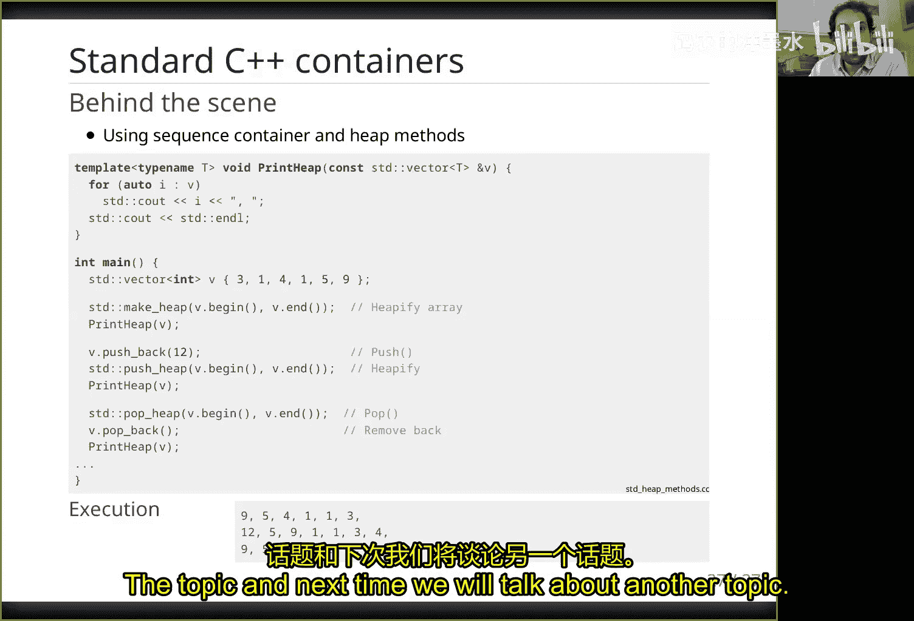

# 数据结构与算法编程：6-2：优先级队列（第二部分）🎯


在本节课中，我们将继续学习优先级队列，重点探讨如何高效地构建一个二叉堆（堆化），并了解C++标准库中优先级队列的实现方式。

上一节我们介绍了优先级队列的基本概念以及使用二叉堆实现`push`和`pop`操作的方法。本节中，我们来看看如何从一个无序集合高效地构建堆，以及标准库中的相关工具。

## 堆化：从无序集合构建堆

堆化是指从一个初始的项目集合（例如一个向量）直接构建出一个二叉堆的过程。这在某些场景下非常有用，例如堆排序算法。

### 朴素方法（威廉姆斯方法）

一种直观的方法是从一个空堆开始，遍历集合中的每个元素，并逐个执行`push`操作。

以下是该方法的伪代码表示：
```cpp
// 伪代码：朴素堆化方法
for (item in collection) {
    heap.push(item);
}
```

**问题**：这种方法的时间复杂度是**O(n log n)**。原因在于，对于集合中大约一半的元素（位于堆的底层），执行`push`操作（涉及上滤）的代价最高，约为树的高度O(log n)。

### 高效方法（弗洛伊德方法）

存在一种更优的线性时间**O(n)**方法，称为弗洛伊德方法。其核心思想是“自底向上”地修复堆序性质。

该方法分为两个步骤：
1.  **构建完全二叉树结构**：简单地将所有元素按顺序放入一个数组中，形成一个结构上完全但无序的二叉树。
2.  **自底向上执行下滤**：从**最后一个非叶子节点**开始，向前遍历到根节点，对每个遍历到的节点执行`下滤`操作。

以下是该方法的伪代码表示：
```cpp
// 伪代码：弗洛伊德堆化方法
// 步骤1: 将元素复制到内部数组，形成完全二叉树结构
copy(collection, heap_array);

// 步骤2: 从最后一个非叶子节点开始，向前执行下滤
for (i = heap_size / 2; i >= 1; i--) {
    percolate_down(i);
}
```

**优势分析**：与朴素方法相反，弗洛伊德方法中，代价高的下滤操作（O(h)）只对少数靠近根部的节点执行。而数量庞大的叶子节点（占一半）根本无需操作。其一层节点（占1/4）只需常数时间O(1)的操作。通过数学推导，总时间复杂度可降至**O(n)**。

## C++标准库中的优先级队列

在C++标准库中，`std::priority_queue`是一个容器适配器，它基于底层序列容器（默认为`std::vector`）和一系列堆算法来实现优先级队列的功能。

### 声明与类型

默认情况下，`std::priority_queue`是一个**最大堆**（元素值越大，优先级越高）。

声明一个最大堆的代码如下：
```cpp
std::priority_queue<int> max_heap; // 默认最大堆
```

若要创建**最小堆**（元素值越小，优先级越高），需要提供额外的模板参数来指定比较方式。

声明一个最小堆的代码如下：
```cpp
std::priority_queue<int, std::vector<int>, std::greater<int>> min_heap;
```

### 底层堆算法

标准库也提供了直接在序列容器（如`vector`）上操作的堆算法，这揭示了`priority_queue`的内部机制。

以下是一些关键函数及其作用：
*   `std::make_heap(begin, end)`：将指定范围内的元素重新排列，使其形成一个堆。
*   `std::push_heap(begin, end)`：假设`[begin, end-1)`已是一个堆，将`*(end-1)`（即新尾元素）放入堆中的正确位置。
*   `std::pop_heap(begin, end)`：将堆中的最大元素（位于`begin`）移动到`end-1`位置，并将`[begin, end-1)`重新调整为堆。

使用这些函数的示例流程如下：
```cpp
std::vector<int> v = {3, 1, 4, 1, 5, 9};
// 1. 堆化
std::make_heap(v.begin(), v.end()); // v变为最大堆
// 2. 添加元素并调整堆
v.push_back(6);
std::push_heap(v.begin(), v.end()); // 将6放入堆中正确位置
// 3. 弹出堆顶元素
std::pop_heap(v.begin(), v.end()); // 最大元素被移至末尾
v.pop_back(); // 移除该元素
```

## 总结



本节课中我们一起学习了优先级队列的两个高级主题。首先，我们比较了构建二叉堆的两种方法：时间复杂度为O(n log n)的朴素插入法和更优的、时间复杂度为O(n)的弗洛伊德自底向上堆化法。接着，我们探讨了C++标准库中`std::priority_queue`的实现，它是一个容器适配器，默认创建最大堆，并通过指定比较器可以创建最小堆。我们还了解了底层堆算法（如`make_heap`、`push_heap`、`pop_heap`）如何直接在序列容器上操作，这有助于我们理解优先级队列的内部工作原理。掌握这些知识对于高效地使用和实现优先级队列这一重要数据结构至关重要。