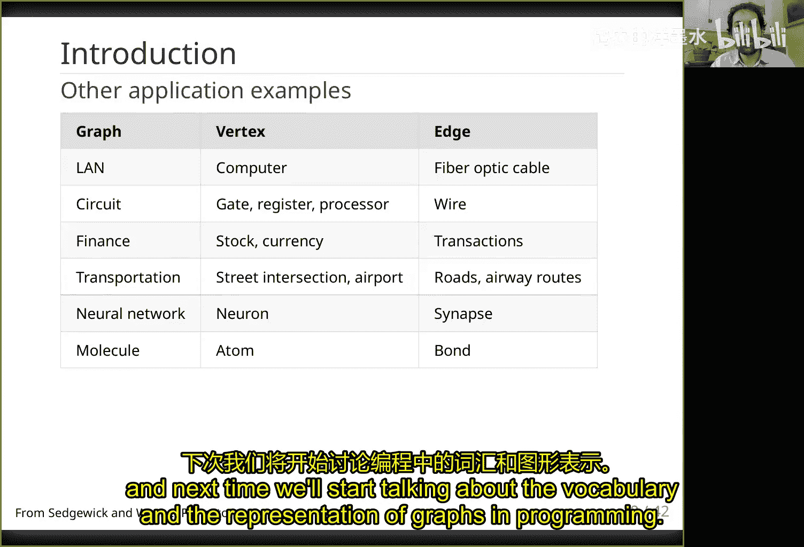

# 【全集】加州大学戴维斯分校 数据结构与算法编程 中英字幕 完整课件 p19 7-1 图表 -BV1rJ2WBSE7P_p19-

Hi， everybody。So today we're going to briefly start a new topic。Graphs。

Before we dive into all of the complexities， I actually would like to just。

Talk to you a little bit about the problem that started the whole graph theory。

 which I thought was interesting， so we're going to just start with that for today。嗯。

So about 300 years ago， actually， this mathematician， Leonard Eeller。

 was living in the city of Kunningsburg in what was Prussia， so the former German Empire。

 which actually was the capital city for a while of Prussia。

Today this city of Kningsburg still exists， it's in actual Russia and it's named Kaingrad。

 but anyway。This guy， Eler， was living in that city of Kningsburg and the city of Kningsburg is interesting because it's divided in four different pieces。

You have two pieces which are the main lane， the main land。Here and there。

 and then you have two islands。And the city spans all those four portions。Now。

 what's funny is that back in the day they were。7 bridges to connect those different portions of the city。

And so this mathematician， Eeller， was wondering if it was possible to walk like walk through the city。

By crossing each bridge。Exactly once。And he wanted to prove mathematically whether it was possible or not。

So let's try， imagine like we start over here in the northern part of the city and then we say。

 okay we're going to cross one bridge， then maybe another one will get out。Then a third one。

Then I can go back into here。And then say， I take this one。And then I take this one and I'm back。

Into the middle island and I actually did not cross this last bridge， so doesn't work。

So let's try another solution imaging now I'm going to start from here and now let me try another color that we'll see better。

Maybe let's try green。So now let's imagine we start from this island。Take this bridge。

Then what options do I have， maybe I could？Do this。嗯可。Maybe， and then。

I can take here and then I'm stuck over there and I'm still missing that bridge。And actually， I mean。

 you can post the video if you want and try to find a solution by yourself。

 but it probably will be difficult because Uer eventually proved that the solution had that this problem had no solution。

 so not superf。Now what's fun is that in order to prove that this problem of the seven bridges of Kningsburg didn't have any solution。

 he actually developed an entire new methodologies to support its proof and that was the beginning of the graphs theory so what he did is that he reformulated the problem in terms of like abstraction and so he came up with the area of saying well we're going to talk about the land masses or the different portions of the cities。

In terms of vertex or node。And we're going to represent the bridges as edges。And so if we do that。

 like we represent each portion of the land as a。As a node。

 and then every bridge that connects two portions。Is an edge？We essentially start creating， well。

 this thing。Which is a graph。And so here we have the representation of the different portions of the city and the different edges。

And now from that graph， we can do some analysis。So first of all。

 like obviously we need the graph to be connected， we need to have the different vertices be connected by edges if we're going to be able to like walk through the city crossing all bridges。

Now the possibility or not。Of crossing each bridges， each bridge only once， it depends。

 And that's what Eeller found。 It depends on the。Degrees of the node。

Like the number so remember like it's the same idea as for trees。

 the degree of a node is the number of edges that come out of that node。

 so here like this node has a degree of three。And so what Euler was able to show or to prove he came up with two kind of walks through a graph。

He came with the definition of a Uarian path。That's actually like the problem of the seven bridges。

 it's finding a graph that goes through all of the edges exactly once。

And what Eeller said and proved is that it's only possible to find such a path。

If the graph has exactly zero or two nodes。That are all of odd degrees。

So let's take this example here。This node。Has two edges， so it。This node has two edges， so it's even。

This node as。Three engines。This one has。Two edges。 and this one has one edge。So in that graph。

 we have exactly two nodes of odd degrees。In that graph。

 then it is possible to find a what is called a U walk or U path。呃。And in fact。

 he went even further he showed that such a path will necessarily start from the degrees one of the two nodes of odd degrees。

And end at the other node of our degrees。That's pretty much what he was able to show and the reason that。

The seven bridges could not be solved is that here in that very graph。All of the nodedes。Are of。

A degrees。So those three nodes have a degree of three and this node is of degree five。

 so mathematically it is not possible to find a Uarian path inside of that graph。

Another type of path that he showed that is named Ean Circuit or also known as a Ueller tour。

Is the idea to find a path that goes through all of the ages。Of the graph。

But with the same starting and end point。And it proved that it was only possible if all of the nodes。

Are of even degrees。The a is actually not that complicated。If you have a note。

You need to be able to enter that node and get out of that node and doing that takes one edge。

 two edge。If a node is now connected through four edges， you'll still need to like。Come do that note。

 and exit。And later come to that node again and exit， but every time you use one edge。

 two edges to come in， get out。So there's like kind of this symmetry to visit every node to be able to rid that node。

 come out of that node， and that's only this symmetry is only provided by an even number of engines。

So that was the beginning of it。So a graph。More generally。

 it's a set of vertices or nodes connected by edges。And to connect it now with computer science。

 it is extremely useful， it's one of the most popular type of data representation because it allows to apply to many different applications I'm going to show you a few examples。

And because it's such a great way to represent data。

 it also came with a lot of different algorithms to manipulate that data and do pretty cool things around graphs。

So here are a few examples， for example， like if you have a subway map that can be represented by a graph。

 you can represent all of the different stations。Buy nodes and then the connection between those stations via edges and you can represent in terms of like with in programming or。

Digally， you can represent。Maps。Another example is I'd say like molecular level or like protein level you can represent the interaction between proteins using graphs another example that I quite like is so I think it's back in 2008 or nine or something like that there were 500 million people on Facebook there's a lot more now but。

And this guy was an internet at Facebook and thought it would be funny to look at all of the database of users。

And try to explore for each user the like the other users that this user was connected to so kind of do a friendship graph。

And then based on the user kind of location in terms of GPS。

Put them on a map somewhere like where they're located and then trace from where they're located。

 all of the collection， the connections from one user to the next when they know each other when they're in like the same friendship group。

And by doing that， the intern was able to trace essentially like a world map。

That was super precise and that was even alighting。Countries， even though here in this map。

 like countries， they are not represented， but because technically like if you look at here。

 for example， in Europe you definitely you can see Spain and then you can see that it goes around。

Here， because here this little portion is Portugal and here you have a France which has another color and so on。

嗯。😊，And。And so you can see countries because within one country， people are going to be connected。

 but not necessarily with like the country that's across the border。And by just representing that。

 you actually see the borders on the map。嗯。😊，And so on。 I mean， graphs are used， absolutely。

Everywhere。呃呃嗯。It can be in terms of representing networks。

 in terms of representing digital circuits， representing transactions in finance and so on。

 it's very， very it's a concept that's very broadly applied。嗯。

That's it for today on graphs and next time we'll start talking about the vocabulary and the representation of graphs in programming。

