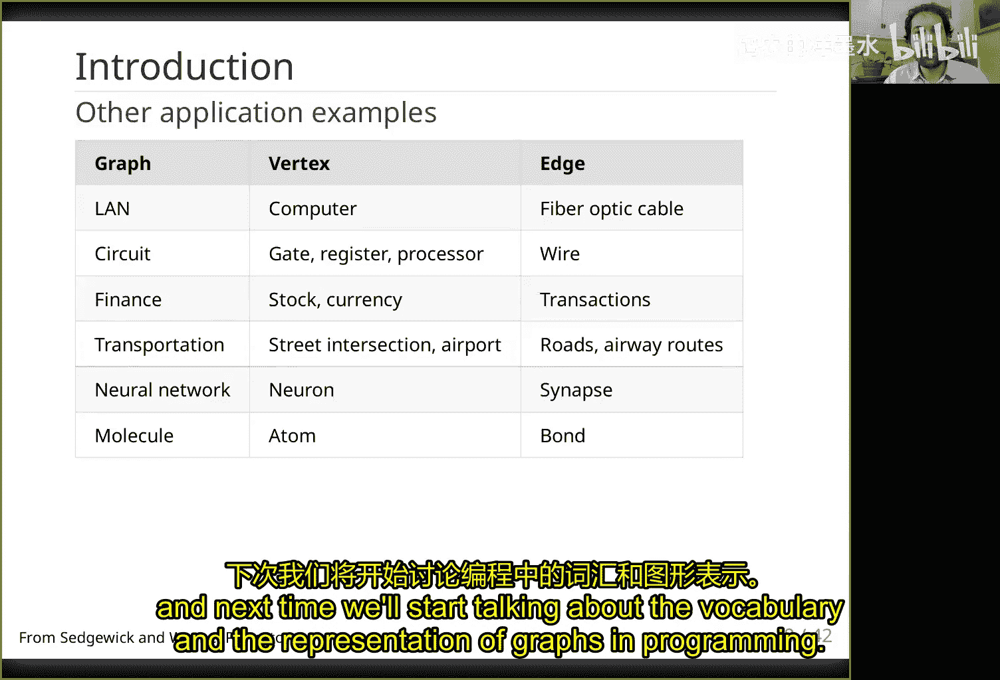

# 数据结构与算法：19：图论入门

在本节课中，我们将开始学习一个新的数据结构——图。我们将从一个有趣的历史问题出发，了解图论的起源，并初步认识图的基本概念和应用。

## 概述：从七桥问题到图论

上一节我们介绍了树等数据结构，本节中我们来看看图。图论起源于一个著名的数学问题。大约300年前，数学家莱昂哈德·欧拉生活在普鲁士的柯尼斯堡市。这座城市被河流分为四个部分，由七座桥梁连接。欧拉思考了一个问题：能否找到一条路线，**恰好只穿过每座桥一次**？

他尝试了多种路径，但最终证明这个问题无解。在证明过程中，欧拉创造性地将实际问题抽象化，从而开创了图论这一数学分支。

## 图的抽象表示

为了解决问题，欧拉将城市的不同陆地部分抽象为**顶点**或**节点**，将连接它们的桥梁抽象为**边**。通过这种抽象，复杂的城市布局就变成了一个由点和线组成的结构，即**图**。

以下是图的抽象表示方法：
*   **顶点/节点**：代表实体（如陆地）。
*   **边**：代表实体间的连接关系（如桥梁）。

## 欧拉路径与欧拉回路

基于图的抽象，欧拉定义了两种特殊的路径，并给出了它们存在的条件。

### 欧拉路径

欧拉路径是指一条**经过图中每条边恰好一次**的路径。欧拉证明，这样的路径存在，当且仅当图中**恰好有0个或2个“奇度”顶点**。

**节点的度**是指连接到该节点的边的数量。例如，一个连接了3条边的节点，其度为3（奇数）。

在七桥问题对应的图中，所有四个节点的度都是奇数（三个度为3，一个度为5），不满足“0个或2个奇度顶点”的条件，因此不存在欧拉路径。

### 欧拉回路

欧拉回路是一种特殊的欧拉路径，它要求路径**起点和终点是同一个顶点**。欧拉证明，欧拉回路存在，当且仅当图中**所有顶点的度均为偶数**。

其原理直观：要进入并离开一个节点，每次需要消耗两条边。只有当一个节点连接的边数为偶数时，才能保证在遍历所有边后，能恰好回到该节点。

## 图在计算机科学中的应用

图是一种极其强大的数据表示方法，在计算机科学中应用广泛。以下是几个典型的例子：

*   **交通网络**：地铁线路图可以用图来表示，其中站点是节点，轨道连线是边。
*   **社交网络**：社交平台（如Facebook）的好友关系可以构成一个巨大的图，用户是节点，好友关系是边。曾有实习生通过可视化全球用户的好友连接，在地图上清晰地显示出了国家边界。
*   **生物信息学**：蛋白质之间的相互作用可以用图来建模。
*   **其他领域**：图还广泛应用于电路设计、金融交易网络分析等诸多领域。

## 总结

本节课中我们一起学习了图论的起源和基本概念。我们从欧拉解决柯尼斯堡七桥问题的故事出发，理解了如何将现实问题抽象为**由顶点和边组成的图**。我们学习了**欧拉路径**和**欧拉回路**的定义及其存在条件，并了解了图在计算机科学中的广泛应用。下一节，我们将开始学习图在编程中的具体表示方法和相关术语。