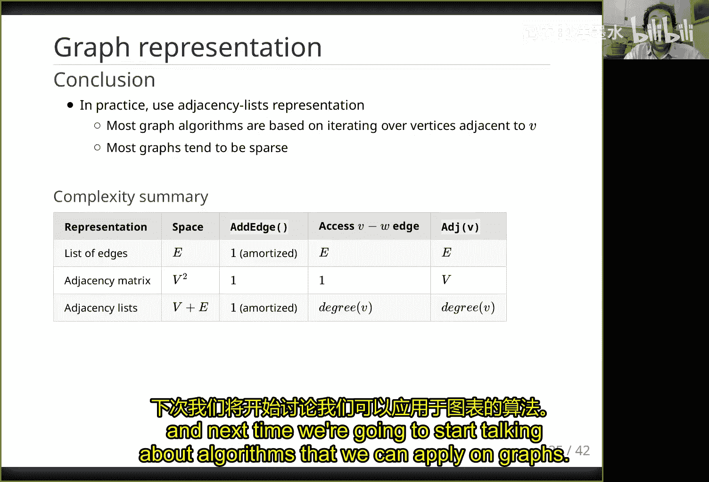

# 【全集】加州大学戴维斯分校 数据结构与算法编程 中英字幕 完整课件 p20 7-2 图表 -BV1rJ2WBSE7P_p20-

Hi everybody， welcome to Graphpot two。嗯。So this time no recap because we pretty haven't like divd into the subject at all。

So， let's start。嗯。Today we're going to go over some definitions of graphs and some vocabulary and terminology。

 and I'll show you how graphs are being represented programmatically。

In this slide just a tiny bit of mathematical notations。

 so when you have a graph it's usually expressed like that by V。

A set of vertices and E a set of edges。There are two main type of graphs。

Graphs in which edges are undirected， which means that they are bidirectional here a is connected to B and B is connected to a through kind of like the same link。

The way that it's represented that this undirect graph is represented is by saying that V is the set composed by ABC。

And E is the set composed by edge A B and E AC， which are bidirectional。On the other hand。

 we have directed graphs where here edges are unidirectional。

 there's an actual direction of the edge。To here we could say that C is connected to A。

But a is not connected to C because there is not an actual edge from A to C。

Those directed graphs are usually called digraphs for shot。

So the notation for the set of vertices is the same as uni directed graphs。

The definition of the list of edges is slightly different here because all of the directions have to be listed and you'll notice the use of parentheses。

 which means that there is a direction A2 B， whereas here we had the use of curly braces because it was undirected。

嗯。By default， if someone just says a graph， you can usually assume anddirect it。Okay。

 so now let's go over some words of vocabulary。So。What do we call the degree of vertex I think that's something we talked about in the previous lecture and that's something we've that's a term we've seen around trees before iss the number of edges that are connected to a vertex so here for example node three has one edge two edges。

 three edges that are connected to it so a would be of degree3 now we can distinguish。

In which direction， if it's a diagram， in which direction the edges。

Are connected to a certain node and so we can talk about in degrees and our degrees。

 so in degrees would be the number of edges that come inside of a node so here a would have an in degree of two because it has two edges that come inside of it。

And it would have an hour degree of one because there's only one edge that comes out of it。And。

It is definitely possible that nodes and some vertices have zero degree， so for example。

 here C has no edge coming into it so it would have an in degree of zero。On the other hand。

 B doesn't have any edges coming out of it， so it has a hour degree of zero。Now。

 if we look at this graph， C is not at all connected to A and B。

 there's no edges that come to C or that come out of C。So， C is of degree 0。

What's important here is that they're all valid graphs。

Graphs don't necessarily imply that everything have to be connected。

If you represent friendships through graphs， it's very possible that in a class you have different groups of friendships and some groups they don't have any connection with one another。

 they're completely separated there would be no edges that actually connect everybody together and that would obviously be valid。

And。😊，O。They are different types of graph， so what we call a multi graph is a graph that is connected or not doesn't matter。

 but in which we all loops， so an edge that connect。A node onto itself。Or multiple edges。

 so nodes that are connected to one another in multiple ways。一直。Pretty rare， I believe， Multigraphs。

What's most common are called simple graphs， simple graphs are kind of the opposite of multigraphs in the sense that they are undirected and they don't have multiple edges and they don't have loops。

And again， when someone says a graph， usually they mean simple graph， undirected， no loops。

 no multiple edges。The third type of graph that we're actually going to work with a little bit。

It's called weighted graphs。Here is the idea that every edge can be associated with a weight that represents something。

And that entirely depends on the scenario， so for example。

 like if you have a map and you want to represent intersections with nodes and segments of roots with edges。

 you could associate the speed limit of every segment of root as the weight for that edge and then with the GPS application that would allow you to find the best path where you can drive as fast as possible。

 for example， so the idea is just that you would associate some sort of number to an edge so that later you can run an algorithm that actually takes this number into account and it's supposed to be representing something associated to the edge。

Okay， next we have the notion of path。So the path is pretty much the same notion as in trees is。

It's the sequence。Of vertices and edges that are connected。

A path has a certain length and that is determined by the number of edges that it has so for example。

 this path between B and D has a length of three because it goes through three edges。

If the graph is weighted， then the path would also has a certain weight and that would be the sum of all of the weights along the path and so in that case this path between B and D would have a weight of 10。

对。Next we have the notion of cycle， so a cycle is a kind of path that loops around like you start from a certain place and then you're able to go back to the same node so here like there's a cycle。

 say from a that goes to C D and then back to a。A graph that doesn't contain any cycles is called acyclic。

Yeah。Next we're going to talk about two classes of graphs。

 the first class is something called connected graphs。A connected graph is a graph into which。

All of the vertices， all of the nodes， are connected somehow to one another。

So here B is indirectly connected to D， B isdirect indirectly connected to C and directlyly connected to A and same for a is directly connected to B。

 directlyly connected to C， indirectly connected to D and so on。

 but all of them like from each nodes， all of the other nodes are accessible。Now。

 when we have directed graphs， it gets a little bit more complicated because A is connected to B。

And connected to C， but for example， like B has no direct connection to D because there's no directly direct edge from B2 D or even like through multiple edges。

In that case， we say that they are weakly connected if there's。

If there are edges in between those nodes， but not necessarily in the right direction。And。

And in a graph where all of the vertices are all mutually connected， so for example。

 like if I have a graph with four nodes。And they are all connected to one another。

Theyre all directly connected to one another， we say that the graph is complete。

The second class of graph is the opposite we talk about a disconnected graph。

 a disconnected graph is a graph into which you have essentially like different groups of nodes。

And those groups have no connection between one another。

 so here we have a graph where A and B are connected and then C and D are connected but A B and C are two sets that are not connected to one another in that case we would say that the graph is disconnected。

Next， we have the notion of denses graph。So a dense graph is where we have a certain number of vertices。

And the number of edges is largely superior to the number of vertices。And actually。

 the number of edges has like a quadratic upper bound。

And it's pretty much the same the idea that like if you have a graph。Containing say like V nodes。

So here like four， then for each。Notdes， you will have v minus1。

Connection because every node is connected to all of the other nodes。

 So all V minus one because it's not connected to itself node and so overall it's V。Times v minus-1。

 if the graph is complete。嗯。😊，And if the so actually like if it's v times v minus1， if every node。

 if the graph is directed and so we have。All of the connections are like going in two in both direction right here we really have like essentially v squared。

If the graph doesn't have that。Is only an undirected graph。

 then it would be v squared divided by two because there's not like this symmetry。

In opposition to dense graphs， we have the notion of sparse graphs。

A spae graph is a graph where the number of edges is pretty much proportional to the number of vertices。

 right you have about as many vertices as you have edges。Next， there's an interesting specific case。

In the sense that trees that we have been talking about for the past few weeks。

 they're in fact graphs， they're just a very specific kind of graph。

In the sense that they're undirected， they're acidcyclic， they're connected。

 you cannot have a tree where you have a node that's not connected to anything in the tree。

And most of all， they are root。Root it means that there is a node in that graph which has a certain signification that other nodes don't and that because it's the root node。

And。😊，If you have a graph。That contains multiple trees。

 so imagine like you didn't have this connection， so that tree was by itself in the graph and then that tree was by itself in the graph。

And so A was the root node of this tree and B was the root node of this other tree。

Then we would say that the graph is a forest because it contains multiple trees。Okay。

So that's it for the vocabulary now let's talk about representation。好。嗯。So。

Imagine these kind of disconnected graphs right， we have three components with different vertices that are connected to one another and we have like three components of that。

A way that we could very simply represent this graph。In a text file。

Would be by doing that that's just an example， there are like different ways of representing graphs and that's one。

So I could represent this graph。In a text file。With different clients。

And here my idea is that the very first line of the file would be the number of vettices totaled that I have in the graph。

So here I have 13 vertices numbered from zero to 12。And after knowing the number of vertices total。

 I essentially have the list of edges。Then I I have the information that node zero is connected to node 5。

 node4 is connected to node3， node zero is connected to node one and so on essentially and by reading。

The entire list of edges， we are able to essentially to represent this graph， right？And so。

Before we get into the representation of graph in terms of C++ data structure and everything。

Let's look at what we expect from a graph first， like if we're able to represent a graph as a class。

 what do we actually want from that class， like what kind of behavior？So。

Let's look at the API of a graph class first just to get a notion of like what do we expect to find in there。

So here's an exampleop。So imagine they have a。Class graph that is supposed to represent a graph。

Here are the different functions that I would expect。I would expect to be able to create a graph。

An empty graph into which I have a certain number of vertices that are not yet connected to one another。

And then I would also have a function that can add an edge。From node V to node W， right？

I could also want to create a graph directly from。An input stream。

 given that like I have a text file that describes a graph and I just want to create a graph out of this text file。

 the same kind of text file as I just showed you in the last slide。

And then essentially the main function that will be very useful for most algorithms that we will get to see in this class。

Is this function？Adge for adjacent。The adjacent function。Essentially， the ideas that you would give。

The certain vertex bys by its number V。And that function would return。

The list of all of the other vertices that V is adjacent to， right？

And then just to kind of be able to characterize this graph。

 we'd have a function V which retain the number of vertices total we have in the graph。

And E which would return the number of edges we have total in the graph。So。

Whichever algorithm we have is to kind of understand the graph that we're talking about here。Now。

 that。Class graph can be implemented in many different ways， there are various implementations。

 and we're actually going to talk about all of them today。嗯。

There are three that we're going to talk about， one that's called list of edges。

Adjacency matrix and adjacency lists。So let's start with the first one， list ofeds。

The principle of this representation is that the class graph will essentially keep a list of all of the edges that are in the graph。

which is pretty much the same type of information that we find in the text file in the first place。

 so it's actually going to be very easy to create because we're going to read the text file that describes the graph and we're pretty much going to reproduce the same kind of information using say like vectors and whatnot。

あ。And so the fact that node7 is connected to node8 will be indicated in our data structure because in the list of edges。

 we will have an entry that says。Seven is connected to eight that's pretty much going to be the idea。

So how do I represent that in terms of code， let me show you。In terms of code， the list of edges。

Will essentially be a vector， so an array into which I can push new edges。

And each edge will be a pair。Of an int with an int and so we'll be able to represent that seven is connected to8 w2 Inte number that make a pair and that are pushed us one single entry into the vector and so here with the vector we're going to be able to have a list of edges。

We this list of edges。It will be very easy to implement the function E by returning the size of this vector。

However， in order to return V， the number of vertices total I have in my graph。

I need to maintain a separate variable for that。Which can be written there。

Now let's look at the constructs。So here the first construct that says， oh。

 I want to create an empty graph of size v vertices。

 it's just a matter of initializing our private variable envy and that's it and that makes us an empty graph of NV vertices。

Now for the construction that reads an already existing graphs out of a file。So remember。

 like the first line of that file contains the number of vertices。So using the Chevron operator。

 we can extract that number and put it in n and then on each line we're going to have the edge itself like the starting node and the end node so we're going to just。

Do that。😡，We're going to have two variable V and W， and we're going to read for every line。

 the first number will go into V and the second number of the line will go into W using again。

 the Chevron operator on this input stream。And once we have V and W from the file that we read like one purple line。

We can call the function add edge。And add edge， I'm going to show you the code right now will essentially make a pair。

Between vertex V and vertex W。And put that pair。Inside of her。Adgelist， which is a vector。

He you notice that。We use this function called M plays back instead of saying， say， use a pushback。

 you know pushback， right you push at the back of a vector。

Here we use M plays back because it turns out that this MacP function will actually create an object。

And in place back， we'll take this actual object and put it into the vector。

And there won't be any copy。If we were to use instead of n plays back， if we were to use pushback。

 it's possible not necessary， but it's possible that pushback would take the argument of what we're trying to push back and copy it into the vector。

And it would be a waste here because we are already creating an object from Mac pairer。

 and it would be better for a memory of occupation and for like just a performance reasons in general that we use this actual object and push that in the vector and not create a new one that we push into the vector。

So that's why we use M plays back in that case。Okay， so we have that and so the last function。

 the the crucial function is the。Adjacency function。So Odge。

So here we get a certain Vtex v and we want to return the list of all the vertices that are connected to V。

And with this implementation of having an edge list， it's a little complicated。

Because we have to go through all of the edges。In that list。And then check if V。

 the vertex for which we're trying to find the adjacency list。

We have to find V is either the first node of a certain edge or the second node of the same edge in which case we would。

Push。The other one in the list that we finally return。嗯。

So let me maybe go back a few slides here right here so for example。

 like if we were to call the function edge on say node number to let me find a good one。

Not say which one would be work well。😔，嗯。嗯。4。So if we call a 4。

 we would expect to be returned a vector so four is connected to three is connected to five and is connected to six。

 so we would expect a vector that contains three， five and6。

 so the list of all the nodes connected to node number four。And here。

 essentially what we would do is go through the entire list of edges and look if is zero or1 equal to4。

 so meaning like is that edge between zero and1， an edge that involves four。So this one， no。

 this one， no and so on。And so here we have a match because three is connected to four。

 so that means that that is an edge。into which4 is the sagon member of the edge， but still。

 and so it means that three should be pushed into the vector that we're going to re。

And then we go on and we find okay， four is connected to five。

 so now here like four appears first in the description of this edge。

And so it means that we would need to push5hi into the return vector。

And then we'd find four connected to six， and so we need to push six in the return vector。Oops。

That's pretty much。What this function is doing here it's going through the entire list of edges and for each edge it see it looks if the vertex v is either the first member of this or the second member if it's the first member then it pushes the second member into the vector if it's the second member then it pushes the first vector the first member into the vector and so at the end we have a list。

Of vertices。To which V is connected。Okay。Overall， in terms of space occupation。

 this list of edges is directly proportional to the number of edges we have in the graph， right？

The search for adjacent edges is in O of the number of edges， which is directly what we can see here。

 we have a follow loop and we go through all of the edges in the entire graph in order to find the vertices that are adjacent to V so the complexity is proportional to。

Worse。If we were to try to to locate if a certain edge。VW existed in the graph。

We'd still have to go through all of the edges in your graph to see if there is an entry that matches and so the complexity of that operation would be inu of。

Right now， we're going to see a technique that can give us whether an edge between V and W exists。

 and we can solve that in o of one。So let's see how we can do that。

We can do that by using another kind of representation of a graph called an adjacency matrix。

So here the AD is completely different。Here the idea is to have a two dimensional array。Of V。

 so the number of vertices by V， the number of vertices， so it's a square matrix。And when。一。

Vertex is connected to another vertex。Then at the appropriate location in the matrix。 So here like。

 say7。And8。They are connected， so in that location we're going to write a one。

And because we're talking about here an undirected graph， which means that if7 is connected to eight。

 then eight is also connected to seven， then it means that between eight and seven here well also have a one。

Both of those ones actually represent the same edge， but anyway。

and so here you see that like now if we try to locate whether an edge Vw exists in the graph。

 all we need to do is directly access the H metrics。

 either at index Vw or index Wv and check if it's true or false and we have the response directly in o of one。

嗯。Very quickly before we move on to the next slide。I want you to pay attention to something。

I want you to start。Seeing what will be the biggest flaw of this adency matrix representation？

And let me guide you through it a little bit， so let's take this graph。

What would you say about this graph， is it dense？Or is it sports。In other words。

 do you see that the number of edges？Is quadratic compared to the number of vertices。

I do you feel like the number of edges is pretty much proportional？To the number of。Vertices。To me。

 it seems like it's fairly proportional， we pretty much I don't know exactly the count。

 but it seems like we have as many vertices as we have edges in the graph。

So that means it's a sparse graph， right， so that would be pretty sparse。Now look at the metrics。

And try to determine like， do we have about the same number of zeros as the number of ones。

 do we have more ones than zeros or do we have more zeros than ones？To me。

 it seems like we have a lot more zeros than once。That's the main problem with adency metrics。

We are representing， using a lot of space。We are representing with the zeros。

 connections or information that actually don't exist。Like here， by putting a zero in this cell。

 we are actually like we are actively describing the fact that node3 and node1 are not connected。

We're using a space in the memory。To say they're not connected instead of just if they're not connected。

 like why don't we just not say anything， right？So that's a big flaw of edjaency metrics for denser graphs。

 though it would be a very good representation because now like the matrix would really be used a lot。

Anyway。Just wanted to point that out to you already。

Let's go on and let's see how it's now represented in terms of like C++ programming。So。Here。

 the way that we're going to represent this matrix is by doing a vector of vector。

So we're going to have a vector in one direction， a vector in the other direction。

 and that's going to make us。AMa。So that first vector will be for all of the rows essentially。

 and that internal vector of Boolean will be to describe the columns。Of bulls。

And that makes us a matrix。We are going to keep track of the number of vertices and the number of edges which are variables that we can directly return from V and E。

Now let's look at the first construct， like constructing an empty graph that has V vertices。And。

So the way that we're going to construct the matrix is that the first dimension will be a v size。

 we're going to create a first vector of size v that will be。

 as I was saying like that will make the different rows。And in every row， we have a second dimension。

 so the dimension of column， and that's another vector of Boolean of size v as well because it's a metric of v times v and everything is initialized to false by default。

And so here， because we are receiving V as a parameter。

 we can set our internal viable Nv to be equal to that number。Now what happens if instead of that。

 we receive directly a textual description of the graph via a text file。So that would be the second。

Construction。And so we receive this input stream directly from the text file。So again。

 that doesn't change on the first line， we get the number of vertices。

Once we have the number of vertics， then we can allocate the 2D matrix。Unfortunately。

 that kind of initialization right there。It's an initialization that we can only do， you know。

 by using the column here in a construct that's super specific to that use case。Here。

 once we're in the body of the function， we cannot use the same kind of initialization。

And so in that case， I would use the method resize。And so by using resize。

 we would essentially do the same thing， essentially we would take this empty vector and resize it to the size of the matrix that we are trying to come up with and so that matrix would be of size env times env。

All initialized to false， same as before。And again， same as before。

 after we have set up these HS and C matrix， then we go through all of the lines of that file and we essentially like extract the different edges and we make them as part of the class。

 as part of the C+ class。And so here you see that the code is super simple。

We receive V and W from that function call， and then it's just a matter of accessing these matrix at the right indices and we change the Boolean true to signify that V and W are in fact connected。

And as we call add edges， we can update the number of edges we have total。

Now let's look at the last function， the H function。Or edge function so again。

 so edge we get a certain vertex and we want to have the list of vertices that this vertex is connected to。

And it's a lot easier than before because now we only have to go through all of the possible vertices。

And we can check in the agency metrics if the given。

Vertex v is connected to W and have W essentially go from zero to like go through all of the vertices in the graph。

Every time that we find a bo like boolean that is true。

 it means that they're connected and we can push back a W into the vector that we are finally returning at the end。

So a lot easier than before。Overall。The space occupation is pretty bad because it's。

Proparal to v squared to like the quadratic value of the number of vertices in the graph。

 so pretty pretty bad compared to B4。Accessing a specific edge between V and W can be done in o of one because that's just an access into an array。

 so pretty good。And。Like searching for the adjacent edges or the adjacent vertices of a specific vertex is in OV because we have to go through。

All of the vertices to know which one are connected to us。嗯。You'll see here how like the search。

 it's interesting， like it's it's kind of the the opposite as the。Previous representation。

Using a list of edges。Essentially like the list of edges。

Will be very good if you have a sparse graph， because in a sparse graph。

 you don't have very much edges。 So having a list of edges is going to be convenient。However。

 if you have a dense graph。😊，Then you don't want to go through all of the list of edges if you have a dance graph。

 then。Searching having a search strategy that depends on the number of vertices is going to be a lot better in terms of running time complexity because the number of vertices is lower than the number of edges。

 so that's kind of the idea the comparison。Now， let's talk about the last。type of representation。

 which really tries to kind of like get the best of both worlds like we try to have a space occupation that is linear and not quadratic and we try to have a fast search for adjacent edges and also a relatively a fast access of a particular edge。

So let's see this last representation。It's called adjacency list and that's kind of an hybrid of the two previous representations the idea is that we're going to have a first dimension using an array and that's going to be an array that。

Like can of represent all of the vertices that we have in the graph。嗯。And for each vertex。

 we're going to point onto a list that can be a variable side， and this list will contain only。

It will be a list of the connected vertices to that vertex。So here for entry zero， so vertex zero。

 we have a list that contains six to， one and five because node zero is connected to node6 to one and5。

That's the idea。And。So how do we represent that in C++， it's actually very similar to the H matrix。

 except that here we're not going to allocate the entire matrix。

 we're going to try to be a lot more dynamic than that。But you see that。

The initial declaration is very similar， like it's a vector of vector。

So the idea is that like we have a first dimension here that can point on two other dimensions。

Very much like a 2D array。And。And we also have the number of vertices and the number of edges。

Now let's look at the implementation of the constructs。And here's the big difference， essentially。

When we create the agency agencyency list。For an empty graph containing V vertices。

 we only allocate the first dimension。We don't allocate anything in the second dimension。

 so we're not like already allocating a matrix， we're only allocating a simple array that has the same size as the number of vertices。

 that's it。And that's pretty much what we do in the construction from the text file as well。

And it's only。When we add edges here。That。For a certain vertex， we push back。

The vertex to which it's connected。Into the agency C list。So here， the like the second dimension。

Only grows。As new edges are being created and pushed into those lists。衣服。

A vertex here is not connected to any other vertex。

 then it's not connected to anything and we' not using any space to represent that information。

That's the idea。And that implementation actually makes the edge function super， super easy。

 Look at that。 It's only one line。So here， if we want to have the list of vertices that are connected to vertex v。

 we directly return theency list at index V so it could give the impression that this function is in o of one because we're only doing one thing but it's actually not the case because as you can notice we are returning a vector。

 which means that we're going to return when we return the agencyency list。

 we're going to have to make a copy and the copy depends on the number of items we have in the list at that index。

So in fact， the search for adjacent edges， which is that function， is in O of degree of V。

So it will depend how many vertices this V vertex is connected to because that will be the number like the length of the copy for the vector that we need to do the space occupation is V plus E。

The， because the first dimension。Has the size of V that's the length of this first array。And then。

In the agency list， we're going to have as many items as the number of actual edges in the graph。

 so it's v plus E。And finally， searching is if V is connected to W。We cannot do that in o of one。

 but we can essentially access the a sensor list at index v。

 which is o of one because it's just an accessing this array。

 but then we still have to go through all of the items of the a s list。

 so again it's in O of degree V。In conclusion。You probably in terms of representation。

 you probably want to use this last representation that we talked about， the adjaency list。

 that's one of the most popular representations because most graphs tend to be sparse。

 it's really only if the graph is very dense then matrix representation would be interesting。

And here is a summary of the different complexities。

 so in terms of space list of edges is fairly proportional or linear， same as a。

 whereas agency matrix it's pretty bad because it's quadratic here they are very similar to one another like add edges they're either in O of one or o of one amortized because we have a vector and pushing new data to a vector might trigger a resize which would be in O of n so that's why it's amortized。

Accessing a certain edge。Would be pretty bad for the list of edges because you need to go through all of the edges in the graph。

 whereas with the a metric， it's something that can be done in o of one。

Here it depends on the degree of the vertex V because4 v。

 you need to look at everything that V is connected to to see if W is part of the list。And finally。

 to find all of the vertices that are adjacent to vertex v。

It's proportional to E in the list of edges， which is pretty bad。

 proportional to V if you use an agency matrix， which is pretty bad。

And it's proportional to the degree of V， which is pretty good when using agent and list。

So that terminates this lecture， and next time we're going to start talking about algorithms that we can apply on graphs。

