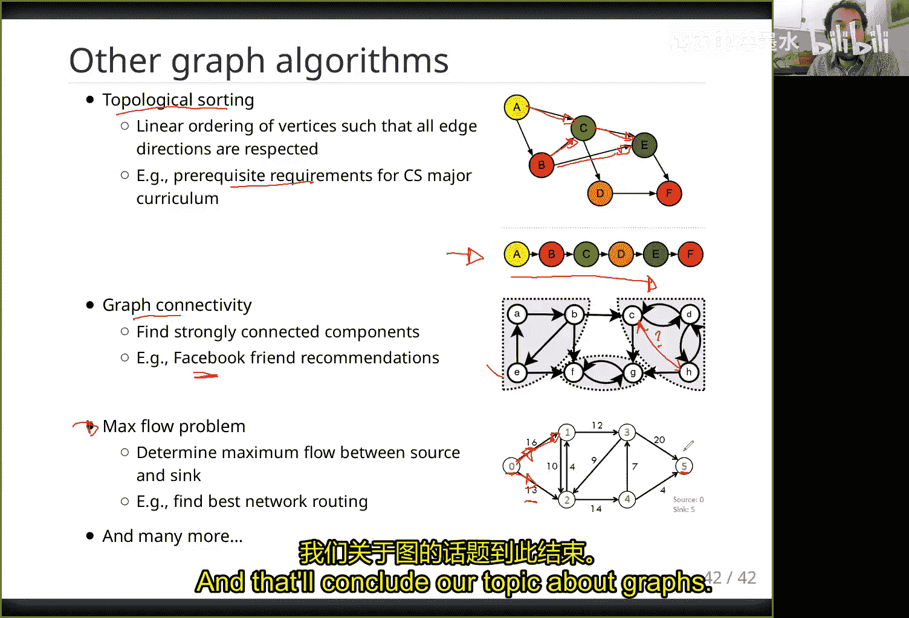

# 【全集】加州大学戴维斯分校 数据结构与算法编程 中英字幕 完整课件 p21 7-3 图表 -BV1rJ2WBSE7P_p21-

Hi everybody， Wecome to this last lecture about graphs。

So quick recap about last time we talked about how to represent graphs programmatically。

And so we saw that given a certain graph， we essentially had three options to represent it。

One is to make a list of all of the edges so we can typically have a vector of pairs and every pair represents an edge in the graph。

 so here we said that for example， vertex zero is connected to vertex 1。

 which we can see here and we represent all of the edges in the graph。

Another representation is the adjacency matrix， so here we have a square matrix。

The size on one side is the number of vertices we have in the graph。And if a certain vertex here。

 so seven is connected to another vertex， say eight。

 then we put a one or like a boolean true in the matrix to signify that two nodes or two vertices are connected。

The issue of the very quickly， like the issue with the edge list is the fact that。

The running time complexity to find， say， all of the edges and vertices from one vertex is not great because it's in the O of E being the number of edges in the graph。

Edgcency metricses have pretty decent running time complexity。

 the big issue here is the space complexity because it takes a lot of space to represent these metrics and。

If the graph is not dense， then most of these metrics is wasted。And finally。

 kind of the best of both worlds， we have the adjacency list。

 so here we have a 1D array to represent all of the vertices in the graph。

And per vertex we have a dynamic list that list all of the vertices that these vertex is connected with。

 so for example， like vertex0 here is connected to6 to one and5 so in the cell or vertex0 we have a list that lists6 to1 and5。

And so here the running time complexity is pretty good for most functions。

 and the space complexity is also pretty good because we're not representing any information that actually doesn't need to be represented。

So here we've talked about graph representation today we're going to talk about algorithms now that we can run on graph。

诶。To make them useful。One of the first things exactly like other kind of containers is how do we traverse a graph if we have a graph。

 how do we go through all of the nodes？So let's see what we know so far。So far。

 we know that when we have。List are sequence ADTs then we know how to traverse them it's actually pretty easy。

 we start from the first element and we just go sequentially one after the other it's very intuitive。

We started for trees， it was a little bit more complicated。But we have two options in trees。

 all of them always so when we traverse a tree， we always start from the root node and we go down towards the leaves that's a given but we have two ways of doing that the first ways is to do something called depth first order。

Where from the roots we try to go towards the first leaf as fast as possible。

 so we try to explore the tree as deep as possible and only when we start touching the edges。

 we kind of like backtrack and we try again like in another path down to the nearest leaf as well。

So there's really this idea that we start from the root and then we try to go as deeply far down as possible when we can't。

 we like hit the wall， we backtrack a little bit and we try again in another direction and so on。And。

😊，And then the second strategy it's called breadth first order here。

 it's more like a systematic exploration level by level， we start from the root。

 we explore all of the nodes on the second level than all of the nodes on the third level。

 so it's more like a progressive traversal from the root down to the leaves。And。😊。

And as a matter of fact， because trees， in the end， if you remember， they are graph as well。

 the traversal of a graph will be very， very similar。

We essentially have also the same two kind of strategies。Except that in a graph there's no root node。

 so it's kind of like we pick a note inside of the graph at random or more depending on what we're trying to do。

And then we also have the strategy of going depth first or breath first， essentially from that node。

 do we want to try to explore as as deep as possible， or do we want to do like kind of level by leap？

Up until all of the nodes have been traversed。So that's kind of the idea。

So let's start with the first one， the depth first triveral。So with the depth first traveral。

 you see how like so in this example， we would start by node or vertex zero and then we try to go as deep as possible so from vertex zero we start exploring an edge。

Brings us to five then from five， we start， we pick an edge， we follow it， four。

 we pick another edge six。We finally reach six and six is connected back to zero so that's a cycle we don't want to explore it so we stop here and so you see here like we really we follow as deep as possible。

Up until we can't and that's when we like backtrack a little bit and we try another direction so like size33 is connected also to5 which has already been traverse so that's the end so we backtrack to4 we backtrack25 we backtrack to0 and we try again going like as deep as possible in other edges up until all of the nodes have been visited that's pretty much the idea。

And in the same way。As trees， the implementation is actually very similar。

 we can do it either recursively or using a stack if we want to do it iteratively。

So let me show you the recurringcurrency function that does that， so usually it's called DFS。

Depth first search。From a certain vertex v， and so here we took zero。

 but it could be another vertex in the graph。we need to keep track of which vertices have been visited because we don't want to loop around。

 we don't want to go into a cycle， we only want to traverse all of the vertices once。

 so we mark them as visited。And every time that we reach。A vertex， a certain vertex。

 then we essentially explore all of the edges for that vertex and we recur on those connected vertices if they have not been marked yet。

ButThat's pretty much the idea。And then the other one， so the breakfast search。

This one I like to imagine kind of visually as you know like you spill some water in the floor and the water like kind of expands progressively in all directions at the same time like equally you know。

 so here it's kind of the same idea like you stop from a certain vertex。

And imagine that you spill water in that vertex and so the water will like。Move。

In all direction can like at the same speed and so at first it will reach all of the vertices that are connected directly to that vertex so that will be the first level and then they will like。

Take some further step and reach the second level and so on。And。In the same way as。

For trees with like bread like level order traversal。

 the best kind of implementation is iterative using a cube。So let me show you the algorithm here。

So again， we want to do so we usually call it BfS B search。From a certain vertex V。

Because we are studying from that vertex we can market directly as visited and then we use a Q so at first we put V in the Q so that the Q so if we start from zero for example。

The Q would only contain 0 at first。And then as long as Q is not empty。

 like as long as we're searching and traversing and reaching new vertices that have not yet been explored。

诶。Then we explore， so the first step we only have vertex zero in the queue， we take it out。

And from vertex zero， we explore all of the edges and we populate the Q with all of the new vertices that we can now explore so we can explore five。

 one， two， and six。From verex 0。And then we essentially loop again， and as we put them in the queue。

 we also mark them as like visited so that like we cannot add them to the queue any longer。

So now we have that in the queue， we take out five。And so from 5， we can explore 3 and 4。

 which will be added to the queue。 So now the Q would be 1，2，6。three。And for。

Now we would take out one， one is not connected to anything so that's it， we would take out two。

 two is not connected to anything， we would take out six。

 six is connected to four but four has already been visited and marked and added to the queue so there's nothing to do same for three same for four now the queue is empty so the BFS is done and all of the nodes have been eventually visited。

Okay， so now that we understand the principle of travercing graphs， either using DFS or BFS。

Let's show the code， let's really see how we can code that。There are many。

 many ways to implement graph algorithms on graphs。

Maybe one you will see very often if you look online or if you read textbooks。

People tend to often integrate the algorithms directly as part of the class that represents the graph itself。

whichch is okay， that's probably the way that I learned as well when I was a student here I'm going to try to push your away another way of designing graph algorithms that I feel is better because it really like separates the graph representation like how does the graph look。

To the graph processing， how do we run a certain algorithm on the graph？And the idea is that like。

When we run an algorithm on the graph we don't have to change that graph so the graph representation would not be changed at all we would use it as almost like a read only。

Object。And then we can instantiate some graph processing objects that will interact with the graph and we have this like nice separation which I think is very good in terms of programming。

So let me show you an example， imagine so we have a certain graph with a graph representation using either like a list of edges and adjacency metrics or adjacency list。

 whatever representation you like best， they're all implementing the same API so we don't care。

And then the idea is that like we would have another object that would essentially take this graph。😊。

As a parameter and say would run DFS on it starting from vertex zero。

 and so we would run the DFS on that graph representation。

 but without changing the graph itself and this DFS starting on vertex zero would be its own object。

That we would then be able to query like we would be able to ask this object。

 well now that you have run this DFS starting from Vitex0。

 can you tell me if vertex zero is connected to vertex4。

 which is the case and well even be able to ask like what is the path from vertex zero to vertex4？

Or is vertex zero connected to vertex 7， that's not the case， so there is no such path。

So let me start showing you some code now。Let me。Show you the API that we would expect from a DFS processing class。

So that's a class， that's a C++ class that we so here I called it De first path。

 but pretty much it's a depth first search that's the same idea。

And we would essentially expect three functions in the API。

 a certain construct that would take a graph or tag the representation of a graph as a parameter。And。

The number of the vertex from which we want to run this DFS triveral。Then after the DFS has run。

 we'd be able to query this object by calling say haspa two。

Do is there a path between this stop vertex S。And another vertex in the graph and this function would return true if there is a path between S and V or false if there is not a path。

And then we'd be able to print or not to print but to return the actual path between starting vertex S and whichever destination vertex V and we would have essentially a list of all of the vertices that are on the path between S and V So let me show you the code here now let's start with this first function with the construction。

Oh no， actually， you sorry。Before we get into the code， let me show you how it would be used。

 like just an example of how this class would be used so that you understand the intent in this like separation between graph representation and graph processing。

So that would be a typical program that I could write so in that program say I could declare a graph so that's the graph representation and I would have an object G that would be constructed from a graph that is defined say in a file so pretty much exactly like we discussed last time。

And so now we could have another object。Which we would call DFP。

Which would run on the graph that we just read out of a file starting from a certain vertex S。

And that would start。The D exploration， the DFX exploration starting from vertex S。

And then we could run a follow loop on essentially like all of the vertices in that graph。

And we would see， oh， is there a path between whichever vertex was the starting point to。

This other vertex in the graph。And if there is a path， then we would print it。Otherwise。

 we would print， there is no path。And so now。Imagine we have the description of a graph。

 tiny G dot text， that's the same graph we studied last time， this one。And we would say like， okay。

 we want to run a DFS starting from node zero， but we can give another number if we want。

Running that program here， like running those lines would eventually produce that output where would see like okay。

 from zero from not zero to not zero， there's a path because that that's itself。

From node zero to noded one， there's a path that goes01 because they're directly connected。

Two is the same。They are connected。 so zero to。 but now， like from zero to3。

 it's a little bit more complicated because it's。0ero，2， five，2， four。Two， three。

 and that's what the DFS exploration has produced。And with seven。

 because seven is not connected to zero， there's no part。

So that's pretty much like the idea of how we could use this graph processing object in a regular program。

Now that we understand how it would be used。Let's talk about its actual implementation。

So we have the public API here now let's talk about some private members that we would need。So。😊。

We're going to need three private members， we're going to need a array of bulloles mocked that will help us while we run the DFS to keep track of which vertices have been visited so that we don't visited them multiple times。

Pv will help us when we explore it will help us construct paths so that let me back up here， oops。

 so for example， like when we say oh， is there a path from zero to three we'll be able to actually like produce this list。

 we'll know that。There is a path between zero and three。And in that path。

 the previous node from three is four， the previous node from four to zero is five and the previous node from five to zero is zero and what kind of like from a certain destination。

We can kind of like backtrack to the source of the exploration。

That's what this PRv array will be and you'll see when we look at the code you'll see how it works。

S will be the starting vertex like the vertex from which we start the DFS。

And then we have a private function， DFS。Which is recursive。

 that's why we put it as a private method。And so this one takes a graph。

And text the currently explode vertex V。So let's look at the construct。

 the construct is super simple， so the construct receives a gravity and a starting vertex S。

It initialized。The array marked two false。And the array marked is size to have as many entries as the number of vertices in the graph。

Same for the array prep， except that here it's initialized with all minus ones because at the very beginning like。

We haven't explored the graph at all yet， so we need a way to say that all of the vertices have no predecessor yet。

And essentially， this function directly calls this recursive DFS function on graphra G starting from nodes or vertex S。

And so now we have the definition of the DFS function， the recursive one。

 and here it' pretty much the algorithm that I showed you in Suuc a few slides ago。

So when we arrive on vertex v， we mark it as marked right away because we're like now we are here or like we've been able to reach it。

And from the。We loop through all of the vertices that V is connected to。

And we look from V we are connected to different vertices。

 if those vertices have already been marked， then we just ignore them if they have not been marked。

Then， we recur。On them， we recall DFS on them and so that's how we go as deep as possible and we follow paths。

And。And at the end， because we were able to reach W from。Vertex V。

 we mark that the the previous node of W is。And so finally。

 we have two functions left in the public API， we have as path to2 vertex v and essentially it。

Means that if we were able to read vertex V during the DFS。

 then vertex v would have been marked eventually because at the beginning everything was marked as false。

 so if it was marked as true， it means that V was eventually reached during the traversal。

 so which means that there is a path between S and V。And now we have this function。

 what is actually this path if there was one？And so here we are going to use this prev array。

So if there is a path to V， then we're going to populate path with the values。是。是。Okay。嗯。

So now let's look at BFS。 So we just checked out DFS。 Let's look at now BFS， the breadth first order。

It's very similar we also have。An array marked of Boolean to make sure that we are not visiting vertices more than once。

We also have this array prep to keep track of the different paths。As the starting node。

 and this time we have BFS， which will not be recursive。Actually。

 so I made BFS here as a as a helper function， even though it's not a recursive helper function。

 it's true that it would not necessarily be necessary to have a helper function here if it's not。

Recursive we could potentially put directly all of the code in the construction directly。

 so actually let me show you so。The construct is very similar to the other one。

 we also initialized the array marked all to false。

 we initialized the array pre all to minus one and essentially we call BFS directly。

And so what I'm saying is that since BfS here is not recursive。

We could actually have all of that code directly in the construction。

 but it's just out of symmetry between the DFS implementation and the BFS implementation that I decided to have upper functions in both cases。

嗯。😊，But so once again for BFS， it's the direct translation of the pseudocode algorithm that I showed you a couple slides ago in code。

So we have a queue。And at first， we push into this queue the starting node S because that's where we're starting from and we mark s as visited and then we loop around。

As long as this queue is not empty， so as long as we are able to continue exploring the graph and reaching new vertices that we haven't seen before。

诶。And so the thing is that we would uncue the first one in the queue。Vertex v。

 and we would explore all of the edges of the to see which vertexes are variable able to reach。

If we're reaching a vertex that has not been visited yet， then we push it in the queue。

We mark it as true and we mark that we were able to reach out。This vertex w from vertex v。

 and we do that as long as the queue is not empty。嗯。And so， eventually。When we give。This example。

Graph and we say that we want to run this BFS starting from node zero。We get。

All of the paths from zero to the other vertices of the graph， if they were reachable。

Look at this path。Here， from 0。2，3。Do you remember that with DFS？

Reaching3 was like a little convoluted because we were first coming from 0 to 5 and then from 5 to 4 and for4 to 3。

And now with BFS， because we go kind of like level by level。3。Is reachable much faster。

 We go from 0 to 5 directly to 3， because3 is at kind of like two levels down， right。嗯。

That brings us。To one of the most common and popular algorithms of graphs。Clled shortest path。

The idea is that we have a certain graph。And we pick。A specific vertex， s， a source's vertex。

 and we want to find the shortest path from S to all the other vertices。

And the reason that it's so popular that it's such a common algorithm that we want to do that is that。

 well， that's how GPS works， for example， like you're in your car。

 you're in da and you want to go to the bay， for example and so。

It's a graph problem you know like da is a vertex， the bay is another vertex and you want to find the shortest path between those two vertices it's also。

Very much used in network。Say you want to send a package from here from California to Italy。

 I don't know， and you want to find the shortest path to send your message through a few routers and through like an optic fiber that goes into the ocean and so on and you want to find the path that will be as short as possible。

呃。And even like in other domains， which we would not necessarily expect such as solving a rubic cube。

 so imagine that like I have one here。Oops， imagine that each vertex in the graph is a combination of a rubic' cube。

 so that's a combination， that's another combination。And every edge represents a certain move。

 So from the vertex that describes this rubbic cube combination to the vertex that describes that。

ARic scoops combination， I have a edge because that's one move。

And so you can run also a shortest path algorithm to find the minimum set of moves。

That essentially brings you from the current combination。

 that's probably a combination where the rub cube did not solve。

To the one that where it is solved and so you follow the path and every edge tells you oh。

 you need to move this side or that side and so on。

So you see here that short path in a graph is not just GPS。

 it can be applied to many different things to get to a certain state。

 to another state in as few moves as possible。嗯。😊，Now we have to distinguish。

Two types of graphs because they're not going to ask for the same type of algorithms。Essentially。

 we have to。Distinguished between graphs that are not weighted and graphs that are weighted。

 that's a major difference when we talk about shortest path。

So imagine a graph that is not weighted like every edge essentially has the same weight。

Ts me as much time to run that side of the block， than to good that side of the block。In that case。

 I can just use a regular BFS。 What I want is typically just to minimize the number of edges that I go through in order to go from say A to B。

Now， if the graph is weighted， it's not as simple。😮，You see that， for example。

 if I want to go from a。土地。If I just run a DFS。B， F S will tell me， well。

 that is the shortest path because that's just one hop。

Except that this hub is kind of expensive because this hub will cost me four。Whereas。

If I go from A to B and then B to D。Then the path is one plus one。Equals2。

Which is obviously better than four。So here my shortest path between A and D is， in fact， A B。第。

And that's something that BFS will not find。And not DF as either。I need a specific algorithm。

And the most famous algorithm that runs a shortest path algorithm on a weighted graph is called dira。

That's from the name。Of a mathematician slash computer scientist。

 pioneer computer scientist called Datra， who。Back in the 50s， developed this algorithm。

So the assumptions that edges are weighted， as we just talked about and weights are necessarily positive。

 doesn't work well if edges are negative。And the concept is like very similar to BFX。

 it's also the idea that like you start from a node and you start expanding like kind of slowly on in every direction。

Except that with BFS， we only consider extending by considering all of the edges with the same weight。

 so first we explore the first kind of level of nodes that are connected by one edge and then the nodes that are connected by two edges and so on。

Here， instead of doing that， we follow the shortest path。嗯。😊，So it's again。

 a question of like creating a queue， so just like BFS。

And we initialize all of the vertex in the graph by saying that first of all。

 like we don't know how to reach them， we don't know the distance from the source node to them。

 so we mark that as infinity it's kind of like saying minus one because it hasn't been explored yet。

We also don't know how to reach them， so the prev is undefined。

And we add all of the vertices to the Q at first。And the only thing that we're sure of is that the distance from the source。

To itself is obviously zero， that's kind of like our starting point。And then same as BFS。

 we're going to run this algorithm as long as the queue is not empty。And， here's。

The major difference with BFS， it's in that operation。So in BfS。

 we would take out from the queue the first element， the element that had been pushed。The呃。

Faththest ago， like the oldest element of the queue。

Here it's not the case here we look at the Q and we're going to Dq from the Q the element that we can reach that has not been explored。

 but that can be reached with the minimum distance。That's the note that we're going to look at。

And then from that note， we're going to see。What this node is connected to。And as we do that。

 we're going to see if that node can bring us。Two other node that maybe have been explored before。

But that can bring us there faster than what we had discovered before。呃，so。

If say a node V can now be accessed faster than we thought it could。

Then we essentially update our understanding of the graph。嗯。So let me show you an example of that。

 I'll let you study that on your own。You'll probably need a few minutes for it to make sense。

But let me show you an example， so imagine we have this graph that's the graph we talked about before。

And we want to run this diial algorithm starting from node a。 So from node a。

 we want to know what is the shortest path to all of the other nodes to B to D and to C。呃。

According to all of those edges and the weight of all of those edges。What we start with。

 like the initialization is that。Vertex a has a distance to itself of0。Everything else undefined。

 we don't know yet what is the distance between a and all of the other vertices。

 so it's all like infinity。We don't know how like we don't know what is the bestpa to them yet。

And all of the pres are undefined because we don't know again what the best path to them is。

And the queue is initially。Has all of those nodes in it because we're going to explore them little by little。

So， now。And again， like that's the main difference with BFS from the queue。

We're going to take out the node that has the shortest distance。Here， the shortest distance is。

Note 0。 So we're going to take0 out of the cube。And from。Sorry， not zero a and from a。

 we're going to explore the different edges and we're going to see if we can reach B and D。

Faster than what we currently know。From A， we can explore B with a weight of one。And from A。

 we can explore D with a weight of four。Up until now we could reach B with a distance of infinity。

 in other words， B was not reachable and D was not reachable。So it's definitely an improvement。

And we can update the distance。For B and D， with now saying like， okay。

 we can reach B from a with a distance of1 and we can reach D from a with the distance of four。

And in that new path that we found。The predecessor from D is a and the predecessor of B is a。

 So essentially it means that we have a path A B。And。

A D with distance of four and here distance of one。O。😊，Next step， we look at the Q and now we have B。

 C and D。We look at all of those vertices， we take the vertex that has the minimum distance。

The minimum distance is the distance that we have for B。

 so we take B out of the Q and we start analyzing it。

And here we're going to see something interesting B has only one edge that's coming out of it to node D。

And it turns out that from B， we can reach D in。1。Plus。one。Because remember。

 like we are talking about the distance here is always the distance from a， which is the source node。

So a to B is1， B to D is1， so a to D is1 plus one。That's two。

Two is better than the four that we had found here where we would go from A to D directly。

So that's time for us to update the information that we have on D。

 like we have found a better path to D。Distance 2。That goes through B。嗯。Then when do we have less。

 we have C and D left。C as a distance of infinity， D as a distance of2。 So we're going to take D。

Out of the queue and explore D。D has only one edge out of it。With a a weight of two。

So that will replace this infinity。Now we can reach C。In。1。Plus，1。Plus。2。We can reach it。

With the weight of4。Okay。And。In the best path between A and C。The predecessor of C is D。

 like D is rich is is。The previous node that leads us to see。嗯。Then we have C left。

We can take it out。 C is not connected to anything， so we don't have anything to do。

And we're pretty much done。And so now we have all of the information that we need， we know that。

From note a。Note a itself is directly accessible in distance zero because it's itself。Not B。

 the best path is with a distance of one。And in that best path。B is connected to a directly from a。

Now C， the best path to reach C is with a distance of four。And to reach C， you have to reach D first。

And finally， node D is reachable， the best path to reach it from a is with the distance of2。

And the path to the node to reach first to get to D from A is B。

And so if we were to run this di algorithm and programmatically and then say like print in the terminal the resultss。

 we could see something like that like A to B。Exist。With a path of one。

 A to C exists with that path like A， B， D C with a distance of four and so on。

So obviously ditro is not the only algorithm so actually like。That's why it's very popular。

 it's been also heavily optimized over the years。In the algorithm that I just showed you。

 we used I didn't really like precise what kind of cues we were using。

 but ideally you would actually want to use a priority queue so that when you look at the queue and you want to remove the element with the minimum distance。

 you can do that with the binary he。The minimum distance being the node that would be at the top of the binary hip this way。

 this element removal would be done in in O of log n instead of in O of n if you were just to use a regular sequential cube。

And then you have。Plenty of other chas path algorithm。

 so you have one that's called Belman Ford which handles the fact that hedges can be negative。

 you have a very very popular algorithm called Astar widely used in video games so you know when when you play。

Agains where you have a map and you have like little characters that you can select and you click somewhere else on the map and they all like move along and if there's like a mountain in between they would like go around the mountain or whatever。

 that's typically a star that is being used that finds very well the best path between one source and one destination and we have other algorithms it's a pretty。

 it's a problem that has many different solutions。And。And quickly before we finish with that topic。

 there's another algorithm that I wanted to mention here， something called minimum spanning tree。

So take a graph。Here， like you have six nodes and a bunch of edges。A spanning tree。

 like the broad definition of a spanning tree。Is the tree of edges that connects all of the vertices in a graph。

 So， for example， in that graph。You can have。If you select the edge between A and D。

 the edge between D and B， the edge between D and E， E and F。And CF。

Then you've made a selection of certain edges in such a way that all of the vertices are connected。

That's the broad definition of a spanning tree。 Now， the more interestingly， you want to minimize。

This spanning tree， you want to include only the smallest selection of edges。

Such as all of the vertices would be connected and that's the idea of a minimum spanning tree。

Not there's more than that。It's when you add。Waits。So now let's imagine you have a graph。

And edges have weight， so now you don't want to only find the minimum spanning tree。

 you want to find the one that has the the overall weight has as small as possible。

Why is it interesting， well it's interesting in many different problems。

 imagine that all of those nodes， ABC and so on are say like buildings on campus， on UC Davis campus。

 you have like camper halls， you have silo， you have like Git Hall and and so on like you have like six buildings。

And now let's imagine that each edge between two building is a possible route to put some。

Fibber optic cable on the。So if you have a weight of one between building A and B。

 it means that it's super easy to lay down。A fiber optic cable。If two buildings here。

 B and C are not even connected， it means that it's impossible。

 like say you have to cross the highway， it's way too like it's not possible。

or you can have some path here between A and D with a weight of four。

 like it's possible to put a fiber optic cable， but it would cost like super， super expensive。

So now the goal is to find the succession， the spanning tree。Such。

In such a way that like the overall weight of all of those edges will be as small as possible to say like minimize the cost of laying on that cable。

嗯。The algorithm for that is surprisingly easy， there are multiple ones again。

 but the most famous one is called PRs algorithm。And essentially。

 you start with a random vertex in the tree because eventually you have to connect them all。

And then you from that vertex。You choose， you choose to follow the edge that has the the minimum edge。

And that gets you to another vertex， so now you have two vertices and one inch。

From those two vertices。You once again follow the edge that has the smallest value that gets you to another edge to another vertex that has not been visited yet so now you have like three vertices and again you follow from that three of two edges and three vertices you follow the next edge that has the smallest value and that get you to another vertex that you haven't yetex plot and you keep doing that。

Until you've been able to reach all of the vertices in the tree。

 all of the vertices in the graph by every time following the smallest edge that you could find。

So again， let me show you an example。Well actually this one， imagine you start from F。

So right now you only know F and so from F， you have two possibilities like you have two edges。

 you follow the one that has the smallest value。And so that will now make C。Be part of what you know。

So next step now。From F and C， you can follow two edges here。

 and then you can follow this edge from C or this edge from F。 This one is the smallest。So。

 you follow this one。And now you reach E。 So now you have all of those vertices。

That have been explored。And you can follow that edge。

 that edge or that edge to go like outside of the parameter that you already know。

It seems like this edge2 is the smallest， so you follow this one。So now you have all of those。

Edges all of those vertices are known， you can follow that edge。That edge。This edge or this edge。

This one is the smallest， so that's what you follow。So now you have all of those edges。

That you already know。You can photo this one or this one。Seems like it's the exact same weight。

 so you can just pick one at random。And there youる。At this point。

 all of the vertices now have been reached by every time following the shortest path that you could follow in order to include a new vertex。

And so the minimum spanning tree would be this sequence of edges。

There are here we just brushed the surface by talking about chaest path and minimum spanning tree。

 there are like dozens of other well known algorithms to run on graphs。

 I can mention topological sorting， so here imagine you have a directed graph。

And you look at all of the directed edges as some sort of dependency， like for example。

 C depends on A and on B because you have two arrows from A to C and B to C。

 and E depends on C and depends on B。You can see that， for example。

 as the representation of the prere requirements for CS classes， like in order to take 36 C。

 you need ECS 20 and ECS 36B。And you could draw a graph of the entire CS curriculum based on those prerequisite。

Tological sorting means that you would want to find a certain sequence of node there can be multiple sequences。

But at least one sequence of node。Such as things are in order like you know that if you take a and then you take B and then you take C and everything。

 you will satisfy all of those dependencies even if theyre a lot more complicated than that like here you kind of like。

You take a graph that's very like 3D and you can compress it in something that's just in 2D。And。

Another popular type of algorithm is to measure the connectivity of a graph。So for example。

 like you have a certain graph and you see that certain nodes are strongly connected。

And and then and you can kind of like say oh， this group of nodes is very strongly connected so that's we call it a connected component and then that other group of nodes are very much connected between each other so that's another component and so on and so you're able to find different components inside of the same graph which are strongly connected among themselves。

That's typically something that say like Facebook could run to make friend recommendations or LinkedIn。

 for example， to make like a recommendation in terms of your professional network。Here typically。

 you know that C is strongly connected to D， D is strongly connected to H， so all three。

They make a strongly connected component。 However， C and H are not connected to each other。

Facebook could typically kind of ask the question to both of them like hey guys。

 do you know each other like because it sounds like everybody around you knows each other so maybe you do too something like that。

U。Another one and we'll finish here， another very popular algorithm that can be run on graphs is something called a Max flow problem。

So here imagine you have a graph that somehow like represents， say if it's for like networking。

 every node is a server on the internet and the edge between those nodes is the bandwidth like the amount of data that a cable can carry。

And so you look at this map of connected servers with different bandwidth。

And you want to be able to know from say， server zero to server5。

What is the maximum amount of data that you can that you can transport because you can you can use。

Different edges at the same time， like you can send some data onto that link and some data onto this link and so you can have like data propagate。

From zero to five and so what is the maximum amount of data that you can kind of propagate on all of those edges at the same time to reach the maximum capacity？

and once again， there are many， many more algorithms that can be run onto graph graph are just the representation of some just the abstract representation of things that can be extremely complex。

And so there can be many ways to process that complexity。And that'll conclude our topic about graphs。

Yeah。