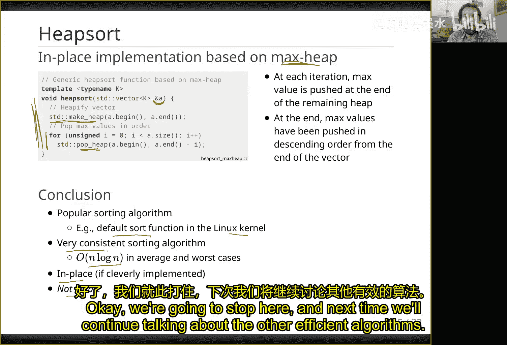

# 【全集】加州大学戴维斯分校 数据结构与算法编程 中英字幕 完整课件 p22 8-1 排序 -BV1rJ2WBSE7P_p22-

Hi everybody。So today we're going to start a new topic about sorting。

Soning is by itself one of the most crucial and important operations in computer science。

It allows to sort a certain collection for the user to see in the same way that in real life books are sorted in a library so that we can find them easily passengers are listed in a certain alphabetical order on the plane so that we can find them to some extent food is sorted at the grocery store so that the clients can find them so even in computer science。

 organizing data is very important operation。It's also an important operation because other operations are based or take advantage of the fact that a collection would be sorry。

 so for example searching is a lot easier if the collection is sortied in the first place now you know that if you have a vector of solid numbers instead of doing a linear search you can do a binary search。

You can also， if a certain sequence of items is sorted， check for the uniqueness of items。

 like know exactly how many items in that connection are unique because you can skip over duplicates there would be right next to one another。

You can also， which is very similar。Counts the number of duplicates in a certain collection and therefore determine the frequency distribution of all of the elements inside of the collection。

You can also select， so find which item is the K， yes。

 largest in a certain collection or the n smallest in the collection and so they are like many different operations that are made a lot easier when a collection of items is in solid order。

Now here's the more like general definition of what is sorting and I think it's important to remind that。

呃。Even if obviously like。It's notIt's not necessary to explain sorry for hours。

 but it is important to understand that sawing is putting like a collection of elements。

In a certain order right and this order is not a predetermined like it depends on a certain criteria for example。

 if I take all of the students in the class I have many ways I can sort that collection I can sort students by their age I can sort students by their first name by their last name I can sort that in ascending order and descending order so there is not like one way like one inherenterrant way of sorting items in the collection it depends on a certain criteria and that's why like sorting is always。

According to a certain order。Now， the whole thing is that if I want to be able to sort。

We need to be able to compare， so we need to have a way of determining between two items according to a certain criteria。

 which item is smaller or greater than the other item that's the only sort of requirement。Now。

 as you can imagine。Soting because it's such a crucial operation in computer science that has been a field that has been investigated from almost day one and so that's why that as early as the mid50s a lot of algorithms were already known and most of the algorithm that we still use today have been invented 50 years ago and honestly like as of now sorting is kind of considered solved problem there have been a couple of new sorting algorithms published in the early 2000 but really nothing new recently it might get some interest again when we get to。

Computers that are many calls like that phones and laptops will have processors that have say like hundreds of thousands of calls that are probably like。

Trigger some new needs for better sorting algorithms， but at this point what we have is pretty good。

Yeah。And actually we could even consider that there are too many sorting algorithms rather than too few。

 that's not even the whole list and you can see that already there are so so many algorithms sorting algorithms some of which with very interesting name。

 I would say that some of my favorites are the cocktail shaker salt。

 I don't know what this one is but it sounds pretty fancy。

 I don't know what the American flag salt is either。

They all have pretty interesting names we're only going to study a few in this class。

 but you can loop them up on Wikipedia if you want。Okay。We are going to see that sorting algorithms。

 they can be classified kind of following three different aspects。So the most obvious aspect。

 and that's pretty much what we're going to follow in that topic。

 we can classify algorithms by their running complexity， like how fast or how slow are they。

And there are three categories here， we have naive algorithms。

 so algorithms that usually are super easy to implement， but because they are naive。

 they are not very fast and so on average to sort a collection that contains n items they are going to require up to n squared steps。

And。It's not because they have a quadratic complexity that they have complete garbage and we should never use them。

 they are still very relevant and sometimes good if you have a small collection and you just need to start a small connection then there's no need to take out the big guns。

And a native algorithm could be just fine。For most needs。

We need what we call efficient algorithms that we're going to study， so say like HiOt， mergerchOt。

quiOt， those have a complexity of about and login， which is pretty much what we can do best for sorting。

And in most cases that's pretty much the default option and then there are other kinds of sorting algorithms which not really based on like comparing items to one another so they're kind of like on the side because their complexity doesn't even like depends on the number of items you have in the collection sometimes they have a complexity that depends on the size of the keys but we'll talk about that towards the end of this topic and you'll see what I mean and sometimes they can have really really good complexities and that's why it makes them extremely interesting。

Now there's another aspect。Another way of classifying sorting algorithms is by the memory that they need。

 like their memory occupation。So we have two types， essentially。

 we have algorithms that are said to be in place。Those algorithms mean that like you get a certain collection that needs to be sorted。

 you don't need any extra space， you can do the sorting directly in the collection that you receive so you receive say like an array of integers。

That's it， you can do the sorting directly inside of that array。If it's not in place。

 then it means that the algorithm cannot do its job directly in the array that needs to be sorted and needs to create some extra space。

 so typically it needs to say make a copy of the array temporarily to swap some items around and so on and do some some things and eventually transfer back the sorted array。

Back into the original one。And so typically the extra space that's often used is either in log of N or in O ofN if we really need to duplicate the input array entirely。

Yeah。And the last sort of aspect in this classification of sorting algorithms。

Is the notion of stability。Stability means that。If you have a collection of items。

And some items are considered equal with respect to the sorting algorithm， so for example。

 say imagine like in the class I have two students。And two of them have the same last name。

 and I'm sorting by last name， so they are going to be equal。

 but they have different first names and that makes them like two different items。

The algorithm will be stable。If。When we saw those students by last names。

 their original order stays the same， so let me give you an example here using cardss and probably down make it easier to understand。

Yeah。That's the initial collection of I have forecastk out that I'm trying to sort and that's the initial collection and you see that and we're going to try to sort them by their number value。

And so you see that I have two cards。I have two sevens。17 of hot and one7 of spades。If my algorithm。

 my sorting algorithm is stable， then I am guaranteed。That in the resulting sortid collection。

 my seven of heart will be b the seven of Spdedes because in the original collection。

 seven of heart was b for7 of spa。So even then if they are technically equal with respect to the sorting。

 their original order is guaranteed to be preserved。That's what a stable algorithm means。

If the algorithm is not stable。Then maybe。It's not。One way or the other， maybe。

It is possible that the original order might not be preserved and so that typically seven of space would be put before seven of arts。

Doesn't mean that it's always going to be the case， so it's just not guaranteed it might happen。嗯。

Okay。So we're going to go through different sorting algorithms。

 we're going to start studying some naive ones， so we're going to talk about selection salt and insertion salt and then we'll start talking about efficient ones。

So let's start with the naive ones and with selection start。So selection thoughts。Assuming an array。

 a containing n items。We're going to require n phases。😡。

And then each phase that we could say at phase number I。

We're going to find the minimum item in what has not yet been sorted。

We're going to find the minimum and we're going to swapwa the value with the item at index I。

 so let me give you an example。Imagine that I have thisar and I'm right in the middle of sorting it。

And so I'm at phase three。So that means that so far， my array。

Between index 0 and index 2 is already sorted。You look at the letter A， C， D， that's sorry。So， now。

 I'm looking at。Index three， and I'm pretty much trying to populate this cell in my array with the right value。

So what we do is that because we're at phase three。We try we look at all of the items that are left。

And we try to find the minimum item。Between U， V， I and S。Here。

 if we are trying to sort alphabetically， then I。In my is my minimum。

So that's what we have and so what we would do is swap。The item at I。

 So a3 with the item at the minimum。 so we would swap I。And you。

 so I would be there now and not you and you would be there。At the end。Of this phase。

 then now ACDI would be sorted。And we would switch to phase four and we would try to do the same at index4。

 so we would look at V U determine which one is the minimum and swap this minimum with item number four here。

Now let's look at the entire example。So imagine we start with this array at the beginning。

 we have an array。Of a seven element like UC D A VIS， UC Davis， that's very creative。And essentially。

 so if we have seven items， then we have。7 phases。And for each phase。

We essentially try to determine which one is the minimum and bring it to the cell it should go to。

So at phase number zero， we're going to try to determine which is the item that should go into that cell and so the item that should go into the cell is the minimum of the entire collection a。

So we bring it here。 And once it's here。We don't have anything to do。

And so you see that like essentially at every phase， we have some of the array that's already sorted。

And we try to determine which is the minimum in what is left and we bring it to the right location。

That's the selection sort。Let me show you the code for that。So here I would just。

 I'm not going to create like any classes or whatever just typical functions。

 we can make the functions be templated so that they can accept any kind of items。

 not necessarily just integers， any kind that can be compared。But the idea is that they receive。

An array。Containing a collection， a。As a vector of item type K。

 and then we have the algorithm and so you see that the algorithm has a first follow loop for the different phases。

And then a follow loop。Starting like looking at the remaining collection of what is not yet sorted。

Did that means？Which is the index that contains the minimum element。And once we found this element。

 we swap it with the current element and we do that n times and at the end。

We get something that is solid， so that would be typically the whether I could use this function by declaring a vector say of integer and then I could run the function specializing it with the same type of data type so here integer。

On the vector， and it would return something that is solided in ascending order。嗯。In terms of。

Complexity。N squared， I mean， let me go back one slide here。You see， it's very simple。

 I have one far loop。From 0 to n。Another follow loop。That's nested from essentially i+ 12 n。

 so also in O of n。So that gets me of n squared， right？And actually， even more than o of n squared。

 it gives me big theta of n squared because no matter what the collection contains。

 I'm not even looking at the value， even if the collection is already sorted。

 we're still going to do those n squared iteration。

 hence we can even precise more than big o of n squared that is' big theta of n squared。

So complexity， y is not great that it's n squared guaranteed。

Now it's still a great algorithm because it is extremely simple right like it's just a few lines of code and you can sort any type of collection。

😊，It's in place。As you could see in the code， while not declaring like any other things that a couple of variables and then everything happens directly in the array that we receive。

 like everything is swapped directly in the array that we receive。However。It is not stable。

If we have equal items， then it is possible that they get switched。

Here is an example of how that could happen， imagine B1 and B2 are equal with respect to this with the sorting order。

 except that B1 was first in the initial collection and B2 was saed in the initial collection。

Now it turns out that because of this algorithm here， B1 will be swapped with a。

During the first phase and so here B1 will end up being after B2。Now when we get to phase number one。

 B2 will be considered equal to B1， so we're not going to change its location。

 so B2 will remain there and B1 will remain there and so at the end the sort collection has now B2 appear before B1 which is not stable。

That can be an issue sometimes。So that was for selection salt。

Now let's look at the other Nive algorithm， which is called insertion sort。So， insertions that。

Also works on a collection of n items that need to be sort and also has n phases。

Here it's a little different though。At phase， I。We're going to look at the item that is at index I。

And we going to start， we're going to try to push it to the left。And we're going to try to put it。

On the left side， add its right location， so let me actually give you an example to explain。

Take that the example。Imagine that。Right after phase two， that's our situation。We have CU， which are。

Soed。Among themselvesself。C is smaller than D， D is smaller than you。

 So that part is like relatively it's sorry。 It's not their and it's not their final position。

C is not at its final position， nor is D， nor is U， but among themselves， they're in solid order。

And now we have the rest of the collection over there， which is not solid yet and we haven't looked。

Now at phase I。We're going to look at a。And we're essentially going to push a to the left。

And we're going to swap it iteratively with each individual item on its left。

As long as this item A is smaller than the next item on its left。So。Here a is smaller than you。

So we would swap A and U， so A would be there and you would come here。And we'd continue。

 is a smaller than D， Yes， so we would swap A and D， we put D here。And a here。Is a smarter than C。

 yes。We swap them。So a comes here and C gets there。And so at the end， it means that。We considered a。

 and we sorted a properly to put it and in its right location。 And so now。

We have four elements that are relatively sorted and now we're going to look at V and we're going to see if V can be pushed on its left and be swapped with some other elements。

And。So yeah， that's the idea， so let me give you the entire example here。

And that's how it would work， so once again， we start with the collection UC Davisvie。And we go。

And so that's seven letters from zero to six， so we have seven phases as well。

 phase zero to phase six。So at phase zero， we don't pretty have much to do because it's U and U is already relatively to itself。

 it's already solid。Now， in phase one， we look at。Lettter C and we try to push letter C on its left and we try to see if we can swap it with the next item。

 which is the case and so that's why I C now is in front of you。Now we look at D。

D is smaller than you， so we'll be able to swap them。But D is not smaller than C。

 so that would mean okay， we're done， we stop pushing it to the left and so we'd end up with the C。

And then wed look at a， so this one we've already talked about it。

 A would be pushed over U or swap with U， swap with D， swap with C。

 and it would be now right at the beginning。Then we look at V。

 turns out that V is not smallerer than U so V， we can kind of just skip over it。Then we look at I。

 I will be able to be swapped with V， swap with U， and it will end up there and so on so essentially like imagine it's like you have a deck of cards。

And you have a certain number of cards in your hand that are already in solid order relatively to one another。

And now you pick one more card that you want to sort in your already solid collection and essentially you start from the bottom location and you're like does it go there no。

 and you move it one next like one next position， does it go there and no one next and essentially you try to see where it fits the best between two of your already sorted cards。

That's pretty much the the and that's why it's called insertion because you try to insert the new element where it should go。

The implementation is also relatively simple。Even more simple to some extent than the selection sub to be on it。

 so again， follow loop。From zero to n。And then another nested follow loop。

From I and so this one is more like from I。To zero it actually like goes in the other direction and essentially so as long as the item that we are trying to。

To insert。Is smallerer than the previous item than we swap them and so that's why earlier with A we would swap it with D and swap it with U and then swap it with D。

 then swap it with C and so on so and we keep doing that and once the item is inserted in its right place。

 we stop and we go to the next phase。嗯。And again。If we have a vector of integers。

 we say run this algorithm on the vector of integer。Gets us sorted all。嗯。With selection sort。

 the insertion sort is also one of the two most popular naive sorting algorithms。

 it's usually more efficient than selection salt， let me go back one slide。Well， actually。Here。

Imagine that we were trying to sort。This collection， knowing that it's actually already sorted。

Then we would have n phases。To try to determine is a is in its right place， yes。

Is C in its right place， We would check like is C smallerer than a， no， it's not， so we're good。

Then we look at D， can D be swapped with C， no， so it's good。We look at I， can I be swapped with D。

 no， we're good and so on。 And so overall， if the connection is already sort。

Then the complexity can be as low as o of N。That's the best case， right。

 whereas with selection salt and you can look at it for yourself。With selection salt。

If the collection is already sold。We are still going to do n squared iterations for nothing。

 but we're still going to do all of them。Here we can skip a bit。On the other hand。

Because insertion thought。Swas item between neighbors so again like when we are at phase three and we have letter A。

We swap it with you， we swap it with D， we swap it with C， that makes a lot of right operations。😡。

And we can have up to n squared operations in the case where the collection that needs to be sorted is actually completely unalted。

 it's in the reverse order of so。Then it would take up to n squared rights。

 which is a lot of right operations。Whereas with selection thoughts。

Because first we try to find the minimum and we only swap the minimum once we found it with the first item or with the current item。

We would have only N rights。So those are the pros and cons of insertion salt versus selection salt。

What's cool is that this one is in place， we don't need any extra storage and it is stable。

 it respects the original order of elements that could be considered equal。

And one super cool sort of feature of this sorting algorithm is the fact that it's online。

 So what does it mean？It means that。Imagine you write a program that is supposed to sort data。

 but when you start sort them， you don't have all of the data yet because imagine the data is coming from the internet and the connection is pretty slow and so you know that you're going to receive like I don't know。

Millions of different numbers。But you don't have them right away in an array。

 they are going to come successively。Well， with insertion salt because you actually like。

Sort what you have and then you pick the next element and you try to insert it where it should go and you put it there and then you pick the next one and you try to insert it where it should go and so on。

 you actually don't need to have the entire collection all at once when you start sorting。

And you can sub the collection as you receive it。That's a pretty cool feature of insertion thought that other algorithms don't necessarily have。

Okay。And so next we're going to start talking about some more efficient algorithms and we're going to start with one that we actually already mentioned before HeO。

So you remember he Start， we mentioned it very briefly when we were talking about priority cues and binary heaps。

And I showed you the way to build a heap using this Fyd algorithm。Out of a collection of n items。

 so we have n items in an array and we can build a he directly on that array。😊。

That is pretty much the main step of this algorithm hipshot。

We essentially have a collection of N items and we build a he hour of it。

And we know that it's O of n if we use Floyd's algorithm and not the Williams algorithm。

I'll let you go back to the slides that explain the Floyd algorithm if you need。

Once we have a heap out of those n items， and so we know。

That the root of this he say is the smallest item because that's what binary hips do。

 then we can essentially remove the root。And as we keep removing the roots。

 we essentially remove the next minimum element out of the collection and that builds that gives us a solid version of that collection。

Right？呃。Building the heap is over then。Plus。And operations to remove。All of N elements。

Knowing that each removal takes log of n， that gives us a tall complexity of n log n。

 which is really good。So let me show you an implementation。

 a possible implementation using a mean hip。And using the code from the priority queue。

That we studied。A couple weeks ago。So， function episode。Gets an array。Here。

 we would want to do a copy， so that would be typically a case where we need some extra storage。

So we make a copy of this array and then we build a heap。Out of the n items in this array。嗯。

And now what we would need to do is essentially like iterate n times。And。Take out the top。

Put it back at the right location in the original array and that's why we needed a copy because we needed to be able to do the whole Hfi in an external array and then when we remove the minimum out of this hip。

 we can put it in the right location in the original array。

And then we can pop it out after we've removed it。And so that would give us at the end， an array A。

From0 to。N minus1。That is in solid order， like from the minimum item to the maximum item。So。

Why am I saying that this is a naive implementation？Well， it's mostly the fact that like。I need this。

 I need this， this copy。 I need this， like。Dedicated space。

To hepify my collection and then take out the minimum and reconstitute a solid collection。

There's another way that's a little clever， but very interesting， where I would not need to use。

An extra vector。And。You look， you need to look at this operation。So， and you need to also remember。

What happens when we do a pop？So you remember that a heap is pretty much an array。Here。

Where so we have sequential elements。But in fact， those elements。

Represent certain nodes in the binary array， so the first element is in fact the root node and has its left child directly there and the right child over there then its right child has its own left child there。

And the right child there。 And same over here。And so。

 and so we have this whole like binary tree structure。Inside of an area。呃。

If we build a binary he here out of a collection of items。And it's a mean heap。

Then it means that the minimum of this collection will be。At the root。

 right and so that's why we pop it out。To put it at the right location。

Now you have to remember that when we pop。What we're going to do is that we're going to。Replace。

This mean with the last item of the collection。Right？And then we'll take this item here。

 we'll put it at the root。And if you remember properly。

col we're going to paracollate it down so that it gets to its final position and we have the new mean of this new collection be put at the root so that we can remove it later。

At the end of running this far loop， I hope I'm not losing you too much。

At the end of running this follow loop。If we were to look at this ahi。Vectctor。What we would find。

Is that we have the minimum element。At the very bottom of the vector， then we have the next smartest。

 let me call it like minimum minus1。And then we have。Minimum-2。

And the very first item would actually be the max。Because that's the last one that was popped out。

And so it was the minimum in the collection that was eventually left。O。

So what do we see here is that at the end of running this like build heap and then popping out like item by item。

What I'm going to have left in this vector copy is in fact。A soed version of my array。

 but in reverse order from the maximum down to the minimum。

How could I leverage that that's pretty much the how I can transform this naive implementation into clever implementation。

Let me show you how。Essentially。I could do。 I could use a max heap。Right。So here。

 now if I get my array A。Is a collection of non solided item。

And I make hip out of it and here I use directly the STD Mehi which will make a max hip out of this array and then all I need to do。

Is anyters。Where I popped the head。As I'm doing that。I will essentially because it's a max heap。

I'm going to。Put the maximum element at the end of my array。

And then again and again and again and again。And at the end。

 my entire array will be completely sorted from the minimum value to the maximum value。嗯。嗯。

If you have。Conceptual issues understanding that， take a piece of paper and run it yourself and you'll be convinced in two minutes that it does work and it's really pretty clever。

Keeps up。Sly not the most popular algorithm， but it is one of the it is popular in some。

In some circumstances， for example， in the Linux kernel。

 it is the default sorting function to sort kernel objects。

 I believe the reason is that it is extremely consistent。The n log n is pretty much guaranteed。

 right， which is not the case with some of the algorithms。

 efficient algorithms that we're going to study such as like merge salt or Quickot。

They do en again on average。And on average， they're actually like faster than the hips salt。

But HeO is guaranteed to be endless again， which is not the case of set like Quickott。

 Quickott can have some worst cases where it's actually quadratic， it's extremely rare。

 but it's possible。Here its analog login is absolutely guaranteed。

It's also in place if we implement it with this clever approach， however， it is not stable。

 like equal elements might end up being switched off。Okay。

 we're going to stop here and next time we'll continue talking about the other efficient algorithms。

