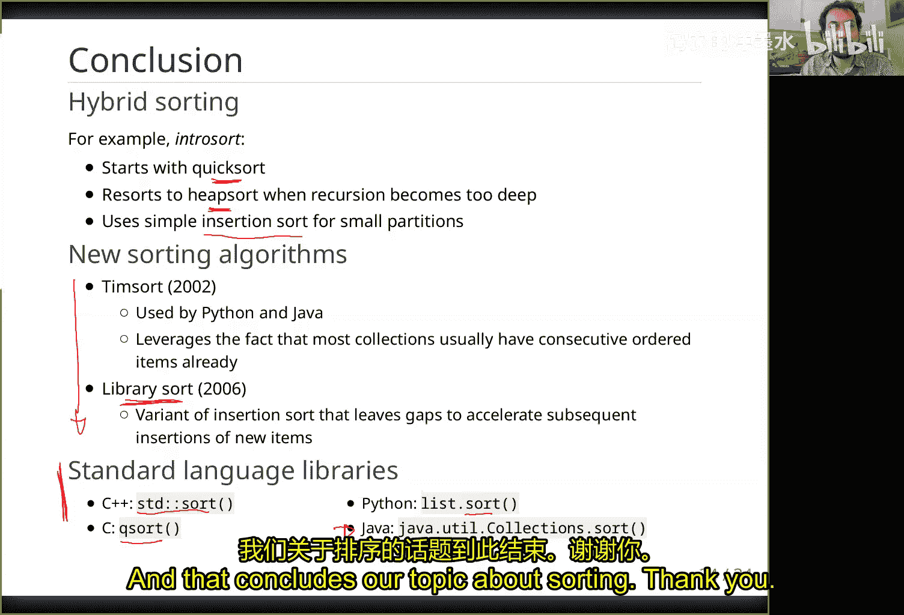

# 【全集】加州大学戴维斯分校 数据结构与算法编程 中英字幕 完整课件 p23 8-2 排序 -BV1rJ2WBSE7P_p23-

Everybody， welcome to starting part two。So last time we saw we talked about sorting and the different aspects of it。

The first aspect that we talked about was the complexity。

So we have sorting algorithms that are said to be naive because they have pretty high running time complexity in like say n squared。

 for example。We have efficient。Algorithms， often in N log n。

 and we have another kind of algorithms that we will mention soon that are not based on comparison and that can even be in linear time。

The other aspect is the one of memory occupation， so that means whether the algorithm can sort the collection in place without using any extra space or if it needs some extra space to do some computation。

And the last effect is the one of stability。It says that if we have。Multiple or。

At least two equal items， the algorithm is stable if their relative order in the original connection collection is not changed。

 it's preserved。We talked last time about three algorithms， selection sort。

Which is in n squared in place but not stable we talk about insert and sort which is also n squared in place stable and online remember like。

We can start sorting the collection， even though we don't have all of the items yet very useful if you get the collection progressively。

And hip salt， this one is in a loggan because it uses a binary hip， it is in place but not stable。

So let's go on today we're going to talk about more sorting algorithms of the efficient kind。

So let's take a quick step back， we talked about section salt and insertion salt and we saw that their running time complexity was in n squared of n for the best case。

 is the best case being that the arrays already sort it which is not super useful。

 but yeah essentially those two na algorithms， they just scan items and they tried to swap them and it's not extremely powerful。

The next two algorithms that we're going to talk about mergeO and QuickSot。

 they change this paradigm， they have another way of handling this issue。

 like of handling this algorithm。And we can put them in what we call divide and conquer algorithms。

 so divide and conquer algorithms， they often have three steps。

A step where they divide a piece of work that is otherwise too complex to solve into smaller chunks。

And they do that even repeatedly up until they get to a size of a chunk。That makes the problem。

 almost。Natural or like super easy to solve。Then they conquer those individual pieces。

 which is much easier because now they're super small and then they go back up by combining what they have conquered。

Up until like the entire collection is now a processed and in that case up until the collection is sort。

And that's pretty much what mergech thought and quick shots are so let's start with merge thought。

Here is the ID with an example。So obviously the idea is that we start with an array。

 a collection of items and here those are integers they are not in solid order and at the end。

They are in solid order， so how did that happen？Well。

 let's try to map this merge dot into the three phases of divide and conquer。First of all。

 we're going to divide。So。If the array has more than one item， then we split it into。

Right and we do it reccursively essentially up until we have unique。Itテems。

And you can see that in this entire phase。😊，Up until we have singular items that we can individually conquer。

The order has not changed， like we have not done much rather other than just dividing the work into smallergen。

But 38 is still first then 27， 43 and so on。Now we conquer。

And here it's pretty easy to conquer this first step。

How to conquer 38 to a 38 is already concurred because when you just look at it。

 it's already in solid order， it's just one item。The magic here is the combination part。能。

38 is conquered， 27 is conquered because they are both sorted relatively。

 we're going to combine them。And it's much easier to combine solid sequences than。

Non solid sequences so for example， to combine 38 and 27。

 I just need to realize that 27 is smaller than 38 and so 27 should go first and 38 second super easy。

Same with 43 and three， I can recombine them easily， nine goes first。82 goes first，10 it by itself。

 goes by itself。And once again， now I have a subar that is locally sorted 2738 and another one。

 3 and 443 sorry。As we will see in the next slide， it's also very easy to combine those two arrays into an array of four elements that is now sorted。

And we continue doing that we like return from the recursion by combining those locally solid array back into。

At the end， having an， it's completely solided。So let's actually zoom。😊，On that part， like。

 let's zoom on this merging two halves of the array into。A sub that is now sorry。

 because that's really the core of this algorithm。Let me show you here。

So that's pretty much what we have we would have。An array here， an auxiliary array。

 we would need some temporary space。And we would have the first half here。

Between an index low and in index mid for middle。That is locally solid， as you can see。

 EE GM is locally solid。And then we have another half that's right after。

Between mid plus one and index high， which is also locally sold A C， E， R。

And the idea is that we have those two subrays that are locally solid and we try to merge them together。

The algorithm to merge them is in fact a linear algorithm。

We are going to start with E we're going to start with the first item of each subase and we're going to determine。

 okay， which one is the smallerer？Here， a is smaller than E。 So a will go。

At the first location of the resulting sub。So a is good。 We move to C。 Now we compare E and C。

 which is the smallest。 the smallest is C。We put it next in the solid subine。N what done with C。

Which is the smallest between E and E well they're equal。

 so this time we're going to take the one from the first half to respect their relative order。

So E will go next。嗯。Then we compare again E versus E same case， they are equal。

 but we take the first one。And ego is there。Now we have G versuss。E， E is smaller， so E goes next。

And weather that。 And now we at all。G versus R， G goes first。Anyone that。M versus R， M goes first。

And we're actually completely done with this half。So now we don't even need to compare R with anything because we are done on this half。

 so whichever item we have remaining on that half， we can just put them if we had more over there。

 we would just put them in the same order at the end。And as you can see。

It's a completely linear process there are no multiple like nested fall loops or whatever it is just one follow loop。

 every item only gets scanned once。Okay。And let me actually show you the code of that。

 the code is the exact transcription of what I explained in C press。So what we receive is。

An arrayray A， that's the collection that we want to sort。

And we want to start it between index low and high。

 and the midpoint is received as an argument as well。

 So that gives us index low index mid and index I， which are the three indexes that we need in order to understand that we have。

A first solid half over there， or second solid half over there， and we want to combine that。

And we also receive as an argument， some auxiliary space so that we can do this merging without touching the original collection and the original collection only gets the result of the image。

嗯。So first， we copy everything into the auxiliary array。And then we can run the algorithm。

 And so the algorithm will。Essentially， reconstitute a between low and I by having an index K go from low to high。

That's this first followup and every time for K， we are trying to determine which item from either of the one the two subs should go at index K。

Then we have。Two blocks here which deal with the fact that like if we have exhausted one of the two subrays。

 then we can just copy whatever is left in the other one。

So kind of the case where like once we finish copying EEGM and on the other side。

 the only thing that was left with awe。That was caught by one of those two E Elsie。

The more regular case is when we're iterating still in both subs。

So here we would have an index I that starts from low and go to mid and an index J that starts from mid plus one and go to high。

And so here we would simply like compare。At index I versus index J。

 which one is the smallest element and we copy it into a at index K。

 we copy it at the right index and then we go to the next index and so on。That is the core of the me。

The rest is pretty easy and I'm going to show you the other function， so the other function。

Is the one that。Recursively divides the array is in smallerer chunks and then recombininees everything on its way back up。

And that's in this function。So again， this function receives the array that needs to be。Sot it。

Some auxiliary space to do the merging process。And this one， this function is called to a sort。

 a slice of the array between。Index low and index high。Because it's a recursive function。

 we need to know where to stop the recursion， so we need to find a stop condition。

And here the stop condition is when the subet is too small， essentially。

 either when the sub has gone to being zero， like the subet doesn't contain any item in which case。

 well it's sorted。Or when the sub contains one item。

 it in which case it's also sorted and we can start coming back from it and doing the merging process。

So that's where to like signal the stop of the recursion。Otherwise。

If the array here that we get into an argument from the recursion has more than one items。

 then it means that it's possible to find a middle element。

And to call the recursive function on the first half between low and mid and on the second half between mid plus 1 and high So if that's the slice of the array that we get into this function with low at index 10 and high at index 17。

 then mid is computed to be index 13， we're going to recursively call the function on that slice。

And then call the function on that slice。And when we call the same function on that slice。

 because that slice is only four elements， we'll do the same。

 we'll also cut it in two and we'll recall the same function on those two elements。And on those， too。

And again， on this one element and on this one element。

And that once we get there we'll hit the stop condition that tells us like okay the recursion can now stop and now comes the time where we recombine everything that we've divided so those two unique elements will be recombined then those two halves here will be recombined and then those two will be recombined and that's what we do on our way back from the recursion we recombine everything between index low and mid and mid plus one high with the same function that I just showed you in the previous slide。

So now we have two functions， one that merges and one that recursively divides now let's put all of those species back together。

So that's the one that merges that's the one that recursively divides n called the merge process。

 now we can define the top function， the one that the user would call directly on the vector that they want to sort。

And so essentially we would need to do two things in that higher level function。

 we would want to create some auxiliary space for the merg process。

And then we would want to call the recursive function for the very first time。

 like kicking it kicking off the process， saying I want to merge， I want to sort。Collection A。

Here is some auxiliary space to help with the recombining process。

And I want to start a between index0 and index essentially and minus1。

And so that's where you start this whole process of dividing， concurring and recombining。

And so from a user point of view， that's how we would use it。

 imagine I declare a vector of integer and I would call this merge salt function on this vector of integer and at the end it does work。

And。MergeOt is very， very popular， it's in direct competition with the next algorithm that we're going to talk about Quickot。

Even though Quicksott is usually considered the best sorting algorithm ever。

 MerOt has one very interesting advantage， it's very good for a certain type of container that needs to be sorted and especially with linked list。

Merge sort in this entire process and especially the recombining like the merging process of two halves that are sorted。

We see that like everything is always scanned linearly， like right。

 when we want to merge two sorted half of an array。

 we start from the first index and we move linearly like through the item。If you have a linked list。

That is very precious to be able to go in the right direction because you can follow very easily the next point。

As we will see in a QuickSo， QuickSot is based on swapping items and that means that we need to be able to randomly access any index in the array and randomly accessing an item at a certain position in a linked list is's not easy。

嗯。So that's why mergechOt works very well with a linked list。The complexity is also pretty good。

 however it's not in place algorithm， we need to have some extra space and actually we need to declare。

Another vector that has the same size as the one we want to sort。

 so that's a pretty big amount of space。However， it is stable if two items are equal。

 they will stay in the same relative order as in the original collection。Okay。

And so now let's talk about the next algorithm， the big one Quickult。

So this one is extremely interesting as well。It is kind of a divide and conqueror as well。

 although it doesn't really have any like combining or merging phases。

 it's really just dividing conquering， so how do we divide。Well。

 we divide by choosing one item in the array a specific item that we're going to call a pivot。

 so let's imagine that that's the array that we get with bunch of random values here that is not installeded order。

We could， for example， that's an example because there are many different ways of choosing a pivot。

 but just out of simplicity， we're going to choose。

The first value of the array to be the pivot value， so we're going to choose， okay。

 40 will be the pivot。And then we're going to rearrange all of the remaining values。So 90 to 50。

 like all of the remaining items in the collection。We're going to rearrange them around that pivot。

So we're going to put all of the values that are smaller。Then 40 we're going to put them on the left。

And all of the values that are greater than 40， we're going to put them on the right。

What's kind of amazing is that。Once we've done that。

Then the pivot value here is in its final position， that's it。

 this pivot value does not need to be moved anymore。In the resulting solid collection here。

 farri is in its right place， all we need to do now is sort that half。And that half， but 40 is good。

And in fact。And that's why it's a divide and conquer。

 Now we have another smarter array and we can do the same kind of algorithm， which is choose a pivot。

And move。The other items on the right or on the left to the period according to whether or not they're smaller or greater and we keep doing that recursively up until everything is solid and that's pretty much what this figure show so 40 is in it is in its final position won't move。

But we're going to do the same on the remaining half。 so here we're going to choose 13 as a pivot。

And so。10 and five， which are smaller than 13， they are going to be put on the left。

13 will be put right there and 20 which is bigger will be put on the right and again after we do this partition it's called 13 is in its final location in the solid array。

And we recursively keep doing that on smaller and smaller partition up until。

We have only a single pivots。That are in their final location and that gets us an array that is now completely sorry that's the idea of quick salt。

So in the next slide， we're going to zoom on this partitioning process。

 which is finding a pivot and swapping the values to put them on the left and right of that pivot。

 so let me show you。Okay。So。We need to choose the pivot here again， out of simplicity。

 we choose the pivot that is at index low。 So we consider that we're looking at the slice of the array between index low and index high。

 essentially。And the pivot will be the item at index row。Then what we have is two indices I。

 which we will initialize from low plus one。And J， which will be initialized to high and which will go。

Towards I。 So I is incremented and J is decremented。

And what we're going to do is that so we're going to stop from I and we're going to stop at the very first value that is greater than 40。

And it turns out that actually right there， 90 is greater than 40， so I stays there。

 we don't move it there。And J。Will move in that direction and this time we're going to look for a value that is smallerer than 40 right so here 50 is not smallerer than 40 so we skip it and so J will now point on 45 45 is not smallerer than 40 so we'll move J。

On 20。So now we have I on a value that's greater than the pivot 40 and j on a value that's smaller than the pivot 20。

 what we do is that we swapwab them。Remove。90 where 20 is and we move 20 where 90 is。

And that get us here。 And so now we move I。To the right， again。

 up until it finds a value that is greater than 40 and we actually find it right here on 60。

On the other hand。J was there。 Now we decrement it， and we find again。

 a value that is smaller than the pivot。So again， we have I on a value that's greater than the PV。

 J on a value that's smallerer than the PV， we exchange them。Yeah。And we continue。

I will now point on index on value 5。So we incremented J was on value 60， which is greater than 40。

 so we decrement it and we keep doing that up until they essentially cross one another。

And so eventually here。J will be on 13 and I will be on 60。

 they have like run into each other and they have crossed one another。

And that tells us that that's it， the part is done。

What it means is that now all of the values here between， so here we have low。Between low plus one。

And J， all of those values are smaller than the pivot。

And all of the values between I and index high are now bigger， so that's kind of the end of it。

The last thing that we need to do is put the pivot where it should go and so here it's pretty simple we're going to exchange the pivot with the last value of this first partition the partition that is smallerer so we swapb 13 with 40 and that will now put 40 in its right location。

Everything that's on the left is smaller， everything that's on the right is bigger。对。

And we pretty much need to rerun this same partitioning algorithm。On now， a smaller partition again。

Yeah。Let me show you the code for that so for some reason like the code is kind of long。

 I also added a bunch of comments so that you can really take the time to read it by yourself。

The code that I'm going to show you is exactly what I explained here。So。Essentially。

 we have this partitioning function， gets an array A。

 and we want a partition between index low and index high， so low and high。嗯。嗯。

Whatever it is at index low will be considered the pivot value and so we're going to initialize an index I which will start here and an index J will start right there and they will。

Go in opposite direction。So that they meet in the middle。So first we're going to move index I。

 we're going to essentially move index I in that direction。Up until we find a value that is。

Larger than the pivot。That's where we stop。And on the other， after we've done that， we move。

 we're going to move J in that direction up until we find a value that this time is smallerer than the pivot。

Once we so and Jay would be there， I would be there。And。嗯。After moving those values。

 if we've crossed one another， if partnerner J and I have like crossed one another。

 it means that in fact there's nothing else to do and we can just quit this algorithm。Otherwise。

 we're going to swapwa them。And then we're going to keep moving I in this direction and moving J in this direction。

Either until we find two other eyeers that can be swapped or until they run into one another and we are done。

And so at the end。Once we are done with this while loop。We are here。 So we have like。

Our pivot at index low， we have well actually like。

Where someone like here like everything that's there is smallerer than P。

 everything that's here is is greater than P， and so we have the very last step。

Where we put the pivot in its right location and we exchange it with like whatever was at index J。

And finally， we return。The location of the index of the pivot position。

So that whoever called that function partition now knows。

At which index we have a pivot that is in its final location。

 and so we don't need to touch it ever again。Okay。So now that we have this partition code。

 let me show you the function that calls this partition code。So that would be a recursive call。

 so again like gets the array A and gets a slice of the array A between low and high。

 which is the the slice that we're trying to sort。If this slice is either zero in size or one item in size。

 then that's the stop condition for the recursion we just that's it， the slice is solid。

 we don't need to do anything else。Otherwise， if the slice that needs to be solid so like here。

 for example。Is at least two elements。Then， we can。Partitiontion it。Between index， low and high。

The partition， which is the function we just talked about in the previous slide。

 will return the index where the pivot was put that is in its final location。After we do that。

 we can recursively call Quickops。On the subsdes between low and P -1。

 So the slides that's before the P。So imagine like we just run the part on that entire sub array and so now P is in its final location。

 we can co recursively quick sort on low to p minus1 here。And on P plus one。Too high。

 and so we can recursively sort this and sort that。And so overall， the function quick thoughts。

Cause the recursive function on the array that we want to sort。

And wants to sort between index0 and index and minus1。And again。

 the way that we would use it in a C+ first program。

It's simply by passing a vector of items and having it be sorted。Okay， conclusion on that。

Quickott is by far I would say the most popular algorithm for sorting。

 it is the algorithm that is used by the Java language for all of its primitive types。

 it is the function that is used in C QSot， it is the default function in Uni it's the default sorting function in MALab and so on。

 it is widely widely used。It is extremely efficient and fast on average。

 however and so on average it's log n log n， however。

 it's not guaranteed in rare cases it's possible that QuicksSot is in n squared。

 although it's pretty rare and that's why it's such a popular algorithm。Now it turns out that。

What I showed you in the examples is that when we want to partition a certain slice of DNA。

 we could take the first item of this slice to be the pivot。

That is actually not a very good idea and the advice is not to take this first item。

 there are other strategies you can choose a pivot or just a random position or choose the pivot that is actually write already in the middle index of the partition because if you choose the one that is the first。

Of the sub array， it might trigger the worst case behavior where you're trying to sort an array that is already sorted but in opposite order。

And that's pretty much when you hit the case that's pretty rare of n squared。

Now in terms of memory occupation because so we saw it doesn't create an extra array like merged thought so that's good。

 however， because it's a recursive algorithm， it needs stack space every time we call a function recursively and that can be up to a log of n times。

Finally it's in place， which is great we saw directly the collection inside of the collection。

But it is not stable。So yeah。嗯。So let me quickly now mention two other kind of algorithms that are kind of like their own categories。

 bucket salt and Radic salt。So the concept of bucket sort is that we have the items of the collection and we're essentially going to put them in certain buckets。

To make the sorting like easier because now like every bucket will only contain a smaller fraction of the original collection then we're going to sort the buckets individually and then we can essentially like recombine all of the buckets in their order and that will get us a collection that is sorry so let me give you an example to illustrate that imagine you have an array of numbers see between like nine and 49。

We could determine that we're going to make five buckets。

That go from like 10 by 10 so the first bucket will capture every value that is between zero and nine the second bucket will capture all of the values between 10 and 90 and the next one between 20 and 29 and so on。

And so we're going to scan this collection from beginning to end and we're going to see， okay。

 29 will go in the bucket that capture the values between 20 and 29。

25 saying well go in the same bucket and so on。And so eventually you get that。

You get that number three and number nine， go into that bucket， 29， 25， 21。

 go in this bucket and so on。And so now you have buckets where you have a lot less numbers than what you had in the original collection。

And you can sort them locally， so you can sort this bucket locally， sort this bucket locally。

 so it's only two numbers， that's only three numbers and so on， so you sort them locally。

Once you've started them locally， you can just go through。

All of the buckets in linear order and inside of each bucket， you go in the order of the elements。

And that gives you。A list of numbers in sorted order。Okay。

The code is actually pretty simple so you might ask me like how do I sort each bucket individually depending on of the size of the collection。

 you can use a very simple sorting algorithm such as say like insert and sort， for example。

 doesn't have to be very complicated。But so let me show you the code here。And。

So you get a vector a say that contains integer and the assumption would be that this collection a only contains。

Numbers between 0 and 99。So that allows you to make 10 buckets to kind of capture like each of the tens。

嗯。😊，And then you go through all of the items in your collection and you determine which is the bucket number that this item should go into and so here you extract。

The1s digits from the item， if the item is 25， then it should go in bucket2。

If the item is 51 it should going bucket five and so on， and that's how you do that。

Then you sort each bucket individually， and so here the idea is that like you wouldn't have many buckets。

So technically， the sorting process should be pretty fast。

And eventually you recombine all of the buckets together and all of the values inside of each bucket and you reconstitute your collection in solid order。

对。Now it's interesting with bucket salt is that it can work extremely well and it even can offer a linear complexity O of N。

 which is really， really good。But it only works well in kind of specific circumstances。

It works well if。Items are positive integers。If they belong to a certain range that is rather small so for example you would not use a bucket sort on numbers that can be between say like zero and like 10。

000 billion something like that however， if I wanted to do a bucket salt on I don't know on students in the class knowing that most students are of age。

 say I don't know， maybe like 17 if people are super young to I don't know like 22 or something like that I'm sure people are older than that but that just for the example like。

That's a rather small range like 17 to 22， it really means that like numbers can either be 17， 18。

 19 20， 21， 22 that's it like that's very， very small range。So in that case。

 it would work well and if numbers are well distributed among that rangech。

 then it would work well because they would end up in different buckets， that's the whole idea。And。

If it works so well that like you have a rather a short rangech and the numbers are well distributed in that rangech。

And you end up with essentially like only one item per bucket。Then the complexity is just over it。

Because you need to scan your collection one time。and put each item into their right bucket。

 and then you need to just scan the buckets in their order。

 extract those items back and your collection is solid。And。The worst case scenario。

 on the other hand， is that all of your items end up in one bucket。

Which you need to sort and then it pretty much depends on the algorithm that you use to sort this one bucket。

Whi can be very high if your sorting algorithm is like insertion salt， for example。嗯。And finally。

 the last algorithm that I wanted to mention， so this one is absolutely fascinating。

 I really hope you find it as fascinating as I do， it's called Raics salt so this one is completely different to anything we've seen so far。

嗯。😊，So let me show you an example here。Imagine we have numbers。 So here again。

 like it works a lot better if we have a certain range right， So here if we have。

Numbers between zero and 999。It's really important because it means that this algorithm will run in three phases because we have up to three digits in that key。

 like in the range。So。That's our original collection。

 we have a bunch of numbers within the range zero， 999。Now we're going to make buckets。Again。

So we're going to make a bucket for zeros， we're going to make a bucket for ones， for twos。

 for threes。Let me remove that。For fourths， for fives。6。7，8。And9s。And now we're going to。

Move through this collection from beginning to end linearly。

 we're going to look at each number and we're going to look at the digit number， the unit digit。

 right？So here， 170， dig， the unit digit is zero， so we're going to put 170 in bucket 0。

Then we look at 45， the unit digit is5， so we're going to put 45 in that bucket。75 same bucket。

90 here is zero， so same bucket as 170。Then， 12。Bucket 2。Then 80002。Then two。

And then 66 will be by itself here， okay。Okay。And now we're going to extract。

Those buckets in their order。 So we're going to start with 170 and then 90 and then 12。

 802 and so on。A 2 66。And where're again。So let me make columns like that。嗯。We're again。

 gonna insert them。 So let me。Just。We would empty all of those buckets， right。

 we would like extract all of all of those values in in their order。Put them in another array。

 and then we would insert them again in the same buckets。 but this time we're going to look。

At the middle digit， at the ten digit。So let's start here if we look at the 1 digit that 470。

 that's a7， so it would go in bucket 7。Then 90 would go into bucket 9。Then 12 would go in bucket one。

8002 would go in bucket zero。2。Could be read as O2 goes into bucket 0。45 goes into bagette。4。

75 goes into packets。7 at 66 again， goes into bucket6。And again。

We're going to extract those numbers from the first number in bucket zero。Down to。

The last number in bucket。9。And now we're going to look at the hundreds digits。The first digit。

So for 802， that will go into buckets。8ight。2 here has 100 digits of zero。

 so this one goes into bucket 0。12 has100 digit of zero goes into bucket zero。

 45 same goes into bucket zero。66。goes into bucket zero。170 goes into bucket one。Yes。

75 goes into bucket zero。And 90 goes into bucket0。Okay。

And I don't know if you're seeing it already but。Magic has just happened now。

If I now finally extract。All of those numbers starting from back at zero and from the first number in bucket at  zero。

Down to the last number。I get a solid connection to 12，45。66，75，90， n。Hundred and 70 and 802。

And now you can look at the complexity of this operation。

We have essentially traversed our collection one time to put it the first time in the buckets based on their unit digit。

Then we have done another linear traversal。On their1 digit and a third traveral。On their 100 digit。

 which means that essentially the complexity is like 3N。Which is pretty absolutely amazing。

So that's Radic salt。I put the exact same example here， but I wanted to do it with you kind of live。

 but it's the same。Conclusion on this searching sorting topics sorry。

What actually is the most popular type of implementation often？I's something called IntroO。

 it's very popular right now。It's kind of an hybrid solution。

 so intratro itself it' not a sorting algorithm， but it's more of an hybrid of other type of sorting algorithm。

It uses Quickot in priority because Quickott is the best of the best。嗯。

But if the collection that needs to be sort is， in fact。

 too large and we are starting to recur too much。And we might like exhaust the stack space。

 which would not be good， then we can stop the recursion and use HPO if ever the recursion gets to it because HPO doesn't do any recursion and can just like so in space without using any memory and has a very good guarantee in terms of running time and memory occupation。

If the array that we're trying to sort is really small and using Quick salt or He salt would just make no sense because it would be too slow。

 then we can use just a simple insertion salt。And so intratro salt is a very popular hybrid algorithm that exists in the wild。

Now I told you， I think in the last lecture。That most sorting algorithms have been found a long time ago。

 like more than 50 years ago。There are sometimes new algorithms that come out。

 so in the past 20 years in the early 2000 two new algorithms were invented something called Teamot which is in fact used in Python and in Java which tries to leverage the fact that in any given collection items are there are often clusters of items that are already sorted and so TeamSot tries to。

Leverage that fact。And another one that's kind of interesting as well that was released in 2006。

 which is called library So， so this one is a variant of insertion salt。

But also leaves some sort of holes in the resulting array so that if ever the collection is increased by new items。

 then it's a lot easier to insert them in the right place without having to like resort the whole thing and the name is kind of interesting library sorted because。

It takes on what librarians do in libraries， you know。

 like when you go to the library and you have a bunch of books on the shelves。

You'll notice that like shelves are very rarely like completely packed。

 there's often a lot of small space interspace within one shelf so that when librarians buy new books。

 they don't have to reorganize the entire library， they can just like put the book in one of the holes that already exist on the bookshelves。

Without having to like reorganize everything。嗯。😊，And because last but not least because sorting is such a crucial operation。

 it's usually part directly of the libraries in languages of like the standard libraries。

 so for example in C+ you have access to STD sort in C。

 you have a Q sort in Python you can sort at list directly。

 I mean in most languages nowadays like sorting is a native operation。

 you don't need to reinvent the world， you just need to call the proper function。

And that concludes our topic about sorting， thank you。

